# Sampling, Reconstruction and Discretization

A digital controller sees a continuous plant only through samples and acts on it only through a hold. To analyse the loop we must know exactly what sampling does to a signal, when the samples determine the signal completely, how a continuous signal is rebuilt from samples, and how to replace a continuous system by an equivalent discrete one. This chapter answers these questions with the tools of linear systems theory: convolution and the impulse response, Fourier series and the Fourier transform, the impulse-sampling model, Shannon's sampling theorem and aliasing, ideal and practical reconstruction (zero- and first-order holds), and the standard discretization methods (ZOH equivalent, impulse invariance, Euler and Tustin rules, matched pole–zero). A brief overview is in Sampling and Reconstruction.

## Linear Time-Invariant Systems and Convolution

### Systems and their variables

A **system** is a combination of components (devices or processes) with inputs and outputs, through which matter, energy or information is applied, extracted or exchanged. Engineering examples are circuits, communication devices, machine tools and robots; biological examples are cells, the heart and the brain; economic examples are national and global economies and stock markets. A system description distinguishes three kinds of variable:

- **Inputs** \\(u\\) originate outside the system and are not affected by what goes on inside.
- **States** \\(x\\) form a *minimum* set of variables that, together with the future input, determine the system's future behaviour.
- **Outputs** \\(y\\) are the states, or functions of them, that are of interest for regulation or monitoring.

A **dynamic system** is one whose present output may depend on the past history of the input as well as its present value:
\\[
y(t) = \varphi\left[u(\tau),\ 0 \le \tau \le t\right].
\\]
*Example (moving mass).* A cart of mass \\(m\\) driven by a force \\(u\\) has velocity satisfying \\(m\dot v = u\\), so
\\[
v(t) = v(0) + \frac1m\int\_0^t u(\tau)\\,d\tau,
\\]
which depends on the whole input history. An **input–output system** is a dynamic system with fixed (normally zero) initial conditions, so that its output depends only on the input history.

### Linearity, time invariance and the impulse

**Definition (LTI system).** A system is **linear** if it obeys superposition: whenever \\(u\_i \to y\_i\\), then \\(\sum\_i\alpha\_iu\_i \to \sum\_i\alpha\_iy\_i\\) for all constants \\(\alpha\_i\\). It is **time-invariant** if \\(u(t) \to y(t)\\) implies \\(u(t-\tau) \to y(t-\tau)\\) for all \\(t\\) and \\(\tau\\).

The **unit impulse** \\(\delta(t)\\) is the limit of a pulse of width \\(\varepsilon\\) and height \\(1/\varepsilon\\) as \\(\varepsilon \to 0\\): zero for \\(t \ne 0\\), "infinite" at \\(t = 0\\), with unit area,
\\[
\int\_{-\infty}^\infty \delta(t)\\,dt = 1 .
\\]

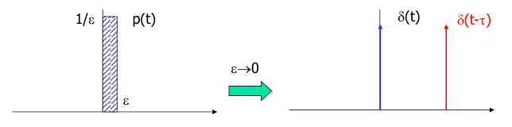

*Figure: the unit impulse as the limit of a pulse \\(p\\) of width \\(\varepsilon\\) and height \\(1/\varepsilon\\). The translated impulse \\(\delta(t-\tau)\\) sits at \\(t = \tau\\).*

**Sifting property.** Any continuous signal can be written as a superposition of shifted impulses:
\\[
f(t) = \int\_{-\infty}^\infty \delta(t-\tau)f(\tau)\\,d\tau .
\\]
*Proof.* Let \\(p(t) = 1\\) on \\([0,1]\\) and 0 elsewhere, so that \\(\delta(t) = \lim\_{\varepsilon\to0}\varepsilon^{-1}p(t/\varepsilon)\\). Substituting \\(s = (t-\tau)/\varepsilon\\):
\\[
\int \delta(t-\tau)f(\tau)\\,d\tau = \int\lim\_{\varepsilon\to0}\frac1\varepsilon p\left(\frac{t-\tau}{\varepsilon}\right)f(\tau)\\,d\tau = \int\lim\_{\varepsilon\to0}p(s)f(t - \varepsilon s)\\,ds = \int\_0^1 \lim\_{\varepsilon\to0}f(t - \varepsilon s)\\,ds = f(t). \quad\square
\\]

### Impulse response and convolution

The **impulse response** \\(g(t)\\) is the output of the system when the input is \\(\delta(t)\\) and the initial conditions are zero. By time invariance, \\(\delta(t-\tau)\\) produces \\(g(t-\tau)\\). Decompose an arbitrary input with the sifting property, as a continuum of impulses \\(\delta(t-\tau)u(\tau)\\). By linearity the output is the same continuum of shifted, weighted impulse responses:
\\[
u(t) = \int\_{-\infty}^\infty \delta(t-\tau)u(\tau)\\,d\tau \ \xrightarrow{\ \text{system}\ }\ y(t) = \int\_{-\infty}^\infty g(t-\tau)u(\tau)\\,d\tau = (g \ast u)(t).
\\]

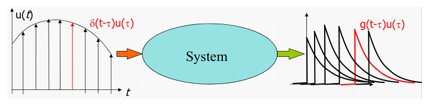

*Figure: the superposition view of convolution. Each slice \\(\delta(t-\tau)u(\tau)\\) of the input (left) produces a shifted, scaled impulse response \\(g(t-\tau)u(\tau)\\) (right); the output is their sum.*

**Definition (convolution).** \\((f \ast g)(t) = \int\_{-\infty}^\infty f(t-\tau)g(\tau)\\,d\tau\\).

**Theorem (convolution systems are LTI).** Conversely, for any \\(g\\), the map \\(u \mapsto g \ast u\\) defines an LTI system with impulse response \\(g\\). It is linear because convolution is linear in \\(u\\). It is time-invariant because \\(u\_T(t) = u(t-T)\\) gives \\((g\ast u\_T)(t) = \int g(t-\tau)u(\tau - T)d\tau = \int g(t - T - \sigma)u(\sigma)d\sigma = y(t-T)\\). And \\(u = \delta\\) gives \\(g \ast \delta = g\\). \\(\square\\)

So an LTI system *is* convolution with its impulse response. Graphically, \\(y(t)\\) is the area under the product of \\(u(\tau)\\) and the flipped, shifted response \\(g(t-\tau)\\).

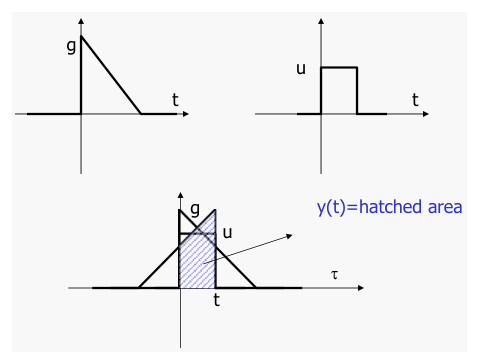

*Figure: graphical convolution. Flip \\(g\\), slide it to position \\(t\\), multiply by \\(u\\) and integrate. The hatched overlap area is \\(y(t)\\).*

**Properties of convolution.** Convolution is commutative (\\(f \ast g = g \ast f\\)), associative (\\((f\ast g)\ast h = f \ast(g \ast h)\\)) and distributive (\\(f\ast(g+h) = f\ast g + f\ast h\\)), with the impulse as unit element (\\(f \ast\delta = \delta\ast f = f\\)). For one-sided signals it becomes a product under the Laplace transform:
\\[
\mathcal{L}(f\ast g) = F(s)G(s), \qquad F(s) = \int\_0^\infty f(t)e^{-st}\\,dt .
\\]
Hence in the s-domain \\(Y(s) = G(s)U(s)\\), where the **transfer function** \\(G(s) = Y(s)/U(s)\\) is the Laplace transform of the impulse response:
\\[
y = g\ast u \quad\Longleftrightarrow\quad Y(s) = G(s)U(s).
\\]

**Causality.** A system is **causal** if its output does not anticipate its input, that is, \\(g(t) = 0\\) for \\(t < 0\\). For a causal system driven by an input with \\(u(t) = 0\\) for \\(t < 0\\), the limits of the convolution integral shrink to
\\[
y(t) = \int\_0^t g(t-\tau)u(\tau)\\,d\tau .
\\]

**Example (ramp response of a first-order system).** Find \\(y(t)\\) for \\(\dot y + y = u\\), \\(u(t) = t\\), \\(y(0) = 0\\).

*By convolution.* The impulse response is \\(g(t) = e^{-t}\\), \\(t \ge 0\\). Then
\\[
y(t) = \int\_0^t e^{-(t-\tau)}\tau\\,d\tau = e^{-t}\left[(\tau - 1)e^{\tau}\right]\_0^t = e^{-t}\left[(t-1)e^t + 1\right] = t - 1 + e^{-t}.
\\]
*By Laplace.* \\(Y(s) = \dfrac{1}{s+1}\cdot\dfrac{1}{s^2} = \dfrac{1}{s^2} - \dfrac1s + \dfrac{1}{s+1}\\), giving the same \\(y(t) = t - 1 + e^{-t}\\). After the transient the output follows the ramp with a lag of 1 s.

**Frequency response.** Apply \\(u(t) = e^{j\omega t}\\) for \\(t \ge 0\\) to a causal system. Then
\\[
y(t) = \int\_0^t g(t-\tau)e^{j\omega\tau}d\tau = e^{j\omega t}\int\_0^t g(\sigma)e^{-j\omega\sigma}d\sigma \ \xrightarrow{\ t\to\infty\ }\ G(j\omega)e^{j\omega t},
\\]
provided \\(g\\) is absolutely integrable, that is, the system is stable. In steady state, a complex exponential passes through an LTI system multiplied by the complex number \\(G(j\omega)\\), the **frequency response**. For real systems, \\(\sin\omega t \to \lvert G(j\omega)\rvert\sin(\omega t + \angle G(j\omega))\\). \\(G(j\omega)\\) is also the Fourier transform of \\(g(t)\\), which connects convolution to the Fourier analysis below. The discrete counterpart, with \\(G(e^{j\omega T})\\), is the basis of [Frequency-Response Analysis and Design](frequency-response.md).

**Transfer function and differential equation.** For
\\[
a\_0y^{(n)} + a\_1y^{(n-1)} + \cdots + a\_{n-1}\dot y + a\_ny = b\_0u^{(m)} + b\_1u^{(m-1)} + \cdots + b\_{m-1}\dot u + b\_mu,
\\]
the Laplace transform with zero initial conditions gives
\\[
G(s) = \frac{Y(s)}{U(s)} = \frac{b\_0s^m + b\_1s^{m-1} + \cdots + b\_m}{a\_0s^n + a\_1s^{n-1} + \cdots + a\_n}.
\\]

## Fourier Series

Fourier analysis identifies the frequency content of a signal. It is used to analyse spectra, compress data, speed up computation (through the FFT) and identify systems. For sampling it is indispensable, because what sampling does is far simpler to describe in frequency than in time.

The idea is old: Babylonian astronomers used sums of periodic terms. Its modern history begins with Euler's study of vibrating strings in 1748. Lagrange objected (1759) to using trigonometric series for vibration problems. Fourier presented his claim that "any" periodic function is a sum of sinusoids around 1800; his famous 1807 memoir was rejected over Lagrange's objections. Dirichlet gave the first precise convergence conditions in 1829.

**Definition (Fourier series).** A signal \\(x(t)\\) with period \\(T\\) is represented as
\\[
x(t) = \sum\_{n=-\infty}^\infty c\_ne^{jn\omega\_0t}, \qquad \omega\_0 = \frac{2\pi}{T}, \qquad c\_n = \frac1T\int\_{-T/2}^{T/2}x(t)e^{-jn\omega\_0t}\\,dt .
\\]
The coefficient formula follows from orthogonality: \\(\frac1T\int\_{-T/2}^{T/2}e^{j(m-n)\omega\_0t}dt\\) is 1 if \\(m = n\\) and 0 otherwise. For real \\(x\\), \\(c\_{-n} = \bar c\_n\\), and the pair \\(c\_ne^{jn\omega\_0t} + c\_{-n}e^{-jn\omega\_0t} = 2\operatorname{Re}(c\_ne^{jn\omega\_0t})\\) is a real sinusoid.

**Theorem (convergence).**
1. *\\(L\_2\\) theory.* If \\(x\\) is square-integrable over a period, the series converges to \\(x\\) in the mean-square sense.
2. *Dirichlet conditions.* If, in addition, \\(x\\) has finitely many maxima, minima and discontinuities in any finite interval (bounded variation), the series converges to \\(x(t)\\) at every point of continuity, and to the average of the left and right limits at a jump. If \\(x\\) is also continuous, the convergence is uniform.

**Example (square wave).** Let \\(x(t) = 1\\) for \\(2k\pi \le t < (2k+1)\pi\\) and \\(x(t) = -1\\) for \\((2k+1)\pi \le t < 2(k+1)\pi\\). Then \\(T = 2\pi\\) and \\(\omega\_0 = 1\\), and
\\[
c\_n = \frac{1}{2\pi}\left(\int\_0^\pi e^{-jnt}dt - \int\_{-\pi}^0 e^{-jnt}dt\right)
= \frac{1}{2\pi}\cdot\frac{2 - e^{-jn\pi} - e^{jn\pi}}{jn}
= \begin{cases}\dfrac{2}{jn\pi}, & n \text{ odd}, \\\\ 0, & \text{otherwise}.\end{cases}
\\]
Pairing \\(\pm n\\): \\(c\_ne^{jnt} + c\_{-n}e^{-jnt} = \frac{2}{jn\pi}(e^{jnt} - e^{-jnt}) = \frac{4}{n\pi}\sin nt\\). With \\(n = 2k-1\\),
\\[
x(t) = \sum\_{k=1}^\infty \frac{4\sin\left[(2k-1)t\right]}{(2k-1)\pi} = \frac4\pi\left(\sin t + \frac{\sin 3t}{3} + \frac{\sin 5t}{5} + \cdots\right).
\\]
The coefficients fall off only as \\(1/n\\) because of the jumps. Near each discontinuity the partial sums overshoot by about 9% of the jump. The overshoot narrows as more terms are added but never shrinks in height: this is the **Gibbs phenomenon**, the visible face of convergence that is pointwise but not uniform.

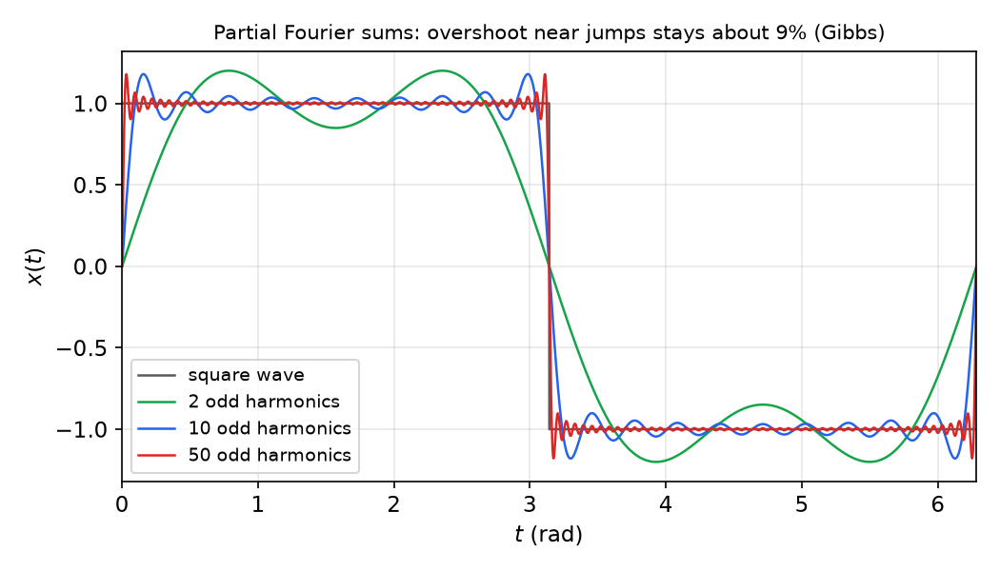

*Figure: truncated Fourier series of the square wave. With more harmonics the approximation improves everywhere except next to the jumps at \\(0, \pi, 2\pi\\), where the overshoot (Gibbs phenomenon) persists.*

## The Fourier Transform

### From series to transform

A non-periodic signal can be treated as periodic with period \\(T \to \infty\\). Multiply the coefficient formula by \\(T\\) and let \\(n\omega\_0 \to \omega\\):
\\[
Tc\_n = \int\_{-T/2}^{T/2}x(t)e^{-jn\omega\_0t}dt \ \longrightarrow\ X(j\omega) := \int\_{-\infty}^\infty x(t)e^{-j\omega t}dt .
\\]
In the synthesis formula, the spacing \\(\omega\_0 = 2\pi/T\\) becomes \\(d\omega\\):
\\[
x(t) = \sum\_n c\_ne^{jn\omega\_0t} = \frac{1}{2\pi}\sum\_n (Tc\_n)e^{jn\omega\_0t}\frac{2\pi}{T} \ \longrightarrow\ \frac{1}{2\pi}\int\_{-\infty}^\infty X(j\omega)e^{j\omega t}d\omega .
\\]

**Definition (Fourier transform pair).**
\\[
X(j\omega) = \int\_{-\infty}^\infty x(t)e^{-j\omega t}dt, \qquad
\hat x(t) = \frac{1}{2\pi}\int\_{-\infty}^\infty X(j\omega)e^{j\omega t}d\omega .
\\]
**Theorem (inversion).** If \\(x\\) is absolutely and square integrable (\\(x \in L\_1 \cap L\_2\\)) and has bounded variation with finitely many discontinuities in finite intervals, then \\(\hat x(t) = x(t)\\) except at the discontinuities.

For a one-sided signal (\\(x(t) = 0\\) for \\(t < 0\\)), the Fourier transform is the Laplace transform on the imaginary axis, \\(X(j\omega) = \mathcal{L}\\{x\\}\rvert\_{s = j\omega}\\), provided the imaginary axis lies in the region of convergence. See Fourier Transform.

**Example (exponential).** For \\(f(t) = e^{-\alpha t}\\), \\(t \ge 0\\) (zero otherwise), with \\(\alpha > 0\\):
\\[
F(j\omega) = \int\_0^\infty e^{-(\alpha + j\omega)t}dt = \frac{1}{j\omega + \alpha}, \qquad \lvert F(j\omega)\rvert = \frac{1}{\sqrt{\omega^2 + \alpha^2}}.
\\]
A slowly decaying signal (small \\(\alpha\\)) has a tall, narrow spectrum of height \\(1/\alpha\\) and half-power width \\(\alpha\\); a fast one has a low, wide spectrum. This is the **time–bandwidth trade-off**: short in time means broad in frequency.

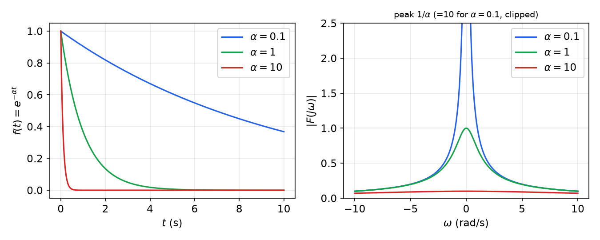

*Figure: \\(e^{-\alpha t}\\) for three decay rates (left) and \\(\lvert F(j\omega)\rvert\\) (right). The product of duration and bandwidth is roughly constant.*

**Impulse and constant.** \\(\delta(t) \leftrightarrow 1\\), a flat spectrum containing all frequencies equally. By duality, the constant \\(1 \leftrightarrow 2\pi\delta(\omega)\\), all energy at zero frequency. Likewise \\(e^{j\omega\_0t} \leftrightarrow 2\pi\delta(\omega - \omega\_0)\\).

### Properties

| Property | Time domain | Frequency domain |
|---|---|---|
| Linearity | \\(ax(t) + by(t)\\) | \\(aX(j\omega) + bY(j\omega)\\) |
| Scaling | \\(x(at)\\) | \\(\frac{1}{\lvert a\rvert}X(j\omega/a)\\) |
| Reversal (real \\(x\\)) | \\(x(-t)\\) | \\(X(-j\omega) = \overline{X(j\omega)}\\) |
| Differentiation | \\(d^nx/dt^n\\) | \\((j\omega)^nX(j\omega)\\) |
| Multiplication by \\(t^n\\) | \\(t^nx(t)\\) | \\(j^n\\,d^nX/d\omega^n\\) |
| Time shift | \\(x(t-c)\\) | \\(e^{-j\omega c}X(j\omega)\\) |
| Modulation (frequency shift) | \\(e^{j\omega\_0t}x(t)\\) | \\(X(j(\omega - \omega\_0))\\) |
| Convolution | \\(x \ast y\\) | \\(X(j\omega)Y(j\omega)\\) |
| Multiplication | \\(x(t)y(t)\\) | \\(\frac{1}{2\pi}X \ast Y\\) |
| Duality | \\(X(t)\\) | \\(2\pi x(-\omega)\\) |

**Parseval's theorem.** For real signals, \\(\int x(t)y(t)\\,dt = \frac{1}{2\pi}\int\overline{X(j\omega)}Y(j\omega)\\,d\omega\\). In particular
\\[
\int\_{-\infty}^\infty x^2(t)\\,dt = \frac{1}{2\pi}\int\_{-\infty}^\infty \lvert X(j\omega)\rvert^2d\omega,
\\]
so energy, the squared 2-norm, is the same computed in time or in frequency.

The **modulation property** is the one that explains sampling: multiplying a signal by \\(e^{jn\omega\_st}\\) shifts its spectrum by \\(n\omega\_s\\).

### The ideal low-pass filter

**Example (inverse transform of a rectangle).** Let \\(X(j\omega) = 1\\) for \\(\lvert\omega\rvert \le \Omega\\) and 0 otherwise, the frequency response of an **ideal low-pass filter**. Then
\\[
x(t) = \frac{1}{2\pi}\int\_{-\Omega}^\Omega e^{j\omega t}d\omega = \frac{e^{j\Omega t} - e^{-j\Omega t}}{2\pi jt} = \frac{\sin\Omega t}{\pi t} = \frac{\Omega}{\pi}\operatorname{sinc}\left(\frac{\Omega t}{\pi}\right),
\qquad \operatorname{sinc}(x) := \frac{\sin\pi x}{\pi x}.
\\]
The impulse response is a sinc that extends over all \\(t\\), including \\(t < 0\\). The ideal filter is therefore **not causal** and cannot be built exactly. It can only be approximated by truncating the sinc to a finite window and delaying it.

**FIR approximations and windows.** Truncating the sinc to a finite window \\(\lvert t\rvert \le b/2\\) gives a finite impulse response (FIR) filter. Truncation multiplies by a rectangle, which convolves the ideal spectrum with a sinc. The result is ripple in the passband and stopband, with a Gibbs overshoot at the band edges that does not shrink as the window grows. Tapering the window smoothly to zero removes most of the ripple at the cost of a wider transition band. The **Hamming window**, written for \\(0 \le t \le b\\) as
\\[
W(t) = 0.54 - 0.46\cos\left(\frac{2\pi t}{b}\right)
\\]
(equivalently \\(0.54 + 0.46\cos(2\pi t/b)\\) for \\(\lvert t\rvert \le b/2\\) about the window centre), is a standard choice.

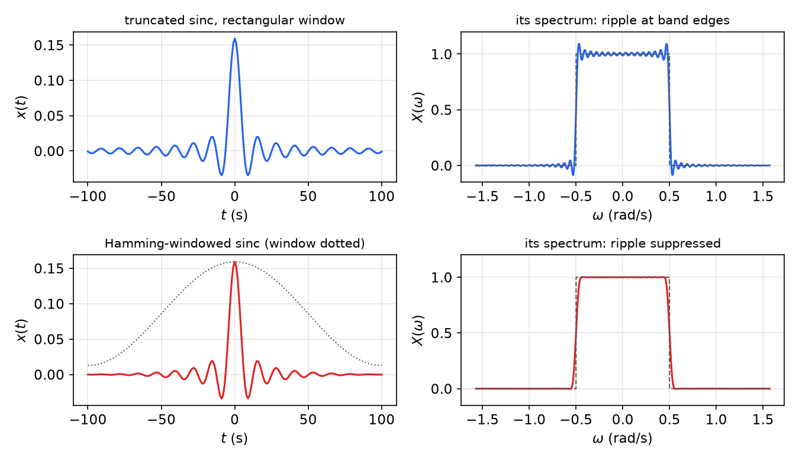

*Figure: low-pass FIR filters with cutoff 0.5 rad/s and a window of 200 samples. Top: rectangular truncation gives Gibbs ripple at the band edges. Bottom: the Hamming window (dotted) tapers the sinc and suppresses the ripple, at the price of a slightly gentler roll-off.*

## Impulse Sampling

### The sampled signal

Sampling with period \\(T\\) keeps the values \\(x(kT)\\). To treat the sampled signal with continuous-time transforms, represent it as a train of impulses whose weights are the samples:
\\[
x^{\ast}(t) = x(0)\delta(t) + x(T)\delta(t-T) + \cdots = \sum\_{k=-\infty}^\infty x(kT)\delta(t-kT) = x(t)\\,\delta\_T(t),
\qquad \delta\_T(t) = \sum\_{k=-\infty}^\infty\delta(t-kT).
\\]
The **ideal impulse sampler** is thus modulation by the impulse train \\(\delta\_T\\). Physically no device produces impulses, but the model is exact for what matters: a continuous system driven through a ZOH responds to \\(x^{\ast}\\) passed through the hold transfer function \\((1-e^{-sT})/s\\) (see [Digital Control Systems: Architecture and Hardware](introduction.md)).

**The link to the z-transform.** For a one-sided signal, the Laplace transform of \\(x^{\ast}\\) is
\\[
X^{\ast}(s) = \mathcal{L}\left\\{x^{\ast}(t)\right\\} = \sum\_{k=0}^\infty x(kT)e^{-kTs} = X(z)\Big\|\_{z = e^{sT}} .
\\]
\\[
\boxed{\mathcal{L}(x^{\ast}) = \mathcal{Z}\left[x(k)\right] \quad\text{with}\quad z = e^{sT}.}
\\]
The z-transform is the Laplace transform of the impulse-sampled signal, written in the variable \\(z = e^{sT}\\). This identity underlies the pulse transfer function and the whole correspondence between the s-plane and the z-plane.

### Spectrum of the sampled signal

**Lemma (Fourier series of the impulse train).** \\(\delta\_T\\) is periodic with period \\(T\\), so it has a Fourier series with \\(\omega\_s = 2\pi/T\\). Only the impulse at \\(t = 0\\) lies in \\([-T/2, T/2]\\), so
\\[
c\_n = \frac1T\int\_{-T/2}^{T/2}\delta\_T(t)e^{-jn\omega\_st}dt = \frac1T,
\qquad
\delta\_T(t) = \frac1T\sum\_{n=-\infty}^\infty e^{jn\omega\_st} = \frac1T + \frac2T\sum\_{n=1}^\infty\cos(n\omega\_st).
\\]
(Truncated, this sum of cosines builds ever-sharper spikes at the integer multiples of \\(T\\): a Gibbs-type approximation of the impulse train.)

**Theorem (spectrum of a sampled signal).** If \\(x\\) has Fourier transform \\(X(j\omega)\\), then
\\[
\boxed{X^{\ast}(j\omega) = \frac1T\sum\_{n=-\infty}^\infty X\big(j(\omega - n\omega\_s)\big), \qquad \omega\_s = \frac{2\pi}{T}.}
\\]
*Proof.* Substituting the Fourier series of \\(\delta\_T\\),
\\[
x^{\ast}(t) = x(t)\delta\_T(t) = \frac1T\sum\_n x(t)e^{jn\omega\_st},
\\]
and by the modulation property each term transforms to \\(X(j(\omega - n\omega\_s))\\). \\(\square\\)

Sampling therefore **replicates the spectrum**: \\(X^{\ast}\\) is the original spectrum, scaled by \\(1/T\\), plus copies shifted by every multiple of \\(\omega\_s\\). In the Laplace variable the same argument gives
\\[
X^{\ast}(s) = \frac1T\sum\_{n=-\infty}^\infty X(s - jn\omega\_s),
\\]
so \\(X^{\ast}(s)\\) is periodic in \\(s\\) with period \\(j\omega\_s\\), consistent with \\(z = e^{sT}\\) being periodic in \\(s\\). The formula assumes \\(x\\) is continuous at the sampling instants. If \\(x\\) jumps at \\(t = 0\\) (as a step does), the impulse at \\(t = 0\\) straddles the jump, the series converges to the average value \\(x(0^+)/2\\) there, and a correction \\(x(0^+)/2\\) must be added to the sum.

## The Sampling Theorem and Aliasing

### Nyquist criterion

Suppose \\(x\\) is **band-limited** with bandwidth \\(B\\): \\(X(j\omega) = 0\\) for \\(\lvert\omega\rvert > B\\). The replica centred at \\(n\omega\_s\\) occupies \\([n\omega\_s - B, n\omega\_s + B]\\). Adjacent replicas do not overlap if \\(\omega\_s - B \ge B\\), that is
\\[
\boxed{\omega\_s \ge 2B.}
\\]
Then the central replica \\(X(j\omega)/T\\) can be isolated from \\(X^{\ast}\\) by a low-pass filter, and \\(x(t)\\) is recoverable from its samples. The frequency \\(\omega\_s/2\\) is the **Nyquist frequency**, and \\(2B\\) the **Nyquist rate**.

### Aliasing

If \\(\omega\_s < 2B\\), the replicas overlap and add. The sum no longer determines \\(X(j\omega)\\): different signals produce the same samples. This distortion is **aliasing**. High-frequency content above \\(\omega\_s/2\\) folds back and masquerades as low-frequency content. Once the samples are taken, aliasing cannot be undone, which is why anti-aliasing filters must act *before* the sampler.

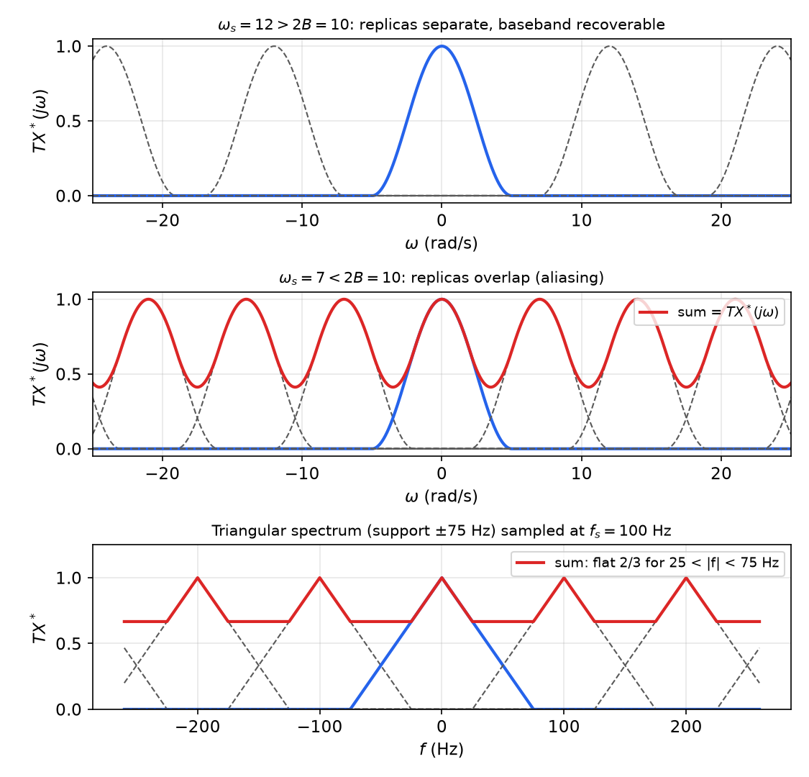

*Figure: spectra of sampled signals, scaled by \\(T\\). Top: \\(\omega\_s > 2B\\); the baseband replica (blue) is separate from its copies (dashed). Middle: \\(\omega\_s < 2B\\); overlapping replicas sum to the red curve, from which the original cannot be recovered. Bottom: the triangular spectrum of the worked example below, sampled at 100 Hz.*

**Aliasing of a sinusoid.** For any integer \\(n\\),
\\[
\cos\left[(\omega + n\omega\_s)kT + \phi\right] = \cos\left[\omega kT + \phi + 2\pi nk\right] = \cos\left[\omega kT + \phi\right],
\\]
so the frequencies \\(\omega + n\omega\_s\\) are indistinguishable after sampling. Since also \\(\cos(-\omega kT - \phi) = \cos(\omega kT + \phi)\\), the frequencies \\(n\omega\_s \pm \omega\\) all alias to one **apparent frequency** in \\([0, \omega\_s/2]\\):
\\[
\omega\_a = \lvert \omega - n\omega\_s\rvert, \qquad n = \text{the integer nearest to } \omega/\omega\_s .
\\]
For a sine, folding (\\(\omega\_a = n\omega\_s - \omega\\)) also reverses the sign.

**Example (sinusoids sampled at 20 Hz).** The Nyquist frequency is 10 Hz.
- 1 Hz: well below Nyquist. The samples trace the waveform closely.
- 9 Hz: just below Nyquist. The samples look erratic but still determine the signal uniquely (ideal reconstruction would recover it).
- 18 Hz: \\(\omega\_a = \lvert 18 - 20\rvert = 2\\) Hz. The samples lie exactly on a 2 Hz sinusoid of opposite sign.
- 20.1 Hz: \\(\omega\_a = 0.1\\) Hz. The samples trace a very slow wave, a stroboscopic effect like wagon wheels turning slowly backward in films.

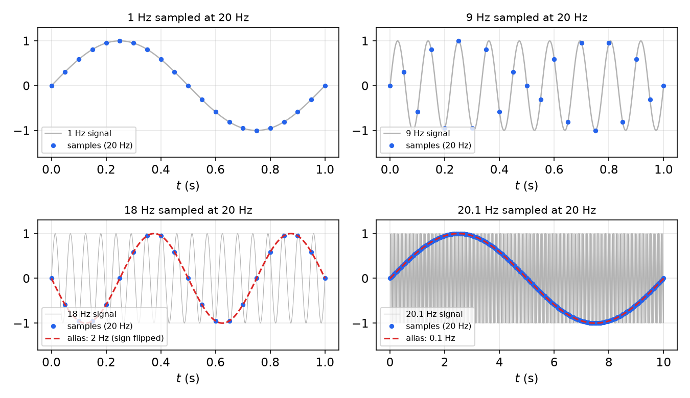

*Figure: sinusoids sampled at 20 Hz. Below the 10 Hz Nyquist frequency (top) the samples represent the signal; above it (bottom) the same samples fit a slower alias exactly: 2 Hz (with a sign flip) for 18 Hz, and 0.1 Hz for 20.1 Hz.*

**Example (a pure sine at three sampling rates).** Sample \\(\sin\omega t\\) at (a) \\(\omega\_s = 2\omega\\), (b) \\(\omega\_s = \omega\\), (c) \\(\omega\_s = \omega/2\\).

- (a) \\(T = \pi/\omega\\): the samples are \\(\sin(k\pi) = 0\\) for every \\(k\\). The signal is invisible. (A cosine would give \\((-1)^k\\), and other phases give intermediate amplitudes.) At exactly the Nyquist rate the samples depend on the phase, which is why the theorem needs the *strict* inequality \\(\omega\_s > 2B\\). In frequency, the lines at \\(\pm\omega\\) and their replicas at \\(\pm\omega + n\cdot 2\omega\\) coincide at odd multiples of \\(\omega\\).
- (b) \\(T = 2\pi/\omega\\): the samples are \\(\sin(2\pi k) = 0\\), or in general the constant \\(\sin\phi\\). The sine aliases to DC: the replica of the line at \\(\omega\\) shifted by \\(-\omega\_s\\) lands on \\(\omega = 0\\).
- (c) \\(T = 4\pi/\omega\\): every sample again falls at the same phase, so the sine also aliases to DC (\\(\omega - 2\omega\_s = 0\\)).

**Example (a triangular spectrum).** \\(X(j\omega)\\) is a triangle of height 1 supported on \\(\lvert f\rvert \le 75\\) Hz, and \\(T = 0.01\\) s, so \\(f\_s = 100\\) Hz < 150 Hz: the Nyquist condition fails. Using frequency \\(f\\) in Hz, \\(TX^{\ast} = \sum\_n X(f - 100n)\\). For \\(\lvert f\rvert < 25\\) Hz only the central triangle contributes, \\(1 - \lvert f\rvert/75\\). For \\(25 < f < 75\\) Hz the central triangle \\(1 - f/75\\) overlaps the replica at 100 Hz, which contributes \\(1 - (100-f)/75 = (f - 25)/75\\). The sum is
\\[
1 - \frac{f}{75} + \frac{f - 25}{75} = \frac{50}{75} = \frac23,
\\]
flat. The sampled spectrum is the triangle peak between \\(\pm25\\) Hz, a plateau at \\(2/3\\) out to the midpoint between replicas, and is periodic with period 100 Hz (bottom panel of the spectra figure). The band \\(25 < \lvert f\rvert < 75\\) Hz is corrupted.

## Reconstruction

### Ideal reconstruction

If \\(\omega\_s > 2B\\), multiplying \\(X^{\ast}\\) by the ideal low-pass filter
\\[
F(j\omega) = \begin{cases} T, & -\omega\_s/2 \le \omega \le \omega\_s/2, \\\\ 0, & \text{otherwise}, \end{cases}
\\]
keeps the central replica and restores the scale, so \\(X(j\omega) = F(j\omega)X^{\ast}(j\omega)\\). From the low-pass example with \\(\Omega = \omega\_s/2\\), and using \\(\omega\_sT = 2\pi\\), the filter's impulse response is
\\[
f(t) = T\cdot\frac{\omega\_s}{2\pi}\operatorname{sinc}\left(\frac{\omega\_s}{2\pi}t\right) = \operatorname{sinc}\left(\frac tT\right).
\\]
In the time domain the product becomes a convolution. Since \\(f \ast\delta(t - kT) = f(t - kT)\\),
\\[
x(t) = f \ast x^{\ast} = \sum\_k x(kT)\\,f(t)\ast\delta(t-kT) = \sum\_k x(kT)\\,f(t - kT).
\\]

**Theorem (Shannon's sampling theorem).** Let \\(x(t)\\) be band-limited with bandwidth \\(B\\), and sample it with \\(\omega\_s > 2B\\) (sampling frequency more than twice the bandwidth). Then \\(x\\) is determined by its samples and is recovered by
\\[
\boxed{x(t) = \sum\_{k=-\infty}^\infty x(kT)\\,\operatorname{sinc}\left(\frac tT - k\right).}
\\]
*Proof.* Combine the spectrum theorem (the replicas are disjoint) with the ideal-filter computation above. \\(\square\\)

The interpolating functions \\(\operatorname{sinc}(t/T - k)\\) equal 1 at \\(t = kT\\) and 0 at every other sampling instant. The reconstruction therefore passes exactly through every sample and fills in between with the unique band-limited curve.

**Example (evaluating the series).** Given \\(x(0), x(T), \ldots\\), with \\(x(t) = 0\\) for \\(t < 0\\):
\\[
x(0) = x(0)\operatorname{sinc}(0) + x(T)\operatorname{sinc}(-1) + \cdots = x(0),
\\]
\\[
x(0.5T) = x(0)\operatorname{sinc}(0.5) + x(T)\operatorname{sinc}(-0.5) + \cdots + x(kT)\operatorname{sinc}(0.5 - k) + \cdots .
\\]
The value halfway between samples depends on *all* samples, including future ones. **Shannon reconstruction is not causal.** It is also slow to converge, because the sinc decays only as \\(1/t\\). In real time it can only be approximated by a truncated, windowed sinc and an accompanying delay, which is the FIR filter design of the previous section. Feedback loops cannot afford that delay, so they use holds.

### Zero- and first-order holds

A **hold** reconstructs causally (or nearly so) from the current and past samples by polynomial extrapolation or interpolation.

**Zero-order hold.** Keep each sample constant for one period. Its impulse response is a unit-height pulse of width \\(T\\), and
\\[
G\_{h0}(s) = \frac{1 - e^{-sT}}{s}, \qquad
G\_{h0}(j\omega) = T\\,\frac{\sin(\omega T/2)}{\omega T/2}\\,e^{-j\omega T/2} = T\operatorname{sinc}\left(\frac{\omega}{\omega\_s}\right)e^{-j\omega T/2}.
\\]

**First-order hold (linear interpolation).** Connect successive samples by straight lines. The interpolating function is the triangle \\(h\_1(t) = 1 - \lvert t\rvert/T\\) for \\(\lvert t\rvert \le T\\), which is the convolution of two ZOH pulses scaled by \\(1/T\\), so its spectrum is the square of the ZOH's:
\\[
G\_{h1}(s) = \frac{e^{sT}(1 - e^{-sT})^2}{Ts^2}, \qquad G\_{h1}(j\omega) = T\operatorname{sinc}^2\left(\frac{\omega}{\omega\_s}\right).
\\]
Linear interpolation needs the *next* sample before it can draw the line, so in real time it introduces a full period of delay (the factor \\(e^{sT}\\) must be dropped). The causal alternative, the **predictive** first-order hold, extrapolates the line through the last two samples, \\(u(t) = u(k) + \frac{u(k) - u(k-1)}{T}(t - kT)\\). Its transfer function is
\\[
T(1 + sT)\left[\frac{1 - e^{-sT}}{sT}\right]^2,
\\]
which has less phase lag than the ZOH at low frequency but overshoots at signal changes.

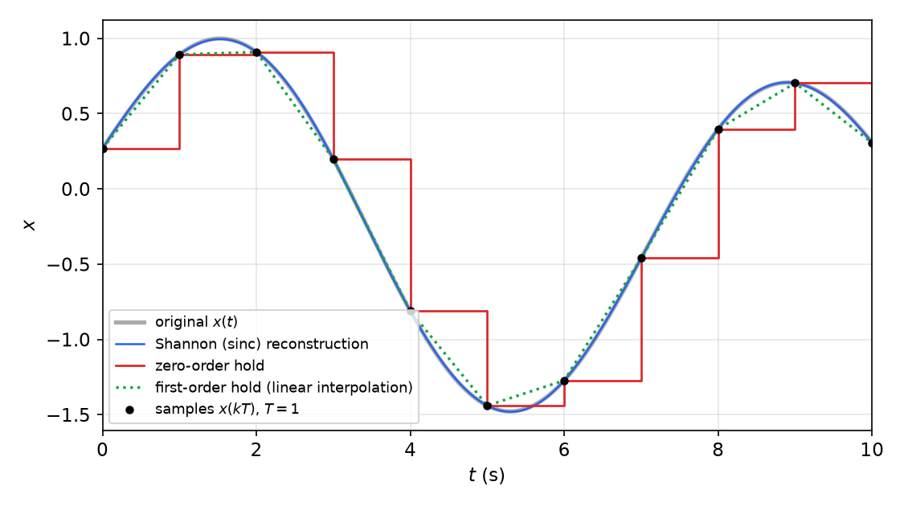

*Figure: reconstruction of a band-limited signal from samples at \\(T = 1\\) s. The Shannon series (blue) is indistinguishable from the original. Linear interpolation (green dotted) cuts the corners. The ZOH staircase (red) lags by about half a period.*

**Comparison in frequency.** The ideal reconstructor is a rectangle of height \\(T\\) on \\(\lvert\omega\rvert < \omega\_s/2\\). Both holds are low-pass approximations of it.

- The ZOH magnitude, \\(T\lvert\operatorname{sinc}(\omega/\omega\_s)\rvert\\), drops to \\(2/\pi \approx 0.64\\) of its DC value at the Nyquist frequency. Its first side lobe, near \\(1.5\omega\_s\\), is about \\(1/(1.5\pi) \approx 0.21\\), so replicas leak through noticeably.
- The FOH magnitude, \\(T\operatorname{sinc}^2(\omega/\omega\_s)\\), has side lobes of about \\(0.21^2 \approx 0.05\\). It is a better low-pass filter, but in its causal form it costs a full period of delay.

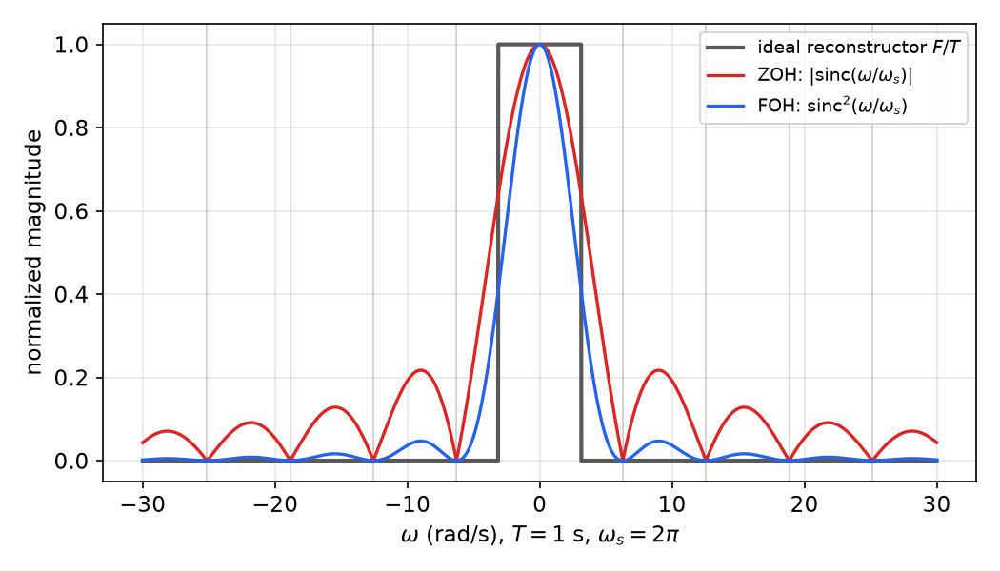

*Figure: frequency responses (normalized by \\(T\\)) of the ideal reconstructor, the ZOH and the FOH for \\(T = 1\\) s (\\(\omega\_s = 2\pi\\)). Both holds have nulls at multiples of \\(\omega\_s\\), where the replicas are centred. The FOH side lobes are about four times smaller than the ZOH's.*

In control, the ZOH is almost universal: it is what a D/A converter does naturally, it is causal, and its effect, roughly a delay of \\(T/2\\), is easy to account for exactly with the pulse transfer function.

## Discretization of Continuous-Time Systems

Two related problems lead to the same mathematics:

1. **Modelling.** A continuous plant \\(G(s)\\) is driven by a hold and observed by a sampler. What discrete transfer function relates the input samples to the output samples? The answer is exact and is the subject of [Pulse Transfer Functions and z-Plane Analysis](z-plane.md).
2. **Emulation.** A controller \\(D(s)\\) has been designed in continuous time. What difference equation, run at period \\(T\\), behaves like it? Here every answer is an approximation, and different approximations preserve different properties.

### Impulse invariance

Choose the discrete impulse response to be the samples of the continuous one:
\\[
G(z) = \mathcal{Z}\left[g(kT)\right].
\\]
This is exactly the relation between \\(x^{\ast}\\) and \\(y^{\ast}\\) when the input to \\(G(s)\\) is the impulse-sampled \\(x^{\ast}\\). Each pole \\(s = p\\) maps to \\(z = e^{pT}\\): \\(e^{pt} \to e^{pkT} \leftrightarrow z/(z - e^{pT})\\). For filter emulation the result is usually multiplied by \\(T\\), so that the DC gain is approximately preserved: a sampled impulse response summed at rate \\(1/T\\) approximates the integral of \\(g\\) only after scaling by \\(T\\). By the spectrum theorem, impulse invariance aliases the frequency response, \\(G(e^{j\omega T}) = \frac1T\sum G(j(\omega - n\omega\_s))\\) (before the factor \\(T\\)), so it suits only strongly low-pass systems.

### Step invariance: the ZOH equivalent

Require instead that the discrete system reproduce the continuous system's response to *piecewise-constant inputs* exactly at the sampling instants. That is precisely the situation of a plant behind a ZOH.

**Theorem (ZOH equivalent).** If \\(G(s)\\) is driven through a zero-order hold and its output is sampled with period \\(T\\), the samples satisfy \\(Y(z) = G\_{ZOH}(z)U(z)\\) with
\\[
\boxed{G\_{ZOH}(z) = (1 - z^{-1})\\,\mathcal{Z}\left[\frac{G(s)}{s}\right],}
\\]
where \\(\mathcal{Z}[G(s)/s]\\) means the z-transform of the samples of the step response \\(\mathcal{L}^{-1}\\{G(s)/s\\}\\).

*Proof.* Let \\(s\_1(t)\\) be the unit-step response. The held input is \\(u(t) = \sum\_i u(i)\left[1(t - iT) - 1(t - (i+1)T)\right]\\), a sum of steps. By linearity and time invariance,
\\[
y(kT) = \sum\_i u(i)\left[s\_1(kT - iT) - s\_1(kT - iT - T)\right] = \sum\_i u(i)\\,g\_h(k - i), \qquad g\_h(k) = s\_1(kT) - s\_1(kT - T).
\\]
This is a discrete convolution, and \\(\mathcal{Z}[g\_h] = (1 - z^{-1})\mathcal{Z}[s\_1(kT)]\\) by the delay property. \\(\square\\) Equivalently, \\(G\_{ZOH}(z) = \mathcal{Z}\left[\frac{1 - e^{-sT}}{s}G(s)\right]\\), and the factor \\(e^{-sT}\\) pulls out as \\(z^{-1}\\).

The poles again map by \\(z = e^{pT}\\), and the DC gain is preserved exactly (\\(G\_{ZOH}(1) = G(0)\\)). The zeros, however, do not map simply: new **sampling zeros** appear. A strictly proper \\(G(s)\\) of relative degree \\(r\\) gives a \\(G\_{ZOH}(z)\\) with \\(r - 1\\) extra zeros, which for small \\(T\\) tend to fixed locations, some outside the unit circle when \\(r \ge 3\\).

**Example (first-order plant).** \\(G(s) = 1/(s + p)\\).

*Impulse-sampled input.* \\(g(kT) = e^{-pkT}\\), so
\\[
G(z) = \frac{z}{z - e^{-pT}}.
\\]
*Through a ZOH.* \\(\dfrac{1}{s(s+p)} = \dfrac1p\left(\dfrac1s - \dfrac{1}{s+p}\right)\\), whose step-response samples have transform \\(\dfrac1p\left(\dfrac{z}{z-1} - \dfrac{z}{z - e^{-pT}}\right) = \dfrac{(1 - e^{-pT})z}{p(z-1)(z - e^{-pT})}\\). Then
\\[
G\_{ZOH}(z) = \frac{z-1}{z}\cdot\frac{(1 - e^{-pT})z}{p(z-1)(z - e^{-pT})} = \frac{1 - e^{-pT}}{p\\,(z - e^{-pT})}.
\\]
The ZOH version has one more step of delay (no \\(z\\) in the numerator) and DC gain \\(1/p\\), equal to \\(G(0)\\).

### Numerical-integration rules

Any rule for numerically integrating \\(\dot y = u\\) defines a substitution for the integrator \\(1/s\\), and hence for \\(s\\) in any transfer function.

- **Forward Euler (forward rectangle).** \\(y(k+1) = y(k) + Tu(k)\\), so \\(\dfrac{Y}{U} = \dfrac{T}{z-1}\\) and \\(\boxed{s \leftarrow \dfrac{z-1}{T}}\\).
- **Backward Euler (backward rectangle).** \\(y(k) = y(k-1) + Tu(k)\\), so \\(\dfrac{Y}{U} = \dfrac{Tz}{z-1}\\) and \\(\boxed{s \leftarrow \dfrac{z-1}{Tz}}\\).
- **Tustin (trapezoidal, bilinear).** \\(y(k) = y(k-1) + \frac T2\left[u(k) + u(k-1)\right]\\), so \\(\dfrac{Y}{U} = \dfrac T2\dfrac{z+1}{z-1}\\) and
\\[
\boxed{s \leftarrow \frac{2}{T}\\,\frac{z-1}{z+1}.}
\\]

**Where the stability region goes.** Solving each substitution for \\(z\\) shows where the left half s-plane lands:
- Forward Euler: \\(z = 1 + sT\\) maps the left half-plane to \\(\operatorname{Re}z < 1\\). Part of that region lies outside the unit circle, so a *stable* \\(D(s)\\) can give an *unstable* discretization if \\(T\\) is too large.
- Backward Euler: maps the left half-plane into the disk of radius 1/2 centred at \\(z = 1/2\\). Stability is always preserved, but lightly damped poles become overdamped.
- Tustin: \\(z = (1 + sT/2)/(1 - sT/2)\\) maps the left half-plane *exactly* onto the unit disk, and the imaginary axis onto the unit circle. Stability and minimum phase are preserved.

**Frequency warping.** On the unit circle \\(z = e^{j\omega T}\\), the Tustin substitution gives
\\[
s = \frac2T\\,\frac{e^{j\omega T} - 1}{e^{j\omega T} + 1} = j\\,\frac2T\tan\frac{\omega T}{2}.
\\]
The discrete filter at frequency \\(\omega\\) therefore behaves like the continuous one at
\\[
\omega\_a = \frac2T\tan\frac{\omega T}{2}.
\\]
For \\(\omega T \ll 1\\), \\(\omega\_a \approx \omega\\). As \\(\omega \to \pi/T\\), \\(\omega\_a \to \infty\\): the whole continuous frequency axis is compressed onto \\(0 \le \omega < \pi/T\\). This is the same map used by the w-transform in frequency-domain design ([Frequency-Response Analysis and Design](frequency-response.md)). To make the discretization exact at one critical frequency \\(\omega\_1\\) (a notch or a crossover frequency), **prewarp**: use
\\[
s \leftarrow \frac{\omega\_1}{\tan(\omega\_1T/2)}\\,\frac{z-1}{z+1},
\\]
which agrees with Tustin to first order and maps \\(j\omega\_1\\) exactly onto \\(e^{j\omega\_1T}\\).

### Matched pole–zero mapping

Map every finite pole *and* zero by \\(z = e^{sT}\\). Place zeros at \\(z = -1\\) (the Nyquist frequency) for the zeros of \\(G(s)\\) at infinity, all of them or all but one if a one-step computational delay is wanted. Finally, choose the gain to match \\(G\\) at DC (or another reference frequency). For
\\[
G(s) = K\frac{\prod(s - z\_i)}{\prod(s - p\_i)}
\quad\to\quad
G(z) = K\_d\frac{(z+1)^{n-m}\prod(z - e^{z\_iT})}{\prod(z - e^{p\_iT})}, \qquad G(z)\rvert\_{z=1} = G(s)\rvert\_{s=0}.
\\]

### Comparison

**Example (discretizing a second-order system).** \\(G(s) = \dfrac{4}{s^2 + 2s + 4}\\) (\\(\omega\_n = 2\\) rad/s, \\(\zeta = 0.5\\)) with \\(T = 0.3\\) s, so \\(\omega\_nT = 0.6\\), a deliberately coarse rate. The exact poles map to \\(e^{(-1 \pm j\sqrt3)0.3}\\), of radius \\(e^{-0.3} = 0.741\\).

| Method | \\(G(z)\\) |
|---|---|
| ZOH equivalent | \\(\dfrac{0.1446z + 0.1182}{z^2 - 1.2861z + 0.5488}\\) |
| Tustin | \\(\dfrac{0.0648(z+1)^2}{z^2 - 1.3094z + 0.5684}\\) |
| Matched pole–zero | \\(\dfrac{0.0657(z+1)^2}{z^2 - 1.2861z + 0.5488}\\) |
| Forward Euler | \\(\dfrac{0.36}{z^2 - 1.4z + 0.76}\\) |

The ZOH and matched methods place the poles exactly at \\(e^{p\_iT}\\). Tustin places them slightly differently because of warping. Forward Euler gives poles of radius \\(\sqrt{0.76} = 0.872\\), much too lightly damped. The ZOH equivalent reproduces the continuous step response exactly at the sampling instants, by construction. Tustin and matched pole–zero respond one sample early, because their numerators have the same degree as their denominators, and they roll off faster near the Nyquist frequency because of the zeros at \\(z = -1\\). Forward Euler overshoots badly.

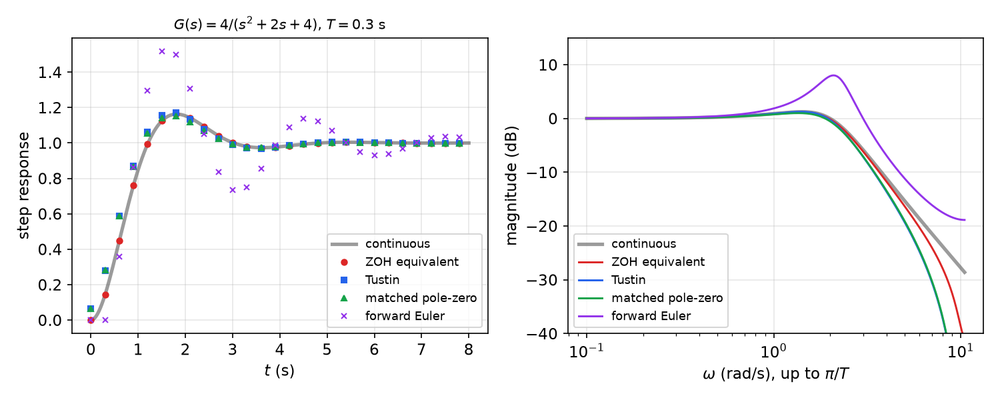

*Figure: four discretizations of \\(4/(s^2 + 2s + 4)\\) at \\(T = 0.3\\) s. Left: step-response samples. ZOH samples lie on the continuous curve; Tustin and matched are close but shifted by a sample; forward Euler is badly underdamped. Right: magnitude responses up to the Nyquist frequency \\(\pi/T\\). Tustin and matched drop to zero at \\(\pi/T\\) because of their zeros at \\(z = -1\\); forward Euler shows a spurious resonance.*

**Guidelines.** For a *plant* behind a D/A converter, the ZOH equivalent is exact and is the one to use. For *emulating a controller* designed in continuous time, Tustin (prewarped if a particular frequency matters) or matched pole–zero is preferred, and the sampling rate should be fast enough, typically 20 or more times the bandwidth, that the half-sample hold delay does not erode the margins. Forward Euler is simple but risky at coarse rates.

```matlab
G  = tf(4, [1 2 4]);  T = 0.3;
Gz = c2d(G, T, 'zoh');        % also 'foh', 'impulse', 'tustin', 'matched'
Gt = c2d(G, T, c2dOptions('Method','tustin','PrewarpFrequency',2));
step(G, Gz, Gt); bode(G, Gz, Gt)
```

```python
import scipy.signal as sg
num, den, _ = sg.cont2discrete(([4], [1, 2, 4]), 0.3, method='zoh')       # or 'bilinear', 'euler', 'backward_diff'
```

## Summary

- An LTI system is convolution with its impulse response: \\(y = g\ast u\\), so \\(Y(s) = G(s)U(s)\\); for causal systems \\(y(t) = \int\_0^t g(t-\tau)u(\tau)d\tau\\). In steady state a stable system maps \\(e^{j\omega t}\\) to \\(G(j\omega)e^{j\omega t}\\).
- Fourier series: \\(c\_n = \frac1T\int x e^{-jn\omega\_0t}dt\\); the square wave is \\(\frac4\pi\sum\sin((2k-1)t)/(2k-1)\\), with Gibbs overshoot at its jumps. Fourier transform: \\(X(j\omega) = \int xe^{-j\omega t}dt\\). The ideal low-pass filter has the non-causal impulse response \\(\sin\Omega t/(\pi t)\\).
- Impulse sampling: \\(x^{\ast} = x\delta\_T\\), \\(\mathcal{L}(x^{\ast}) = X(z)\rvert\_{z=e^{sT}}\\), and \\(X^{\ast}(j\omega) = \frac1T\sum\_nX(j(\omega - n\omega\_s))\\): sampling replicates the spectrum every \\(\omega\_s\\).
- Nyquist: no overlap if \\(\omega\_s > 2B\\). Otherwise aliasing occurs, and a sinusoid at \\(\omega\\) appears at \\(\lvert\omega - n\omega\_s\rvert\\). Filter before sampling.
- Shannon: \\(x(t) = \sum x(kT)\operatorname{sinc}(t/T - k)\\), exact for band-limited signals but non-causal. Holds are the practical alternative: the ZOH \\((1-e^{-sT})/s\\) (sinc magnitude, delay \\(T/2\\)) and the FOH (sinc², lower side lobes, extra delay).
- Discretization: ZOH equivalent \\(G(z) = (1 - z^{-1})\mathcal{Z}[G(s)/s]\\) (exact for a plant behind a D/A); impulse invariance \\(\mathcal{Z}[g(kT)]\\); Euler rules \\(s \leftarrow (z-1)/T\\) or \\((z-1)/(Tz)\\); Tustin \\(s \leftarrow \frac2T\frac{z-1}{z+1}\\) (maps stable to stable, warps \\(\omega\_a = \frac2T\tan\frac{\omega T}2\\), prewarp if needed); matched pole–zero \\(z = e^{sT}\\) for poles and zeros.

## See Also

- Sampling and Reconstruction (signals overview)
- Fourier Transform
- Laplace Transform
- [Digital Control Systems: Architecture and Hardware](introduction.md)
- [The z-Transform and Difference Equations](z-transform.md)
- [Pulse Transfer Functions and z-Plane Analysis](z-plane.md)
- [Frequency-Response Analysis and Design](frequency-response.md)
- Frequency-Domain Analysis
- [Discrete-Time Systems (state space)](../me6401-linear-control/discrete-time.md)
- Numerical Methods for ODEs
