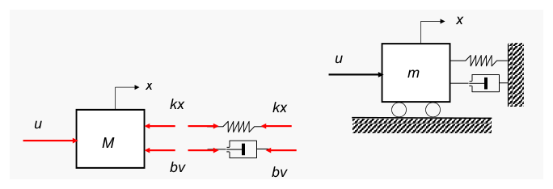
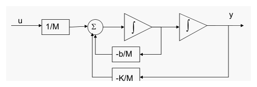
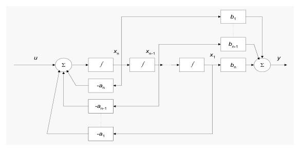
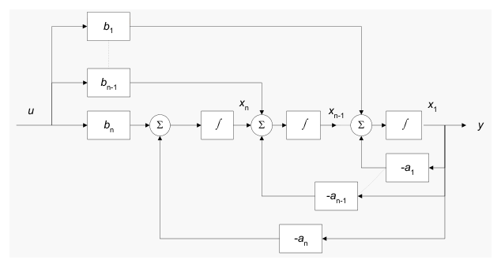
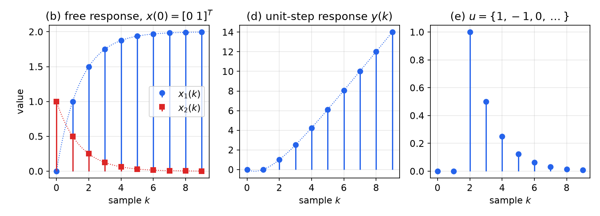
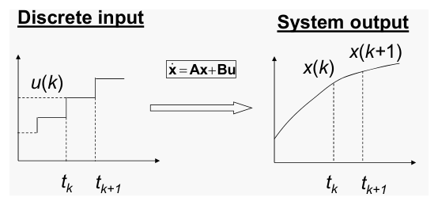
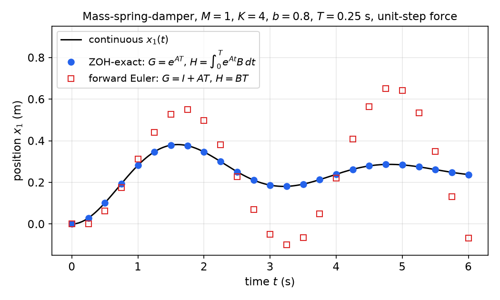

# Discrete-Time State-Space Models

Transfer functions describe a sampled system by its input–output behaviour. They work well for single-input, single-output, time-invariant plants, but they hide the internal variables and do not extend to multivariable, time-varying or nonlinear systems. This chapter recasts discrete-time systems as sets of first-order difference equations in a state vector. It covers the canonical realizations of a pulse transfer function, the solution of the state equation and the exact discretization of a continuous-time state model driven through a zero-order hold. The following chapters on [state feedback](state-feedback.md) and [observers](observers.md) build their designs on these models.

## Why State Space

### Input–output models

A sampled system can be described by expressing the current output as a function of past outputs and present and past inputs:
\\[
y(k) = f\big[y(k-1), \dots, y(k-n),\\; u(k), \dots, u(k-m)\big].
\\]
If the relation is linear and time-invariant it becomes the difference equation
\\[
y(k) + \sum\_{i=1}^{n} a\_i\\, y(k-i) = \sum\_{j=0}^{m} b\_j\\, u(k-j),
\\]
and taking z-transforms with zero initial conditions gives the pulse transfer function
\\[
H(z) = \frac{Y(z)}{U(z)} = \frac{b\_0 + b\_1 z^{-1} + \dots + b\_{m-1} z^{-m+1} + b\_m z^{-m}}{1 + a\_1 z^{-1} + \dots + a\_{n-1} z^{-n+1} + a\_n z^{-n}} .
\\]
This is the description used in the [z-transform](z-transform.md) and [z-plane](z-plane.md) chapters.

### State models

Transfer-function methods are best suited to LTI SISO systems. State-space methods handle multi-input, multi-output, time-varying and nonlinear systems with the same machinery, and they turn controller design into linear algebra even for SISO plants. The idea is to rewrite an \\(n\\)th-order difference equation as \\(n\\) coupled **first-order** difference equations. The state model is usually derived from physics or from a transfer function. Unlike the transfer function, it is **not unique**: infinitely many state models share one input–output behaviour.

## States and State Equations

**Definition (State).** The *state* of a dynamic system is the smallest set of variables (the *state variables*) such that knowing them at time \\(t\_0\\), together with the input for \\(t \ge t\_0\\), completely determines the behaviour of the system for all \\(t \ge t\_0\\). If the state variables are \\(x\_1, \dots, x\_n\\), the *state vector* is \\(x = [x\_1, \dots, x\_n]^T\\).

The state is the system's memory: everything about the past that matters for the future is compressed into \\(x(t\_0)\\).

### Continuous time: state differential equations

In continuous time each state variable obeys a first-order differential equation
\\[
\dot x\_i = f\_i(x\_1, \dots, x\_n, u\_1, \dots, u\_m, t), \qquad i = 1, \dots, n,
\\]
which gives its rate of change in terms of the present states and inputs. Each equation can be drawn as an *integrating memory element*: the function block \\(f\_i\\) computes \\(\dot x\_i\\) from \\(x\\) and \\(u\\), an integrator produces \\(x\_i\\), and \\(x\_i\\) is fed back. The outputs are static functions \\(y\_j = h\_j(x, u, t)\\). With \\(x \in \mathbb{R}^n\\), \\(u \in \mathbb{R}^m\\), \\(y \in \mathbb{R}^p\\):
\\[
\dot x = f(x, u, t), \qquad y = h(x, u, t).
\\]
The continuous-time theory is developed in [Modeling and State-Space Models](../me6401-linear-control/modeling.md).

**Example 1 (Mass–spring–damper).** A cart of mass \\(M\\) is pushed by a force \\(u\\) and restrained by a spring \\(K\\) and a damper \\(b\\).



*Figure: right, the cart with spring and damper attached to a wall; left, its free-body diagram, with the applied force u to the right and the spring force Kx and damper force bv to the left.*

Newton's law gives \\(M\ddot x = u - Kx - b\dot x\\). Position \\(x\\) and velocity \\(v = \dot x\\) determine the acceleration and hence the whole future motion, so they are a valid state. With \\(x\_1 = x\\), \\(x\_2 = \dot x\\):
\\[
\dot x\_1 = x\_2, \qquad \dot x\_2 = \frac{1}{M}\left(-Kx\_1 - bx\_2 + u\right),
\\]
\\[
\begin{bmatrix} \dot x\_1 \\\\ \dot x\_2 \end{bmatrix}
= \underbrace{\begin{bmatrix} 0 & 1 \\\\ -K/M & -b/M \end{bmatrix}}\_{A}
\begin{bmatrix} x\_1 \\\\ x\_2 \end{bmatrix} + \underbrace{\begin{bmatrix} 0 \\\\ 1/M \end{bmatrix}}\_{B} u, \qquad
y = \underbrace{\begin{bmatrix} 1 & 0 \end{bmatrix}}\_{C} x + \underbrace{0}\_{D}\\, u .
\\]



*Figure: simulation diagram of Example 1. The input is scaled by 1/M and summed with the velocity feedback −b/M and the position feedback −K/M; two integrators in series produce velocity and then position. Each integrator output is a state variable.*

### Discrete time: state difference equations

In discrete time the integrator is replaced by a unit delay. The state equations give the *next* state in terms of the current state and input:
\\[
x\_i(k+1) = f\_i\big(x\_1(k), \dots, x\_n(k), u\_1(k), \dots, u\_m(k)\big), \quad i = 1, \dots, n,
\\]
\\[
y\_j(k) = h\_j\big(x\_1(k), \dots, x\_n(k), u\_1(k), \dots, u\_m(k)\big), \quad j = 1, \dots, p,
\\]
or in vector form \\(x(k+1) = f(x(k), u(k))\\), \\(y(k) = h(x(k), u(k))\\). The shorthand \\(x^+ := x(k+1)\\) is convenient and is used throughout this subsection.

### Classes of discrete-time systems

- **Time-invariant (autonomous) nonlinear:** \\(f\\) and \\(h\\) do not depend explicitly on \\(k\\): \\(x(k+1) = f(x(k), u(k))\\), \\(y(k) = h(x(k), u(k))\\).
- **Linear time-varying (LTV):**
\\[
x(k+1) = G(k)x(k) + H(k)u(k), \qquad y(k) = C(k)x(k) + D(k)u(k),
\\]
with matrices of compatible dimensions.
- **Linear time-invariant (LTI):** constant matrices,
\\[
\boxed{x(k+1) = Gx(k) + Hu(k), \qquad y(k) = Cx(k) + Du(k).}
\\]

The letters follow Fadali and Visioli: \\(G, H\\) for the discrete-time state and input matrices, reserving \\(A, B\\) for the continuous-time model \\(\dot x = Ax + Bu\\).

**Example 2 (Spread of an infectious disease).** Let \\(k\\) count weeks, \\(x\_E(k)\\) be the number of exposed people and \\(x\_L(k)\\) the number of latent (infectious) cases. Each week a fraction \\(r\_E\\) of the exposed become latent, a fraction \\(r\_L\\) of latent cases leave the pool (recovery or isolation), and each latent case exposes \\(r\_0\\) new people. A public-health action \\(u\\) adds to or removes from the latent pool. Book-keeping gives
\\[
x\_E(k+1) = x\_E(k) - r\_E x\_E(k) + r\_0 x\_L(k), \qquad x\_L(k+1) = x\_L(k) + r\_E x\_E(k) - r\_L x\_L(k) + u(k),
\\]
\\[
\begin{bmatrix} x\_E \\\\ x\_L \end{bmatrix}^+
= \underbrace{\begin{bmatrix} 1 - r\_E & r\_0 \\\\ r\_E & 1 - r\_L \end{bmatrix}}\_{G}
\begin{bmatrix} x\_E \\\\ x\_L \end{bmatrix} + \underbrace{\begin{bmatrix} 0 \\\\ 1 \end{bmatrix}}\_{H} u, \qquad
y = \underbrace{\begin{bmatrix} 1 & 1 \end{bmatrix}}\_{C} x .
\\]
Removal of infected people corresponds to \\(u \le 0\\). The open-loop characteristic polynomial, written in powers of \\(z - 1\\), is
\\[
\det(zI - G) = (z-1)^2 + (r\_E + r\_L)(z-1) + r\_E(r\_L - r\_0).
\\]
At \\(z = 1\\) it equals \\(r\_E(r\_L - r\_0)\\). If \\(r\_0 > r\_L\\) this is negative, while the polynomial is positive for large real \\(z\\), so there is a real root \\(z > 1\\): the epidemic grows geometrically whenever new infections outpace removals. The [state-feedback chapter](state-feedback.md) returns to this model.

## Change of State Variables

Because the state is not unique, any invertible change of coordinates produces another valid model. A trivial case: the scalar system \\(x^+ = x + u\\) becomes \\(\hat x^+ = \hat x + 2u\\) with \\(\hat x = 2x\\).

In general let \\(\hat x = Px\\) with \\(P\\) nonsingular. Multiply the state equation by \\(P\\) and substitute \\(x = P^{-1}\hat x\\):
\\[
x^+ = Gx + Hu \;\Rightarrow\; Px^+ = PGx + PHu \;\Rightarrow\; \hat x^+ = PGP^{-1}\hat x + PHu, \qquad y = CP^{-1}\hat x + Du .
\\]
The **similarity transformation** formulas are therefore
\\[
\boxed{(G, H, C, D) \xrightarrow{\\;\hat x = Px\\;} (\hat G, \hat H, \hat C, D), \qquad \hat G = PGP^{-1}, \quad \hat H = PH, \quad \hat C = CP^{-1}.}
\\]
Similar matrices have the same characteristic polynomial, \\(\det(zI - PGP^{-1}) = \det\big(P(zI - G)P^{-1}\big) = \det(zI - G)\\), so the eigenvalues (the system poles) are coordinate-free. Changes of basis are treated in detail in [Realizations and Canonical Forms](../me6401-linear-control/realizations.md).

## From State Space to Transfer Function

Take the z-transform of the LTI state equations with \\(x(0) = 0\\): \\(zX(z) = GX(z) + HU(z)\\), so \\(X(z) = (zI - G)^{-1}HU(z)\\) and
\\[
\boxed{F(z) = \frac{Y(z)}{U(z)} = C(zI - G)^{-1}H + D .}
\\]
For a multi-input, multi-output system \\(F(z)\\) is a \\(p \times m\\) matrix of pulse transfer functions. Since \\((zI - G)^{-1} = \operatorname{adj}(zI - G)/\det(zI - G)\\), every pole of \\(F(z)\\) is an eigenvalue of \\(G\\). The converse can fail when a pole–zero cancellation occurs; this happens exactly when the realization is not both controllable and observable (see [Structure of Linear Systems](../me6401-linear-control/structure.md)).

The transfer function is unique, but its realizations are not. Two similar realizations give the same transfer function:
\\[
\hat C(zI - \hat G)^{-1}\hat H + D = CP^{-1}\big(P(zI - G)P^{-1}\big)^{-1}PH + D = CP^{-1}P(zI - G)^{-1}P^{-1}PH + D = F(z).
\\]
Going from a transfer function to a state model requires choosing a form. The standard choices are the controllable, observable and Jordan (diagonal) canonical forms.

**Example 3 (Transfer function of a state model).** Find the transfer function of
\\[
x^+ = \begin{bmatrix} 0 & 1 \\\\ -0.16 & -1 \end{bmatrix} x + \begin{bmatrix} 1 \\\\ 1 \end{bmatrix} u, \qquad y = \begin{bmatrix} 1 & 0 \end{bmatrix} x .
\\]
*Solution.* Form
\\[
zI - G = \begin{bmatrix} z & -1 \\\\ 0.16 & z + 1 \end{bmatrix}, \qquad \det(zI - G) = z^2 + z + 0.16 = (z + 0.2)(z + 0.8),
\\]
\\[
(zI - G)^{-1} = \frac{1}{(z+0.2)(z+0.8)} \begin{bmatrix} z + 1 & 1 \\\\ -0.16 & z \end{bmatrix}.
\\]
Then \\(C(zI-G)^{-1} = [\\,z+1 \;\; 1\\,]/\det\\), and multiplying by \\(H = [1 \;\; 1]^T\\):
\\[
F(z) = \frac{z + 2}{(z + 0.2)(z + 0.8)} .
\\]
The poles \\(-0.2\\) and \\(-0.8\\) are the eigenvalues of \\(G\\), and there is a zero at \\(z = -2\\).

## Canonical Realizations

### Controllable canonical form

**Second order, no zeros.** For \\(Y/U = 1/(z^2 + a\_1 z + a\_2)\\) the difference equation is \\(y(k+2) + a\_1 y(k+1) + a\_2 y(k) = u(k)\\). Choose \\(x\_1(k) = y(k)\\) and \\(x\_2(k) = y(k+1)\\). Then \\(x\_1^+ = x\_2\\) and \\(x\_2^+ = y(k+2) = -a\_2 x\_1 - a\_1 x\_2 + u\\):
\\[
x^+ = \begin{bmatrix} 0 & 1 \\\\ -a\_2 & -a\_1 \end{bmatrix} x + \begin{bmatrix} 0 \\\\ 1 \end{bmatrix} u, \qquad y = \begin{bmatrix} 1 & 0 \end{bmatrix} x .
\\]

**Second order with a zero.** For \\(Y/U = (b\_1 z + b\_2)/(z^2 + a\_1 z + a\_2)\\) the difference equation is
\\[
y(k+2) + a\_1 y(k+1) + a\_2 y(k) = b\_1 u(k+1) + b\_2 u(k).
\\]
The naive choice \\(x\_1 = y\\), \\(x\_2 = y(k+1)\\) now gives \\(x\_2^+ = -a\_2 x\_1 - a\_1 x\_2 + b\_1 u(k+1) + b\_2 u(k)\\). This is **not** a state equation: the next state depends on the *future* input \\(u(k+1)\\). The output and its advances are the wrong variables when the transfer function has zeros.

The fix is to split the transfer function through an intermediate signal \\(w\\) that sees only the poles:
\\[
Y(z) = (b\_1 z + b\_2)\\, \underbrace{\frac{U(z)}{z^2 + a\_1 z + a\_2}}\_{W(z)} .
\\]
Then \\(w(k+2) + a\_1 w(k+1) + a\_2 w(k) = u(k)\\), which has no input derivatives. Take \\(x\_1 = w\\), \\(x\_2 = w(k+1)\\): \\(x\_1^+ = x\_2\\), \\(x\_2^+ = -a\_2 x\_1 - a\_1 x\_2 + u\\), and the output is \\(y = b\_1 w(k+1) + b\_2 w(k) = b\_2 x\_1 + b\_1 x\_2\\):
\\[
x^+ = \begin{bmatrix} 0 & 1 \\\\ -a\_2 & -a\_1 \end{bmatrix} x + \begin{bmatrix} 0 \\\\ 1 \end{bmatrix} u, \qquad y = \begin{bmatrix} b\_2 & b\_1 \end{bmatrix} x .
\\]
The zeros appear only in the output matrix.

**General case.** For a strictly proper transfer function
\\[
F(z) = \frac{b\_1 z^{n-1} + b\_2 z^{n-2} + \dots + b\_{n-1} z + b\_n}{z^n + a\_1 z^{n-1} + \dots + a\_{n-1} z + a\_n},
\\]
the same construction (a chain of \\(n\\) delays driven by \\(u\\) through the denominator) gives the **controllable canonical form** (CCF) \\(x^+ = G\_c x + H\_c u\\), \\(y = C\_c x\\):
\\[
G\_c = \begin{bmatrix} 0 & 1 & 0 & \cdots & 0 \\\\ 0 & 0 & 1 & \cdots & 0 \\\\ \vdots & & & \ddots & \vdots \\\\ 0 & 0 & \cdots & 0 & 1 \\\\ -a\_n & -a\_{n-1} & \cdots & -a\_2 & -a\_1 \end{bmatrix}, \qquad
H\_c = \begin{bmatrix} 0 \\\\ 0 \\\\ \vdots \\\\ 0 \\\\ 1 \end{bmatrix}, \qquad
C\_c = \begin{bmatrix} b\_n & b\_{n-1} & \cdots & b\_2 & b\_1 \end{bmatrix}.
\\]
\\(G\_c\\) is a *companion matrix*: its characteristic polynomial \\(z^n + a\_1 z^{n-1} + \dots + a\_n\\) can be read off its last row. If the transfer function is biproper (numerator degree \\(n\\)), first divide it as \\(F(z) = b\_0 + F\_{sp}(z)\\), realize the strictly proper part and set \\(D = b\_0\\).



*Figure: controllable canonical realization. The input enters a single summing junction at the head of a chain of n delays (drawn as integrator blocks); every delay output is fed back to that junction through a coefficient −a and forward to the output summer through a numerator coefficient b.*

### Observable canonical form

Start again from \\(Y/U = (b\_1 z + b\_2)/(z^2 + a\_1 z + a\_2)\\), written as \\(z^2 Y + a\_1 zY + a\_2 Y = b\_1 zU + b\_2 U\\). Divide by \\(z^2\\) and nest the delays:
\\[
Y = z^{-1}\Big( \underbrace{-a\_1 Y + b\_1 U + \underbrace{z^{-1}\left(-a\_2 Y + b\_2 U\right)}\_{X\_2}}\_{X\_1} \Big).
\\]
Each delay output is a state: \\(y = x\_1\\), \\(x\_1^+ = -a\_1 y + x\_2 + b\_1 u\\), \\(x\_2^+ = -a\_2 y + b\_2 u\\). For general \\(n\\) the **observable canonical form** (OCF) is
\\[
G\_o = \begin{bmatrix} -a\_1 & 1 & 0 & \cdots & 0 \\\\ -a\_2 & 0 & 1 & \cdots & 0 \\\\ \vdots & \vdots & & \ddots & \vdots \\\\ -a\_{n-1} & 0 & \cdots & 0 & 1 \\\\ -a\_n & 0 & \cdots & 0 & 0 \end{bmatrix}, \qquad
H\_o = \begin{bmatrix} b\_1 \\\\ b\_2 \\\\ \vdots \\\\ b\_{n-1} \\\\ b\_n \end{bmatrix}, \qquad
C\_o = \begin{bmatrix} 1 & 0 & \cdots & 0 & 0 \end{bmatrix}.
\\]



*Figure: observable canonical realization. The input is distributed through the numerator coefficients b to summing junctions placed between the delays; the single output y = x₁ is fed back to every junction through the coefficients −a.*

The two forms are dual. With the exchange matrix \\(J\\) (ones on the anti-diagonal), \\(G\_o = J G\_c^T J\\), \\(H\_o = J C\_c^T\\) and \\(C\_o = H\_c^T J\\). The OCF is the transpose of the CCF with the state order reversed. This duality between controllability and observability recurs in the [observer chapter](observers.md).

### Diagonal (Jordan) form

If the poles are distinct, expand the transfer function in partial fractions:
\\[
\frac{Y}{U} = \frac{b\_1 z + b\_2}{(z - p\_1)(z - p\_2)} = \frac{c\_1}{z - p\_1} + \frac{c\_2}{z - p\_2}, \qquad
Y = c\_1 \underbrace{\frac{U}{z - p\_1}}\_{X\_1} + c\_2 \underbrace{\frac{U}{z - p\_2}}\_{X\_2}.
\\]
Each first-order factor is one state, \\(x\_i^+ = p\_i x\_i + u\\), so
\\[
x^+ = \begin{bmatrix} p\_1 & 0 \\\\ 0 & p\_2 \end{bmatrix} x + \begin{bmatrix} 1 \\\\ 1 \end{bmatrix} u, \qquad y = \begin{bmatrix} c\_1 & c\_2 \end{bmatrix} x .
\\]
The states are decoupled *modes*, each evolving as \\(p\_i^k\\). A repeated pole \\(p\\) of multiplicity two contributes terms \\(c\_1/(z - p) + c\_2/(z - p)^2\\). These are realized by a cascade of two first-order blocks, which produces a Jordan block \\(\begin{bmatrix} p & 1 \\\\ 0 & p \end{bmatrix}\\) (see [Modal Decomposition](../me6401-linear-control/modal-decomposition.md)).

**Example 4 (Three realizations of one transfer function).** Take \\(F(z) = (z + 2)/[(z + 0.2)(z + 0.8)]\\) from Example 3.

- *CCF:* \\(a\_1 = 1\\), \\(a\_2 = 0.16\\), \\(b\_1 = 1\\), \\(b\_2 = 2\\):
\\(G\_c = \begin{bmatrix} 0 & 1 \\\\ -0.16 & -1 \end{bmatrix}\\), \\(H\_c = \begin{bmatrix} 0 \\\\ 1 \end{bmatrix}\\), \\(C\_c = \begin{bmatrix} 2 & 1 \end{bmatrix}\\).
- *OCF:* \\(G\_o = \begin{bmatrix} -1 & 1 \\\\ -0.16 & 0 \end{bmatrix}\\), \\(H\_o = \begin{bmatrix} 1 \\\\ 2 \end{bmatrix}\\), \\(C\_o = \begin{bmatrix} 1 & 0 \end{bmatrix}\\).
- *Diagonal:* the residues are \\(c\_1 = (z+2)/(z+0.8)\big\rvert\_{z=-0.2} = 1.8/0.6 = 3\\) and \\(c\_2 = (z+2)/(z+0.2)\big\rvert\_{z=-0.8} = 1.2/(-0.6) = -2\\). Hence \\(G = \operatorname{diag}(-0.2, -0.8)\\), \\(H = [1 \;\; 1]^T\\), \\(C = [3 \;\; -2]\\). Check: \\(3(z + 0.8) - 2(z + 0.2) = z + 2\\).

The model of Example 3 has the same \\(G\\) as the CCF but a different \\(H\\) and \\(C\\). It is a fourth realization of the same transfer function.

## Time Response of Discrete-Time Systems

### Time-varying systems and the state transition matrix

Consider \\(x(k+1) = G(k)x(k) + H(k)u(k)\\) with given \\(x(0)\\) and input sequence \\(\\{u(k)\\}\\). Iterate:
\\[
\begin{aligned}
x(1) &= G(0)x(0) + H(0)u(0), \\\\
x(2) &= G(1)G(0)x(0) + G(1)H(0)u(0) + H(1)u(1), \\\\
x(3) &= G(2)G(1)G(0)x(0) + G(2)G(1)H(0)u(0) + G(2)H(1)u(1) + H(2)u(2).
\end{aligned}
\\]
The pattern is
\\[
x(k) = \Big(\prod\_{i=0}^{k-1} G(i)\Big) x(0) + \sum\_{j=0}^{k-1} \Big(\prod\_{i=j+1}^{k-1} G(i)\Big) H(j)u(j),
\\]
with products ordered so that larger indices stand on the left (an empty product is \\(I\\)).

**Definition (State transition matrix).** For \\(k \ge j\\),
\\[
\Psi(k, j) = G(k-1)G(k-2)\cdots G(j), \qquad \Psi(k, k) = I .
\\]

With this notation the response from an arbitrary initial time \\(k\_0\\) is
\\[
\boxed{x(k) = \Psi(k, k\_0)\\, x(k\_0) + \sum\_{j=k\_0}^{k-1} \Psi(k, j+1)\\, H(j)u(j).}
\\]

**Properties of \\(\Psi\\).**

1. With \\(u \equiv 0\\), \\(x(k) = \Psi(k, j)x(j)\\): \\(\Psi\\) carries the state from time \\(j\\) to time \\(k\\).
2. \\(\Psi(k, k) = I\\).
3. Semigroup property: \\(\Psi(k, j) = \Psi(k, i)\Psi(i, j)\\) for \\(k \ge i \ge j\\).
4. If every \\(G(k)\\) is nonsingular, \\(\Psi(k, j)\\) is nonsingular and \\(\Psi^{-1}(k, j) = \Psi(j, k)\\), which defines backward propagation. Unlike the continuous-time transition matrix, a discrete \\(\Psi\\) *can* be singular. A sampled continuous system always has nonsingular \\(G = e^{AT}\\), but a system defined directly in discrete time need not (a deadbeat closed loop is an example).
5. For an LTI system, \\(\Psi(k, j) = G^{k-j}\\).

The continuous-time counterpart is developed in [Time Response and the Matrix Exponential](../me6401-linear-control/time-response.md), and the sampled-data view in [Discrete-Time Systems](../me6401-linear-control/discrete-time.md).

### LTI systems: the convolution formula

For constant \\(G, H\\):
\\[
\boxed{x(k) = G^k x(0) + \sum\_{j=0}^{k-1} G^{k-1-j} H u(j) \;=\; G^k x(0) + G^{k-1}H \* u(k).}
\\]
The first term is the zero-input (free) response and the second the zero-state (forced) response, a discrete convolution of the input with the state impulse response \\(G^{k-1}H\\). The output is \\(y(k) = CG^k x(0) + \sum\_{j=0}^{k-1} CG^{k-1-j}Hu(j) + Du(k)\\).

### Computing \\(G^k\\)

There are three routes.

1. **Numerically:** multiply \\(G \cdot G \cdots G\\). This is fine for simulation but gives no closed form.
2. **By z-transform.** Transform the state equation including the initial condition: \\(zX(z) - zx(0) = GX(z) + HU(z)\\), so
\\[
X(z) = (zI - G)^{-1}\big[zx(0) + HU(z)\big].
\\]
Comparing with the convolution formula term by term gives
\\[
\boxed{G^k = \mathcal{Z}^{-1}\big[z(zI - G)^{-1}\big], \qquad \mathcal{Z}^{-1}\big[(zI - G)^{-1}HU(z)\big] = G^{k-1}H \* u(k).}
\\]
This is the discrete analogue of \\(e^{At} = \mathcal{L}^{-1}[(sI - A)^{-1}]\\).
3. **By modal decomposition.** If \\(G = V\Lambda V^{-1}\\) is diagonalizable, \\(G^k = V\Lambda^k V^{-1}\\). Every entry of \\(G^k\\) is then a combination of the *modes* \\(\lambda\_i^k\\). Jordan blocks add terms \\(k\lambda^{k-1}, \dots\\) The free response decays to zero for every \\(x(0)\\) if and only if all eigenvalues satisfy \\(\lvert \lambda\_i \rvert < 1\\) (see [z-plane analysis](z-plane.md) and [Stability](../me6401-linear-control/stability.md)).

**Example 5 (Response of a second-order system).** Consider
\\[
x^+ = \begin{bmatrix} 1 & 1 \\\\ 0 & 0.5 \end{bmatrix} x + \begin{bmatrix} 0 \\\\ 1 \end{bmatrix} u .
\\]
Find (a) \\(G^k\\); (b) \\(x(k)\\) for \\(x(0) = [0 \;\; 1]^T\\), \\(u = 0\\); (c) the transfer function with \\(y = x\_1\\); (d) the unit-step response; (e) \\(y(k)\\) and its limit for \\(x(0) = 0\\), \\(u(0) = 1\\), \\(u(1) = -1\\), \\(u(k) = 0\\) for \\(k > 1\\).

*(a)* \\(zI - G = \begin{bmatrix} z - 1 & -1 \\\\ 0 & z - 0.5 \end{bmatrix}\\) is upper triangular, so
\\[
z(zI - G)^{-1} = \begin{bmatrix} \dfrac{z}{z-1} & \dfrac{z}{(z-1)(z-0.5)} \\\\ 0 & \dfrac{z}{z - 0.5} \end{bmatrix}.
\\]
The off-diagonal entry expands as \\(\dfrac{z}{(z-1)(z-0.5)} = \dfrac{2z}{z-1} - \dfrac{2z}{z-0.5}\\), so
\\[
G^k = \begin{bmatrix} 1 & 2(1 - 0.5^k) \\\\ 0 & 0.5^k \end{bmatrix}.
\\]
The modes are \\(1^k\\) (from the eigenvalue at 1, an integrator) and \\(0.5^k\\).

*(b)* \\(x(k) = G^k [0 \;\; 1]^T = \big[\\,2(1 - 0.5^k), \;\; 0.5^k\\,\big]^T\\). The second state decays and the first accumulates it, approaching 2.

*(c)* \\(F(z) = C(zI - G)^{-1}H\\) is the (1,2) entry of \\((zI - G)^{-1}\\):
\\[
F(z) = \frac{1}{(z - 1)(z - 0.5)} .
\\]

*(d)* With \\(U(z) = z/(z - 1)\\),
\\[
Y(z) = \frac{z}{(z-1)^2(z - 0.5)}, \qquad \frac{Y(z)}{z} = \frac{-4}{z - 1} + \frac{2}{(z-1)^2} + \frac{4}{z - 0.5},
\\]
where the coefficient of \\((z-0.5)^{-1}\\) is \\(1/(0.5)^2 = 4\\), that of \\((z-1)^{-2}\\) is \\(1/0.5 = 2\\), and that of \\((z-1)^{-1}\\) is \\(\tfrac{d}{dz}(z-0.5)^{-1}\big\rvert\_{z=1} = -4\\). Inverting,
\\[
y(k) = 2k - 4 + 4(0.5)^k, \qquad y(0) = y(1) = 0, \; y(2) = 1, \; y(3) = 2.5, \dots
\\]
The response grows without bound because a step drives the integrating pole at \\(z = 1\\).

*(e)* The input is \\(U(z) = 1 - z^{-1} = (z - 1)/z\\). Its zero at \\(z = 1\\) cancels the integrating pole:
\\[
Y(z) = \frac{1}{z(z - 0.5)} = z^{-2}\frac{z}{z - 0.5} \;\Rightarrow\; y(0) = y(1) = 0, \quad y(k) = 0.5^{k-2} \;\; (k \ge 2),
\\]
and \\(\lim\_{k\to\infty} y(k) = 0\\).



*Figure: Example 5 simulated by direct recursion (stems) and compared with the closed-form answers (dotted). Left: free response from x(0) = [0 1]ᵀ, with x₁ → 2 and x₂ = 0.5ᵏ. Centre: the step response grows like 2k − 4. Right: the input {1, −1} has zero net area, so the output returns to zero.*

## Continuous-Time Solution

The discretization formulas rest on the solution of \\(\dot x = Ax + Bu\\). The homogeneous solution is \\(x(t) = e^{At}x(0)\\) with
\\[
e^{At} = I + At + \frac{A^2t^2}{2!} + \dots + \frac{A^nt^n}{n!} + \dots = \mathcal{L}^{-1}\big[(sI - A)^{-1}\big].
\\]
The state impulse response is \\(\mathcal{L}^{-1}[(sI - A)^{-1}B] = e^{At}B\\), and the total response is the free response plus the convolution of \\(e^{At}B\\) with the input. From an arbitrary initial time:
\\[
\boxed{x(t) = e^{A(t - t\_0)}x(t\_0) + \int\_{t\_0}^{t} e^{A(t - \tau)}Bu(\tau)\\, d\tau .}
\\]
Derivations and methods for computing \\(e^{At}\\) are in [Time Response and the Matrix Exponential](../me6401-linear-control/time-response.md).

## Discretization of Continuous-Time Systems

### Exact discretization with a zero-order hold

In a digital control loop the computer updates \\(u\\) at the sampling instants \\(t\_k = kT\\), and a zero-order hold (ZOH) keeps it constant in between: \\(u(t) = u(k)\\) for \\(t\_k \le t < t\_{k+1}\\). The plant evolves continuously, but only the samples \\(x(k) = x(t\_k)\\) are of interest.



*Figure: discretization. Left, the staircase input produced by the zero-order hold, constant on each interval [t_k, t_{k+1}). Right, the resulting continuous state trajectory; only its samples x(k) and x(k+1) enter the discrete model.*

Apply the solution formula over one interval, from \\(t\_0 = t\_k\\) to \\(t = t\_{k+1}\\). Because \\(u\\) is constant on the interval it comes out of the integral:
\\[
x(k+1) = \underbrace{e^{A(t\_{k+1} - t\_k)}}\_{G}\\, x(k) + \underbrace{\left[\int\_{t\_k}^{t\_{k+1}} e^{A(t\_{k+1} - \tau)}B\\, d\tau\right]}\_{H} u(k).
\\]
With uniform sampling, \\(t\_k = kT\\), substitute \\(\sigma = (k+1)T - \tau\\) (so \\(d\sigma = -d\tau\\), and \\(\tau = kT \mapsto \sigma = T\\), \\(\tau = (k+1)T \mapsto \sigma = 0\\)):
\\[
\int\_{kT}^{(k+1)T} e^{A[(k+1)T - \tau]}B\\, d\tau = \int\_0^T e^{A\sigma}B\\, d\sigma .
\\]
The result does not depend on \\(k\\), so the sampled system is LTI:

**Theorem (ZOH discretization).** If the input of \\(\dot x = Ax + Bu\\), \\(y = Cx + Du\\) is held constant between samples spaced \\(T\\) apart, the samples satisfy exactly
\\[
\boxed{x(k+1) = Gx(k) + Hu(k), \quad y(k) = Cx(k) + Du(k), \qquad G = e^{AT}, \quad H = \int\_0^T e^{At}B\\, dt .}
\\]
\\(C\\) and \\(D\\) are unchanged.

No approximation is involved. The discrete model reproduces the continuous state *at the sampling instants* exactly, for any \\(T\\), as long as the input really is piecewise constant. The pulse transfer function \\(C(zI - G)^{-1}H + D\\) of this model equals the ZOH-equivalent \\((1 - z^{-1})\mathcal{Z}\\{F(s)/s\\}\\) derived in [Sampling, Reconstruction and Discretization](sampling.md).

### Computing \\(G\\) and \\(H\\)

- **Series.** \\(G = \sum\_{i \ge 0} (AT)^i/i!\\) and \\(H = \sum\_{i \ge 0} A^iT^{i+1}B/(i+1)!\\), obtained by integrating the series term by term.
- **Closed form when \\(A\\) is invertible.** \\(H = A^{-1}(e^{AT} - I)B\\).
- **Augmented exponential.** A single matrix exponential gives both matrices:
\\[
\exp\left( \begin{bmatrix} A & B \\\\ 0 & 0 \end{bmatrix} T \right) = \begin{bmatrix} G & H \\\\ 0 & I \end{bmatrix}.
\\]
To see this, note that \\(\xi = [x; u]\\) with \\(\dot u = 0\\) obeys \\(\dot \xi = \begin{bmatrix} A & B \\\\ 0 & 0 \end{bmatrix}\xi\\). Its transition matrix over one period must map \\((x(k), u(k))\\) to \\((x(k+1), u(k))\\). This is how MATLAB's `c2d` and SciPy's `cont2discrete` compute the ZOH model.

```matlab
sysc = ss(A,B,C,D);
sysd = c2d(sysc,T);          % zero-order-hold discretization
[G,H,C,D] = ssdata(sysd);
```

```python
from scipy.signal import cont2discrete
G, H, C, D, _ = cont2discrete((A, B, C, D), T, method='zoh')
```

### Poles map, zeros do not

If \\(Av = \lambda v\\) then \\(e^{AT}v = e^{\lambda T}v\\). Every continuous eigenvalue \\(\lambda\\) becomes a discrete eigenvalue \\(z = e^{\lambda T}\\), the map studied in [z-plane analysis](z-plane.md). Zeros have no such simple rule. Sampling usually creates extra *sampling zeros*, as the next example shows.

**Example 6 (Double integrator).** Let \\(\ddot x = u\\), with \\(x\_1 = x\\), \\(x\_2 = \dot x\\):
\\[
A = \begin{bmatrix} 0 & 1 \\\\ 0 & 0 \end{bmatrix}, \qquad B = \begin{bmatrix} 0 \\\\ 1 \end{bmatrix}.
\\]
Since \\(A^2 = 0\\), the series terminates: \\(e^{At} = I + At = \begin{bmatrix} 1 & t \\\\ 0 & 1 \end{bmatrix}\\). Hence
\\[
G = \begin{bmatrix} 1 & T \\\\ 0 & 1 \end{bmatrix}, \qquad
H = \int\_0^T \begin{bmatrix} t \\\\ 1 \end{bmatrix} dt = \begin{bmatrix} T^2/2 \\\\ T \end{bmatrix}.
\\]
The first row is the familiar kinematics \\(x(k+1) = x(k) + T\dot x(k) + \tfrac{T^2}{2}u(k)\\). With \\(y = x\_1\\),
\\[
C(zI - G)^{-1}H = \frac{1}{(z-1)^2}\begin{bmatrix} z - 1 & T \end{bmatrix}\begin{bmatrix} T^2/2 \\\\ T \end{bmatrix} = \frac{T^2}{2}\\,\frac{z + 1}{(z - 1)^2} .
\\]
The double pole at \\(s = 0\\) maps to \\(z = 1\\). The continuous plant \\(1/s^2\\) has no finite zeros, yet a sampling zero appears at \\(z = -1\\). This model is used repeatedly in the next two chapters.

**Example 7 (Exact versus Euler discretization).** For the mass–spring–damper of Example 1 with \\(M = 1\\), \\(K = 4\\), \\(b = 0.8\\) and \\(T = 0.25\\) s, the ZOH formulas give
\\[
G = e^{AT} = \begin{bmatrix} 0.8853 & 0.2173 \\\\ -0.8691 & 0.7115 \end{bmatrix}, \qquad H = \begin{bmatrix} 0.0287 \\\\ 0.2173 \end{bmatrix}.
\\]
A tempting shortcut is forward Euler, \\(G \approx I + AT\\), \\(H \approx BT\\). It maps each eigenvalue to \\(1 + \lambda T\\) instead of \\(e^{\lambda T}\\). Here the continuous poles \\(-0.4 \pm j1.96\\) become \\(0.9 \pm j0.49\\), of magnitude \\(1.025 > 1\\), so the Euler model of a stable plant is *unstable*.



*Figure: unit-step response of the mass–spring–damper. The ZOH model (blue dots) lands exactly on the continuous trajectory at every sample; the forward-Euler model (red squares) drifts away and its oscillation grows, because I + AT has eigenvalues outside the unit circle at this sampling period.*

## Summary

- An LTI discrete-time state model is \\(x(k+1) = Gx(k) + Hu(k)\\), \\(y = Cx + Du\\). It is unique only up to similarity, \\((G, H, C) \to (PGP^{-1}, PH, CP^{-1})\\), which preserves eigenvalues and the transfer function.
- Transfer function: \\(F(z) = C(zI - G)^{-1}H + D\\); its poles are eigenvalues of \\(G\\).
- Canonical realizations of \\((b\_1 z^{n-1} + \dots + b\_n)/(z^n + a\_1 z^{n-1} + \dots + a\_n)\\):
  - controllable form (companion \\(G\_c\\) with last row \\(-a\_n, \dots, -a\_1\\), \\(H\_c = e\_n\\), \\(C\_c = [b\_n \cdots b\_1]\\));
  - observable form (its dual);
  - diagonal/Jordan form from partial fractions.
  When there are zeros, states must be defined through an intermediate signal, never as advances of the output.
- Time response: \\(x(k) = \Psi(k, k\_0)x(k\_0) + \sum\_{j=k\_0}^{k-1}\Psi(k, j+1)H(j)u(j)\\). For LTI systems, \\(x(k) = G^kx(0) + \sum\_{j=0}^{k-1}G^{k-1-j}Hu(j)\\) with \\(G^k = \mathcal{Z}^{-1}[z(zI - G)^{-1}]\\).
- ZOH discretization is exact at the samples: \\(G = e^{AT}\\), \\(H = \int\_0^T e^{At}B\\, dt\\). It can be computed from one augmented matrix exponential. Eigenvalues map as \\(z = e^{\lambda T}\\); zeros do not, and sampling zeros appear (\\(1/s^2 \to \tfrac{T^2}{2}(z+1)/(z-1)^2\\)).

## See Also

- [State Feedback and Pole Placement for Discrete Systems](state-feedback.md) and [Observers for Discrete Systems](observers.md): design on these models.
- [Sampling, Reconstruction and Discretization](sampling.md) and [Pulse Transfer Functions and z-Plane Analysis](z-plane.md): the transfer-function view of the same discretization.
- [Realizations and Canonical Forms](../me6401-linear-control/realizations.md), [Time Response and the Matrix Exponential](../me6401-linear-control/time-response.md) and [Discrete-Time Systems](../me6401-linear-control/discrete-time.md): the continuous-time theory in depth.
- State-Space Representation: the short overview.
- The Z-Transform, Eigenvalues and Eigenvectors and Systems of Differential Equations.
