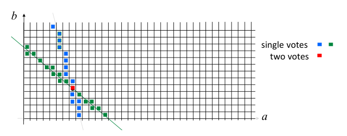
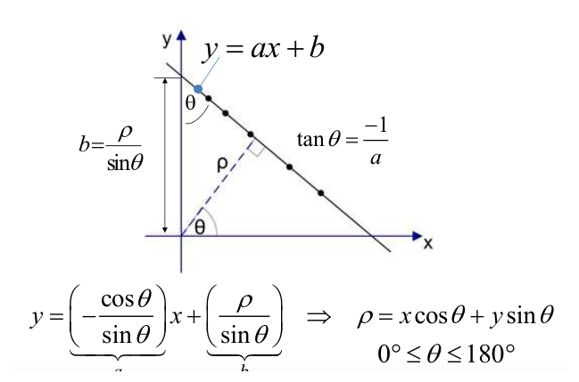
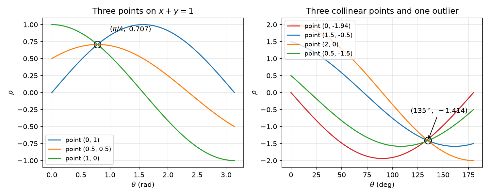
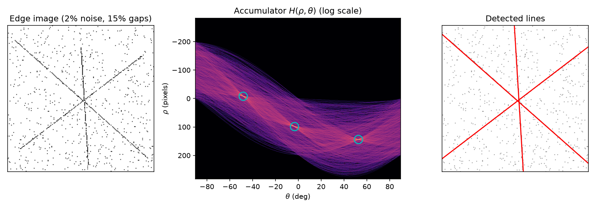
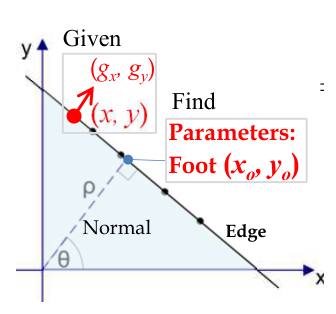
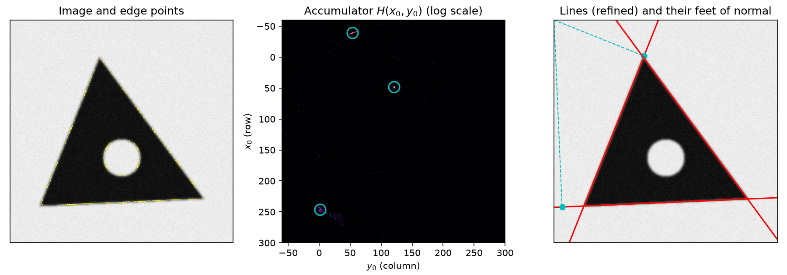
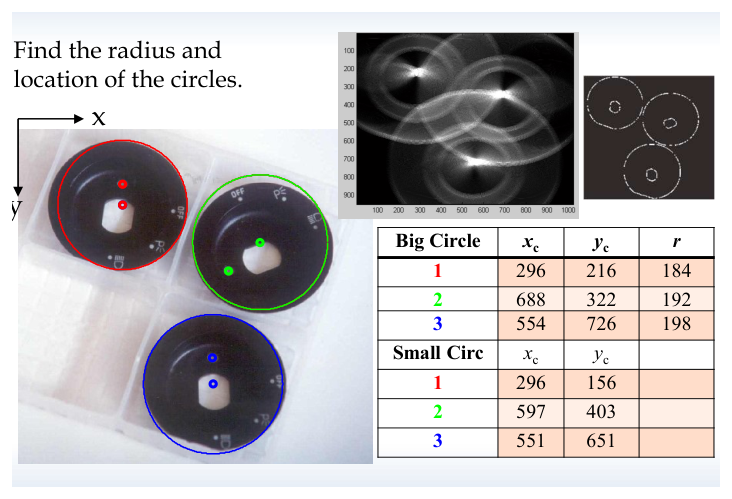
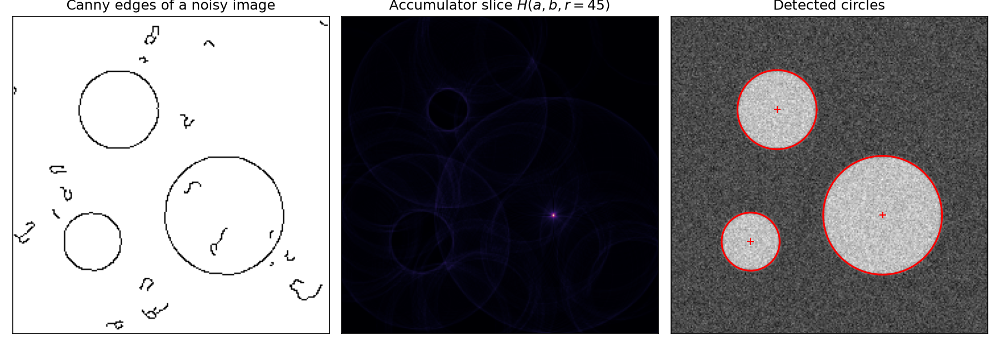
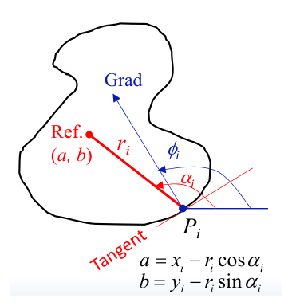

# The Hough Transform

An edge detector leaves a machine vision system with thousands of isolated edge pixels, while a measurement task needs a few lines, circles or ellipses with numerical parameters. The Hough transform bridges the two by a change of representation: it turns the combinatorial problem of grouping points into curves into the simpler problem of finding peaks in an array of votes. This chapter derives the transform for lines in three parameterizations, including the foot-of-normal form computed from the gradient, and then extends it to circles, ellipses and arbitrary shapes through the generalized Hough transform. Its input is the edge map of [Smoothing and Edge Detection](edge-detection.md), and its output feeds the matching of [Template Matching, Clustering and Shape Signatures](shape-analysis.md).

## From Edges to Curves

Most features used in machine vision are built from a small set of primitives: edges, corners and regions. Building them raises two questions that sit at the intermediate level of vision:

- **Grouping (perceptual organization).** Which edge pixels, corners or curve pieces belong together?
- **Model fitting.** Given a group, what geometric structure (a line, a circle) best describes it?

The simplest instance is the passage from local edge elements to straight lines. A direct approach is hopeless. Given \\(n\\) edge points, there are \\(n(n-1)/2 \sim O(n^2)\\) lines through pairs of them, and testing every other point against every such line costs \\((n-2)\\,n(n-1)/2 \sim O(n^3)\\) operations. For a modest edge image with \\(n = 10^4\\) points that is \\(10^{12}\\) tests.

The Hough transform reverses the logic. Instead of asking which points lie on a given line, each point asks which lines pass through it, and votes for all of them in a space whose coordinates are the line parameters. Lines supported by many points receive many votes.

**Key idea.** The Hough transform converts a *point-grouping problem* in image space into a *peak-detection problem* in parameter space.

## Lines in Slope–Intercept Form

### Point–line duality

A line in the image plane is \\(y = ax + b\\). Fix a point \\((x\_i, y\_i)\\). Infinitely many lines pass through it, namely all \\((a, b)\\) satisfying \\(y\_i = a x\_i + b\\). Rewriting,
\\[
b = -x\_i\\, a + y\_i ,
\\]
which, for fixed \\((x\_i,y\_i)\\), is a *single straight line* in the \\((a,b)\\) **parameter plane**. So every image point corresponds to a line in parameter space, and every image line corresponds to a point in parameter space. If \\(n\\) image points \\((x\_1,y\_1),\dots,(x\_n,y\_n)\\) lie on one line of slope \\(a^\*\\) and intercept \\(b^\*\\), their \\(n\\) parameter-space lines all pass through \\((a^\*, b^\*)\\). The intersection of the lines for \\((x\_i,y\_i)\\) and \\((x\_j,y\_j)\\) gives the parameters of the line through both points.

**Example 1 (Four points).** Take the points \\((1,3)\\), \\((2,2)\\), \\((4,3)\\) and \\((4,0)\\). Their parameter-space lines are

| image point | equation \\(y\_i = a x\_i + b\\) | parameter line |
|---|---|---|
| \\((1,3)\\) | \\(3 = a + b\\) | \\(b = -a + 3\\) |
| \\((2,2)\\) | \\(2 = 2a + b\\) | \\(b = -2a + 2\\) |
| \\((4,3)\\) | \\(3 = 4a + b\\) | \\(b = -4a + 3\\) |
| \\((4,0)\\) | \\(0 = 4a + b\\) | \\(b = -4a\\) |

The first, second and fourth lines meet at \\((a,b) = (-1, 4)\\): substituting \\(a=-1\\) gives \\(b = 4\\) in all three. Hence \\((1,3)\\), \\((2,2)\\) and \\((4,0)\\) are collinear on \\(y = -x + 4\\). The line of \\((4,3)\\) is parallel to that of \\((4,0)\\) (same slope \\(-4\\) in parameter space, since both points have \\(x = 4\\)); it crosses the others at single points only, so \\((4,3)\\) collects no consensus.

### The accumulator

To turn the geometry into an algorithm, the parameter plane is discretized into cells, the **accumulator** \\(H(a,b)\\), a two-dimensional histogram.

**Algorithm (Hough transform, slope–intercept form).**

1. Choose ranges \\(a\_{\min} \le a \le a\_{\max}\\), \\(b\_{\min} \le b \le b\_{\max}\\) and quantize them into "buckets" \\(a\_1,\dots,a\_K\\) and \\(b\_1,\dots,b\_L\\). Set \\(H(p,q) = 0\\) for all cells.
2. For every edge point \\((x\_k, y\_k)\\) whose gradient magnitude exceeds a threshold, and for each \\(a\_p\\), \\(p = 1,\dots,K\\):
   compute \\(b = -a\_p x\_k + y\_k\\), round it to the nearest bucket \\(b\_q\\), and increment \\(H(p,q) \leftarrow H(p,q) + 1\\).
3. A value \\(M\\) in cell \\(H(p,q)\\) means that \\(M\\) image points lie (to within the quantization) on the line \\(y = a\_p x + b\_q\\). Local maxima of \\(H\\) correspond to collinear edge points.



*Figure: the quantized \\((a,b)\\) plane. Each image point deposits a digital line of single votes (blue and green cells); the cell where two such lines cross receives two votes (red). Line detection in image space has become cluster detection in parameter space.*

**Cost.** If \\(a\\) is subdivided into \\(K\\) increments, each point produces \\(K\\) values of \\(b\\), so \\(n\\) points require \\(nK\\) evaluations. The work is **linear in \\(n\\)**, against \\(O(n^3)\\) for the exhaustive test. The price is resolution: the accuracy with which collinearity is judged is set by the number of subdivisions of the \\((a,b)\\) plane.

**The flaw of this parameterization.** The slope is unbounded, \\(-\infty \le a \le \infty\\). A vertical line has no finite \\(a\\), and near-vertical lines need an enormous and mostly empty range of \\(a\\). No finite accumulator covers all lines. The normal parameterization removes the problem.

## The Normal (ρ, θ) Parameterization

### Derivation

Describe a line by the perpendicular dropped onto it from the origin: \\(\rho\\) is the length of that perpendicular and \\(\theta\\) the angle it makes with the \\(x\\)-axis. The foot of the perpendicular is \\((\rho\cos\theta, \rho\sin\theta)\\), and the unit normal of the line is \\(n = (\cos\theta, \sin\theta)\\). A point \\((x, y)\\) lies on the line exactly when its projection on the normal equals \\(\rho\\):
\\[
\boxed{\rho = x\cos\theta + y\sin\theta .}
\\]

The same result follows from the slope–intercept form. The normal is perpendicular to the line, so its slope \\(\tan\theta\\) and the line's slope \\(a\\) multiply to \\(-1\\):
\\[
\tan\theta = -\frac{1}{a} \quad\Longrightarrow\quad a = -\frac{\cos\theta}{\sin\theta}.
\\]
Where the line crosses the \\(y\\)-axis (\\(x = 0\\)), the right triangle formed by the origin, the foot and the intercept has hypotenuse \\(b\\) and the angle between the \\(y\\)-axis and the normal equal to \\(90^\circ - \theta\\), so \\(\rho = b\sin\theta\\), i.e. \\(b = \rho/\sin\theta\\). Substituting both into \\(y = ax + b\\),
\\[
y = \left(-\frac{\cos\theta}{\sin\theta}\right) x + \frac{\rho}{\sin\theta}
\quad\Longrightarrow\quad
y\sin\theta = -x\cos\theta + \rho
\quad\Longrightarrow\quad
\rho = x\cos\theta + y\sin\theta .
\\]



*Figure: the normal parameterization. The perpendicular from the origin to the line has length ρ and direction θ; the slope–intercept parameters follow as a = −cos θ / sin θ and b = ρ / sin θ.*

Both parameters are now **bounded**. With \\(0 \le \theta < 180^\circ\\), \\(\rho\\) takes either sign and \\(\lvert\rho\rvert\\) never exceeds the distance \\(D\\) from the origin to the farthest image corner (for an \\(M\times N\\) image with the origin at a corner, \\(D = \sqrt{M^2+N^2}\\)). Equivalently one may let \\(\theta\\) range over \\([0, 360^\circ)\\) and keep \\(\rho \ge 0\\). Vertical lines are \\(\theta = 0\\), horizontal lines \\(\theta = 90^\circ\\), and nothing is singular.

### Points map to sinusoids

For a fixed image point, \\(\rho(\theta) = x\cos\theta + y\sin\theta = \sqrt{x^2+y^2}\\,\cos(\theta - \phi)\\) with \\(\phi = \operatorname{atan2}(y,x)\\): a **sinusoid** of amplitude equal to the point's distance from the origin. Collinear points give sinusoids through a common point \\((\theta^\*, \rho^\*)\\), the parameters of their line.

**Example 2 (Three points on \\(x + y = 1\\)).** The points \\((0,1)\\), \\((0.5, 0.5)\\) and \\((1,0)\\) give
\\[
\rho = \sin\theta, \qquad \rho = 0.5(\cos\theta + \sin\theta), \qquad \rho = \cos\theta .
\\]
The first and third are equal when \\(\tan\theta = 1\\), \\(\theta = \pi/4\\), where \\(\rho = \sin(\pi/4) = 0.707\\); the second gives \\(0.5(0.707 + 0.707) = 0.707\\) as well. All three meet at \\((\theta,\rho) = (\pi/4, 0.707)\\), and indeed \\(x\cos 45^\circ + y \sin 45^\circ = 0.707\\) is \\(x + y = 1\\).

**Example 3 (An outlier among three collinear points).** Four points \\((0,-1.94)\\), \\((1.5,-0.5)\\), \\((2,0)\\) and \\((0.5,-1.5)\\) give the curves
\\[
\rho = -1.94\sin\theta,\quad \rho = 1.5\cos\theta - 0.5\sin\theta,\quad \rho = 2\cos\theta,\quad \rho = 0.5\cos\theta - 1.5\sin\theta,
\qquad 0^\circ \le \theta \le 180^\circ .
\\]
At \\(\theta = 135^\circ\\) (\\(\cos\theta = -0.7071\\), \\(\sin\theta = 0.7071\\)) the last three give \\(\rho = -1.414\\) exactly: for instance \\(1.5(-0.7071) - 0.5(0.7071) = -1.414\\). The line is therefore
\\[
x\cos 135^\circ + y\sin 135^\circ = -1.414 \;\Longleftrightarrow\; y = x - 2,
\\]
with slope \\(a = -\cos\theta/\sin\theta = 1\\) and intercept \\(b = \rho/\sin\theta = -2\\). The foot of the normal is \\((\rho\cos\theta, \rho\sin\theta) = (1, -1)\\). The first point is *not* on the line (\\(0 - 2 \ne -1.94\\)), but its sinusoid passes close by: at \\(135^\circ\\) it gives \\(\rho = -1.372\\), only 0.042 from the peak. With a \\(\rho\\) bin wider than about 0.05 it would add a vote to the same cell. The bin width is the tolerance with which points are declared collinear.



*Figure: left, Example 2, three sinusoids meeting at (π/4, 0.707). Right, Example 3, three collinear points meeting at (135°, −1.414); the red curve of the outlier (0, −1.94) passes close to, but not through, the common point.*

When the points come from a real object, the picture is a bundle of sinusoids. For a triangle in a 500 × 400 image, three points on the left edge give sinusoids crossing at about \\(\rho = 270\\), \\(\theta = 0.71\\) rad. A vertex lies on two edges, so its sinusoid passes through two of the peaks. The sinusoids of all boundary points form bundles intersecting at three points, one per side.

### Accumulator design

The algorithm is that of the slope–intercept form with \\((\theta,\rho)\\) in place of \\((a,b)\\): for each edge point and each quantized \\(\theta\_j\\), compute \\(\rho = x\cos\theta\_j + y\sin\theta\_j\\), round it to a bin and increment \\(H(\theta\_j, \rho)\\). Practical choices:

- **Bin sizes.** \\(\Delta\rho\\) of about one pixel and \\(\Delta\theta\\) such that \\(D\\,\Delta\theta \approx \Delta\rho\\) (so that a rotation by one \\(\theta\\) bin moves the far end of a line by about one \\(\rho\\) bin) balance the two axes. A grid that is too coarse merges nearby lines ("maxima pushed together"); a grid that is too fine spreads the votes of one noisy line over many cells, so peaks become ill defined.
- **Precomputed trigonometry.** \\(\cos\theta\_j\\) and \\(\sin\theta\_j\\) are tabulated once; each vote then costs two multiplications and an addition.
- **Peak detection.** A real line produces a peak with a skirt of neighbouring votes, and noise produces a background level. Peaks are taken as local maxima above a threshold, and once a peak is accepted its neighbourhood is suppressed so that it is not reported twice (non-maximum suppression). MATLAB's `houghpeaks` does this with a suppression window `NhoodSize`.
- **From peak to segment.** A peak gives an infinite line. The finite segments are recovered by walking along the line in the edge image, as discussed under gradient-based voting below.



*Figure: the ρ–θ transform at work. Left, three lines with 15% of their pixels removed and 2% random noise pixels. Centre, the accumulator (log scale): every pixel draws a sinusoid, and the three lines appear as bright crossings (circled), well above the background of noise votes. Right, the three detected lines drawn over the edge image.*

**Example 4 (Chessboard grid in MATLAB).** The toolbox functions `hough`, `houghpeaks` and `houghlines` implement this transform. The following script finds the grid lines of a chessboard; the Canny thresholds 0.1 and 0.2 with \\(\sigma = 2\\) suppress the texture of the background:

```matlab
im = imread('chess1.bmp'); f1 = figure; imshow(im);
e  = edge(im, 'canny', [0.1 0.2], 2);          % edge map
[h, theta, rho] = hough(e);                    % accumulator, theta in degrees
figure; imshow(sqrt(h'), []);                  % display (square root for contrast)
p = houghpeaks(h, 21, 'Threshold', 0, 'NhoodSize', [27 11]);   % up to 21 peaks,
                                               % at least 27 rho bins and 11 theta bins apart
theta = (pi/180) * theta;                      % convert to radians
figure(f1); [nr, nc] = size(im); hold on
for pr = p'
    r = rho(pr(1)); t = theta(pr(2));
    % end points of the line r = x cos t + y sin t clipped to the image
    if abs(sin(t)) > 1e-6
        x = [1 nc]; y = (r - x*cos(t)) / sin(t);
    else
        y = [1 nr]; x = r / cos(t) * [1 1];
    end
    plot(x, y, 'r-', 'LineWidth', 1);
end
hold off
```

The scikit-image equivalent is short:

```python
import numpy as np
from skimage.feature import canny
from skimage.transform import hough_line, hough_line_peaks

edges = canny(img, sigma=2)
h, angles, dists = hough_line(edges, theta=np.linspace(-np.pi/2, np.pi/2, 360, endpoint=False))
for acc, theta, rho in zip(*hough_line_peaks(h, angles, dists, num_peaks=21)):
    print(f"rho = {rho:.1f} px, theta = {np.degrees(theta):.1f} deg, votes = {acc}")
```

Note that scikit-image measures \\(\rho = c\cos\theta + r\sin\theta\\) with \\(c\\) the column and \\(r\\) the row index.

## Using the Gradient Direction

The standard transform uses only the *existence* of an edge at a pixel and lets it vote for every orientation. But the edge detector also measures the edge *orientation*: the gradient \\((g\_x, g\_y)\\) is normal to the edge. If \\(\theta\\) is taken from the gradient, each edge pixel maps to a single **point** \\((\rho,\theta)\\) of Hough space instead of a sinusoid. Three edge pixels on one line, with parallel gradients, map to the same point, wherever the origin is placed.

Consequences:

- **Cost.** One vote per pixel instead of \\(K\\). In practice a small window of \\(\theta\\) bins around the measured direction is used to absorb the angular error of the gradient.
- **Clusters, not curves.** Collinear edges form point clusters in parameter space. Peak detection becomes cluster detection, which is why clustering (K-means, treated in [Template Matching, Clustering and Shape Signatures](shape-analysis.md)) is a natural tool here.
- **Lost localization.** Separate collinear segments, for example the treads of a staircase-like contour that lie on one line, contribute to the same maximum. The peak identifies an "average" line; where along the line the edges are is no longer known.

Image-space localization is restored by an **edge connected-components** step. For the edges in one Hough cluster: rotate the edge points by \\(-\theta\\) so that the line becomes an axis; sort them by the rotated coordinate along the line; scan for gaps larger than a "max gap" threshold and break the line into segments there; if a segment has enough edges, fit a straight line to its points by least squares. MATLAB's `houghlines` (with `FillGap` and `MinLength`) implements this step.

## The Foot-of-Normal Parameterization

The gradient can do more than select \\(\theta\\). Given an edge point and its gradient, the line through the point perpendicular to the gradient is fully determined, and so is the foot of the perpendicular from the origin to it. Using the foot \\((x\_o, y\_o)\\) itself as the pair of parameters avoids trigonometric functions entirely.

### Derivation

Let the edge point be \\((x, y)\\) with gradient \\((g\_x, g\_y)\\), \\(G = \sqrt{g\_x^2 + g\_y^2}\\). The foot \\((x\_o, y\_o)\\) satisfies two conditions.

1. The vector from the origin to the foot lies along the normal, i.e. along the gradient:
\\[
\tan\theta = \frac{g\_y}{g\_x} = \frac{y\_o}{x\_o} \quad\Longrightarrow\quad \begin{bmatrix} x\_o \\\\ y\_o \end{bmatrix} = \nu \begin{bmatrix} g\_x \\\\ g\_y \end{bmatrix} \ \text{ for some scalar } \nu .
\\]
2. The foot lies on the edge line, so the vector from the foot to the edge point is perpendicular to the normal. In slope form, the line's slope is \\(a = \dfrac{y - y\_o}{x - x\_o} = -\dfrac{x\_o}{y\_o} = -\dfrac{g\_x}{g\_y}\\), which rearranges to
\\[
x\_o (x - x\_o) + y\_o (y - y\_o) = 0 .
\\]

Substituting \\(x\_o = \nu g\_x\\), \\(y\_o = \nu g\_y\\) into the second condition,
\\[
\nu (g\_x x + g\_y y) - \nu^2 (g\_x^2 + g\_y^2) = 0
\quad\Longrightarrow\quad
\boxed{\begin{bmatrix} x\_o \\\\ y\_o \end{bmatrix} = \nu \begin{bmatrix} g\_x \\\\ g\_y \end{bmatrix}, \qquad \nu = \frac{x g\_x + y g\_y}{g\_x^2 + g\_y^2}.}
\\]
(The root \\(\nu = 0\\) corresponds to a line through the origin, whose foot is the origin itself.) One can also eliminate \\(y\_o = (g\_y/g\_x) x\_o\\) directly: \\(x\_o(x - x\_o) + \frac{g\_y}{g\_x}x\_o\left(y - \frac{g\_y}{g\_x}x\_o\right) = 0\\) gives \\(x\_o\left(1 + \frac{g\_y^2}{g\_x^2}\right) = x + y\frac{g\_y}{g\_x}\\), the same result.

The other line parameters follow from the foot:
\\[
\rho = \sqrt{x\_o^2 + y\_o^2} = \lvert\nu\rvert G, \qquad
\theta = \tan^{-1}\frac{g\_y}{g\_x} = \tan^{-1}\frac{y\_o}{x\_o}, \qquad
a = -\frac{x\_o}{y\_o}, \qquad b = \frac{\rho}{\sin\theta},
\\]
and the line itself is
\\[
x\_o\\, x + y\_o\\, y = x\_o^2 + y\_o^2 .
\\]



*Figure: given an edge point (x, y) and its gradient (g_x, g_y), the parameters are the foot (x_o, y_o) of the perpendicular from the origin to the edge line.*

**Advantages.** (i) No trigonometric functions are evaluated; (ii) the gradient information is used; (iii) both parameters are computed simultaneously, so each edge pixel casts exactly one vote in a two-dimensional accumulator \\(H(x\_o, y\_o)\\).

**Accumulator and practical details.** The foot coordinates can be negative (a line whose normal points away from the image quadrant), so an offset is added to make the array indices positive, e.g. \\(H(x\_o + \text{offset}, y\_o + \text{offset})\\). The foot does not depend on the gradient polarity: reversing \\((g\_x, g\_y)\\) reverses \\(\nu\\) and leaves \\(\nu(g\_x, g\_y)\\) unchanged, so dark-to-light and light-to-dark edges on the same line vote for the same cell. The accuracy of the foot degrades with distance from the origin: an angular error \\(\delta\theta\\) in the gradient moves the foot by about \\(\rho\\,\delta\theta\\) perpendicular to the normal. Smoothing the gradient (derivative-of-Gaussian rather than a bare Sobel mask) and refining each detected line by a least-squares fit to the edge points that voted for it both help.

**Coordinate conventions.** Here pixel coordinates are (row, column) \\(= (x, y)\\), with \\(x\\) pointing down the rows and \\(y\\) to the right along the columns, and the gradient is \\((g\_x, g\_y) = (\partial I/\partial x, \partial I/\partial y)\\). MATLAB's `[~,~,Gv,Gh] = edge(...)` returns \\((g\_x, g\_y)\\) in this order, whereas `[Gx,Gy] = imgradientxy(I)` returns the horizontal gradient first, i.e. \\(g\_y\\), then \\(g\_x\\). `imshow` displays the column to the right and the row down, while `plot` puts \\(y\\) up. Most errors in implementing the foot-of-normal transform are mixed conventions.

**Example 5 (Rotated checkerboard).** On a rotated checkerboard, the gradient image and the 3-D histogram of \\((x\_o, y\_o)\\) show six sharp peaks. Reading them off and converting gives

| line | \\(x\_o\\) | \\(y\_o\\) | \\(a\\) | \\(b\\) | \\(\rho\\) | inclination \\(\tan^{-1}a\\) |
|---|---|---|---|---|---|---|
| 1 | −58 | 116 | 0.500 | 145 | 130 | 26.6° |
| 2 | −19 | 40 | 0.48 | 49.0 | 44 | 25.4° |
| 3 | 25 | −50 | 0.50 | −62.5 | 56 | 25.6° |
| 4 | 71 | 32 | −2.22 | 189.5 | 78 | −65.7° |
| 5 | 159 | 80 | −1.99 | 396.0 | 178 | −63.3° |
| 6 | 246 | 120 | −2.05 | 624.3 | 274 | −64.0° |

Check line 1: \\(a = -x\_o/y\_o = 58/116 = 0.5\\); \\(\rho = \sqrt{58^2 + 116^2} = 129.7\\); the line \\(x\_o x + y\_o y = \rho^2\\) meets \\(x = 0\\) at \\(y = b = \rho^2/y\_o = 16820/116 = 145\\). The angle column is the inclination of the line, which is the normal angle \\(\operatorname{atan2}(y\_o, x\_o) = 116.6^\circ\\) minus \\(90^\circ\\). Lines 1–3 have slope about 0.5 and lines 4–6 slope about −2: two perpendicular families, as a checkerboard requires (\\(0.5 \times (-2) = -1\\)).

**Example 6 (Triangle with a hole; Hough votes plus K-means).** Storing an \\(N\_1 \times N\_2\\) accumulator is unnecessary when each pixel casts one vote: the votes can be kept as a list `Accu = [Accu; x0 y0]` (an \\(N \times 2\\) array) and clustered with K-means, whose centroids are the accumulator peaks. For a gray right triangle with a circular hole, the 3-D accumulator shows three peaks (about 450, 400 and 600 votes), and `kmeans(Accu, 3)` returns the centroids (with an offset of 300 added) \\((299.13, 372.23)\\), \\((279.76, 320.46)\\), \\((850.23, 300.43)\\), i.e. without offset
\\[
(x\_o, y\_o) = (-0.87, 72.23),\quad (-20.24, 20.46),\quad (550.23, 0.43).
\\]
The third is the bottom edge of the triangle: its foot lies where the perpendicular from the image corner meets the edge, near row 550, column 0, and the cursor reading \\([X,Y] = [6, 546]\\) in the displayed image (column, row) agrees once the (row, column) order is respected. The edge pixels of the hole cast votes spread along a curve rather than into a peak, so they do not attract a centroid. K-means needs the number of lines in advance. When it is known it filters noise effectively (one noisy line produces many small neighbouring peaks, which a single centroid absorbs); without that knowledge it can fail.

The same method applied to a trapezoid with a circular hole yields four tall spikes; K-means with \\(k = 4\\) (20 replicates) gives centroids \\((-184, 666)\\), \\((0, 162)\\), \\((184, 0)\\), \\((721, 0)\\). The lines \\(x\_o x + y\_o y = x\_o^2 + y\_o^2\\) are \\(x = 721\\), \\(x = 184\\), \\(y = 162\\), and the slanted edge \\(-184x + 666y = 477{,}412\\); their pairwise intersections give the four corners \\((184,162)\\), \\((184,768)\\), \\((721,916)\\), \\((721,162)\\) in (row, column) order (for example \\(x = 184\\) in the slanted line gives \\(666y = 477{,}412 + 184^2\\), \\(y = 767.7\\)).



*Figure: foot-of-normal transform of a synthetic triangle with a hole (rows down, columns right, origin at the top-left corner). Centre: one vote per edge pixel in the \\((x\_0, y\_0)\\) accumulator; the three sides give compact peaks (circled: K-means centroids) and the hole a faint circular trail of scattered votes. Right: the three lines after least-squares refinement, with the perpendicular from the origin to each foot (cyan). The side whose foot is farthest from the origin has the most spread-out peak, because angular errors are magnified by ρ.*

In the synthetic example of the figure the true feet are \\((48.3, 120.7)\\), \\((-39.7, 53.9)\\) and \\((251.3, 11.4)\\). The K-means centroids are \\((48.2, 120.6)\\), \\((-39.7, 53.9)\\) and \\((246.5, 1.5)\\); after a total-least-squares line fit to the edge points that voted within 15 pixels of each centroid, the third becomes \\((250.9, 10.8)\\).

## Generalization to Other Curves

The Hough transform generalizes to any curve given in implicit form
\\[
f(\mathbf{x}, \mathbf{a}) = 0,
\\]
where \\(\mathbf{x}\\) is the image point and \\(\mathbf{a}\\) the parameter vector, whose components are the axes of Hough space. Each edge point votes for the set of \\(\mathbf{a}\\) consistent with it. Two facts limit the generalization:

- **Quantization governs success.** Too coarse and distinct maxima are pushed together; too fine and the peaks become poorly defined.
- **Dimension.** With \\(m\\) parameters, each quantized into \\(Q\\) levels, the accumulator has \\(Q^m\\) cells. The exponential growth restricts the direct method to curves with few parameters. Gradient information, which removes one degree of freedom per edge point, is the main remedy.

## Circles

A circle with centre \\((a, b)\\) and radius \\(r\\),
\\[
(x - a)^2 + (y - b)^2 = r^2 ,
\\]
has three parameters and a three-dimensional accumulator \\(H(a, b, r)\\).

### Radius known, no gradient

If \\(r\\) is known, the accumulator is two-dimensional. An edge point \\((i, j)\\) could be on any circle of radius \\(r\\) whose centre satisfies \\((i - a)^2 + (j - b)^2 - r^2 = 0\\): the candidate centres themselves form a circle of radius \\(r\\) around \\((i,j)\\) in the \\((a,b)\\) plane. Each edge point therefore draws a circle of votes, and the circles drawn by all points of the true circle pass through its centre, which collects many votes.

### Using the gradient

At an edge point of a circle the gradient is radial. Let \\(\theta\\) be its direction,
\\[
G = \sqrt{g\_x^2 + g\_y^2}, \qquad \tan\theta = \frac{g\_y}{g\_x}, \qquad \cos\theta = \frac{g\_x}{G}, \qquad \sin\theta = \frac{g\_y}{G}.
\\]
If the gradient points away from the centre (a dark disc on a light background), the centre lies a distance \\(r\\) back along it:
\\[
\boxed{a = x - r\cos\theta = x - r\frac{g\_x}{G}, \qquad b = y - r\sin\theta = y - r\frac{g\_y}{G}.}
\\]
For a light disc on a dark background the signs flip; voting for both \\(\pm r\\) handles unknown polarity. With the gradient, each edge pixel casts one vote per candidate radius instead of a whole circle of votes.

**Algorithm (circle Hough transform with gradient).**

1. Compute the gradient (Sobel or derivative of Gaussian) and keep pixels whose magnitude exceeds a threshold.
2. Initialize an accumulator \\(H(a, b, r)\\) of size \\(S\_x \times S\_y \times R\_{\max}\\).
3. For each edge pixel and each \\(r = 1, \dots, R\_{\max}\\): compute \\(a\\) and \\(b\\) from the boxed formula, round them and increment \\(H(a, b, r)\\).
4. The element with the largest value (or each local maximum above a threshold) gives a circle.

In MATLAB-like pseudo-code:

```matlab
for r = 1:Rmax
    for i = 1:NumEdgePixels
        a = x(i) - r*gx(i)/sqrt(gx(i)^2 + gy(i)^2);
        b = y(i) - r*gy(i)/sqrt(gx(i)^2 + gy(i)^2);
        HT(round(a), round(b), r) = HT(round(a), round(b), r) + 1;
    end
end
[~, k] = max(HT(:)); [a, b, r] = ind2sub(size(HT), k);
```

**Example 7 (Four edge points).** Four edge points with unit gradients:

| point | \\((x, y)\\) | \\((g\_x, g\_y)\\) |
|---|---|---|
| ① | (3, 5) | (0, 1) |
| ② | (5, 3) | (1, 0) |
| ③ | (3, 1) | (0, −1) |
| ④ | (1, 3) | (−1, 0) |

For point ③ and \\(r = 1\\): \\(a\_3 = 3 - 1\cdot\frac{0}{1} = 3\\), \\(b\_3 = 1 - 1\cdot\frac{-1}{1} = 2\\). Repeating for all points:

- \\(r = 1\\): the votes go to \\((3,4)\\), \\((4,3)\\), \\((3,2)\\), \\((2,3)\\), four different cells with one vote each.
- \\(r = 2\\): all four points vote for \\((3,3)\\).

The maximum, four votes, is at \\(a = b = 3\\), \\(r = 2\\): the circle \\((x-3)^2 + (y-3)^2 = 4\\), which indeed passes through all four points with outward radial gradients.

**Example 8 (Hex nut).** For a hexagonal nut on a tan background, searching \\(1 \le r \le R\_{\max} = 50\\) with the edge pixels of the central hole gives an accumulator peak at \\((a, b) = (112, 119)\\), \\(r = 35\\): the hole of the nut.

**Example 9 (Parts with two circles each).** For three circular parts, each with an outer rim and an inner feature, a 3-D accumulator gives the big circles \\((x\_c, y\_c, r)\\) = (296, 216, 184), (688, 322, 192), (554, 726, 198) and the small-circle centres (296, 156), (597, 403), (551, 651). The same method locates the 5 × 5 grid of circular dots on a camera-calibration target.



*Figure: circle detection on three parts. The accumulator (top) shows bright crossings at the centres; the table lists centres and radii of the outer circles and centres of the inner ones, drawn in matching colours on the image.*



*Figure: circle Hough transform without gradient on a synthetic image (scikit-image `hough_circle`, radii 15–59). Left, Canny edges including spurious fragments. Centre, the accumulator slice for r = 45: the edge pixels of every circle draw rings of votes, but only the circle of radius 45 produces a sharp peak at its centre. Right, the three detected circles; the centres and radii (150, 160, 45), (70, 80, 30) and (170, 60, 22) are recovered exactly.*

**Remark (two-stage variants).** When memory for a full 3-D accumulator is a concern, a common alternative is to vote for centres first along the gradient line (all \\(r\\) collapsed into one 2-D accumulator), then, for each detected centre, histogram the distances of the edge points to it to find the radius.

## Ellipses

For illustration take an ellipse whose principal axes are parallel to the coordinate axes:
\\[
\frac{(x - x\_c)^2}{a^2} + \frac{(y - y\_c)^2}{b^2} = 1 ,
\\]
with four parameters \\((a, b, x\_c, y\_c)\\).

**Using the edge direction.** Differentiate the equation totally with respect to \\(x\\):
\\[
\frac{x - x\_c}{a^2} + \frac{y - y\_c}{b^2}\frac{dy}{dx} = 0 .
\\]
The edge operator gives the tangent slope \\(dy/dx = \tan\phi\\) (the tangent is perpendicular to the gradient, \\(\tan\phi = -g\_x/g\_y\\)). Hence
\\[
x - x\_c = -\left(\frac{a}{b}\right)^2 (y - y\_c)\tan\phi .
\\]
Substitute into the ellipse equation:
\\[
\frac{a^2}{b^4}(y - y\_c)^2\tan^2\phi + \frac{(y - y\_c)^2}{b^2} = 1
\quad\Longrightarrow\quad
(y - y\_c)^2 = \frac{b^2}{1 + (a/b)^2\tan^2\phi} .
\\]
Then \\((x - x\_c)^2 = (a/b)^4 \tan^2\phi\\,(y - y\_c)^2 = \dfrac{a^4\tan^2\phi}{b^2 + a^2\tan^2\phi} = \dfrac{a^2}{1 + (b/a)^2/\tan^2\phi}\\). Therefore
\\[
\boxed{x\_c = x \pm \frac{a}{\sqrt{1 + (b/a)^2/\tan^2\phi}}, \qquad y\_c = y \pm \frac{b}{\sqrt{1 + (a/b)^2\tan^2\phi}} .}
\\]
The two signs are not independent: from \\(x - x\_c = -(a/b)^2(y-y\_c)\tan\phi\\), the sign of \\(x - x\_c\\) is opposite to that of \\((y - y\_c)\tan\phi\\). So for each trial pair \\((a, b)\\), an edge point with known direction votes for just two candidate centres, symmetric about the point.

**Algorithm (ellipse Hough transform).**

1. Quantize the parameter space \\((a, b, x\_c, y\_c)\\) between appropriate minimum and maximum values.
2. Form an accumulator array with all elements initially zero.
3. For every edge point \\((x, y)\\) and every discrete \\((a, b)\\), solve for \\((x\_c, y\_c)\\) with the boxed formula.
4. Increment the corresponding accumulator cells.
5. Local maxima of the accumulator correspond to ellipses; the accumulator value measures how many edge points support each one.

On a test image containing one ellipse, the accumulated votes form overlapping elliptical arcs with a sharp peak at the centre. A rotated ellipse adds a fifth parameter, the orientation, and the accumulator grows accordingly; this is where the exponential cost of the direct method begins to bite, and where methods that fit conics to grouped edge points become competitive.

## The Generalized Hough Transform

Many object outlines have no analytic form. The **generalized Hough transform** (GHT) replaces the equation \\(f(\mathbf{x},\mathbf{a}) = 0\\) by a table built from a model of the shape. Assume first that the scale and orientation of the object are fixed; only its position is unknown.

**Building the R-table.**

1. Pick a reference point \\((a, b)\\) inside the shape (the centroid, say).
2. For each boundary point \\(P\_i = (x\_i, y\_i)\\), \\(i = 1, \dots, n\\):
   - draw the segment from the reference point to \\(P\_i\\); measure its length \\(r\_i\\) and its orientation \\(\alpha\_i\\);
   - write the reference coordinates in terms of them:
     \\[
     a = x\_i - r\_i\cos\alpha\_i, \qquad b = y\_i - r\_i\sin\alpha\_i ;
     \\]
   - record the gradient orientation \\(\phi\_i\\) at \\(P\_i\\).
3. Build a table indexed by the (quantized) gradient direction \\(\phi\\). Each row lists all \\((r, \alpha)\\) pairs observed at boundary points with that direction:

| \\(\phi\\) | displacement pairs |
|---|---|
| \\(\phi\_1\\) | \\((r\_1^1, \alpha\_1^1), (r\_2^1, \alpha\_2^1), \dots, (r\_{n\_1}^1, \alpha\_{n\_1}^1)\\) |
| \\(\phi\_2\\) | \\((r\_1^2, \alpha\_1^2), (r\_2^2, \alpha\_2^2), \dots, (r\_{n\_2}^2, \alpha\_{n\_2}^2)\\) |
| \\(\vdots\\) | \\(\vdots\\) |
| \\(\phi\_m\\) | \\((r\_1^m, \alpha\_1^m), (r\_2^m, \alpha\_2^m), \dots, (r\_{n\_m}^m, \alpha\_{n\_m}^m)\\) |

A row may hold several entries because several boundary points can share a gradient direction (for a non-convex shape, or on parallel sides).



*Figure: building the R-table. For each boundary point P_i, the displacement (r_i, α_i) to the reference point (a, b) is stored under the gradient direction φ_i measured at P_i.*

**Detection.**

1. Form the R-table from the model.
2. Initialize an accumulator over candidate reference positions \\((a,b)\\).
3. For each edge pixel \\((x, y)\\) of the image: compute its gradient direction \\(\phi\\); look up the row for \\(\phi\\); for each \\((r, \alpha)\\) in that row compute the candidate reference point \\(a = x - r\cos\alpha\\), \\(b = y - r\sin\alpha\\) and increment \\(H(a, b)\\).
4. Local maxima of the accumulator are the locations of instances of the shape.

The R-table is the shape's template, and the line and circle transforms are special cases: for a circle every row holds the single entry \\((r, \phi)\\).

**Rotation and scale.** If the object may also be scaled by \\(S\\) and rotated by \\(\theta\\), the accumulator becomes four-dimensional, \\(H(a, b, S, \theta)\\). For each edge pixel, each \\((r, \alpha)\\) in the selected row and each discrete \\((S, \theta)\\),
\\[
a = x - r(\phi) S\cos[\alpha(\phi) + \theta], \qquad b = y - r(\phi) S\sin[\alpha(\phi) + \theta],
\\]
and \\(H(a, b, S, \theta)\\) is incremented; maxima give position, scale and orientation. Because rotating the object also rotates its gradients, the row to consult for trial rotation \\(\theta\\) is the one for \\(\phi - \theta\\). (With the opposite convention for \\(\alpha\\), the vector from \\(P\_i\\) to the reference point, the formulas read \\(a = x + rS\cos(\alpha + \theta)\\) and \\(b = y + rS\sin(\alpha+\theta)\\).)

## Properties and Limitations

The Hough transform is a **voting scheme**: points vote for the parameter sets describing a line or curve through them, and the more votes a parameter set receives, the more evidence there is that the curve is present. From this follow its strengths:

- **Robustness to gaps and occlusion.** A line with half its pixels missing still receives half the votes; nothing requires the points to be contiguous.
- **Robustness to clutter.** Points not on the curve scatter their votes over the accumulator and raise only the background level.
- **Multiple instances in one pass.** Every peak is a curve; several lines or circles are found together.

and its costs:

- **Memory and time grow exponentially with the number of parameters.** Lines (2) and circles (3) are routine; ellipses (4–5) and the GHT with rotation and scale (4) are expensive.
- **Quantization trade-offs** between merged peaks and diffuse peaks, which must be tuned to the noise level.
- **Infinite lines, not segments,** unless a connected-components step follows.
- **Spurious peaks** from accidental alignments in heavily textured images, which is why a verification step (checking the edge support along a detected curve) is customary.

## Summary

- The Hough transform maps each edge point to the set of curve parameters consistent with it and accumulates votes; peaks are curves. Grouping becomes peak detection, at cost linear in the number of edge points.
- Slope–intercept form: the point \\((x\_i, y\_i)\\) gives the line \\(b = -x\_i a + y\_i\\) in the \\((a,b)\\) plane; unusable for (near-)vertical lines because \\(a\\) is unbounded.
- Normal form: \\(\rho = x\cos\theta + y\sin\theta\\), \\(0 \le \theta < 180^\circ\\), \\(\lvert\rho\rvert \le D\\); points map to sinusoids; \\(a = -\cos\theta/\sin\theta\\), \\(b = \rho/\sin\theta\\).
- Foot of normal from the gradient: \\((x\_o, y\_o) = \nu (g\_x, g\_y)\\), \\(\nu = (x g\_x + y g\_y)/(g\_x^2 + g\_y^2)\\); one vote per pixel, no trigonometry; line \\(x\_o x + y\_o y = x\_o^2 + y\_o^2\\); votes can be clustered with K-means.
- Circles: \\(a = x - r g\_x/G\\), \\(b = y - r g\_y/G\\); one vote per pixel per radius with the gradient; a circle of votes per pixel without it.
- Axis-aligned ellipses: \\(x\_c = x \pm a/\sqrt{1 + (b/a)^2/\tan^2\phi}\\), \\(y\_c = y \pm b/\sqrt{1 + (a/b)^2\tan^2\phi}\\), with coupled signs.
- Generalized HT: an R-table indexed by gradient direction stores displacements \\((r, \alpha)\\) to a reference point; rotation and scale add two accumulator dimensions.
- Accumulator size grows exponentially with the number of parameters; quantization must balance merged and diffuse peaks.

## See Also

- [Smoothing and Edge Detection](edge-detection.md): the gradient and edge maps that the transform consumes.
- [Template Matching, Clustering and Shape Signatures](shape-analysis.md): K-means for clustering Hough votes, and corner detection by other means.
- [Camera Calibration, Pose Estimation and Hand–Eye Calibration](calibration.md): circle and ellipse features as calibration targets and pose cues.
- Feature Detection and Image Processing: overview pages.
- Unsupervised Learning: clustering methods in general.
