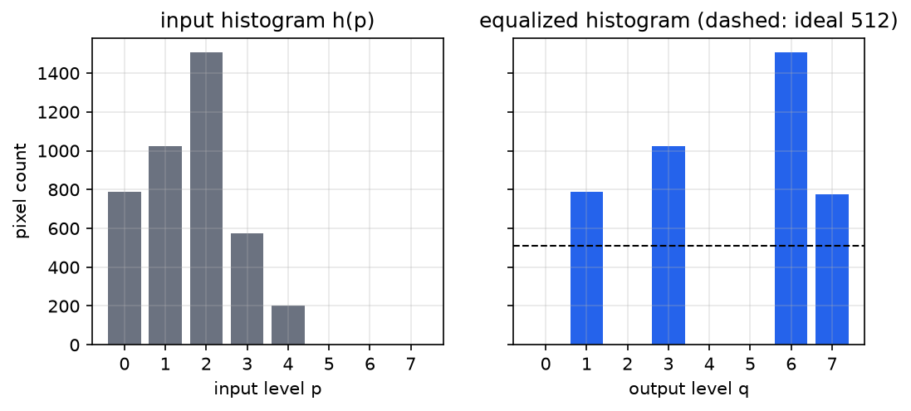
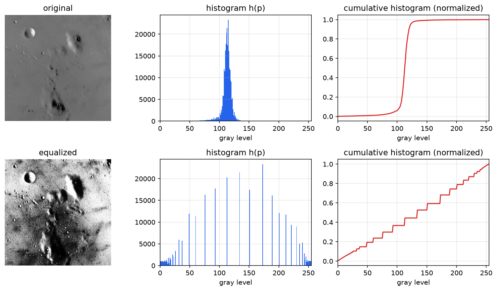
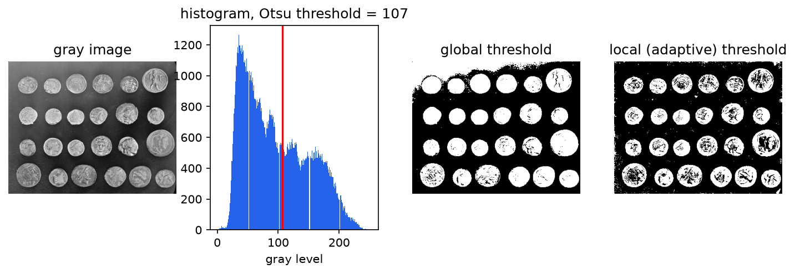
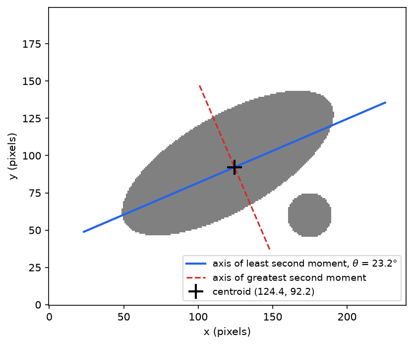
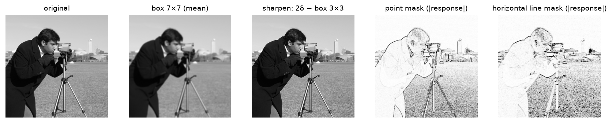

# Image Enhancement and Region Properties

Once an image is a matrix of gray levels, the first processing steps work either on the *distribution* of those levels or on small *neighbourhoods* of pixels. This chapter covers both. The histogram summarises the gray-level distribution and leads to histogram equalization, a contrast enhancement derived from the conservation of pixel counts, and to thresholding, which turns a gray image into a binary one. From a labelled binary image, moments give the area, position and orientation of each object; the principal-axis angle is derived in full. The chapter ends with masks and discrete convolution, the neighbourhood machinery that [Smoothing and Edge Detection](edge-detection.md) builds on.

## The Gray-Level Histogram

**Definition (Histogram).** For an \\(M \times N\\) image with \\(L = 2^n\\) gray levels \\(p \in \\{0, 1, \dots, L-1\\}\\), the histogram \\(h(p)\\) is the number of pixels with gray level \\(p\\). It is drawn as a bar graph with intensity on the horizontal axis and number of occurrences on the vertical axis, and satisfies \\(\sum\_{p=0}^{L-1} h(p) = MN\\).

Dividing by \\(MN\\) gives the normalised histogram \\(h(p)/MN\\), an empirical probability mass function of the gray level of a randomly chosen pixel. The histogram discards all spatial information (shuffling the pixels leaves it unchanged) but tells at a glance:

- the **overall brightness** (where the mass lies),
- the **contrast** (how widely the mass is spread; a low-contrast image uses only a narrow band of the available range),
- **saturation** (spikes at 0 or \\(L-1\\)),
- and **modality**: an image of dark objects on a bright background, as produced by the retroreflective lighting of [Image Formation and Acquisition](imaging.md), has a bimodal histogram with a valley between the object and background peaks.

## Histogram Equalization

A low-contrast image crowds its pixels into a narrow range of gray levels. **Histogram equalization** remaps the gray levels so that the output histogram is as flat (uniform) as possible, spreading the pixels over the full range. Peaks and valleys of the original histogram are kept, in the sense that the mapping is monotonic and preserves the order of gray levels, but they are shifted and stretched.

### Derivation

Treat the gray level as a continuous variable for the derivation. Let the input level be \\(p \in [0, L-1]\\) with histogram density \\(h(p)\\) (pixels per unit gray level), and seek a monotonically increasing mapping \\(q = T(p)\\) such that the output density \\(g(q)\\) is uniform. Since \\(MN\\) pixels are spread uniformly over \\([0, L-1]\\),
\\[
g(q) = \frac{MN}{L - 1} = \frac{MN}{2^n - 1}.
\\]
A monotonic mapping sends the pixels whose levels lie in \\([p, p + dp]\\) to levels in \\([q, q + dq]\\), and the number of pixels is conserved:
\\[
h(p)\\,dp = g(q)\\,dq.
\\]
Substitute the uniform \\(g\\) and integrate from 0:
\\[
\frac{MN}{2^n - 1}\int\_0^q dq' = \int\_0^p h(p')\\,dp' \quad\Longrightarrow\quad \boxed{q = T(p) = \frac{2^n - 1}{MN}\int\_0^p h(p')\\,dp'.}
\\]
The equalizing transformation is the **cumulative histogram, scaled** to the output range. Equivalently, in probability language, if \\(F(p)\\) is the cumulative distribution function of the gray level, \\(q = (L-1)F(p)\\); and a random variable passed through its own CDF is uniformly distributed on \\([0,1]\\), since \\(P(F(p) \le u) = P(p \le F^{-1}(u)) = u\\).

For discrete gray levels the integral becomes a sum and the result is rounded to the nearest available level:
\\[
\boxed{q\_k = \operatorname{round}\left( \frac{2^n - 1}{MN}\sum\_{p=0}^{p\_k} h(p) \right).}
\\]
The algorithm has three steps: (1) compute the histogram; (2) compute the cumulative histogram; (3) transform every input pixel through the resulting look-up table. Given the \\(M \times N\\) array \\(p(i,j)\\), the output array is \\(q(i,j) = q\_{p(i,j)}\\).

The discrete result is only approximately uniform. A mapping of levels cannot split one input level into several output levels, so whole bars of the histogram move together, and several input levels can merge into one output level. The continuous derivation is exact only in the limit of many levels and smooth histograms.

**Example 1 (Equalizing an 8-level image).** A \\(64 \times 64\\) image (\\(MN = 4096\\)) has \\(n = 3\\) bits, so \\(q\_k = \frac{7}{4096}\sum\_{p \le p\_k} h(p)\\).

| \\(p\_k\\) | \\(h(p\_k)\\) | cumulative | \\(q\_k\\) | rounded | equalized count |
|---|---|---|---|---|---|
| 0 | 790 | 790 | 1.35 | 1 | 790 at \\(q = 1\\) |
| 1 | 1023 | 1813 | 3.10 | 3 | 1023 at \\(q = 3\\) |
| 2 | 1506 | 3319 | 5.67 | 6 | 1506 at \\(q = 6\\) |
| 3 | 574 | 3893 | 6.65 | 7 | 777 at \\(q = 7\\) |
| 4 | 203 | 4096 | 7.00 | 7 | (merged into 7) |
| 5, 6, 7 | 0 | 4096 | 7.00 | 7 | |

For instance \\(q\_0 = \frac{7}{4096}(790) = 1.35 \to 1\\) and \\(q\_1 = \frac{7}{4096}(790 + 1023) = \frac{7}{4096}(1813) = 3.10 \to 3\\). The output uses levels 1, 3, 6 and 7 with counts 790, 1023, 1506 and \\(574 + 203 = 777\\). The input crowded 81% of its pixels into levels 0–2; the output spreads them across the whole range, though the histogram is far from the ideal 512 per level.



*Figure: the 8-level example. Equalization moves whole histogram bars (it cannot split them), merges levels 3 and 4, and leaves gaps; the result approximates the ideal flat histogram (dashed) only roughly.*

**Example 2 (Equalizing an X-ray sub-region).** The following \\(6 \times 8\\) block of an 8-bit chest X-ray (rows downward) uses only levels 168–194:
```
179 177 177 181 185 188 190 193
174 175 178 184 187 188 189 190
172 174 178 183 185 185 187 189
173 175 177 179 180 181 185 191
172 173 175 177 178 180 186 193
168 170 175 179 182 184 188 194
```
Here \\(MN = 48\\) and \\(q\_k = \frac{255}{48}\sum\_{p \le k} h(p) = 5.3125 \sum\_{p \le k} h(p)\\).

| \\(p\\) | 168 | 170 | 172 | 173 | 174 | 175 | 177 | 178 | 179 | 180 | 181 | 182 |
|---|---|---|---|---|---|---|---|---|---|---|---|---|
| \\(h\\) | 1 | 1 | 2 | 2 | 2 | 4 | 4 | 3 | 3 | 2 | 2 | 1 |
| cumulative | 1 | 2 | 4 | 6 | 8 | 12 | 16 | 19 | 22 | 24 | 26 | 27 |
| \\(q\\) | 5 | 11 | 21 | 32 | 43 | 64 | 85 | 101 | 117 | 128 | 138 | 143 |

| \\(p\\) | 183 | 184 | 185 | 186 | 187 | 188 | 189 | 190 | 191 | 193 | 194 |
|---|---|---|---|---|---|---|---|---|---|---|---|
| \\(h\\) | 1 | 2 | 4 | 1 | 2 | 3 | 2 | 2 | 1 | 2 | 1 |
| cumulative | 28 | 30 | 34 | 35 | 37 | 40 | 42 | 44 | 45 | 47 | 48 |
| \\(q\\) | 149 | 159 | 181 | 186 | 197 | 213 | 223 | 234 | 239 | 250 | 255 |

(For example \\(q\_{175} = 5.3125 \times 12 = 63.75 \to 64\\) and \\(q\_{185} = 5.3125 \times 34 = 180.6 \to 181\\).) Applying the table:
```
117  85  85 138 181 213 234 250
 43  64 101 159 197 213 223 234
 21  43 101 149 181 181 197 223
 32  64  85 117 128 138 181 239
 21  32  64  85 101 128 186 250
  5  11  64 117 143 159 213 255
```
A range of 26 gray levels has been stretched to the full 0–255. The local structure (the darker lower-left corner, the brighter right side) is now plainly visible, but small differences have been amplified too: neighbouring input levels 182 and 183 (one level apart) map to 143 and 149, while 184 and 185 map to 159 and 181 because level 185 is common. Equalization allocates output contrast in proportion to how many pixels occupy each input level.



*Figure: a low-contrast image (top) and its equalized version (bottom), with histograms and normalized cumulative histograms. The input occupies a narrow band; the output histogram is spread across 0–255 and its cumulative histogram is nearly a straight line, the signature of a uniform distribution.*

In MATLAB, `histeq(I)` performs equalization; in Python, `skimage.exposure.equalize_hist`. Equalization is a global operation, so regions with different local statistics may be over- or under-enhanced; **adaptive** variants (CLAHE, contrast-limited adaptive histogram equalization) apply the same idea in tiles and limit the slope of the mapping to avoid amplifying noise.

## Thresholding and Binary Images

Thresholding is the simplest segmentation: classify each pixel as object or background by comparing its gray level with a threshold \\(g\_{th}\\),
\\[
b(x, y) = \begin{cases} 1, & g(x, y) \ge g\_{th}, \\\\ 0, & g(x, y) < g\_{th}, \end{cases}
\\]
(or the reverse, if objects are dark). The histogram guides the choice: for a bimodal histogram the threshold belongs in the valley between the peaks. Too low a threshold merges background into objects; too high a threshold erodes and fragments the objects.

On a retroreflective background with collocated lighting, the three-lobed castings of [Image Formation and Acquisition](imaging.md) produce a histogram with a dark object cluster well separated from a background cluster near 200–250, and a threshold of \\(g\_{th} = 57\\) gives a clean silhouette. On a diffuse background no single threshold works, whatever algorithm chooses it; the lighting decides.

Standard automatic methods include:

- **Otsu's method**, which chooses \\(g\_{th}\\) to maximise the between-class variance \\(\omega\_0\omega\_1(\mu\_0 - \mu\_1)^2\\), where \\(\omega\_i\\) and \\(\mu\_i\\) are the fraction of pixels and the mean gray level of the two classes; equivalently it minimises the within-class variance.
- **Iterative (isodata) selection**: start with a guess, set \\(g\_{th}\\) to the average of the two class means, and repeat until it stops changing.
- **Adaptive (local) thresholding**: compute a separate threshold for each pixel from the statistics of its neighbourhood (for example, the local mean minus an offset), to cope with uneven illumination.



*Figure: thresholding a gray image of coins. The histogram is not cleanly bimodal; Otsu's global threshold (107) separates most coins but merges the brighter top-left background into the foreground because the illumination is uneven. A local threshold handles the uneven background but fragments the coin interiors, which have texture. Neither is as clean as a well-lit scene.*

### Labelling connected components

A binary image may contain several objects. Before measuring any object it must be **labelled**: each connected set of 1-pixels receives its own integer label. Connectivity must be defined: with **4-connectivity** a pixel's neighbours are the four sharing an edge; with **8-connectivity** the four diagonal neighbours count as well. (Using 8-connectivity for the objects and 4-connectivity for the background, or vice versa, avoids topological paradoxes such as a diagonal line that both separates and does not separate the background.) The classic two-pass algorithm scans the image, assigns provisional labels from already-visited neighbours, records equivalences when two labels meet, and resolves them in a second pass. In MATLAB, `[L, num] = bwlabel(BW, 4)` returns the label matrix and the number of objects, and `regionprops(L, 'Area', 'Centroid')` measures each one; in Python, `skimage.measure.label` and `regionprops`.

## Geometric Properties from Moments

Let \\(b(x, y)\\) be the binary image of a single labelled object (1 inside, 0 outside) over the image \\(I\\). Its geometric properties are moments of \\(b\\), the same integrals that give the mass, centre of mass and moments of inertia of a thin plate of uniform density.

**Definition (Moments).** The \\((j,k)\\) moment of the object is
\\[
m\_{jk} = \iint\_I x^j y^k\\, b(x, y)\\,dx\\,dy, \qquad\text{discretely}\qquad m\_{jk} = \sum\_{x}\sum\_{y} x^j y^k\\, b(x, y).
\\]

### Area (zeroth moment)

\\[
A = m\_{00} = \iint\_I b(x, y)\\,dx\\,dy, \qquad A = \sum\_i\sum\_j b(i, j),
\\]
the number of object pixels.

### Centroid (first moments)

The centroid \\((\bar x, \bar y)\\) is the point about which the first moments vanish:
\\[
\bar x A = \iint\_I x\\, b(x, y)\\,dx\\,dy, \qquad \bar y A = \iint\_I y\\, b(x, y)\\,dx\\,dy,
\\]
and discretely, for \\(A \neq 0\\),
\\[
\bar x = \frac{1}{A}\sum\_i\sum\_j i\\, b(i, j), \qquad \bar y = \frac{1}{A}\sum\_i\sum\_j j\\, b(i, j).
\\]
The centroid is the position estimate used for robot pick-up and for landmark tracking. Because it averages many pixels, it is located to a small fraction of a pixel even though each boundary pixel is quantised.

### Second moments and orientation

Orientation is defined through second moments taken about the centroid. Shift the origin to \\((\bar x, \bar y)\\), keeping the names \\(x, y\\) for the centred coordinates, and define the central second moments
\\[
I\_{xx} = \iint\_I x^2\\, b\\,dx\\,dy, \qquad I\_{yy} = \iint\_I y^2\\, b\\,dx\\,dy, \qquad I\_{xy} = \iint\_I xy\\, b\\,dx\\,dy.
\\]
(These are moments of the area about the axes: \\(I\_{xx}\\) measures spread in the \\(x\\) direction. Some texts swap the names; only consistency matters.)

Now rotate the coordinate axes by an angle \\(\theta\\) about the centroid. A point with coordinates \\((x, y)\\) has, in the rotated frame,
\\[
\begin{bmatrix} u \\\\ v \end{bmatrix} = \begin{bmatrix} \cos\theta & \sin\theta \\\\ -\sin\theta & \cos\theta \end{bmatrix} \begin{bmatrix} x \\\\ y \end{bmatrix}, \qquad u = x\cos\theta + y\sin\theta, \quad v = -x\sin\theta + y\cos\theta,
\\]
so the \\(u\\) axis points in the direction \\((\cos\theta, \sin\theta)\\), at angle \\(\theta\\) from the \\(x\\) axis.

**Definition (Principal axes).** The principal axes of the object are the rotated axes \\(u, v\\) for which the product of inertia vanishes, \\(I\_{uv} = \iint\_I uv\\, b\\,dx\\,dy = 0\\).

**Derivation of the principal-axis angle.** Write \\(c = \cos\theta\\), \\(s = \sin\theta\\) and expand:
\\[
uv = (xc + ys)(-xs + yc) = -x^2 sc + xy\\,c^2 - xy\\,s^2 + y^2 sc = sc\\,(y^2 - x^2) + (c^2 - s^2)\\,xy.
\\]
Integrate against \\(b\\) and use \\(sc = \tfrac12\sin 2\theta\\), \\(c^2 - s^2 = \cos 2\theta\\):
\\[
I\_{uv} = \frac{\sin 2\theta}{2}\left( I\_{yy} - I\_{xx} \right) + \cos 2\theta\\, I\_{xy}.
\\]
Setting \\(I\_{uv} = 0\\) gives the **condition for principal axes**:
\\[
\boxed{\tan 2\theta = \frac{2 I\_{xy}}{I\_{xx} - I\_{yy}}.}
\\]
The equation has two solutions in \\([0, \pi)\\), differing by \\(90^\circ\\): the two principal axes. To decide which is the object's orientation, consider the second moment about an axis.

**Theorem (Axis of least second moment).** Among all lines through the centroid, the line at angle \\(\theta\\) minimises
\\[
E(\theta) = \iint\_I r^2\\, b(x, y)\\,dx\\,dy,
\\]
where \\(r\\) is the perpendicular distance from \\((x, y)\\) to the line, if and only if
\\[
\sin 2\theta = \frac{2I\_{xy}}{\sqrt{(2I\_{xy})^2 + (I\_{xx} - I\_{yy})^2}}, \qquad \cos 2\theta = \frac{I\_{xx} - I\_{yy}}{\sqrt{(2I\_{xy})^2 + (I\_{xx} - I\_{yy})^2}}.
\\]
The orientation is undefined when \\(I\_{xy} = 0\\) and \\(I\_{xx} = I\_{yy}\\).

*Proof.* The distance from a point to the \\(u\\) axis is \\(\lvert v \rvert\\), so
\\[
E(\theta) = \iint v^2 b = \iint (x^2 s^2 - 2xy\\,sc + y^2 c^2)\\, b = I\_{xx}s^2 - 2I\_{xy}sc + I\_{yy}c^2.
\\]
With \\(s^2 = \tfrac12(1 - \cos 2\theta)\\), \\(c^2 = \tfrac12(1 + \cos 2\theta)\\):
\\[
E(\theta) = \frac{I\_{xx} + I\_{yy}}{2} - \left[ \frac{I\_{xx} - I\_{yy}}{2}\cos 2\theta + I\_{xy}\sin 2\theta \right].
\\]
The bracket is the dot product of the vector \\(\big(\tfrac12(I\_{xx} - I\_{yy}),\\, I\_{xy}\big)\\) with the unit vector \\((\cos 2\theta, \sin 2\theta)\\). It is largest, making \\(E\\) smallest, when the unit vector points along the fixed vector, which gives the stated \\(\sin 2\theta\\) and \\(\cos 2\theta\\) (positive square root). It is smallest, making \\(E\\) largest, for the opposite direction (negative root), i.e. the perpendicular axis. Setting \\(dE/d\theta = 0\\) recovers exactly \\(I\_{uv} = 0\\), so both principal axes are stationary points. If the fixed vector is zero, that is \\(I\_{xy} = 0\\) and \\(I\_{xx} = I\_{yy}\\), \\(E\\) is constant and no axis is preferred. \\(\square\\)

The extreme values are
\\[
E\_{\min,\max} = \frac{I\_{xx} + I\_{yy}}{2} \mp \frac12\sqrt{(2I\_{xy})^2 + (I\_{xx} - I\_{yy})^2},
\\]
which are the eigenvalues of the matrix \\(\begin{bmatrix} I\_{yy} & -I\_{xy} \\\\ -I\_{xy} & I\_{xx} \end{bmatrix}\\), the second-moment (inertia) tensor of the plate about the centroid. Equivalently, the axis of least second moment is the eigenvector with the *largest* eigenvalue of the covariance matrix \\(\frac1A\begin{bmatrix} I\_{xx} & I\_{xy} \\\\ I\_{xy} & I\_{yy} \end{bmatrix}\\): the direction of greatest spread, the first principal component of the pixel coordinates. The ratio \\(E\_{\min}/E\_{\max} \in [0, 1]\\) measures roundness: 0 for a line, 1 for a disc or a square (any shape with that much symmetry), and the object behaves, as far as second moments go, like an ellipse with semi-axes proportional to \\(\sqrt{E\_{\max}}\\) along the axis and \\(\sqrt{E\_{\min}}\\) across it.

In practice compute \\(\theta = \tfrac12\operatorname{atan2}\big(2I\_{xy},\\, I\_{xx} - I\_{yy}\big)\\), which selects the correct quadrant of \\(2\theta\\) automatically. In terms of raw moments, the central ones are \\(I\_{xx} = m\_{20} - A\bar x^2\\), \\(I\_{yy} = m\_{02} - A\bar y^2\\), \\(I\_{xy} = m\_{11} - A\bar x\bar y\\) (the parallel-axis theorem), so a single pass over the image accumulating \\(m\_{00}, m\_{10}, m\_{01}, m\_{20}, m\_{11}, m\_{02}\\) suffices.

A note on image coordinates. Many image conventions put \\(x\\) down the rows and \\(y\\) along the columns, or \\(y\\) pointing down; the formula is the same, but \\(\theta\\) is then measured from the chosen \\(x\\) axis toward the chosen \\(y\\) axis, which may appear clockwise on the screen.

**Example 3 (Moments of a small bar).** An object occupies the six pixels \\((x, y) = (1,1), (2,1), (2,2), (3,2), (3,3), (4,3)\\), a staircase rising to the right.

- Area: \\(A = 6\\).
- Centroid: \\(\bar x = (1 + 2 + 2 + 3 + 3 + 4)/6 = 2.5\\), \\(\bar y = (1 + 1 + 2 + 2 + 3 + 3)/6 = 2\\).
- Centred coordinates: \\(x - \bar x = -1.5, -0.5, -0.5, 0.5, 0.5, 1.5\\); \\(y - \bar y = -1, -1, 0, 0, 1, 1\\).
- Second moments: \\(I\_{xx} = 2.25 + 0.25 + 0.25 + 0.25 + 0.25 + 2.25 = 5.5\\); \\(I\_{yy} = 1 + 1 + 0 + 0 + 1 + 1 = 4\\); \\(I\_{xy} = 1.5 + 0.5 + 0 + 0 + 0.5 + 1.5 = 4\\).
- Orientation: \\(\tan 2\theta = 8/(5.5 - 4) = 5.33\\), and since \\(2I\_{xy} > 0\\) and \\(I\_{xx} - I\_{yy} > 0\\), \\(2\theta = 79.4^\circ\\) lies in the first quadrant: \\(\theta = 39.7^\circ\\). The other root, \\(129.7^\circ\\), is the axis of greatest second moment.
- Extremes: \\(\sqrt{8^2 + 1.5^2} = 8.14\\), so \\(E\_{\min} = 4.75 - 4.07 = 0.68\\) and \\(E\_{\max} = 4.75 + 4.07 = 8.82\\); the roundness \\(0.68/8.82 = 0.08\\) shows a strongly elongated object.

The staircase is less steep than \\(45^\circ\\) because it advances three pixels in \\(x\\) for every two in \\(y\\) on average.

**Example 4 (A symmetric diamond).** The \\(5 \times 5\\) binary diamond
\\[
b = \begin{bmatrix} 0 & 0 & 1 & 0 & 0 \\\\ 0 & 1 & 1 & 1 & 0 \\\\ 1 & 1 & 1 & 1 & 1 \\\\ 0 & 1 & 1 & 1 & 0 \\\\ 0 & 0 & 1 & 0 & 0 \end{bmatrix}
\\]
has \\(A = 13\\) and its centroid at the centre pixel. Its symmetry about both axes gives \\(I\_{xy} = 0\\), and its symmetry under a \\(90^\circ\\) rotation gives \\(I\_{xx} = I\_{yy}\\). Directly: the rows, at offsets \\(y = -2, \dots, 2\\), contain 1, 3, 5, 3, 1 pixels with column offsets \\(\\{0\\}, \\{-1, 0, 1\\}, \\{-2, \dots, 2\\}, \\{-1, 0, 1\\}, \\{0\\}\\), so \\(I\_{xx} = 0 + 2 + 10 + 2 + 0 = 14\\) and \\(I\_{yy} = 4(1) + 1(3) + 0 + 1(3) + 4(1) = 14\\). The orientation is undefined, as it should be for a shape that looks the same after a quarter turn. Orientation from second moments distinguishes only shapes whose second-moment ellipse is not a circle; a square, an equilateral triangle and the three-lobed castings of the previous chapter all have \\(E\_{\min} = E\_{\max}\\), and their orientation must be found from other features, such as boundary curvature or template matching ([Shape Analysis](shape-analysis.md)).



*Figure: an ellipse tilted at 30° and a separate small disc, deliberately measured together as if they were one object (A = 8744 pixels). The centroid and the axis of least second moment (θ = 23.2°, roundness E_min/E_max = 0.30) are pulled toward the disc. Labelling first and measuring each component separately recovers the ellipse's own 30°.*

The figure illustrates why objects must be **labelled individually** before their properties are computed: moments of a union of objects describe the union, not any of its members.

**Example 5 (Python).** Moments and orientation of a labelled region:
```python
import numpy as np
from skimage import measure

def blob_orientation(b):
    """Area, centroid and orientation (deg, from +x toward +y) of a binary mask."""
    y, x = np.nonzero(b)              # rows are y, columns are x
    A = x.size
    xb, yb = x.mean(), y.mean()
    dx, dy = x - xb, y - yb
    Ixx, Iyy, Ixy = (dx*dx).sum(), (dy*dy).sum(), (dx*dy).sum()
    theta = 0.5*np.degrees(np.arctan2(2*Ixy, Ixx - Iyy))
    return A, (xb, yb), theta

labels = measure.label(binary_image, connectivity=2)   # 8-connectivity
for r in measure.regionprops(labels):
    print(r.label, r.area, r.centroid, blob_orientation(labels == r.label))
```

## Masks and Convolution

Histogram operations treat each pixel independently of its neighbours. **Neighbourhood** (local) operations compute each output pixel from a small window of input pixels around it. The window and its weights form a **template**, **mask**, **kernel** or **filter**.

### The mask operation

Centre an \\(n \times m\\) mask \\(T\\) at a pixel, multiply each weight by the pixel beneath it and sum:
\\[
T \star I(X, Y) = \sum\_{i=0}^{n-1}\sum\_{j=0}^{m-1} T(i, j)\\, I(X + i, Y + j),
\\]
with indices arranged so that the mask is centred on the output pixel. For a \\(3 \times 3\\) mask it is convenient to list the neighbourhood and the weights as 9-vectors,
\\[
\mathbf{x} = \begin{bmatrix} x\_1 & x\_2 & \cdots & x\_9 \end{bmatrix}^T, \quad \mathbf{w} = \begin{bmatrix} w\_1 & w\_2 & \cdots & w\_9 \end{bmatrix}^T, \qquad y(i, j) = \mathbf{w}^T\mathbf{x} = \sum\_{k=1}^{9} w\_k x\_k,
\\]
with the neighbourhood read row by row: \\(x\_5\\) is the centre pixel. The rules are:

1. Write each result \\(y(i, j)\\) into a **new** array.
2. Use the same weights \\(\mathbf{w}\\) everywhere in the image.
3. Always use the **original** pixel values \\(\mathbf{x}\\), never values already updated by the operation.

Pixels near the border lack a full neighbourhood. The options are to shrink the output (compute only where the mask fits, so an \\(n \times n\\) mask loses \\((n-1)/2\\) pixels on each side), or to pad the input: with zeros, by replicating the border pixels, or by mirror reflection.

### Correlation and convolution

The operation above, sliding the mask as it is, is **correlation**. **Convolution** flips the mask in both directions first. In continuous form, the convolution of \\(h\\) and \\(g\\) is
\\[
f(t) = h(t) \* g(t) \equiv \int\_{-\infty}^{\infty} h(\tau)\\, g(t - \tau)\\,d\tau,
\\]
computed graphically by (1) replacing \\(t\\) with \\(\tau\\) in \\(g\\); (2) flipping and sliding, \\(g(\tau) \to g(t - \tau)\\); (3) for each \\(t\\), taking the area under the product \\(h(\tau)g(t - \tau)\\). For example, if \\(h\\) is a unit-height pulse on \\([0, 1]\\) and \\(g\\) a pulse of height \\(\tfrac12\\) on \\([0, 1]\\), the overlap grows linearly and then shrinks, so \\(f\\) is a triangle with \\(f(0) = 0\\), \\(f(1) = 0.5\\) and \\(f(2) = 0\\). In two discrete dimensions, with a \\((2k+1) \times (2k+1)\\) kernel \\(H\\),
\\[
F(i, j) = \sum\_{u=-k}^{k}\sum\_{v=-k}^{k} H(u, v)\\, G(i - u, j - v), \qquad F = H \ast\ast\\, G.
\\]
The convolution sum is exactly polynomial multiplication: the coefficient of \\(x^k\\) in \\((c\_0 + c\_1 x + \cdots)(d\_0 + d\_1 x + \cdots)\\) is \\(\sum\_i c\_i d\_{k-i}\\).

For a symmetric kernel (box, Gaussian, Laplacian) correlation and convolution coincide. For an asymmetric kernel they differ, and many texts and libraries (and CNN frameworks) loosely call correlation "convolution".

**Example 6 (Correlation versus convolution).** Local data and kernel
\\[
G = \begin{bmatrix} 10 & 5 & 3 \\\\ 4 & 6 & 1 \\\\ 1 & 1 & 8 \end{bmatrix}, \qquad H = \begin{bmatrix} 0 & 0 & 0 \\\\ 0 & 0.5 & 0 \\\\ 0 & 1 & 0.5 \end{bmatrix}.
\\]
Correlation (no flip) gives at the centre \\(0.5(6) + 1(1) + 0.5(8) = 8\\). Convolution flips \\(H\\) so that its nonzero weights fall on the upper-left part of \\(G\\): \\(0.5(6) + 1(5) + 0.5(10) = 13\\). The two answers differ because \\(H\\) is not symmetric.

Convolution is the natural operation for linear systems (Convolution), and has the algebraic properties that make filter design easy:

- commutative, \\(f\_1 \* f\_2 = f\_2 \* f\_1\\); distributive, \\(f\_1 \* (f\_2 + f\_3) = f\_1 \* f\_2 + f\_1 \* f\_3\\); associative, \\(f\_1 \* (f\_2 \* f\_3) = (f\_1 \* f\_2) \* f\_3\\);
- shift: if \\(f\_1 \* f\_2 = c(t)\\), then \\(f\_1(t) \* f\_2(t - T) = f\_1(t - T) \* f\_2(t) = c(t - T)\\);
- identity, \\(f \* \delta = f\\), and \\(f \* \delta(t - T) = f(t - T)\\).

A system \\(R\\) is **linear shift-invariant (LSI)** if it obeys superposition, \\(R(f\_1 + f\_2) = R(f\_1) + R(f\_2)\\), scaling, \\(R(kf) = kR(f)\\), and shift invariance (the response to a translated input is the translated response). Every LSI system is a convolution with its impulse response, and every mask operation with fixed weights is LSI. Associativity means a cascade of filters equals one filter, the convolution of the kernels; distributivity means a sum of filtered images equals one filter with the summed kernel.

**Example 7 (1-D moving average).** Convolve \\(f = [4, 3, 2, -5, 3, 5, 2, 5, 5, 6]\\) with the three-point average \\(g = [\tfrac13, \tfrac13, \tfrac13]\\). Sliding the kernel: \\(\tfrac13(4 + 3 + 2) = 3\\); \\(\tfrac13(3 + 2 - 5) = 0\\); \\(\tfrac13(2 - 5 + 3) = 0\\); and so on. Computing only where the kernel fits ("valid", the output shrinks to 8 samples):
\\[
f \* g = \left[ 3,\ 0,\ 0,\ 1,\ \tfrac{10}{3},\ 4,\ 4,\ \tfrac{16}{3} \right].
\\]
Zero-padding to \\([0, f, 0]\\) keeps all 10 samples: \\(\left[ \tfrac73, 3, 0, 0, 1, \tfrac{10}{3}, 4, 4, \tfrac{16}{3}, \tfrac{11}{3} \right]\\); the end values are biased toward 0 by the padding.

**Example 8 (2-D sharpening kernel).** Apply the kernel \\(K = \begin{bmatrix} 0 & -1 & 0 \\\\ -1 & 5 & -1 \\\\ 0 & -1 & 0 \end{bmatrix}\\) (symmetric, so correlation equals convolution) to
\\[
I = \begin{bmatrix} -5 & 3 & 2 & -5 & 3 \\\\ 4 & 3 & 2 & 1 & -3 \\\\ 1 & 0 & 3 & 3 & 5 \\\\ -2 & 0 & 1 & 4 & 4 \\\\ 5 & 6 & 7 & 9 & -1 \end{bmatrix}
\\]
without padding, giving a \\(3 \times 3\\) output. Top-left, centred on \\(I(2,2) = 3\\): \\(5(3) - (3 + 4 + 2 + 0) = 15 - 9 = 6\\). Bottom-right, centred on \\(I(4,4) = 4\\): \\(5(4) - (3 + 1 + 4 + 9) = 20 - 17 = 3\\). The full result is
\\[
\begin{bmatrix} 6 & 1 & 8 \\\\ -7 & 9 & 2 \\\\ -5 & -9 & 3 \end{bmatrix}.
\\]
This kernel is the identity plus the negative of the discrete Laplacian: \\(K = \delta - \nabla^2\\), so it adds to each pixel its difference from the neighbourhood average, accentuating edges.

### Common masks

**Averaging (box, mean) filter.** \\(\tfrac19\begin{bmatrix} 1 & 1 & 1 \\\\ 1 & 1 & 1 \\\\ 1 & 1 & 1 \end{bmatrix}\\) replaces each pixel by the mean of its neighbourhood. It reduces noise (the variance of independent noise falls by the number of pixels averaged, 9) at the cost of blurring edges. Applied to an image of 0s and 90s, it spreads an isolated stray 90 into a block of 10s and partly fills an isolated 0 "hole" in a field of 90s (to 80), while turning sharp boundaries into ramps 0, 30, 60, 90. The weights sum to 1 so that flat regions are unchanged.

**Shift kernel.** \\(\begin{bmatrix} 0 & 0 & 0 \\\\ 1 & 0 & 0 \\\\ 0 & 0 & 0 \end{bmatrix}\\) is an off-centre impulse. Under convolution it shifts the image left by one pixel (output \\((i, j)\\) takes input \\((i, j + 1)\\)); under correlation it shifts right. It shows directly that a kernel is an impulse response.

**Sharpening by superposition.** Since \\(\begin{bmatrix} 0 & 0 & 0 \\\\ 0 & 2 & 0 \\\\ 0 & 0 & 0 \end{bmatrix} - \tfrac19\begin{bmatrix} 1 & 1 & 1 \\\\ 1 & 1 & 1 \\\\ 1 & 1 & 1 \end{bmatrix}\\) applied to \\(I\\) equals \\(I + (I - \text{blurred } I)\\), it adds back the detail that blurring removes, accentuating edges (unsharp masking).

**Point (isolated-pixel) mask.**
\\[
\mathbf{w} = \begin{bmatrix} -1 & -1 & -1 \\\\ -1 & 8 & -1 \\\\ -1 & -1 & -1 \end{bmatrix}: \qquad y = \mathbf{w}^T\mathbf{x} = 8x\_5 - \left( \sum\_{k=1}^{4} x\_k + \sum\_{k=6}^{9} x\_k \right).
\\]
The weights sum to zero, so the response is zero wherever the neighbourhood is constant. At an isolated bright pixel of value 1 on a 0 background the response is 8, and at each of its neighbours it is \\(-1\\). An isolated point is declared where \\(\mathbf{w}^T\mathbf{x} > T\_{th}\\) for a nonnegative threshold \\(T\_{th}\\). The mask is a discrete Laplacian (with sign reversed), which responds to any second-derivative structure: points, lines and edges.

**Line masks.** Each responds most strongly to a one-pixel-wide line in one orientation:
\\[
\text{horizontal } \begin{bmatrix} -1 & -1 & -1 \\\\ 2 & 2 & 2 \\\\ -1 & -1 & -1 \end{bmatrix}, \quad \text{vertical } \begin{bmatrix} -1 & 2 & -1 \\\\ -1 & 2 & -1 \\\\ -1 & 2 & -1 \end{bmatrix}, \quad +45^\circ\ \begin{bmatrix} -1 & -1 & 2 \\\\ -1 & 2 & -1 \\\\ 2 & -1 & -1 \end{bmatrix}, \quad -45^\circ\ \begin{bmatrix} 2 & -1 & -1 \\\\ -1 & 2 & -1 \\\\ -1 & -1 & 2 \end{bmatrix}.
\\]
Again the weights sum to zero. Applying all four and taking, at each pixel, the mask with the largest response gives both the presence and the orientation of thin lines.

**Gradient masks** (Sobel, Prewitt, Roberts) and **Gaussian masks** respond to edges and smooth noise; they are the subject of [Smoothing and Edge Detection](edge-detection.md).



*Figure: an image filtered by a 7 × 7 mean filter (blurred), the sharpening kernel 2δ − box (edges accentuated), the point mask (responds to fine detail and edges) and the horizontal line mask (responds mainly to horizontal structures such as the tripod's horizontal parts).*

In MATLAB, `imfilter(I, h)` correlates by default (`imfilter(I, h, 'conv')` convolves) and `conv2` convolves; in Python, `scipy.ndimage.correlate` and `scipy.ndimage.convolve`. The convolutional layers of a CNN are banks of exactly these masks, with weights learned rather than designed ([Neural Networks](neural-networks.md)).

## Summary

- Histogram \\(h(p)\\): count of pixels at each gray level; \\(\sum h = MN\\). It shows brightness, contrast, saturation and modality, not spatial structure.
- Equalization from \\(h(p)\\,dp = g(q)\\,dq\\) with uniform \\(g = MN/(2^n - 1)\\): \\(q = \frac{2^n - 1}{MN}\int\_0^p h\\), the scaled cumulative histogram; discretely \\(q\_k = \operatorname{round}\big(\frac{2^n - 1}{MN}\sum\_{p \le p\_k} h(p)\big)\\). The discrete output is only approximately flat; levels can merge.
- Thresholding \\(b = [g \ge g\_{th}]\\); choose \\(g\_{th}\\) in the histogram valley (Otsu, iterative, or local). Good lighting matters more than the threshold rule. Label connected components (4- or 8-connectivity) before measuring.
- Area \\(A = \sum b\\); centroid \\(\bar x = \frac1A\sum x b\\), \\(\bar y = \frac1A\sum y b\\).
- Principal axes from \\(I\_{uv} = \tfrac12\sin 2\theta(I\_{yy} - I\_{xx}) + \cos 2\theta\\, I\_{xy} = 0\\): \\(\tan 2\theta = 2I\_{xy}/(I\_{xx} - I\_{yy})\\). The axis of least second moment has \\(\sin 2\theta, \cos 2\theta\\) proportional to \\(2I\_{xy}\\), \\(I\_{xx} - I\_{yy}\\) with a positive root; \\(\theta = \tfrac12\operatorname{atan2}(2I\_{xy}, I\_{xx} - I\_{yy})\\). Undefined when \\(I\_{xy} = 0\\), \\(I\_{xx} = I\_{yy}\\).
- Mask operation \\(y = \mathbf{w}^T\mathbf{x}\\) into a new array using original values. Convolution flips the kernel; correlation does not; they agree for symmetric kernels. Convolution is commutative, associative, distributive and shift-invariant.
- Masks: box average (weights sum to 1), point and line masks (weights sum to 0), shift, sharpening \\(2\delta - \text{box}\\) or \\(\delta - \nabla^2\\).

## See Also

- [Image Formation and Acquisition](imaging.md): lighting that makes histograms bimodal.
- [Smoothing and Edge Detection](edge-detection.md): Gaussian and gradient masks built on the convolution of this chapter.
- [Morphology](morphology.md): set operations on the binary images produced by thresholding.
- [Shape Analysis](shape-analysis.md): boundary-based features for objects whose moments cannot fix orientation.
- [Neural Networks](neural-networks.md): learned convolution kernels.
- Image Processing: overview of point and neighbourhood operations.
- Convolution: convolution and LSI systems in signals.
