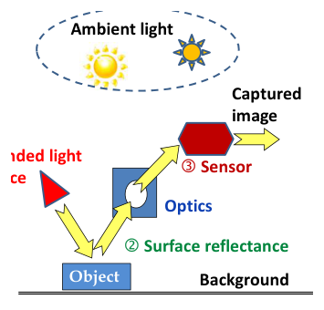
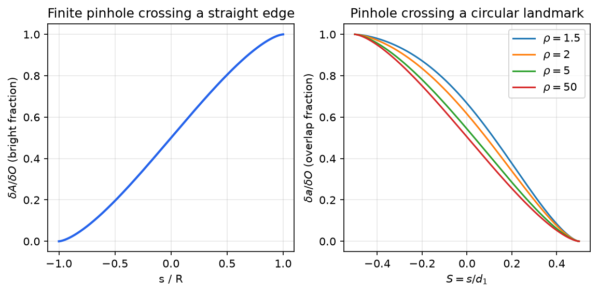
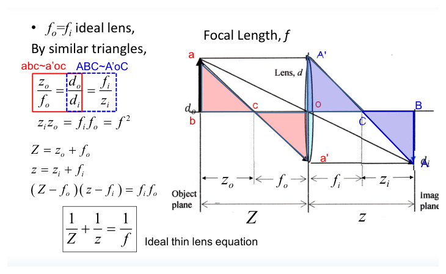
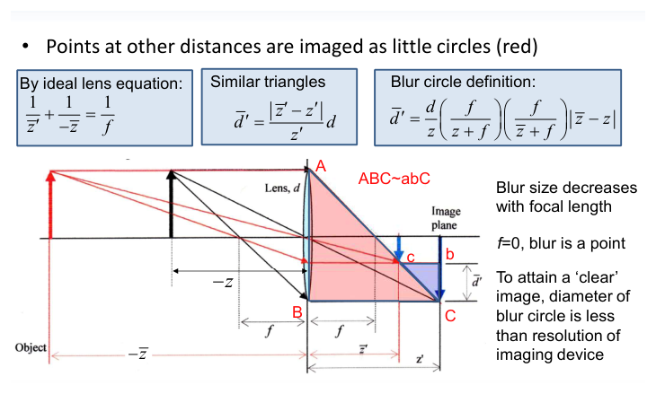
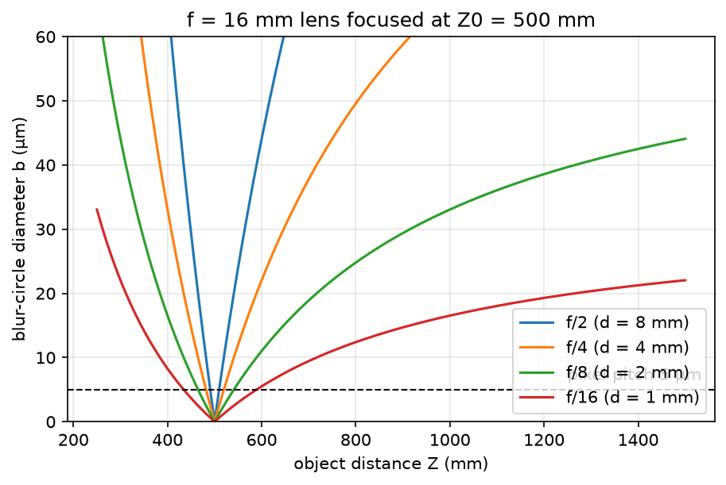
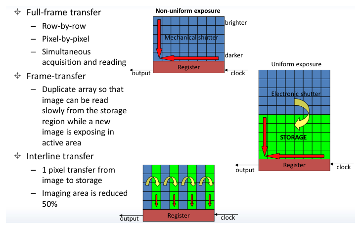
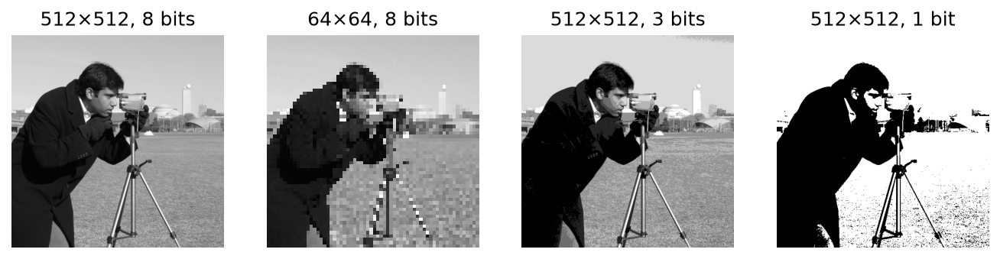
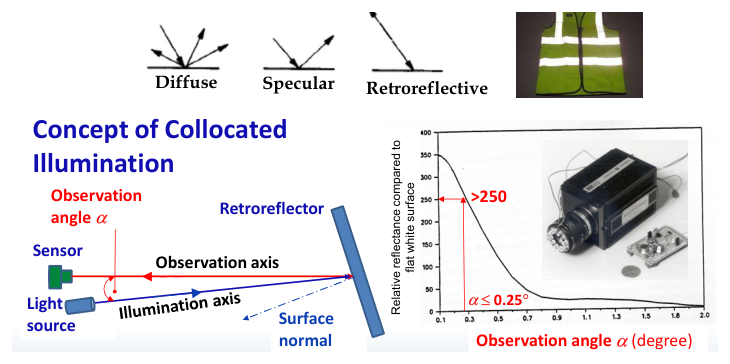
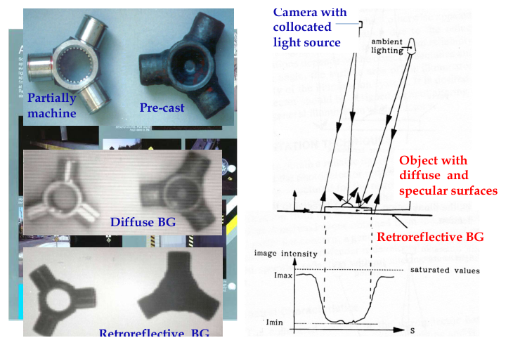

# Image Formation and Acquisition

A machine vision system makes decisions from numbers, and every number it uses was produced by a chain of physical events: light leaves a source, reflects from an object and its background, passes through an aperture or lens, and is converted to charge, voltage and finally an integer in a sensor. Each link of that chain sets limits that no algorithm can undo: blur, darkness, noise, saturation, finite resolution. This chapter follows the chain in order: what machine vision is, the geometry of pinhole and lens imaging (with the thin-lens equation and the blur circle derived from similar triangles), the sensors that turn light into numbers, the sampling and quantization that make an image a matrix, and the illumination techniques, retroreflective lighting in particular, that make the later processing easy.

## Machine Vision as a Measurement System

**Definition (Machine vision).** Machine vision is the process of acquiring one or more images with an optical sensing device, and then processing and analysing them so that *decisions can be made*.

The word "decision" separates three overlapping fields. *Image processing* produces images from images (enhancement, filtering, restoration). *Computer vision* is the general science of extracting a description of the world from images. *Machine vision* is computer vision in an industrial and engineering context: inspection, guidance and measurement, integrated with sensing, control and, importantly, deliberate control of the illumination. The field draws on optics, signal processing, statistics and geometry, mechanical design and automation, and increasingly machine learning.

Human and machine vision differ in a way that shapes the whole subject. Human vision is *qualitative*: it relies heavily on inference and prior assumptions, and is limited to the visible band. This makes it robust but easy to fool. In Adelson's checker-shadow illusion two squares with identical gray level look completely different because the visual system "corrects" for a shadow it infers. A machine does not see like this. It examines individual pixels, processes them, and draws conclusions *quantitatively and consistently*. It can also be *active*, supplying its own controlled light, rather than passively relying on whatever ambient illumination exists.

A typical machine vision system has five stages:

1. **Image acquisition**: illumination, optics, sensor and digitization (this chapter).
2. **Low-level processing**: background removal, enhancement, thresholding, labelling ([Image Enhancement and Region Properties](image-enhancement.md)).
3. **Feature extraction**: edges, lines, curves, corners, colour features ([Smoothing and Edge Detection](edge-detection.md), [The Hough Transform](hough.md), [Shape Analysis](shape-analysis.md), [Morphology](morphology.md), [Colour](color.md)).
4. **Image analysis**: relating image measurements to the 3-D world and recognising objects ([Camera Calibration](calibration.md), [Stereo Vision](stereo.md), [Neural Networks](neural-networks.md)).
5. **Decision making**: for example, commanding a robot to pick up a part.

The acquisition stage is the cheapest place to solve problems. A clean, high-contrast image turns segmentation into a single threshold; a poor one can make it impossible.

## Elements of Optical Image Formation

*Figure: the three elements of optical image formation. An intended light source (1) illuminates the object and background; their surface reflectance (2) sends part of the light through the optics to the sensor (3). Ambient light is an unintended, uncontrolled second source.*

Three elements determine every image:

1. **Illumination.** Ambient light is unintended and uncontrolled (sunlight through a window, overhead lamps); a light source designed for the vision task is controlled in position, spectrum, intensity and timing.
2. **Surface reflectance** of the object and of the background. It decides how much of the incident light travels toward the camera.
3. **The field sensor**, that is, the optics (pinhole or lens) together with the detector. Optical sensors include CCD, CID, CMOS and older vidicon tubes; other imaging modalities (X-ray, MRI, sonar, thermal infrared) follow the same logic with different physics.

### Reflectance types

Surfaces are idealised in three classes.

- **Diffuse (Lambertian)** surfaces, such as paper and matte paint, scatter light in all directions and appear equally bright from every viewing direction.
- **Specular** surfaces, such as mirrors and polished metal, reflect light so that the angle of incidence equals the angle of reflection. They look very bright from one direction and dark from others.
- **Retroreflective** surfaces, such as 3M Scotchlite tape on safety vests and road signs, return most of the incident radiation back toward the direction it came from, whatever the angle of incidence (within limits). They are built from glass microspheres or corner-cube prisms.

Real surfaces mix these behaviours. A machined metal part is partly diffuse, partly specular; a cast part is mostly diffuse.

## The Pinhole Camera

The pinhole camera is the most elementary imaging device: a light-tight box with a small hole in one face. Each point of the scene sends a narrow pencil of rays through the hole, and the pencil lands at a single point on the opposite face. No lens is needed.

### Perspective projection

Place the pinhole at the origin, let the optical axis be the \\(Z\\) axis, and put the image plane at distance \\(f\\) behind the hole (the *focal length* of the pinhole camera). A scene point \\(P = (X, Y, Z)\\) projects through the origin to an image point \\(p = (x, y)\\). The ray from \\(P\\) through the origin forms two similar right triangles, one in front of the hole with legs \\(Z\\) and \\(X\\), one behind it with legs \\(f\\) and \\(x\\). Hence
\\[
\frac{x}{f} = \frac{X}{Z}, \qquad \frac{y}{f} = \frac{Y}{Z},
\\]
up to the sign that records the inversion of the image (the image behind the pinhole is upside down). Using a "virtual" image plane at distance \\(f\\) *in front of* the pinhole removes the sign:
\\[
\boxed{x = f\\,\frac{X}{Z}, \qquad y = f\\,\frac{Y}{Z}}
\\]
This is **perspective projection**. It is nonlinear because of the division by depth \\(Z\\): distant objects look smaller, and parallel lines in the scene converge to vanishing points in the image. In homogeneous coordinates it becomes linear,
\\[
s\begin{bmatrix} x \\\\ y \\\\ 1 \end{bmatrix} = \begin{bmatrix} f & 0 & 0 & 0 \\\\ 0 & f & 0 & 0 \\\\ 0 & 0 & 1 & 0 \end{bmatrix} \begin{bmatrix} X \\\\ Y \\\\ Z \\\\ 1 \end{bmatrix}, \qquad s = Z,
\\]
which is the starting point of the full camera model with pixel scaling, image centre, lens distortion and pose that [Camera Calibration](calibration.md) develops. Depth is lost: every point on the ray through \\(p\\) produces the same image, which is why recovering 3-D structure needs either known geometry or several views ([Stereo Vision](stereo.md)).

### Hole size: sharpness versus brightness

An ideal pinhole is a point and gives a perfectly sharp image, but it admits no light. A real pinhole of radius \\(R\\) admits a cone of rays from each scene point, so each point is imaged as a small disc. The trade-off is immediate:

- **Smaller hole**: better focus, darker image.
- **Larger hole**: brighter image, more blur.

Two further problems limit the pinhole. Its light-gathering ability is poor, so long exposures are needed; and when the hole becomes very small, **diffraction** (the bending of light as it passes an aperture) spreads the image again. The optimum hole size balances geometric blur against diffraction blur, and even then the image is dim.

### Edge response of a finite pinhole

The blur introduced by a finite pinhole can be computed exactly for a straight edge. Run the geometry backwards: a single sensor element "sees" the scene through the pinhole, and its field of view on the object plane is a disc of radius \\(R\\) (scaled by the magnification, which we absorb into \\(R\\)) and area \\(\delta O = \pi R^2\\). As the sensor element moves along the image plane, the disc scans across the object plane. Suppose the object plane contains a straight edge between a dark region and a bright region. The sensor output is proportional to the bright area \\(\delta A\\) inside the disc.

Let \\(s\\) be the signed distance from the disc centre to the edge, positive when the centre lies on the bright side, and let \\(S = s/R\\). The dark part of the disc is a circular segment cut off by a chord at distance \\(\lvert s \rvert\\) from the centre. Let \\(\alpha\\) be the half-angle that the chord subtends at the centre, so \\(\cos\alpha = s/R\\), and let \\(h = \sqrt{R^2 - s^2}\\) be the half-chord. The segment is a sector of angle \\(2\alpha\\) minus the isosceles triangle formed by the centre and the chord:
\\[
\delta a = \underbrace{\pi R^2 \frac{2\alpha}{2\pi}}\_{\text{sector}} - \underbrace{s\sqrt{R^2 - s^2}}\_{\text{triangle}} = R^2\alpha - s\sqrt{R^2 - s^2}.
\\]
The bright fraction is therefore
\\[
\frac{\delta A}{\delta O} = \frac{\delta O - \delta a}{\delta O} = 1 - \frac{\alpha}{\pi} + \frac{s\sqrt{R^2 - s^2}}{\pi R^2},
\\]
and with \\(\alpha = \cos^{-1} S\\),
\\[
\boxed{\frac{\delta A}{\delta O} = 1 - \frac{1}{\pi}\left( \cos^{-1} S - S\sqrt{1 - S^2} \right), \qquad S = \frac{s}{R} \in [-1, 1].}
\\]
The formula holds for both signs of \\(s\\): when the centre is on the dark side, \\(s<0\\), \\(\alpha > \pi/2\\), and the "segment" is the larger part of the disc, as it should be. Checks: at \\(S = -1\\), \\(\cos^{-1}(-1) = \pi\\) and the ratio is 0 (disc entirely dark); at \\(S = 0\\), \\(\cos^{-1} 0 = \pi/2\\) and the ratio is \\(1/2\\); at \\(S = 1\\) it is 1.

*Figure: left, the normalised response of a sensor element as its pinhole projection disc crosses a straight edge; the ideal step becomes an S-shaped ramp of width 2R. Right, the overlap fraction when a pinhole disc of diameter d1 crosses the boundary of a bright circular landmark of diameter d2 = ρ d1; as ρ grows the curve approaches the straight-edge case.*

The ideal step edge is thus imaged as a smooth ramp of total width \\(2R\\) (in object-plane units). As \\(R \to 0\\) the ramp sharpens, but the energy collected, proportional to \\(\pi R^2\\), falls to zero: sharpness and brightness trade against each other. The edge detectors of [Smoothing and Edge Detection](edge-detection.md) must therefore locate edges that are *ramps*, not steps.

**Example 1 (Pinhole scanning a circular landmark).** A bright circular landmark of diameter \\(d\_2\\) is scanned by a pinhole projection disc of diameter \\(d\_1\\). Let \\(s\\) be the signed distance from the pinhole centre \\(C\_1\\) to the common chord of the two circles, positive when the chord lies between \\(C\_1\\) and the landmark centre \\(C\_2\\), and let \\(S = s/d\_1 \in [-\tfrac12, \tfrac12]\\), \\(\rho = d\_2/d\_1 \ge 1\\). Find the overlap fraction \\(\delta a/\delta O\\), \\(\delta O = \pi d\_1^2/4\\).

*Solution.* The common chord splits the lens-shaped overlap into two circular segments, \\(\delta a = \delta a\_1 + \delta a\_2\\). Write \\(r\_1 = d\_1/2\\), \\(r\_2 = d\_2/2\\), and the half-chord \\(\ell = \sqrt{r\_1^2 - s^2}\\).

- Segment of the pinhole disc beyond the chord, at distance \\(s\\) from \\(C\_1\\): as for the straight edge, \\(\delta a\_1 = r\_1^2\cos^{-1}(s/r\_1) - s\ell\\).
- Segment of the landmark on the pinhole side of the chord. The chord is at distance \\(s\_2\\) from \\(C\_2\\), where \\(\ell^2 = r\_2^2 - s\_2^2\\), so \\(s\_2 = \sqrt{r\_2^2 - r\_1^2 + s^2}\\). Its half-angle \\(\beta\\) satisfies \\(\sin\beta = \ell/r\_2\\), and \\(\delta a\_2 = r\_2^2 \sin^{-1}(\ell/r\_2) - s\_2\ell\\).

Divide by \\(\pi r\_1^2\\), and use \\(s/r\_1 = 2S\\), \\(r\_2/r\_1 = \rho\\), \\(\ell/r\_1 = \sqrt{1 - (2S)^2}\\), \\(s\_2/r\_1 = \sqrt{\rho^2 - 1 + (2S)^2}\\):
\\[
\frac{\delta a}{\delta O} = \frac{1}{\pi}\left[ \cos^{-1}(2S) - 2S\sqrt{1 - (2S)^2} + \rho^2\sin^{-1}\\!\left(\frac{\sqrt{1 - (2S)^2}}{\rho}\right) - \sqrt{\big(\rho^2 - 1 + (2S)^2\big)\big(1 - (2S)^2\big)} \right].
\\]
Checks: at \\(S = -\tfrac12\\) the first term is \\(\pi\\) and the others vanish, so the ratio is 1 (the pinhole disc lies inside the landmark, touching its boundary); at \\(S = \tfrac12\\) every term vanishes (the discs touch from outside). Note that the second term carries the sign of \\(S\\); writing it as \\(\sqrt{(2S)^2 - (2S)^4}\\) loses that sign and gives a wrong curve for \\(S<0\\). As \\(\rho \to \infty\\), with \\(h = \sqrt{1 - (2S)^2}\\), \\(\rho^2\sin^{-1}(h/\rho) \approx \rho h + h^3/(6\rho)\\) and \\(h\sqrt{\rho^2 - h^2} \approx \rho h - h^3/(2\rho)\\), so the last two terms cancel and the result reduces to the circular-segment formula of the straight edge with \\(S\\) replaced by \\(2S\\) (the landmark is now the bright side, so the curve falls instead of rising). The right panel of the figure plots the result for \\(\rho = 1.5, 2, 5, 50\\). Because the overlap curve depends on \\(\rho\\), a landmark's apparent edge profile depends on its size relative to the blur, which matters when landmark centres are estimated to sub-pixel accuracy.

## Lenses

A lens solves the pinhole's light problem: it collects all the rays from a scene point that strike its aperture (diameter \\(d\\), much larger than a pinhole) and bends them so that they converge again at a single image point. The image is far brighter, but now only points at one particular depth are in perfect focus.

### The thin-lens equation

*Figure: thin-lens construction. An object of height d_o at distance Z from the lens images to height d_i at distance z. The ray through the front focal point c leaves parallel to the axis, the ray parallel to the axis passes through the rear focal point C; triangles abc ~ a'oc and ABC ~ A'oC give the lens equation.*

An ideal thin lens has the same focal length on both sides, \\(f\_o = f\_i = f\\), and obeys two rules: a ray through the centre \\(o\\) passes undeviated; a ray parallel to the axis is bent through the focal point on the other side (and, by reversibility, a ray through the front focal point leaves parallel to the axis).

Let an object of height \\(d\_o\\) stand at distance \\(Z\\) in front of the lens, and its image of height \\(d\_i\\) at distance \\(z\\) behind it. Measure distances from the focal points: \\(z\_o = Z - f\_o\\) for the object, \\(z\_i = z - f\_i\\) for the image.

1. The ray from the object tip \\(a\\) through the front focal point \\(c\\) leaves the lens parallel to the axis at height \\(d\_i\\) (below the axis). Triangle \\(abc\\) (legs \\(z\_o\\) and \\(d\_o\\)) is similar to triangle \\(a'oc\\) (legs \\(f\_o\\) and \\(d\_i\\)):
\\[
\frac{z\_o}{f\_o} = \frac{d\_o}{d\_i}.
\\]
2. The ray from \\(a\\) parallel to the axis meets the lens at height \\(d\_o\\) and passes through the rear focal point \\(C\\). Triangle \\(A'oC\\) (legs \\(f\_i\\), \\(d\_o\\)) is similar to triangle \\(ABC\\) (legs \\(z\_i\\), \\(d\_i\\)):
\\[
\frac{d\_o}{d\_i} = \frac{f\_i}{z\_i}.
\\]
3. Equating the two ratios gives **Newton's form** of the lens equation:
\\[
\frac{z\_o}{f\_o} = \frac{f\_i}{z\_i} \quad\Longrightarrow\quad \boxed{z\_o z\_i = f\_o f\_i = f^2.}
\\]
4. Substitute \\(z\_o = Z - f\\), \\(z\_i = z - f\\): \\((Z - f)(z - f) = f^2\\), i.e. \\(Zz - fZ - fz = 0\\). Divide by \\(fZz\\):
\\[
\boxed{\frac{1}{Z} + \frac{1}{z} = \frac{1}{f}} \qquad\text{(thin-lens equation)}.
\\]

The **magnification** follows from the undeviated central ray: \\(m = d\_i/d\_o = z/Z\\). For \\(Z \gg f\\), \\(z \approx f\\) and \\(m \approx f/Z\\), which is exactly the pinhole projection with the lens centre as the pinhole. This is why the pinhole model describes the *geometry* of a focused lens camera, while the lens supplies the *light*.

**Example 2 (Image distance).** A lens with \\(f = 16\\) mm images a part at \\(Z = 500\\) mm. Then \\(1/z = 1/16 - 1/500\\), so \\(z = 16.53\\) mm: the sensor sits 0.53 mm behind the focal plane, and the magnification is \\(16.53/500 = 0.033\\). A 10 mm feature produces a 0.33 mm image, about 66 pixels on a sensor with 5 µm pixels.

### Out-of-focus blur: the blur circle

*Figure: a point at a depth other than the focused one converges in front of (or behind) the image plane, and the cone of rays from the aperture cuts the image plane in a small disc, the blur circle of diameter d'. The similar triangles ABC ~ abC relate d' to the aperture d.*

Suppose the sensor is at distance \\(z\_0\\) behind the lens, chosen to focus objects at depth \\(Z\_0\\): \\(z\_0 = fZ\_0/(Z\_0 - f)\\). A point at a different depth \\(Z\\) comes to focus at \\(z = fZ/(Z - f) \ne z\_0\\). All rays from that point that pass through the aperture of diameter \\(d\\) form a cone with apex at distance \\(z\\); the sensor cuts this cone in a disc. By similar triangles (the aperture of width \\(d\\) at the lens, and the cross-section of width \\(b\\) at distance \\(\lvert z - z\_0 \rvert\\) from the apex),
\\[
\frac{b}{d} = \frac{\lvert z - z\_0 \rvert}{z}.
\\]
Now
\\[
z - z\_0 = f\left( \frac{Z}{Z - f} - \frac{Z\_0}{Z\_0 - f} \right) = \frac{f^2 (Z\_0 - Z)}{(Z - f)(Z\_0 - f)},
\\]
and dividing by \\(z = fZ/(Z - f)\\) gives the **blur-circle diameter**
\\[
\boxed{b = \frac{d\\, f\\, \lvert Z - Z\_0 \rvert}{Z\\,(Z\_0 - f)}.}
\\]
The same result can be written in the course's sign convention, where object positions are negative (\\(-\bar z\\) for the point, \\(-z\\) for the focused depth) and the lens equation reads \\(1/\bar z' + 1/(-\bar z) = 1/f\\); the factors then appear as \\(z + f\\) and \\(\bar z + f\\), and the structure is the same: \\(b\\) is proportional to the aperture \\(d\\), to the depth error \\(\lvert Z - Z\_0 \rvert\\), and grows with focal length.

Consequences:

- **Aperture.** \\(b \propto d\\). Stopping the lens down (smaller \\(d\\), larger f-number \\(N = f/d\\)) reduces blur; in the limit \\(d \to 0\\) the lens becomes a pinhole and every depth is in focus, at the cost of light.
- **Focal length.** For a fixed f-number, \\(d = f/N\\) and \\(b \approx f^2 \lvert Z - Z\_0 \rvert / (N Z Z\_0)\\) for \\(Z\_0 \gg f\\): blur shrinks rapidly as focal length decreases, and as \\(f \to 0\\) the blur becomes a point. Short (wide-angle) lenses have large depth of field.
- **Resolution.** An image is "clear" when the blur circle is smaller than the resolution of the imaging device, essentially one pixel.

### Depth of field

Setting \\(b = c\\), the acceptable blur (for example the pixel pitch), and solving the blur formula on each side of \\(Z\_0\\) gives the near and far limits of acceptable focus. For \\(Z < Z\_0\\): \\(df(Z\_0 - Z) = cZ(Z\_0 - f)\\), so
\\[
Z\_{\text{near}} = \frac{d f Z\_0}{d f + c (Z\_0 - f)}, \qquad Z\_{\text{far}} = \frac{d f Z\_0}{d f - c (Z\_0 - f)},
\\]
the second following in the same way for \\(Z > Z\_0\\). The **depth of field** is \\(Z\_{\text{far}} - Z\_{\text{near}}\\). The far limit becomes infinite when \\(c(Z\_0 - f) \ge df\\), that is, when the lens is focused at or beyond the **hyperfocal distance** \\(H = f + df/c = f + f^2/(Nc)\\).

**Example 3 (Depth of field of an inspection camera).** Take \\(f = 16\\) mm, \\(N = 4\\) (so \\(d = 4\\) mm), focus distance \\(Z\_0 = 500\\) mm and pixel pitch \\(c = 5\\) µm \\(= 0.005\\) mm. Then \\(df = 64\\) mm² and \\(c(Z\_0 - f) = 0.005 \times 484 = 2.42\\) mm², so
\\[
Z\_{\text{near}} = \frac{64 \times 500}{66.42} = 481.8\ \text{mm}, \qquad Z\_{\text{far}} = \frac{64 \times 500}{61.58} = 519.6\ \text{mm}.
\\]
The depth of field is only about 38 mm. A point at 1 m is blurred to \\(b = 64 \times 500 / (1000 \times 484) = 0.066\\) mm, about 13 pixels. The hyperfocal distance is \\(16 + 64/0.005 = 12.8\\) m.

*Figure: blur-circle diameter against object distance for a 16 mm lens focused at 500 mm. The depth of field is the range over which a curve stays below the pixel pitch (dashed); stopping down from f/2 to f/16 widens it eightfold.*

## Image Sensors

The sensor converts the optical image into an electrical signal. Silicon photodiodes generate electron–hole pairs in proportion to the number of absorbed photons; the charge is integrated over an exposure time and then read out. Three families have been important.

- **CCD (charge-coupled device).** Charge packets are physically shifted from pixel to pixel by clocked gate voltages to a single output amplifier, then converted to a voltage and digitised off-chip. CCDs offer excellent uniformity and low noise.
- **CID (charge-injection device).** Similar to the CCD except in how the charge is handled before it is recorded: each pixel can be addressed and read non-destructively, and the charge is "injected" into the substrate to clear it.
- **CMOS active-pixel sensor (APS).** Each pixel has its own amplifier; rows and columns are addressed like memory, and bias generation, timing, gain and analog-to-digital conversion are integrated on the same chip. A CCD camera needs separate circuits for bias, clocking, oscillator, line driver, gain and ADC on its circuit board; a CMOS imager puts them on the die, which is why CMOS dominates low-cost and high-speed cameras.

### Scanning formats

Images can be acquired by moving a small detector or by a full array.

| Format | Advantages | Disadvantages |
|---|---|---|
| **Point scanning** (single cell, scanned in X and Y) | High resolution, low cost, simple detector | Registration errors from mechanical X–Y motion; low frame rate; system complexity |
| **Line scanning** (linear array, scanned one line at a time) | High resolution along the line; simpler mechanics | Length limited by wafer size; resolution in one direction set by pixel spacing; per-pixel non-uniformity must be calibrated out; scan times of seconds to minutes |
| **Area scanning** (2-D array, single exposure) | Highest frame rate, best registration, minimal system complexity | Resolution limited in both directions; higher cost; lower signal-to-noise ratio |

Line-scan cameras remain standard for continuous webs (paper, steel strip, textiles) and conveyors, where the object's motion supplies the second scan direction.

### CCD readout architectures

*Figure: CCD readout architectures. Full-frame: the whole array is shifted row by row into the serial register, so pixels read later have integrated longer (top brighter, bottom darker) unless a mechanical shutter is used. Frame transfer: the image is dumped quickly into a shielded storage array (green) and read from there. Interline: each column of photodiodes has a shielded transfer column beside it.*

- **Full-frame (FF) transfer.** Exposure is controlled by a mechanical shutter or a strobe. After exposure the charges are shifted down one row at a time into the serial (horizontal) register, which is read out pixel by pixel; then the next row is shifted. Without a shutter, pixels continue to collect light during readout, so exposure is non-uniform.
- **Frame transfer (FT).** The sensor has a second, light-shielded storage array of the same size. At the end of exposure the whole image is shifted rapidly into storage, and is read slowly from there while the next image is exposing: an electronic shutter with uniform exposure. The costs are *smear* (the image area still integrates light during the fast dump) and twice the silicon, hence lower resolution or higher cost for a given chip.
- **Interline transfer (IL).** Each pixel is a photodiode paired with a light-shielded CCD cell; charge is transferred sideways by one pixel, immediately and simultaneously for the whole array. This is the fastest electronic shutter, but the shielded columns reduce the light-sensitive area by about 50%, lowering sensitivity and increasing sampling (aliasing) error, and the structure adds complexity, cost and some image lag. Microlenses over each pixel are used to recover the lost fill factor.

### Noise and dynamic range

The photodetector stores a limited charge. Typical figures for a CCD element: saturation at about \\(4 \times 10^5\\) electrons, and the following disturbances.

| Effect | Description | Typical size |
|---|---|---|
| Blooming | Excess charge from a saturated pixel diffuses into neighbours, enlarging bright regions | |
| Smear | A bright spot produces a vertical stripe (charge collected during transfer) | |
| Dark current | Thermally generated charge, present without light | σ ≈ 50 e⁻ |
| Fixed-pattern noise | Pixel-to-pixel sensitivity and offset differences | σ ≈ 700 e⁻ |
| Reset noise | Uncertainty of the reset level ("kTC" noise, \\(\sqrt{kT/C}\\) in volts) | ≈ 100 e⁻ |
| Amplifier noise | Thermal noise of the output amplifier | ≈ 100 e⁻ |
| Shot (quantum) noise | Poisson statistics of photon arrival: \\(\sigma = \sqrt{\text{mean}}\\) | ≈ 700 e⁻ at saturation |

Shot noise is fundamental: for a mean of \\(\bar n\\) photo-electrons the standard deviation is \\(\sqrt{\bar n}\\), so the best possible signal-to-noise ratio is \\(\sqrt{\bar n}\\); at \\(4 \times 10^5\\) electrons, \\(\sqrt{4 \times 10^5} \approx 630\\), consistent with the ≈ 700 e⁻ in the table. Fixed-pattern noise, unlike the others, is repeatable and can be removed by flat-field calibration.

The **dynamic range** is the ratio of the largest to the smallest detectable signal, expressed in decibels as \\(20\log\_{10}(\text{ratio})\\). High-end CCDs exceed 78 dB (a ratio of about 8000), consumer CCDs about 66 dB, consumer CMOS about 54 dB (about 500). Natural illumination spans roughly \\(10^{-3}\\) lx (starlight) to \\(10^5\\) lx (direct sunlight), a ratio of \\(10^8\\) or 160 dB, far beyond any single exposure. **High-dynamic-range** imaging bridges the gap by combining a long-integration image (detail in the shadows) with a short one (detail in the highlights), or by logarithmic-response CMOS pixels; scenes such as a tunnel exit, oncoming headlights or a welding arc are unreadable with a standard sensor and readable with an HDR one.

### Spectral response and source choice

Silicon responds from the near ultraviolet to about 1.1 µm, well beyond the visible band of roughly 0.4–0.7 µm. The illumination should be matched to the sensor's peak sensitivity: a CID used in the course examples peaks near 630 nm (red), a CCD near 830 nm in the near infrared. Typical sources compared:

| Source | Wavelength | Cost | Life | Power |
|---|---|---|---|---|
| LED | 650 nm | about \$1 | \\(5 \times 10^6\\) h | 100 mW |
| Laser diode | 790–840 nm | about \$200 | \\(2.5 \times 10^5\\) h | 1 W |
| Xenon flash tube | 830–1000 nm | about \$10 | \\(10^6\\) flashes (0.3–4 per s) | 25 W (500 V) |

Infrared sources have the practical benefit of being invisible to workers, and a narrow-band source combined with a matching optical filter rejects most ambient light.

### Acquisition hardware

In the classic architecture a television-standard camera (RS-170, 30 frames per second) sends an analogue video signal to a *frame grabber*, a flash analogue-to-digital converter that digitises each line into \\(n\\)-bit gray levels and writes the full frame into a video buffer; the host computer then copies the buffer to its memory and runs the algorithm, whose decision goes to an external controller such as a robot.

This architecture explains two old puzzles. Why did a colour TV camera cost about \$1,500 while a gray-level machine vision system cost \$50,000? Because a TV camera serves human vision, which needs only qualitative information, while a machine needs quantitative information, with calibrated geometry and intensity. And why could it take half a second to find the centre of one small blob? Because the RS-170 standard, designed for television in the 1950s, limits readout to 33 ms per frame, the whole frame must be digitised and stored before processing starts, and yet only a handful of pixels carry the information needed for the decision.

The response was to integrate sensing, illumination control, digitisation, computation and communication in one unit. An early example, the *Flexible Integrated Vision System* (FIVS, 1992), combined a 192 × 165 CCD, a 25 MHz 8-bit flash A/D converter, a 20 MHz DSP56001 digital signal processor with program and data memory, direct control of the illumination, and a serial link to the robot controller; removing the frame grabber removed the 30 fps limit. Today's **smart cameras**, with CMOS sensors, on-board processors and digital interfaces (GigE Vision, USB3 Vision, Camera Link), are descendants of this idea.

## Sampling and Quantization

The continuous image irradiance \\(E(x, y)\\) on the sensor becomes a digital image through two discretisations.

**Spatial sampling.** The sensor integrates the irradiance over each pixel's light-sensitive area and reports one value per pixel, on a grid with pitch \\(\Delta\\). The digital image is an \\(M \times N\\) matrix
\\[
g = \begin{bmatrix} g(1,1) & g(1,2) & \cdots & g(1,N) \\\\ \vdots & & & \vdots \\\\ g(M,1) & g(M,2) & \cdots & g(M,N) \end{bmatrix},
\\]
each element being a **pixel** (picture element). By the sampling theorem (Sampling), spatial frequencies above \\(1/(2\Delta)\\) cycles per unit length cannot be represented and alias into lower frequencies; the optics' blur and the pixel's finite area act as a built-in anti-aliasing low-pass filter. This is also why, for a "clear" image, the blur circle should be comparable to one pixel: much smaller blur wastes nothing optically but invites aliasing, much larger blur wastes pixels.

**Quantization.** Each sample is converted to one of \\(2^n\\) gray levels. With \\(n = 8\\) bits, \\(0 \le g \le 2^8 - 1 = 255\\). Rounding a uniformly distributed signal to a step \\(\Delta\_q\\) introduces an error uniformly distributed on \\([-\Delta\_q/2, \Delta\_q/2]\\), with variance \\(\Delta\_q^2/12\\); for a full-scale signal this gives the familiar signal-to-quantization-noise ratio of about \\(6.02 n + 1.76\\) dB, roughly 50 dB for 8 bits. Too few levels produce false contours in smooth regions.

*Figure: the same scene at 512 × 512 with 8 bits, subsampled to 64 × 64 (blocky, fine detail lost), and quantized to 3 bits (8 levels: false contours in the sky) and 1 bit (a binary image).*

A pixel is therefore characterised by its position \\((x, y)\\), its intensity (\\(n\\)-bit gray level, or a colour vector, see [Colour](color.md)) and, in a sequence, its time. The simplest image of all is the **binary image**, obtained by comparing each gray level with a threshold \\(g\_{th}\\):
\\[
b(x, y) = \begin{cases} 1, & g(x, y) \ge g\_{th}, \\\\ 0, & g(x, y) < g\_{th}. \end{cases}
\\]
Binary images are the subject of the next chapter, and the lighting techniques below exist largely to make that one comparison reliable.

Software conventions vary. MATLAB's Image Processing Toolbox distinguishes indexed images (an index matrix plus an \\(n \times 3\\) colormap of RGB values in \\([0,1]\\)), intensity images (gray levels, often doubles in \\([0,1]\\)), binary images and RGB images, with conversion functions such as `rgb2gray`, `im2bw`, `ind2gray`, `gray2ind`, `rgb2ind`, `ind2rgb` and `mat2gray`. In Python the image is simply a NumPy array, `uint8` or `float`, with row index first.

## Illumination Techniques

Because the machine controls its own light, illumination is the most powerful and cheapest design variable in machine vision. The goal is to maximise contrast between the features of interest and everything else, and to make the image insensitive to ambient light and surface variations.

Standard configurations include:

- **Diffuse front lighting** (ring lights, domes): soft, even illumination that suppresses specular highlights; good for printed labels and matte parts.
- **Directional or low-angle (dark-field) lighting**: light grazing the surface makes scratches, embossing and edges scatter into the camera while flat areas stay dark.
- **Backlighting**: the object sits between the light and the camera and appears as a black silhouette on a bright field; ideal for measuring outlines and holes, useless for surface features.
- **Structured lighting**: a projected line or pattern whose deformation encodes depth (laser triangulation; see 3D Vision).
- **Collocated (coaxial) and retroreflective lighting**, discussed next.

### Collocated illumination and retroreflection

*Figure: diffuse, specular and retroreflective reflection; the collocated-illumination concept (light source beside the sensor, observation angle α between the illumination and observation axes); and the measured reflectance of a retroreflector relative to a flat white surface, more than 250 times brighter for α ≤ 0.25° and falling to almost nothing by 1–2°.*

In **collocated illumination** the light source is placed right next to the sensor, so the illumination axis almost coincides with the observation axis. The small angle between them is the **observation angle** \\(\alpha\\). A retroreflector returns light into a narrow cone around the illumination direction, so a camera at small \\(\alpha\\) receives an enormous signal from it: relative to a flat white diffuse surface, the reflectance exceeds 250 for \\(\alpha \le 0.25^\circ\\) and decays to almost zero by about \\(1^\circ\\)–\\(2^\circ\\). The same retroreflector is therefore extremely bright to the collocated camera and unremarkable to any other viewer or light source. A beam splitter can make the two axes exactly coaxial, and an LED ring around the lens is a common practical approximation.

Two complementary applications follow.

**Retroreflective background.** Place the object, with ordinary diffuse and specular surfaces, on a retroreflective background and image it with a collocated camera. The background returns the camera's own light and saturates at \\(I\_{max}\\); the object scatters most of the light elsewhere and appears dark at \\(I\_{min}\\). Ambient lighting, coming from other directions, is retroreflected back toward its own source and not into the camera. A scan line across the object shows a deep, flat-bottomed "well". On a diffuse background, by contrast, a shiny machined part and a dark cast part have gray levels overlapping the background's, and segmentation is hard.

*Figure: partially machined and pre-cast three-lobed castings. On a diffuse background the bright machined surfaces and dark cast surfaces are poorly separated from it; on a retroreflective background with collocated lighting both parts become uniform dark silhouettes against a saturated background, as the intensity profile along a scan line (right) shows.*

The resulting histogram is strongly bimodal, a single global threshold yields a clean binary silhouette, and the gradient of that binary image gives clean outlines, all with the cheapest possible algorithms. This is precisely the situation exploited in [Image Enhancement and Region Properties](image-enhancement.md).

**Retroreflective landmarks.** Reverse the roles: put small retroreflective targets on a diffuse object. A bicycle with reflective tape photographed at night with a flash shows only the tape; everything else is dark. Landmarks of this kind give unambiguous, high-contrast features for pose estimation, robot guidance and motion capture, and remain detectable under strong ambient light because only the collocated source returns to the camera.

## Summary

- Machine vision acquires images and analyses them so that decisions can be made, quantitatively and consistently, usually with controlled illumination.
- Image formation has three elements: illumination, surface reflectance (diffuse, specular, retroreflective) and the field sensor (optics plus detector).
- Pinhole (perspective) projection: \\(x = fX/Z\\), \\(y = fY/Z\\); depth is lost. A finite pinhole of radius \\(R\\) images a step edge as a ramp, \\(\delta A/\delta O = 1 - \frac{1}{\pi}(\cos^{-1}S - S\sqrt{1 - S^2})\\), \\(S = s/R\\): smaller holes are sharper but darker.
- Thin lens: \\(z\_o z\_i = f^2\\) (Newton), \\(1/Z + 1/z = 1/f\\) (Gauss), magnification \\(z/Z\\).
- Blur circle: \\(b = d f \lvert Z - Z\_0 \rvert / [Z(Z\_0 - f)]\\); proportional to aperture, grows with focal length, vanishes for a pinhole. Depth of field from \\(b \le c\\): \\(Z\_{near,far} = dfZ\_0/[df \pm c(Z\_0 - f)]\\); hyperfocal distance \\(f + f^2/(Nc)\\).
- Sensors: CCD (shift charge to one amplifier), CID, CMOS APS (per-pixel amplifier, on-chip ADC). CCD readout: full-frame (needs shutter), frame-transfer (storage array, smear), interline (fast, 50% fill factor).
- Noise: shot noise \\(\sqrt{\bar n}\\), dark current, fixed-pattern, reset, amplifier; blooming and smear. Dynamic range in dB is \\(20\log\_{10}\\) of the ratio; HDR by combining exposures.
- Digital image: \\(M \times N\\) matrix of \\(n\\)-bit gray levels; sampling obeys the Nyquist limit, quantization error variance \\(\Delta\_q^2/12\\).
- Collocated lighting with retroreflective backgrounds or landmarks produces bimodal, ambient-insensitive images that a single threshold can segment.

## See Also

- [Image Enhancement and Region Properties](image-enhancement.md): histograms, thresholding and moments of the images formed here.
- [Smoothing and Edge Detection](edge-detection.md): locating the blurred edges predicted by the pinhole and lens models.
- [Camera Calibration](calibration.md): the full camera model built on perspective projection.
- [Stereo Vision](stereo.md): recovering the depth that projection discards.
- [Colour](color.md): spectral response and colour sensing.
- 3D Vision and Image Processing: overview chapters.
- Sampling: the sampling theorem behind spatial resolution.
