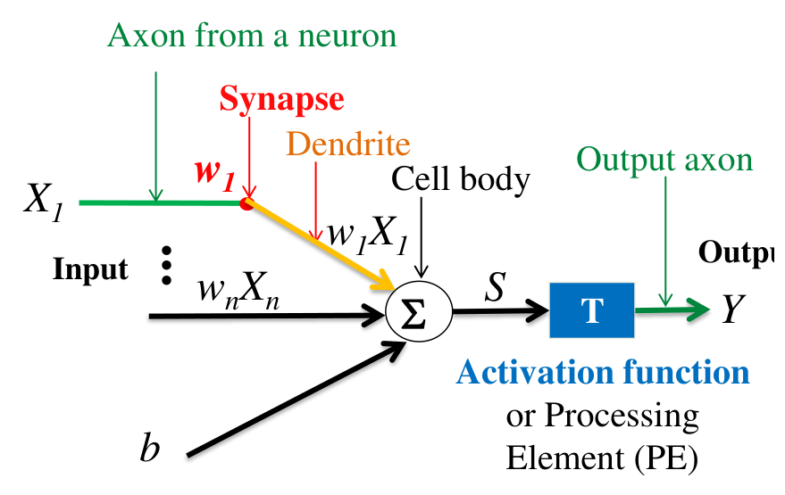
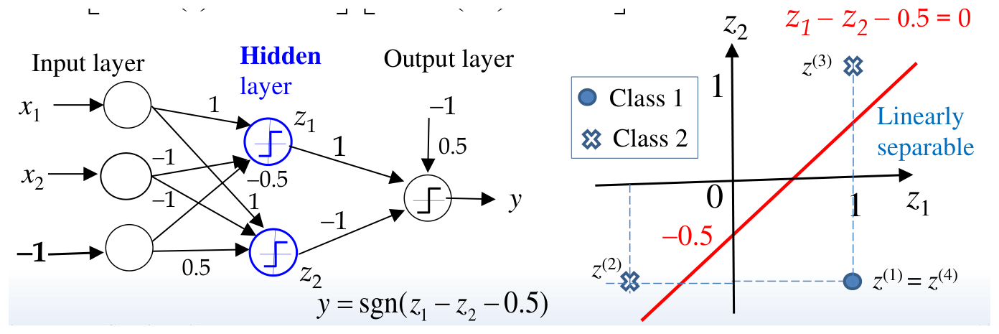
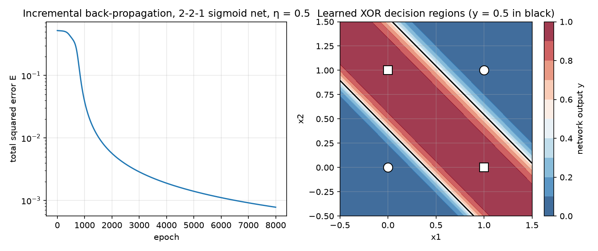
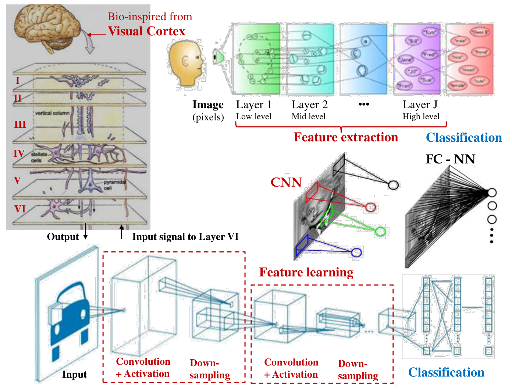
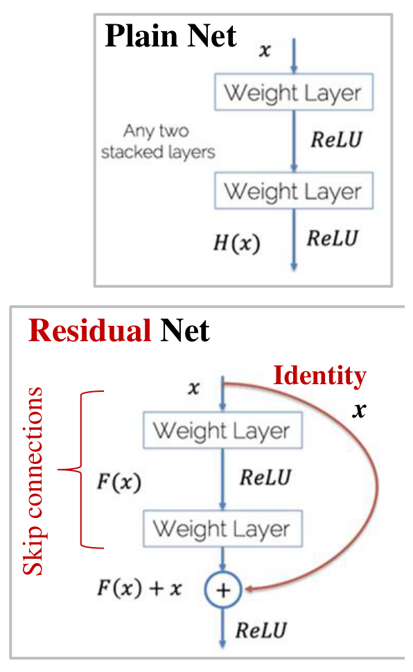

# Neural Networks for Machine Vision

Hand-designed features (thresholds, edges, moments, color boxes) work when the engineer knows what distinguishes good parts from bad. When the distinction is subtle, varies from part to part, or involves relationships no one has written down, it is easier to *learn* the mapping from examples. Artificial neural networks do this. This chapter develops them from the single neuron: the perceptron and its limits, the delta rule and gradient descent, the back-propagation algorithm derived in full with worked numerical examples, and the practical issues of training. It then explains why images call for convolutional networks, works through their arithmetic, surveys the architectures that made them dominant, and closes with machine-vision applications in robotic handling, food processing and process monitoring.

## The Artificial Neuron

### Biological motivation

An artificial neural network (ANN) is an extremely simplified model of the brain: many simple units, "neurons", cooperating to perform a function. A biological neuron receives signals on its **dendrites**, integrates them in the **cell body**, and, if the combined stimulus exceeds a threshold, fires an impulse along its **axon**. The **synapse**, where an axon meets the next neuron's dendrite, is the point at which the impulse passes on, and its strength determines how much the signal counts. Incoming signals are thus weighted and summed; if the sum reaches a threshold the neuron fires; and learning in the nervous system adjusts the weights.



*Figure: the processing element. Inputs X_1 ... X_n arrive along "axons", are multiplied by synaptic weights w_i, summed in the "cell body" together with a bias b, and passed through the activation function T to give the output Y.*

**Definition (processing element).** A processing element (PE), or neuron, computes
\\[
z^{in} = \sum\_{i=1}^{n}w\_iX\_i + b, \qquad z^{out} = h(z^{in}),
\\]
where \\(w\_i\\) are the weights, \\(b\\) the bias and \\(h\\) the activation (transfer) function. The bias is often absorbed as a weight \\(w\_0\\) on a constant input \\(x\_0\\) (\\(+1\\) or \\(-1\\)).

An ANN is a parallel, distributed information-processing structure in which (1) the mathematical model is inspired by neurons; (2) many highly interconnected PEs operate together; (3) the knowledge is held in the connection weights; (4) each PE responds only to local information, its inputs and their weights; (5) the network learns, recalls and generalizes by adjusting the weights from training data; and (6) no single neuron carries a specific piece of information, which is the *distributed representation* property.

### Activation functions

| Name | \\(y = h(x)\\) | Range | Derivative |
|---|---|---|---|
| Step | 0 for \\(x < 0\\), 1 for \\(x \ge 0\\) | {0, 1} | 0 (except at 0) |
| Hard limiter (sgn) | −1 for \\(x < 0\\), 1 for \\(x \ge 0\\) | {−1, 1} | 0 (except at 0) |
| Ramp | 0, \\(x\\), 1 for \\(x < 0\\), \\(0 \le x \le 1\\), \\(x > 1\\) | [0, 1] | 1 on (0, 1) |
| Unipolar sigmoid | \\(1/(1 + e^{-\lambda x})\\) | (0, 1) | \\(\lambda y(1 - y)\\) |
| Bipolar sigmoid | \\(\tanh x\\), or \\(2/(1 + e^{-x}) - 1\\) | (−1, 1) | \\(1 - y^2\\), or \\(\tfrac12(1 - y^2)\\) |
| ReLU | \\(\max(0, x)\\) | [0, ∞) | 1 for \\(x > 0\\), 0 for \\(x < 0\\) |
| ELU | \\(x\\) for \\(x \ge 0\\), \\(\alpha(e^x - 1)\\) for \\(x < 0\\) | (−α, ∞) | 1, or \\(y + \alpha\\) |

The sigmoids were historically the most common choice in engineering because they are smooth, bounded and have derivatives expressible through the output itself. For the unipolar sigmoid with \\(\lambda = 1\\),
\\[
h'(f) = \frac{e^{-f}}{(1 + e^{-f})^2} = \frac{1}{1 + e^{-f}}\cdot\frac{e^{-f}}{1 + e^{-f}} = y(1 - y),
\\]
and for the bipolar sigmoid \\(y = 2(1 + e^{-s})^{-1} - 1 = (1 - e^{-s})/(1 + e^{-s})\\),
\\[
h'(s) = \frac{2e^{-s}}{(1 + e^{-s})^2} = \frac12\left[1 - y\right]\left[1 + y\right] = \frac12(1 - y^2).
\\]
(Check: \\(1 - y = 2e^{-s}/(1 + e^{-s})\\) and \\(1 + y = 2/(1 + e^{-s})\\).) A linear PE \\(h = af\\) has \\(h' = a\\). ReLU has become the default in deep networks because it does not saturate for positive inputs.

### Network topologies and learning paradigms

PEs are connected as a single-layer feedforward network; a node with feedback to itself; a **multilayer feedforward** (fully connected) network with input, hidden and output layers, the most common form in engineering and the basis of deep learning; a multilayer recurrent network, with outputs fed back to earlier layers; or a **convolutional neural network** (CNN), whose structured layers extract image features before a fully connected classifier.

Learning is organized in one of three ways.

- **Supervised learning** (the most common): each training input \\(x^{(i)}\\) comes with the desired output \\(d^{(i)}\\); an error signal generator compares the actual output \\(y\\) with \\(d\\) and the error drives the weight changes.
- **Reinforcement learning:** only an evaluative signal is available ("too high", "50% correct", "right or wrong"); a critic converts it into a learning signal.
- **Unsupervised learning:** no teacher. The network must discover patterns, regularities, correlations or categories in the input and code them in its output (self-organization).

## The Perceptron

### Linear separation

**Example 10.1 (Two-class perceptron).** Two classes of points in the plane are separable by a straight line \\(x\_2 = mx\_1 + c\\). A single neuron with a threshold PE and a constant bias input \\(x\_0 = -1\\) computes
\\[
y = \begin{cases} 1, & \sum\_{i=0}^{2}x\_iw\_i > 0, \\\\ 0, & \sum\_{i=0}^{2}x\_iw\_i < 0. \end{cases}
\\]
Its decision boundary is \\(x\_0w\_0 + x\_1w\_1 + x\_2w\_2 = 0\\), i.e.
\\[
x\_2 = -\frac{w\_1}{w\_2}x\_1 - \frac{w\_0}{w\_2}x\_0,
\\]
a line with slope \\(m = -w\_1/w\_2\\) and intercept \\(c = -w\_0x\_0/w\_2\\). Three inputs (including the constant) are the minimum; training adjusts the weights from labelled patterns \\((x\_{0j}, x\_{1j}, x\_{2j}; y\_j)\\) until the line separates them. A single threshold neuron can implement exactly the linearly separable classifications.

**Example 10.2 (XOR is not linearly separable).** The exclusive-OR maps \\((0, 0) \to 0\\), \\((0, 1) \to 1\\), \\((1, 0) \to 1\\), \\((1, 1) \to 0\\). Try a linear unit \\(y = x\_1w\_1 + x\_2w\_2\\): the first pattern holds for any weights; the second gives \\(w\_2 = 1\\); the third \\(w\_1 = 1\\); and the fourth requires \\(w\_1 + w\_2 = 0\\), a contradiction. Adding a bias and a threshold does not help: the points \\((0, 1)\\) and \\((1, 0)\\) of one class lie on one diagonal of the unit square and \\((0, 0)\\), \\((1, 1)\\) on the other, and no single line separates the diagonals. Minsky and Papert's 1969 analysis of such limitations contributed to a long decline of neural-network research, ended by the popularization of back-propagation for multilayer networks in 1986.

### A hidden layer solves XOR

**Example 10.3 (XOR with linear threshold units).** Use bipolar targets: class 1 \\(= \\{(0, 0), (1, 1)\\}\\) with \\(d = 1\\), class 2 \\(= \\{(0, 1), (1, 0)\\}\\) with \\(d = -1\\). Two parallel lines \\(x\_1 - x\_2 + 0.5 = 0\\) and \\(x\_1 - x\_2 - 0.5 = 0\\) cut the input plane into three strips, with class 1 in the middle one. Two hidden linear threshold units implement them,
\\[
z\_1 = \text{sgn}(x\_1 - x\_2 + 0.5), \qquad z\_2 = \text{sgn}(x\_1 - x\_2 - 0.5),
\\]
and map the four patterns to \\(z^{(1)} = (1, -1)\\), \\(z^{(2)} = (-1, -1)\\), \\(z^{(3)} = (1, 1)\\), \\(z^{(4)} = (1, -1)\\). In the \\((z\_1, z\_2)\\) plane the classes are separated by \\(z\_1 - z\_2 - 0.5 = 0\\), so the output unit is \\(y = \text{sgn}(z\_1 - z\_2 - 0.5)\\).



*Figure: a 2-2-1 network of threshold units for XOR. The weights into z_1 are (1, −1) with bias weight −0.5 on the input −1; into z_2, (1, −1) with bias weight 0.5; the output weights are 1 and −1 with bias weight 0.5. Right: in the hidden space the two classes are separated by the line z_1 − z_2 − 0.5 = 0.*

| \\(x\_1\\) | \\(x\_2\\) | \\(z\_1\\) | \\(z\_2\\) | \\(y = \text{sgn}(z\_1 - z\_2 - 0.5)\\) |
|---|---|---|---|---|
| 0 | 0 | sgn(0.5) = +1 | sgn(−0.5) = −1 | sgn(1.5) = +1 |
| 0 | 1 | sgn(−0.5) = −1 | sgn(−1.5) = −1 | sgn(−0.5) = −1 |
| 1 | 0 | sgn(1.5) = +1 | sgn(0.5) = +1 | sgn(−0.5) = −1 |
| 1 | 1 | sgn(0.5) = +1 | sgn(−0.5) = −1 | sgn(1.5) = +1 |

With these labels the network outputs \\(+1\\) when the inputs are equal (the XNOR polarity; negating the output weights gives XOR). The essential point is that **the hidden layer transforms a non-separable problem into a separable one**. The weights here were chosen by hand; the rest of the chapter is about learning them.

## Learning by Gradient Descent

### Minimizing squared error

**Example 10.4 (The NOT function).** A linear PE \\(y = x\_0w\_0 + x\_1w\_1\\) with \\(x\_0 = 1\\) must map \\(x\_1 = 0 \to d = 1\\) and \\(x\_1 = 1 \to d = 0\\). The outputs are \\(y\_1 = w\_0\\) and \\(y\_2 = w\_0 + w\_1\\), and the squared-error cost is
\\[
E = \tfrac12\left[(1 - w\_0)^2 + (0 - w\_0 - w\_1)^2\right].
\\]
Setting \\(E = 0\\) and expanding, \\(w\_0^2 + (w\_1 - 1)w\_0 + \tfrac12(1 + w\_1^2) = 0\\), so
\\[
w\_0 = \frac{(1 - w\_1) \pm \sqrt{(1 - w\_1)^2 - 2(1 + w\_1^2)}}{2} .
\\]
The discriminant is \\(-(1 + w\_1)^2\\), which is non-negative only for \\(w\_1 = -1\\); then \\(w\_0 = 1\\), and the neuron computes \\(y = 1 - x\_1\\). Solving by hand is feasible only for tiny problems; in general the error is minimized iteratively.

**Adaline.** For a single unit and \\(p\\) training patterns we seek \\(w\\) with \\(h(\sum\_j w\_jx\_j^{(k)}) = d^{(k)}\\), \\(k = 1, \ldots, p\\). An exact solution exists when the input vectors are linearly independent (\\(p \le m\\)); in general we minimize
\\[
E(w) = \frac12\sum\_{k=1}^{p}\left(d^{(k)} - y^{(k)}\right)^2, \qquad y^{(k)} = h(w^Tx^{(k)}),
\\]
which is non-negative and zero only for a perfect fit.

### Steepest descent

The gradient \\(\nabla f = [\partial f/\partial x\_1 \ \cdots\ \partial f/\partial x\_n]^T\\) points in the direction of fastest increase of \\(f\\) and is perpendicular to its level sets. Useful formulas: \\(\nabla(c^Tx) = c\\); \\(\nabla(x^Tx) = 2x\\); \\(\nabla(\tfrac12x^TQx) = Qx\\) for symmetric \\(Q\\). For example, \\(f = x\_1^2 + 2x\_1x\_2 + 3x\_2^2\\) has \\(\nabla f = (2x\_1 + 2x\_2,\ 2x\_1 + 6x\_2)\\), which at \\((2, 1)\\) is \\((6, 10)\\).

**Steepest descent** moves against the gradient:
\\[
x^{(k+1)} = x^{(k)} - \lambda\nabla f(x^{(k)}) = x^{(k)} - \alpha S^{(k)}, \qquad S = \frac{\nabla f}{\lVert \nabla f \rVert}, \quad \alpha = \lambda\lVert \nabla f \rVert .
\\]
With a **constant step** the learning rate must be chosen by trial: too large and the error diverges or oscillates, too small and progress is slow; near the minimum a fixed step can overshoot so that \\(f\\) increases. With an **optimal (adaptive) step**, \\(\alpha^{(k)}\\) minimizes \\(f(x^{(k)} - \alpha S^{(k)})\\) along the line (a line search). The iteration stops when \\(\lVert \nabla f(x^{(k)}) \rVert \le \varepsilon\_g\\) or when \\(\lvert f(x^{(k+1)}) - f(x^{(k)}) \rvert \le \varepsilon\_f\\).

**Example 10.5 (Steepest descent on an elongated bowl).** Minimize \\(f(x) = x\_1^2 + 25x\_2^2\\) from \\(x^{(0)} = (2, 2)\\), where \\(f = 104\\) and \\(\nabla f = (2x\_1, 50x\_2) = (4, 100)\\). The unit direction is \\(S^{(0)} = (4, 100)/100.08 = (0.040, 0.999)\\), so \\(x^{(1)} = (2 - 0.04\alpha,\ 2 - \alpha)\\) approximately and \\(f(x^{(1)}) = (2 - 0.04\alpha)^2 + 25(2 - \alpha)^2\\). Setting \\(df/d\alpha = 0\\): \\(-0.08(2 - 0.04\alpha) - 50(2 - \alpha) = 0\\), so \\(\alpha^{(0)} = 2.003\\), \\(x^{(1)} = (1.92, -0.003)\\), \\(f = 3.69\\).

| \\(k\\) | optimal \\(\alpha^{(k)}\\) | \\(x\\) | \\(f\\) | | constant \\(\alpha = 1\\): \\(x\\) | \\(f\\) |
|---|---|---|---|---|---|---|
| 0 | | (2, 2) | 104 | | (2, 2) | 104 |
| 1 | 2.003 | (1.92, −0.003) | 3.69 | | (1.96, 1) | 28.84 |
| 2 | 1.85 | (0.07, 0.07) | 0.13 | | (1.88, 0) | 3.53 |
| 3 | 0.07 | (0.07, 0) | 0.0049 | | (0.88, 0) | 0.774 |
| 4 | | | | | (−0.12, 0) | 0.0144 |
| 5 | | | | | (−0.88, 0) | 0.774 |

With line search the error falls by more than an order of magnitude per step. With a fixed unit step the iterate overshoots and oscillates about the minimum along \\(x\_1\\), never settling. The zig-zag of the optimal-step path (each new direction is perpendicular to the previous one) is characteristic of steepest descent on elongated valleys, and is why more refined optimizers (momentum, conjugate gradients, adaptive per-weight rates) are used in practice.

### The delta rule

Apply steepest descent to the Adaline cost with a differentiable \\(h\\), \\(s = \sum\_jw\_jx\_j\\), \\(y = h(s)\\):
\\[
\Delta w\_j = -\eta\frac{\partial E}{\partial w\_j} = -\eta\sum\_{k=1}^{p}\left(d^{(k)} - y^{(k)}\right)\left(-\frac{\partial y^{(k)}}{\partial w\_j}\right), \qquad
\frac{\partial y}{\partial w\_j} = h'(s)\frac{\partial s}{\partial w\_j} = h'(s)\\,x\_j,
\\]
because \\(\partial w\_i/\partial w\_j = 0\\) for \\(i \ne j\\). Hence the batch ("true gradient") update
\\[
\Delta w\_j = \eta\sum\_{k=1}^{p}\left(d^{(k)} - y^{(k)}\right)h'(s^{(k)})\\,x\_j^{(k)} .
\\]
In practice the gradient is estimated from one pattern at a time, giving the **delta learning rule**:
\\[
\boxed{\Delta w = \eta\\,\delta^{(k)}x^{(k)}, \qquad \delta^{(k)} = \left[d^{(k)} - h(w^Tx^{(k)})\right]h'(w^Tx^{(k)})},
\\]
with \\(\delta\\) the *learning signal*, \\(\eta\\) the learning constant and \\(w^{(k+1)} = w^{(k)} + \Delta w^{(k)}\\). One pass through all patterns is an **epoch**; patterns are recycled for as many epochs as needed.

**Example 10.6 (Delta rule on a four-input neuron).** A single neuron with bipolar sigmoid \\(h(s) = 2/(1 + e^{-s}) - 1\\) is trained on
\\[
x^{(1)} = (1, -2, 0, -1),\ d^{(1)} = -1; \quad x^{(2)} = (0, 1.5, -0.5, -1),\ d^{(2)} = -1; \quad x^{(3)} = (-1, 1, 0.5, -1),\ d^{(3)} = 1,
\\]
with \\(w^{(1)} = (1, -1, 0, 0.5)\\) and \\(\eta = 0.1\\). Since \\(h' = \tfrac12(1 - y^2)\\), the update is \\(\Delta w = 0.05\left[d - y\right]\left[1 - y^2\right]x\\).

- Step 1: \\(s = 1 + 2 + 0 - 0.5 = 2.5\\), \\(y = h(2.5) = 0.848\\). \\(\Delta w = 0.05(-1.848)(0.281)x^{(1)} = -0.0260\\,x^{(1)}\\), so \\(w^{(2)} = (0.974,\ -0.948,\ 0,\ 0.526)\\).
- Step 2: \\(s = -1.948\\), \\(y = -0.750\\), \\(w^{(3)} = (0.974,\ -0.956,\ 0.002,\ 0.531)\\).
- Step 3: \\(s = -0.974 - 0.956 + 0.001 - 0.531 = -2.46\\), \\(y = -0.843\\), \\(w^{(4)} = (0.947,\ -0.930,\ 0.016,\ 0.505)\\).

Each step moves the output toward its target for the pattern just shown, by an amount proportional to the error and to the slope of the sigmoid; the large error of step 3 (\\(d - y = 1.84\\)) is damped by the small slope at \\(y = -0.84\\).

## Back-Propagation

### Two phases

A multilayer feedforward network with differentiable activations is trained by **back-propagation** (BP), steepest descent on the output error with the gradient computed layer by layer. For each training pair \\((x^{(k)}, d^{(k)})\\):

- **Forward phase:** the input propagates layer by layer to the output, producing \\(y^{(k)}\\).
- **Backward phase:** error signals formed from \\(d^{(k)} - y^{(k)}\\) are propagated from the output layer back toward the input, and every weight is updated.

**Notation.** Consider consecutive layers K (\\(N\_k\\) nodes) → J (\\(N\_j\\)) → P (\\(N\_p\\)) → Q (\\(N\_q\\) output nodes). Node \\(j\\) receives the outputs \\(O\_k\\) of layer K:
\\[
I\_j = \sum\_{k=1}^{N\_k}w\_{jk}O\_k + \theta\_j, \qquad O\_j = h\_j(I\_j),
\\]
where \\(w\_{jk}\\) weights the output of node \\(k\\) into node \\(j\\) and \\(\theta\_j\\) is a bias. A shape parameter \\(\theta\_o\\) is sometimes included, \\(h\_j = 1/\left(1 + \exp[-(\sum\_kw\_{jk}O\_k + \theta\_j)/\theta\_o]\right)\\): small \\(\theta\_o\\) approaches a step, large \\(\theta\_o\\) gives a gentle slope, and \\(\theta\_j\\) shifts the curve. Below the biases are treated as weights on a constant input and \\(\theta\_o = 1\\).

### Output layer

The error for one pattern is
\\[
E = \frac12\sum\_{q=1}^{N\_q}(r\_q - O\_q)^2,
\\]
with \\(r\_q\\) the desired output. The update of a weight into the output layer is \\(\Delta w\_{qp} = -\eta\\,\partial E/\partial w\_{qp}\\). By the chain rule,
\\[
\frac{\partial E}{\partial w\_{qp}} = \frac{\partial E}{\partial I\_q}\frac{\partial I\_q}{\partial w\_{qp}}, \qquad \frac{\partial I\_q}{\partial w\_{qp}} = \frac{\partial}{\partial w\_{qp}}\sum\_{p}w\_{qp}O\_p = O\_p .
\\]
Define the **error signal** \\(\delta\_q \equiv -\partial E/\partial I\_q\\). Then
\\[
\delta\_q = -\frac{\partial E}{\partial O\_q}\frac{\partial O\_q}{\partial I\_q}, \qquad \frac{\partial E}{\partial O\_q} = \frac12\frac{\partial}{\partial O\_q}(r\_q - O\_q)^2 = -(r\_q - O\_q), \qquad \frac{\partial O\_q}{\partial I\_q} = h'\_q(I\_q),
\\]
\\[
\boxed{\delta\_q = (r\_q - O\_q)\\,h'\_q(I\_q), \qquad \Delta w\_{qp} = \eta\\,\delta\_q\\,O\_p} .
\\]
This is the delta rule again, with the hidden output \\(O\_p\\) playing the role of the input.

### Hidden layers

For a hidden node \\(p\\) the same form \\(\Delta w\_{pj} = \eta\delta\_pO\_j\\) holds, with \\(\delta\_p = -\partial E/\partial I\_p\\). But a hidden node has no desired output, so \\((r\_p - O\_p)\\) is undefined. The chain rule supplies what is needed: \\(O\_p\\) affects \\(E\\) only through the inputs \\(I\_q = \sum\_pw\_{qp}O\_p\\) of every output node, with \\(\partial I\_q/\partial O\_p = w\_{qp}\\). Therefore
\\[
\delta\_p = -\frac{\partial E}{\partial O\_p}\frac{\partial O\_p}{\partial I\_p} = -\frac{\partial E}{\partial O\_p}h'\_p(I\_p),
\\]
\\[
-\frac{\partial E}{\partial O\_p} = -\sum\_{q=1}^{N\_q}\frac{\partial E}{\partial O\_q}\frac{\partial O\_q}{\partial I\_q}\frac{\partial I\_q}{\partial O\_p} = \sum\_{q=1}^{N\_q}(r\_q - O\_q)h'\_q(I\_q)\\,w\_{qp} = \sum\_{q=1}^{N\_q}\delta\_qw\_{qp},
\\]
\\[
\boxed{\delta\_p = h'\_p(I\_p)\sum\_{q=1}^{N\_q}\delta\_q\\,w\_{qp}} .
\\]
Each hidden node's error signal is the weighted sum of the error signals of the nodes it feeds, carried backward through the same weights, times its own slope. The recursion continues to earlier layers:
\\[
\delta\_j = h'\_j(I\_j)\sum\_{p=1}^{N\_p}\delta\_pw\_{pj}, \qquad \Delta w\_{jk} = \eta\\,\delta\_jO\_k .
\\]
Every layer is updated by \\(w \leftarrow w + \eta\\,\delta\\,O\\) ("error signal at the receiving node times output of the sending node"). For the unipolar sigmoid \\(h'(I) = O(1 - O)\\), so all quantities are available from the forward pass. The cost of the backward pass is about that of the forward pass, which is why BP made multilayer networks practical.

### The algorithm

**Algorithm (incremental back-propagation).**
- *Step 0 (initialize).* Choose \\(\eta > 0\\) and a tolerable error \\(E\_{max}\\); initialize the weights to small random values; set \\(E = 0\\), \\(k = 1\\).
- *Step 1.* Apply pattern \\(k\\) to the input layer.
- *Step 2 (forward).* Propagate to the output.
- *Step 3 (error).* \\(E \leftarrow E + \tfrac12\sum\_q(r\_q^{(k)} - O\_q)^2\\); compute \\(\delta\_q = h'\_q(I\_q)(r\_q - O\_q)\\).
- *Step 4 (backward).* Propagate the \\(\delta\\)s backward, computing each layer's \\(\delta\\) from the *current* weights of the layer above, and update all weights. (One pattern is one learning step.)
- *Step 5.* If \\(k < p\\), set \\(k \leftarrow k + 1\\) and return to Step 1; otherwise one epoch is complete.
- *Step 6.* If \\(E < E\_{max}\\), stop; else set \\(E = 0\\), \\(k = 1\\) and start a new epoch.

**Example 10.7 (One BP step on a 2-2-1 network).** Inputs 1 and 2 feed unipolar-sigmoid hidden nodes 3 and 4, which feed a bipolar-sigmoid output node 5 (no biases). The input is \\((I\_1, I\_2) = (-1, 1)\\) with desired output 1; the weights are \\(w\_{31} = w\_{32} = 0.5\\), \\(w\_{41} = w\_{42} = 1\\), \\(w\_{53} = -0.5\\), \\(w\_{54} = 0.5\\); \\(\eta = 0.5\\).

The error signals for this architecture are
\\[
\delta\_5 = \tfrac12(1 - y\_5^2)(y\_d - y\_5), \qquad \delta\_3 = y\_3(1 - y\_3)\\,w\_{53}\delta\_5, \qquad \delta\_4 = y\_4(1 - y\_4)\\,w\_{54}\delta\_5 .
\\]
*Forward.* \\(I\_3 = 0.5(-1) + 0.5(1) = 0\\), \\(I\_4 = 0\\), so \\(y\_3 = y\_4 = 0.5\\); \\(I\_5 = 0.5(-0.5) + 0.5(0.5) = 0\\), so \\(y\_5 = 0\\).

*Backward.* \\(\delta\_5 = \tfrac12(1 - 0)(1 - 0) = 0.5\\). Hidden signals, with the old output weights: \\(\delta\_3 = 0.5(0.5)(-0.5)(0.5) = -0.0625\\), \\(\delta\_4 = +0.0625\\).

*Updates.* \\(w\_{53} = -0.5 + 0.5(0.5)(0.5) = -0.375\\), \\(w\_{54} = 0.5 + 0.125 = 0.625\\); \\(w\_{31} = 0.5 + 0.5(-0.0625)(-1) = 0.53125\\), \\(w\_{32} = 0.5 + 0.5(-0.0625)(1) = 0.46875\\), \\(w\_{41} = 1 + 0.5(0.0625)(-1) = 0.96875\\), \\(w\_{42} = 1.03125\\).

The output weights move to raise \\(I\_5\\) (node 4 now counts more and node 3 less), and the hidden weights move so that \\(y\_4\\) rises and \\(y\_3\\) falls for this input, which raises \\(I\_5\\) further. A new forward pass gives \\(I\_3 = -0.0625\\), \\(I\_4 = 0.0625\\), \\(I\_5 = 0.141\\), \\(y\_5 = 0.070\\): the error has decreased.

**Example 10.8 (Recognizing the character "1").** On a \\(3 \times 3\\) binary grid (pixels numbered 1 2 3 / 4 5 6 / 7 8 9), a "1" may appear in the left, middle or right column. The training set:

| Class | Pattern \\(x\_1 \ldots x\_9\\) | \\(d\\) |
|---|---|---|
| Good | 1 0 0 1 0 0 1 0 0 | 1 |
| Good | 0 1 0 0 1 0 0 1 0 | 1 |
| Good | 0 0 1 0 0 1 0 0 1 | 1 |
| Bad (empty) | 0 0 0 0 0 0 0 0 0 | 0 |
| Bad (full) | 1 1 1 1 1 1 1 1 1 | 0 |
| Bad (top and bottom rows) | 1 1 1 0 0 0 1 1 1 | 0 |
| Bad (Γ shape) | 1 1 0 1 0 0 1 0 0 | 0 |
| Bad (diagonal) | 1 0 0 0 1 0 0 0 1 | 0 |

A 9-3-1 network (inputs 1–9, hidden nodes 10–12, output 13, unipolar sigmoids) computes \\(y\_{13} = h(w\_{13,10}y\_{10} + w\_{13,11}y\_{11} + w\_{13,12}y\_{12})\\) with \\(y\_p = h(\sum\_{j=1}^{9}w\_{p,j}x\_j)\\). Its error signals are \\(\delta\_{13} = y\_{13}(1 - y\_{13})(d - y\_{13})\\) and \\(\delta\_p = y\_p(1 - y\_p)w\_{13,p}\delta\_{13}\\) for \\(p = 10, 11, 12\\). Training from small random weights with \\(\eta = 0.2\\) for 1500 epochs gives output weights \\(w\_{13,10} = -9.11\\), \\(w\_{13,11} = 12.51\\), \\(w\_{13,12} = -9.01\\), and hidden weights

| from pixel | 1 | 2 | 3 | 4 | 5 | 6 | 7 | 8 | 9 |
|---|---|---|---|---|---|---|---|---|---|
| to node 10 | −0.17 | 5.89 | −0.15 | −2.41 | 0.50 | −0.98 | −1.37 | 0.53 | 1.26 |
| to node 11 | 0.40 | 1.54 | 1.59 | 2.79 | 1.25 | 2.26 | 2.72 | 2.95 | −0.17 |
| to node 12 | 3.98 | −1.11 | −0.51 | 2.02 | −1.83 | −1.45 | 3.17 | −1.91 | 0.60 |

The output weights show one strongly excitatory hidden unit (node 11) and two inhibitory ones (nodes 10 and 12); the classification emerges from their competition rather than from any single unit. Testing: the good pattern 1 0 0 1 0 0 1 0 0 gives 0.964; the full grid gives 0.008; and an untrained pattern 1 1 1 1 0 1 1 1 1 (a ring) gives 0.0074, correctly rejected. The per-pattern error curves fall to near zero within about 200 epochs for most patterns, but two patterns plateau for some 1000 epochs before collapsing abruptly, a typical sign of the network sitting near a saddle of the error surface.

**Example 10.9 (Learning XOR by back-propagation).** A 2-2-1 network with unipolar sigmoids and biases, initialized with random weights in \\([-1, 1]\\) and trained incrementally with \\(\eta = 0.5\\), learns XOR (targets 0, 1, 1, 0) to outputs \\(0.018, 0.979, 0.979, 0.020\\) after 8000 epochs.

```python
import numpy as np
sg = lambda z: 1/(1 + np.exp(-z))
X = np.array([[0,0],[0,1],[1,0],[1,1.]]); D = np.array([0,1,1,0.])
rng = np.random.default_rng(3)
W1, b1 = rng.uniform(-1,1,(2,2)), rng.uniform(-1,1,2)
W2, b2 = rng.uniform(-1,1,2), rng.uniform(-1,1)
for epoch in range(8000):
    for x, d in zip(X, D):
        O1 = sg(W1@x + b1); y = sg(W2@O1 + b2)          # forward
        dq = (d - y)*y*(1 - y); dp = O1*(1 - O1)*W2*dq   # error signals
        W2 += 0.5*dq*O1; b2 += 0.5*dq                    # output layer
        W1 += 0.5*np.outer(dp, x); b1 += 0.5*dp          # hidden layer
```



*Figure: left, total squared error per epoch (log scale). It stays on a plateau for several hundred epochs while the hidden units are still nearly symmetric, then drops quickly once they specialize. Right, the network output over the input plane; the 0.5 contour (black) consists of two parallel lines, the same strip structure as the hand-designed threshold network of Example 10.3.*

## Training in Practice

**Data.** Split the available patterns into three independent sets: a *training set* (50–60%) used to update the weights; a *validation set* (20–25%) used to compare network designs and hyperparameters; and a *test set* (20–25%), never seen during development, used to estimate the generalization error. For example, if the irreducible error is 1%, a network might reach 5% on the training set and 8% on validation and test data.

**Fitting.** An underfitted network (too simple) has a boundary that cannot follow the data; an overfitted one (too flexible, trained too long) follows every training point, including noise. Training error decreases monotonically with epochs, but validation error decreases and then rises; the gap between them is the generalization gap, and training should stop near the validation minimum. The number of hidden neurons is often chosen at the "knee" of the error-versus-size curve. See Regularization and Model Evaluation.

**Learning rate.** A step too large diverges, a step too small crawls, and a fixed step that is good early may overshoot near the minimum. A common schedule lowers the rate every few epochs; the right choice depends on the number of epochs, the training-set size and the network size.

**Initialization.** The error surface is not convex, and different initial weights reach different local minima. Initialization matters enormously:
- *All zeros:* every hidden unit computes the same function and receives the same gradient; symmetry is never broken and the layer behaves like one node.
- *Small random weights* (zero-mean Gaussian, standard deviation 0.01): in a deep network (say 10 tanh layers of 500 units) activations shrink layer by layer toward zero. Since the gradient with respect to a layer's weights is proportional to that layer's inputs, gradients vanish too.
- *Large random weights* (standard deviation 1): the tanh units saturate at \\(\pm1\\), where \\(h' \approx 0\\); gradients vanish again.
- *Scaled random weights:* drawing weights uniformly from \\(\left[-3/\sqrt{N\_l},\ 3/\sqrt{N\_l}\right]\\), where \\(N\_l\\) is the number of inputs to each unit (Wessels and Barnard, 1992), keeps the activation statistics roughly constant from layer to layer. Modern Xavier and He initializations follow the same principle of scaling by the fan-in.

## Convolutional Neural Networks

### Why fully connected layers do not scale

A fully connected (FC) layer computes a weighted sum of *all* its inputs. For a \\(16 \times 16\\) character image with 100 hidden units and 26 outputs, the trainable parameters number
\\[
(25{,}600\\,w\_{pj} + 100\\,b\_p) + (2{,}600\\,w\_{qp} + 26\\,b\_q) = 28{,}326 .
\\]
An RGB image of \\(1000 \times 1000\\) pixels feeding a layer of 1000 units would need \\(3 \times 10^9\\) weights, each with its memory and gradient, which is impractical. It is also wasteful: an FC unit treats every pair of pixels alike, although relationships between distant pixels are rarely significant at the first stages of vision. Two structural restrictions fix this:

1. **Local connectivity:** each output depends only on a small patch of the input.
2. **Weight sharing:** the same weights are applied at every position, so a feature detector learned in one place works everywhere.

Together they make a layer a bank of convolutions. The design mirrors the visual cortex, whose layers process the image hierarchically from low-level features (edges) through mid-level ones to high-level object representations, each neuron responding to a limited region.



*Figure: from the visual cortex to the CNN. Visual processing proceeds through layers that extract increasingly abstract features. A CNN alternates convolution with activation and downsampling stages (feature learning) and ends with a fully connected network that classifies.*

### Convolution revisited

The discrete convolution of sequences is the rule for multiplying polynomials: the coefficient of \\(x^k\\) in \\((c\_0 + c\_1x + \cdots)(d\_0 + d\_1x + \cdots)\\) is \\((c \* d)\_k = \sum\_i c\_id\_{k-i}\\), the discrete analogue of \\((f \* g)(t) = \int f(\tau)g(t - \tau)\\,d\tau\\). CNN libraries actually compute the *correlation* \\(\sum\_i c\_{k+i}d\_i\\) (no flip of the kernel); since the kernel is learned, the distinction is immaterial.

**Example 10.10 (1-D moving average).** Convolving \\(f = [4, 3, 2, -5, 3, 5, 2, 5, 5, 6]\\) with \\(g = [\tfrac13, \tfrac13, \tfrac13]\\): the first output is \\((4 + 3 + 2)/3 = 3\\), the second \\((3 + 2 - 5)/3 = 0\\), and the full "valid" result is
\\[
f \* g = \left[3,\ 0,\ 0,\ 1,\ \tfrac{10}{3},\ 4,\ 4,\ \tfrac{16}{3}\right],
\\]
two samples shorter than \\(f\\). Zero padding one sample at each end keeps the length: \\(\left[\tfrac73,\ 3,\ 0,\ 0,\ 1,\ \tfrac{10}{3},\ 4,\ 4,\ \tfrac{16}{3},\ \tfrac{11}{3}\right]\\).

**Example 10.11 (2-D convolution).** The \\(5 \times 5\\) image and sharpening kernel
\\[
I = \begin{bmatrix} -5 & 3 & 2 & -5 & 3 \\\\ 4 & 3 & 2 & 1 & -3 \\\\ 1 & 0 & 3 & 3 & 5 \\\\ -2 & 0 & 1 & 4 & 4 \\\\ 5 & 6 & 7 & 9 & -1 \end{bmatrix}, \qquad
k = \begin{bmatrix} 0 & -1 & 0 \\\\ -1 & 5 & -1 \\\\ 0 & -1 & 0 \end{bmatrix}
\\]
give the \\(3 \times 3\\) valid output \\(\begin{bmatrix} 6 & 1 & 8 \\\\ -7 & 9 & 2 \\\\ -5 & -9 & 3 \end{bmatrix}\\). For the top-left entry, centred on the pixel 3 at row 2, column 2: \\(5(3) - (3 + 0 + 4 + 2) = 6\\); for the bottom-right, centred on 4: \\(5(4) - (3 + 4 + 9 + 1) = 3\\).

### Convolution over color volumes

A color image is a volume \\(W \times H \times 3\\). A filter extends through the **full depth** of its input: a \\(5 \times 5\\) filter on an RGB image is \\(5 \times 5 \times 3\\). At each position it computes one number, the dot product of its 75 weights with the 75 input values plus a bias, \\(z\_i = w^Tx\_i + b\\). Sliding a \\(5 \times 5 \times 3\\) filter over a \\(32 \times 32 \times 3\\) image without padding gives a \\(28 \times 28 \times 1\\) **activation map**. A layer with five such filters outputs a \\(28 \times 28 \times 5\\) volume.

**Example 10.12 (Multi-channel convolution).** A \\(5 \times 5 \times 3\\) input is padded with one row of zeros on top and one column on the left, and convolved with a \\(3 \times 3 \times 3\\) filter at stride 1, giving a \\(4 \times 4\\) output. At the first position the three channel windows and the three filter slices are
\\[
R: \begin{bmatrix} 0 & 0 & 0 \\\\ 0 & 156 & 155 \\\\ 0 & 153 & 154 \end{bmatrix},\
G: \begin{bmatrix} 0 & 0 & 0 \\\\ 0 & 167 & 166 \\\\ 0 & 164 & 165 \end{bmatrix},\
B: \begin{bmatrix} 0 & 0 & 0 \\\\ 0 & 163 & 162 \\\\ 0 & 160 & 161 \end{bmatrix};
\\]
\\[
k\_R = \begin{bmatrix} -1 & -1 & 1 \\\\ 0 & 1 & -1 \\\\ 0 & 1 & 1 \end{bmatrix},\
k\_G = \begin{bmatrix} 1 & 0 & 0 \\\\ 1 & -1 & -1 \\\\ 1 & 0 & -1 \end{bmatrix},\
k\_B = \begin{bmatrix} 0 & 1 & 1 \\\\ 0 & 1 & 0 \\\\ 1 & -1 & 1 \end{bmatrix}.
\\]
The channel responses are \\(156 - 155 + 153 + 154 = 308\\), \\(-167 - 166 - 165 = -498\\) and \\(163 - 160 + 161 = 164\\); with bias 1 the output is \\(308 - 498 + 164 + 1 = -25\\).

### Layer dimensions

For an \\(N\_x \times N\_y\\) input, an \\(F \times F\\) filter, strides \\(S\_x, S\_y\\) and paddings \\(P\_{x\pm}, P\_{y\pm}\\) on the two sides,
\\[
\text{output} = \left(\frac{N\_x + P\_{x+} + P\_{x-} - F}{S\_x} + 1\right) \times \left(\frac{N\_y + P\_{y+} + P\_{y-} - F}{S\_y} + 1\right),
\\]
and for a square input with symmetric padding \\(P\\), \\((N + 2P - F)/S + 1\\). For \\(N = 7\\), \\(F = 3\\) without padding: stride 1 gives 5, stride 2 gives 3, and stride 3 gives \\(2.33\\), a fraction, meaning the stride does not fit and is illegal. With \\(P = 1\\) and \\(S = 1\\) the size is preserved (\\(7 \times 7\\)); "same" padding \\(P = (F - 1)/2\\) is common because without it maps shrink quickly (\\(32 \to 28 \to 24 \to 20\\) with \\(5 \times 5\\) filters).

**Example 10.13 (Size and parameters of a layer).** Input \\(32 \times 32 \times 3\\), ten \\(5 \times 5\\) filters, stride 1, padding 2. Output size \\((32 + 4 - 5)/1 + 1 = 32\\), so the output is \\(32 \times 32 \times 10\\). Each filter has \\(5 \cdot 5 \cdot 3 = 75\\) weights plus a bias, 76 parameters, and the layer has \\(760\\), independent of the image size. A layer of four \\(5 \times 5\\) filters on an RGB image stores its weights in a tensor of shape \\((3, 4, 5, 5)\\): input channels, filters, kernel height, kernel width (the order depends on the library).

### Nonlinearity, pooling and the classifier

- **ReLU** \\(R(z) = \max(0, z)\\) is applied element-wise after each convolution, producing a *rectified feature map*. Unlike the sigmoid it does not saturate, and its gradient is 1 wherever the unit is active.
- **Pooling** downsamples each feature map independently. With spatial extent \\(F\\) and stride \\(S\\), a \\(W\_{in} \times H\_{in} \times D\_{in}\\) volume becomes \\(W\_{out} = (W\_{in} - F)/S + 1\\), \\(H\_{out} = (H\_{in} - F)/S + 1\\), \\(D\_{out} = D\_{in}\\); it has no parameters. Max pooling \\(2 \times 2\\) with stride 2 halves each dimension (\\(224 \times 224 \times 64 \to 112 \times 112 \times 64\\)); for example
\\[
\begin{bmatrix} 1 & 4 & 2 & 7 \\\\ 2 & 6 & 8 & 5 \\\\ 3 & 4 & 0 & 7 \\\\ 1 & 2 & 3 & 1 \end{bmatrix} \to \begin{bmatrix} 6 & 8 \\\\ 4 & 7 \end{bmatrix}.
\\]
- **Flattening** turns the final maps into a vector (here \\([6, 8, 4, 7]\\)) for a fully connected network, trained by back-propagation exactly as above, that makes the decision. A prototype CNN repeats CONV–ReLU–CONV–ReLU–POOL blocks and ends with FC layers producing class scores.
- **Softmax** converts \\(K\\) class scores \\(z\\) into probabilities that sum to 1:
\\[
\sigma(z)\_i = \frac{e^{z\_i}}{\sum\_{j=1}^{K}e^{z\_j}}, \qquad i = 1, \ldots, K,
\\]
for example 0.95 "dog" and 0.05 "cat".

**Receptive field.** The receptive field of a unit is the region of the input image that affects it. After two \\(2 \times 2\\), stride-2 pooling stages each unit sees a \\(4 \times 4\\) patch. If a network reduces a \\(16 \times 16\\) image to a single output unit, the whole image is its receptive field, and it cannot report two separate targets. With \\(2 \times 2\\) outputs each covers a quarter of the image; finer output grids localize better but a target may straddle two fields, or two targets share one. Detection networks manage this trade-off explicitly.

### Benchmarks and architectures

The ImageNet challenge (1000 classes, over a million images) reports the **top-5 error**: the fraction of test images whose correct label is not among the network's five highest-scoring classes. Its history traces the rise of CNNs:

| Year | Model | Layers | Top-5 error (%) |
|---|---|---|---|
| 2010–2011 | shallow (hand-crafted features) | — | 28.2, 25.8 |
| 2012 | AlexNet (first large ReLU CNN) | 8 | 16.4 |
| 2013 | | 8 | 11.7 |
| 2014 | VGG | 19 | 7.3 |
| 2014 | GoogLeNet (Inception) | 22 | 6.7 |
| 2015 | ResNet | 152 | 3.6 |
| 2016, 2017 | | | 3.0, 2.3 |

(Human performance on the same task is about 5%.) Two ideas made the deeper networks possible.

**1 × 1 convolutions.** A \\(1 \times 1\\) filter keeps the spatial size and computes, at every pixel, a dot product across the channels: it acts as a fully connected layer applied per pixel. With ReLU it adds nonlinearity, and with fewer filters than input channels it shrinks the depth (32 filters of size \\(1 \times 1 \times 200\\) map \\(32 \times 32 \times 200\\) to \\(32 \times 32 \times 32\\)). The **Inception** module runs \\(1 \times 1\\), \\(3 \times 3\\) and \\(5 \times 5\\) convolutions and \\(3 \times 3\\) max pooling in parallel and concatenates the results, using \\(1 \times 1\\) "bottleneck" layers to control cost. Applying 92 filters of \\(5 \times 5 \times 200\\) directly to a \\(32 \times 32 \times 200\\) volume costs \\((5 \cdot 5 \cdot 200)(32 \cdot 32 \cdot 92) \approx 470\\) million multiplications; reducing to 16 channels first costs \\((1 \cdot 1 \cdot 200)(32 \cdot 32 \cdot 16) + (5 \cdot 5 \cdot 16)(32 \cdot 32 \cdot 92) \approx 40\\) million.

**Residual connections.** Simply stacking more layers eventually makes performance *worse*: a 56-layer plain network has higher training and test error than a 20-layer one. The problem is optimization (vanishing or exploding gradients), not overfitting.



*Figure: a plain block learns the desired mapping H(x) directly; a residual block learns only the residual F(x) and adds the input back through an identity skip connection, so its output is F(x) + x before the final ReLU.*

For layers of equal dimension with \\(x^L = f(W^Lx^{L-1} + b^L)\\),
\\[
x^{L+1} = \begin{cases} f(W^{L+1}x^L + b^{L+1}), & \text{plain}, \\\\ f(W^{L+1}x^L + b^{L+1} + x^{L-1}), & \text{residual}. \end{cases}
\\]
If the extra layers learn nothing useful (\\(W^{L+1}x^L \approx 0\\), \\(b^{L+1} \approx 0\\)), the plain network outputs 0, destroying the signal, whereas the residual network passes \\(f(x^{L-1})\\) through. A residual block can therefore always fall back to (nearly) the identity, so adding blocks should not hurt, and the identity path also carries gradients backward undiminished. Residual networks use mostly \\(3 \times 3\\) filters, keep the number of filters fixed while the map size is fixed and double it when the map is halved (by stride-2 convolution), use a \\(1 \times 1\\) projection on the shortcut when dimensions change, and end with global average pooling and a softmax classifier. With them, 34-layer networks outperform 18-layer ones, where plain networks do the opposite.

**Fully convolutional networks.** For segmentation, which needs a label per pixel, the FC classifier is replaced by convolutions and the downsampled feature maps (e.g. \\(H/4 \times W/4\\)) are upsampled back to \\(H \times W\\) by interpolation (nearest-neighbour, bilinear, cubic) or by learned transposed convolutions. See Deep Learning for Vision for detection, segmentation and transformers.

## Applications in Machine Vision

Neural networks enter machine vision in two roles: as **classifiers** of image features (pattern recognition, inspection, matching), and as **function approximators** that learn a mapping too complex to model (prediction of motion, robot response, physical quantities). They are also used for noise reduction.

**Example 10.14 (Picking parts off a vibratory feeder).** Parts travel along vibratory feeders with noisy, roughly straight trajectories, and an industrial robot with a suction gripper and a wrist-mounted integrated vision system must pick them on the move, like a predator intercepting prey. The control objective is \\(\lVert p\_{i+1} - r\_{i+1} \rVert \le \delta\\): after a time \\(\Delta t\\) the gripper pose \\(r\_{i+1}\\) must match the part pose \\(p\_{i+1}\\) within the gripper tolerance \\(\delta\\). Two BP-trained networks are used:

- a **target trajectory network** (TTNN) maps the part's current state and a prediction interval \\(\Delta t\\) to its future state;
- a **robot response network** (RRNN) maps a target position to the time \\(t\_r\\) the robot needs to reach it.

The controller iterates: predict where the part will be after \\(\Delta t\\), ask how long the robot needs to get there, and adjust \\(\Delta t\\) until \\(t\_r + t\_v \le \Delta t\\), where \\(t\_v\\) is the vision processing time. Network sizes were chosen at the knee of the error curves:

| Network | Hidden neurons | Inputs | Outputs | Training data |
|---|---|---|---|---|
| RRNN | 5 | \\(x, y\\) | \\(t\_r\\) | 387 grid points |
| TTNN, circular disk | 30 | \\(x\_i, y\_i, \Delta t\\) | \\(x\_{i+1}, y\_{i+1}\\) | 500 |
| TTNN, machine screw | 65 | \\(x\_i, y\_i, \theta\_i, \Delta t\\) | \\(x\_{i+1}, y\_{i+1}, \theta\_{i+1}\\) | 500 |

The RRNN smooths the noisy measured response-time surface (1.2–1.6 s) with a maximum error of 0.19 s. The cycle comprised CCD integration 60 ms, image transfer 6 ms, serial communication 74 ms and processing 55 ms (\\(t\_v = 0.257\\) s) plus a robot response of 1.2 s. In simulation the TTNN predicted the final state of 90% of disks and 89% of screws for \\(\Delta t = 0.3\\) s, falling to 68% and 33% at 1.5 s, since prediction degrades with horizon and the three-state screw is harder. Parts were recognized from boundary-curvature features or moment invariants (68 ms for moments versus 384 ms for curvature). Experimentally, 61–68% of moving parts were picked depending on the viewing height.

**Example 10.15 (Visual servoing with a fuzzy–neural controller).** In a hierarchical version, level 1 (image processing) finds the target, level 2 (a fuzzy controller on the position and velocity differences, with seven triangular membership functions from "negative large" to "positive large") pursues it to its vicinity, and level 3 (a tanh–tanh–linear network with 20 and 10 hidden units, trained on 584 patterns of \\((x, y, \Delta t)\\)) estimates the grasp. On trajectories not used for training the grasp succeeded in 87–94% of trials.

**Example 10.16 (Live-bird handling).** In automated transfer of live birds for poultry processing, the vision system extracts the posture of a bird before grasping (background subtraction, histogram equalization, edge detection, posture contour) and a BP network maps the posture to the velocity of the rotating grasping fingers. Blue illumination is used because birds remain calm under it, a consequence of avian color vision. Eight birds tested twice each gave 15 successful transfers out of 16.

**Example 10.17 (Physics-guided network for tool temperature).** In dry machining of titanium alloy, whose thermal conductivity is a twentieth of aluminium's, the tool–chip interface becomes very hot and the peak temperature, which governs tool wear, is hidden inside the contact zone. An infrared camera sees only the tool's outer surface. A heat-conduction model of the tool (finite elements, with the heat flux at the contact area and a convection coefficient estimated from far-field temperatures) generates simulated IR images for many cutting conditions; a small network (temperatures at about 15 feature points along rays of the IR image as inputs, 6 hidden neurons, 2 outputs) is trained on them to predict the maximum surface and internal temperatures. Placing feature points densely near the contact reduces the sensitivity to noise. Applied to real low-resolution (\\(24 \times 20\\)) IR images, the network estimates the peak temperature with errors below 4%, whereas reading the low-resolution image directly is 9–17% off.

**CNNs in inspection.** Modern visual inspection increasingly uses CNNs trained on images of good and defective products: classification networks for accept/reject decisions, detection networks to locate defects, and fully convolutional networks to segment them. They learn features that are hard to specify by hand (texture anomalies, irregular blemishes) and tolerate natural variation, but they need representative labelled data, are harder to verify than explicit rules, and their decisions are less transparent. Physics-guided training data, as in Example 10.17, and hybrid systems that combine calibrated geometry with learned recognition are common compromises in industrial machine vision. End-to-end CNNs are also used for control, for example mapping multiple camera views directly to a probabilistic steering command for autonomous navigation.

## Summary

- Neuron: \\(y = h(\sum\_iw\_ix\_i + b)\\). Sigmoid derivatives: unipolar \\(y(1 - y)\\), bipolar \\(\tfrac12(1 - y^2)\\).
- A single threshold unit separates classes by a hyperplane; XOR needs a hidden layer, which maps the problem to a separable one.
- Steepest descent \\(x^{(k+1)} = x^{(k)} - \alpha S^{(k)}\\); line search versus constant step.
- Delta rule: \\(\Delta w = \eta\delta x\\), \\(\delta = (d - y)h'(s)\\).
- Back-propagation: \\(\delta\_q = (r\_q - O\_q)h'(I\_q)\\) at the output, \\(\delta\_p = h'(I\_p)\sum\_q\delta\_qw\_{qp}\\) in hidden layers, \\(\Delta w = \eta\\,\delta\_{\text{receiving}}O\_{\text{sending}}\\).
- Practice: train/validation/test split; stop at the validation minimum; initialize with weights scaled by \\(1/\sqrt{\text{fan-in}}\\).
- CNN: local connectivity and weight sharing; output size \\((N + 2P - F)/S + 1\\); parameters per filter \\(F^2D + 1\\); ReLU, pooling, flattening, softmax.
- Depth: \\(1 \times 1\\) convolutions for cheap channel mixing (Inception); residual blocks \\(F(x) + x\\) make very deep networks trainable.

## See Also

- Neural Networks and Deep Learning: general treatment and modern training.
- Deep Learning for Vision: detection, segmentation and vision transformers.
- [Smoothing and Edge Detection](edge-detection.md): the hand-designed convolution kernels that early CNN layers rediscover.
- [Color Vision and Color Features](color.md): color classifiers (bounded box, RCE network, SVM) for comparison.
- [Template Matching, Clustering and Shape Signatures](shape-analysis.md): least squares and features used as network inputs.
- Robotic Manipulation: grasping moving objects.
