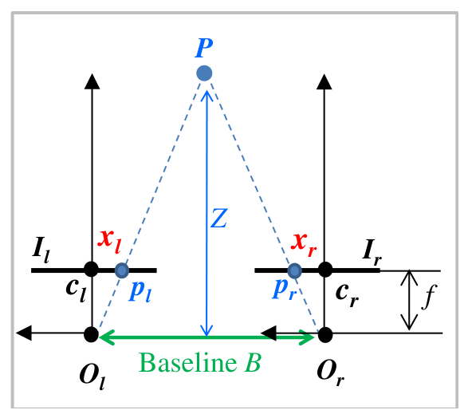
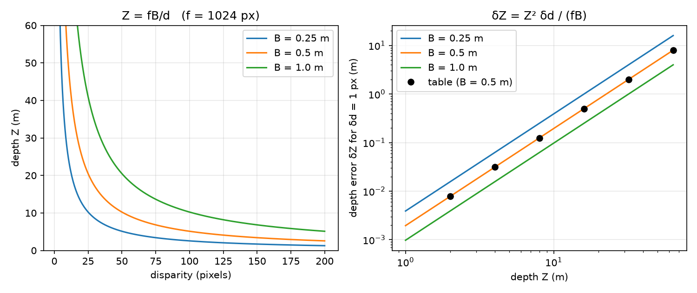
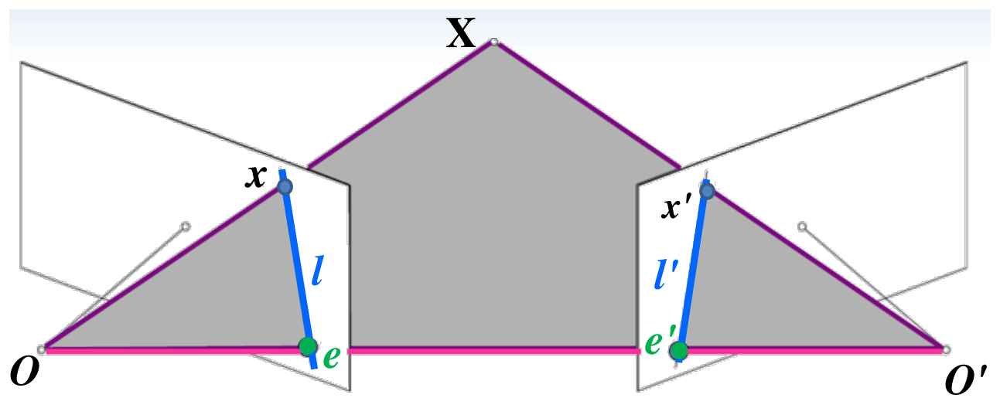
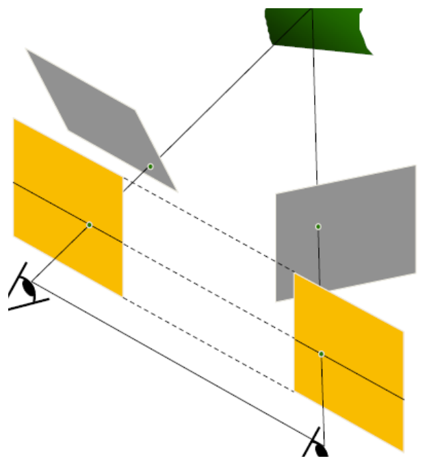

# Stereo Vision and Depth Perception

A single image fixes only the ray on which a scene point lies; its distance along the ray is lost. Two cameras looking at the same point from different positions see it along two different rays, and the rays meet at the point. Stereo vision recovers depth from this intersection. The chapter first derives the depth–disparity relation for the simplest rig, then develops the epipolar geometry that governs any pair of cameras, the essential and fundamental matrices and their estimation, rectification, the correspondence (matching) problem, and finally how accurately depth can be measured.

## Stereopsis

**Definition (stereo vision).** The ability to infer the 3-D structure and the distance of a scene from two or more images taken from different viewpoints.

The effect is easy to observe: hold a thumb at arm's length and close each eye in turn. The thumb jumps relative to the background. This *parallax*, the displacement in the apparent position of an object viewed along two lines of sight, is what the brain uses to reconstruct depth. Humans also use monocular depth cues (occlusion, perspective, shading), but stereopsis is the one that delivers metric depth at close range, and it is the one a pair of cameras can reproduce exactly.

Stereo vision splits into two sub-problems.

1. **Correspondence.** Which point in the right image corresponds to a given point in the left image? The result is a *disparity map*. The problem is hard because corresponding regions are only *similar*, not identical (different viewpoints, specular reflections, noise), and because some points are visible in only one image (*occlusion*).
2. **Reconstruction.** Given corresponding points and the geometry of the rig, recover the 3-D position. The geometry (focal lengths, image centres, relative pose of the cameras) is obtained by *stereo calibration*, the two-camera version of [Camera Calibration](calibration.md).

Reconstruction depends crucially on correct correspondence. With two points \\(P\\) and \\(Q\\) at different depths, pairing the left image of \\(P\\) with the right image of \\(Q\\) (and vice versa) triangulates two points \\(P'\\) and \\(Q'\\) that do not exist.

## Depth from Disparity

### The parallel-axis rig

Consider two identical pinhole cameras whose image planes \\(I\_l\\) and \\(I\_r\\) are coplanar, whose optical axes are parallel (the cameras fixate at infinity) and whose optical centres \\(O\_l\\), \\(O\_r\\) are separated by the **baseline** \\(B\\) along the image \\(x\\) axis.

*Figure: a stereo rig with parallel optical axes. The point P projects to p_l and p_r; x_l and x_r are their coordinates relative to the image centres c_l and c_r. The triangles (p_l, P, p_r) and (O_l, P, O_r) are similar, which gives the depth Z of P from the baseline.*

**Theorem (depth from disparity).** In a parallel-axis rig with focal length \\(f\\) and baseline \\(B\\), a point at distance \\(Z\\) from the baseline produces the disparity \\(d = x\_l - x\_r\\), and
\\[
\boxed{Z = \frac{fB}{d}} .
\\]

*Proof (coordinates).* Put the world frame at \\(O\_l\\), with \\(X\\) along the baseline and \\(Z\\) along the optical axes, so that \\(O\_r = (B, 0, 0)\\). A point \\((X, Y, Z)\\) projects to \\(x\_l = fX/Z\\) in the left image and \\(x\_r = f(X - B)/Z\\) in the right. Subtracting, \\(d = x\_l - x\_r = fB/Z\\). The \\(y\\) coordinates are equal, \\(y\_l = y\_r = fY/Z\\). ∎

*Proof (similar triangles).* Using virtual image planes in front of the centres, the segment \\(p\_lp\_r\\) is parallel to the baseline at distance \\(f\\) from it, i.e. at distance \\(Z - f\\) from \\(P\\). Its length is \\(B - d\\) (each image point is displaced toward the other camera by its image coordinate). Similar triangles \\((p\_l, P, p\_r)\\) and \\((O\_l, P, O\_r)\\) give
\\[
\frac{B - d}{Z - f} = \frac{B}{Z} \;\Longrightarrow\; ZB - Zd = ZB - fB \;\Longrightarrow\; Z = f\frac{B}{d}. \quad ∎
\\]

Three consequences follow at once. **Disparity is inversely proportional to depth**: near points shift a lot between the views, distant points hardly at all, and points at infinity have zero disparity. Corresponding points lie on the *same image row*, so the search for a match is one-dimensional. And the quantities \\((B, f, c\_l, c\_r)\\) are all that is needed; finding them is the stereo calibration problem. Once \\(Z\\) is known, the other coordinates follow as \\(X = x\_lZ/f\\), \\(Y = y\_lZ/f\\).

*Figure: left, Z = fB/d for f = 1024 pixels and three baselines; depth changes rapidly with disparity at small disparities (far points) and slowly at large disparities (near points). Right, depth error for a one-pixel disparity error on log axes; the slope of 2 shows that error grows as Z squared, and doubling the baseline halves the error. The dots are the values of Example 8.2.*

## Projection Matrices and Linear Triangulation

For a general (not parallel) rig, describe each camera by its \\(3 \times 4\\) projection matrix (see the matrix form in [Camera Calibration](calibration.md)). Pixel coordinates \\((x\_{im}, y\_{im})\\) relate to image-plane coordinates \\((u, v)\\) through the pixel sizes \\((s\_x, s\_y)\\) and the image centre \\((o\_x, o\_y)\\):
\\[
\begin{bmatrix} x\_{im} \\\\ y\_{im} \\\\ 1 \end{bmatrix} = \begin{bmatrix} 1/s\_x & 0 & o\_x \\\\ 0 & 1/s\_y & o\_y \\\\ 0 & 0 & 1 \end{bmatrix}\begin{bmatrix} u \\\\ v \\\\ 1 \end{bmatrix},
\qquad
s\begin{bmatrix} x\_{im} \\\\ y\_{im} \\\\ 1 \end{bmatrix} = M\_{int}\\,M\_{ext}\begin{bmatrix} X\_w \\\\ Y\_w \\\\ Z\_w \\\\ 1 \end{bmatrix} = M\\,W .
\\]

Given the matrices \\(M\_l\\), \\(M\_r\\) and a correspondence \\(U\_l = (u, v, 1)^T\\), \\(U\_r = (u', v', 1)^T\\), we have \\(s\_lU\_l = M\_lW\\) and \\(s\_rU\_r = M\_rW\\). The unknown scale factors are removed by noting that \\(U\\) and \\(MW\\) are parallel, \\(U \times (MW) = 0\\), i.e. \\([U]\_\times MW = 0\\) with
\\[
[U]\_\times = \begin{bmatrix} 0 & -1 & v \\\\ 1 & 0 & -u \\\\ -v & u & 0 \end{bmatrix}.
\\]
With \\(M\\) written by rows \\(\rho\_1^T, \rho\_2^T, \rho\_3^T\\),
\\[
[U]\_\times M = \begin{bmatrix} -\rho\_2^T + v\rho\_3^T \\\\ \rho\_1^T - u\rho\_3^T \\\\ -v\rho\_1^T + u\rho\_2^T \end{bmatrix}.
\\]
The third row equals \\(-u\\) times the first minus \\(v\\) times the second, so the skew matrix has rank 2 and each camera contributes two independent equations. Stacking,
\\[
\begin{bmatrix} \rho\_1^T - u\rho\_3^T \\\\ \rho\_2^T - v\rho\_3^T \\\\ \rho\_1'^T - u'\rho\_3'^T \\\\ \rho\_2'^T - v'\rho\_3'^T \end{bmatrix} W = 0 \quad\Longleftrightarrow\quad Q\\,W = 0, \qquad Q = [V\_1\ V\_2\ V\_3\ V\_4],
\\]
four homogeneous equations in the three unknowns of \\(W = (X\_w, Y\_w, Z\_w, 1)\\). Either solve \\(\left[V\_1\ V\_2\ V\_3\right] (X\_w, Y\_w, Z\_w)^T = -V\_4\\) by least squares, or take the right singular vector of \\(Q\\) for the smallest singular value and divide by its last component. With noisy data the two rays do not meet exactly and these linear solutions minimize an algebraic, not geometric, error; a more accurate estimate minimizes the reprojection error in both images.

**Example 8.1 (Converging cameras).** Two cameras with the same intrinsic matrix \\(A = \begin{bmatrix} 1000 & 0 & 360 \\\\ 0 & 1000 & 220 \\\\ 0 & 0 & 1 \end{bmatrix}\\) are separated by a baseline \\(b = 150\\) along the world \\(x\\) axis and toed in symmetrically: each optical axis makes \\(70^\circ\\) with the baseline. A point is seen at \\((u\_1, v\_1) = (189, 99)\\) in the left image and \\((u\_2, v\_2) = (531, 99)\\) in the right. Find it.

Take the left camera frame's origin as world origin, \\(x\\) along the baseline, \\(y\\) down, \\(z\\) forward. The left optical axis is \\((\cos70^\circ, 0, \sin70^\circ)\\) and the right one \\((-\cos70^\circ, 0, \sin70^\circ)\\). The camera rotations (rows = camera axes in world coordinates) are
\\[
R\_l = \begin{bmatrix} \sin70^\circ & 0 & -\cos70^\circ \\\\ 0 & 1 & 0 \\\\ \cos70^\circ & 0 & \sin70^\circ \end{bmatrix}, \qquad
R\_r = \begin{bmatrix} \sin70^\circ & 0 & \cos70^\circ \\\\ 0 & 1 & 0 \\\\ -\cos70^\circ & 0 & \sin70^\circ \end{bmatrix},
\\]
and \\(P\_1 = A[R\_l \mid 0]\\), \\(P\_2 = A[R\_r \mid -R\_rC\_r]\\) with \\(C\_r = (150, 0, 0)\\). Building the \\(4 \times 4\\) matrix \\(Q\\) and taking its null vector gives
\\[
(X, Y, Z) = (75.0,\ -50.0,\ 412.9) .
\\]
The result can be checked geometrically. The pixel offsets \\(189 - 360 = -171\\) and \\(531 - 360 = +171\\) are symmetric and the rows are equal, so the point lies on the plane of symmetry, \\(X = b/2 = 75\\). Each ray deviates from its optical axis by \\(\tan^{-1}(171/1000) = 9.70^\circ\\), away from the other camera, so each ray makes \\(79.70^\circ\\) with the baseline, and \\(Z = 75\tan79.70^\circ = 412.9\\). (Had the offsets pointed toward the other camera, the ray angle would be \\(60.30^\circ\\) and \\(Z = 131.5\\); the sign convention of the image axes matters.) Finally, the depth along each optical axis is about 413.6, and \\(Y = (99 - 220)/1000 \times 413.6 = -50.0\\).

## Epipolar Geometry

The correspondence search would be two-dimensional for an arbitrary rig. Epipolar geometry reduces it to one dimension for every rig.

*Figure: epipolar geometry. The camera centres O and O' and the scene point X span the epipolar plane. It cuts the two image planes in the conjugate epipolar lines l and l'. All epipolar lines in one image pass through the epipole (e or e'), the image of the other camera's centre.*

**Definitions.**
- The **baseline** is the line joining the camera centres \\(O\\) and \\(O'\\).
- An **epipolar plane** is any plane containing the baseline; the one through \\(X\\) is \\(OO'X\\).
- The **epipoles** \\(e\\), \\(e'\\) are the intersections of the baseline with the image planes, equivalently the projections of each camera centre into the other camera.
- **Conjugate epipolar lines** are the intersections of an epipolar plane with the two image planes; they always come in corresponding pairs.

**The epipolar constraint.** All points on the ray from \\(O\\) through the image point \\(x\\) lie in the epipolar plane, so they project into the second image onto the line \\(l'\\). Hence the match of \\(x\\) must lie on \\(l'\\), and the match of \\(x'\\) must lie on \\(l\\). The epipole is where the other camera would appear: to one observer, every epipolar line points at the other observer.

### The essential matrix (calibrated cameras)

Take the first camera frame as the world frame, so the projection matrices are \\([I \mid 0]\\) and \\([R \mid t]\\): a point with coordinates \\(x\\) in the first camera has coordinates \\(x' = Rx + t\\) in the second. Here \\(x\\) and \\(x'\\) may be taken as normalized image vectors \\((u/f, v/f, 1)\\) scaled by depth; the constraint below is homogeneous, so the scale is irrelevant.

The three vectors \\(x'\\), \\(t\\) and \\(Rx\\), all expressed in the second camera frame, lie in the epipolar plane. Coplanarity means the triple product vanishes:
\\[
x'^T\left[t \times (Rx)\right] = 0 \;\Longrightarrow\; x'^T[t]\_\times R\\,x = 0 ,
\\]
\\[
\boxed{x'^T E\\,x = 0, \qquad E = [t]\_\times R}, \qquad [t]\_\times = \begin{bmatrix} 0 & -t\_z & t\_y \\\\ t\_z & 0 & -t\_x \\\\ -t\_y & t\_x & 0 \end{bmatrix}.
\\]
\\(E\\) is the **essential matrix** (Longuet-Higgins, 1981). Its properties:

- \\(l' = Ex\\) is the epipolar line of \\(x\\) in the second image, and \\(l = E^Tx'\\) the line of \\(x'\\) in the first (a line \\(l = (a, b, c)\\) is the set of points with \\(au + bv + c = 0\\)).
- \\(Ee = 0\\) and \\(E^Te' = 0\\): the epipoles are the null vectors.
- \\(E\\) is singular (rank 2, since \\([t]\_\times\\) is) and is defined up to scale. It has five degrees of freedom: three for rotation, two for the direction of translation (the length of the baseline cannot be recovered from images alone).

**Theorem.** A real \\(3 \times 3\\) matrix is an essential matrix if and only if two of its singular values are equal and the third is zero.

*Sketch.* \\([t]\_\times\\) has singular values \\((\lVert t \rVert, \lVert t \rVert, 0)\\), and multiplying by the orthogonal \\(R\\) does not change them. Conversely, a matrix with singular values \\((\sigma, \sigma, 0)\\) can be factored as a skew matrix times a rotation using its SVD.

### The fundamental matrix (uncalibrated cameras)

If the intrinsic matrices \\(K\\), \\(K'\\) are unknown, work in pixels: \\(x = K^{-1}u\\), \\(x' = K'^{-1}u'\\). Substituting into \\(x'^TEx = 0\\),
\\[
\boxed{u'^T F\\,u = 0, \qquad F = K'^{-T}EK^{-1}} .
\\]
\\(F\\) is the **fundamental matrix** (Faugeras and Luong, 1992). As for \\(E\\): \\(l' = Fu\\), \\(l = F^Tu'\\), \\(Fe = 0\\), \\(F^Te' = 0\\), \\(\det F = 0\\) (rank 2). It is defined up to scale and has **seven** degrees of freedom (nine entries, minus scale, minus the determinant constraint). \\(F\\) can be estimated from point matches alone, without any calibration.

### Estimating \\(F\\): the eight-point algorithm

Writing out \\(u'^TFu = 0\\) for \\(u = (u, v, 1)\\), \\(u' = (u', v', 1)\\):
\\[
u'uf\_{11} + u'vf\_{12} + u'f\_{13} + v'uf\_{21} + v'vf\_{22} + v'f\_{23} + uf\_{31} + vf\_{32} + f\_{33} = 0,
\\]
i.e. \\([u'u\ \ u'v\ \ u'\ \ v'u\ \ v'v\ \ v'\ \ u\ \ v\ \ 1]\\,f = 0\\) with \\(f = (f\_{11}, \ldots, f\_{33})^T\\). Each match gives one linear homogeneous equation; eight matches determine \\(f\\) up to scale (ignoring the rank constraint).

**Algorithm (eight-point).**
1. Input \\(n \ge 8\\) matches. Build the \\(n \times 9\\) matrix \\(A\\), one row per match, so that \\(Af = 0\\).
2. Minimize \\(\sum\_i (u'^T\_iFu\_i)^2 = \lVert Af \rVert^2\\) subject to \\(\lVert f \rVert = 1\\). With the Lagrangian \\(g = \lVert Af \rVert^2 + \lambda(1 - \lVert f \rVert^2)\\), \\(\partial g/\partial f = 0\\) gives \\(A^TAf = \lambda f\\) and \\(g = \lambda\\); the minimum is the unit eigenvector of \\(A^TA\\) with the smallest eigenvalue, equivalently the right singular vector of \\(A = U\Sigma V^T\\) for the smallest singular value.
3. **Enforce rank 2.** Compute \\(F = U\Sigma V^T\\), set the smallest singular value to zero, \\(\Sigma \to \Sigma'\\), and output \\(F' = U\Sigma'V^T\\), the closest rank-2 matrix in the Frobenius norm. (The rank condition can also be written as the cubic \\(f\_1f\_5f\_9 + f\_2f\_6f\_7 + f\_3f\_4f\_8 - f\_3f\_5f\_7 - f\_2f\_4f\_9 - f\_1f\_6f\_8 = 0\\) in the entries numbered row by row.)

In practice the pixel coordinates should first be translated to zero mean and scaled so the average distance from the origin is \\(\sqrt2\\) (Hartley's normalization); without it the columns of \\(A\\) differ by orders of magnitude and the estimate is poor. With the intrinsics known, the same procedure applied to normalized coordinates estimates \\(E\\), whose two nonzero singular values are then set equal.

**Seven-point method.** Because \\(F\\) has seven degrees of freedom, seven matches suffice. The null space of the \\(7 \times 9\\) matrix is two-dimensional, spanned by \\(F\_1\\) and \\(F\_2\\). Imposing \\(\det[\alpha F\_1 + (1 - \alpha)F\_2] = 0\\) gives a cubic in \\(\alpha\\) with one or three real roots, hence one or three candidate matrices. The minimal method is the basis of robust estimation, in which many random seven- or eight-point samples are tried and the \\(F\\) consistent with the most matches is kept, so that wrong matches are rejected.

**Epipoles from \\(F\\).** With \\(F = U\Sigma V^T\\), the epipole \\(e\\) is the column of \\(V\\) and \\(e'\\) the column of \\(U\\) belonging to the zero singular value.

**Projective reconstruction.** From \\(F\\) alone the cameras, and hence the scene, are determined only up to a 3-D projective transformation. A canonical pair is \\(P' = [I \mid 0]\\), \\(P = [M \mid e]\\) with \\(F = [e]\_\times M\\), \\(e\\) the eigenvector of \\(FF^T\\) with the smallest eigenvalue and \\(M = -[e]\_\times F/\lVert e \rVert^2\\). Triangulating with these matrices yields a projective reconstruction; metric reconstruction requires the intrinsics.

### Uncalibrated stereo in four steps

A complete pipeline for two images from unknown cameras (following Zhang, Deriche, Faugeras and Luong, 1995):

1. **Initial matching by 2-D search.** Detect corners (points of high curvature) in both images and compare windows around them by the normalized cross-correlation score below, within a search area. A point may have several candidate matches.
2. **Estimate the epipolar geometry** (\\(F\\)) robustly from the candidates.
3. **Rematch with the epipolar constraint.** Now each search is a 1-D search along \\(l' = Fu\\).
4. **Reconstruct** by triangulation.

To disambiguate step 1, candidates are scored by *relaxation*: a match is strong if its neighbours have matches that are consistent with it. The strength of a match \\((m\_{1i}, m\_{2j})\\) with correlation score \\(c\_{ij}\\) is
\\[
S\_M(m\_{1i}, m\_{2j}) = c\_{ij}\sum\_{n\_{1k} \in N(m\_{1i})}\left[\max\_{n\_{2l} \in N(m\_{2j})}\frac{c\_{kl}\\,\delta(m\_{1i}, m\_{2j}; n\_{1k}, n\_{2l})}{1 + \text{dist}(m\_{1i}, m\_{2j}; n\_{1k}, n\_{2l})}\right],
\\]
where \\(N(m)\\) is a neighbourhood of radius \\(R\\), \\(\text{dist}\\) is the average distance of the two neighbours from their respective points, and \\(\delta = e^{-r/\varepsilon\_r}\\) rewards neighbours whose relative distance \\(r\\) is preserved between the images (and is zero if \\((n\_{1k}, n\_{2l})\\) is not a candidate or \\(r\\) exceeds \\(\varepsilon\_r\\)). The total \\(\sum S\_M\\) is maximized iteratively.

## Rectification

Searching along arbitrary epipolar lines is awkward. **Rectification** transforms both images so that the epipolar lines become horizontal and aligned, as in the parallel rig.

**The parallel case.** For \\(R = I\\), \\(t = (T, 0, 0)\\),
\\[
E = [t]\_\times R = \begin{bmatrix} 0 & 0 & 0 \\\\ 0 & 0 & -T \\\\ 0 & T & 0 \end{bmatrix}, \qquad
\begin{bmatrix} x' & y' & 1 \end{bmatrix} E \begin{bmatrix} x \\\\ y \\\\ 1 \end{bmatrix} = T(y - y') = 0 .
\\]
Corresponding points have equal \\(y\\) coordinates, the epipoles are at infinity and the epipolar lines are the image rows.

*Figure: rectification. The original image planes (gray) are reprojected onto a common plane parallel to the baseline (yellow). After the transformation corresponding points move only horizontally, and each is applied as a 3 x 3 homography to one image.*

Rectification reprojects both image planes onto a common plane parallel to the baseline, using one \\(3 \times 3\\) homography per image (Loop and Zhang, 1999). For calibrated cameras with relative pose \\((R, T)\\) a simple construction is:

1. Build a rotation whose first axis is the baseline:
\\[
e\_1 = \frac{T}{\lVert T \rVert}, \qquad e\_2 = \frac{(-T\_y,\ T\_x,\ 0)^T}{\sqrt{T\_x^2 + T\_y^2}}, \qquad e\_3 = e\_1 \times e\_2, \qquad R\_{rect} = \begin{bmatrix} e\_1^T \\\\ e\_2^T \\\\ e\_3^T \end{bmatrix}.
\\]
\\(e\_2\\) is orthogonal to \\(e\_1\\) and to the old optical axis, and \\(e\_3\\) completes the frame.
2. Set \\(R\_l = R\_{rect}\\) and \\(R\_r = RR\_{rect}\\) (the second camera must first be rotated into the first camera's orientation).
3. For each left image point \\(u\_l = (u, v, f)\\) compute \\(R\_lu\_l\\) and rescale it to lie on the plane at distance \\(f\\), \\(x = (f/z)R\_lu\_l\\); do the same for the right image with \\(R\_r\\). In practice one maps each *output* pixel back into the input image and interpolates.

After rectification both images share the same row structure, the disparity is purely horizontal, and \\(Z = fB/d\\) applies directly.

## The Correspondence Problem

### Window-based matching

**Basic stereo algorithm.** Rectify the images if necessary. For each pixel \\(x\\) in the left (reference) image, take the corresponding scanline in the right (target) image, search along it for the best match \\(x'\\), compute the disparity \\(d = x - x'\\) and the depth \\(fB/d\\).

A single pixel's gray level is too ambiguous to match, so a small window around it is compared with windows along the scanline. Common costs for a \\((2m + 1) \times (2n + 1)\\) window at disparity offset \\((x, y)\\):
\\[
\text{SAD} = \sum\_{j=-n}^{n}\sum\_{i=-m}^{m}\left\lvert I\_1(i, j) - I\_2(x + i, y + j)\right\rvert, \qquad
\text{SSD} = \sum\_{j=-n}^{n}\sum\_{i=-m}^{m}\left[I\_1(i, j) - I\_2(x + i, y + j)\right]^2,
\\]
\\[
\text{NCC} = \frac{\sum\sum I\_1(i, j)\\,I\_2(x + i, y + j)}{\sqrt{\sum\sum I\_1(i, j)^2 \cdot \sum\sum I\_2(x + i, y + j)^2}} .
\\]
SAD and SSD are minimized at the correct disparity, NCC maximized (its largest possible value is 1). NCC is insensitive to a gain change between the cameras. Subtracting the window means as well makes it insensitive to an offset too; the zero-mean score
\\[
\text{Score}(m\_1, m\_2) = \frac{\sum\_{i=-n}^{n}\sum\_{j=-m}^{m}\left[I\_1(u\_1 + i, v\_1 + j) - \bar I\_1\right]\left[I\_2(u\_2 + i, v\_2 + j) - \bar I\_2\right]}{(2n + 1)(2m + 1)\sqrt{\sigma^2(I\_1)\\,\sigma^2(I\_2)}}
\\]
lies in \\([-1, 1]\\), from completely dissimilar to identical up to gain and offset. Here \\(\bar I\_k\\) is the window mean and \\(\sigma(I\_k)\\) the window standard deviation.

Plotting the cost against disparity along a scanline shows a clear minimum (SSD) or maximum (NCC) where the texture is distinctive, and a flat or multi-modal curve in uniform or repetitive regions.

### Constraints and refinements

Window matching is improved by constraints that real scenes usually satisfy:

- **Epipolar constraint:** search only along the epipolar line (built in after rectification).
- **Uniqueness:** each point has at most one match.
- **Ordering:** for opaque surfaces, points along a scanline usually appear in the same order in both images.
- **Disparity limit and smoothness:** disparity is bounded, and changes smoothly except at object boundaries.
- **Left–right consistency:** a match found from left to right should be found again from right to left; inconsistent pixels are flagged as occluded.

Typical refinements, in order of improvement of the resulting depth maps: plain block matching (noisy); with sub-pixel interpolation of the cost minimum (a parabola through the minimum and its neighbours); block matching with dynamic programming along each scanline, which enforces ordering and smoothness (smooth but streaky); and a coarse-to-fine image pyramid with dynamic programming and sub-pixel refinement (best). Window size is a trade-off: small windows localize depth discontinuities well but are noisy, large windows are robust but blur boundaries.

## Depth Resolution

Disparity is measured in whole or fractional pixels, so depth is quantized and its error grows with distance.

**Theorem (depth error).** For a rig with \\(Z = fB/d\\), a disparity error \\(\delta d\\) produces a depth error
\\[
\boxed{\delta Z = \frac{Z^2}{fB}\\,\delta d}, \qquad \frac{\delta Z}{Z} = \frac{Z}{fB}\\,\delta d .
\\]

*Proof.* \\(dZ/dd = -fB/d^2 = -Z^2/(fB)\\), using \\(d = fB/Z\\). ∎

So the absolute error grows with the **square** of the depth and falls in inverse proportion to the baseline and the focal length; the relative error grows linearly with depth. Geometrically, a fixed angular uncertainty of each ray (one pixel subtends a fixed cone) intersects in a region that lengthens rapidly as the rays become nearly parallel.

**Example 8.2 (Depth accuracy).** With \\(\delta d = 1\\) pixel, \\(f = 2^{10} = 1024\\) pixels and \\(B = 0.5\\) m, \\(\delta Z = Z^2/2^9\\) m:

| \\(Z\\) (m) | 2 | 4 | 8 | 16 | 32 | 64 |
|---|---|---|---|---|---|---|
| \\(\delta Z\\) (m) | 1/128 | 1/32 | 1/8 | 1/2 | 2 | 8 |

At 2 m the rig resolves 8 mm, at 64 m only 8 m. Sub-pixel matching to \\(\delta d = 0.1\\) pixel improves all entries tenfold.

**Choosing the baseline.** A longer baseline gives better depth resolution, but the two views overlap less (smaller common field of view), look more different, and suffer more occlusion, which makes correspondence harder. A shorter baseline makes matching easy but depth coarse. Multi-baseline and multi-view stereo combine several cameras to get both.

**Error sources.** The pipeline (calibrate, rectify, compute disparity, estimate depth) is limited by calibration errors, image resolution, occlusions, violations of brightness constancy (specular reflections), large disparity ranges, and low-contrast or repetitive regions where matching is ambiguous. With many views of a scene, for example community photo collections, multi-view stereo reconstructs dense models of whole buildings.

## Summary

- Parallel rig: \\(d = x\_l - x\_r = fB/Z\\), so \\(Z = fB/d\\); corresponding points share the same row.
- Linear triangulation: \\([U]\_\times MW = 0\\) gives two equations per camera; solve \\(QW = 0\\) by SVD or least squares.
- Epipolar constraint: the match of \\(x\\) lies on \\(l' = Ex\\) (calibrated) or \\(l' = Fu\\) (pixels).
- Essential matrix \\(E = [t]\_\times R\\), \\(x'^TEx = 0\\), rank 2, singular values \\((\sigma, \sigma, 0)\\), 5 DOF. Fundamental matrix \\(F = K'^{-T}EK^{-1}\\), \\(u'^TFu = 0\\), rank 2, 7 DOF.
- Eight-point algorithm: smallest singular vector of the \\(n \times 9\\) data matrix, then force rank 2 by zeroing the smallest singular value; normalize coordinates first. Epipoles are the null vectors of \\(F\\) and \\(F^T\\).
- Rectification: rotate both cameras so their \\(x\\) axes lie along the baseline (\\(R\_{rect}\\) built from \\(T\\)); then disparities are horizontal.
- Matching costs SAD, SSD, NCC (zero-mean NCC is invariant to gain and offset); constraints: epipolar, uniqueness, ordering, smoothness, left–right consistency.
- Depth error \\(\delta Z = Z^2\delta d/(fB)\\): quadratic in depth, inverse in baseline and focal length.

## See Also

- [Camera Calibration, Pose Estimation and Hand–Eye Calibration](calibration.md): projection matrices, intrinsics and extrinsics.
- [Smoothing and Edge Detection](edge-detection.md) and [Template Matching, Clustering and Shape Signatures](shape-analysis.md): features and window matching used for correspondence.
- 3D Vision: structure from motion, depth sensors and point clouds.
- Feature Detection: corners and descriptors for sparse matching.
- Singular Value Decomposition: the tool behind the eight-point algorithm and triangulation.
- [Image Processing for Robots](../me7785-introduction-to-robotics/robot-vision.md): stereo on mobile robots.
