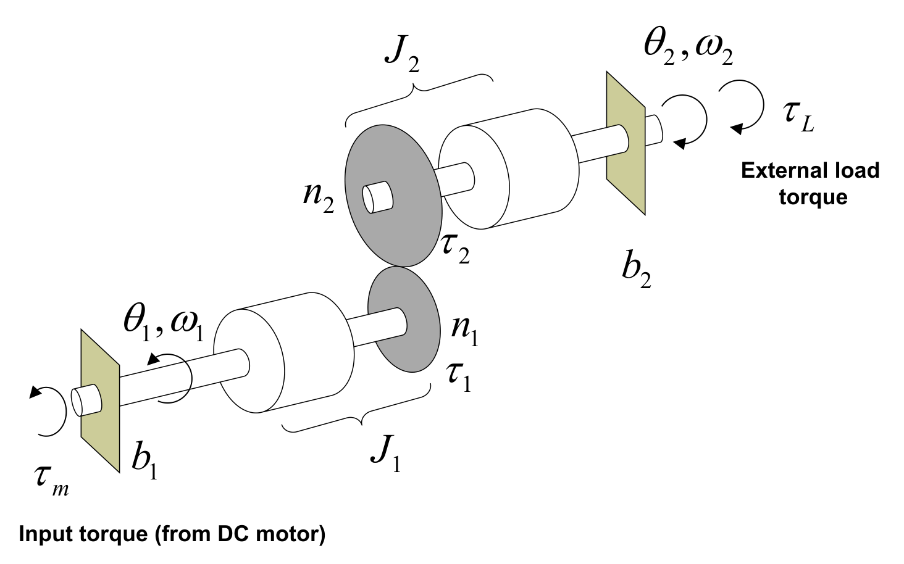
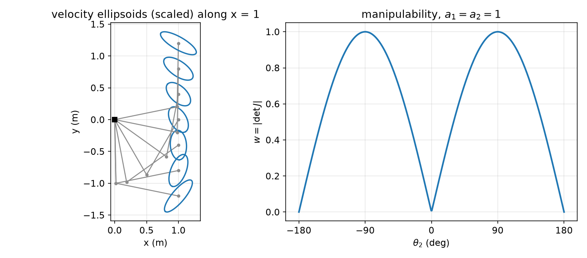
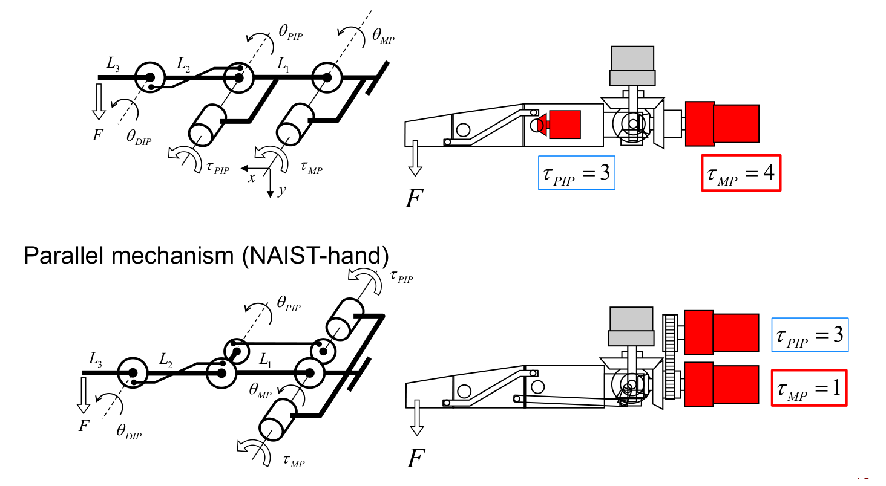
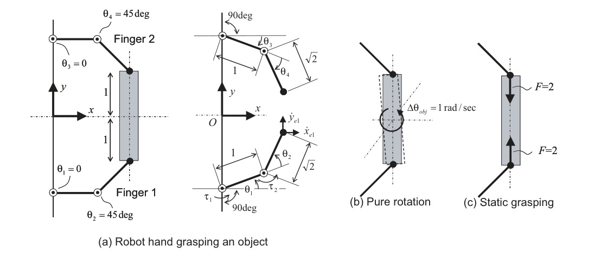

# Actuation, Transmissions and Redundancy

The kinematic and dynamic models of the earlier chapters treat each joint as a source of whatever torque the controller asks for. Real joints have a motor with its own electrical and mechanical dynamics, usually behind a gear reduction that multiplies torque and also multiplies the rotor's inertia and friction as seen from the link. This chapter models that hardware, shows why a high reduction ratio makes the arm's dynamics nearly decoupled (and non-back-drivable), and then turns to the mechanism level: the extra freedom of redundant arms, the manipulability measure of how well a posture can move, and the coupling and parallel drives used in multi-fingered hands.

## Electromagnetic Actuators

Most robot joints are driven by electromagnetic motors. Brushed **DC motors** dominate small-scale applications (hobby robots, home electronics, gaming devices, pager motors in phones). **AC and brushless motors** are used where high torque and reliability matter (industrial arms, HVAC, electric and hybrid cars); they need an electronic commutation controller. For control purposes a brushless motor with its drive behaves like a DC motor, so the DC model below is the one to know.

### The armature-controlled DC motor

The motor is an armature circuit (input voltage \\(e\_a\\), resistance \\(R\_a\\), inductance \\(L\_a\\), current \\(i\_a\\)) coupled to a rotor (angle \\(\theta\\), inertia \\(J\\) of rotor plus load, viscous friction \\(b\\) in the bearings). The field flux is constant, set by a constant field current or, in small motors, by permanent magnets. Two electromechanical laws link the halves:
\\[
\tau(t) = K\\, i\_a(t), \qquad e\_b(t) = K\_b\\, \dot\theta(t),
\\]
where \\(K\\) is the **torque constant** and \\(e\_b\\) is the **back EMF**, proportional to speed through the back-EMF constant \\(K\_b\\). (In consistent SI units \\(K = K\_b\\), by power balance between electrical power \\(e\_b i\_a\\) and mechanical power \\(\tau\dot\theta\\).)

Take Laplace transforms with zero initial conditions:
\\[
T(s) = K I\_a(s), \qquad E\_b(s) = K\_b s \Theta(s), \qquad E\_a(s) = (sL\_a + R\_a) I\_a(s) + E\_b(s).
\\]
The mechanical side is \\(J\ddot\theta = \tau - b\dot\theta\\), i.e. \\((s^2 J + s b)\Theta(s) = T(s)\\). Substituting \\(I\_a = T/K\\) and \\(\Theta = T/(s^2J+sb)\\) into the circuit equation,
\\[
E\_a(s) = \left(\frac{sL\_a + R\_a}{K} + \frac{K\_b}{sJ + b}\right) T(s)
\quad\Longrightarrow\quad
\boxed{\frac{T(s)}{E\_a(s)} = \frac{K(sJ + b)}{(sL\_a + R\_a)(sJ + b) + K K\_b}.}
\\]
The torque produced is *not* proportional to the applied voltage: there is dynamics between them, and the back-EMF term \\(KK\_b\\) makes the torque fall as the motor speeds up. The voltage-to-angle transfer function follows by dividing by \\(s^2J+sb\\):
\\[
\frac{\Theta(s)}{E\_a(s)} = \frac{K}{s\left[(sL\_a + R\_a)(sJ + b) + K K\_b\right]},
\\]
a third-order system with a pole at the origin. That integrator means a constant voltage produces (after a transient) a constant *speed*, not a constant angle. Position control of this plant is treated in [Manipulator Control](control.md).

### Motor drivers and idealized servo modes

The voltage-to-torque dynamics is compensated by a **motor driver** (servo amplifier). A commercial driver typically offers three closed-loop modes: speed control (using a tachometer or encoder), relative position control (using a potentiometer), and **torque mode**, in which an internal PID loop regulates the motor current, and hence torque \\(\tau = K i\_a\\). A motion control system is therefore a chain *controller → driver → motor* with its own feedback.

For mechanism-level analysis it is common to assume the driver does a perfect job and to replace it by a static gain of one:

- **Velocity control mode:** \\(\dot\theta\_d \to [1] \to \dot\theta\\). This is the assumption behind Jacobian velocity control below.
- **Torque control mode:** \\(\tau\_d \to [1] \to \tau\\). This is the assumption behind statics (\\(\tau = J^T F\\)) and the model-based controllers of the next chapters.

A fully integrated example is the hobby **RC servo** (and its robot-grade descendants such as networked smart servos): motor, gearbox, potentiometer and position controller in one case. The desired angle is encoded by pulse-width modulation, with a period of 20 ms and a pulse width from 1 ms (one end of the range) to 2 ms (the other end).

## Gear Trains

### Statics of a gear pair

Two meshing gears of radii \\(r\_1, r\_2\\) and tooth counts \\(n\_1, n\_2\\) share the velocity of their contact point, \\(r\_1\omega\_1 = r\_2\omega\_2\\), and the tooth pitch is common, \\(2\pi r\_1/n\_1 = 2\pi r\_2/n\_2\\). Hence the **gear ratio**
\\[
\frac{\omega\_2}{\omega\_1} = \frac{r\_1}{r\_2} = \frac{n\_1}{n\_2}.
\\]
For a lossless train the power in equals the power out, \\(\tau\_1\omega\_1 = \tau\_2\omega\_2\\), so
\\[
\frac{\tau\_2}{\tau\_1} = \frac{n\_2}{n\_1}.
\\]
A reduction (\\(n\_2 > n\_1\\)) trades speed for torque in exactly inverse proportion. Robots use compact high-ratio reducers: **planetary gears** (sun, planet pinions on a carrier, ring gear) and **harmonic drives** (a wave generator deforms a flexible spline so that it meshes with a rigid circular spline having two more teeth, giving ratios of 50 to 160 in one stage with no backlash).

### Dynamics of a gear train



*Figure: a two-shaft gear train. The motor applies τ_m to shaft 1 (inertia J₁, damping b₁, gear with n₁ teeth); shaft 2 (J₂, b₂, gear with n₂ teeth) carries the external load τ_L. τ₁ and τ₂ are the tooth forces' torques on each gear.*

Let \\(\tau\_1\\) be the torque that the rest of the train exerts back on gear 1 (action and reaction at the teeth) and \\(\tau\_2\\) the torque the teeth deliver to shaft 2. With no external load (\\(\tau\_L = 0\\)):
\\[
J\_1\ddot\theta\_1 + b\_1\dot\theta\_1 = \tau\_m - \tau\_1, \qquad J\_2\ddot\theta\_2 + b\_2\dot\theta\_2 = \tau\_2,
\\]
with the gear constraints \\(\tau\_2/\tau\_1 = n\_2/n\_1\\) and \\(\dot\theta\_2/\dot\theta\_1 = \ddot\theta\_2/\ddot\theta\_1 = n\_1/n\_2\\).

**Example 1 (referred to the output shaft).** Find \\(\Theta\_2(s)/T\_m(s)\\). Eliminate \\(\theta\_1 = (n\_2/n\_1)\theta\_2\\) and \\(\tau\_1 = (n\_1/n\_2)\tau\_2 = (n\_1/n\_2)(J\_2\ddot\theta\_2 + b\_2\dot\theta\_2)\\) from the input-shaft equation:
\\[
J\_1\frac{n\_2}{n\_1}\ddot\theta\_2 + b\_1\frac{n\_2}{n\_1}\dot\theta\_2 = \tau\_m - \frac{n\_1}{n\_2}\left(J\_2\ddot\theta\_2 + b\_2\dot\theta\_2\right).
\\]
Multiply by \\(n\_2/n\_1\\) and collect:
\\[
\left[J\_1\left(\frac{n\_2}{n\_1}\right)^2 + J\_2\right]\ddot\theta\_2 + \left[b\_1\left(\frac{n\_2}{n\_1}\right)^2 + b\_2\right]\dot\theta\_2 = \frac{n\_2}{n\_1}\tau\_m,
\\]
\\[
\frac{\Theta\_2(s)}{T\_m(s)} = \frac{n\_2/n\_1}{s^2\left[J\_1(n\_2/n\_1)^2 + J\_2\right] + s\left[b\_1(n\_2/n\_1)^2 + b\_2\right]}.
\\]
The bracketed terms are the **equivalent (reflected) inertia and damping** at the output shaft. With a 1:10 reduction (\\(n\_2/n\_1 = 10\\)) the input-side inertia and damping are multiplied by 100 and dominate the output-side values. This is the price of gearing; the benefit is the factor \\(n\_2/n\_1\\) on the right-hand side, which lets a smaller motor produce the same output torque. Note that the torque gain is linear in the ratio while the inertia penalty is quadratic.

**Example 2 (referred to the input shaft).** Eliminate \\(\theta\_2, \tau\_1, \tau\_2\\) instead: \\(J\_2\ddot\theta\_2 + b\_2\dot\theta\_2 = (n\_2/n\_1)\tau\_1\\) with \\(\tau\_1 = \tau\_m - J\_1\ddot\theta\_1 - b\_1\dot\theta\_1\\) and \\(\theta\_2 = (n\_1/n\_2)\theta\_1\\):
\\[
J\_2\frac{n\_1}{n\_2}\ddot\theta\_1 + b\_2\frac{n\_1}{n\_2}\dot\theta\_1 = \frac{n\_2}{n\_1}\left(\tau\_m - J\_1\ddot\theta\_1 - b\_1\dot\theta\_1\right)
\\]
\\[
\Longrightarrow\quad \left[J\_1 + J\_2\left(\frac{n\_1}{n\_2}\right)^2\right]\ddot\theta\_1 + \left[b\_1 + b\_2\left(\frac{n\_1}{n\_2}\right)^2\right]\dot\theta\_1 = \tau\_m .
\\]
So \\(J\_{1,eq} = J\_1 + J\_2(n\_1/n\_2)^2\\) and \\(b\_{1,eq} = b\_1 + b\_2(n\_1/n\_2)^2\\). The rule is the same from either side: **an inertia or damping is reflected through a gear stage by the square of the speed ratio**. For a reduction \\(n\_1/n\_2 \ll 1\\) the load is almost invisible from the motor, and the motor's own inertia and damping dominate.

**Example 3 (choosing a ratio for a required reflected inertia).** A two-shaft train with \\(J\_1 = J\_2 = 100\\) must present \\(1256\ddot\theta = \tau\\) at the input shaft. From Example 2, \\(1256 = 100 + 100\\,(n\_1/n\_2)^2\\), so \\((n\_1/n\_2)^2 = 11.56\\) and \\(n\_1/n\_2 = 3.4\\) (for instance \\(n\_1 = 17\\), \\(n\_2 = 5\\)). Reflecting a large inertia onto the input requires a speed-*increasing* stage, the output turning 3.4 times faster than the input. Conversely, when \\(n\_1 \ll n\_2\\) the term \\(J\_2(n\_1/n\_2)^2 \to 0\\) and \\(J\_1\\) dominates.

### Safety and back-drivability

Because reflected parameters scale with the square of the ratio, a modest motor becomes a very heavy object when seen from the link. A rotor of \\(J\_1 = 1\ \mathrm{kg\\,m^2}\\) behind a 1:200 reduction behaves at the link like a direct-drive motor of inertia \\(200^2 \times 1 = 4\times 10^4\ \mathrm{kg\\,m^2}\\). Viscous and Coulomb friction in the motor and gear are amplified in the same way. A person or an external load pushing on such a link cannot move it: the joint is **non-back-drivable**. This is good for holding loads with the power off, but bad for safe physical interaction, for force control, and for absorbing impacts (see [Force Control, Haptics and Teleoperation](force-control.md) and Human-Robot Interaction).

### A geared link

A motor with rotor inertia \\(J\_m\\) drives a link of inertia \\(I\_1\\) through a reduction \\(n = n\_2/n\_1 > 1\\), so \\(\theta\_m = n\theta\_1\\). Reflecting the rotor to the link side,
\\[
\left[J\_m n^2 + I\_1\right]\ddot\theta\_1 = n\tau\_m .
\\]
Without gears the motor would have to supply \\(I\_1\ddot\theta\_1 = \tau\_1\\) directly. As \\(n\\) grows the left side is dominated by \\(J\_m n^2\\): the link inertia becomes negligible and a smaller motor suffices. Writing the same equation in motor coordinates makes this explicit:
\\[
\left[J\_m + \frac{I\_1}{n^2}\right]\ddot\theta\_m = \tau\_m \;\longrightarrow\; J\_m\ddot\theta\_m = \tau\_m \quad (n\to\infty).
\\]

**Example 4 (choosing the gear ratio of a 1R arm).** A rotor \\(J\_m = 2\\) drives a link with \\(I\_1 = 10\\) about its axis and length \\(L\_1 = 2\\).

*(a)* The design must give output-shaft dynamics \\(12\ddot\theta\_1 = \tau\_m\\), and when the tip pushes statically on a wall with \\(F = 3\\) N the motor torque must stay below 5 N·m. Divide the geared-link equation by \\(n\\):
\\[
\left[J\_m n + \frac{I\_1}{n}\right]\ddot\theta\_1 = \tau\_m \;\Rightarrow\; 2n + \frac{10}{n} = 12 \;\Rightarrow\; 2n^2 - 12n + 10 = 0 \;\Rightarrow\; n = 1 \text{ or } 5 .
\\]
Statically the link torque is \\(L\_1F = 6\\) N·m, and the motor sees \\(\tau\_m = 6/n\\). The requirement \\(6/n < 5\\) excludes \\(n = 1\\), so \\(n = 5\\), i.e. \\(n\_1 : n\_2 = 1:5\\).

*(b)* Why does the rotor dominate as \\(n\to\infty\\)? In motor coordinates the link inertia is divided by \\(n^2\\), as shown above.

*(c)* A payload is added at the tip, raising the link-side inertia to \\(I = I\_1 + \Delta I\\), and the design must still give \\(12\ddot\theta\_1 = \tau\_m\\). Dividing by \\(n\\) again, \\(2n + I/n = 12\\), i.e. \\(2n^2 - 12n + I = 0\\). With the payload contributing \\(\Delta I = 8\\) (so \\(I = 18\\)), this becomes \\(2n^2 - 12n + 18 = 2(n-3)^2 = 0\\), a double root \\(n = 3\\), i.e. \\(n\_1:n\_2 = 1:3\\). (If the payload is a point mass \\(M\_p\\) at distance \\(L\_1\\), \\(\Delta I = M\_pL\_1^2\\); the value 8 corresponds to \\(M\_p = 2\\) with \\(L\_1 = 2\\). A point mass of 4 would give \\(I = 26\\), and then \\(2n^2 - 12n + 26 = 0\\) has no real root: the target of 12 is unreachable, the smallest achievable equivalent inertia being \\(2\sqrt{2\cdot 26} \approx 14.4\\) at \\(n = \sqrt{13}\approx 3.6\\).) Reducing the ratio when the load grows is not counter-intuitive: the link got heavier, so to keep the same equivalent inertia the rotor's share \\(J\_mn\\) must shrink to make room for the larger \\(I/n\\) term.

The last remark is general: \\(J\_m n + I/n\\) is minimized at \\(n^\* = \sqrt{I/J\_m}\\), the **inertia-matching** ratio, where the reflected rotor inertia equals the load inertia and the acceleration per unit motor torque is greatest.

### Geared multi-link arms

The joint-space model \\(M(q)\ddot q + h(q,\dot q) + g(q) = Q\\) of [Manipulator Dynamics](dynamics.md) assumes that each joint produces any effort \\(Q\\) on demand. With gear trains and rotors coaxial with the joint axes (as with harmonic drives), let \\(Q\_m\\) be the vector of motor efforts, \\(N = \mathrm{diag}(n\_1,\dots,n\_n)\\) the gear ratios and \\(M\_m = \mathrm{diag}(J\_{m1},\dots,J\_{mn})\\) the armature inertias, so that \\(Q = NQ\_m\\) and \\(q\_m = Nq\\). Then
\\[
\left(M(q) + N^2M\_m\right)\ddot q + h(q,\dot q) + g(q) = NQ\_m,
\\]
or, dividing by \\(N\\),
\\[
\left(N^{-1}M(q) + NM\_m\right)\ddot q + N^{-1}h(q,\dot q) + N^{-1}g(q) = Q\_m .
\\]
(This neglects the gyroscopic coupling of spinning rotors, which is standard for reducers coaxial with the joint.) As the ratios grow, the configuration-dependent terms are divided by \\(N\\) while the rotor term is multiplied by \\(N\\). In the limit
\\[
NM\_m\ddot q = Q\_m \quad\Longleftrightarrow\quad n\_iJ\_{mi}\ddot\theta\_i = J\_{mi}\ddot\theta\_{mi} = \tau\_{mi}, \quad i = 1,\dots,n,
\\]
\\(n\\) **decoupled linear** equations, one per motor. The nonlinear, coupled link dynamics act only as a small disturbance on each joint. *When the reduction ratio is high, independent joint-level control is sufficient*, which is why classical industrial arms work well with one PID loop per joint.

**Direct drive.** Robots that must be fast, light or back-drivable use direct drive or low ratios: wafer-handling robots, highly dynamic legged and humanoid robots, fast delta-type assembly robots. Then \\(M(q)\\), \\(h\\) and \\(g\\) are no longer small compared with the rotor terms, and the link dynamics must be compensated in software by the model-based controllers of [Manipulator Control](control.md).

### Sensors

Joint angles are measured by **optical encoders**: a code disk between a light source and photosensors produces two square-wave channels A and B, 90° out of phase (quadrature), whose order gives the direction and whose edges give the count. Global position is measured magnetically (electromagnetic trackers), optically (motion capture), or inertially (IMUs). End-point forces are measured by **six-axis force/torque sensors** (three forces, three moments) mounted between the flange and the tool; a classic design instruments a Maltese-cross flexure with strain gauges.

## Redundancy and Jacobian Velocity Control

### Jacobian velocity control

Stack the end-point linear and angular velocity, \\(v\_E = [\dot p\_E;\ \omega\_E] = J(q)\dot q\\) (see [Jacobians and Statics](jacobians-statics.md)). For a six-joint arm away from singularities (\\(\det J \neq 0\\)), driving each joint in velocity mode with
\\[
\dot q\_d = J^{-1}(q)\\, v\_E
\\]
realizes a desired end-point velocity. This is **Jacobian (resolved-rate) velocity control**. It fails where \\(\det J = 0\\), the velocity singularities.

### The pseudoinverse

A manipulator is **kinematically redundant** for a task when it has more joints \\(n\\) than task coordinates \\(m\\) (\\(n\geq 7\\) for a full six-dimensional task, \\(n \geq 3\\) for a planar point). Then \\(J\\) is \\(m\times n\\) with \\(m < n\\), and \\(J\dot q = v\_E\\) has infinitely many solutions.

**Definition (Moore–Penrose pseudoinverse).** For \\(X\in\mathbb R^{m\times n}\\),
\\[
X^+ = \begin{cases} (X^TX)^{-1}X^T, & \mathrm{rank}\\,X = n \ (\text{full column rank}),\\\\ X^T(XX^T)^{-1}, & \mathrm{rank}\\,X = m\ (\text{full row rank}). \end{cases}
\\]
In general \\(X^+\\) is defined through the SVD (see Singular Value Decomposition) and computed by MATLAB `pinv` or `numpy.linalg.pinv`.

**Proposition (minimum-norm solution).** If \\(J\\) has full row rank, \\(\dot q = J^+v\_E = J^T(JJ^T)^{-1}v\_E\\) is the solution of \\(J\dot q = v\_E\\) with the smallest \\(\lVert \dot q\rVert\\).

*Proof.* Minimize \\(\tfrac12\dot q^T\dot q\\) subject to \\(J\dot q = v\_E\\). The Lagrangian \\(\tfrac12\dot q^T\dot q + \lambda^T(v\_E - J\dot q)\\) is stationary when \\(\dot q = J^T\lambda\\); substituting, \\(JJ^T\lambda = v\_E\\), so \\(\lambda = (JJ^T)^{-1}v\_E\\) and \\(\dot q = J^T(JJ^T)^{-1}v\_E\\). The objective is strictly convex, so this is the unique minimizer. \\(\square\\)

### Null-space motion

The matrix \\(P = I - J^+J\\) (\\(n\times n\\)) has three properties that follow directly from \\(JJ^+ = I\\) (full row rank) and the definition:
\\[
JP = J - JJ^+J = 0, \qquad PJ^+ = J^+ - J^+JJ^+ = 0, \qquad P^T = P = P^2 .
\\]
\\(P\\) is the orthogonal projector onto the null space of \\(J\\). Therefore the general solution of \\(J\dot q = v\_E\\) is
\\[
\boxed{\dot q\_d = J^+v\_E + (I - J^+J)\\,k,}
\\]
where \\(k\in\mathbb R^n\\) is arbitrary. The second term produces joint motion with \\(J(I-J^+J)k = 0\\): **changing \\(k\\) does not change the end-point velocity but changes the posture** (self-motion). The free vector is used for secondary goals: avoiding obstacles with the elbow, staying away from joint limits, or avoiding singularities. A systematic choice of \\(k\\), gradient projection, is developed in [Manipulator Control](control.md#redundant-arms-and-task-priority).

## Manipulability

### The velocity manipulability ellipsoid

How well can a posture move the end point in each direction? Map the unit ball of joint velocities, \\(\lVert \dot q\rVert \leq 1\\), through \\(J\\). Write any feasible \\(\dot q\\) as \\(\dot q = J^+v\_E + (I-J^+J)k\\). Then
\\[
\lVert\dot q\rVert^2 = (J^+v\_E)^T(J^+v\_E) + 2k^T(I-J^+J)^TJ^+v\_E + k^T(I-J^+J)^T(I-J^+J)k .
\\]
The cross term vanishes because \\((I-J^+J)^TJ^+ = (I-J^+J)J^+ = 0\\), and the last term is non-negative. Hence
\\[
1 \geq \lVert\dot q\rVert^2 \geq v\_E^T (J^+)^TJ^+ v\_E ,
\\]
and every achievable end-point velocity satisfies
\\[
\boxed{v\_E^T (J^+)^TJ^+\\, v\_E \leq 1,}
\\]
an ellipsoid in \\(\mathbb R^m\\), the **manipulability ellipsoid** (Yoshikawa). With full row rank, \\((J^+)^TJ^+ = (JJ^T)^{-1}\\), so the ellipsoid is \\(v\_E^T(JJ^T)^{-1}v\_E \leq 1\\).

**Drawing it with the SVD.** Let \\(J = U\Sigma V^T\\) with \\(U = [u\_1, \dots, u\_m]\\) (\\(m\times m\\) orthogonal), \\(V\\) (\\(n\times n\\) orthogonal) and \\(\Sigma = [\mathrm{diag}(\sigma\_1,\dots,\sigma\_m)\ \ 0]\\), \\(\sigma\_1\geq\sigma\_2\geq\dots\geq 0\\). The \\(\sigma\_i\\) are the square roots of the eigenvalues of \\(JJ^T\\) (equivalently, the nonzero eigenvalues of \\(J^TJ\\)). Then \\(JJ^T = U\\,\mathrm{diag}(\sigma\_i^2)\\,U^T\\), and the ellipsoid's principal axes are \\(\sigma\_1u\_1, \sigma\_2u\_2, \dots, \sigma\_mu\_m\\): the end point moves fastest along \\(u\_1\\) and slowest along \\(u\_m\\). In effect this is a principal component analysis of \\(JJ^T\\).

```matlab
[U,S,V] = svd(J);       % principal axes: S(i,i)*U(:,i)
```

```python
U, s, Vt = np.linalg.svd(J)   # axes s[i]*U[:, i]
```



*Figure: left, a planar 2R arm (a₁ = a₂ = 1) placed at points along the line x = 1 by inverse kinematics (elbow-down branch), with its velocity ellipse (scaled by 0.18) drawn at the tip. Near the base the ellipses are round; toward the ends of the line they elongate as the arm stretches. Right, the manipulability w = |det J| = |sin θ₂|, which vanishes at the singularities θ₂ = 0, ±180° and peaks at θ₂ = ±90°.*

### The manipulability measure

The volume of the ellipsoid is \\(c\_m\sigma\_1\sigma\_2\cdots\sigma\_m\\), with
\\[
c\_m = \begin{cases}\dfrac{(2\pi)^{m/2}}{2\cdot 4\cdot 6\cdots(m-2)\cdot m}, & m \text{ even},\\\\[2ex] \dfrac{2(2\pi)^{(m-1)/2}}{1\cdot 3\cdot 5\cdots(m-2)\cdot m}, & m\text{ odd}\end{cases}
\\]
(\\(c\_2 = \pi\\), \\(c\_3 = 4\pi/3\\)). Dropping the constant gives the **manipulability measure**
\\[
\boxed{w = \sigma\_1\sigma\_2\cdots\sigma\_m = \sqrt{\det J(q)J^T(q)}, \qquad w = \lvert\det J(q)\rvert \ \text{ if } m = n .}
\\]
\\(w \geq 0\\), and \\(w = 0\\) exactly at velocity singularities (some \\(\sigma\_i = 0\\)): the ellipsoid collapses in at least one direction. Large \\(w\\) indicates a dexterous posture. The measure depends on units and on the scaling of the task coordinates, and it says nothing about isotropy; the condition number \\(\sigma\_1/\sigma\_m\\) is a complementary measure.

**Example 5 (planar 2R).** With
\\[
J = \begin{bmatrix} -a\_1S\_1 - a\_2S\_{12} & -a\_2S\_{12}\\\\ a\_1C\_1 + a\_2C\_{12} & a\_2C\_{12}\end{bmatrix},
\\]
expand the determinant term by term:
\\[
\det J = (-a\_1S\_1 - a\_2S\_{12})a\_2C\_{12} + a\_2S\_{12}(a\_1C\_1 + a\_2C\_{12}) = a\_1a\_2\left(S\_{12}C\_1 - C\_{12}S\_1\right) = a\_1a\_2S\_2 .
\\]
So \\(w = \lvert a\_1a\_2\sin\theta\_2\rvert\\), independent of \\(\theta\_1\\). (a) **Manipulability is maximal at \\(\theta\_2 = \pm 90^\circ\\)**, the elbow at a right angle. (b) The arm is velocity-singular at \\(\theta\_2 = 0, 180^\circ\\), for every \\(\theta\_1\\), where \\(w = 0\\) by definition. (c) If \\(a\_1 = a\_2\\), the folded posture \\(\theta\_2 = 180^\circ\\) puts the tip on the base axis, where \\(\theta\_1\\) is indeterminate: a *displacement* singularity of the inverse kinematics. It is also a velocity singularity, so \\(w = 0\\) there too.

**Example 6 (RP arm with a 45° slide).** A revolute joint \\(\theta\_1\\) carries a link \\(L\_1\\), at whose end a prismatic joint \\(d\_2\\) slides along an axis at 45° to the link (no joint limits; \\(d\_2\\) may be negative). The tip is
\\[
\begin{bmatrix} x\_e\\\\ y\_e\end{bmatrix} = L\_1\begin{bmatrix}C\_1\\\\ S\_1\end{bmatrix} + d\_2\begin{bmatrix}\cos(\theta\_1+\pi/4)\\\\ \sin(\theta\_1+\pi/4)\end{bmatrix},
\\]
\\[
J = \begin{bmatrix} -L\_1S\_1 - \frac{d\_2}{\sqrt2}(S\_1 + C\_1) & \frac{1}{\sqrt2}(C\_1 - S\_1)\\\\ L\_1C\_1 + \frac{d\_2}{\sqrt2}(C\_1 - S\_1) & \frac{1}{\sqrt2}(S\_1 + C\_1)\end{bmatrix}.
\\]
Writing \\(s = \sin(\theta\_1 + \pi/4)\\), \\(c = \cos(\theta\_1+\pi/4)\\), the determinant is \\((-L\_1S\_1 - d\_2 s)s - (L\_1C\_1 + d\_2c)c = -L\_1\cos(\pi/4) - d\_2\\), so
\\[
w = \left\lvert \frac{L\_1}{\sqrt2} + d\_2\right\rvert .
\\]
(a,b) \\(w = 0\\) if and only if \\(d\_2 = -L\_1/\sqrt2\\), for any \\(\theta\_1\\). (c) In that posture the tip is the foot of the perpendicular from the base onto the slide line. Rotating joint 1 then moves the tip perpendicular to the radius, which is *along* the slide: both joint columns of \\(J\\) are parallel, and \\(J\\) has rank 1. (d) Would a 90° slide remove the singularity? No. Then \\(x = L\_1C\_1 + d\_2S\_1\\), \\(y = L\_1S\_1 - d\_2C\_1\\),
\\[
J = \begin{bmatrix} -L\_1S\_1 + d\_2C\_1 & S\_1\\\\ L\_1C\_1 + d\_2S\_1 & -C\_1\end{bmatrix}, \qquad \det J = L\_1S\_1C\_1 - d\_2C\_1^2 - L\_1S\_1C\_1 - d\_2S\_1^2 = -d\_2,
\\]
so \\(w = \lvert d\_2\rvert\\). The singularity simply moves to \\(d\_2 = 0\\), where the tip sits at the end of link 1 and both joints move it perpendicular to the link. Note that \\(w\\) depends only on \\(d\_2\\) and grows without bound as \\(d\_2\to\infty\\).

**Example 7 (a mechanism with constant manipulability).** Among the planar two-joint arms 2R, RP, PR and PP, only the Cartesian **PP** arm has a configuration-independent manipulability: \\(J = I\\) and \\(w = 1\\) everywhere.

### Force manipulability and dynamic manipulability

By statics \\(\tau = J^Tf\_E\\) (see [Jacobians and Statics](jacobians-statics.md)). Bounding joint torques by \\(\lVert\tau\rVert \leq 1\\) gives the **force manipulability ellipsoid**
\\[
f\_E^TJJ^Tf\_E \leq 1,
\\]
whose principal axes are \\(u\_i/\sigma\_i\\): the same directions as the velocity ellipsoid with reciprocal lengths. A direction in which the arm moves fast is a direction in which it pushes weakly, and vice versa. Near a singularity the arm can resist large forces along the degenerate direction with little torque.

Velocity is not the whole story for fast motion. Ignoring the velocity terms, \\(\ddot q = M^{-1}\tau\\) and \\(\dot v\_E \approx J\ddot q = JM^{-1}\tau\\). Bounding \\(\lVert\tau\rVert\leq 1\\) gives the **dynamic manipulability ellipsoid** (DME)
\\[
\dot v\_E^T (J^+)^TM^TMJ^+\\,\dot v\_E \leq 1, \qquad w\_d = \sqrt{\det\left[J(M^TM)^{-1}J^T\right]},
\\]
the set of end-point accelerations reachable with unit torques, and its volume measure. For a two-link arm moved along the \\(x\\)-axis, \\(w\_d\\) is roughly flat over the middle of the workspace and drops to zero as the arm stretches to full reach.

## Parallel Link Mechanisms

A **parallel** robot connects the end-effector to the base through several kinematic chains (legs), as in SCARA-type parallel arms, Stewart-platform flight simulators and delta pick-and-place robots. Compared with a serial arm:

| Property | Serial | Parallel |
|---|---|---|
| Range of motion | large | limited |
| Structure | simple | complicated |
| Kinematics and dynamics | easy to solve | difficult |
| Moving inertia, speed | large inertia, slower | less inertia, faster |
| Accuracy | lower (joint errors accumulate toward the tip) | higher |

Actuators can be mounted on or near the base, so the moving mass is small, and leg errors average rather than add. The price is a small workspace and hard forward kinematics; these are the subject of [Parallel Robots](parallel-robots.md).

## Robot Hands

### Cost, coupling and underactuation

A rough rule of thumb puts the cost of a manipulator or gripper at the number of joints times about \\$5,000 per joint. A human-like hand has more than 15 joints, so two strategies keep cost and size down:

1. **Reduce the number of actuated DOF** by coupling joints or by underactuation. In human fingers the distal (DIP) and proximal (PIP) interphalangeal joints flex together; a linkage that couples DIP to PIP reproduces this with one actuator, while the MP joint stays independent.
2. **Reduce motor cost by relaxing torque requirements**, using a parallel drive mechanism, as explained below.

### A finger module with three-axis gearing

The NAIST hand places three motors per finger in the palm and drives the finger through a three-axis gear mechanism, without tendons. Motor 1 drives MP adduction/abduction, motor 2 MP flexion/extension, and motor 3 PIP flexion through a rod, with the DIP joint coupled to PIP. Because the gear axes are nested (bevel and differential gears), motor rotations combine:
\\[
\begin{bmatrix}\theta\_{MPaa}\\\\ \theta\_{MPfe}\\\\ \theta\_{rod}\end{bmatrix} = \begin{bmatrix}1 & 0 & 0\\\\ -2 & -1 & 0\\\\ 0 & 1 & 1\end{bmatrix}\begin{bmatrix}\theta\_1/n\_1\\\\ \theta\_2/n\_2\\\\ \theta\_3/n\_3\end{bmatrix},
\\]
where \\(\theta\_i\\) are motor angles and \\(n\_i\\) gear ratios. The coupling matrix is lower-triangular with unit diagonal magnitude, hence invertible: any finger posture is reachable, and the controller simply inverts the matrix. The design needs less space than tendon drives and, as shown next, reduces the burden on the motors for fingertip force. The fingertip carries a vision-based tactile sensor: a transparent hemispherical gel with dot markers is imaged by a small CMOS camera, and the marker motion reveals which parts of the contact stick and which slip, giving early warning of incipient slip.

### Serial versus parallel drive



*Figure: top, a serial finger drive (as in several research hands) with the PIP motor carried on the proximal link; bottom, the parallel drive of the NAIST hand, where the PIP motor sits at the base and drives the PIP joint through a link parallel to the proximal phalanx. For the same fingertip force F the joint torques are τ_PIP = 3 in both, but the MP motor needs τ_MP = 4 in the serial drive and only 1 in the parallel one (relative units).*

For a fingertip force \\(F\\) along the finger's \\(y\\)-direction, statics gives the joint torques
\\[
\begin{bmatrix}\tau\_{MP}\\\\ \tau\_{PIP}\end{bmatrix} = J^T\begin{bmatrix}0\\\\ F\end{bmatrix}.
\\]
In the serial drive each motor supplies its own joint torque: \\(\tau\_{PIP} = 3\\) and \\(\tau\_{MP} = 4\\) in the example. In the parallel drive the PIP motor is grounded on the palm and transmits its torque through the parallel link, so its reaction no longer loads the MP joint; the MP motor supplies only the *difference* between the MP joint torque and the PIP torque, \\(4 - 3 = 1\\). The MP motor's torque requirement drops by a factor of four, so a smaller, cheaper motor suffices. (The same idea appears in parallelogram-driven industrial arms, where the elbow motor sits at the shoulder.)

### Kinematics and statics of a two-finger grasp



*Figure: (a) a planar two-finger hand in its neutral grasp, each finger with links of length 1 and √2 and joint angles θ₁ = 0, θ₂ = 45° (finger 1) and θ₃ = 0, θ₄ = 45° (finger 2, mirrored); the object of length 2 is held by point contacts without slip. (b) the object rotated counterclockwise at 1 rad/s. (c) a static squeeze with F = 2 from each finger.*

**Example 8 (two-finger manipulation).** The bases of the two fingers lie on the \\(y\\)-axis at \\(y = \mp 2\\); the contacts are at \\((2, \mp 1)\\) relative to the object centre line.

*(a) Jacobian of finger 1 in the neutral posture.* The fingertip relative to the finger base is
\\[
x\_{e1} = \cos\theta\_1 + \sqrt2\cos(\theta\_1+\theta\_2), \qquad y\_{e1} = \sin\theta\_1 + \sqrt2\sin(\theta\_1+\theta\_2).
\\]
Differentiating,
\\[
\dot x\_{e1} = -\dot\theta\_1\sin\theta\_1 - \sqrt2(\dot\theta\_1+\dot\theta\_2)\sin(\theta\_1+\theta\_2), \qquad \dot y\_{e1} = \dot\theta\_1\cos\theta\_1 + \sqrt2(\dot\theta\_1+\dot\theta\_2)\cos(\theta\_1+\theta\_2).
\\]
At \\(\theta\_1 = 0\\), \\(\theta\_2 = 45^\circ\\), \\(\sqrt2\sin 45^\circ = \sqrt2\cos 45^\circ = 1\\), so \\(\dot x\_{e1} = -\dot\theta\_1 - \dot\theta\_2\\) and \\(\dot y\_{e1} = \dot\theta\_1 + \dot\theta\_1 + \dot\theta\_2 = 2\dot\theta\_1 + \dot\theta\_2\\):
\\[
J = \begin{bmatrix}-1 & -1\\\\ 2 & 1\end{bmatrix}, \qquad \det J = 1, \qquad J^{-1} = \begin{bmatrix}1 & 1\\\\ -2 & -1\end{bmatrix}.
\\]

*(b-1) Rotating the object.* The object turns counterclockwise at 1 rad/s about its centre; for small angles the result of (a) still applies. A point at offset \\(r\\) from the centre moves with velocity \\(\omega\times r\\). The lower contact (\\(r = (0,-1)\\)) moves at \\((1, 0)\\), the upper contact (\\(r = (0,1)\\)) at \\((-1, 0)\\). For finger 1,
\\[
\begin{bmatrix}\dot\theta\_1\\\\ \dot\theta\_2\end{bmatrix} = J^{-1}\begin{bmatrix}1\\\\ 0\end{bmatrix} = \begin{bmatrix}1\\\\ -2\end{bmatrix}\ \mathrm{rad/s}.
\\]
Finger 2 is the mirror image of finger 1 about the \\(x\\)-axis, with its angles measured in the mirrored sense; the mirrored \\(y\\)-velocity of its contact is still zero, so
\\[
\begin{bmatrix}\dot\theta\_3\\\\ \dot\theta\_4\end{bmatrix} = J^{-1}\begin{bmatrix}-1\\\\ 0\end{bmatrix} = \begin{bmatrix}-1\\\\ 2\end{bmatrix}\ \mathrm{rad/s}.
\\]

*(b-2) Rolling at the contact.* The distal link of finger 1 turns at \\(\dot\theta\_1 + \dot\theta\_2 = 1 - 2 = -1\\) rad/s, while the object turns at \\(+1\\) rad/s. The object therefore rotates relative to the fingertip at \\(1 - (-1) = 2\\) rad/s. A point contact permits this relative rotation; without slip it appears as rolling of the fingertip on the object.

*(c-1) Static squeeze.* Each finger pushes on the object with \\(F = 2\\) along \\(y\\) toward the centre; for finger 1 the force is \\((0, 2)\\). The joint torques are
\\[
\tau = J^TF = \begin{bmatrix}-1 & 2\\\\ -1 & 1\end{bmatrix}\begin{bmatrix}0\\\\ 2\end{bmatrix} = \begin{bmatrix}4\\\\ 2\end{bmatrix}.
\\]
The two finger forces are equal and opposite, so their resultant on the object is zero: they form an **internal force** (a squeeze). The object is held without motion, and the internal force can be raised to increase the friction margin without disturbing equilibrium. This is the basic mechanism of grasp stability discussed in Manipulation and Grasping.

*(c-2) Fingertip torque.* A point contact transmits no moment, so the torque at the fingertip is zero; this is why the wrench applied by each finger is a pure force.

## Summary

- DC motor: \\(\tau = Ki\_a\\), \\(e\_b = K\_b\dot\theta\\); \\(T/E\_a = K(sJ+b)/[(sL\_a+R\_a)(sJ+b) + KK\_b]\\); voltage to angle is third order with an integrator. Drivers are idealized as unity gain in velocity or torque mode.
- Gear pair: \\(\omega\_2/\omega\_1 = n\_1/n\_2\\), \\(\tau\_2/\tau\_1 = n\_2/n\_1\\). Inertia and damping reflect by the **square** of the speed ratio: \\(J\_{eq} = J\_1(n\_2/n\_1)^2 + J\_2\\) at the output.
- Geared link: \\([J\_mn^2 + I\_1]\ddot\theta\_1 = n\tau\_m\\); inertia matching at \\(n^\* = \sqrt{I/J\_m}\\). High ratios make the arm non-back-drivable but nearly decoupled: \\((M + N^2M\_m)\ddot q + h + g = NQ\_m \to NM\_m\ddot q = Q\_m\\).
- Redundancy: \\(\dot q\_d = J^+v\_E + (I - J^+J)k\\); \\(J^+ = J^T(JJ^T)^{-1}\\) gives the minimum-norm solution, \\(I - J^+J\\) projects onto the null space.
- Manipulability ellipsoid \\(v\_E^T(J^+)^TJ^+v\_E\leq 1\\), axes \\(\sigma\_iu\_i\\) from the SVD; measure \\(w = \sqrt{\det JJ^T}\\) (\\(=\lvert\det J\rvert\\) if square); force ellipsoid \\(f\_E^TJJ^Tf\_E\leq1\\); dynamic manipulability \\(w\_d = \sqrt{\det[J(M^TM)^{-1}J^T]}\\).
- 2R: \\(w = \lvert a\_1a\_2\sin\theta\_2\rvert\\), maximal at \\(\theta\_2 = \pm90^\circ\\). RP with 45° slide: \\(w = \lvert L\_1/\sqrt2 + d\_2\rvert\\); with 90° slide: \\(w = \lvert d\_2\rvert\\); PP: \\(w = 1\\).
- Hands: joint coupling and parallel drives cut actuator count and torque; two-finger grasp: \\(\tau = J^TF\\), equal and opposite finger forces are internal forces.

## See Also

- [Jacobians and Statics](jacobians-statics.md): velocity Jacobian, singularities and \\(\tau = J^TF\\).
- [Manipulator Dynamics](dynamics.md): the model \\(M\ddot q + h + g = \tau\\) that gearing modifies.
- [Manipulator Control](control.md): joint servo design for the motor models here, and null-space control.
- [Parallel Robots](parallel-robots.md): mobility and displacement analysis of closed chains.
- Manipulation and Grasping and Human-Robot Interaction: hands, grasps and the safety role of back-drivability.
- Singular Value Decomposition: the tool behind manipulability ellipsoids and pseudoinverses.
- System Modeling: electromechanical transfer functions.
