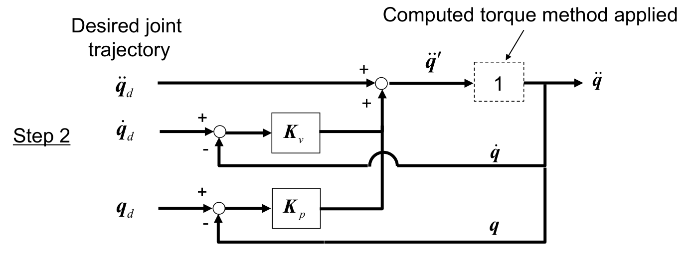
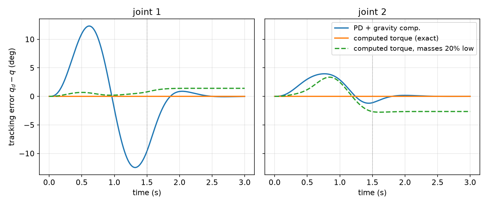
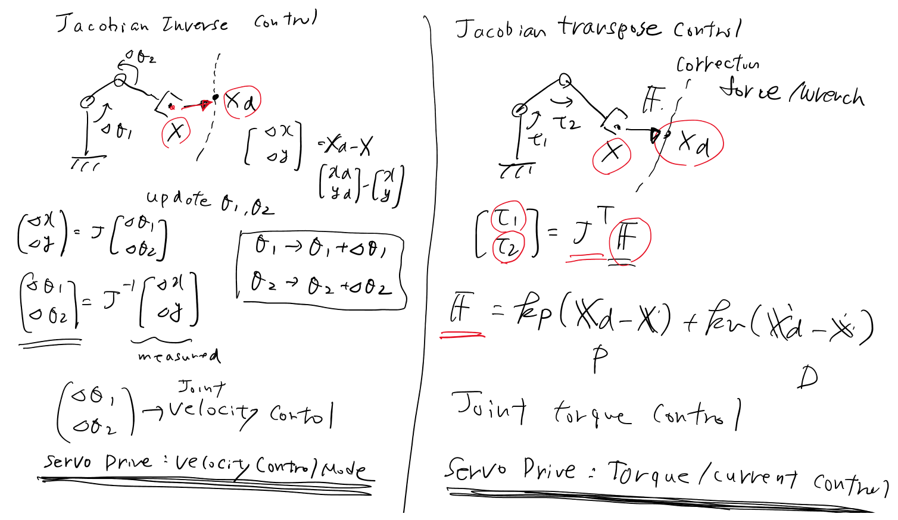
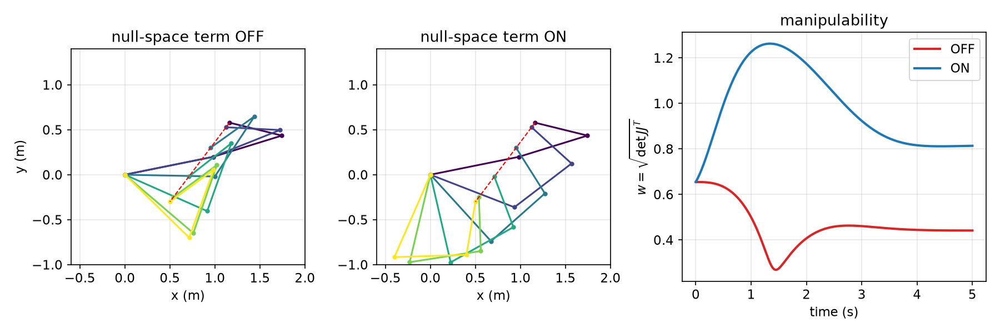

# Manipulator Control

Inverse dynamics computes the joint torques that would produce a planned motion, but replaying those torques open loop does not reproduce the motion: initial-condition mismatch, numerical error, model error and disturbances all accumulate, and an unstable or marginally stable plant drifts away. Feedback is required. This chapter builds manipulator controllers in order of increasing model use: linear single-joint servos (P, PD, PID) and the DC-servo loop, PD control with gravity compensation and its Lyapunov stability proof, computed-torque (feedback-linearizing) control and the effect of model errors, task-space controllers based on the Jacobian inverse and transpose, and null-space control of redundant arms. The robot model throughout is \\(M(q)\ddot q + h(q,\dot q) + g(q) = \tau\\) from [Manipulator Dynamics](dynamics.md); the trajectories \\(q\_d(t)\\) come from [Trajectory Generation](trajectory.md).

## Feedback Control of a Robot

A closed-loop robot controller compares a **reference input** (the desired response) with a measured **output** at an error detector. The controller, usually a microprocessor, computes an actuator command; the actuator (a DC motor with its driver) applies torque to the plant (the link mechanism); a sensor (encoder, potentiometer, camera) closes the loop. Disturbances (friction, unmodeled loads, noise) enter at the plant input. A humanoid robot has the same structure at a larger scale: vision, gyro, force and joint-angle sensors are sampled through A/D converters, the controller compares them with reference inputs, and D/A converters drive the servo modules.

The simplest joint loop is a link driven by a geared or gearless motor whose angle is read by a potentiometer (a resistor between ground and +5 V whose wiper voltage is proportional to angle). The angle passes through an A/D converter to the controller, which compares it with the desired angle and sends a torque command through a D/A converter to a current-controlled motor driver.

In the Laplace domain, with plant \\(P(s)\\) and controller \\(K(s)\\) in unity feedback,
\\[
\frac{C(s)}{R(s)} = \frac{P(s)K(s)}{1 + P(s)K(s)},
\\]
with a disturbance \\(D(s)\\) entering at the plant input. **Caution:** manipulator dynamics are nonlinear in general, so transfer-function methods apply only to linearized models, to single joints, or to arms whose dynamics have been linearized by feedback (computed torque). The available controller families are on–off, P, I, PI, PD, PID and model-based control.

## Single-Joint Linear Control

### Position control of a mass

Consider a mass \\(m\\) driven by a motor force \\(u\\), to be moved from \\(x = 0\\) to a goal \\(x = r = 1\\). The plant is \\(P(s) = 1/(ms^2)\\). We want a feedback law with \\(x\to r\\) as \\(t\to\infty\\).

**P control.** With \\(u = k\_p(r - x) = k\_pe\\),
\\[
G\_{CL}(s) = \frac{k\_p/ms^2}{1 + k\_p/ms^2} = \frac{k\_p}{ms^2 + k\_p} = \frac{\omega\_n^2}{s^2 + \omega\_n^2}, \qquad \omega\_n = \sqrt{k\_p/m}.
\\]
For a step of size \\(r\\), \\(X(s) = r\left(\frac1s - \frac{s}{s^2+\omega\_n^2}\right)\\), so \\(x(t) = r - r\cos\omega\_nt\\). The controller acts as a **virtual spring** of stiffness \\(k\_p\\) attached to the goal; with nothing to dissipate energy, the mass oscillates forever about \\(r\\) between 0 and \\(2r\\). Damping must be added.

**PD control.** With \\(u = k\_p(r - x) + k\_v(\dot r - \dot x) = k\_pe + k\_v\dot e\\), the controller mimics a virtual spring \\(k\_p\\) and damper \\(k\_v\\):
\\[
\frac{PK}{1+PK} = \frac{(k\_p + k\_vs)/ms^2}{1 + (k\_p + k\_vs)/ms^2} = \frac{k\_p + k\_vs}{ms^2 + k\_vs + k\_p}.
\\]
The characteristic equation \\(ms^2 + k\_vs + k\_p = 0\\) has roots
\\[
p\_{1,2} = \frac{-k\_v\pm\sqrt{k\_v^2 - 4mk\_p}}{2m} = -\zeta\omega\_n \pm j\omega\_n\sqrt{1-\zeta^2}, \qquad \omega\_n = \sqrt{\frac{k\_p}{m}},\ \ \zeta = \frac{k\_v}{2\sqrt{mk\_p}},
\\]
which are in the open left half-plane if and only if \\(k\_p > 0\\) and \\(k\_v > 0\\): a normal (positive) spring and damper. In the time domain, the plant \\(m\ddot x = u\\) with \\(u = k\_pe + k\_v\dot e\\) and constant \\(r\\) gives \\(m\ddot e + k\_v\dot e + k\_pe = 0\\), so \\(e\to0\\).

| Damping ratio | Poles | Response |
|---|---|---|
| \\(0<\zeta<1\\) | complex-conjugate pair | underdamped |
| \\(\zeta = 1\\) | repeated real | critically damped |
| \\(\zeta > 1\\) | two distinct real | overdamped |

Overshoot depends on zeros as well as poles. The PD law places a zero at \\(s = -k\_p/k\_v\\) in the reference path, which can cause overshoot even when the poles are critically damped or overdamped. Applying the derivative action to the measured output only (\\(u = k\_p(r-x) - k\_v\dot x\\)) removes that zero. Second-order response measures are treated in [Time Response](../me6401-linear-control/time-response.md) and PID tuning in PID Control.

### Position control of a DC servo

For the armature-controlled DC motor of [Actuation](actuation.md), with \\(J\\) now including motor and load inertia,
\\[
\frac{\Theta(s)}{E\_a(s)} = \frac{K}{(sL\_a + R\_a)(s^2J + sb) + KK\_bs} = \frac{K}{s}\cdot\frac{1}{(sL\_a + R\_a)(sJ + b) + KK\_b},
\\]
a third-order system modeled as
\\[
P(s) = \frac{a\_3}{s(s^2 + a\_1s + a\_2)}.
\\]
The pole at the origin is an integrator: voltage sets speed. A common structure uses an outer P loop \\(K\_1(s) = b\_1\\) on the position error and an inner feedback \\(K\_2(s) = b\_2s\\) (velocity feedback) or \\(K\_2(s) = b\_2s + b\_3s^2\\) (velocity and acceleration feedback). With \\(u = b\_1(r - \theta) - K\_2(s)\theta\\),
\\[
\Theta = \frac{a\_3}{s(s^2+a\_1s+a\_2)}\left[b\_1R - (b\_1 + b\_2s + b\_3s^2)\Theta\right]
\\]
\\[
\Longrightarrow\quad G(s) = \frac{\Theta}{R} = \frac{a\_3b\_1}{s^3 + (a\_1 + a\_3b\_3)s^2 + (a\_2 + a\_3b\_2)s + a\_3b\_1}.
\\]
All three closed-loop coefficients can be assigned with \\(b\_1, b\_2, b\_3\\). Rescaling time by \\(\omega\_0 = (a\_3b\_1)^{1/3}\\) (substituting \\(s\to\omega\_0 s\\)) normalizes the constant term:
\\[
G(s) = \frac{1}{s^3 + \alpha s^2 + \beta s + 1}.
\\]
With \\(\alpha = 1.3\\), \\(\beta = 2.2\\) the normalized step response rises to about 1 at \\(t\approx4\\) with a small overshoot and settles by \\(t\approx 10\\). (Routh: a cubic \\(s^3+\alpha s^2+\beta s + 1\\) is stable iff \\(\alpha,\beta > 0\\) and \\(\alpha\beta > 1\\); here \\(\alpha\beta = 2.86\\).)

**Exercise (pick-and-place carriage).** A part-handling robot drives a carriage with voltage \\(V\\); position \\(x\\). It carries a gripper of mass \\(m\_1\\), picks a part \\(m\_2\\) at \\(x = 1\\) (starting from \\(x\_0 = 0\\)) and places it at \\(x = 3\\). The plant is \\(P(s) = \frac{1}{ms(s^2 + a\_1s + a\_2)}\\) with \\(m\\) jumping from \\(m\_1\\) to \\(m\_1 + m\_2\\) at pickup. A fixed-gain design must therefore be checked for stability and performance at *both* masses: increasing the mass lowers the loop gain, slows the response and changes the damping.

### Integral action and disturbance rejection

Under P or PD control with a constant disturbance, the output settles short of the reference. An integral term \\(\int\_0^te\\,dt\\) keeps growing as long as an error persists, and so penalizes steady-state error:
\\[
K = k\_p \ (\mathrm P),\quad \frac{k\_i}{s}\ (\mathrm I),\quad k\_p + \frac{k\_i}{s}\ (\mathrm{PI}),\quad k\_p + \frac{k\_i}{s} + k\_vs\ (\mathrm{PID}); \qquad u = k\_pe + k\_i\int\_0^te\\,dt + k\_v\dot e .
\\]

**Example 1 (PID control of a mass under gravity).** A vertically moving mass with \\(P(s) = 1/(ms^2)\\) is regulated at \\(R(s) = 0\\); gravity is a step disturbance \\(D(s) = -mg/s\\) at the plant input. With \\(K = k\_p + k\_i/s + k\_vs\\) the disturbance-to-error transfer function is
\\[
G\_{de}(s) = \frac{-P}{1 + KP} = \frac{-s}{ms^3 + k\_vs^2 + k\_ps + k\_i}.
\\]
Stability is not automatic: by Routh's criterion the cubic \\(ms^3 + k\_vs^2 + k\_ps + k\_i\\) is stable iff all coefficients are positive and \\(k\_vk\_p > mk\_i\\). If so, by the final value theorem
\\[
e(\infty) = \lim\_{s\to0} s\cdot\frac{-s}{ms^3 + k\_vs^2 + k\_ps + k\_i}\cdot\left(-\frac{mg}{s}\right) = 0 .
\\]
The integrator rejects the constant disturbance completely.

### A single link with gravity

The 1-DOF arm of [Manipulator Dynamics](dynamics.md), a uniform link of mass \\(m\\), length \\(L\\) and centroidal inertia \\(I\\), angle \\(\theta\\) from the horizontal, obeys
\\[
\tau = \left(I + \frac{mL^2}{4}\right)\ddot\theta + \frac{mgL}{2}\cos\theta .
\\]
Regulate it to the horizontal, \\(r = 0\\), with \\(\tau = k\_pe + k\_i\int e\\,dt + k\_v\dot e\\), \\(e = r - \theta\\). Simulated with P, PD and PID gains in turn: P oscillates; PD settles with the link drooping below the horizontal; PID reaches the horizontal.

**Example 2 (PD steady-state error).** With \\(\tau = k\_v(\dot\theta\_d - \dot\theta) + k\_p(\theta\_d - \theta)\\) and \\(\theta\_d = 0\\), an equilibrium \\(\bar\theta\\) satisfies \\(\frac{mgL}{2}\cos\bar\theta = -k\_p\bar\theta\\). For a stiff servo \\(\bar\theta\\) is small, \\(\cos\bar\theta\approx1\\), and
\\[
\bar\theta \approx -\frac{mgL}{2k\_p}.
\\]
Linearizing about \\(\bar\theta\\) with the shifted coordinate \\(\tilde\theta = \theta - \bar\theta = \theta + \frac{mgL}{2k\_p}\\) gives \\(\left(I + \frac{mL^2}{4}\right)\ddot{\tilde\theta} + k\_v\dot{\tilde\theta} + k\_p\tilde\theta = 0\\), so \\(\theta\to\bar\theta\\): the arm converges, but to the wrong angle. The droop shrinks as \\(1/k\_p\\) but never vanishes; integral action (PID) removes it.

**Gravity cancellation.** If the gravity torque is known from the model, cancel it:
\\[
\tau = k\_pe + k\_v\dot e + \frac{mgL}{2}\cos\theta \quad\Longrightarrow\quad \left(I + \frac{mL^2}{4}\right)\ddot e + k\_v\dot e + k\_pe = 0 \quad (r\ \text{constant}),
\\]
and \\(e\to0\\) whenever all coefficients are positive. This simple step, using a nonlinear model term to cancel a nonlinearity, is the seed of the nonlinear controllers below.

## Lyapunov Stability in Brief

The multi-joint controllers below are nonlinear, so their stability is proved with Lyapunov's direct method (developed fully in [Lyapunov Stability](../me6402-nonlinear-control/lyapunov.md)). Let \\(B\_r = \\{x\in\mathbb R^n : \lVert x\rVert\leq r\\}\\).

**Definition.** A function \\(V(x)\\) is **positive definite** (on \\(B\_r\\)) if \\(V(0) = 0\\) and \\(V(x) > 0\\) for all \\(x\in B\_r\\), \\(x\neq0\\); **positive semi-definite** if \\(V(0) = 0\\) and \\(V(x)\geq0\\) on \\(B\_r\\). With \\(x = [x\_1, x\_2]^T\\): \\(x\_1^2 + x\_2^2\\) and \\(x\_1^2 + x\_2^4\\) are positive definite; \\((1-x\_1^2)x\_1^2 + x\_2^2\\) is locally positive definite (on \\(B\_r\\) with \\(r<1\\)); \\((x\_1+x\_2)^2\\) and \\(ax\_1^2\\) (\\(a>0\\)) are only positive semi-definite, since they vanish on a line through the origin.

**Theorem (Lyapunov's direct method).** Let the origin be an equilibrium of \\(\dot x = f(x)\\) and let \\(V\\) be continuously differentiable and positive definite. If \\(\dot V = \nabla V\cdot f\\) is negative semi-definite, the origin is **stable**; if \\(\dot V\\) is negative definite, it is **asymptotically stable**.

Geometrically, \\(V\\) is a bowl whose level sets enclose the origin; \\(\dot V<0\\) forces trajectories down through the level sets to the bottom, while \\(\dot V\leq0\\) only keeps them from climbing. The total energy of a mechanical system is the usual candidate, but there is no systematic way to construct Lyapunov functions in general.

**Theorem (LaSalle's invariance principle, as used here).** If \\(V\\) is positive definite and radially unbounded, \\(\dot V\leq0\\) everywhere, and the only solution that stays forever in the set \\(\\{\dot V = 0\\}\\) is the equilibrium, then the equilibrium is globally asymptotically stable. (See [Invariance Principles](../me6402-nonlinear-control/invariance.md).)

For linear systems \\(\dot x = Ax\\), the origin is asymptotically stable iff every eigenvalue of \\(A\\) has negative real part; for \\(x(k+1) = Gx(k)\\), iff every eigenvalue of \\(G\\) lies strictly inside the unit circle.

## PD Control with Gravity Compensation

### The control law

Let all \\(n\\) joints be revolute, with dynamics \\(M(q)\ddot q + h(q,\dot q) + g(q) = \tau\\), and let \\(q\_d\\) be a fixed desired posture. Apply
\\[
\boxed{\tau = K\_pe + K\_v\dot e + g(q),\qquad e = q\_d - q,}
\\]
\\(K\_p = \mathrm{diag}(k\_{p1},\dots,k\_{pn}) > 0\\), \\(K\_v = \mathrm{diag}(k\_{v1},\dots,k\_{vn}) > 0\\). Each joint has its own PD servo, a torsional spring \\(k\_{pi}\\) and damper \\(k\_{vi}\\) pulling it toward \\(\theta\_{id}\\); the only model term used is the gravity torque \\(g(q)\\), computed from the known gravity model and the measured \\(q\\). The law ignores the dynamic coupling between joints and the Coriolis and centrifugal forces entirely. Remarkably, it is still globally asymptotically stable.

### A property of the velocity terms

The proof needs one structural fact. From the Lagrangian derivation, with kinetic energy \\(\tfrac12\dot q^TM(q)\dot q\\),
\\[
h(q,\dot q) = \dot M\dot q - \frac12\left(\frac{\partial}{\partial q}\left(\dot q^TM(q)\dot q\right)\right)^T .
\\]
Take the inner product with \\(\dot q\\). Since \\(\dot M = \sum\_k \frac{\partial M}{\partial q\_k}\dot q\_k\\),
\\[
\dot q^T\left(\frac{\partial}{\partial q}(\dot q^TM\dot q)\right)^T = \sum\_k \dot q\_k\\, \dot q^T\frac{\partial M}{\partial q\_k}\dot q = \dot q^T\dot M\dot q,
\\]
so
\\[
\dot q^Th = \dot q^T\dot M\dot q - \tfrac12\dot q^T\dot M\dot q = \tfrac12\dot q^T\dot M\dot q .
\\]
Equivalently, writing \\(h = C(q,\dot q)\dot q\\) with Christoffel symbols, \\(\dot M - 2C\\) is skew-symmetric. Physically: Coriolis and centrifugal forces do no net work; they only exchange kinetic energy between joints.

### Proof of stability

**Theorem.** Under PD control with gravity compensation and constant \\(q\_d\\), the equilibrium \\(e = 0\\), \\(\dot q = 0\\) is globally asymptotically stable.

*Proof.* Take the candidate
\\[
V = \frac12 e^TK\_pe + \frac12\dot e^TM(q)\dot e,
\\]
the potential energy of the virtual springs plus the kinetic energy. It is positive definite in \\((e,\dot e)\\) and radially unbounded, because \\(K\_p > 0\\) and \\(M(q)\\) is uniformly positive definite. Since \\(q\_d\\) is constant, \\(\dot e = -\dot q\\) and \\(\dot e^TM\dot e = \dot q^TM\dot q\\). Differentiate:
\\[
\dot V = e^TK\_p\dot e + \dot q^TM\ddot q + \tfrac12\dot q^T\dot M\dot q = -e^TK\_p\dot q + \dot q^T(\tau - h - g) + \tfrac12\dot q^T\dot M\dot q .
\\]
By the property above, \\(\tfrac12\dot q^T\dot M\dot q - \dot q^Th = 0\\), so
\\[
\dot V = -e^TK\_p\dot q + \dot q^T(\tau - g).
\\]
Substitute the control law, \\(\tau - g = K\_pe + K\_v\dot e = K\_pe - K\_v\dot q\\):
\\[
\dot V = -e^TK\_p\dot q + \dot q^TK\_pe - \dot q^TK\_v\dot q = -\dot q^TK\_v\dot q = -\dot e^TK\_v\dot e \leq 0 .
\\]
\\(\dot V\\) is only negative *semi*-definite: it vanishes whenever \\(\dot q = 0\\), regardless of \\(e\\). Apply LaSalle. On a trajectory staying in \\(\\{\dot V = 0\\} = \\{\dot q = 0\\}\\), also \\(\ddot q = 0\\), and the dynamics give \\(g(q) = \tau = K\_pe + g(q)\\), i.e. \\(K\_pe = 0\\), so \\(e = 0\\). The only invariant solution is the equilibrium, which is therefore globally asymptotically stable. \\(\square\\)

So **as long as gravity is compensated, joint-level PD servo control is stable and converges asymptotically to the desired posture**, for any positive gains and any arm. If gravity is not compensated, the same analysis with \\(V\\) augmented by the gravitational potential shows convergence to an equilibrium where \\(K\_pe = g(q)\\): a steady-state droop, exactly as in Example 2. If \\(g\\) is compensated with an error \\(\Delta g\\), the offset is \\(e = K\_p^{-1}\Delta g\\) (approximately).

**Assessment.** *Pros:* theoretically asymptotically stable; easy to implement with an off-the-shelf servo driver per joint and one model term. *Cons:* the transient performance may be unsatisfactory, and it varies with posture, because the inertia \\(M(q)\\) seen by each servo changes with configuration, and the off-diagonal terms of \\(M(q)\\), \\(h\\) and \\(g\\) couple the joints. The guarantee is for regulation to a fixed \\(q\_d\\), not for tracking a trajectory.

## Computed-Torque Control

### Two steps: shape the dynamics, then feed back

**Computed-torque control** (also called inverse-dynamics control, feedback linearization or control partitioning) assumes that a perfect model is available and that \\(q\\) and \\(\dot q\\) are measured perfectly. It works in two steps.

**Step 1 (inner loop).** Use the model to cancel \\(h\\) and \\(g\\), and use \\(M(q)\\) to make a new input \\(\ddot q'\\) specify the joint accelerations directly:
\\[
\tau = M(q)\ddot q' + h(q,\dot q) + g(q).
\\]
Equate with the robot dynamics \\(M\ddot q + h + g = \tau\\): \\(h\\) and \\(g\\) cancel, leaving \\(M(q)\ddot q = M(q)\ddot q'\\). Since \\(M\\) is invertible,
\\[
\ddot q = \ddot q' ,
\\]
i.e. \\(\ddot\theta\_1 = \ddot\theta\_1'\\), \\(\ddot\theta\_2 = \ddot\theta\_2'\\), and so on. The nonlinear, coupled robot has become a unit block \\(\ddot q'\to[1]\to\ddot q\\): \\(n\\) decoupled double integrators.

**Step 2 (outer loop).** Given a desired trajectory \\(q\_d, \dot q\_d, \ddot q\_d\\), choose the new input as acceleration feedforward plus PD feedback:
\\[
\ddot q' = \ddot q\_d + K\_v(\dot q\_d - \dot q) + K\_p(q\_d - q).
\\]



*Figure: the outer loop of computed-torque control. The inner loop (dashed box) has reduced the robot to a unit block from q̈′ to q̈. The desired acceleration is fed forward and PD corrections on velocity and position error are added.*

With \\(e = q\_d - q\\), substituting \\(\ddot q = \ddot q'\\) gives the **error dynamics**
\\[
\boxed{\ddot e + K\_v\dot e + K\_pe = 0,}
\\]
linear, decoupled and configuration-independent. With diagonal positive gains each joint error obeys \\(\ddot e\_i + k\_{vi}\dot e\_i + k\_{pi}e\_i = 0\\) and \\(e\to0\\) exponentially, for tracking as well as regulation. The gains are set directly from the desired error response: \\(k\_{pi} = \omega\_n^2\\), \\(k\_{vi} = 2\zeta\omega\_n\\), with \\(\zeta = 1\\) for critical damping. Combining both steps,
\\[
\tau = M(q)\left[\ddot q\_d + K\_v(\dot q\_d - \dot q) + K\_p(q\_d - q)\right] + h(q,\dot q) + g(q).
\\]
The general theory is in [Feedback Linearization](../me6402-nonlinear-control/feedback-linearization.md) and its multi-input form in [Multi-Input Nonlinear Systems](../me6402-nonlinear-control/multi-input.md).

**Assessment.** *Pros:* much better and uniform performance; gains have a direct meaning. *Cons:* requires an accurate dynamic model and accurate measurements, and the full inverse dynamics must be computed at the servo rate.

### Example: computed torque for an RP arm

**Example 3.** A planar RP arm (revolute \\(\theta\_1\\), then prismatic \\(d\_2\\)) moving in a vertical plane has dynamics
\\[
\begin{bmatrix}\tau\_1\\\\ f\_2\end{bmatrix} = \begin{bmatrix} md\_2^2 + I & 0\\\\ 0 & m\end{bmatrix}\begin{bmatrix}\ddot\theta\_1\\\\ \ddot d\_2\end{bmatrix} + \begin{bmatrix}2md\_2\dot d\_2\dot\theta\_1\\\\ -md\_2\dot\theta\_1^2\end{bmatrix} + \begin{bmatrix} mgd\_2C\_1\\\\ mgS\_1\end{bmatrix}.
\\]
The desired motion is \\(q\_d = \left(\tfrac\pi2\cos\omega t,\ 1 + \sin\omega t\right)\\), so
\\[
\dot q\_d = \left(-\tfrac{\omega\pi}{2}\sin\omega t,\ \omega\cos\omega t\right), \qquad \ddot q\_d = \left(-\tfrac{\omega^2\pi}{2}\cos\omega t,\ -\omega^2\sin\omega t\right).
\\]

*(a) The control law, written out:*
\\[
\tau\_1 = (md\_2^2 + I)\left[-\tfrac{\omega^2\pi}{2}\cos\omega t + k\_{v1}\left(-\tfrac{\omega\pi}{2}\sin\omega t - \dot\theta\_1\right) + k\_{p1}\left(\tfrac\pi2\cos\omega t - \theta\_1\right)\right] + 2md\_2\dot d\_2\dot\theta\_1 + mgd\_2C\_1,
\\]
\\[
f\_2 = m\left[-\omega^2\sin\omega t + k\_{v2}(\omega\cos\omega t - \dot d\_2) + k\_{p2}(1 + \sin\omega t - d\_2)\right] - md\_2\dot\theta\_1^2 + mgS\_1 .
\\]
*(b) What must be calibrated, measured and tuned?* Calibrate the model parameters \\(m\\) and \\(I\\) (and \\(g\\)); measure \\(\theta\_1, \dot\theta\_1, d\_2, \dot d\_2\\) in real time; tune \\(k\_{p1}, k\_{p2}, k\_{v1}, k\_{v2}\\). Accelerations \\(\ddot\theta\_1, \ddot d\_2\\) are **not** needed: they are commanded, not measured.

*(c) Stability.* The error dynamics are \\(\ddot e\_i + k\_{vi}\dot e\_i + k\_{pi}e\_i = 0\\), asymptotically stable for all positive gains.

*(d) If the gravity terms are omitted,* constant offsets appear at rest; integral action (PID in the outer loop) removes them.

*(e) With an end-point sensor* one may instead use Jacobian-transpose control (below). Advantages: kinematic errors are compensated by direct end-point feedback, and no full dynamic model is needed. Disadvantages: task-space sensing is costly or difficult, and if the dynamics are not compensated the performance depends on posture.

### Effect of model error

In practice the controller uses estimates \\(\hat M, \hat h, \hat g\\):
\\[
\tau = \hat M(q)\ddot q' + \hat h(q,\dot q) + \hat g(q), \qquad \ddot q' = \ddot q\_d + K\_v\dot e + K\_pe .
\\]
Setting this equal to \\(M\ddot q + h + g\\),
\\[
\hat M(\ddot q\_d + K\_v\dot e + K\_pe) + \hat h + \hat g - M\ddot q - h - g = 0 .
\\]
Add and subtract \\(\hat M\ddot q\\) and use \\(\ddot e = \ddot q\_d - \ddot q\\):
\\[
\hat M(\ddot e + K\_v\dot e + K\_pe) = (M - \hat M)\ddot q + (h - \hat h) + (g - \hat g),
\\]
\\[
\boxed{\ddot e + K\_v\dot e + K\_pe = \hat M^{-1}\left[(M - \hat M)\ddot q + (h - \hat h) + (g - \hat g)\right].}
\\]
The model error acts as a **disturbance** driving the otherwise perfect error dynamics; it vanishes when the model is exact. Two consequences are worth separating:

- At rest (\\(\dot q = \ddot q = 0\\)) the inertia error and the velocity-term error drop out, because \\(h(q,0) = 0\\). Only the **gravity error** survives, and it produces a steady-state offset \\(e\_{ss} \approx K\_p^{-1}\hat M^{-1}(g - \hat g)\\).
- During motion, inertia and velocity-term errors distort the transient and the tracking.

**Example 4 (computed torque without the velocity terms).** Suppose the law omits \\(h\\): \\(\tau = M(\ddot q\_d + K\_v\dot e + K\_pe) + g\\). Then \\(M(\ddot e + K\_v\dot e + K\_pe) = h(q,\dot q)\\), i.e.
\\[
\ddot e + K\_v\dot e + K\_pe = M(q)^{-1}h(q,\dot q).
\\]
Because \\(h = 0\\) at rest, there is **no steady-state error at a fixed set point**; moving trajectories deviate, usually slightly at moderate speeds since \\(h\\) is quadratic in velocity.

**Example 5 (1R arm: PD, computed torque, and parameter errors).** For the link of Example 2, \\(\tau = \left(I + \tfrac{mL^2}{4}\right)\ddot\theta + \tfrac{mgL}{2}\cos\theta\\), with target \\(\theta\_d = 0\\):

*(a)* PD alone leaves the offset \\(\bar\theta\approx -mgL/(2k\_p)\\) (Example 2).

*(b)* Computed torque with estimated parameters \\(\hat I, \hat m, \hat L\\), with \\(\theta\_d = \dot\theta\_d = \ddot\theta\_d = 0\\):
\\[
\tau = \left(\hat I + \tfrac{\hat m\hat L^2}{4}\right)(-k\_v\dot\theta - k\_p\theta) + \tfrac{\hat mg\hat L}{2}\cos\theta .
\\]
With exact parameters, \\(\ddot\theta + k\_v\dot\theta + k\_p\theta = 0\\) and \\(\theta\to0\\).

*(c)* Let \\(\hat{\mathcal M} = \hat I + \hat m\hat L^2/4\\) and \\(\mathcal M = I + mL^2/4\\). At an equilibrium (\\(\dot\theta = \ddot\theta = 0\\), small \\(\bar\theta\\), \\(\cos\bar\theta\approx1\\)):
\\[
\frac{mgL}{2} = -\hat{\mathcal M}k\_p\bar\theta + \frac{\hat mg\hat L}{2} \quad\Longrightarrow\quad \bar\theta = -\frac{(mL - \hat m\hat L)g}{2k\_p\hat{\mathcal M}} .
\\]

| Case | Error | Steady state \\(\bar\theta\\) |
|---|---|---|
| exact model | none | \\(0\\) |
| A | \\(\hat I = 0.8I\\) | \\(0\\) |
| B | \\(\hat m = 0.8m\\) | \\(-\dfrac{1}{k\_p}\dfrac{0.1mgL}{I + 0.2mL^2}\\) |
| C | \\(\hat L = 0.8L\\) | \\(-\dfrac{1}{k\_p}\dfrac{0.1mgL}{I + 0.16mL^2}\\) |

*Case A:* gravity is exact, so there is no offset; the dynamics become \\(\mathcal M\ddot\theta = \hat{\mathcal M}(-k\_v\dot\theta - k\_p\theta)\\), i.e. \\(\ddot\theta + \alpha k\_v\dot\theta + \alpha k\_p\theta = 0\\) with \\(\alpha = \frac{0.8I + mL^2/4}{I + mL^2/4}\in(0,1)\\). The response is slower but still converges. *Case B:* \\(\hat{\mathcal M} = I + 0.2mL^2\\) and \\((mL - 0.8mL)g/2 = 0.1mgL\\). *Case C:* \\(\hat m\hat L^2 = 0.64mL^2\\) so \\(\hat{\mathcal M} = I + 0.16mL^2\\), and the gravity estimate is \\(0.8\\) of the true value, again a deficit of \\(0.1mgL\\). **Mis-estimated inertia changes only the transient; mis-estimated gravity produces an offset.**

*(d)* Remedy: replace the PD outer loop by PID, \\(\ddot q' = \ddot q\_d + K\_v\dot e + K\_pe + K\_i\int e\\,dt\\); the integral term supplies the missing gravity torque in steady state.

### Simulation: PD + gravity versus computed torque on a 2R arm



*Figure: tracking errors of a planar 2R arm in a vertical plane (uniform links m₁ = 2 kg, l₁ = 1 m, m₂ = 1.5 kg, l₂ = 0.8 m) following a quintic move from (−90°, 0°) to (30°, 90°) in 1.5 s (dotted line), then holding. Same gains in all cases: K_p = diag(100, 100), K_v = diag(20, 20). PD + gravity compensation (blue) lags by up to 12.5° on joint 1 during the move but converges once the reference stops. Exact computed torque (orange) tracks perfectly. Computed torque whose model masses and inertias are 20% low (green) tracks closely during motion but settles with offsets of 1.4° and −2.7°, caused by the gravity under-estimate.*

The simulation illustrates both theorems. PD with gravity compensation has no inertia model, so during the fast move the coupling and inertial torques act as large disturbances on each joint servo; once the reference stops it converges, as the Lyapunov proof guarantees. Computed torque with an exact model gives zero error; with a 20% mass error it shows the predicted steady offset, which an integral term would remove.

```python
# Computed-torque law used in the simulation (model functions return M, h, g)
def ctc(q, qd, qr, dqr, ddqr, Kp, Kv, model):
    M, h, g = model(q, qd)
    return M @ (ddqr + Kv @ (dqr - qd) + Kp @ (qr - q)) + h + g
```

### A drawing task with a 3R arm

A representative control project uses the torque-controlled simplified PUMA (3R) arm under gravity to draw figures in a horizontal plane within 10 s: three tangent circles of radius 0.1 m, then a word of at least six letters. The specification, evaluated from 1 s to 10 s, is a maximum tip error below 3 cm and an RMS error below 1 cm. A weak controller tracing "GATECH" shows a 4.4 cm peak error and 1.42 cm RMS, failing the specification, with torque spikes to ±8000 at the uncontrolled jumps between strokes. In one submitted solution (by T. Brumfiel), a computed-torque controller with \\(K\_p = \mathrm{diag}(1000,1000,1000)\\) and \\(K\_v = \mathrm{diag}(300,500,500)\\), built on a symbolically derived Lagrangian model, achieved a maximum circle error of 1.3 mm and RMS error of 0.8 mm; for a hand-digitized word the maximum error rose to about 1.6 cm, dominated by the jumps between digitized points. Smooth references matter as much as the controller.

## Task-Space Control

Tasks are specified at the end point, while actuators act at the joints. There are three ways to close the loop.

### Joint-based control of Cartesian paths

Convert the Cartesian trajectory \\(X\_d, \dot X\_d, \ddot X\_d\\) to joint space by inverse kinematics (\\(\theta\_d = \mathrm{IK}(X\_d)\\), \\(\dot\theta\_d = J^{-1}\dot X\_d\\), \\(\ddot\theta\_d = J^{-1}(\ddot X\_d - \dot J\dot\theta\_d)\\)) and use any joint servo. This is the most common industrial arrangement. Its weakness is that the end point is never measured: kinematic calibration errors pass straight through.

### Resolved-acceleration (end-point computed-torque) control

Apply the computed-torque idea in task space. With \\(\dot x = J\dot q\\) and \\(\ddot x = J\ddot q + \dot J\dot q\\), choose a new input \\(\ddot x'\\) and
\\[
\tau = M(q)J^{-1}\left(\ddot x' - \dot J\dot q\right) + h(q,\dot q) + g(q).
\\]
Equating with the dynamics: \\(MJ^{-1}(\ddot x' - \dot J\dot q) = M\ddot q\\), so \\(\ddot x' - \dot J\dot q = J\ddot q\\), and
\\[
\ddot x' = J\ddot q + \dot J\dot q = \ddot x .
\\]
The arm becomes \\(\ddot x'\to[1]\to\ddot x\\), decoupled in task coordinates, and standard PD feedback with feedforward is applied to \\(x, y, z, \dots\\) independently: \\(\ddot x' = \ddot x\_d + K\_v(\dot x\_d - \dot x) + K\_p(x\_d - x)\\). It requires a nonsingular \\(J\\).

### Inverse-Jacobian and transpose-Jacobian control



*Figure: left, inverse-Jacobian control: the measured end-point error ΔX = X_d − X is mapped to joint corrections Δθ = J⁻¹ΔX that are sent to joint velocity servos. Right, transpose-Jacobian control: the end-point error defines a correction force F = k_p(X_d − X) + k_v(Ẋ_d − Ẋ), a virtual spring and damper pulling the tip toward X_d, which J^T converts to joint torques for torque-mode servos.*

**Inverse-Jacobian control.** Measure (or compute) the end-point error \\(\Delta X = X\_d - X\\). Since \\(\Delta X\approx J\Delta\theta\\) for small errors,
\\[
\Delta\theta = J^{-1}\Delta X,
\\]
and the joints are updated \\(\theta\_i\to\theta\_i + \Delta\theta\_i\\) by joint velocity control (servo drives in **velocity mode**), or the joint error \\(\Delta\theta\\) is fed to joint PD servos. End-point error becomes joint error, which joint position control removes. It fails at singularities, where \\(J^{-1}\\) does not exist and grows without bound nearby.

**Transpose-Jacobian control.** Treat the end-point error as a virtual spring and damper and convert the resulting force to torques by statics:
\\[
\boxed{\tau = J^T(q)F, \qquad F = K\_p(X\_d - X) + K\_v(\dot X\_d - \dot X),}
\\]
with servo drives in **torque (current) mode**. No inverse is computed, so the law is well defined at singularities (though it cannot generate force along a degenerate direction there).

**Theorem (transpose-Jacobian regulation).** For a constant target \\(X\_d\\), the law \\(\tau = J^T(K\_p(X\_d - X) - K\_v\dot X) + g(q)\\) with \\(K\_p, K\_v > 0\\) makes the arm converge to a posture with \\(X = X\_d\\), provided \\(J\\) is nonsingular there.

*Sketch.* Use \\(V = \tfrac12\dot q^TM\dot q + \tfrac12(X\_d - X)^TK\_p(X\_d - X)\\). With \\(\dot X = J\dot q\\) and the property \\(\dot q^Th = \tfrac12\dot q^T\dot M\dot q\\), \\(\dot V = \dot q^T(\tau - g) - \dot X^TK\_p(X\_d - X) = -\dot X^TK\_v\dot X\leq 0\\). On \\(\\{\dot V = 0\\}\\) with \\(J\\) nonsingular, \\(\dot q = 0\\), and the dynamics give \\(J^TK\_p(X\_d - X) = 0\\), hence \\(X = X\_d\\). \\(\square\\)

**Example 6 (RP arm).** For the RP arm with \\(x\_e = (l\_1 + d\_2)\cos\theta\_1\\), \\(y\_e = (l\_1 + d\_2)\sin\theta\_1\\),
\\[
\dot x\_e = -(l\_1 + d\_2)\sin\theta\_1\\,\dot\theta\_1 + \cos\theta\_1\\,\dot d\_2, \qquad \dot y\_e = (l\_1 + d\_2)\cos\theta\_1\\,\dot\theta\_1 + \sin\theta\_1\\,\dot d\_2,
\\]
\\[
J = \begin{bmatrix} -(l\_1 + d\_2)\sin\theta\_1 & \cos\theta\_1\\\\ (l\_1 + d\_2)\cos\theta\_1 & \sin\theta\_1\end{bmatrix}, \qquad \begin{bmatrix}\tau\_1\\\\ f\_2\end{bmatrix} = J^T\left[K\_p\begin{bmatrix}x\_d - x\_e\\\\ y\_d - y\_e\end{bmatrix} + K\_v\begin{bmatrix}\dot x\_d - \dot x\_e\\\\ \dot y\_d - \dot y\_e\end{bmatrix}\right].
\\]
\\(\det J = -(l\_1 + d\_2)\\), so the arm is singular only when the tip is on the joint-1 axis. Tracking quality depends on the PD gains and, without dynamic compensation, on posture; the gains must be tuned for acceptable tracking.

**Example 7 (comparing end-point controllers for a 2R arm).** For the 2R arm,
\\[
J = \begin{bmatrix} -L\_1S\_1 - L\_2S\_{12} & -L\_2S\_{12}\\\\ L\_1C\_1 + L\_2C\_{12} & L\_2C\_{12}\end{bmatrix}, \qquad \det J = L\_1L\_2S\_2,
\\]
so the inverse-Jacobian scheme fails whenever \\(\theta\_2 = 0\\) or \\(\pi\\), **for any** \\(\theta\_1\\) (not only at \\(\theta\_1 = \theta\_2 = 0\\)). A torque-level Cartesian PD is \\(\tau = J^T(K\_pe\_X + K\_d\dot e\_X)\\); writing it as \\(\tau = J^{-1}(\cdot)\\) mixes up the two schemes, because \\(J^{-1}\\) maps task errors to *joint errors*, on which a joint PD then acts.

| Method | Advantages | Disadvantages |
|---|---|---|
| Computed torque | excellent, uniform performance | needs an exact model |
| Jacobian-based (inverse or transpose) | simple; end-point feedback corrects kinematic errors | performance varies over the workspace; closed-loop poles not fixed |
| PD + gravity compensation | easy; asymptotically stable | posture-dependent performance; joint coupling |

## Redundant Arms and Task Priority

### Null-space correction

For a redundant arm (\\(n > m\\)) the velocity solution of [Actuation](actuation.md) is \\(\dot q\_d = J^+v\_E + (I - J^+J)k\\), and the end-point error correction becomes
\\[
\Delta q = J^+(X\_d - X) + (I - J^+J)k .
\\]
How should \\(k\\) be chosen? Decompose the job into tasks with priorities. The **first task** is tracking \\(X\_d\\). The **second task** is achieved *as much as possible* using only the null space; there is no guarantee that it is fully accomplished, but it never disturbs the first.

### Gradient projection

Encode the second task as a criterion \\(p = V(q)\\) to be kept as large as possible, and choose \\(k\\) along its gradient:
\\[
\boxed{\dot q\_d = J^+v\_E + (I - J^+J)\\,k\_p\\,\xi, \qquad k\_p > 0, \qquad \xi = \left[\frac{\partial V}{\partial q\_1}\ \ \frac{\partial V}{\partial q\_2}\ \cdots\ \frac{\partial V}{\partial q\_n}\right]^T .}
\\]
Since \\(J\dot q\_d = v\_E\\) regardless of the second term, the end point is unaffected. Along the resulting motion, the null-space contribution to \\(\dot V\\) is \\(\xi^T(I - J^+J)k\_p\xi = k\_p\lVert(I-J^+J)\xi\rVert^2\geq0\\) (using that the projector is symmetric and idempotent), so the self-motion always climbs \\(V\\).

For **singularity avoidance**, take the manipulability \\(V(q) = w = \sqrt{\det J(q)J^T(q)}\\). Using \\(\partial\det A/\partial\theta = \det A\\,\mathrm{tr}(A^{-1}\partial A/\partial\theta)\\) with \\(A = JJ^T\\),
\\[
\xi\_l = \frac{\partial w}{\partial\theta\_l} = \frac12\sqrt{\det JJ^T}\sum\_{i,j=1}^{m} b\_{ij}\left(\frac{\partial J\_i}{\partial\theta\_l}J\_j^T + \frac{\partial J\_j}{\partial\theta\_l}J\_i^T\right), \qquad l = 1,\dots,n,
\\]
where \\(b\_{ij}\\) is the \\((i,j)\\) element of \\((JJ^T)^{-1}\\) and \\(J\_i\\) is the \\(i\\)-th row of \\(J\\). In practice the gradient is often evaluated numerically by finite differences.

**Example 8 (planar 3R arm with a point task).** A planar 3R arm positioning its tip is redundant by one: \\(J\\) is \\(2\times3\\),
\\[
\begin{bmatrix}\dot x\_e\\\\ \dot y\_e\end{bmatrix} = \begin{bmatrix} -a\_1S\_1 - a\_2S\_{12} - a\_3S\_{123} & -a\_2S\_{12} - a\_3S\_{123} & -a\_3S\_{123}\\\\ a\_1C\_1 + a\_2C\_{12} + a\_3C\_{123} & a\_2C\_{12} + a\_3C\_{123} & a\_3C\_{123}\end{bmatrix}\begin{bmatrix}\dot\theta\_1\\\\ \dot\theta\_2\\\\ \dot\theta\_3\end{bmatrix},
\\]
with \\(p = \sqrt{\det JJ^T}\\) and \\(\xi = [\partial V/\partial\theta\_1,\ \partial V/\partial\theta\_2,\ \partial V/\partial\theta\_3]^T\\).



*Figure: a planar 3R arm (links 1.0, 0.8, 0.6 m) moves its tip along the red dashed line in 5 s under resolved-rate control with tip-error feedback; postures are drawn every second, dark to light. Without the null-space term (left) the minimum-norm solution lets the arm fold, and the manipulability drops from 0.65 to a minimum of 0.27. With the gradient term (gain 3, middle) the self-motion unfolds the arm while the tip follows the same line, and w stays above its initial value, ending at 0.81 versus 0.44.*

In a physics simulation of the same idea, with avoidance switched on the arm stays bent and its manipulability levels off around 0.025, above a chosen threshold of 0.02; switched off, the arm approaches a folded posture and the manipulability drops to about 0.017, below the threshold. The curves separate where the minimum-norm solution starts folding the arm.

## Summary

- P control of a mass is a virtual spring (undamped oscillation); PD adds a virtual damper: \\(m\ddot e + k\_v\dot e + k\_pe = 0\\), stable iff \\(k\_p, k\_v > 0\\). The PD zero can cause overshoot.
- DC servo position loop with velocity and acceleration feedback: \\(G = a\_3b\_1/[s^3 + (a\_1 + a\_3b\_3)s^2 + (a\_2 + a\_3b\_2)s + a\_3b\_1]\\).
- PID rejects constant disturbances (\\(e(\infty) = 0\\)) if stable (\\(k\_vk\_p > mk\_i\\) for a mass). PD on a link under gravity droops by \\(\approx mgL/(2k\_p)\\).
- PD + gravity compensation \\(\tau = K\_pe + K\_v\dot e + g(q)\\) is globally asymptotically stable for regulation: \\(V = \tfrac12e^TK\_pe + \tfrac12\dot q^TM\dot q\\), \\(\dot V = -\dot q^TK\_v\dot q\\), plus LaSalle; key fact \\(\dot q^Th = \tfrac12\dot q^T\dot M\dot q\\).
- Computed torque \\(\tau = M(\ddot q\_d + K\_v\dot e + K\_pe) + h + g\\) gives \\(\ddot e + K\_v\dot e + K\_pe = 0\\). With model errors the right side becomes \\(\hat M^{-1}[(M-\hat M)\ddot q + (h-\hat h) + (g-\hat g)]\\): inertia errors affect transients, gravity errors cause offsets (fixed by PID).
- Task space: resolved acceleration \\(\tau = MJ^{-1}(\ddot x' - \dot J\dot q) + h + g\\); inverse-Jacobian \\(\Delta\theta = J^{-1}\Delta X\\) (velocity mode); transpose-Jacobian \\(\tau = J^T[K\_p(X\_d - X) + K\_v(\dot X\_d - \dot X)]\\) (torque mode).
- Redundancy: \\(\dot q\_d = J^+v\_E + (I - J^+J)k\_p\nabla V\\); with \\(V = \sqrt{\det JJ^T}\\) it steers away from singularities without disturbing the end point.

## See Also

- Robot Control: overview of joint- and task-space control.
- [Actuation, Transmissions and Redundancy](actuation.md): motor models, gearing, pseudoinverse and manipulability.
- [Manipulator Dynamics](dynamics.md) and [Trajectory Generation](trajectory.md): the model and references used here.
- [Force Control, Haptics and Teleoperation](force-control.md): controlling interaction forces rather than positions.
- [Lyapunov Stability](../me6402-nonlinear-control/lyapunov.md), [Invariance Principles](../me6402-nonlinear-control/invariance.md), [Feedback Linearization](../me6402-nonlinear-control/feedback-linearization.md) and [Multi-Input Nonlinear Systems](../me6402-nonlinear-control/multi-input.md): the theory behind PD + G and computed torque.
- [Adaptive Control](../me6402-nonlinear-control/adaptive-control.md) and [Sliding Control](../me6402-nonlinear-control/sliding-control.md): robust and adaptive answers to model error.
- PID Control and Control Systems.
