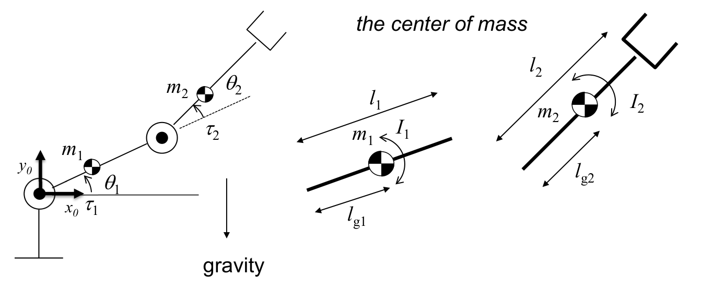
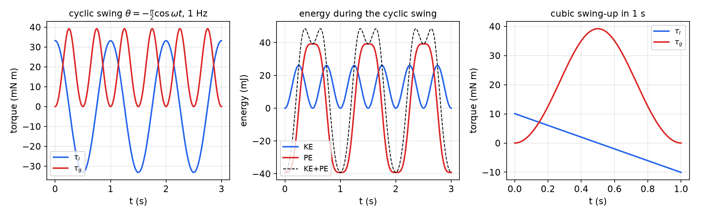
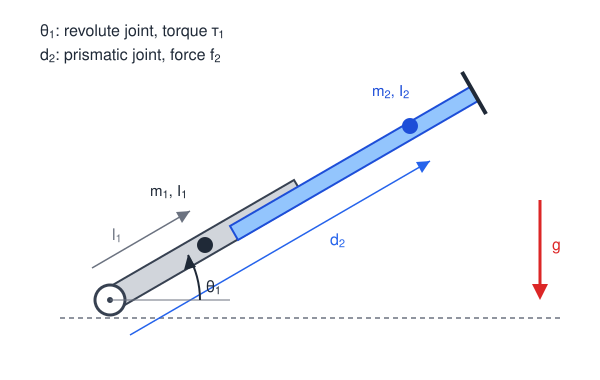
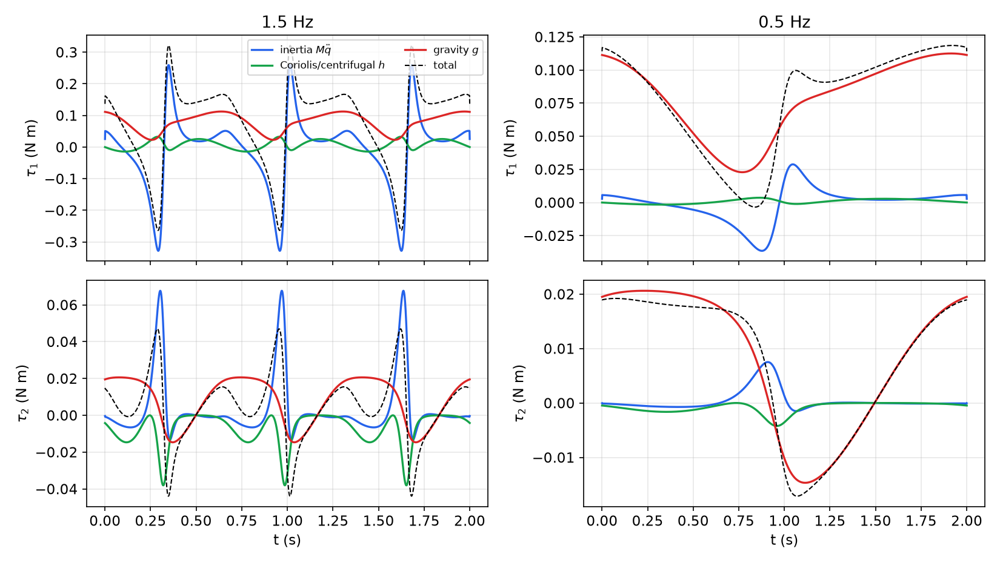
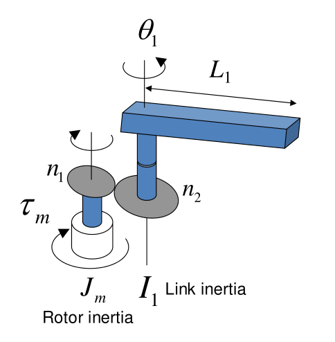
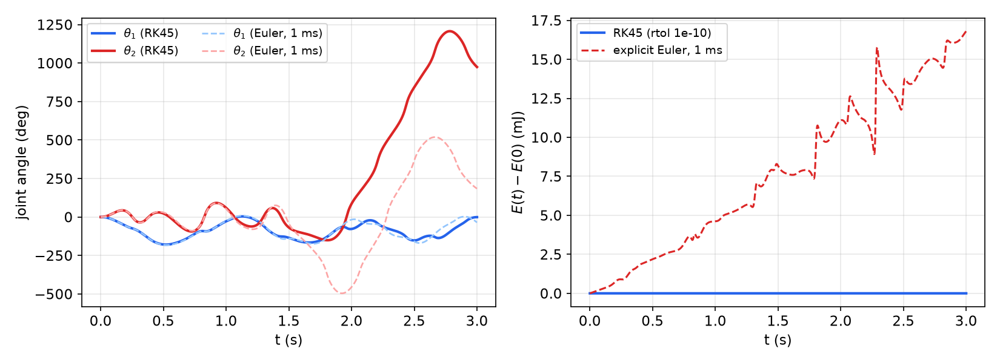

# Manipulator Dynamics

Kinematics and trajectory generation say where the joints should be and how fast; dynamics says what torques it takes. The answer is a set of coupled, nonlinear second-order differential equations, the **dynamic equation of motion** \\(M(q)\ddot q+C(q,\dot q)\dot q+G(q)=\tau\\). Two classical routes lead to it. The recursive Newton–Euler algorithm propagates velocities and accelerations outward from the base and forces inward from the tool; it is fast and suits numerical computation. The Lagrangian formulation differentiates the kinetic and potential energies and gives the equations in closed, symbolic form, which suits analysis and control design. This chapter develops both, works out the standard examples, studies the structure of the equations (the properties that controllers exploit), adds the effect of gear trains, and finishes by simulating a two-link arm. The single-body foundations are in Newton's Laws, Momentum and Energy Methods; the overview chapter Robot Dynamics summarizes the results.

## The Dynamic Equation of Motion

For an \\(n\\)-joint arm with joint displacement vector \\(q=[\theta\_1\ \cdots\ \theta\_n]^T\\) (with \\(d\_j\\) in place of \\(\theta\_j\\) when joint \\(j\\) is prismatic) and joint effort vector \\(Q=[\tau\_1\ \cdots\ \tau\_n]^T\\) (a force \\(f\_j\\) for a prismatic joint), the dynamics take the form

\\[
\boxed{M(q)\ddot q+h(q,\dot q)+g(q)=Q+Q^x}
\\]

where

- \\(M(q)\\) is the **inertia matrix**: symmetric, positive definite, and **posture dependent**;
- \\(h(q,\dot q)\\) collects the **centrifugal and Coriolis** terms, nonlinear and quadratic in the joint velocities; writing \\(h=C(q,\dot q)\dot q\\) gives the common form \\(M\ddot q+C\dot q+G=\tau\\);
- \\(g(q)\\) (or \\(G(q)\\)) is the **gravity** term, also posture dependent;
- \\(Q^x\\) are joint torques produced by external loads on the arm, for example \\(Q^x=J^TF\_{ext}\\) for a force \\(F\_{ext}\\) applied to the tool.

Two problems are solved with it.

- **Inverse (reverse) dynamics:** given \\(q,\dot q,\ddot q\\) along a trajectory, compute the torques, \\(Q=M(q)\ddot q+h(q,\dot q)+g(q)-Q^x\\). Used for feedforward control and actuator sizing.
- **Forward dynamics:** given \\(q,\dot q\\) and the torques, compute the accelerations, \\(\ddot q=M(q)^{-1}\left(Q+Q^x-h(q,\dot q)-g(q)\right)\\), and integrate them numerically (Runge–Kutta, for instance). Used for simulation.

And two methods produce the equation:

- **Iterative (recursive) Newton–Euler:** numerical, link to link, cost proportional to \\(n\\);
- **Closed form (Lagrange):** symbolic \\(M\\), \\(h\\), \\(g\\).



*Figure: the planar 2R arm used throughout the chapter. Link \\(i\\) has mass \\(m\_i\\), length \\(l\_i\\), centre of mass at distance \\(l\_{gi}\\) from its joint, and moment of inertia \\(I\_i\\) about its centre of mass; joint torques \\(\tau\_1,\tau\_2\\); gravity along \\(-y\_0\\); no external load, \\(Q^x=0\\).*

## Accelerations of a Rigid Body

The Newton–Euler method needs accelerations, which follow from differentiating the velocity relations of [Jacobians, Singularities and Statics](jacobians-statics.md) once more. Derivatives are taken in an inertial ("universal") frame \\(\\{U\\}\\).

**Angular acceleration.** With \\(\omega={}^{U}R\_B{}^{B}\omega\\) and \\(\frac{d}{dt}({}^{U}R\_B{}^{B}p)={}^{U}R\_B{}^{B}\dot p+\omega\times{}^{U}R\_B{}^{B}p\\),

\\[
\dot\omega=\frac{d}{dt}\left({}^{U}R\_B{}^{B}\omega\right)={}^{U}R\_B\frac{d}{dt}{}^{B}\omega+\omega\times\omega={}^{U}R\_B\frac{d}{dt}{}^{B}\omega .
\\]

The angular acceleration can be differentiated in either frame; the cross term vanishes.

**Linear acceleration, common origin.** Differentiate \\({}^{A}v={}^{A}R\_B{}^{B}v+{}^{A}\omega\_B\times{}^{A}R\_B{}^{B}p\\) and apply the same rule to each product:

\\[
{}^{A}\dot v={}^{A}R\_B{}^{B}\dot v+2\\,{}^{A}\omega\_B\times{}^{A}R\_B{}^{B}v+{}^{A}\dot\omega\_B\times{}^{A}R\_B{}^{B}p+{}^{A}\omega\_B\times\left({}^{A}\omega\_B\times{}^{A}R\_B{}^{B}p\right).
\\]

**General case.** For frames \\(\\{A\\}\\), \\(\\{B\\}\\), \\(\\{C\\}\\) with \\({}^{A}\omega\_C={}^{A}\omega\_B+{}^{A}R\_B{}^{B}\omega\_{BC}\\),

\\[
{}^{A}\dot\omega\_C={}^{A}\dot\omega\_B+{}^{A}R\_B{}^{B}\dot\omega\_{BC}+{}^{A}\omega\_B\times\left({}^{A}R\_B{}^{B}\omega\_{BC}\right),
\\]
\\[
{}^{A}\ddot p\_C={}^{A}\ddot p\_B+{}^{A}R\_B\frac{d^2}{dt^2}{}^{B}p\_{BC}+2\\,{}^{A}\omega\_B\times{}^{A}R\_B\frac{d}{dt}{}^{B}p\_{BC}+{}^{A}\dot\omega\_B\times{}^{A}R\_B{}^{B}p\_{BC}+{}^{A}\omega\_B\times\left({}^{A}\omega\_B\times{}^{A}R\_B{}^{B}p\_{BC}\right).
\\]

The terms have names: relative acceleration, **Coriolis** acceleration (angular velocity times linear velocity, \\(2\omega\times\dot p\\)), tangential acceleration (\\(\dot\omega\times p\\)) and **centripetal** acceleration (angular velocity times angular velocity, \\(\omega\times(\omega\times p)\\)). If \\(p\_{BC}\\) is constant, as for a point fixed on a link, the second and third terms vanish. These velocity-product terms are the origin of \\(h(q,\dot q)\\).

## Mass Distribution

The rotational inertia of a body about the axes of a frame \\(\\{A\\}\\) is the **inertia tensor**

\\[
{}^{A}I=\begin{bmatrix}I\_{xx}&-I\_{xy}&-I\_{xz}\\\\-I\_{xy}&I\_{yy}&-I\_{yz}\\\\-I\_{xz}&-I\_{yz}&I\_{zz}\end{bmatrix},
\qquad
\begin{aligned}
I\_{xx}&=\iiint\_V(y^2+z^2)\rho\\,dv, & I\_{xy}&=\iiint\_Vxy\\,\rho\\,dv,\\\\
I\_{yy}&=\iiint\_V(x^2+z^2)\rho\\,dv, & I\_{xz}&=\iiint\_Vxz\\,\rho\\,dv,\\\\
I\_{zz}&=\iiint\_V(x^2+y^2)\rho\\,dv, & I\_{yz}&=\iiint\_Vyz\\,\rho\\,dv .
\end{aligned}
\\]

The diagonal entries are the mass **moments** of inertia, the off-diagonal ones the mass **products** of inertia. Two transformations are used constantly.

- **Parallel-axis theorem.** If \\({}^{C}I\\) is the tensor about the centre of mass and \\(p\_c\\) the position of the centre of mass in \\(\\{A\\}\\) (same orientation), then \\({}^{A}I={}^{C}I+m\left[p\_c^Tp\_c\\,I\_3-p\_cp\_c^T\right]\\); for example \\({}^{A}I\_{zz}={}^{C}I\_{zz}+m(x\_c^2+y\_c^2)\\). For a link rotating about its joint, \\(I\_2+m\_2l\_{g2}^2\\) is its moment of inertia about joint 2.
- **Rotation.** Expressed in a rotated frame, \\({}^{U}I={}^{U}R\_C\\,{}^{C}I\\,{}^{U}R\_C^T\\). This is only a change of coordinates, not the parallel-axis theorem.

For a uniform rectangular bar of length \\(l\\) and width \\(w\\), the centroidal moment about the axis normal to its face is \\(m(l^2+w^2)/12\\).

## Newton's and Euler's Equations

For a rigid body of mass \\(m\\) with centre-of-mass velocity \\(v\_c\\), acted on by a net force \\(F\\) and a net moment \\(N\\) about its centre of mass:

\\[
\boxed{F=m\dot v\_c,\qquad N={}^{C}I\\,\dot\omega+\omega\times{}^{C}I\\,\omega .}
\\]

Newton's equation is familiar. Euler's follows from the rate of change of angular momentum \\(E=I\omega\\), with \\(I={}^{U}R\_C{}^{C}I{}^{U}R\_C^T\\) in the inertial frame. Since \\({}^{C}I\\) is constant in the body frame,

\\[
N=\frac{dE}{dt}=\frac{d}{dt}\left({}^{U}R\_C{}^{C}E\right)={}^{U}R\_C\frac{d}{dt}{}^{C}E+\omega\times{}^{U}R\_C{}^{C}E
={}^{U}R\_C{}^{C}I\frac{d}{dt}{}^{C}\omega+\omega\times\left({}^{U}R\_C{}^{C}I{}^{C}\omega\right)=I\dot\omega+\omega\times(I\omega),
\\]

using \\(\frac{d}{dt}\omega={}^{U}R\_C\frac{d}{dt}{}^{C}\omega\\) from the previous section. The gyroscopic term \\(\omega\times I\omega\\) vanishes for rotation about a principal axis, in particular for every planar motion.

## The Iterative Newton–Euler Algorithm

Let \\(C\_i\\) be a frame at the centre of mass of link \\(i\\) with the same orientation as frame \\(\\{i\\}\\), \\({}^{i}p\_{C\_i}\\) its position in \\(\\{i\\}\\), and \\({}^{C\_i}I\_i\\) the link's centroidal inertia tensor.

### Outward recursion: velocities and accelerations

For \\(i=0,1,\dots,n-1\\), starting from the base with \\({}^{0}\omega\_0={}^{0}\dot\omega\_0=0\\):

*Revolute joint \\(i+1\\):*

\\[
\begin{aligned}
{}^{i+1}\omega\_{i+1}&={}^{i+1}R\_i{}^{i}\omega\_i+\dot\theta\_{i+1}{}^{i+1}\hat Z\_{i+1},\\\\
{}^{i+1}\dot\omega\_{i+1}&={}^{i+1}R\_i{}^{i}\dot\omega\_i+{}^{i+1}R\_i{}^{i}\omega\_i\times\dot\theta\_{i+1}{}^{i+1}\hat Z\_{i+1}+\ddot\theta\_{i+1}{}^{i+1}\hat Z\_{i+1},\\\\
{}^{i+1}\dot v\_{i+1}&={}^{i+1}R\_i\left[{}^{i}\dot\omega\_i\times{}^{i}p\_{i+1}+{}^{i}\omega\_i\times\left({}^{i}\omega\_i\times{}^{i}p\_{i+1}\right)+{}^{i}\dot v\_i\right].
\end{aligned}
\\]

*Prismatic joint \\(i+1\\):*

\\[
\begin{aligned}
{}^{i+1}\omega\_{i+1}&={}^{i+1}R\_i{}^{i}\omega\_i,\qquad {}^{i+1}\dot\omega\_{i+1}={}^{i+1}R\_i{}^{i}\dot\omega\_i,\\\\
{}^{i+1}\dot v\_{i+1}&={}^{i+1}R\_i\left[{}^{i}\dot\omega\_i\times{}^{i}p\_{i+1}+{}^{i}\omega\_i\times\left({}^{i}\omega\_i\times{}^{i}p\_{i+1}\right)+{}^{i}\dot v\_i\right]+2\\,{}^{i+1}\omega\_{i+1}\times\dot d\_{i+1}{}^{i+1}\hat Z\_{i+1}+\ddot d\_{i+1}{}^{i+1}\hat Z\_{i+1}.
\end{aligned}
\\]

Both are the general acceleration formula with \\(\\{B\\}=\\{i\\}\\) and \\(\\{C\\}=\\{i+1\\}\\). The term \\({}^{i}\omega\_i\times\dot\theta\_{i+1}\hat Z\_{i+1}\\) appears because the axis of joint \\(i+1\\) is itself rotating. The Coriolis term \\(2\omega\times\dot d\hat Z\\) appears because a sliding link moves relative to a rotating frame.

*Then, for each link, the centre-of-mass acceleration and the inertial force and moment:*

\\[
\begin{aligned}
{}^{i+1}\dot v\_{C\_{i+1}}&={}^{i+1}\dot\omega\_{i+1}\times{}^{i+1}p\_{C\_{i+1}}+{}^{i+1}\omega\_{i+1}\times\left({}^{i+1}\omega\_{i+1}\times{}^{i+1}p\_{C\_{i+1}}\right)+{}^{i+1}\dot v\_{i+1},\\\\
{}^{i+1}F\_{i+1}&=m\_{i+1}{}^{i+1}\dot v\_{C\_{i+1}},\\\\
{}^{i+1}N\_{i+1}&={}^{C\_{i+1}}I\_{i+1}\\,{}^{i+1}\dot\omega\_{i+1}+{}^{i+1}\omega\_{i+1}\times{}^{C\_{i+1}}I\_{i+1}\\,{}^{i+1}\omega\_{i+1}.
\end{aligned}
\\]

**Gravity.** Instead of adding a weight to every link, start the recursion with \\({}^{0}\dot v\_0=-g\\), where \\(g\\) is the gravity vector. Giving the base a fictitious upward acceleration of \\(1\\,g\\) has exactly the effect of gravity on all links, by the equivalence principle, at no extra cost.

### Inward recursion: forces, moments and joint torques

The free-body diagram of link \\(i\\) contains the force \\(f\_i\\) and moment \\(n\_i\\) exerted by link \\(i-1\\), the reactions \\(-f\_{i+1}\\), \\(-n\_{i+1}\\) of link \\(i+1\\), and the net \\(F\_i\\), \\(N\_i\\) that must produce the link's motion.


*Figure: forces on link \\(i\\). Blue are the constraint forces and moments from the neighbouring links; red are the net force \\(F\_i=m\_i\dot v\_{C\_i}\\) at the centre of mass and the net moment \\(N\_i\\) that the blue loads must add up to.*

Balance of force and of moment about the centre of mass:

\\[
{}^{i}F\_i={}^{i}f\_i-{}^{i}R\_{i+1}{}^{i+1}f\_{i+1},\qquad
{}^{i}N\_i={}^{i}n\_i-{}^{i}n\_{i+1}+\left(-{}^{i}p\_{C\_i}\right)\times{}^{i}f\_i-\left({}^{i}p\_{i+1}-{}^{i}p\_{C\_i}\right)\times{}^{i}f\_{i+1},
\\]

where \\({}^{i}n\_{i+1}={}^{i}R\_{i+1}{}^{i+1}n\_{i+1}\\) and \\({}^{i}f\_{i+1}={}^{i}R\_{i+1}{}^{i+1}f\_{i+1}\\). Solving for the loads at joint \\(i\\) (substitute the force balance into the moment balance) gives the inward recursion, for \\(i=n,n-1,\dots,1\\), started with the force and moment the tool exerts on the environment (zero in free motion):

\\[
\boxed{\begin{aligned}
{}^{i}f\_i&={}^{i}R\_{i+1}{}^{i+1}f\_{i+1}+{}^{i}F\_i,\\\\
{}^{i}n\_i&={}^{i}N\_i+{}^{i}R\_{i+1}{}^{i+1}n\_{i+1}+{}^{i}p\_{C\_i}\times{}^{i}F\_i+{}^{i}p\_{i+1}\times{}^{i}R\_{i+1}{}^{i+1}f\_{i+1},\\\\
\tau\_i&={}^{i}n\_i^T\\,{}^{i}\hat Z\_i\ \ \text{(revolute)},\qquad \tau\_i={}^{i}f\_i^T\\,{}^{i}\hat Z\_i\ \ \text{(prismatic)}.
\end{aligned}}
\\]

As in statics, the actuator supplies only the component along its joint's free direction. The other five components of \\(f\_i,n\_i\\) are reactions of the rigid structure: bearings, guides, the joint housing. The algorithm computes them too, which is useful for sizing bearings.

The whole computation is a fixed number of \\(3\times3\\) operations per link, so its cost grows **linearly** with \\(n\\). That is why recursive Newton–Euler is the standard for real-time inverse dynamics. It needs no symbolic model, only link parameters and frames.

**Example 1 (2R arm with point masses, by Newton–Euler).** Each link's mass is concentrated at its distal end: \\({}^{1}p\_{C\_1}=l\_1\hat X\_1\\), \\({}^{2}p\_{C\_2}=l\_2\hat X\_2\\), \\({}^{C\_i}I\_i=0\\). Gravity acts along \\(-\hat Y\_0\\), so \\({}^{0}\dot v\_0=g\hat Y\_0\\). No load at the tool.

*Link 1 (outward).* \\({}^{1}\omega\_1=\dot\theta\_1\hat Z\\), \\({}^{1}\dot\omega\_1=\ddot\theta\_1\hat Z\\), and \\({}^{1}\dot v\_1={}^{1}R\_0\\,g\hat Y\_0=[gS\_1,\ gC\_1,\ 0]^T\\). At the mass,

\\[
{}^{1}\dot v\_{C\_1}=\ddot\theta\_1\hat Z\times l\_1\hat X+\dot\theta\_1\hat Z\times(\dot\theta\_1\hat Z\times l\_1\hat X)+{}^{1}\dot v\_1
=\begin{bmatrix}-l\_1\dot\theta\_1^2+gS\_1\\\\ l\_1\ddot\theta\_1+gC\_1\\\\0\end{bmatrix},\qquad {}^{1}F\_1=m\_1\\,{}^{1}\dot v\_{C\_1},\quad {}^{1}N\_1=0 .
\\]

*Link 2 (outward).* \\({}^{2}\omega\_2=(\dot\theta\_1+\dot\theta\_2)\hat Z\\), \\({}^{2}\dot\omega\_2=(\ddot\theta\_1+\ddot\theta\_2)\hat Z\\). The origin of \\(\\{2\\}\\) is at distance \\(l\_1\\) along \\(\hat X\_1\\), so its acceleration is the vector just computed, rotated by \\({}^{2}R\_1=R\_z(\theta\_2)^T\\):

\\[
{}^{2}\dot v\_2=\begin{bmatrix}C\_2&S\_2&0\\\\-S\_2&C\_2&0\\\\0&0&1\end{bmatrix}\begin{bmatrix}-l\_1\dot\theta\_1^2+gS\_1\\\\ l\_1\ddot\theta\_1+gC\_1\\\\0\end{bmatrix}
=\begin{bmatrix}l\_1\ddot\theta\_1S\_2-l\_1\dot\theta\_1^2C\_2+gS\_{12}\\\\ l\_1\ddot\theta\_1C\_2+l\_1\dot\theta\_1^2S\_2+gC\_{12}\\\\0\end{bmatrix},
\\]
\\[
{}^{2}\dot v\_{C\_2}=\begin{bmatrix}0\\\\ l\_2(\ddot\theta\_1+\ddot\theta\_2)\\\\0\end{bmatrix}+\begin{bmatrix}-l\_2(\dot\theta\_1+\dot\theta\_2)^2\\\\0\\\\0\end{bmatrix}+{}^{2}\dot v\_2,\qquad {}^{2}F\_2=m\_2\\,{}^{2}\dot v\_{C\_2},\quad {}^{2}N\_2=0 .
\\]

*Link 2 (inward).* With \\(f\_3=n\_3=0\\): \\({}^{2}f\_2={}^{2}F\_2\\) and \\({}^{2}n\_2={}^{2}p\_{C\_2}\times{}^{2}F\_2=[0,\ 0,\ l\_2F\_{2y}]^T\\), so

\\[
\tau\_2=m\_2l\_1l\_2C\_2\ddot\theta\_1+m\_2l\_1l\_2S\_2\dot\theta\_1^2+m\_2l\_2gC\_{12}+m\_2l\_2^2(\ddot\theta\_1+\ddot\theta\_2).
\\]

*Link 1 (inward).* \\({}^{1}n\_1={}^{1}R\_2{}^{2}n\_2+l\_1\hat X\times{}^{1}F\_1+l\_1\hat X\times{}^{1}R\_2{}^{2}f\_2\\). The \\(z\\)-component of the last term is \\(l\_1(S\_2f\_{2x}+C\_2f\_{2y})\\), and

\\[
S\_2f\_{2x}+C\_2f\_{2y}=m\_2\left[l\_1\ddot\theta\_1+gC\_1-l\_2S\_2(\dot\theta\_1+\dot\theta\_2)^2+l\_2C\_2(\ddot\theta\_1+\ddot\theta\_2)\right],
\\]

using \\(S\_2^2+C\_2^2=1\\) and \\(S\_2S\_{12}+C\_2C\_{12}=C\_1\\). Adding the three contributions and collecting,

\\[
\begin{aligned}
\tau\_1={}&m\_2l\_2^2(\ddot\theta\_1+\ddot\theta\_2)+m\_2l\_1l\_2C\_2(2\ddot\theta\_1+\ddot\theta\_2)+(m\_1+m\_2)l\_1^2\ddot\theta\_1\\\\
&-m\_2l\_1l\_2S\_2\dot\theta\_2^2-2m\_2l\_1l\_2S\_2\dot\theta\_1\dot\theta\_2+m\_2l\_2gC\_{12}+(m\_1+m\_2)l\_1gC\_1 .
\end{aligned}
\\]

The \\(\dot\theta\_1^2\\) terms cancel: link 2's centrifugal reaction to joint 1's own rotation passes through joint 1. In matrix form,

\\[
M=\begin{bmatrix}(m\_1+m\_2)l\_1^2+m\_2l\_2^2+2m\_2l\_1l\_2C\_2&m\_2l\_2^2+m\_2l\_1l\_2C\_2\\\\ m\_2l\_2^2+m\_2l\_1l\_2C\_2&m\_2l\_2^2\end{bmatrix},\quad
h=\begin{bmatrix}-m\_2l\_1l\_2S\_2(2\dot\theta\_1\dot\theta\_2+\dot\theta\_2^2)\\\\ m\_2l\_1l\_2S\_2\dot\theta\_1^2\end{bmatrix}.
\\]

## The Lagrangian Formulation

### Euler–Lagrange equations

The Lagrangian is \\(L=KE-PE\\). With generalized coordinates \\(q\\) and generalized forces \\(Q+Q^x\\) (the joint efforts and the joint torques due to external loads),

\\[
\left(\frac{d}{dt}\frac{\partial L}{\partial\dot q}-\frac{\partial L}{\partial q}\right)^T=Q+Q^x .
\\]

The kinetic energy of link \\(i\\) is that of its centre of mass plus that of rotation about it,

\\[
KE\_i=\tfrac12m\_iv\_{C\_i}^Tv\_{C\_i}+\tfrac12\\,{}^{i}\omega\_i^T\\,{}^{C\_i}I\_i\\,{}^{i}\omega\_i .
\\]

Angular velocity is a free vector, and frames \\(\\{i\\}\\) and \\(\\{C\_i\\}\\) have the same orientation, so \\({}^{C\_i}\omega\_i={}^{i}\omega\_i\\). Both velocities are linear in \\(\dot q\\) (\\(v\_{C\_i}=J\_{v,C\_i}(q)\dot q\\) and \\(\omega\_i=J\_{\omega,i}(q)\dot q\\), the Jacobians of the centre of mass), so the total kinetic energy is a quadratic form,

\\[
KE=\sum\_{i=1}^nKE\_i=\tfrac12\dot q^TM(q)\dot q,\qquad
M(q)=\sum\_{i=1}^n\left(m\_iJ\_{v,C\_i}^TJ\_{v,C\_i}+J\_{\omega,i}^T\\,R\_i{}^{C\_i}I\_iR\_i^T\\,J\_{\omega,i}\right).
\\]

If gravity is the only potential, \\(PE=PE(q)\\), and \\(\partial PE/\partial\dot q=0\\). Then

\\[
\frac{d}{dt}\frac{\partial L}{\partial\dot q}=\frac{d}{dt}\left(M\dot q\right)=M\ddot q+\dot M\dot q,\qquad
\frac{\partial L}{\partial q}=\frac12\frac{\partial}{\partial q}\left(\dot q^TM\dot q\right)-\frac{\partial PE}{\partial q},
\\]

and the Euler–Lagrange equations become \\(M(q)\ddot q+h(q,\dot q)+g(q)=Q+Q^x\\) with

\\[
\boxed{h(q,\dot q)=\dot M\dot q-\frac12\left(\frac{\partial}{\partial q}\left(\dot q^TM\dot q\right)\right)^T,\qquad g(q)=\left(\frac{\partial PE}{\partial q}\right)^T .}
\\]

Here \\(\dot M\dot q=\sum\_k\frac{\partial M}{\partial q\_k}\dot q\_k\\,\dot q\\). The velocity terms come entirely from the configuration dependence of \\(M\\): if \\(M\\) is constant, \\(h=0\\). As shown below, these terms are a "good" nonlinearity: they do no work and preserve passivity, which controllers exploit ([Control of Multi-Input Physical Systems](../me6402-nonlinear-control/multi-input.md)).

### Example 2: a single link

A uniform link of length \\(l\\), mass \\(m\\) and centroidal inertia \\(I\\) rotates about one end; \\(\theta\\) is measured from the horizontal and gravity acts downward. The centre of mass is at \\(l\_g=l/2\\). By the parallel-axis theorem,

\\[
KE=\tfrac12I\dot\theta^2+\tfrac12ml\_g^2\dot\theta^2=\tfrac12\left(I+\frac{ml^2}{4}\right)\dot\theta^2,\qquad PE=\frac{mgl}{2}\sin\theta .
\\]

Then \\(\partial L/\partial\dot\theta=(I+ml^2/4)\dot\theta\\), its derivative is \\((I+ml^2/4)\ddot\theta\\), \\(\partial L/\partial\theta=-\frac{mgl}{2}\cos\theta\\), and

\\[
\tau=\left(I+\frac{ml^2}{4}\right)\ddot\theta+\frac{mgl}{2}\cos\theta .
\\]

**Why are there no Coriolis or centrifugal terms?** No Coriolis term, because only one rigid body moves, so there is no interaction between bodies. No centrifugal term in the torque, because although the link does feel a centrifugal force, it acts along the link, through the joint axis, and is cancelled by the centripetal reaction of the bearing. In the language of statics, it is a **reciprocal wrench**, carried by the structure with no joint torque, and so it never appears in the joint's equation.

**Energy check.** The total energy is \\(TE=\tfrac12(I+ml^2/4)\dot\theta^2+\tfrac{mgl}{2}\sin\theta\\). The power delivered by the joint is

\\[
W=\tau\dot\theta=\left[\left(I+\frac{ml^2}{4}\right)\ddot\theta+\frac{mgl}{2}\cos\theta\right]\dot\theta=\frac{d}{dt}\left[\tfrac12\left(I+\frac{ml^2}{4}\right)\dot\theta^2+\frac{mgl}{2}\sin\theta\right],
\\]

so \\(\int W\\,dt=TE\\) up to a constant: all work done by the motor goes into mechanical energy.

**Inverse dynamics of a swing.** Swing the link cyclically from hanging (\\(\theta(0)=-\pi/2\\)) to upright and back: \\(\theta=-\frac{\pi}{2}\cos\omega t\\), \\(\dot\theta=\frac{\omega\pi}{2}\sin\omega t\\), \\(\ddot\theta=\frac{\omega^2\pi}{2}\cos\omega t\\). The torque splits into an inertial part \\(\tau\_I=M\ddot\theta\\) and a gravity part \\(\tau\_g=g(\theta)\\):

\\[
\tau\_I=\left(I+\frac{ml^2}{4}\right)\frac{\omega^2\pi}{2}\cos\omega t,\qquad \tau\_g=\frac{mgl}{2}\cos\left(-\frac{\pi}{2}\cos\omega t\right).
\\]

The gravity part is never negative and oscillates at twice the swing frequency; the inertial part is a sinusoid whose amplitude grows as \\(\omega^2\\). For a cubic swing-up in time \\(T\\), from hanging to upright, the gravity torque is zero at both ends (the link is vertical) and peaks mid-way, while the inertial torque is linear in time (a cubic has linear acceleration): positive while accelerating, negative while braking.



*Figure: a uniform 0.2 m, 0.04 kg link (\\(I+ml^2/4=5.35\times10^{-4}\\) kg·m², \\(mgl/2=39.2\\) mN·m). Left: torque components for a 1 Hz cyclic swing; the inertial and gravity parts are comparable at this frequency. Middle: kinetic and potential energy exchange; the total changes because the motor does work. Right: a 1 s cubic swing-up, with gravity torque zero at both vertical ends and a linear inertial torque.*

**Feedforward is not enough.** In principle, feeding the torques computed by inverse dynamics back into the forward dynamics should reproduce the motion exactly. In practice it does not. Any mismatch in initial conditions, any model error and even numerical integration error drift the motion away, and for an unstable motion such as balancing upright the drift grows without bound. Open-loop feedforward must be combined with feedback, the subject of [Manipulator Control](control.md).

### Example 3: the planar RP arm

A revolute joint \\(\theta\_1\\) carries link 1 (mass \\(m\_1\\) at distance \\(l\_1\\), centroidal inertia \\(I\_1\\)), along which slides link 2 (prismatic \\(d\_2\\), mass \\(m\_2\\) with its centre of mass at distance \\(d\_2\\) from the axis, centroidal inertia \\(I\_2\\)). Gravity acts along \\(-y\\).



*Figure: the planar RP arm. The sliding link's centre of mass is at the variable distance \\(d\_2\\) from the revolute axis.*

The centre of mass of link 2 moves radially at \\(\dot d\_2\\) and tangentially at \\(d\_2\dot\theta\_1\\), and both links rotate at \\(\dot\theta\_1\\):

\\[
KE\_1=\tfrac12m\_1l\_1^2\dot\theta\_1^2+\tfrac12I\_1\dot\theta\_1^2,\qquad
KE\_2=\underbrace{\tfrac12m\_2d\_2^2\dot\theta\_1^2}\_{\text{tangential}}+\underbrace{\tfrac12m\_2\dot d\_2^2}\_{\text{radial}}+\underbrace{\tfrac12I\_2\dot\theta\_1^2}\_{\text{rotation}},
\\]
\\[
PE\_1=m\_1l\_1gS\_1,\qquad PE\_2=m\_2d\_2gS\_1 .
\\]

The partial derivatives are

\\[
\frac{\partial KE}{\partial\dot\theta\_1}=(m\_1l\_1^2+I\_1+m\_2d\_2^2+I\_2)\dot\theta\_1,\quad \frac{\partial KE}{\partial\theta\_1}=0,\quad \frac{\partial PE}{\partial\theta\_1}=(m\_1l\_1+m\_2d\_2)gC\_1,
\\]
\\[
\frac{\partial KE}{\partial\dot d\_2}=m\_2\dot d\_2,\quad \frac{\partial KE}{\partial d\_2}=m\_2d\_2\dot\theta\_1^2,\quad \frac{\partial PE}{\partial d\_2}=m\_2gS\_1 .
\\]

Differentiating the first, \\(\frac{d}{dt}\left[(\cdots+m\_2d\_2^2)\dot\theta\_1\right]=(\cdots)\ddot\theta\_1+2m\_2d\_2\dot d\_2\dot\theta\_1\\), so

\\[
\boxed{\begin{bmatrix}\tau\_1\\\\ f\_2\end{bmatrix}=
\begin{bmatrix}m\_1l\_1^2+I\_1+m\_2d\_2^2+I\_2&0\\\\0&m\_2\end{bmatrix}
\begin{bmatrix}\ddot\theta\_1\\\\ \ddot d\_2\end{bmatrix}+
\begin{bmatrix}2m\_2d\_2\dot d\_2\dot\theta\_1\\\\ -m\_2d\_2\dot\theta\_1^2\end{bmatrix}+
\begin{bmatrix}(m\_1l\_1+m\_2d\_2)gC\_1\\\\ m\_2gS\_1\end{bmatrix}.}
\\]

The term \\(2m\_2d\_2\dot d\_2\dot\theta\_1\\) is a **Coriolis** torque: extending the slide while rotating increases the moment of inertia, and the joint must supply torque to keep \\(\dot\theta\_1\\) constant (a figure skater in reverse). The term \\(-m\_2d\_2\dot\theta\_1^2\\) is the **centrifugal** force on the slider, which the prismatic actuator must resist. This time it is not reciprocal, because the slide's free direction is radial. The inertia matrix is diagonal but depends on \\(d\_2\\).

**Variants.**

- *Massless link 1 and \\(I\_2=I\\):* drop \\(m\_1\\) and \\(I\_1\\). The gravity term \\((m\_2gd\_2C\_1,\ m\_2gS\_1)\\) vanishes only at \\(d\_2=0\\) with \\(\theta\_1=0\\) or \\(\pi\\) (arm horizontal, mass on the axis). Replacing the links by a point mass \\(m\_1\\) at the joint-1 end and a point mass \\(m\_2\\) at the slider gives the same equations with \\(I=0\\): a mass sitting on the joint axis never moves and drops out.
- *Vertical slide at the end of a horizontal arm.* Joint 1 is a vertical waist with a horizontal arm \\(L\_2\\); at its end a vertical prismatic joint carries a payload \\(M\_p\\), with \\(d\_2\\) measured downward. Then \\(KE=\tfrac12(M\_pL\_2^2+I\_1+I\_2)\dot\theta\_1^2+\tfrac12M\_p\dot d\_2^2\\) and \\(PE=M\_pg(L\_1-d\_2)\\). With \\(I\_1=I\_2=10\\), \\(M\_p=5\\), \\(L\_2=2\\), \\(g=10\\):

  \\[
  \begin{bmatrix}40&0\\\\0&5\end{bmatrix}\begin{bmatrix}\ddot\theta\_1\\\\ \ddot d\_2\end{bmatrix}+\begin{bmatrix}0\\\\-50\end{bmatrix}=\begin{bmatrix}\tau\_1\\\\ f\_2\end{bmatrix}.
  \\]

  Gravity compensation needs \\(f\_2=-50\\) (negative because \\(d\_2\\) points down: the actuator pulls up). For \\(\ddot\theta\_1=1\\), \\(\ddot d\_2=2\\): \\((\tau\_1,f\_2)=(40,\ 10-50)=(40,-40)\\). To spin joint 1 up from rest to 10 rad/s, \\(40\ddot\theta\_1=\tau\_1\\) admits many torque histories; one is \\(\tau\_1=400\\) for \\(0\le t\le1\\) s and zero afterwards. With no friction and no velocity coupling, the arm then keeps spinning.

### Example 4: the planar 2R arm with distributed links

For the arm in the first figure (centres of mass at \\(l\_{g1},l\_{g2}\\), centroidal inertias \\(I\_1,I\_2\\)), the centre-of-mass velocities satisfy

\\[
v\_{C\_1}^Tv\_{C\_1}=l\_{g1}^2\dot\theta\_1^2,\qquad
v\_{C\_2}^Tv\_{C\_2}=l\_1^2\dot\theta\_1^2+l\_{g2}^2(\dot\theta\_1+\dot\theta\_2)^2+2l\_1l\_{g2}C\_2\\,\dot\theta\_1(\dot\theta\_1+\dot\theta\_2),
\\]

and the angular velocities are \\(\dot\theta\_1\\) and \\(\dot\theta\_1+\dot\theta\_2\\). Collecting \\(KE=\tfrac12\dot q^TM\dot q\\) and differentiating \\(PE=m\_1gl\_{g1}S\_1+m\_2g(l\_1S\_1+l\_{g2}S\_{12})\\):

\\[
M=\begin{bmatrix}m\_1l\_{g1}^2+I\_1+m\_2(l\_1^2+l\_{g2}^2+2l\_1l\_{g2}C\_2)+I\_2&m\_2(l\_{g2}^2+l\_1l\_{g2}C\_2)+I\_2\\\\ m\_2(l\_{g2}^2+l\_1l\_{g2}C\_2)+I\_2&m\_2l\_{g2}^2+I\_2\end{bmatrix},
\\]
\\[
h=\begin{bmatrix}-m\_2l\_1l\_{g2}S\_2(2\dot\theta\_1\dot\theta\_2+\dot\theta\_2^2)\\\\ m\_2l\_1l\_{g2}S\_2\dot\theta\_1^2\end{bmatrix},\qquad
g=\begin{bmatrix}m\_1gl\_{g1}C\_1+m\_2g(l\_1C\_1+l\_{g2}C\_{12})\\\\ m\_2gl\_{g2}C\_{12}\end{bmatrix}.
\\]

With \\(l\_{g1}=l\_1\\), \\(l\_{g2}=l\_2\\) and \\(I\_1=I\_2=0\\) this reduces to the Newton–Euler result of Example 1, as it must. Check \\(h\\) against the formula: \\(\partial M/\partial\theta\_2\\) has entries \\(-2c\\), \\(-c\\), \\(-c\\), \\(0\\) with \\(c=m\_2l\_1l\_{g2}S\_2\\), so \\(\dot M\dot q=-c\dot\theta\_2[2\dot\theta\_1+\dot\theta\_2,\ \dot\theta\_1]^T\\), and \\(\tfrac12\partial(\dot q^TM\dot q)/\partial\theta\_2=-c(\dot\theta\_1^2+\dot\theta\_1\dot\theta\_2)\\). Subtracting gives exactly \\(h\\).

**Example 5 (Lumped masses: a constant inertia matrix).** A planar RR arm in fixed-frame directions with \\(g=10\\) m/s² along \\(-y\_0\\). Joint 1 at the origin carries \\(I\_1=20\\) (\\(m\_1=5\\) on the axis); joint 2 is at \\((4,3)\\), so \\(\lvert a\_1\rvert=5\\), and link 2's mass \\(m\_2=5\\) and inertia \\(I\_2=20\\) are lumped at joint 2. The tool at \\((7,0)\\), 3 right and 3 down from joint 2, carries a 10 N load downward.

(a) *Equations.* \\(KE\_1=\tfrac12\cdot20\dot\theta\_1^2\\); \\(KE\_2=\tfrac12\cdot5(5\dot\theta\_1)^2+\tfrac12\cdot20(\dot\theta\_1+\dot\theta\_2)^2\\); \\(PE\_2=5\cdot10\cdot5S\_1=250S\_1\\), with \\(\theta\_1\\) the angle of the line from joint 1 to joint 2. So

\\[
L=\tfrac{165}{2}\dot\theta\_1^2+20\dot\theta\_1\dot\theta\_2+10\dot\theta\_2^2-250S\_1,\qquad
\begin{bmatrix}\tau\_1\\\\ \tau\_2\end{bmatrix}=\begin{bmatrix}165&20\\\\20&20\end{bmatrix}\ddot q+\begin{bmatrix}250C\_1\\\\0\end{bmatrix},
\\]

and \\(250C\_1=250\cdot\tfrac45=200\\) in this posture. There are no velocity terms: link 2's mass sits on joint 2's axis, so \\(M\\) is constant. The load enters through the Jacobian transpose. The tip is \\((7,0)\\) from joint 1 and \\((3,-3)\\) from joint 2, so \\(J=\begin{bmatrix}0&3\\\\7&3\end{bmatrix}\\) and

\\[
Q^x=J^T\begin{bmatrix}0\\\\-10\end{bmatrix}=\begin{bmatrix}0&7\\\\3&3\end{bmatrix}\begin{bmatrix}0\\\\-10\end{bmatrix}=\begin{bmatrix}-70\\\\-30\end{bmatrix},\qquad
Q+Q^x=M\ddot q+g .
\\]

(b) *Torques for \\(\dot q=(2,3)\\), \\(\ddot q=(-1,-1)\\):* \\(Q=M\ddot q+g-Q^x=(-185,-40)+(200,0)+(70,30)=(85,-10)\\).

(c) *Load suddenly dropped, same torques:* \\(M\ddot q=(85,-10)-(200,0)\\), so \\(\ddot q=(-0.724,\ 0.224)\\).

(d) Because \\(h=0\\), the joint velocities do not enter: with \\(\dot q=0\\) the same \\(Q\\) is needed.

(e) *One Euler step of 0.1 s:* \\(\dot q(t+\Delta t)\approx\dot q+\ddot q\Delta t=(2,3)+0.1(-0.724,0.224)=(1.276,\ 3.022)\\).

### Further examples

**Example 6 (PR arm).** A horizontal prismatic joint \\(d\_1\\) (link 1: \\(m\_1\\)) carries a revolute joint \\(\theta\_2\\) with link 2 (\\(m\_2\\), \\(I\_2\\), centre of mass at \\(L\_{g2}\\)); gravity along \\(-y\\). The centre of mass of link 2 is at \\(s\_2=(d\_1+L\_{g2}C\_2,\ L\_{g2}S\_2)\\), so \\(\dot s\_2^T\dot s\_2=\dot d\_1^2-2\dot d\_1L\_{g2}S\_2\dot\theta\_2+L\_{g2}^2\dot\theta\_2^2\\), and

\\[
\begin{bmatrix}f\_1\\\\ \tau\_2\end{bmatrix}=\begin{bmatrix}m\_1+m\_2&-m\_2L\_{g2}S\_2\\\\-m\_2L\_{g2}S\_2&I\_2+m\_2L\_{g2}^2\end{bmatrix}\begin{bmatrix}\ddot d\_1\\\\ \ddot\theta\_2\end{bmatrix}+\begin{bmatrix}-m\_2L\_{g2}C\_2\dot\theta\_2^2\\\\0\end{bmatrix}+\begin{bmatrix}0\\\\ m\_2gL\_{g2}C\_2\end{bmatrix}.
\\]

In the \\(\tau\_2\\) row the terms \\(\mp m\_2L\_{g2}C\_2\dot d\_1\dot\theta\_2\\) from \\(\frac{d}{dt}\partial L/\partial\dot\theta\_2\\) and \\(\partial L/\partial\theta\_2\\) cancel. Gravity vanishes at \\(\theta\_2=\pm90^\circ\\). If \\(L\_{g2}=0\\) (link 2 balanced on its joint), the off-diagonal inertia, all velocity terms and gravity disappear: the joints are dynamically decoupled.

**Example 7 (Waist and elevation with a point payload).** Joint 1 is a vertical waist; link 1's mass lies on the waist axis, contributing no kinetic energy and constant potential energy. Joint 2, at the top, has a horizontal axis; a massless link \\(L\_2\\) at elevation \\(\theta\_2\\) carries a point payload \\(M\_p\\) at \\(X=(L\_2C\_1C\_2,\ L\_2S\_1C\_2,\ L\_1+L\_2S\_2)\\). Then \\(KE=\tfrac12M\_pL\_2^2(C\_2^2\dot\theta\_1^2+\dot\theta\_2^2)\\), \\(PE=M\_pg(L\_1+L\_2S\_2)\\), and

\\[
\begin{bmatrix}\tau\_1\\\\ \tau\_2\end{bmatrix}=\begin{bmatrix}M\_pL\_2^2C\_2^2&0\\\\0&M\_pL\_2^2\end{bmatrix}\ddot q+\begin{bmatrix}-M\_pL\_2^2\sin2\theta\_2\\,\dot\theta\_1\dot\theta\_2\\\\ \tfrac12M\_pL\_2^2\sin2\theta\_2\\,\dot\theta\_1^2\end{bmatrix}+\begin{bmatrix}0\\\\ M\_pgL\_2C\_2\end{bmatrix}.
\\]

Where link 1's centre of mass lies on the waist axis does not matter.

**Example 8 (Simplified PUMA with spherical links).** Link 1 is a cylinder about the waist (\\(I\_1=10\\)); link 2 is a sphere at joint 2 (\\(m\_2=5\\), \\(I\_2=10\\) about every axis); link 3 is a sphere at joint 3 (\\(m\_3=5\\), \\(I\_3=10\\)); \\(L\_2=L\_3=2\\), \\(g=10\\), no payload; at zero angles links 2 and 3 are horizontal. Only \\(m\_3\\) moves its centre: it is at radius \\(L\_2C\_2\\) from the waist axis and height \\(L\_2S\_2\\). So

\\[
KE=\tfrac12(I\_1+I\_2+I\_3)\dot\theta\_1^2+\tfrac12I\_2\dot\theta\_2^2+\tfrac12I\_3(\dot\theta\_2+\dot\theta\_3)^2+\tfrac12m\_3L\_2^2\dot\theta\_2^2+\tfrac12m\_3L\_2^2C\_2^2\dot\theta\_1^2,\qquad PE=m\_3gL\_2S\_2,
\\]
\\[
\begin{aligned}
\tau\_1&=(I\_1+I\_2+I\_3+m\_3L\_2^2C\_2^2)\ddot\theta\_1-2m\_3L\_2^2C\_2S\_2\dot\theta\_1\dot\theta\_2,\\\\
\tau\_2&=(I\_2+I\_3+m\_3L\_2^2)\ddot\theta\_2+I\_3\ddot\theta\_3+m\_3L\_2^2C\_2S\_2\dot\theta\_1^2+m\_3gL\_2C\_2,\\\\
\tau\_3&=I\_3(\ddot\theta\_2+\ddot\theta\_3).
\end{aligned}
\\]

Gravity appears only in \\(\tau\_2\\) (only \\(m\_3\\) is lifted) and vanishes at \\(\theta\_2=90^\circ,270^\circ\\), where link 2 lies along the waist axis. The Coriolis term couples joints 1 and 2; the centrifugal term in \\(\tau\_2\\) is joint 1's rotation flinging \\(m\_3\\) outward. Both vanish when \\(C\_2S\_2=0\\): at \\(\theta\_2=90^\circ,270^\circ\\) (\\(m\_3\\) on the waist axis, zero radius) and at \\(0^\circ,180^\circ\\), where the motions of joints 1 and 2 are orthogonal and the centrifugal force passes through joint 2's axis, carried by the structure.

## Structure and Properties of the Equations

Write the equations as \\(M(q)\ddot q+C(q,\dot q)\dot q+G(q)=\tau\\). Four properties hold for every rigid serial arm.

**1. The inertia matrix is symmetric and positive definite.** \\(KE=\tfrac12\dot q^TM\dot q>0\\) for \\(\dot q\ne0\\), so \\(M\succ0\\); it is therefore invertible, which makes forward dynamics well posed. For revolute arms \\(M\\) is also bounded above and below, \\(\lambda\_mI\preceq M(q)\preceq\lambda\_MI\\), because \\(q\\) enters only through sines and cosines.

**2. The Coriolis/centrifugal matrix and skew-symmetry.** The velocity terms are quadratic, \\(h\_k=\sum\_{i,j}c\_{ijk}(q)\dot q\_i\dot q\_j\\), with the **Christoffel symbols**

\\[
c\_{ijk}=\frac12\left(\frac{\partial m\_{kj}}{\partial q\_i}+\frac{\partial m\_{ki}}{\partial q\_j}-\frac{\partial m\_{ij}}{\partial q\_k}\right),
\\]

which follow from the Lagrangian formula for \\(h\\) by symmetrizing the index pair \\(i,j\\). Choosing \\(C\_{kj}=\sum\_ic\_{ijk}\dot q\_i\\) makes \\(\dot M-2C\\) **skew-symmetric**: \\(\dot m\_{kj}=\sum\_i\frac{\partial m\_{kj}}{\partial q\_i}\dot q\_i\\), and

\\[
\dot m\_{kj}-2C\_{kj}=\sum\_i\left(\frac{\partial m\_{ij}}{\partial q\_k}-\frac{\partial m\_{ki}}{\partial q\_j}\right)\dot q\_i ,
\\]

which changes sign when \\(k\\) and \\(j\\) are swapped (using \\(m\_{ij}=m\_{ji}\\)). For Example 4, with \\(c=m\_2l\_1l\_{g2}S\_2\\),

\\[
C=\begin{bmatrix}-c\dot\theta\_2&-c(\dot\theta\_1+\dot\theta\_2)\\\\ c\dot\theta\_1&0\end{bmatrix},\qquad
\dot M-2C=\begin{bmatrix}0&c(2\dot\theta\_1+\dot\theta\_2)\\\\-c(2\dot\theta\_1+\dot\theta\_2)&0\end{bmatrix}.
\\]

**3. Passivity: the velocity terms do no work.** Let \\(E=\tfrac12\dot q^TM\dot q+PE(q)\\). Then

\\[
\dot E=\dot q^TM\ddot q+\tfrac12\dot q^T\dot M\dot q+\dot q^TG=\dot q^T(\tau-C\dot q-G)+\tfrac12\dot q^T\dot M\dot q+\dot q^TG=\dot q^T\tau+\tfrac12\dot q^T(\dot M-2C)\dot q=\dot q^T\tau ,
\\]

because \\(x^TSx=0\\) for skew \\(S\\). The power into the arm equals the rate of change of its energy: the map from \\(\tau\\) to \\(\dot q\\) is **passive**. This is the property behind the stability proofs of PD-plus-gravity and passivity-based controllers ([Passivity](../me6402-nonlinear-control/passivity.md)).

**4. Linearity in the parameters.** Although nonlinear in \\(q\\), the equations are linear in a set of constant combinations \\(\pi\\) of masses, first moments and inertias: \\(M\ddot q+C\dot q+G=Y(q,\dot q,\ddot q)\\,\pi\\). For the single link, \\(\tau=\begin{bmatrix}\ddot\theta&g\cos\theta\end{bmatrix}\begin{bmatrix}I+ml^2/4\\\\ ml/2\end{bmatrix}\\). This is what makes least-squares identification and adaptive control possible.

**Gravity** is the gradient of the potential, \\(G=\partial PE/\partial q\\), and is bounded. It is zero only in postures where no link's centre of mass can be lowered by any single joint.

## Task-Space Dynamics

With no external joint loads, \\(\tau=M\ddot q+h+g\\), and a tool force \\(F\\) maps to torques by \\(\tau=J^TF\\). With \\(\dot X=J\dot q\\) and \\(\ddot X=\dot J\dot q+J\ddot q\\), so \\(\ddot q=J^{-1}\ddot X-J^{-1}\dot J\dot q\\) for a square nonsingular \\(J\\):

\\[
F=J^{-T}M\ddot q+J^{-T}h+J^{-T}g
=\underbrace{J^{-T}MJ^{-1}}\_{\Lambda(q)}\ddot X\\;\underbrace{-J^{-T}MJ^{-1}\dot J\dot q+J^{-T}h}\_{\mu(q,\dot q)}\\;+\underbrace{J^{-T}g}\_{p(q)}.
\\]

\\(\Lambda\\) is the inertia the tool "feels" in Cartesian space, the basis of operational-space control and of the [dynamic manipulability](jacobians-statics.md) ellipsoid. It becomes unbounded in some directions at singularities.

## Inverse Dynamics in Practice

**Example 9 (Torque budget on a circle).** A planar 2R arm in the vertical plane, made of rectangular bars of density 1000 kg/m³ (link 1: \\(0.2\times0.02\times0.01\\) m; link 2: \\(0.15\times0.02\times0.01\\) m), so \\(m\_1=0.04\\) kg, \\(m\_2=0.03\\) kg, \\(I\_1=m\_1(l\_1^2+w\_1^2)/12=1.347\times10^{-4}\\) kg·m², \\(I\_2=5.725\times10^{-5}\\) kg·m², \\(l\_{g1}=0.1\\), \\(l\_{g2}=0.075\\) m, \\(g=9.8\\) m/s². The tip tracks the circle \\(x\_{ed}=0.2+0.12\cos\omega t\\), \\(y\_{ed}=0.12\sin\omega t\\) (elbow-up branch, \\(\theta\_2<0\\)). Procedure: inverse kinematics at each sample, numerical differentiation for \\(\dot q,\ddot q\\), then \\(\tau=M\ddot q+h+g\\) from Example 4, kept as three separate terms.



*Figure: inertial (blue), Coriolis/centrifugal (green) and gravity (red) torques, and their total (dashed), at 1.5 Hz (left) and 0.5 Hz (right). At 1.5 Hz the inertial torque at joint 1 swings between about \\(\pm0.33\\) N·m with a sharp spike once per cycle, where the arm passes close to the base; gravity stays between 0.03 and 0.11 N·m. At 0.5 Hz gravity dominates, and the inertial and velocity terms are about nine times smaller.*

Inertial and velocity-product torques scale as \\(\omega^2\\) while gravity does not, so slow motions are gravity-dominated and fast ones inertia-dominated. When validating such a model against a multibody simulator, use a fixed-step or tight-tolerance solver: a loose variable-step solver shows small peak mismatches that are not modelling errors.

**Example 10 (Straight line with a polar RP arm).** Return to the straight-line plan of [Trajectory Generation](trajectory.md), Example 6, for the horizontal-plane RP arm with \\(m=I=1\\):

\\[
\begin{bmatrix}\tau\_1\\\\ f\_2\end{bmatrix}=\begin{bmatrix}d\_2^2+1&0\\\\0&1\end{bmatrix}\ddot q+\begin{bmatrix}2d\_2\dot d\_2\dot\theta\_1\\\\-d\_2\dot\theta\_1^2\end{bmatrix}.
\\]

At \\(t=1\\) s (cruise, tip at \\((1.5,1.5)\\)): \\(d\_2=3\sqrt2/2\\), \\(\dot d\_2=0\\), \\(\dot\theta\_1=-4/9\\), \\(\ddot\theta\_1=0\\), \\(\ddot d\_2=8\sqrt2/27\\). Then \\(\tau\_1=0\\) and \\(f\_2=\tfrac{8\sqrt2}{27}-\tfrac{3\sqrt2}{2}\cdot\tfrac{16}{81}=0\\): **zero effort**. The arm acts on a point mass moving uniformly in a straight line, which by Newton's first law needs no force; in polar coordinates the radial acceleration and the centrifugal term cancel exactly. At \\(t=\Delta=0.25\\) s, with the joint rates and accelerations of that example, the efforts are \\((\tau\_1,f\_2)=(-7.24,\ -0.84)\\).

## Gearing and Reflected Inertia

### Gear pairs

Two meshing gears with radii \\(r\_1,r\_2\\) and tooth counts \\(n\_1,n\_2\\) have equal speed at the contact point, \\(r\_1\omega\_1=r\_2\omega\_2\\), and equal tooth pitch, \\(2\pi r\_1/n\_1=2\pi r\_2/n\_2\\). Hence

\\[
\frac{\omega\_2}{\omega\_1}=\frac{r\_1}{r\_2}=\frac{n\_1}{n\_2},\qquad \frac{\tau\_2}{\tau\_1}=\frac{n\_2}{n\_1}\quad\text{(lossless: }\tau\_1\omega\_1=\tau\_2\omega\_2\text{)}.
\\]

A reduction (\\(n\_2>n\_1\\)) trades speed for torque. Robots use spur and planetary gearheads and harmonic drives (wave generator, flexspline, circular spline), which give ratios of 50 to 200 in one compact, nearly backlash-free stage.

### Two-shaft dynamics

Shaft 1 carries the motor rotor and gear 1 (inertia \\(J\_1\\), viscous damping \\(b\_1\\), motor torque \\(\tau\_m\\)); shaft 2 carries gear 2 and the load (\\(J\_2\\), \\(b\_2\\)). Let \\(\tau\_1\\) be the torque the gear train exerts back on shaft 1 and \\(\tau\_2\\) the torque it delivers to shaft 2:

\\[
J\_1\ddot\theta\_1+b\_1\dot\theta\_1=\tau\_m-\tau\_1,\qquad J\_2\ddot\theta\_2+b\_2\dot\theta\_2=\tau\_2,\qquad
\frac{\tau\_2}{\tau\_1}=\frac{n\_2}{n\_1},\quad \frac{\theta\_2}{\theta\_1}=\frac{n\_1}{n\_2}.
\\]

*Referred to the output shaft.* Eliminate \\(\theta\_1=\tfrac{n\_2}{n\_1}\theta\_2\\) and \\(\tau\_1=\tfrac{n\_1}{n\_2}\tau\_2\\):

\\[
J\_1\frac{n\_2}{n\_1}\ddot\theta\_2+b\_1\frac{n\_2}{n\_1}\dot\theta\_2=\tau\_m-\frac{n\_1}{n\_2}\left(J\_2\ddot\theta\_2+b\_2\dot\theta\_2\right)
\ \Rightarrow\
\left[J\_1\left(\frac{n\_2}{n\_1}\right)^2+J\_2\right]\ddot\theta\_2+\left[b\_1\left(\frac{n\_2}{n\_1}\right)^2+b\_2\right]\dot\theta\_2=\frac{n\_2}{n\_1}\tau\_m,
\\]
\\[
\frac{\Theta\_2(s)}{T\_m(s)}=\frac{n\_2/n\_1}{s^2\left[J\_1(n\_2/n\_1)^2+J\_2\right]+s\left[b\_1(n\_2/n\_1)^2+b\_2\right]}.
\\]

*Referred to the input shaft.* Eliminate \\(\theta\_2\\) instead:

\\[
\left[J\_1+J\_2\left(\frac{n\_1}{n\_2}\right)^2\right]\ddot\theta\_1+\left[b\_1+b\_2\left(\frac{n\_1}{n\_2}\right)^2\right]\dot\theta\_1=\tau\_m .
\\]

Inertia and damping are **reflected** through a gear pair by the *square* of the ratio, while torque is multiplied only by the ratio itself. With a 1:10 reduction, the rotor's inertia and damping appear 100 times larger at the output, and usually dominate, while the motor torque is amplified only 10 times. The advantage is that a much smaller motor can drive the load.

**Back-drivability.** A motor with rotor inertia \\(1\\) kg·m² behind a 1:200 reduction presents \\(1\times200^2=4\times10^4\\) kg·m² at the link, as if it were a huge direct-drive motor. Friction and damping in the motor and gears are amplified the same way, so pushing the link by hand (back-driving) is very hard. Highly geared arms are **non-back-drivable**, which matters for safety and for force control.

### A geared link

A motor with rotor inertia \\(J\_m\\) drives a link of inertia \\(I\_1\\) (about its axis) through ratio \\(n=n\_2/n\_1>1\\), so \\(\theta\_m=n\theta\_1\\):

\\[
\boxed{\left[J\_mn^2+I\_1\right]\ddot\theta\_1=n\tau\_m}
\qquad\text{or, in motor coordinates,}\qquad
\left[J\_m+\frac{I\_1}{n^2}\right]\ddot\theta\_m=\tau\_m .
\\]

Without gears, \\(I\_1\ddot\theta\_1=\tau\_1\\). As \\(n\\) grows, the link inertia is divided by \\(n^2\\) as seen by the motor, and the dynamics approach \\(J\_m\ddot\theta\_m=\tau\_m\\): the rotor dominates and the link becomes negligible.



*Figure: a 1R arm driven through a gear pair \\(n\_1:n\_2\\). The rotor inertia \\(J\_m\\) is on the motor shaft, the link inertia \\(I\_1\\) on the output shaft.*

**Example 11 (Choosing a gear ratio).** \\(J\_m=2\\), \\(I\_1=10\\) (about the axis), \\(L\_1=2\\).

(a) The output-shaft dynamics must be \\(12\ddot\theta\_1=\tau\_m\\), and when the arm pushes a wall statically with \\(F=3\\) N at its tip, the motor torque must stay below 5 N·m. Dividing the geared equation by \\(n\\): \\([J\_mn+I\_1/n]\ddot\theta\_1=\tau\_m\\), so \\(2n+10/n=12\\), \\(2n^2-12n+10=0\\), \\(n=1\\) or \\(5\\). Statically \\(\tau\_m=L\_1F/n=6/n<5\\) requires \\(n>1.2\\). Hence \\(n=5\\), \\(n\_1:n\_2=1:5\\).

(b) As \\(n\to\infty\\), \\([J\_m+I\_1/n^2]\ddot\theta\_m=\tau\_m\to J\_m\ddot\theta\_m=\tau\_m\\): the link inertia is divided by \\(n^2\\).

(c) A point payload \\(M\_p=4\\) is added at the tip, raising the link inertia to \\(I\_1+M\_pL\_1^2=10+16=26\\). Keeping \\(12\ddot\theta\_1=\tau\_m\\) would need \\(2n+26/n=12\\), that is \\(2n^2-12n+26=0\\), whose discriminant \\(144-208\\) is negative: no ratio achieves it. The effective inertia \\(J\_mn+I/n\\) is smallest at \\(n^\*=\sqrt{I/J\_m}\\), here \\(\sqrt{13}\approx3.6\\), where it equals \\(2\sqrt{J\_mI}=2\sqrt{52}\approx14.4\\). The heavier link calls for a *lower* ratio than before (3.6 instead of 5), which is less counter-intuitive than it looks: lowering \\(n\\) reduces the rotor's share \\(J\_mn\\) to balance the larger link share \\(I/n\\). The choice \\(n^\*=\sqrt{I/J\_m}\\), which makes the reflected rotor inertia \\(J\_mn^2\\) equal to the load inertia, is the classical **inertia-matching** ratio; it also maximizes the load acceleration per unit motor torque, \\(n/(J\_mn^2+I)\\). The static limit is still met: \\(\tau\_m=6/3.6\approx1.7<5\\) N·m.

**Example 12 (Reflected inertia of a two-shaft train).** Two shafts with \\(J\_1=J\_2=100\\) must have an effective inertia of 1256 at the output, \\(J\_1(n\_2/n\_1)^2+J\_2=1256\\). Then \\((n\_2/n\_1)^2=11.56\\) and \\(n\_2/n\_1=3.4\\), for example \\(n\_1=5\\), \\(n\_2=17\\). Conversely, referred to the input, a large reduction \\(n\_1\ll n\_2\\) makes \\(J\_2(n\_1/n\_2)^2\to0\\) and \\(J\_1\\) dominates.

### Geared multi-link arms

Previously we assumed each joint can produce an arbitrary effort \\(Q\\). With a gear train per joint and rotors coaxial with the joint axes (as with harmonic drives), let \\(N=\mathrm{diag}(n\_1,\dots,n\_n)\\) be the gear ratios, \\(M\_m=\mathrm{diag}(J\_{m1},\dots,J\_{mn})\\) the rotor inertias, \\(q\_m=Nq\\) the motor angles and \\(Q\_m\\) the motor torques. Each rotor obeys \\(J\_{mi}\ddot q\_{mi}=Q\_{mi}-Q\_i/n\_i\\). Eliminating \\(Q=N(Q\_m-M\_m\ddot q\_m)=NQ\_m-N^2M\_m\ddot q\\):

\\[
\left(M(q)+N^2M\_m\right)\ddot q+h(q,\dot q)+g(q)=NQ\_m,
\qquad\text{or}\qquad
\left(N^{-1}M(q)+NM\_m\right)\ddot q+N^{-1}h+N^{-1}g=Q\_m .
\\]

As the ratios grow, \\(NM\_m\\) dominates \\(N^{-1}M(q)\\), and the coupling, velocity and gravity terms shrink by \\(1/n\_i\\). In the limit the arm decouples into \\(n\\) independent linear systems,

\\[
n\_iJ\_{mi}\ddot\theta\_i=J\_{mi}\ddot\theta\_{mi}=\tau\_{mi},\qquad q=N^{-1}q\_m .
\\]

**When the reduction ratio is high, independent joint-level control is sufficient**, and the nonlinear dynamics act mainly as disturbances. Direct-drive or low-ratio robots, such as wafer-handling robots, fast delta robots and highly dynamic legged and humanoid robots, cannot rely on this: their link dynamics must be compensated in software by model-based control.

## Simulation

Forward dynamics turns the equations into a first-order system in \\(x=(q,\dot q)\\):

\\[
\dot x=\begin{bmatrix}\dot q\\\\ M(q)^{-1}\left(\tau-C(q,\dot q)\dot q-G(q)\right)\end{bmatrix},
\\]

solved by any ODE integrator (numerical methods for ODEs). Solve the linear system \\(M\ddot q=\cdots\\) rather than forming \\(M^{-1}\\). For long chains, recursive \\(O(n)\\) forward-dynamics algorithms (articulated-body methods) avoid building \\(M\\) at all.

```python
import numpy as np
from scipy.integrate import solve_ivp

m1, m2 = 0.04, 0.03; l1 = 0.2; lg1, lg2 = 0.1, 0.075
I1, I2 = 1.347e-4, 5.725e-5; g0 = 9.8

def dynamics(q, qd):
    c2, s2 = np.cos(q[1]), np.sin(q[1])
    M11 = m1*lg1**2 + I1 + m2*(l1**2 + lg2**2 + 2*l1*lg2*c2) + I2
    M12 = m2*(lg2**2 + l1*lg2*c2) + I2
    M = np.array([[M11, M12], [M12, m2*lg2**2 + I2]])
    c = m2*l1*lg2*s2
    h = np.array([-c*(2*qd[0]*qd[1] + qd[1]**2), c*qd[0]**2])
    G = np.array([m1*g0*lg1*np.cos(q[0]) + m2*g0*(l1*np.cos(q[0]) + lg2*np.cos(q[0]+q[1])),
                  m2*g0*lg2*np.cos(q[0]+q[1])])
    return M, h, G

def rhs(t, x, tau=np.zeros(2)):
    q, qd = x[:2], x[2:]
    M, h, G = dynamics(q, qd)
    return np.concatenate([qd, np.linalg.solve(M, tau - h - G)])

sol = solve_ivp(rhs, (0, 3), [0, 0, 0, 0], rtol=1e-10, atol=1e-12, max_step=1e-3)
```

**Example 13 (A 2R arm falling from horizontal).** The arm of Example 9 is released at rest with both links horizontal and no torque applied. Gravity swings it down, and the two links exchange energy through the coupling terms. The motion of an undriven double pendulum is chaotic: after a few swings the outer link starts to whirl through full turns, and two simulations that differ only slightly diverge completely.



*Figure: left, joint angles from a tight-tolerance Runge–Kutta solution (solid) and from explicit Euler with a 1 ms step (dashed, pale). They agree for about 1.3 s and then separate completely. Right, total energy minus its initial value: Runge–Kutta conserves it to about \\(10^{-10}\\) J, while explicit Euler gains about 17 mJ in 3 s, a large error for an arm whose potential-energy scale is tens of millijoules.*

Since an undriven, frictionless arm conserves \\(E\\) (passivity with \\(\tau=0\\)), energy is the natural check on a simulation: a model or integrator that does not conserve it is wrong, regardless of how plausible the trajectories look. For a chaotic system, pointwise agreement of trajectories is not a meaningful test after a short time; conserved quantities are.

**Open-loop reproduction.** If the torques from inverse dynamics are fed to the forward dynamics, the motion is reproduced only as long as the model, the initial state and the numerics agree perfectly. Errors grow (exponentially for unstable or chaotic motions), which is why the computed torques are used as feedforward inside a feedback loop: the computed-torque controller of [Manipulator Control](control.md).

## Summary

- \\(M(q)\ddot q+h(q,\dot q)+g(q)=Q+Q^x\\); inverse dynamics computes \\(Q\\), forward dynamics integrates \\(\ddot q=M^{-1}(Q+Q^x-h-g)\\).
- Accelerations: \\(\ddot p\_C=\ddot p\_B+\ddot r+2\omega\times\dot r+\dot\omega\times r+\omega\times(\omega\times r)\\) (Coriolis and centripetal terms).
- Newton–Euler: outward \\(\omega,\dot\omega,\dot v,\dot v\_C\\), \\(F=m\dot v\_C\\), \\(N=I\dot\omega+\omega\times I\omega\\); inward \\(f\_i=R f\_{i+1}+F\_i\\), \\(n\_i=N\_i+Rn\_{i+1}+p\_C\times F\_i+p\_{i+1}\times Rf\_{i+1}\\), \\(\tau\_i=n\_i\cdot\hat Z\_i\\); gravity via \\(\dot v\_0=-g\\); cost \\(O(n)\\).
- Lagrange: \\(KE=\tfrac12\dot q^TM\dot q\\), \\(h=\dot M\dot q-\tfrac12\partial(\dot q^TM\dot q)/\partial q\\), \\(g=\partial PE/\partial q\\).
- RP arm: \\(M=\mathrm{diag}(m\_1l\_1^2+I\_1+m\_2d\_2^2+I\_2,\ m\_2)\\), \\(h=(2m\_2d\_2\dot d\_2\dot\theta\_1,\ -m\_2d\_2\dot\theta\_1^2)\\), \\(g=((m\_1l\_1+m\_2d\_2)gC\_1,\ m\_2gS\_1)\\).
- 2R arm: \\(M\_{11}=m\_1l\_{g1}^2+I\_1+m\_2(l\_1^2+l\_{g2}^2+2l\_1l\_{g2}C\_2)+I\_2\\), \\(M\_{12}=m\_2(l\_{g2}^2+l\_1l\_{g2}C\_2)+I\_2\\), \\(M\_{22}=m\_2l\_{g2}^2+I\_2\\), \\(h=m\_2l\_1l\_{g2}S\_2(-2\dot\theta\_1\dot\theta\_2-\dot\theta\_2^2,\ \dot\theta\_1^2)\\).
- Properties: \\(M=M^T\succ0\\); \\(\dot M-2C\\) skew; \\(\dot E=\dot q^T\tau\\); linear in parameters.
- Task space: \\(\Lambda=J^{-T}MJ^{-1}\\).
- Gears: inertia reflects with the ratio squared, torque with the ratio; \\([J\_mn^2+I\_1]\ddot\theta\_1=n\tau\_m\\); \\((M+N^2M\_m)\ddot q+h+g=NQ\_m\\); high ratios decouple the joints.

## See Also

- [Jacobians, Singularities and Statics](jacobians-statics.md): velocity propagation, \\(\tau=J^TF\\), reciprocal wrenches.
- [Trajectory Generation](trajectory.md): the motions whose torques are computed here.
- [Actuation, Transmissions and Redundancy](actuation.md): motors, gear trains and drivers.
- [Manipulator Control](control.md): PD with gravity compensation and computed torque.
- Robot Dynamics overview and [Control of Multi-Input Physical Systems](../me6402-nonlinear-control/multi-input.md).
- Engineering Dynamics: Newton's Laws, Momentum, Energy Methods.
- [Passivity](../me6402-nonlinear-control/passivity.md).
