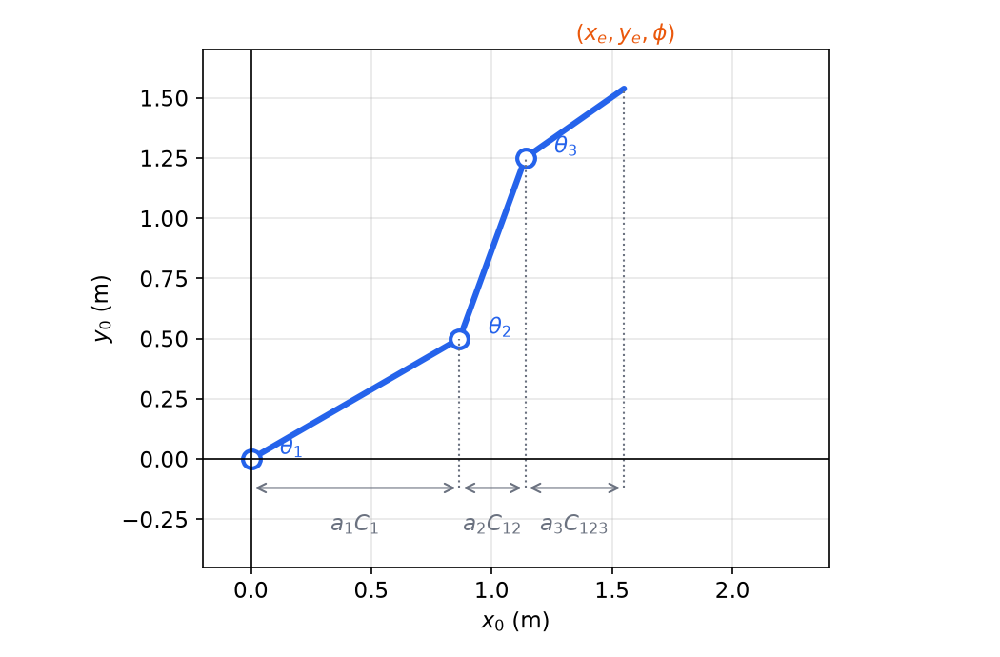
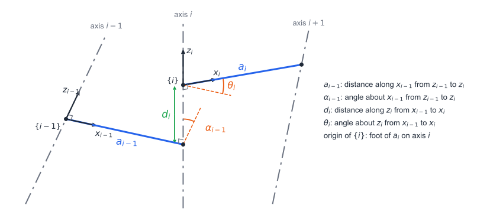
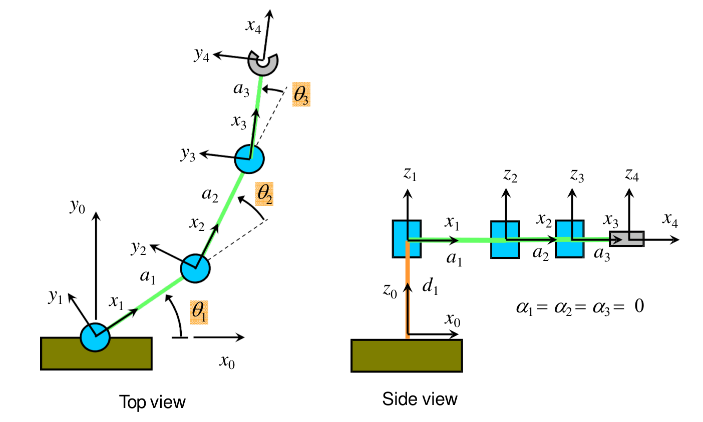
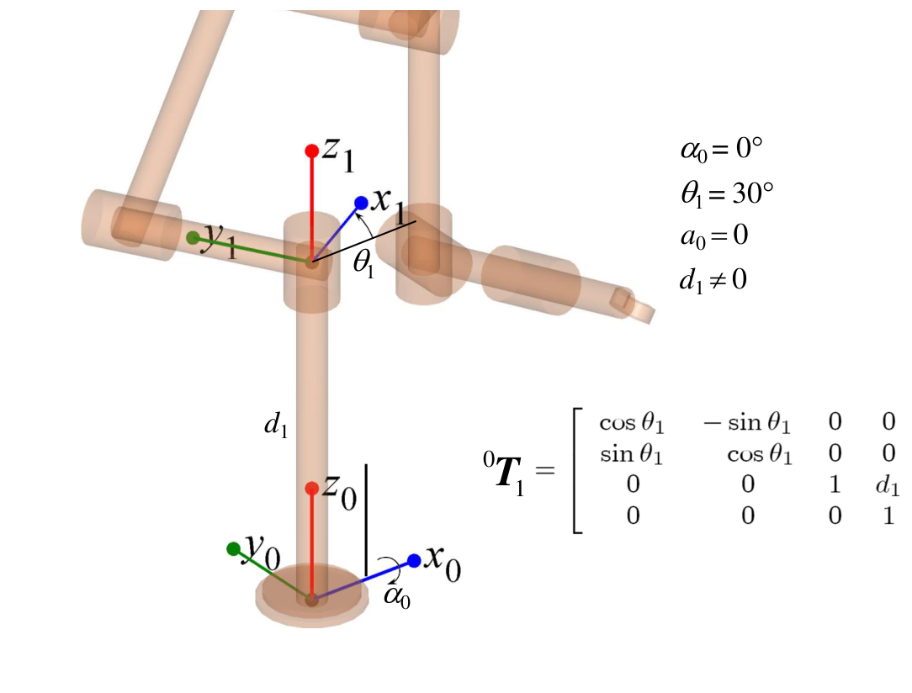
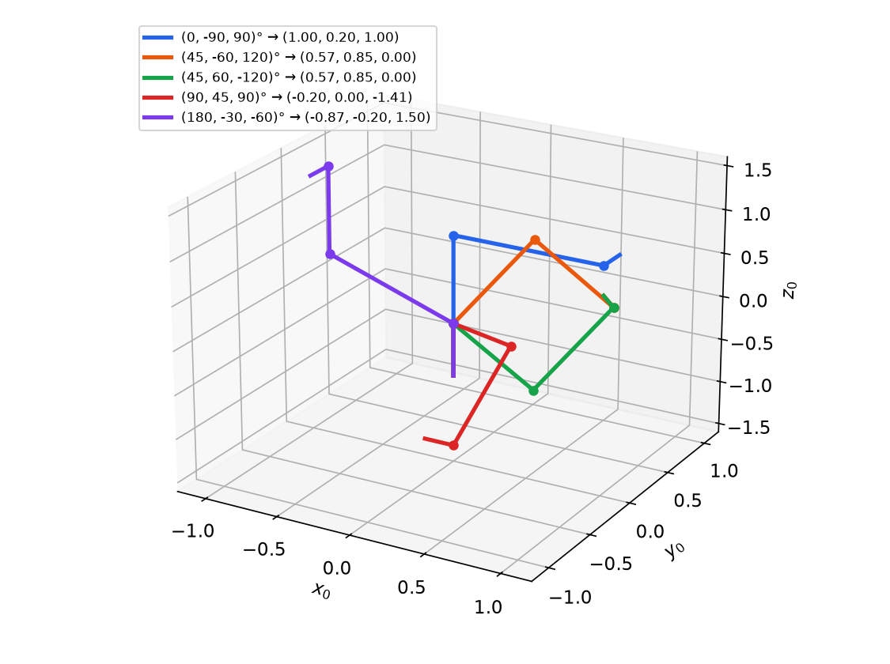
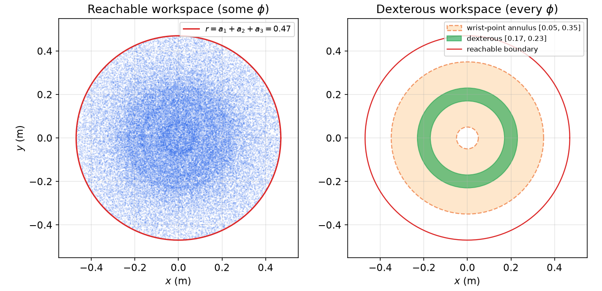

# Forward Kinematics and the Denavit–Hartenberg Convention

Forward kinematics answers the question: given the joint displacements, where is the end-effector and how is it oriented? For a serial chain the answer is a product of one homogeneous transform per link, and the work lies in attaching frames to the links systematically so that each transform depends on four numbers only. This chapter describes joints and manipulator architectures, develops Craig's (modified, or proximal) Denavit–Hartenberg convention with its frame-assignment rules, works the planar RRR arm, a six-revolute arm and a simplified PUMA, and ends with the workspace, the set of poses the forward map can reach. It uses the frames and transforms of [Spatial Descriptions and Transformations](spatial-descriptions.md).

## Joints, Links and Degrees of Freedom

### Lower pairs

A manipulator is a chain of rigid **links** connected by **joints**. Joints in which two surfaces slide over each other are **lower pairs**; there are six:

| Joint | Symbol | DOF | Relative motion |
|---|---|---|---|
| Revolute | R | 1 | rotation about an axis |
| Prismatic | P | 1 | translation along an axis |
| Cylindrical | C | 2 | rotation and translation along one axis |
| Screw (helical) | H | 1 | rotation coupled to translation by the pitch |
| Planar | E | 3 | two translations in a plane, rotation normal to it |
| Spherical | S | 3 | any rotation about a point |

Multi-DOF joints are modelled as several single-axis joints connected by links of zero length. A **spherical joint** (a ball-and-socket or rod end) is three revolute joints whose axes **intersect at one point**, with zero displacement between them. Industrial arms use R and P joints almost exclusively, each driven by its own actuator.

The **number of degrees of freedom** of a serial arm is the total number of single-axis joints. A six-revolute industrial arm (links 0 to 6) has 6 DOF, enough to place a rigid body anywhere in its workspace with any orientation. A human index finger modelled with the metacarpophalangeal (MCP) joint as two revolutes (flexion/extension and ab/adduction) plus the PIP and DIP joints has 4 DOF.

Kinematic sketches use standard symbols: a prismatic joint is a sliding box with an arrow along its axis; a revolute joint whose axis lies in the drawing plane is a diamond (or cylinder) with a rotation arrow; a revolute joint whose axis is normal to the drawing plane is a circle with a dot, drawn so that the link swings up-and-down or back-and-forth in the plane.

### Common arm architectures

The first three joints of a 6-DOF arm (the "arm") position the wrist; the last three (the "wrist") orient the tool. The arm's joint types and axis geometry give the classic architectures:

| Architecture | First three joints | Workspace of the wrist point |
|---|---|---|
| Cartesian (gantry) | P P P, mutually orthogonal | a box |
| Cylindrical | R P P | a thick-walled cylinder |
| Spherical (polar) | R R P | a thick spherical shell |
| Articulated (anthropomorphic, elbow) | R R R, shoulder and elbow parallel, waist vertical | a thick spherical shell, irregular inner boundary |
| SCARA | R R P with all axes vertical | a thick-walled cylinder; compliant horizontally, stiff vertically |

The PUMA-type articulated arm is the reference example: waist (joint 1, about \\(320^\circ\\) of travel), shoulder (joint 2, \\(250^\circ\\)), elbow (joint 3, \\(270^\circ\\)), then a wrist with rotation (joint 4, \\(300^\circ\\)), bend (joint 5, \\(200^\circ\\)) and flange (joint 6, \\(532^\circ\\)). The finite joint ranges matter: the workspace of a real arm is smaller than that of its idealized kinematic model.

### Joint, Cartesian and actuator space

The **joint vector** \\(\theta = (\theta\_1,\dots,\theta\_n)\\) lives in **joint space**. The pose of the tool, written as a position and an orientation (a homogeneous transform, or six numbers), lives in **Cartesian** or **task space**. When actuators drive joints through gears, linkages or differential mechanisms, a third **actuator space** appears; for a direct-drive arm actuator and joint space coincide. Forward kinematics maps joint space to Cartesian space:
\\[
{}^{0}T\_{N} = f(\theta),
\\]
and it is always well-defined and single-valued. The reverse problem is the subject of [Inverse Kinematics](inverse-kinematics.md).

## A First Example: the Planar 3R Arm by Geometry



*Figure: forward kinematics of a planar 3R arm by projection. Each link contributes its length times the cosine (for x) or sine (for y) of its absolute angle, which is the sum of all joint angles up to that link. Here a = (1.0, 0.8, 0.5) m and theta = (30, 40, -35) degrees.*

Three revolute joints with parallel axes move three links of lengths \\(a\_1, a\_2, a\_3\\) in a plane. Measure each joint angle relative to the previous link. The absolute angle of link 2 is \\(\theta\_1 + \theta\_2\\) and of link 3 is \\(\theta\_1+\theta\_2+\theta\_3\\). Projecting each link on the base axes,
\\[
x\_e = a\_1C\_1 + a\_2C\_{12} + a\_3C\_{123},\qquad
y\_e = a\_1S\_1 + a\_2S\_{12} + a\_3S\_{123},\qquad
\phi = \theta\_1 + \theta\_2 + \theta\_3 ,
\\]
with the shorthand \\(C\_1 = \cos\theta\_1\\), \\(C\_{12} = \cos(\theta\_1+\theta\_2)\\), \\(C\_{123} = \cos(\theta\_1+\theta\_2+\theta\_3)\\), and likewise \\(S\\). Direct geometry is fast for planar arms, but it does not scale to spatial chains with skewed axes. The systematic method follows.

## Link Description and the Denavit–Hartenberg Parameters

### Describing a link

Any two lines in space have a unique **common perpendicular** (unless they are parallel, when there are infinitely many). For the link between joint axes \\(i\\) and \\(i+1\\):

- the **link length** \\(a\_i\\) is the length of the common perpendicular between axes \\(i\\) and \\(i+1\\);
- the **link twist** \\(\alpha\_i\\) is the angle between the two axes, measured about that common perpendicular.

Two more numbers say how neighbouring links are connected at joint \\(i\\):

- the **link offset** \\(d\_i\\) is the distance along axis \\(i\\) from the foot of \\(a\_{i-1}\\) to the foot of \\(a\_i\\);
- the **joint angle** \\(\theta\_i\\) is the angle about axis \\(i\\) from the extension of \\(a\_{i-1}\\) to \\(a\_i\\).

For a revolute joint \\(\theta\_i\\) is the joint variable and \\(a\_i, \alpha\_i, d\_i\\) are fixed; for a prismatic joint \\(d\_i\\) is the joint variable and \\(a\_i, \alpha\_i, \theta\_i\\) are fixed. Four numbers per link therefore describe the whole chain: \\(3n\\) constants and \\(n\\) variables.



*Figure: Craig's modified Denavit–Hartenberg parameters. Common perpendiculars a_{i-1} and a_i join consecutive joint axes. Frame {i} sits on axis i at the foot of a_i, with z_i along the axis and x_i along a_i. The twist alpha_{i-1} is measured about x_{i-1}; the offset d_i and the angle theta_i are measured along and about z_i.*

### Craig's frame-assignment procedure

The modified (proximal) convention attaches frame \\(\\{i\\}\\) to link \\(i\\) at its **proximal** end, on joint axis \\(i\\). The procedure is:

1. **Number** links and joints from base to tip; the ground is link 0, and joint \\(i\\) connects link \\(i-1\\) to link \\(i\\).
2. **Draw the joint axes** as infinite lines.
3. **Draw the common perpendiculars** between consecutive axes (or the point of intersection, if they intersect).
4. **Label** the link lengths \\(a\_i\\) (common perpendicular between axes \\(i\\) and \\(i+1\\)) and the offsets \\(d\_i\\) (distance along axis \\(i\\) between the feet of \\(a\_{i-1}\\) and \\(a\_i\\)).
5. **Place the origin** \\(o\_i\\) at the proximal end of \\(a\_i\\), i.e. where \\(a\_i\\) meets axis \\(i\\). If axes \\(i\\) and \\(i+1\\) intersect, put \\(o\_i\\) at the intersection.
6. **Draw frame** \\(\\{i\\}\\): \\(z\_i\\) along joint axis \\(i\\); \\(x\_i\\) along \\(a\_i\\), pointing from axis \\(i\\) toward axis \\(i+1\\) (if the axes intersect, \\(x\_i\\) is normal to the plane containing them); \\(y\_i = z\_i\times x\_i\\) completes a right-handed frame.
7. **Base and tool frames.** Choose \\(\\{0\\}\\) to coincide with \\(\\{1\\}\\) when the first joint variable is zero, which makes \\(a\_0 = 0\\), \\(\alpha\_0 = 0\\) and \\(d\_1 = 0\\) for a revolute joint 1 (or \\(\theta\_1 = 0\\) for a prismatic one). For frame \\(\\{N\\}\\) choose the origin and \\(x\_N\\) to make as many parameters zero as possible. A separate tool frame is then attached by a constant transform.

With frames placed, the parameters are measured between frames:

| Parameter | Definition |
|---|---|
| \\(a\_{i-1}\\) | distance from \\(z\_{i-1}\\) to \\(z\_i\\) measured along \\(x\_{i-1}\\) |
| \\(\alpha\_{i-1}\\) | angle from \\(z\_{i-1}\\) to \\(z\_i\\) measured about \\(x\_{i-1}\\) |
| \\(d\_i\\) | distance from \\(x\_{i-1}\\) to \\(x\_i\\) measured along \\(z\_i\\) |
| \\(\theta\_i\\) | angle from \\(x\_{i-1}\\) to \\(x\_i\\) measured about \\(z\_i\\) |

Equivalently, with \\(p\_{i-1,i}\\) the vector from \\(o\_{i-1}\\) to \\(o\_i\\), the lengths are projections and the angles follow from dot and cross products of unit vectors:
\\[
a\_{i-1} = x\_{i-1}\cdot p\_{i-1,i},\qquad d\_i = z\_i\cdot p\_{i-1,i},
\\]
\\[
\cos\alpha\_{i-1} = z\_{i-1}\cdot z\_i,\quad \sin\alpha\_{i-1} = x\_{i-1}\cdot(z\_{i-1}\times z\_i),\qquad
\cos\theta\_i = x\_{i-1}\cdot x\_i,\quad \sin\theta\_i = (x\_{i-1}\times x\_i)\cdot z\_i .
\\]
These formulas are the safest way to get the signs right: \\(a\_{i-1} \ge 0\\) by construction, but \\(\alpha\_{i-1}\\), \\(d\_i\\) and \\(\theta\_i\\) are signed. With the convention above, \\(p\_{i-1,i} = a\_{i-1}x\_{i-1} + d\_i z\_i\\), because \\(o\_{i-1}\\) travels along \\(x\_{i-1}\\) to axis \\(i\\) and then along \\(z\_i\\) to \\(o\_i\\).

**Caveats.** The labelling is not unique. The direction of each \\(z\_i\\) may be chosen either way (the sign of the joint variable flips). When consecutive axes are **parallel** (\\(\alpha\_i = 0\\)) the common perpendicular can be slid along the axes, so its location is chosen to make some \\(d\\) zero. When they **intersect**, \\(a\_i = 0\\) and the sign of \\(x\_i\\) is a choice. A prismatic joint has a well-defined direction but no well-defined axis *location*; place it to simplify the table (for example through the next origin).

### The link transform

To go from \\(\\{i-1\\}\\) to \\(\\{i\\}\\), introduce an intermediate frame \\(\\{i'\\}\\) at the foot of \\(a\_{i-1}\\) on axis \\(i\\), with \\(x\_{i'}\parallel x\_{i-1}\\) and \\(z\_{i'}\parallel z\_i\\). Then the motion splits into two screws: a rotation \\(\alpha\_{i-1}\\) about and translation \\(a\_{i-1}\\) along \\(x\_{i-1}\\), followed by a rotation \\(\theta\_i\\) about and translation \\(d\_i\\) along \\(z\_i\\):
\\[
{}^{i-1}T\_{i} = {}^{i-1}T\_{i'}\\;{}^{i'}T\_{i} = R\_X(\alpha\_{i-1})D\_X(a\_{i-1})\\;R\_Z(\theta\_i)D\_Z(d\_i),
\\]
\\[
{}^{i-1}T\_{i} = \begin{bmatrix} 1 & 0 & 0 & a\_{i-1} \\\\ 0 & c\_{\alpha\_{i-1}} & -s\_{\alpha\_{i-1}} & 0 \\\\ 0 & s\_{\alpha\_{i-1}} & c\_{\alpha\_{i-1}} & 0 \\\\ 0 & 0 & 0 & 1\end{bmatrix}
\begin{bmatrix} c\_{\theta\_i} & -s\_{\theta\_i} & 0 & 0 \\\\ s\_{\theta\_i} & c\_{\theta\_i} & 0 & 0 \\\\ 0 & 0 & 1 & d\_i \\\\ 0 & 0 & 0 & 1\end{bmatrix}
= \boxed{\begin{bmatrix} c\_{\theta\_i} & -s\_{\theta\_i} & 0 & a\_{i-1} \\\\ s\_{\theta\_i}c\_{\alpha\_{i-1}} & c\_{\theta\_i}c\_{\alpha\_{i-1}} & -s\_{\alpha\_{i-1}} & -s\_{\alpha\_{i-1}}d\_i \\\\ s\_{\theta\_i}s\_{\alpha\_{i-1}} & c\_{\theta\_i}s\_{\alpha\_{i-1}} & c\_{\alpha\_{i-1}} & c\_{\alpha\_{i-1}}d\_i \\\\ 0 & 0 & 0 & 1\end{bmatrix}}
\\]
Rotation and translation along the *same* axis commute, so the order within each screw does not matter; the order of the two screws does. The full chain is
\\[
{}^{0}T\_{N} = {}^{0}T\_{1}\\,{}^{1}T\_{2}\cdots{}^{N-1}T\_{N}.
\\]
Three special cases recur constantly:

- \\(\alpha\_{i-1} = 0\\): \\({}^{i-1}T\_{i} = \begin{bmatrix} c\_i & -s\_i & 0 & a\_{i-1} \\\\ s\_i & c\_i & 0 & 0 \\\\ 0 & 0 & 1 & d\_i \\\\ 0 & 0 & 0 & 1\end{bmatrix}\\) (parallel axes).
- \\(\alpha\_{i-1} = -90^\circ\\): \\({}^{i-1}T\_{i} = \begin{bmatrix} c\_i & -s\_i & 0 & a\_{i-1} \\\\ 0 & 0 & 1 & d\_i \\\\ -s\_i & -c\_i & 0 & 0 \\\\ 0 & 0 & 0 & 1\end{bmatrix}\\).
- \\(\alpha\_{i-1} = +90^\circ\\): \\({}^{i-1}T\_{i} = \begin{bmatrix} c\_i & -s\_i & 0 & a\_{i-1} \\\\ 0 & 0 & -1 & -d\_i \\\\ s\_i & c\_i & 0 & 0 \\\\ 0 & 0 & 0 & 1\end{bmatrix}\\).

### Modified versus classic (distal) DH

Many texts (Paul; Spong, Hutchinson and Vidyasagar; Siciliano et al.) use the **classic** or **distal** convention, in which frame \\(\\{i\\}\\) sits at the *distal* end of link \\(i\\), on axis \\(i+1\\), and
\\[
{}^{i-1}T\_{i}^{\text{classic}} = R\_Z(\theta\_i)D\_Z(d\_i)\\,D\_X(a\_i)R\_X(\alpha\_i).
\\]
The parameter names are the same, but the indices and the order of the screws differ, so a table written in one convention cannot be used with the other's link matrix. Check which convention a table assumes before multiplying: in Craig's tables each row \\(i\\) contains \\(\alpha\_{i-1}\\), \\(a\_{i-1}\\), \\(d\_i\\), \\(\theta\_i\\); in classic tables each row contains \\(\theta\_i, d\_i, a\_i, \alpha\_i\\). Some course tables list the modified parameters in columns \\((d\_i, \theta\_i, a\_i, \alpha\_i)\\) with \\(a\_i, \alpha\_i\\) in the same row; the link matrices are then formed with \\(a\\) and \\(\alpha\\) from the *previous* row.

## Worked Examples

### Example 1: the planar RRR arm



*Figure: DH frames for a planar RRR manipulator. Top view: x_1, x_2, x_3 lie along the links and the tool frame x_4 points out of the gripper. Side view: all z axes are vertical, so every twist is zero; d_1 is the base height.*

All axes are vertical, so every \\(z\_i\\) points up and every twist vanishes. The link lengths are the distances between successive axes. Frame 4 is the tool frame, a constant offset \\(a\_3\\) along \\(x\_3\\). The DH table (Craig form) is

| \\(i\\) | \\(\alpha\_{i-1}\\) | \\(a\_{i-1}\\) | \\(d\_i\\) | \\(\theta\_i\\) |
|---|---|---|---|---|
| 1 | 0 | 0 | \\(d\_1\\) | \\(\theta\_1\\) |
| 2 | 0 | \\(a\_1\\) | \\(d\_2\\) | \\(\theta\_2\\) |
| 3 | 0 | \\(a\_2\\) | \\(d\_3\\) | \\(\theta\_3\\) |
| 4 (tool) | 0 | \\(a\_3\\) | 0 | 0 |

where the offsets \\(d\_i\\) are the heights of the joint housings (all zero for a flat arm with frame 0 in the plane). The link transforms are
\\[
{}^{0}T\_{1} = \begin{bmatrix} c\_1 & -s\_1 & 0 & 0 \\\\ s\_1 & c\_1 & 0 & 0 \\\\ 0 & 0 & 1 & d\_1 \\\\ 0 & 0 & 0 & 1\end{bmatrix},\
{}^{1}T\_{2} = \begin{bmatrix} c\_2 & -s\_2 & 0 & a\_1 \\\\ s\_2 & c\_2 & 0 & 0 \\\\ 0 & 0 & 1 & d\_2 \\\\ 0 & 0 & 0 & 1\end{bmatrix},\
{}^{2}T\_{3} = \begin{bmatrix} c\_3 & -s\_3 & 0 & a\_2 \\\\ s\_3 & c\_3 & 0 & 0 \\\\ 0 & 0 & 1 & d\_3 \\\\ 0 & 0 & 0 & 1\end{bmatrix},\
{}^{3}T\_{4} = \begin{bmatrix} 1 & 0 & 0 & a\_3 \\\\ 0 & 1 & 0 & 0 \\\\ 0 & 0 & 1 & 0 \\\\ 0 & 0 & 0 & 1\end{bmatrix}.
\\]
Multiplying, and using \\(c\_1c\_2 - s\_1s\_2 = C\_{12}\\), \\(s\_1c\_2 + c\_1s\_2 = S\_{12}\\):
\\[
{}^{0}T\_{4} = {}^{0}T\_{1}{}^{1}T\_{2}{}^{2}T\_{3}{}^{3}T\_{4} =
\begin{bmatrix} C\_{123} & -S\_{123} & 0 & a\_1C\_1 + a\_2C\_{12} + a\_3C\_{123} \\\\ S\_{123} & C\_{123} & 0 & a\_1S\_1 + a\_2S\_{12} + a\_3S\_{123} \\\\ 0 & 0 & 1 & d\_1 + d\_2 + d\_3 \\\\ 0 & 0 & 0 & 1\end{bmatrix}
= \begin{bmatrix} {}^{0}R\_{4} & {}^{0}p\_{4} \\\\ 0 & 1\end{bmatrix}.
\\]
The upper-left \\(3\times3\\) block is the orientation of the tool frame in the base frame (its columns are \\({}^{0}x\_4\\), \\({}^{0}y\_4\\), \\({}^{0}z\_4\\)), here a rotation by \\(\phi = \theta\_1+\theta\_2+\theta\_3\\) about \\(z\_0\\). The last column is the position of the tool origin. The result reproduces the geometric formulas, which is a good check on the table.

### Example 2: a six-revolute articulated arm



*Figure: the first step of DH frame assignment on a six-revolute arm (x blue, y green, z red). Frame 0 sits at the base with z_0 up the column; frame 1 rotates with the waist joint and is lifted by d_1.*

Consider a 6R arm with a vertical waist column of height \\(d\_1\\), a shoulder with a lateral offset, an upper arm, an elbow with offsets, and a three-axis wrist whose axes intersect at the wrist centre. Following the procedure link by link gives the table below (the \\(\theta\_i\\) column lists the configuration drawn in the course figures, and the frames are chosen with frame 0 at the floor, so \\(d\_1 \ne 0\\)):

| \\(i\\) | \\(\alpha\_{i-1}\\) | \\(a\_{i-1}\\) | \\(d\_i\\) | \\(\theta\_i\\) (drawn) |
|---|---|---|---|---|
| 1 | \\(0^\circ\\) | 0 | \\(d\_1 \ne 0\\) | \\(30^\circ\\) |
| 2 | \\(-90^\circ\\) | 0 | \\(d\_2 \ne 0\\) | \\(-30^\circ\\) |
| 3 | \\(0^\circ\\) | \\(a\_2 \ne 0\\) | \\(d\_3 < 0\\) | \\(30^\circ\\) |
| 4 | \\(-90^\circ\\) | \\(a\_3 \ne 0\\) | \\(d\_4 \ne 0\\) | \\(-150^\circ\\) |
| 5 | \\(90^\circ\\) | 0 | 0 | \\(60^\circ\\) |
| 6 | \\(-90^\circ\\) | 0 | \\(d\_6 \ne 0\\) | \\(-90^\circ\\) |

Reading the table: joint 2 (shoulder) is horizontal, perpendicular to the waist, hence \\(\alpha\_1 = -90^\circ\\); the shoulder offset is \\(d\_2\\). The elbow axis is parallel to the shoulder (\\(\alpha\_2 = 0\\)), with upper arm length \\(a\_2\\) and an offset \\(d\_3\\) that is negative because it points along \\(-z\_3\\). The forearm has length \\(a\_3\\) and the wrist roll axis (joint 4) is perpendicular to the elbow, with \\(d\_4\\) the distance along it to the wrist centre. Frames 4 and 5 share their origin at the wrist centre (\\(a\_4 = d\_5 = 0\\)) because the wrist axes intersect, and \\(d\_6\\) is the distance from the wrist centre to the tool flange. The link transforms follow from the special cases above:
\\[
{}^{0}T\_{1} = \begin{bmatrix} c\_1 & -s\_1 & 0 & 0 \\\\ s\_1 & c\_1 & 0 & 0 \\\\ 0 & 0 & 1 & d\_1 \\\\ 0 & 0 & 0 & 1\end{bmatrix},\quad
{}^{1}T\_{2} = \begin{bmatrix} c\_2 & -s\_2 & 0 & 0 \\\\ 0 & 0 & 1 & d\_2 \\\\ -s\_2 & -c\_2 & 0 & 0 \\\\ 0 & 0 & 0 & 1\end{bmatrix},\quad
{}^{2}T\_{3} = \begin{bmatrix} c\_3 & -s\_3 & 0 & a\_2 \\\\ s\_3 & c\_3 & 0 & 0 \\\\ 0 & 0 & 1 & d\_3 \\\\ 0 & 0 & 0 & 1\end{bmatrix},
\\]
\\[
{}^{3}T\_{4} = \begin{bmatrix} c\_4 & -s\_4 & 0 & a\_3 \\\\ 0 & 0 & 1 & d\_4 \\\\ -s\_4 & -c\_4 & 0 & 0 \\\\ 0 & 0 & 0 & 1\end{bmatrix},\quad
{}^{4}T\_{5} = \begin{bmatrix} c\_5 & -s\_5 & 0 & 0 \\\\ 0 & 0 & -1 & 0 \\\\ s\_5 & c\_5 & 0 & 0 \\\\ 0 & 0 & 0 & 1\end{bmatrix},\quad
{}^{5}T\_{6} = \begin{bmatrix} c\_6 & -s\_6 & 0 & 0 \\\\ 0 & 0 & 1 & d\_6 \\\\ -s\_6 & -c\_6 & 0 & 0 \\\\ 0 & 0 & 0 & 1\end{bmatrix}.
\\]
This is the structure of the PUMA 560 in Craig's text, apart from the choice of base frame and the offsets \\(d\_1\\), \\(d\_2\\) and \\(d\_6\\). Because joints 4, 5, 6 intersect, the position of the wrist centre \\({}^{0}p\_{4}\\) depends only on \\(\theta\_1, \theta\_2, \theta\_3\\): it is the last column of \\({}^{0}T\_{1}{}^{1}T\_{2}{}^{2}T\_{3}{}^{3}T\_{4}\\), unaffected by the wrist. That decoupling is what makes the inverse problem solvable in closed form ([Pieper's approach](inverse-kinematics.md)).

### Example 3: the simplified PUMA (3R)

A "simplified PUMA" keeps the first three joints: the waist \\(\theta\_1\\) about the vertical \\(z\_0\\), and the shoulder \\(\theta\_2\\) and elbow \\(\theta\_3\\) about parallel horizontal axes. The upper arm has length \\(l\_a\\), the forearm \\(l\_c\\), and the end point is offset sideways by \\(l\_b\\) (the shoulder offset). Frame 0 is at the intersection of the waist and shoulder axes, so the column height drops out. The Craig DH table is

| \\(i\\) | \\(\alpha\_{i-1}\\) | \\(a\_{i-1}\\) | \\(d\_i\\) | \\(\theta\_i\\) |
|---|---|---|---|---|
| 1 | 0 | 0 | 0 | \\(\theta\_1\\) |
| 2 | \\(-90^\circ\\) | 0 | 0 | \\(\theta\_2\\) |
| 3 | 0 | \\(l\_a\\) | 0 | \\(\theta\_3\\) |
| 4 (end point) | 0 | \\(l\_c\\) | \\(l\_b\\) | 0 |

**Link transforms.**
\\[
{}^{0}T\_{1} = \begin{bmatrix} C\_1 & -S\_1 & 0 & 0 \\\\ S\_1 & C\_1 & 0 & 0 \\\\ 0 & 0 & 1 & 0 \\\\ 0 & 0 & 0 & 1\end{bmatrix},\quad
{}^{1}T\_{2} = \begin{bmatrix} C\_2 & -S\_2 & 0 & 0 \\\\ 0 & 0 & 1 & 0 \\\\ -S\_2 & -C\_2 & 0 & 0 \\\\ 0 & 0 & 0 & 1\end{bmatrix},\quad
{}^{2}T\_{3} = \begin{bmatrix} C\_3 & -S\_3 & 0 & l\_a \\\\ S\_3 & C\_3 & 0 & 0 \\\\ 0 & 0 & 1 & 0 \\\\ 0 & 0 & 0 & 1\end{bmatrix},\quad
{}^{3}T\_{4} = \begin{bmatrix} 1 & 0 & 0 & l\_c \\\\ 0 & 1 & 0 & 0 \\\\ 0 & 0 & 1 & l\_b \\\\ 0 & 0 & 0 & 1\end{bmatrix}.
\\]
(The translation in \\({}^{3}T\_{4}\\) is \\(a\_3 = l\_c\\) along \\(x\_3\\) and \\(d\_4 = l\_b\\) along \\(z\_4\\); writing \\(l\_a\\) there is a slip that goes unnoticed only when \\(l\_a = l\_c\\).)

**Product.** First \\({}^{0}T\_{2}\\):
\\[
{}^{0}T\_{2} = \begin{bmatrix} C\_1C\_2 & -C\_1S\_2 & -S\_1 & 0 \\\\ S\_1C\_2 & -S\_1S\_2 & C\_1 & 0 \\\\ -S\_2 & -C\_2 & 0 & 0 \\\\ 0 & 0 & 0 & 1\end{bmatrix},
\\]
then multiplying by \\({}^{2}T\_{3}\\) and using \\(C\_2C\_3 - S\_2S\_3 = C\_{23}\\), \\(S\_2C\_3 + C\_2S\_3 = S\_{23}\\):
\\[
{}^{0}T\_{3} = \begin{bmatrix} C\_1C\_{23} & -C\_1S\_{23} & -S\_1 & l\_aC\_1C\_2 \\\\ S\_1C\_{23} & -S\_1S\_{23} & C\_1 & l\_aS\_1C\_2 \\\\ -S\_{23} & -C\_{23} & 0 & -l\_aS\_2 \\\\ 0 & 0 & 0 & 1\end{bmatrix}.
\\]
The end point is \\({}^{0}r = {}^{0}T\_{3}\\,(l\_c, 0, l\_b, 1)^{T}\\):
\\[
\boxed{r\_x = l\_cC\_1C\_{23} + l\_aC\_1C\_2 - l\_bS\_1,\qquad r\_y = l\_cS\_1C\_{23} + l\_aS\_1C\_2 + l\_bC\_1,\qquad r\_z = -l\_cS\_{23} - l\_aS\_2 .}
\\]
Interpretation: the shoulder and elbow move the end point in a vertical plane at horizontal reach \\(\rho = l\_aC\_2 + l\_cC\_{23}\\) and height \\(-(l\_aS\_2 + l\_cS\_{23})\\) (with \\(z\_2\\) horizontal and positive \\(\theta\_2\\) lowering the arm); the waist rotates this plane, which is displaced sideways by \\(l\_b\\).

**Numerical table** (\\(l\_a = l\_c = 1\\), \\(l\_b = 0.2\\)):

| \\(\theta\_1\\) | \\(\theta\_2\\) | \\(\theta\_3\\) | \\(x\_e\\) | \\(y\_e\\) | \\(z\_e\\) |
|---|---|---|---|---|---|
| \\(0^\circ\\) | \\(-90^\circ\\) | \\(90^\circ\\) | 1 | 0.2 | 1 |
| \\(45^\circ\\) | \\(-60^\circ\\) | \\(120^\circ\\) | 0.566 | 0.849 | 0 |
| \\(45^\circ\\) | \\(60^\circ\\) | \\(-120^\circ\\) | 0.566 | 0.849 | 0 |
| \\(90^\circ\\) | \\(45^\circ\\) | \\(90^\circ\\) | \\(-0.2\\) | 0 | \\(-1.41\\) |
| \\(180^\circ\\) | \\(-30^\circ\\) | \\(-60^\circ\\) | \\(-0.866\\) | \\(-0.2\\) | 1.5 |

The first row is the "upper arm vertical, forearm horizontal" posture: \\(\theta\_2 = -90^\circ\\) raises the upper arm to point straight up (\\(r\_z = -l\_aS\_2 = 1\\)), and \\(\theta\_3 = 90^\circ\\) brings the forearm back to horizontal. (A tabulation of this posture with \\(\theta\_3 = 0\\) would put the arm straight up with the end point at \\((0, 0.2, 2)\\); the value \\((1, 0.2, 1)\\) requires \\(\theta\_3 = 90^\circ\\).) Rows 2 and 3 reach the same point with the elbow above and below the line from shoulder to end point: forward kinematics is single-valued, but the inverse is not.



*Figure: the five postures of the table. The vertical stub is the waist column, the dots are the shoulder, elbow and end of the forearm, and the short last segment is the sideways offset l_b. The orange and green postures reach the same point (0.57, 0.85, 0) with the elbow up and down.*

```matlab
la = 1; lb = 0.2; lc = 1;
dh = @(al,a,d,th) [cos(th) -sin(th) 0 a;
                   sin(th)*cos(al) cos(th)*cos(al) -sin(al) -sin(al)*d;
                   sin(th)*sin(al) cos(th)*sin(al)  cos(al)  cos(al)*d;
                   0 0 0 1];
q  = deg2rad([45 -60 120]);
T  = dh(0,0,0,q(1)) * dh(-pi/2,0,0,q(2)) * dh(0,la,0,q(3)) * dh(0,lc,lb,0);
T(1:3,4)'          % -> 0.5657  0.8485  0.0000
```

The same function in Python:

```python
import numpy as np

def dh_mod(alpha, a, d, theta):
    ca, sa, ct, st = np.cos(alpha), np.sin(alpha), np.cos(theta), np.sin(theta)
    return np.array([[ct, -st, 0, a],
                     [st*ca, ct*ca, -sa, -sa*d],
                     [st*sa, ct*sa, ca, ca*d],
                     [0, 0, 0, 1]])

def fk(table, q):
    """table rows: (alpha_{i-1}, a_{i-1}, d_i, theta_offset); q adds to theta (revolute)."""
    T = np.eye(4)
    for (al, a, d, th0), qi in zip(table, q):
        T = T @ dh_mod(al, a, d, th0 + qi)
    return T
```

### Example 4: an elbow RRR with an offset shoulder

A related 3R arm has a vertical joint 1 with offset \\(d\_1\\) and two parallel horizontal joints with links \\(a\_2\\), \\(a\_3\\). Written with the frame-placement rules, the signs of the nonzero parameters in a given drawing can be read directly: \\(d\_1 > 0\\), \\(\theta\_1 > 0\\) and a twist of \\(\pi/2\\) between joints 1 and 2; \\(\theta\_2 < 0\\) and \\(a\_2 > 0\\); \\(\theta\_3 > 0\\) and \\(a\_3 > 0\\). Getting into the habit of predicting signs from a picture before computing is the best defence against DH errors. This arm reappears in [Inverse Kinematics](inverse-kinematics.md) with its four solution branches.

## Workspace

The **reachable workspace** is the set of positions the end-effector can reach with at least one orientation; the **dexterous workspace** is the subset reachable with *every* orientation (in the plane: every angle \\(\phi\\)). The dexterous workspace is contained in the reachable one and is often much smaller or empty. Joint limits shrink both.

### Planar 3R

Suppose first that the joints are unlimited. For a planar 3R arm the reachable workspace is an annulus. Its outer radius is the fully stretched length \\(a\_1 + a\_2 + a\_3\\). Its inner radius is the closest the folded arm can come to the base,
\\[
r\_{\min} = \max\left(0,\ a\_1 - a\_2 - a\_3,\ a\_2 - a\_1 - a\_3,\ a\_3 - a\_1 - a\_2\right),
\\]
which is \\(a\_1 - a\_2 - a\_3\\) when the first link is the longest and long enough. To see this, sweep the last link: about joint 3 the tip covers a circle of radius \\(a\_3\\); sweeping joint 2 turns it into an annulus about joint 2 of radii \\(\lvert a\_2 - a\_3\rvert\\) and \\(a\_2 + a\_3\\); sweeping joint 1 turns that into an annulus about the base.

For the dexterous workspace, fix the tool angle \\(\phi\\). The wrist point (joint 3) is then at \\(p - a\_3(\cos\phi, \sin\phi)\\), and it must lie in the two-link annulus \\(\lvert a\_1 - a\_2\rvert \le r\_w \le a\_1 + a\_2\\). For *every* \\(\phi\\) to work, the whole circle of radius \\(a\_3\\) about \\(p\\) must lie in that annulus:
\\[
\lvert a\_1 - a\_2\rvert + a\_3 \ \le\ \lVert p \rVert\ \le\ a\_1 + a\_2 - a\_3 ,
\\]
which is non-empty only if \\(a\_1 + a\_2 - \lvert a\_1 - a\_2 \rvert \ge 2a\_3\\), i.e. \\(\min(a\_1, a\_2) \ge a\_3\\).



*Figure: left, random joint samples fill the reachable workspace, a disk of radius 0.47 m (the inner radius is zero because no link is longer than the other two combined). Right, the wrist point must stay in the orange annulus 0.05 to 0.35 m; the end point can take every orientation only in the green annulus 0.17 to 0.23 m.*

### Spatial examples

- **RR "toroidal" arm.** A vertical joint 1 on a column of height 4, a horizontal link of length 3 to joint 2 (horizontal axis), and a link of length 2 to the tip. Joint 2 sweeps the tip around a circle of radius 2 centred on the end of the first link; joint 1 sweeps that circle around the column. The workspace is the **surface of a torus**: tube radius 2, centre circle radius 3, outer radius 5, inner radius 1. A 2-DOF arm reaches only a 2-dimensional set.
- **Simplified PUMA with the end point constrained to a plane.** With frame 0 at the shoulder, \\(l\_b = 0\\) and \\(L\_2 = L\_3 = L\\), points with \\(z\_e = 0\\) are reachable exactly when \\(\sqrt{x\_e^2 + y\_e^2} \le 2L\\). The origin is reachable (the arm folded back on itself) but, as we will see, it is a singular point of the inverse map.
- **Arm types.** Cartesian, cylindrical and spherical arms have box, cylindrical-shell and spherical-shell workspaces respectively; an articulated arm with joint limits has a crescent-shaped vertical section revolved about the waist.

For a 6-DOF arm, reachability of a position and dexterity of an orientation separate cleanly when the wrist axes intersect: the wrist centre must lie in the reachable set of the first three joints, and the wrist must be able to produce the required orientation within its joint limits.

## Summary

- DOF of a serial arm = number of single-axis joints; a spherical joint = three intersecting revolutes. Six lower pairs; arms are classified by their first three joints (PPP, RPP, RRP, RRR, SCARA).
- Craig's modified DH: \\(z\_i\\) on joint axis \\(i\\), \\(x\_i\\) along the common perpendicular \\(a\_i\\) toward axis \\(i+1\\), origin at the proximal foot of \\(a\_i\\). Parameters \\(a\_{i-1}, \alpha\_{i-1}\\) (along/about \\(x\_{i-1}\\)), \\(d\_i, \theta\_i\\) (along/about \\(z\_i\\)); \\(a\_{i-1} = x\_{i-1}\cdot p\_{i-1,i}\\), \\(d\_i = z\_i\cdot p\_{i-1,i}\\).
- Link transform \\({}^{i-1}T\_{i} = R\_X(\alpha\_{i-1})D\_X(a\_{i-1})R\_Z(\theta\_i)D\_Z(d\_i)\\); forward kinematics \\({}^{0}T\_{N} = \prod\_i {}^{i-1}T\_{i}\\). Classic DH uses \\(R\_Z(\theta\_i)D\_Z(d\_i)D\_X(a\_i)R\_X(\alpha\_i)\\): never mix the two.
- Planar 3R: \\(x\_e = a\_1C\_1 + a\_2C\_{12} + a\_3C\_{123}\\), \\(y\_e = a\_1S\_1 + a\_2S\_{12} + a\_3S\_{123}\\), \\(\phi = \theta\_1+\theta\_2+\theta\_3\\).
- Simplified PUMA: \\(r\_x = l\_cC\_1C\_{23} + l\_aC\_1C\_2 - l\_bS\_1\\), \\(r\_y = l\_cS\_1C\_{23} + l\_aS\_1C\_2 + l\_bC\_1\\), \\(r\_z = -l\_cS\_{23} - l\_aS\_2\\).
- Reachable workspace (some orientation) contains the dexterous workspace (all orientations); planar 3R: annulus up to \\(a\_1+a\_2+a\_3\\); dexterous annulus \\(\lvert a\_1 - a\_2\rvert + a\_3 \le r \le a\_1 + a\_2 - a\_3\\).

## See Also

- [Spatial Descriptions and Transformations](spatial-descriptions.md): rotation matrices and homogeneous transforms.
- [Inverse Kinematics](inverse-kinematics.md): inverting the maps derived here.
- [Jacobians and Statics](jacobians-statics.md): differentiating the forward map.
- [Dynamics](dynamics.md) and [Trajectory Generation](trajectory.md): built on the same link frames.
- Kinematics (overview), Manipulation and the Robotics section.
- Linear Algebra.
