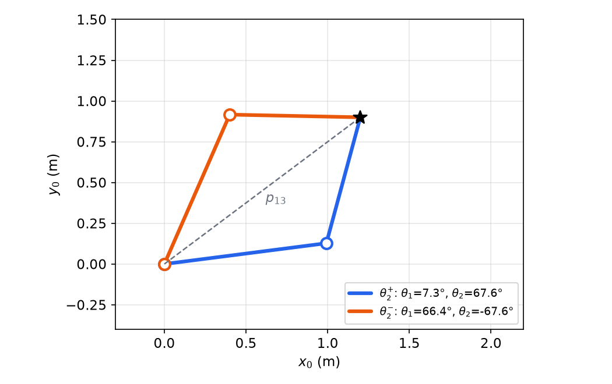
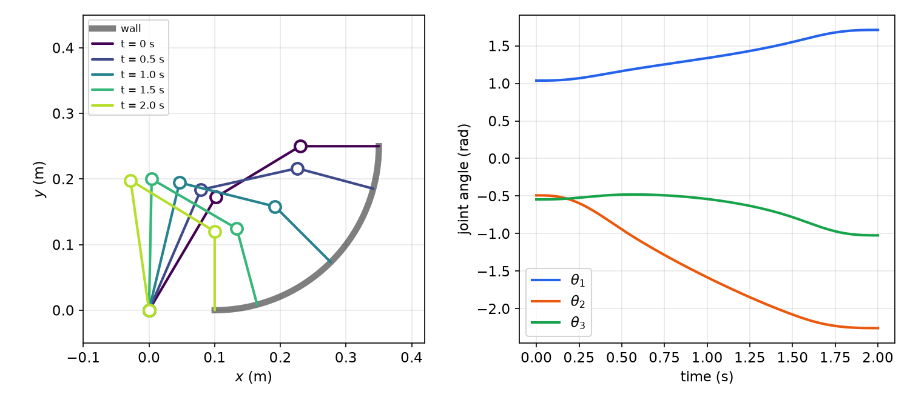
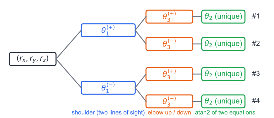
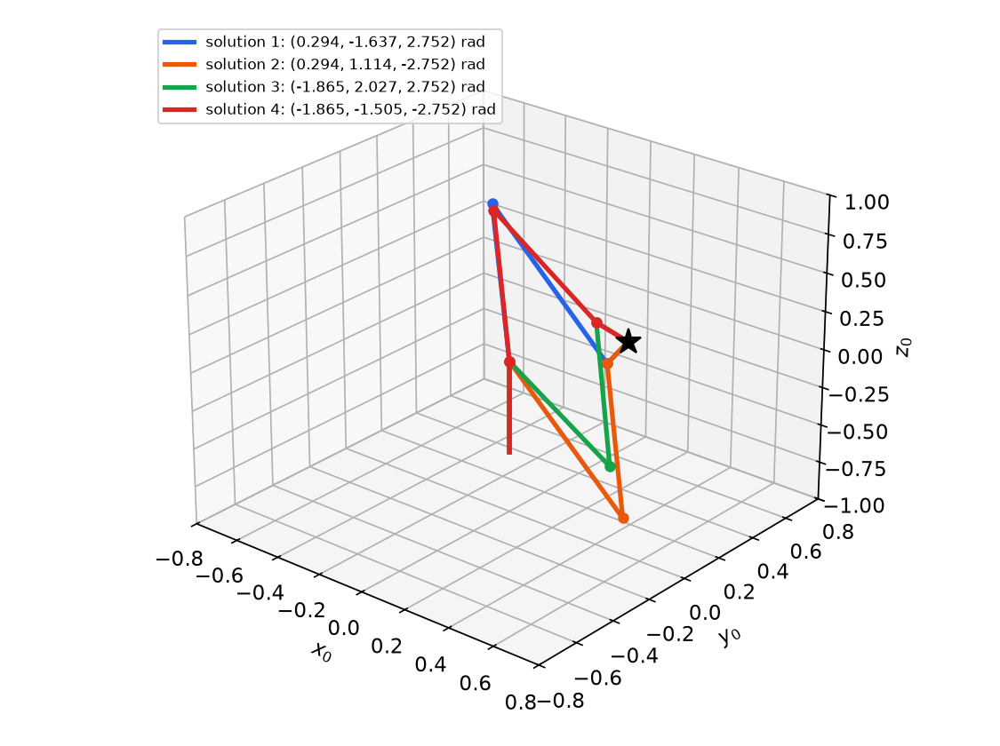
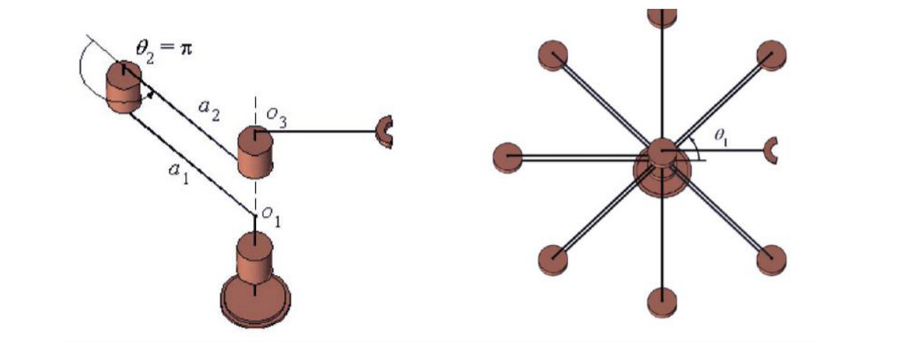
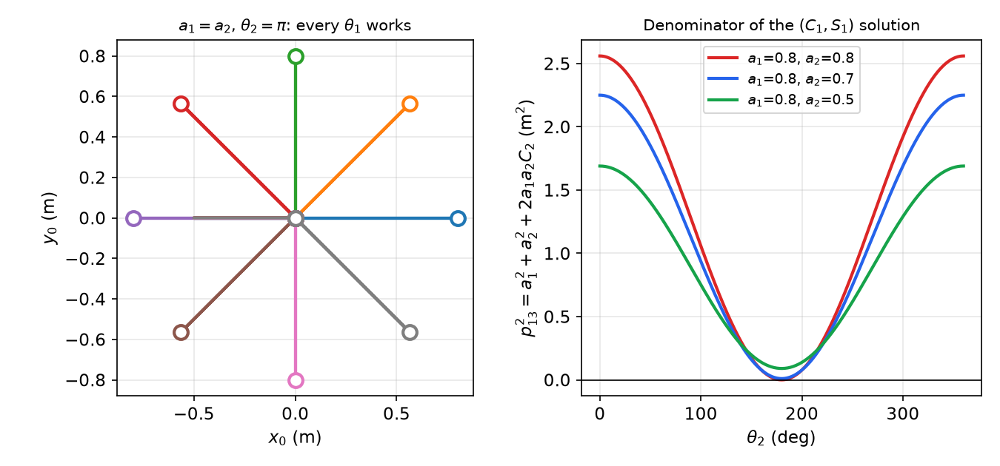

# Inverse Kinematics

Inverse kinematics (IK) runs the forward map backwards: given the desired position (and orientation) of the end-effector, find joint displacements that achieve it. Every task specified in Cartesian space, such as drawing a circle, polishing a wall or picking a part seen by a camera, must pass through this step before a joint controller can act. Unlike forward kinematics the problem is nonlinear and may have no solution, several, or infinitely many. This chapter covers solvability and the counting of solutions, the algebraic and geometric closed-form techniques built on the two-argument arctangent, the planar 3R arm and the PUMA-type 3R arm in full, Pieper's decoupling for arms with a spherical wrist, solution trees, and displacement singularities, where the inverse map becomes indeterminate.

## The Problem and its Solvability

Forward kinematics gives \\({}^{0}T\_{N} = f(\theta)\\). Inverse kinematics asks for \\(\theta\\) such that \\(f(\theta) = T\_d\\) for a given \\(T\_d\\). For a 6-DOF arm this is 12 equations (the rotation block and position column) in 6 unknowns, of which only 6 are independent because the rotation block satisfies \\(R^{T}R = I\\). Three questions arise.

**Existence.** A solution exists only if the target lies in the workspace (see [Forward Kinematics](forward-kinematics.md#workspace)): the position must be reachable, and if an orientation is specified, the target must be in the dexterous workspace for that orientation. Joint limits shrink the set further.

**Well-posedness.** Count constraints against unknowns. For the planar 3R arm with target \\((x\_e, y\_e, \phi)\\) there are 3 constraints and 3 unknowns: generically, a finite number of solutions. With only \\((x\_e, y\_e)\\) specified there are 2 constraints and 3 unknowns, and a one-parameter family of solutions (the arm is **redundant** for that task). Fewer joints than constraints means most targets are unreachable.

**Uniqueness.** Even with matching counts, the equations are nonlinear (sums of products of sines and cosines), so they generally have several isolated solutions. The number depends on the geometry:

- the two-link planar subchain reaches a point in two ways (elbow up and elbow down);
- a PUMA-type arm positions its wrist in up to four ways, and its spherical wrist adds a factor of two: up to **8** solutions for a full pose;
- a general 6R arm has up to **16** solutions (the bound is attained by special designs); a general 6R arm's IK reduces to a polynomial of degree 16.

**Closed form versus numerical.** A *closed-form* solution expresses each joint variable by a finite formula (algebraic or geometric) and finds all solutions at once, fast and reliably. A *numerical* solution iterates (for example Newton's method on \\(f(\theta) - T\_d\\) using the Jacobian) and finds one solution near the initial guess. Every 6R arm with three consecutive axes intersecting at a point, or three consecutive parallel axes, has a closed-form solution (Pieper); industrial arms are designed to satisfy this.

## Tools: atan2 and Two Standard Equations

### Why atan2

Inverse trigonometric functions each return a restricted range:

| Given | Function | Returned values |
|---|---|---|
| \\(x = \cos\theta\\) | \\(\arccos x\\) | \\(\theta\\) or \\(-\theta\\): two candidates, sign unknown |
| \\(y = \sin\theta\\) | \\(\arcsin y\\) | \\(\theta\\) or \\(\pi - \theta\\) (\\(y \ge 0\\)); \\(\theta\\) or \\(-\pi-\theta\\) (\\(y < 0\\)) |
| \\(m = \tan\theta\\) | \\(\arctan m\\) | \\(\theta\\) or \\(\theta \mp \pi\\): quadrant lost, and \\(m\\) blows up at \\(\pm 90^\circ\\) |
| \\(x = \cos\theta,\ y = \sin\theta\\) | \\(\operatorname{atan2}(y, x)\\) | \\(\theta\in(-\pi,\pi]\\), unique |

Only the two-argument arctangent, which uses the signs of both \\(y\\) and \\(x\\), returns the correct angle in the correct quadrant. It also behaves well near \\(\pm 90^\circ\\): `atan2(1, 0)` returns `1.5708`, whereas forming \\(\tan\theta = 1/0\\) first gives `Inf` (MATLAB's `atan` happens to handle `Inf`, but most calculators and many languages do not). It is enough that \\(y\\) and \\(x\\) be *proportional* to \\(\sin\theta\\) and \\(\cos\theta\\) with a positive factor: \\(\operatorname{atan2}(ky, kx) = \operatorname{atan2}(y, x)\\) for \\(k > 0\\). This lets us skip normalizations. The only undefined case is \\(\operatorname{atan2}(0, 0)\\); software returns a number (usually 0), but mathematically the angle is indeterminate, and that case is precisely a displacement singularity.

**Rule.** Whenever both a sine and a cosine of an angle are available (even up to a common positive factor), use \\(\operatorname{atan2}\\). When only the cosine is available, form the sine as \\(\pm\sqrt{1-c^2}\\) and use \\(\operatorname{atan2}(\pm\sqrt{1-c^2}, c)\\): the \\(\pm\\) is a genuine branch of the solution, to be kept, not discarded.

### Equation type 1: \\(a\cos\theta + b\sin\theta = c\\)

Write \\(a = \rho\cos\gamma\\), \\(b = \rho\sin\gamma\\) with \\(\rho = \sqrt{a^2+b^2}\\) and \\(\gamma = \operatorname{atan2}(b, a)\\). The equation becomes \\(\rho\cos(\theta - \gamma) = c\\), so
\\[
\theta = \operatorname{atan2}(b, a) \pm \operatorname{atan2}\left(\sqrt{a^2 + b^2 - c^2},\ c\right).
\\]
Two solutions if \\(a^2 + b^2 > c^2\\), one (double) if equal, none if \\(a^2 + b^2 < c^2\\). An alternative is the tangent half-angle substitution \\(u = \tan(\theta/2)\\), \\(\cos\theta = (1-u^2)/(1+u^2)\\), \\(\sin\theta = 2u/(1+u^2)\\), which turns the equation into the quadratic \\((a + c)u^2 - 2bu + (c - a) = 0\\); it is the standard way to convert transcendental IK equations into polynomials.

### Equation type 2: a pair linear in \\(\cos\theta, \sin\theta\\)

If \\(A\cos\theta - B\sin\theta = u\\) and \\(B\cos\theta + A\sin\theta = v\\), then
\\[
\begin{bmatrix} u \\\\ v \end{bmatrix} = \begin{bmatrix} A & -B \\\\ B & A \end{bmatrix}\begin{bmatrix} \cos\theta \\\\ \sin\theta \end{bmatrix}
\ \Longrightarrow\
\begin{bmatrix} \cos\theta \\\\ \sin\theta \end{bmatrix} = \frac{1}{A^2 + B^2}\begin{bmatrix} Au + Bv \\\\ Av - Bu \end{bmatrix},
\qquad \theta = \operatorname{atan2}(Av - Bu,\ Au + Bv),
\\]
a unique solution whenever \\(A^2 + B^2 \ne 0\\). When \\(A = B = 0\\) the angle is indeterminate.

### The triangle lemma

**Lemma.** In a triangle with sides \\(l\_1, l\_2, l\_3\\), the angle \\(\theta\_1\\) between sides \\(l\_2\\) and \\(l\_3\\) (opposite \\(l\_1\\)) satisfies
\\[
\theta\_1 = \pm\operatorname{atan2}\left(k,\ l\_2^2 + l\_3^2 - l\_1^2\right),\qquad
k = \sqrt{(l\_1^2 + l\_2^2 + l\_3^2)^2 - 2(l\_1^4 + l\_2^4 + l\_3^4)} .
\\]
*Proof.* The law of cosines gives \\(2l\_2l\_3\cos\theta\_1 = l\_2^2 + l\_3^2 - l\_1^2\\). Then
\\[
2l\_2l\_3\sin\theta\_1 = \pm\sqrt{(2l\_2l\_3)^2 - (l\_2^2 + l\_3^2 - l\_1^2)^2},
\\]
and expanding the radicand, \\(4l\_2^2l\_3^2 - (l\_2^2 + l\_3^2 - l\_1^2)^2 = (l\_1^2 + l\_2^2 + l\_3^2)^2 - 2(l\_1^4 + l\_2^4 + l\_3^4)\\). Since \\(\sin\\) and \\(\cos\\) are known up to the common positive factor \\(2l\_2l\_3\\), atan2 applies directly. \\(\blacksquare\\)

The quantity \\(k\\) is four times the area of the triangle (Heron's formula), so it is real exactly when the triangle inequality holds and vanishes when the triangle degenerates into a line. Note the **plus** sign in front of the fourth powers: \\((l\_1^2+l\_2^2+l\_3^2)^2 - 2(l\_1^4 + l\_2^4 + l\_3^4)\\), not with a minus; a minus sign there is a common slip.

## The Planar 3R Arm

### Inspecting the kinematic structure

For the planar 3R arm of [Forward Kinematics](forward-kinematics.md), given \\({}^{0}T\_{4}\\), i.e. \\((x\_e, y\_e, \phi)\\), find \\(\theta\_1, \theta\_2, \theta\_3\\). Before writing equations, look at the structure:

1. Frame 4 is given. Since the last link has fixed length \\(a\_3\\) and known direction \\(\phi\\), the position of joint 3 (origin of frame 3, the "wrist") is determined.
2. Joint 3's position depends only on \\(\theta\_1, \theta\_2\\): a two-link problem.
3. Once \\(\theta\_1, \theta\_2\\) are known, the orientation \\(\phi = \theta\_1 + \theta\_2 + \theta\_3\\) gives \\(\theta\_3\\).

So the procedure is: Step 1, \\((x\_e, y\_e, \phi) \to\\) wrist point \\(\to \theta\_1, \theta\_2\\); Step 2, \\(\phi, \theta\_1, \theta\_2 \to \theta\_3\\).

### Step 1: the wrist point and \\(\theta\_2\\)

The wrist point, written \\(p\_{13}\\) because it is the vector from joint 1 to joint 3, is
\\[
{}^{0}p\_{13} = \begin{bmatrix} x\_e - a\_3\cos\phi \\\\ y\_e - a\_3\sin\phi \end{bmatrix},\qquad
({}^{0}p\_{13})\_x = a\_1C\_1 + a\_2C\_{12},\quad ({}^{0}p\_{13})\_y = a\_1S\_1 + a\_2S\_{12}.
\\]
Squaring and adding eliminates \\(\theta\_1\\):
\\[
p\_{13}^2 = ({}^{0}p\_{13})\_x^2 + ({}^{0}p\_{13})\_y^2 = a\_1^2(C\_1^2 + S\_1^2) + a\_2^2(C\_{12}^2 + S\_{12}^2) + 2a\_1a\_2(C\_1C\_{12} + S\_1S\_{12}) = a\_1^2 + a\_2^2 + 2a\_1a\_2C\_2,
\\]
using \\(C\_1C\_{12} + S\_1S\_{12} = \cos(\theta\_1 + \theta\_2 - \theta\_1) = C\_2\\). This is the law of cosines, and
\\[
C\_2 = \frac{p\_{13}^2 - a\_1^2 - a\_2^2}{2a\_1a\_2},\qquad
\boxed{\theta\_2 = \pm\operatorname{atan2}\left(\sqrt{1 - C\_2^2},\ C\_2\right)}.
\\]
Here \\(\arccos\\) would also do, provided both signs are kept: there are **two solutions**, \\(\theta\_2^{+}\\) and \\(\theta\_2^{-}\\), mirror images about the line from joint 1 to joint 3. A solution exists only if \\(\lvert C\_2\rvert \le 1\\), i.e. \\(\lvert a\_1 - a\_2\rvert \le p\_{13} \le a\_1 + a\_2\\): the wrist point must lie in the two-link annulus.

### Step 1, continued: three ways to find \\(\theta\_1\\)

**(a) Triangle lemma.** In the triangle with sides \\(a\_1\\), \\(a\_2\\), \\(p\_{13}\\), the angle between \\(a\_1\\) and \\(p\_{13}\\) (opposite \\(a\_2\\)) is \\(\pm\operatorname{atan2}(k, p\_{13}^2 + a\_1^2 - a\_2^2)\\). The direction of \\(p\_{13}\\) is \\(\operatorname{atan2}(({}^{0}p\_{13})\_y, ({}^{0}p\_{13})\_x)\\), and link 1 lies on one side or the other of it:
\\[
\theta\_1 = \operatorname{atan2}\left(({}^{0}p\_{13})\_y, ({}^{0}p\_{13})\_x\right) \mp \operatorname{atan2}\left(k,\ p\_{13}^2 + a\_1^2 - a\_2^2\right),\qquad
k = \sqrt{(p\_{13}^2 + a\_1^2 + a\_2^2)^2 - 2(p\_{13}^4 + a\_1^4 + a\_2^4)},
\\]
with the upper sign paired with \\(\theta\_2^{+}\\).

**(b) Geometric construction.** Drop the right triangle formed by extending link 1 and dropping a perpendicular from joint 3: its legs are \\(a\_1 + a\_2C\_2\\) along link 1 and \\(a\_2S\_2\\) perpendicular to it. The angle between link 1 and \\(p\_{13}\\) is \\(\operatorname{atan2}(a\_2S\_2, a\_1 + a\_2C\_2)\\), so
\\[
\theta\_1 = \operatorname{atan2}\left(({}^{0}p\_{13})\_y, ({}^{0}p\_{13})\_x\right) - \operatorname{atan2}\left(a\_2S\_2,\ a\_1 + a\_2C\_2\right).
\\]
This form uses the already chosen \\(\theta\_2\\) (with its sign), so no separate \\(\mp\\) is needed.

**(c) Linear in \\((C\_1, S\_1)\\).** Expand \\(C\_{12} = C\_1C\_2 - S\_1S\_2\\), \\(S\_{12} = S\_1C\_2 + C\_1S\_2\\):
\\[
\begin{bmatrix} ({}^{0}p\_{13})\_x \\\\ ({}^{0}p\_{13})\_y \end{bmatrix} = \begin{bmatrix} a\_1 + a\_2C\_2 & -a\_2S\_2 \\\\ a\_2S\_2 & a\_1 + a\_2C\_2 \end{bmatrix}\begin{bmatrix} C\_1 \\\\ S\_1 \end{bmatrix}.
\\]
This is equation type 2 with \\(A = a\_1 + a\_2C\_2\\), \\(B = a\_2S\_2\\), and \\(A^2 + B^2 = a\_1^2 + a\_2^2 + 2a\_1a\_2C\_2 = p\_{13}^2\\):
\\[
\begin{bmatrix} C\_1 \\\\ S\_1 \end{bmatrix} = \frac{1}{a\_1^2 + a\_2^2 + 2a\_1a\_2C\_2}\begin{bmatrix} ({}^{0}p\_{13})\_x(a\_1 + a\_2C\_2) + ({}^{0}p\_{13})\_y\\,a\_2S\_2 \\\\ ({}^{0}p\_{13})\_y(a\_1 + a\_2C\_2) - ({}^{0}p\_{13})\_x\\,a\_2S\_2 \end{bmatrix},\qquad \theta\_1 = \operatorname{atan2}(S\_1, C\_1).
\\]
Form (c) is the most robust in code (no square roots beyond the one in \\(\theta\_2\\)), and it makes the singular case visible: the denominator is \\(p\_{13}^2\\).

### Step 2: \\(\theta\_3\\)

\\[
\theta\_3 = \phi - \theta\_1 - \theta\_2 .
\\]
Each of the two \\((\theta\_1, \theta\_2)\\) pairs gives one \\(\theta\_3\\): the planar 3R arm has **two solutions** for a full pose \\((x\_e, y\_e, \phi)\\) in the interior of the dexterous workspace.



*Figure: the two inverse solutions of the two-link subchain for a1 = 1, a2 = 0.8 and wrist point (1.2, 0.9). The dashed line is p_13. The solutions are mirror images about it: theta_2 = +67.6 degrees with theta_1 = 7.3 degrees, and theta_2 = -67.6 degrees with theta_1 = 66.4 degrees.*

**Example 1 (numbers for the figure).** With \\(a\_1 = 1\\), \\(a\_2 = 0.8\\), \\({}^{0}p\_{13} = (1.2, 0.9)\\): \\(p\_{13}^2 = 2.25\\), \\(C\_2 = (2.25 - 1 - 0.64)/1.6 = 0.381\\), \\(\theta\_2 = \pm 67.6^\circ\\). Then \\(k = \sqrt{(2.25 + 1 + 0.64)^2 - 2(2.25^2 + 1 + 0.64^2)} = \sqrt{15.132 - 12.944} = 1.479\\), \\(\operatorname{atan2}(1.479, 2.61) = 29.5^\circ\\), and \\(\operatorname{atan2}(0.9, 1.2) = 36.9^\circ\\). So \\(\theta\_1 = 36.9^\circ - 29.5^\circ = 7.3^\circ\\) for \\(\theta\_2^{+}\\), and \\(36.9^\circ + 29.5^\circ = 66.4^\circ\\) for \\(\theta\_2^{-}\\).

```python
import numpy as np

def ik_planar3r(xe, ye, phi, a1, a2, a3, elbow=+1):
    """Return (th1, th2, th3); elbow=+1 or -1 picks the branch of theta2."""
    px, py = xe - a3*np.cos(phi), ye - a3*np.sin(phi)      # wrist point p13
    c2 = (px**2 + py**2 - a1**2 - a2**2) / (2*a1*a2)
    if abs(c2) > 1:
        raise ValueError("wrist point outside the two-link annulus")
    th2 = elbow * np.arctan2(np.sqrt(1 - c2**2), c2)
    A, B = a1 + a2*np.cos(th2), a2*np.sin(th2)
    th1 = np.arctan2(A*py - B*px, A*px + B*py)              # form (c)
    return th1, th2, phi - th1 - th2
```

### Example 2: polishing a curved wall with the tool normal to it

A planar 3R arm with \\(a\_1 = 0.2\\), \\(a\_2 = 0.15\\), \\(a\_3 = 0.12\\) m polishes a quarter-circle wall of radius \\(R = 0.25\\) m centred at \\(c = (0.1, 0.25)\\), from \\((0.35, 0.25)\\) down to \\((0.1, 0)\\), in \\(t\_f = 2\\) s. The tool must stay **normal to the wall**, and the tangential motion must start and stop with zero velocity and acceleration, with a constant-velocity segment of at least 1 s.

*Path.* Parametrize the wall by its polar angle \\(\phi(t)\\) from \\(0\\) to \\(-\pi/2\\). A quartic blend of duration \\(t\_b\\), \\(s(t) = V\left(t^3/t\_b^2 - t^4/(2t\_b^3)\right)\\), satisfies \\(s = \dot s = \ddot s = 0\\) at \\(t = 0\\) and \\(\dot s = V\\), \\(\ddot s = 0\\) at \\(t\_b\\), and covers \\(Vt\_b/2\\). Blends at both ends plus cruise cover \\(V(t\_f - t\_b) = \pi/2\\); with \\(t\_b = 0.5\\) s (1 s of cruise), \\(V = \pi/3 = 1.047\\) rad/s, a tangential speed \\(RV = 0.262\\) m/s. Trajectory design of this kind is treated in [Trajectory Generation](trajectory.md).

*IK.* The tool normal to the wall means \\(\phi\_{\text{tool}} = \phi\\) (the tool points radially outward from the centre toward the wall). The end point is \\(c + R(\cos\phi, \sin\phi)\\) and the wrist point is \\(c + (R - a\_3)(\cos\phi, \sin\phi) = c + 0.13(\cos\phi, \sin\phi)\\). The elbow branch must be chosen so the links do not hit the wall; the branch \\(\theta\_2 < 0\\) works throughout:

- \\(t = 0\\): wrist \\((0.23, 0.25)\\), \\(C\_2 = (0.1154 - 0.0625)/0.06 = 0.882\\), \\(\theta\_2 = -0.491\\), \\(\theta\_1 = 0.827 + 0.210 = 1.037\\), \\(\theta\_3 = 0 - 1.037 + 0.491 = -0.546\\) rad.
- \\(t = 2\\): wrist \\((0.1, 0.12)\\), \\(C\_2 = (0.0244 - 0.0625)/0.06 = -0.635\\), \\(\theta\_2 = -2.258\\), \\(\theta\_1 = 0.876 + 0.836 = 1.711\\), \\(\theta\_3 = -1.571 - 1.711 + 2.258 = -1.024\\) rad.



*Figure: left, snapshots of the arm at t = 0, 0.5, 1, 1.5, 2 s with the tool normal to the wall (thick grey arc). Right, the joint angles obtained by solving the IK at every time step on the theta_2 < 0 branch: theta_1 rises from 1.04 to 1.71 rad, theta_2 falls from -0.49 to -2.26 rad, theta_3 goes from -0.55 to -1.02 rad. The other branch would swing the elbow through the wall.*

## The Simplified PUMA (3R with Shoulder Offset)

The arm of [Forward Kinematics, Example 3](forward-kinematics.md#example-3-the-simplified-puma-3r) has
\\[
r\_x = l\_cC\_1C\_{23} + l\_aC\_1C\_2 - l\_bS\_1,\qquad r\_y = l\_cS\_1C\_{23} + l\_aS\_1C\_2 + l\_bC\_1,\qquad r\_z = -l\_cS\_{23} - l\_aS\_2 .
\\]
Given \\(r = (r\_x, r\_y, r\_z)\\), find \\(\theta\_1, \theta\_2, \theta\_3\\). Three equations, three unknowns.

### Isolating the unknowns by inverse transforms

A standard algebraic trick is to pre-multiply the forward equation by the inverse of the first link transforms, moving the unknowns one at a time to the left-hand side, and to look for elements that depend on a single unknown. Pre-multiplying \\({}^{0}r = {}^{0}T\_{1}{}^{1}T\_{2}{}^{2}T\_{3}\\,{}^{3}r\\) by \\(({}^{0}T\_{1})^{-1}\\) gives
\\[
C\_1r\_x + S\_1r\_y = l\_cC\_{23} + l\_aC\_2,\qquad -S\_1r\_x + C\_1r\_y = l\_b,\qquad r\_z = -l\_cS\_{23} - l\_aS\_2 ,
\\]
and pre-multiplying by \\(({}^{0}T\_{2})^{-1}\\) gives
\\[
C\_1C\_2r\_x + S\_1C\_2r\_y - S\_2r\_z = l\_cC\_3 + l\_a,\qquad -C\_1S\_2r\_x - S\_1S\_2r\_y - C\_2r\_z = l\_cS\_3,\qquad -S\_1r\_x + C\_1r\_y = l\_b .
\\]
The middle equation of the first set contains \\(\theta\_1\\) alone.

### \\(\theta\_1\\): the shoulder offset

\\(-S\_1r\_x + C\_1r\_y = l\_b\\) is equation type 1 with \\(a = r\_y\\), \\(b = -r\_x\\), \\(c = l\_b\\):
\\[
\boxed{\theta\_1 = \operatorname{atan2}(-r\_x, r\_y) \pm \operatorname{atan2}\left(\sqrt{r\_x^2 + r\_y^2 - l\_b^2},\ l\_b\right)}.
\\]
An equivalent form, with \\(\rho = \sqrt{r\_x^2 + r\_y^2}\\): \\(\theta\_1 = \operatorname{atan2}(r\_y, r\_x) - \operatorname{atan2}(l\_b, \pm\sqrt{\rho^2 - l\_b^2})\\). Geometrically, project onto the \\(x\_0y\_0\\) plane: the end point's horizontal projection is the hypotenuse of a right triangle with legs \\(l\_b\\) (the offset, along \\(y\_1\\)) and \\(\sqrt{\rho^2 - l\_b^2}\\) (the reach of the arm plane, along \\(\pm x\_1\\)). The two signs correspond to the arm plane pointing toward the target ("plus", \\(x\_1\\) and \\((r\_x, r\_y)\\) on the same side) or reaching backwards over the top with the offset on the other side. A solution requires \\(\rho \ge l\_b\\).

### \\(\theta\_3\\): the elbow

Adding the squares of the three components (the distance from the shoulder to the end point is independent of \\(\theta\_1\\) and \\(\theta\_2\\)):
\\[
r^2 = r\_x^2 + r\_y^2 + r\_z^2 = l\_a^2 + l\_b^2 + l\_c^2 + 2l\_al\_cC\_3 .
\\]
(The cross terms \\(-2l\_bS\_1(\ldots)\\) and \\(+2l\_bC\_1(\ldots)\\) cancel because the offset is perpendicular to the arm plane.) This is the law of cosines in the arm plane, with the triangle formed by \\(l\_a\\), \\(l\_c\\) and \\(\sqrt{r^2 - l\_b^2}\\). By the triangle lemma,
\\[
\boxed{\theta\_3 = \pm\operatorname{atan2}\left(\kappa,\ r^2 - l\_b^2 - l\_a^2 - l\_c^2\right)},\qquad
\kappa = \sqrt{(r^2 - l\_b^2 + l\_a^2 + l\_c^2)^2 - 2\left[(r^2 - l\_b^2)^2 + l\_a^4 + l\_c^4\right]} = \sqrt{4l\_a^2l\_c^2 - (r^2 - l\_b^2 - l\_a^2 - l\_c^2)^2}.
\\]

### \\(\theta\_2\\): unique once \\(\theta\_1, \theta\_3\\) are fixed

Let \\(u = C\_1r\_x + S\_1r\_y\\) (the reach in the arm plane), \\(A = l\_cC\_3 + l\_a\\), \\(B = l\_cS\_3\\). Expanding \\(C\_{23}\\) and \\(S\_{23}\\) in the first set of equations,
\\[
u = AC\_2 - BS\_2,\qquad -r\_z = BC\_2 + AS\_2 ,
\\]
which is equation type 2. Hence
\\[
\boxed{\theta\_2 = \operatorname{atan2}\left[-r\_z(l\_cC\_3 + l\_a) - (C\_1r\_x + S\_1r\_y)\\,l\_cS\_3,\ \ (C\_1r\_x + S\_1r\_y)(l\_cC\_3 + l\_a) - r\_z\\,l\_cS\_3\right]}.
\\]

### The solution tree



*Figure: the inverse kinematics of the 3R PUMA as a tree. Two choices of theta_1 (the arm plane facing the target, or reaching back) times two of theta_3 (elbow up or down) give four branches; on each branch theta_2 follows uniquely from an atan2.*

Two choices of \\(\theta\_1\\) times two of \\(\theta\_3\\), each with one \\(\theta\_2\\): **four solutions**. Organizing the computation as a tree makes it easy to enumerate all branches, to discard those that violate joint limits, and to pick one consistently along a path.

**Example 3 (four solutions).** With \\(l\_a = l\_c = 1\\), \\(l\_b = 0.2\\), target \\(r = (0.3, 0.3, 0.1)\\). Here \\(\rho^2 = 0.18\\), \\(\sqrt{\rho^2 - l\_b^2} = 0.374\\), \\(r^2 = 0.19\\), and \\(C\_3 = (0.19 - 0.04 - 2)/2 = -0.925\\). The four solutions (rad), each verified by substituting into the forward kinematics:

| Solution | \\(\theta\_1\\) | \\(\theta\_2\\) | \\(\theta\_3\\) | (degrees) |
|---|---|---|---|---|
| 1 | 0.294 | \\(-1.637\\) | 2.752 | 16.87, \\(-93.80\\), 157.67 |
| 2 | 0.294 | 1.114 | \\(-2.752\\) | 16.87, 63.87, \\(-157.67\\) |
| 3 | \\(-1.865\\) | 2.027 | 2.752 | \\(-106.87\\), 116.13, 157.67 |
| 4 | \\(-1.865\\) | \\(-1.505\\) | \\(-2.752\\) | \\(-106.87\\), \\(-86.20\\), \\(-157.67\\) |

The two \\(\theta\_1\\) values differ by \\(\pi - 2\operatorname{atan2}(l\_b, 0.374)\\), not exactly \\(\pi\\), because of the offset.

```matlab
la = 1; lb = 0.2; lc = 1;  xd = 0.3; yd = 0.3; zd = 0.1;
theta1invp = atan2(-xd,yd) + atan2(sqrt(xd^2+yd^2-lb^2), lb);
theta1invm = atan2(-xd,yd) - atan2(sqrt(xd^2+yd^2-lb^2), lb);
r2    = xd^2 + yd^2 + zd^2;
kappa = sqrt((r2-lb^2+la^2+lc^2)^2 - 2*((r2-lb^2)^2 + la^4 + lc^4));
theta3invp =  atan2(kappa, r2-lb^2-la^2-lc^2);
theta3invm = -atan2(kappa, r2-lb^2-la^2-lc^2);
% for each (theta1, theta3) pair:
C1 = cos(theta1invp); S1 = sin(theta1invp); C3 = cos(theta3invp); S3 = sin(theta3invp);
theta2inv = atan2(-zd*(lc*C3+la) - (C1*xd+S1*yd)*lc*S3, (C1*xd+S1*yd)*(lc*C3+la) - zd*lc*S3);
```



*Figure: four postures reaching the same point (star). Solutions 1 and 2 share the waist angle and differ by elbow up/down; solutions 3 and 4 face the other way (waist turned by about 123 degrees) and reach back over the shoulder.*

**Example 4 (tracking a circle).** The end point is to visit \\(x = 0.5 + 0.2\cos T\\), \\(y = 0.2\sin T\\), \\(z = 0\\) at \\(T\_k = 2k\pi/12\\), \\(k = 0, \dots, 12\\), on one branch. Solving at each point:

| \\(k\\) | 0 | 1 | 2 | 3 | 4 | 5 | 6 |
|---|---|---|---|---|---|---|---|
| \\(\theta\_1\\) (rad) | \\(-0.2898\\) | \\(-0.1508\\) | \\(-0.0450\\) | 0 | \\(-0.0680\\) | \\(-0.3282\\) | \\(-0.7297\\) |
| \\(\theta\_2\\) (rad) | \\(-1.2288\\) | \\(-1.2395\\) | \\(-1.2705\\) | \\(-1.3181\\) | \\(-1.3759\\) | \\(-1.4318\\) | \\(-1.4588\\) |
| \\(\theta\_3\\) (rad) | 2.4575 | 2.4790 | 2.5410 | 2.6362 | 2.7518 | 2.8636 | 2.9175 |

and \\(\theta\_1\\) continues \\(-0.9221, -0.8853, -0.7610, -0.6070, -0.4457, -0.2898\\) for \\(k = 7, \dots, 12\\), while \\(\theta\_2, \theta\_3\\) retrace their values symmetrically. Because \\(z = 0\\) and \\(l\_a = l\_c\\), the shoulder–elbow triangle is isosceles with its base horizontal, so \\(\theta\_3 = -2\theta\_2\\) at every point. A check: the forward kinematics of the \\(k = 0\\) angles returns \\((0.700, 0, 0)\\). Staying on one branch (here the same signs throughout) is what keeps the motion between samples smooth; switching branches mid-path would demand a large joint motion for a tiny Cartesian step.

### Example 5: the end point constrained to a plane

Take the same arm with \\(l\_b = 0\\), \\(l\_a = l\_c = L\\), frame 0 at the intersection of joints 1 and 2, and targets in the plane \\(z\_e = 0\\). Let \\(r\_e = \sqrt{x\_e^2 + y\_e^2}\\).

*Workspace.* \\(r\_e \le 2L\\).

*Solutions.* The shoulder, elbow and end point form an isosceles triangle with base \\(r\_e\\) along the line to the target and equal sides \\(L\\). Its base angle is
\\[
\beta = \operatorname{atan2}\left(\sqrt{4L^2 - x\_e^2 - y\_e^2},\ \sqrt{x\_e^2 + y\_e^2}\right),
\\]
and the full tree is

| \\(\theta\_1\\) | \\(\theta\_3\\) | \\(\theta\_2\\) |
|---|---|---|
| \\(\theta\_1^{(+)} = \operatorname{atan2}(y\_e, x\_e)\\) | \\(\theta\_3^{(-)} = -2\beta\\) | \\(\beta\\) |
| | \\(\theta\_3^{(+)} = 2\beta\\) | \\(-\beta\\) |
| \\(\theta\_1^{(-)} = \operatorname{atan2}(y\_e, x\_e) + \pi\\) | \\(\theta\_3^{(-)} = -2\beta\\) | \\(\pi - \beta\\) |
| | \\(\theta\_3^{(+)} = 2\beta\\) | \\(-\pi + \beta\\) |

(with \\(\theta\_2\\) measured as the elevation of the upper arm in the sign convention of this example). Numerically, with \\(L = 1\\) and \\(x\_e = y\_e = \sqrt6/2\\) (\\(r\_e = \sqrt3\\)): \\(\beta = \operatorname{atan2}(1, \sqrt3) = 30^\circ\\), so one solution is \\(\theta\_1 = 45^\circ\\), \\(\theta\_2 = 30^\circ\\), \\(\theta\_3 = -60^\circ\\), with the elbow at height \\(\tfrac12\\) above the plane, at \\((\tfrac{\sqrt6}{4}, \tfrac{\sqrt6}{4}, \tfrac12)\\).

*Singular target.* At \\(r\_e = 0\\), \\(\theta\_1 = \operatorname{atan2}(0, 0)\\) is undefined; \\(\beta = \operatorname{atan2}(2L, 0) = 90^\circ\\) gives \\(\lvert\theta\_3\rvert = 180^\circ\\) (the arm folded on itself), and then *any* \\(\theta\_2\\) leaves the end point at the shoulder. Both \\(\theta\_1\\) and \\(\theta\_2\\) are indeterminate there. MATLAB returns `atan2(0,0) = 0`, a number with no mathematical meaning.

### Example 6: an elbow RRR with four branches

For the elbow RRR arm with a vertical joint 1 and two parallel horizontal joints (forward-kinematics Example 4), position-only IK has **four solutions**: two values of \\(\theta\_1\\) differing by \\(\pi\\) (the arm faces the target or leans back over the base), times elbow up/down. If the configuration drawn is solution 1 with signs \\((q\_1, q\_2, q\_3) = (+, -, +)\\), the others are

| | 1 | 2 | 3 | 4 |
|---|---|---|---|---|
| \\(q\_1\\) | + | + | \\(-\\) | \\(-\\) |
| \\(q\_2\\) | \\(-\\) | + | \\(-\\) | + |
| \\(q\_3\\) | + | \\(-\\) | \\(-\\) | + |

Elbow flips change the sign of \\(q\_3\\) and move \\(q\_2\\) to the other side of the shoulder-to-target line; turning the waist by \\(\pi\\) mirrors the arm plane.

## Arms with Prismatic Joints

Prismatic joints enter the equations linearly, which usually simplifies the algebra but not the counting.

**Example 7 (planar PR arm).** A prismatic joint \\(X\\) slides along \\(x\_0\\), followed by a revolute joint \\(\theta\\) carrying a link \\(L = 1\\): \\(x = X + L\cos\theta\\), \\(y = L\sin\theta\\). For a target \\((x\_{ed}, y\_{ed})\\),
\\[
\theta\_d = \arcsin\frac{y\_{ed}}{L}\quad\text{or}\quad \pi - \arcsin\frac{y\_{ed}}{L},\qquad X\_d = x\_{ed} - L\cos\theta\_d ,
\\]
two solutions per point (link leaning forward or back), provided \\(\lvert y\_{ed}\rvert \le L\\). Along the circle \\((1 + 0.5\cos t,\ 0.5\sin t)\\), one branch gives \\(X\_d = x\_{ed} - \sqrt{1 - y\_{ed}^2}\\) and the other \\(X\_d = x\_{ed} + \sqrt{1 - y\_{ed}^2}\\). Here \\(\arcsin\\) is legitimate because \\(y\\) depends on \\(\sin\theta\\) alone, and both of its values are kept.

**Example 8 (planar RP arm with the slide at \\(90^\circ\\)).** A revolute joint \\(\theta\\) carries a link of length \\(L = 1\\), at whose tip a prismatic joint \\(X\\) slides perpendicular to the link:
\\[
\begin{bmatrix} x \\\\ y \end{bmatrix} = L\begin{bmatrix} C \\\\ S \end{bmatrix} + X\begin{bmatrix} S \\\\ -C \end{bmatrix}.
\\]
For the target \\((\sqrt2, \sqrt2)\\), \\(\lvert r\rvert = 2\\). The link and the slide are perpendicular, so \\(L^2 + X^2 = 4\\) and \\(X = \pm\sqrt3\\). The target direction is \\(45^\circ\\) and the right triangle with legs \\(L = 1\\) and \\(\lvert X\rvert = \sqrt3\\) has an angle of \\(60^\circ\\) at the base, so \\(\theta = 45^\circ + \operatorname{atan2}(X, L)\\):
\\[
(\theta, X) = (105^\circ, \sqrt3)\quad\text{or}\quad(-15^\circ, -\sqrt3).
\\]
Check: \\(\cos 105^\circ + \sqrt3\sin 105^\circ = -0.259 + 1.673 = 1.414\\) and \\(\sin 105^\circ - \sqrt3\cos 105^\circ = 0.966 + 0.448 = 1.414\\).

**Example 9 (polar RP arm).** For \\(x = d\_2C\_1\\), \\(y = d\_2S\_1\\), the inverse is the polar-coordinate conversion \\(d\_2 = \sqrt{x^2 + y^2}\\), \\(\theta\_1 = \operatorname{atan2}(y, x)\\) (plus the branch \\(d\_2 < 0\\), \\(\theta\_1 + \pi\\) if the slide allows negative extension). On the straight segment from \\((1, 2)\\) to \\((2, 1)\\), the midpoint \\((1.5, 1.5)\\) gives \\(\theta\_1 = 45^\circ\\), \\(d\_2 = 3\sqrt2/2\\), the closest approach to the base. A straight Cartesian line becomes curved, non-uniform motion in joint space, which is why Cartesian paths are planned in Cartesian space and converted point by point.

## Pieper's Approach: Arms with a Spherical Wrist

For a 6-DOF arm with joints 4, 5, 6 intersecting at a point (a spherical wrist), position and orientation decouple.

**Step 1: wrist centre.** The wrist centre is the origin of frames 4, 5 (and 6, if \\(d\_6 = 0\\)). With the tool frame \\({}^{0}T\_{6} = \begin{bmatrix} R & p \\\\ 0 & 1\end{bmatrix}\\) given and the tool flange at distance \\(d\_6\\) along \\(z\_6\\),
\\[
{}^{0}p\_{wc} = p - d\_6\\, R\begin{bmatrix} 0 \\\\ 0 \\\\ 1\end{bmatrix}.
\\]
The wrist centre depends only on \\(\theta\_1, \theta\_2, \theta\_3\\), so the first three joints are found from a 3-DOF position problem like those above.

**Step 2: wrist orientation.** With \\(\theta\_1, \theta\_2, \theta\_3\\) known, \\({}^{0}R\_{3}\\) is known and
\\[
{}^{3}R\_{6} = ({}^{0}R\_{3})^{T}\\,R .
\\]
For the wrist of the six-revolute arm in [Forward Kinematics](forward-kinematics.md) (\\(\alpha\_3 = -90^\circ\\), \\(\alpha\_4 = 90^\circ\\), \\(\alpha\_5 = -90^\circ\\)), multiplying the three link rotations gives
\\[
{}^{3}R\_{6} = R\_X(-90^\circ)\\,R\_Z(\theta\_4)\\,R\_Y(-\theta\_5)\\,R\_Z(\theta\_6),
\\]
so \\(R\_X(90^\circ)\\,{}^{3}R\_{6}\\) is a Z–Y–Z Euler matrix with angles \\((\theta\_4, -\theta\_5, \theta\_6)\\), and the inverse formulas of [Spatial Descriptions](spatial-descriptions.md) yield the wrist angles. There are two solutions, \\((\theta\_4, \theta\_5, \theta\_6)\\) and \\((\theta\_4 + 180^\circ, -\theta\_5, \theta\_6 + 180^\circ)\\) (the "wrist flip"), so an arm with four arm solutions has **eight** in total. When \\(\theta\_5 = 0\\) axes 4 and 6 align and only \\(\theta\_4 + \theta\_6\\) is determined: the wrist singularity, the Z–Y–Z representation singularity seen in hardware.

**Pieper's general result.** Pieper showed that the position subproblem has a closed form whenever three consecutive axes intersect. Write the wrist centre (origin of frame 4) as \\({}^{0}p\_{4} = {}^{0}T\_{1}{}^{1}T\_{2}{}^{2}T\_{3}\\,{}^{3}p\_{4}\\). Working from the right, \\({}^{2}T\_{3}{}^{3}p\_{4}\\) depends only on \\(\theta\_3\\), and after multiplying by \\({}^{1}T\_{2}\\) one finds that the squared distance from the origin and the height along \\(z\_1\\) take the form
\\[
r^2 = x^2 + y^2 + z^2 = (k\_1C\_2 + k\_2S\_2)\\,2a\_1 + k\_3,\qquad z = (k\_1S\_2 - k\_2C\_2)\sin\alpha\_1 + k\_4 ,
\\]
where \\(k\_1, \dots, k\_4\\) are functions of \\(\theta\_3\\) only (and \\(a\_1, \alpha\_1\\) describe the link between axes 1 and 2). Three cases follow:

1. \\(a\_1 = 0\\) (axes 1 and 2 intersect): \\(r^2 = k\_3(\theta\_3)\\), one equation in \\(\theta\_3\\), a quadratic in \\(u = \tan(\theta\_3/2)\\).
2. \\(\sin\alpha\_1 = 0\\) (axes 1 and 2 parallel): \\(z = k\_4(\theta\_3)\\), again a quadratic.
3. Otherwise, eliminate \\(\theta\_2\\) using \\(C\_2^2 + S\_2^2 = 1\\):
\\[
\frac{(r^2 - k\_3)^2}{4a\_1^2} + \frac{(z - k\_4)^2}{\sin^2\alpha\_1} = k\_1^2 + k\_2^2 ,
\\]
a quartic in \\(u = \tan(\theta\_3/2)\\), solvable in closed form.

Then \\(\theta\_2\\) follows from the \\(r^2\\) or \\(z\\) equation (type 1), and \\(\theta\_1\\) from the \\(x, y\\) components (type 2). The simplified PUMA is case 1 (frame 0 at the intersection of axes 1 and 2), which is why its \\(\theta\_3\\) came straight from the sum of squares.

## Choosing Among Solutions

All solutions are kinematically valid; the controller needs one. Common criteria:

- **Joint limits** remove branches outright.
- **Obstacles and self-collision**: in the wall-polishing example only the \\(\theta\_2 < 0\\) branch keeps the links off the wall.
- **Closest solution**: along a trajectory, pick the branch nearest to the current configuration (weighted toward moving the light distal joints rather than the heavy proximal ones), so the arm does not reconfigure between samples.
- **Consistency**: once a branch is chosen for a path, keep it unless the path crosses a boundary where branches merge (a singularity), where a reconfiguration may be unavoidable.

Numerical IK, which iterates \\(\theta \leftarrow \theta + J^{-1}(\theta)\\,(x\_d - f(\theta))\\) (or a damped or pseudo-inverse variant), converges to the branch whose basin contains the initial guess; it is the method of choice for redundant arms and arms without a closed form. The Jacobian it needs is developed in [Jacobians and Statics](jacobians-statics.md).

## Displacement Singularities

A **displacement singularity** is a configuration at which the inverse kinematic solution is **indeterminate**: a whole continuum of joint values produces the same end-effector position (or pose). It is defined through the position map, and it is **different from a velocity singularity**, which is a loss of rank of the Jacobian. The two often occur together (a continuum of solutions implies some joint motion produces no end-point motion), but a velocity singularity such as a fully stretched arm need not have an indeterminate inverse.

### Planar 3R with \\(a\_1 = a\_2\\)

In form (c) of the planar solution the denominator is
\\[
a\_1^2 + a\_2^2 + 2a\_1a\_2C\_2 = ({}^{0}p\_{13})\_x^2 + ({}^{0}p\_{13})\_y^2 = p\_{13}^2 .
\\]
It vanishes only if the wrist point coincides with the base, which requires \\(a\_1 = a\_2\\) and \\(C\_2 = -1\\) (\\(\theta\_2 = 180^\circ\\)). Then \\(({}^{0}p\_{13})\_x = ({}^{0}p\_{13})\_y = 0\\) and \\((C\_1, S\_1) \to (0/0, 0/0)\\): **joints 1 and 3 are coaxial**, \\(\theta\_1\\) is arbitrary, and \\(\theta\_3 = \phi - \theta\_1 - \pi\\) compensates. The arm can spin about the common axis without moving the tool.



*Figure: displacement singularity of a planar 3R arm with a1 = a2. Folding the elbow to theta_2 = pi puts joint 3 on the axis of joint 1 (left); every rotation of joint 1, compensated by joint 3, leaves the tool where it is (right, top view).*



*Figure: left, eight of the infinitely many postures of a planar 3R arm with a1 = a2 = 0.8 that reach the same pose; the third link always points along +x from the base. Right, the denominator p_13 squared of the (C1, S1) solution as a function of theta_2; it touches zero only when a1 = a2 (red), at theta_2 = 180 degrees.*

### Other displacement singularities

- **Simplified PUMA.** \\(\theta\_1\\) is indeterminate when the end point lies on the joint-1 (waist) axis: then \\(r\_x = r\_y = 0\\) and the waist can turn freely. With a shoulder offset \\(l\_b \ne 0\\) the end point can never be on the waist axis (\\(\rho \ge l\_b\\) is required), so this singularity requires \\(l\_b = 0\\), with the elbow folded so the end point sits above (or below) the base. With distinct link lengths and \\(l\_b = 0\\), placing the end effector on the joint-1 axis is the minimal condition.
- **Planar-constrained PUMA (Example 5).** At the origin \\(r\_e = 0\\), both \\(\theta\_1\\) and \\(\theta\_2\\) are indeterminate.
- **RP arm with a perpendicular slide.** If the link length is \\(L = 0\\), the map is polar, \\((x, y) = X(S, -C)\\), and at the origin with \\(X = 0\\) the angle \\(\theta\\) is indeterminate. Alternatively, if the slide is aligned with the link (attachment angle \\(0^\circ\\) or \\(180^\circ\\)), \\((x, y) = (L + X)(C, S)\\), and with \\(L + X = 0\\) the origin again leaves \\(\theta\\) free.
- **Planar RPR.** If the geometry allows joints 1 and 3 to become coaxial (for example zero first-link length with zero slide extension), \\(\theta\_1\\) is indeterminate for the same reason as the 3R arm.

The common thread: **a displacement singularity occurs when the end-effector (or the wrist point that the remaining joints must reach) lies on the axis of a revolute joint that precedes it**, so that joint's rotation does not move it. In the algebra this shows up as \\(\operatorname{atan2}(0, 0)\\) or a \\(0/0\\).

## Summary

- IK solves \\(f(\theta) = T\_d\\): check existence (workspace), count constraints versus unknowns, and expect multiple solutions (2 for a planar 2-link chain, 4 for a PUMA-type arm, 8 with a spherical wrist, up to 16 for a general 6R).
- Use \\(\operatorname{atan2}\\) whenever a sine and a cosine (up to a positive factor) are available; keep both signs of \\(\pm\sqrt{1 - c^2}\\). \\(a\cos\theta + b\sin\theta = c \Rightarrow \theta = \operatorname{atan2}(b, a) \pm \operatorname{atan2}(\sqrt{a^2 + b^2 - c^2}, c)\\).
- Triangle lemma: \\(\theta = \pm\operatorname{atan2}(k, l\_2^2 + l\_3^2 - l\_1^2)\\), \\(k = \sqrt{(l\_1^2 + l\_2^2 + l\_3^2)^2 - 2(l\_1^4 + l\_2^4 + l\_3^4)}\\).
- Planar 3R: wrist point \\(p\_{13} = (x\_e - a\_3C\_\phi, y\_e - a\_3S\_\phi)\\); \\(C\_2 = (p\_{13}^2 - a\_1^2 - a\_2^2)/(2a\_1a\_2)\\); \\(\theta\_1 = \operatorname{atan2}(p\_y, p\_x) - \operatorname{atan2}(a\_2S\_2, a\_1 + a\_2C\_2)\\); \\(\theta\_3 = \phi - \theta\_1 - \theta\_2\\).
- Simplified PUMA: \\(\theta\_1 = \operatorname{atan2}(-r\_x, r\_y) \pm \operatorname{atan2}(\sqrt{r\_x^2 + r\_y^2 - l\_b^2}, l\_b)\\); \\(r^2 = l\_a^2 + l\_b^2 + l\_c^2 + 2l\_al\_cC\_3\\); \\(\theta\_2\\) unique by atan2; four branches.
- Pieper: with a spherical wrist, solve the wrist centre \\(p - d\_6Rz\\) for \\(\theta\_{1..3}\\), then \\({}^{3}R\_{6} = {}^{0}R\_{3}^{T}R\\) for \\(\theta\_{4..6}\\) by Euler-angle extraction (two wrist solutions).
- Displacement singularity: indeterminate inverse (\\(0/0\\), \\(\operatorname{atan2}(0, 0)\\)), occurring when the point to be reached lies on a preceding revolute axis (planar 3R with \\(a\_1 = a\_2\\), \\(\theta\_2 = \pi\\)); distinct from a velocity singularity.

## See Also

- [Forward Kinematics and the Denavit–Hartenberg Convention](forward-kinematics.md): the maps inverted here and the workspace.
- [Spatial Descriptions and Transformations](spatial-descriptions.md): Euler-angle extraction used for the wrist.
- [Jacobians and Statics](jacobians-statics.md): velocity singularities and numerical (Jacobian-based) IK.
- [Trajectory Generation](trajectory.md): planning in Cartesian space and converting with IK.
- [Manipulator Control](control.md): using IK in Cartesian control loops.
- Kinematics (overview) and Root Finding for Newton-type iterative solutions.
