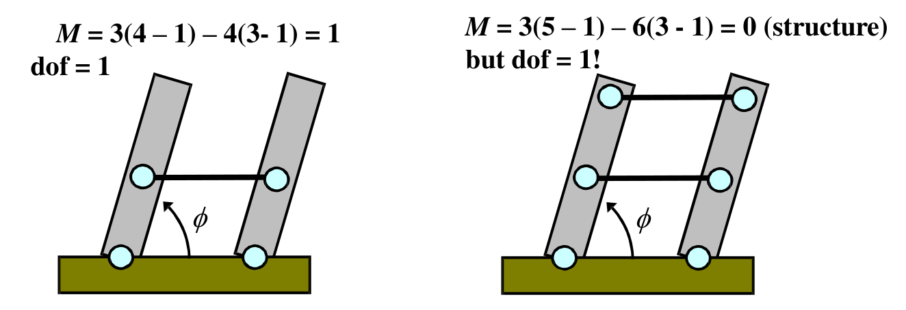
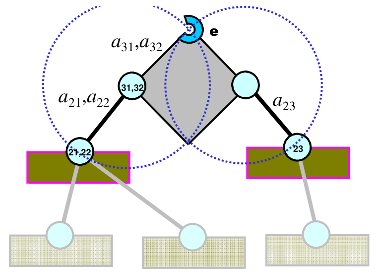
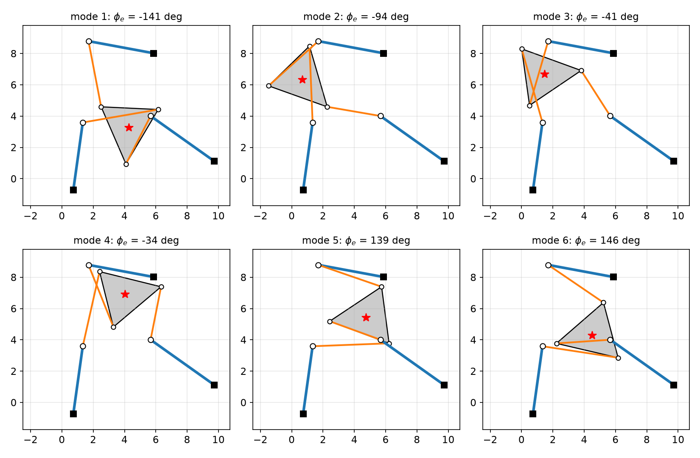
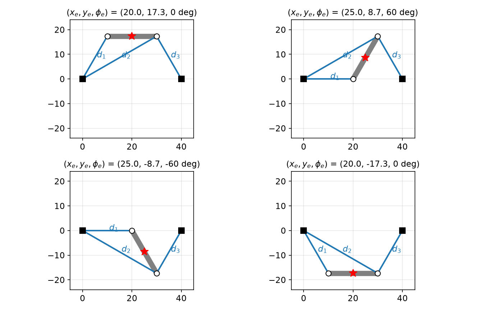

# Parallel Robots

A serial arm is an open chain: each joint carries everything beyond it, and its kinematics follow by multiplying transforms from base to tip. A **parallel robot** connects its end-effector (the platform) to the ground through several chains, or legs, forming closed loops. The closed loops reverse the usual difficulty: the inverse ("reverse") displacement problem becomes easy, leg by leg, while the forward problem becomes a system of polynomial equations with several solutions, and new singularities appear in which the platform moves even though every actuator is locked. This chapter develops the tools in order: counting degrees of freedom by mobility, reverse and forward displacement analysis of the planar 3RRR and 3RPR robots (the forward problem leading to a sixth-degree polynomial), the two kinds of displacement singularity, and worked exercises.

## Freedom and Constraint

### Degrees of freedom

Robots are modeled as free rigid bodies connected by joints and other constraints that limit their relative motion. The three basic joints are the **revolute** (R), **prismatic** (P) and **spherical** (S).

**Definition.** The **degrees of freedom** (dof) of a system are the number of coordinates necessary and sufficient to specify its location: the number of independent coordinates.

- One point has 2 dof in the plane, \\((x, y)\\), and 3 in space; \\(n\\) points have \\(2n\\) or \\(3n\\).
- One rigid body has 3 dof in the plane, \\((x, y, \phi)\\), and 6 in space; \\(n\\) bodies have \\(3n\\) or \\(6n\\).

**Definition.** A **kinematic constraint** is an equation relating coordinates. With independent equality constraints,
\\[
\text{dof} = \text{number of coordinates} - \text{number of independent constraints}.
\\]
*Example.* Two points on a rigid planar body have 4 coordinates and one constraint, \\((x\_1 - x\_2)^2 + (y\_1 - y\_2)^2 = L\_{12}^2\\): \\(4 - 1 = 3\\) dof, as expected for a planar body.

### Joints as bilateral constraints

A **joint** is a mechanical constraint between two bodies; a **bilateral constraint** is an equality relation (it can push and pull). A revolute joint (hinge) permits one relative rotation \\(\phi\\); a prismatic joint (slider) one relative translation \\(d\\); a spherical joint (ball-and-socket) three relative rotations \\(\phi\_x, \phi\_y, \phi\_z\\). Contacts and cables are **unilateral** constraints (inequalities): a contact can push but not pull, and a cable can pull but not push.

### Mobility: the Grübler–Kutzbach criterion

**Definition.** The **mobility** \\(M\\) of a mechanism is its expected relative dof, computed without regard to the specific geometry that may make some constraints dependent. It is a topological measure and easy to compute.

Let \\(D = 3\\) (planar) or \\(6\\) (spatial), let \\(n\\) be the number of bodies **including the ground**, and let joint \\(i\\) permit \\(j\_i\\) relative dof. The \\(n - 1\\) moving bodies have \\(D(n-1)\\) coordinates; joint \\(i\\) removes the \\(D - j\_i\\) relative freedoms it forbids. Assuming all these constraints independent,
\\[
\boxed{M = D(n - 1) - \sum\_i (D - j\_i).}
\\]



*Figure: left, a parallelogram four-bar: M = 3(4 − 1) − 4(3 − 1) = 1 and dof = 1. Right, the same linkage with a third parallel link: M = 3(5 − 1) − 6(3 − 1) = 0, predicting a rigid structure, yet the special geometry (all links parallel and equal) makes one constraint redundant and the mechanism still moves with dof = 1.*

**Example 1 (mobility counts).**

- *Parallelogram four-bar:* 4 bodies, 4 R joints: \\(M = 3(4 - 1) - 4(3 - 1) = 1\\); dof = 1.
- *Parallelogram with an extra parallel link:* 5 bodies, 6 R joints: \\(M = 3(5-1) - 6(3-1) = 0\\), a structure according to the count, **but dof = 1**. Mobility is the *expected* dof; special geometry can make constraints dependent and the actual dof larger.
- *Watt's linkage:* 6 bodies, 7 R joints: \\(M = 3(6-1) - 7(3-1) = 15 - 14 = 1\\).
- *Planar 3RPR parallel robot:* ground (1), two bodies per leg (2–7) and the platform (8), so \\(n = 8\\); 6 R and 3 P joints, each removing 2 planar freedoms: \\(M = 3(8-1) - 6(3-1) - 3(3-1) = 21 - 18 = 3\\). The platform has the full 3 planar dof, one per actuated leg.
- *Planar 3RRR parallel robot:* also \\(n = 8\\), with 9 R joints: \\(M = 21 - 18 = 3\\).
- *Stewart–Gough platform* (six UPS legs: universal, prismatic, spherical): \\(n = 2 + 6\times2 = 14\\); per leg the U removes \\(6-2 = 4\\), the P removes 5, the S removes 3: \\(M = 6\cdot13 - 6(4 + 5 + 3) = 78 - 72 = 6\\). (Each leg also has an idle spin about its own axis, which the count includes; the platform has 6 dof.)

## Serial versus Parallel

| Property | Serial | Parallel |
|---|---|---|
| Range of motion | large | limited |
| Structure | simple | complicated |
| Kinematics and dynamics | easy | difficult |
| Inertia and speed | large inertia, slower | less inertia, faster |
| Accuracy | lower: joint errors accumulate toward the tip | higher |

Parallel robots appear as flight and driving simulators (Stewart platforms), high-speed pick-and-place delta robots, SCARA-like parallel arms, machine tools and precision positioning stages. Their actuators are on or near the ground, the legs share the load, and errors average rather than accumulate.

## Displacement Analysis

Two problems mirror the serial forward and inverse kinematics of [Forward Kinematics](forward-kinematics.md) and [Inverse Kinematics](inverse-kinematics.md):

- **Forward displacement analysis (FDA):** given the actuator displacements, find the end-effector displacement. Not all joints are actuated (some are passive). It is used for simulation and is *very difficult* for parallel robots.
- **Reverse displacement analysis (RDA):** given the end-effector displacement, find the actuator displacements (and usually the passive joints too). It is used for control and is *similar to the serial inverse problem*.

The representative planar parallel robots are the **3RRR** (three legs, each revolute–revolute–revolute, with the first joint of each leg actuated) and the in-line **3RPR** (each leg revolute–prismatic–revolute, with the prismatic joint actuated). The underlined actuated joint is often written \\(3\underline{R}RR\\) and \\(3R\underline{P}R\\).

### Virtual serial robots

The key idea of RDA is to cut the parallel robot into **three virtual serial robots**, one per leg. Each consists of the leg's links plus a *virtual link* \\(a\_{3j}\\) rigidly attached to the platform, running from the leg's platform joint to the end-effector point \\(e\\).

**Notation (double subscripts).** The first subscript counts a robot property (joint or link); the second counts the virtual robot \\(j = 1,2,3\\).

- \\(\theta\_{ij}\\): \\(i\\)-th joint angle of virtual robot \\(j\\); \\(a\_{ij}\\): \\(i\\)-th link length; \\(\mathbf a\_{ij}\\): unit vector along the \\(i\\)-th link.
- \\(\mathbf p\_{1j}\\): position of the grounded joint of leg \\(j\\); \\(\mathbf p\_{1j,ej}\\): end-effector position relative to that joint.
- \\(\phi\_e\\): platform orientation (angle with the \\(x\\)-axis); \\(\phi\_{ej}\\): orientation of the virtual link \\(a\_{3j}\\); \\(\delta\_{ej}\\): the fixed offset angle between them.

Then, for every leg,
\\[
\mathbf p\_e = \mathbf p\_{1j} + \mathbf p\_{1j,ej}, \qquad \phi\_e = \delta\_{ej} + \phi\_{ej} .
\\]

### Reverse displacement analysis of the 3RRR

**Given:** link lengths \\(a\_{ij}\\), end-effector position \\(\mathbf p\_e\\) and orientation \\(\phi\_e\\), offsets \\(\delta\_{ej}\\), and ground joints \\(\mathbf p\_{1j}\\). **Find:** \\(\theta\_{1j}\\) (actuated) and \\(\theta\_{2j}, \theta\_{3j}\\) (passive), \\(j = 1,2,3\\).

**Procedure.**

1. For each leg form the virtual serial robot's target: \\(\mathbf p\_{1j,ej} = \mathbf p\_e - \mathbf p\_{1j}\\) and \\(\phi\_{ej} = \phi\_e - \delta\_{ej}\\).
2. Solve each RRR as a planar 3R inverse kinematics problem. The platform joint is at
\\[
\mathbf p\_{3j} = \mathbf p\_e - a\_{3j}\begin{bmatrix}\cos\phi\_{ej}\\\\ \sin\phi\_{ej}\end{bmatrix},
\\]
which leaves a 2R problem from \\(\mathbf p\_{1j}\\) to \\(\mathbf p\_{3j}\\). With \\(\mathbf r\_j = \mathbf p\_{3j} - \mathbf p\_{1j} = (r\_x, r\_y)\\),
\\[
\cos\theta\_{2j} = \frac{r\_x^2 + r\_y^2 - a\_{1j}^2 - a\_{2j}^2}{2a\_{1j}a\_{2j}}, \qquad \theta\_{2j}^{(\pm)} = \pm\arccos(\cdot),
\\]
\\[
\theta\_{1j}^{(\pm)} = \mathrm{atan2}(r\_y, r\_x) - \mathrm{atan2}\left(a\_{2j}\sin\theta\_{2j}^{(\pm)},\ a\_{1j} + a\_{2j}\cos\theta\_{2j}^{(\pm)}\right), \qquad \theta\_{3j}^{(\pm)} = \phi\_{ej} - \theta\_{1j}^{(\pm)} - \theta\_{2j}^{(\pm)} .
\\]
3. A real solution exists for leg \\(j\\) iff \\(\lvert a\_{1j} - a\_{2j}\rvert\leq\lVert\mathbf r\_j\rVert\leq a\_{1j} + a\_{2j}\\).

Each leg has two elbow configurations, so there are up to \\(2\times2\times2 = 8\\) RDA solutions. The solution tree reads: \\((\mathbf p\_e, \phi\_e)\\) → \\((\mathbf p\_{1j,ej}, \phi\_{ej})\\) for each leg → joint 2: \\(\theta\_{2j}^{(\pm)}\\) → joint 1: \\(\theta\_{1j}^{(\pm)}\\) → joint 3: \\(\theta\_{3j}^{(\pm)}\\).

For the **3RPR** the virtual robots are RPR chains: \\(\mathbf r\_j = \mathbf p\_{3j} - \mathbf p\_{1j}\\) gives the actuator length \\(d\_{2j} = \lVert\mathbf r\_j\rVert\\) and direction \\(\theta\_{1j} = \mathrm{atan2}(r\_y, r\_x)\\) directly; with positive leg lengths the RDA is unique. (The RPR notation adds \\(d\_{ij}\\), the \\(i\\)-th actuator length, and \\(\mathbf d\_{ij}\\), its direction.)

### Forward displacement analysis of the 3RRR

**Given:** \\(\theta\_{11}, \theta\_{12}, \theta\_{13}\\) and the geometry. **Find:** \\(\mathbf p\_e = (x\_e, y\_e)\\) and \\(\phi\_e\\).

**Step 1 (locate joints \\(2j\\)).** The actuated angles fix the first links:
\\[
\mathbf p\_{2j} = \mathbf p\_{1j} + a\_{1j}\mathbf a\_{1j}, \qquad \begin{bmatrix}x\_{2j}\\\\ y\_{2j}\end{bmatrix} = \begin{bmatrix}x\_{1j} + a\_{1j}c\_{1j}\\\\ y\_{1j} + a\_{1j}s\_{1j}\end{bmatrix}.
\\]
**Step 2 (reduce to a structure).** Joints \\(1j\\) and links \\(a\_{1j}\\) are no longer needed: replace them by *virtual grounds* at \\(\mathbf p\_{2j}\\). What remains (the three links \\(a\_{2j}\\) and the platform, 5 bodies with 6 R joints) has \\(M = 3\cdot4 - 6\cdot2 = 0\\): it is a structure, rigid in general. Given \\(\mathbf p\_{21}, \mathbf p\_{22}, \mathbf p\_{23}\\), find \\(\mathbf p\_e, \phi\_e\\).

**Step 3 (platform joints in terms of the unknowns).**
\\[
\mathbf p\_{3j} = \mathbf p\_e - a\_{3j}\mathbf a\_{3j}: \qquad x\_{3j} = x\_e - a\_{3j}c\_{e-ej}, \qquad y\_{3j} = y\_e - a\_{3j}s\_{e-ej},
\\]
with \\(c\_{e-ej} = \cos(\phi\_e - \delta\_{ej})\\), \\(s\_{e-ej} = \sin(\phi\_e - \delta\_{ej})\\), since \\(\phi\_{ej} = \phi\_e - \delta\_{ej}\\). These are 6 equations in 9 unknowns (\\(x\_{3j}, y\_{3j}, x\_e, y\_e, \phi\_e\\)).

**Step 4 (link-length constraints).** Each middle link has fixed length:
\\[
a\_{2j}^2 = (\mathbf p\_{3j} - \mathbf p\_{2j})\cdot(\mathbf p\_{3j} - \mathbf p\_{2j}) = (x\_{3j} - x\_{2j})^2 + (y\_{3j} - y\_{2j})^2,
\\]
three more equations, 9 in all. Geometrically, joint \\(3j\\) must lie on the circle of radius \\(a\_{2j}\\) about joint \\(2j\\); the question is where to put the rigid platform so that all three of its joints touch their circles at once.



*Figure: the circle picture of forward analysis, here at a singular configuration. Each dotted circle is the locus of the end point e allowed by one leg once its actuator is fixed (a circle of radius a₂ⱼ shifted by the platform vector a₃ⱼ). Here legs 1 and 2 share both their platform joint (31,32) and, at this instant, their elbow joint (21,22), so their two circles coincide and e is no longer determined.*

Substituting step 3 into step 4,
\\[
a\_{2j}^2 = \left(x\_e - a\_{3j}c\_{e-ej} - x\_{2j}\right)^2 + \left(y\_e - a\_{3j}s\_{e-ej} - y\_{2j}\right)^2, \qquad j = 1,2,3,
\\]
three equations in the three unknowns \\(x\_e, y\_e, \phi\_e\\). For a fixed \\(\phi\_e\\), each is a circle of radius \\(a\_{2j}\\) for the point \\(e\\), centred not at joint \\(2j\\) but at \\(\mathbf p\_{2j} + a\_{3j}\mathbf a\_{3j}\\): the circle about joint \\(2j\\) shifted by the platform vector. The forward problem asks for the orientations \\(\phi\_e\\) at which **the three shifted circles pass through a common point**.

Expand each equation into the form
\\[
x\_e^2 + y\_e^2 + f\_jx\_e + g\_jy\_e + h\_j = 0, \qquad j = 1,2,3,
\\]
where, with \\(u\_j = x\_{2j} + a\_{3j}c\_{e-ej}\\) and \\(v\_j = y\_{2j} + a\_{3j}s\_{e-ej}\\) (the shifted centre),
\\[
f\_j = -2u\_j, \qquad g\_j = -2v\_j, \qquad h\_j = u\_j^2 + v\_j^2 - a\_{2j}^2,
\\]
all functions of \\(\phi\_e\\) only. Subtracting pairs eliminates the quadratic terms (the radical axes of the circles):
\\[
(f\_3 - f\_1)x\_e + (g\_3 - g\_1)y\_e + (h\_3 - h\_1) = 0, \qquad (f\_1 - f\_2)x\_e + (g\_1 - g\_2)y\_e + (h\_1 - h\_2) = 0 .
\\]
Solve this linear pair by Cramer's rule: \\(x\_e = k/m\\), \\(y\_e = l/m\\) with
\\[
k = -(h\_3 - h\_1)(g\_1 - g\_2) + (h\_1 - h\_2)(g\_3 - g\_1),
\\]
\\[
l = -(f\_3 - f\_1)(h\_1 - h\_2) + (f\_1 - f\_2)(h\_3 - h\_1),
\\]
\\[
m = (f\_3 - f\_1)(g\_1 - g\_2) - (f\_1 - f\_2)(g\_3 - g\_1).
\\]
Back-substitute into the first circle and multiply by \\(m^2\\):
\\[
k^2 + l^2 + kmf\_1 + lmg\_1 + h\_1m^2 = 0,
\\]
a single equation in \\(\phi\_e\\) alone.

**Step 5 (the sextic).** Expand \\(\cos(\phi\_e - \delta\_{ej}) = \cos\phi\_e\cos\delta\_{ej} + \sin\phi\_e\sin\delta\_{ej}\\) and \\(\sin(\phi\_e - \delta\_{ej}) = \sin\phi\_e\cos\delta\_{ej} - \cos\phi\_e\sin\delta\_{ej}\\), write \\(c\_e = \cos\phi\_e\\), \\(s\_e = \sin\phi\_e\\), and use \\(c\_e^2 + s\_e^2 = 1\\) to reduce powers of \\(s\_e\\). The equation is then linear in \\(s\_e\\), so it can be solved for \\(s\_e\\):
\\[
s\_e = \frac{u\_3c\_e^3 + u\_2c\_e^2 + u\_1c\_e + u\_0}{v\_3c\_e^2 + v\_1c\_e + v\_0}
\\]
(with constant coefficients \\(u\_i, v\_i\\) depending on the geometry and the actuator angles). Squaring and substituting \\(s\_e^2 = 1 - c\_e^2\\) gives a **sixth-order polynomial**
\\[
b\_6c\_e^6 + b\_5c\_e^5 + \dots + b\_1c\_e + b\_0 = 0 .
\\]
Each real root \\(c\_e^{(i)}\\) in \\([-1, 1]\\) gives \\(s\_e\\) from the rational expression (the sign of \\(s\_e\\) is fixed there, which discards the spurious branch introduced by squaring), then \\(\phi\_e = \mathrm{atan2}(s\_e, c\_e)\\), and finally \\(x\_e = k/m\\), \\(y\_e = l/m\\). The solution tree is \\(\theta\_{11}, \theta\_{12}, \theta\_{13}\\) → \\(c\_e^{(1\ldots6)}\\) → \\(s\_e\\) → \\(\phi\_e\\) → \\(x\_e\\) → \\(y\_e\\). The tangent half-angle substitution \\(t = \tan(\phi\_e/2)\\) leads to an equivalent polynomial in \\(t\\).

**Theorem.** For given actuator inputs, the planar 3RRR (and 3RPR) forward displacement problem has at most six solutions, the **assembly modes**, and there are geometries for which all six are real.



*Figure: the six forward displacement solutions of one 3RRR geometry (base joints ■ near (0.7, −0.7), (9.7, 1.1), (5.9, 8.0); first links (blue) fixed by the actuators; middle links in orange; triangular platform in gray with the end point ★). The actuated angles and all link lengths are identical in every panel; only the passive joints and the platform pose differ. The modes have platform orientations −141°, −94°, −41°, −34°, 139° and 146°, found as the roots of the one-variable equation in φ_e and checked by substitution into all three circle equations.*

```python
# Forward displacement of a 3RRR: roots of the resultant R(phi) in phi
def fda(p2, a2, a3, dl):               # p2: joints 2j (3x2), a2, a3, offsets dl
    def coeffs(phi):
        u = a3*np.cos(phi - dl) + p2[:, 0]; v = a3*np.sin(phi - dl) + p2[:, 1]
        return -2*u, -2*v, u*u + v*v - a2**2
    def klm(phi):
        f, g, h = coeffs(phi)
        k = -(h[2]-h[0])*(g[0]-g[1]) + (h[0]-h[1])*(g[2]-g[0])
        l = -(f[2]-f[0])*(h[0]-h[1]) + (f[0]-f[1])*(h[2]-h[0])
        m = (f[2]-f[0])*(g[0]-g[1]) - (f[0]-f[1])*(g[2]-g[0])
        return k, l, m, f, g, h
    def R(phi):
        k, l, m, f, g, h = klm(phi); return k*k + l*l + k*m*f[0] + l*m*g[0] + h[0]*m*m
    # bracket sign changes of R on a fine grid, refine with brentq, then x=k/m, y=l/m
```

### The 3RPR

| | 3RRR | 3RPR |
|---|---|---|
| Reverse displacement | create 3 RRR virtual robots and solve each separately | create 3 RPR virtual robots and solve each separately |
| Forward displacement | turn the 3RRR into a structure with 6 R joints and solve | turn the 3RPR into a structure with 6 R joints and solve |

With the actuators locked, each prismatic leg of the 3RPR becomes a rigid virtual link of length \\(d\_{2j}\\) between its base pivot and the platform, just as each 3RRR leg becomes a link \\(a\_{2j}\\) between a virtual ground and the platform. Both reduce to the same structure (three binary links pinned to ground and to a triangular platform), so **their forward analyses are identical**, sextic included.

## Singularities

Parallel robots have two kinds of displacement singularity.

- **Reverse displacement singularities** involve a single leg and are found in the RDA; they are the same as serial-robot singularities. A 3RRR leg fully stretched or folded (\\(\theta\_{2j} = 0\\) or \\(\pi\\)) is at the boundary of its workspace: the platform loses the ability to move in some direction, and two RDA branches merge. For a 3RPR, the analogous case occurs when the platform joint lies on the line of the leg in a way that makes the leg direction indeterminate (e.g. zero leg length).
- **Forward displacement singularities** involve combinations of legs and are found in the FDA. They are unique to closed chains.

**Forward singularities.** Determining all of them is very difficult, but the basic condition is simple. At a forward singularity there are *infinitely many* solutions in \\(x\_e, y\_e, \phi\_e\\), so the three circle equations through \\(e\\) must reduce to fewer than three independent equations. A *sufficient* condition is that **two circles coincide**. In the configuration of the figure above, virtual robots 1 and 2 share their platform joint (joints 31 and 32 are at the same point, \\(a\_{31} = a\_{32}\\)). If joints 21 and 22 also become coincident, the two legs' circles are the same circle; then links \\(a\_{21}, a\_{22}\\) and \\(a\_{23}\\) can all rotate about their joints 2 and, together with the platform, form a four-bar linkage with one dof.

**Consequence:** a load on the end-effector moves it even though all actuators are held fixed, an **uncontrollable motion** that may be disastrous. Near such configurations the actuator forces needed to resist a platform load grow without bound.

**Velocity-level view.** Differentiating the closure equations of any parallel robot gives a relation \\(A\\,\dot{\mathbf x} = B\\,\dot{\mathbf q}\\) between platform velocity \\(\dot{\mathbf x} = (\dot x\_e, \dot y\_e, \dot\phi\_e)\\) and actuator rates \\(\dot{\mathbf q}\\) (Gosselin and Angeles). Where \\(\det B = 0\\), some actuator motions produce no platform motion: the reverse (serial-type) singularity. Where \\(\det A = 0\\), the platform can move with the actuators locked: the forward (parallel-type) singularity just described, at which two roots of the sextic coalesce.

## Worked Exercises

**Exercise 1 (planar 3RRR).** The base joints are actuated, at about \\((-4, -1)\\) (joint 1), \\((-1, -2)\\) (joint 2) and \\((1, -2)\\) (joint 3). The square platform has corners \\((-1, 0)\\), \\((1, 0)\\), \\((1, 2)\\), \\((-1, 2)\\), with the end-effector at \\((1, 2)\\).

*(a) How many RDA solutions?* Each leg can reach its platform joint with elbow on either side: \\(2\times2\times2 = 8\\) solutions, each giving a different set of actuator angles for the same platform pose.

*(b) Find an alternative FDA solution.* With the actuator angles of the given pose locked, the elbow joints \\(2j\\) are fixed, and the three middle links form a structure with the platform. Another way to close the loop is to flip the platform below its original position: the square moves down so that its corners lie at about \\((-1,-2)\\) through \\((1, 0)\\), with the end-effector at \\((1, 0)\\), while each middle link swings about its elbow joint to meet the displaced platform joint. This is a second assembly mode for the same actuator inputs.

**Exercise 2 (planar 3RPR).** The base pivots are at \\(A\_1 = (0, 0)\\) and \\(A\_3 = (40, 0)\\) (inches). The platform is a bar 20 long with the end-effector at its midpoint and pivots \\(B\_1\\) (left) and \\(B\_3\\) (right). Leg 1 runs from \\(A\_1\\) to \\(B\_1\\) at \\(60^\circ\\); leg 2 from \\(A\_1\\) to \\(B\_3\\); leg 3 from \\(A\_3\\) to \\(B\_3\\) at \\(120^\circ\\). In the configuration shown the platform is horizontal and its left pivot is 10 to the right of \\(A\_1\\).

*(a) Pose.* By symmetry \\(x\_e = 20\\) and \\(\phi\_e = 0^\circ\\). The left pivot is at \\(x = 10\\), and \\(\tan60^\circ = y\_e/10\\), so \\(y\_e = 10\sqrt3\\):
\\[
(x\_e, y\_e, \phi\_e) = (20,\ 10\sqrt3,\ 0^\circ).
\\]
*(b) Actuator lengths (RDA).* \\(B\_1 = (10, 10\sqrt3)\\), \\(B\_3 = (30, 10\sqrt3)\\):
\\[
d\_1 = \frac{10}{\cos60^\circ} = 20, \qquad d\_2 = \frac{30}{\cos30^\circ} = 20\sqrt3, \qquad d\_3 = d\_1 = 20 \text{ (by symmetry)}.
\\]
Check: \\(d\_2 = \sqrt{30^2 + 300} = \sqrt{1200} = 20\sqrt3\\).

*(c) Forward solutions for these lengths.* This geometry decouples: \\(B\_3\\) is at distance \\(d\_2\\) from \\(A\_1\\) and \\(d\_3\\) from \\(A\_3\\), so it lies at an intersection of two circles, **2 choices**. Then \\(B\_1\\) is at distance \\(d\_1\\) from \\(A\_1\\) and 20 from \\(B\_3\\), again **2 choices**. There are \\(2\times2 = 4\\) solutions. (The general sextic degenerates here because two legs share the pivot \\(A\_1\\).)



*Figure: the four forward solutions for d₁ = 20, d₂ = 20√3, d₃ = 20, computed by intersecting circles. Top left is the given pose (20, 17.3, 0°); its mirror image below the base line is (20, −17.3, 0°); the two tilted modes have the platform at ±60°, with B₁ on the base line at (20, 0) and the end point at (25, ±8.7).*

The tilted modes can be verified directly: with \\(B\_3 = (30, 10\sqrt3)\\) and \\(B\_1 = (20, 0)\\), \\(\lVert B\_1 - A\_1\rVert = 20 = d\_1\\) and \\(\lVert B\_3 - B\_1\rVert = \sqrt{100 + 300} = 20\\), the platform length; the platform direction is \\(\mathrm{atan2}(10\sqrt3, 10) = 60^\circ\\) and the end point is the midpoint \\((25, 5\sqrt3)\approx(25, 8.7)\\).

## Summary

- Mobility (Grübler–Kutzbach): \\(M = D(n-1) - \sum(D - j\_i)\\), \\(D = 3\\) or 6, \\(n\\) counting the ground. It is the *expected* dof; special geometry can make the actual dof larger (parallelogram with an extra link: \\(M = 0\\), dof = 1).
- 3RRR and 3RPR: \\(M = 21 - 18 = 3\\). Stewart platform: \\(M = 6\\).
- Parallel vs serial: smaller workspace, harder kinematics; lower inertia, higher speed and accuracy.
- RDA: split into three virtual serial robots (\\(\mathbf p\_e = \mathbf p\_{1j} + \mathbf p\_{1j,ej}\\), \\(\phi\_e = \delta\_{ej} + \phi\_{ej}\\)); 3RRR has up to \\(2^3 = 8\\) solutions, 3RPR one (positive lengths).
- FDA: fix joints \\(2j\\) → structure with \\(M = 0\\) → three shifted circles through \\(e\\) → radical axes give \\(x\_e = k/m\\), \\(y\_e = l/m\\) → \\(k^2 + l^2 + kmf\_1 + lmg\_1 + h\_1m^2 = 0\\) → sextic in \\(\cos\phi\_e\\); up to six assembly modes. 3RRR and 3RPR share the same forward analysis.
- Reverse singularities involve one leg (as in serial arms); forward singularities involve several legs (e.g. two coincident circles) and allow uncontrollable platform motion with locked actuators.

## See Also

- [Actuation, Transmissions and Redundancy](actuation.md): serial/parallel comparison and parallel drives in robot hands.
- [Inverse Kinematics](inverse-kinematics.md) and [Forward Kinematics](forward-kinematics.md): the serial problems used leg by leg.
- [Jacobians and Statics](jacobians-statics.md): velocity singularities and force transmission.
- [Manipulator Dynamics](dynamics.md): the five-bar parallelogram arm as a dynamics example.
- Robot Kinematics: overview of kinematic chains.
