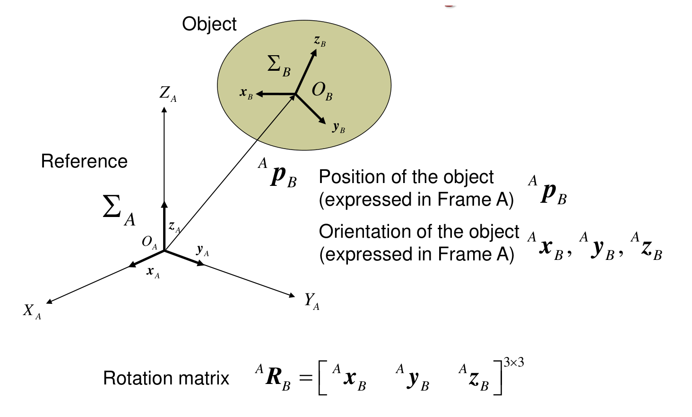
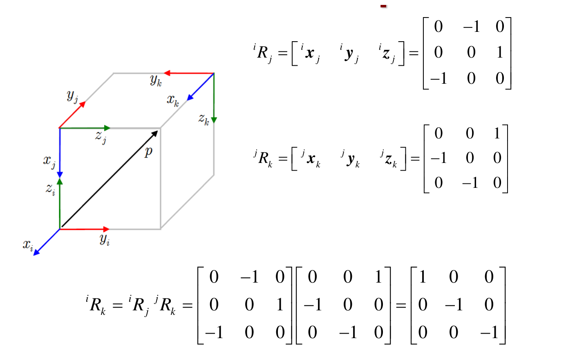
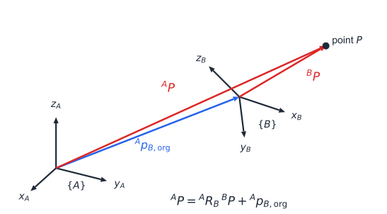
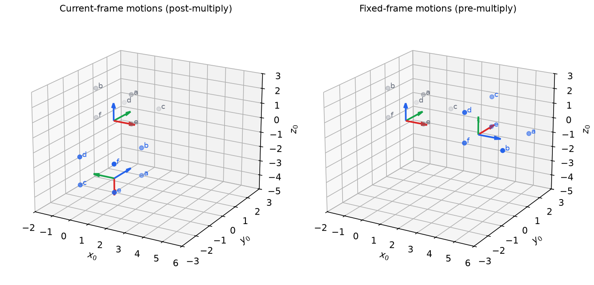
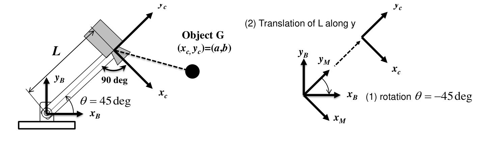

# Spatial Descriptions and Transformations

A manipulator is a chain of rigid bodies, and every question we ask about it (where the gripper is, how a camera reading maps into the base frame, how fast the tool turns) starts with describing the position and orientation of one rigid body relative to another. This chapter builds that language: frames, rotation matrices and their properties, three-parameter orientation descriptions (Euler and fixed angles), the axis–angle and quaternion representations, and the \\(4\times4\\) homogeneous transform that packs rotation and translation into a single matrix product. Everything later in the subsection (Denavit–Hartenberg kinematics, Jacobians, dynamics) is written in this notation, so we take care to derive each rule rather than state it.

## Rigid Bodies, Frames and Degrees of Freedom

### Scalars, vectors and tensors

Mechanics distinguishes three kinds of quantity:

- a **scalar** has a magnitude only (distance, angle, mass, volume, density);
- a **vector** has a magnitude in one direction and, for bound vectors, a location (linear and angular displacement, velocity and acceleration; linear and angular momentum; force and moment);
- a **tensor** has a magnitude for every direction. The stress tensor gives the stress on every plane through a point; the inertia tensor gives the rotational inertia about every axis through the centre of mass; and the direction cosine (rotation) matrix of this chapter gives the orientation of a body by listing unit vectors in all three directions.

### Particles, bodies and frames

A **point** is an infinitesimal element of space; a **particle** is an infinitesimal element of matter (finite density) and has 2 degrees of freedom (DOF) in a plane and 3 in space. A **rigid body** is a collection of particles whose mutual distances never change; it has 3 DOF in the plane (two translations, one rotation) and **6 DOF in space** (three translations, three rotations). Here the **number of degrees of freedom** is the minimum number of independent quantities needed to specify a (small) motion of the system. Idealizations are useful: a *point mass* has finite mass and no volume (a ball bearing, an orbiting satellite), a *geometric body* has volume and no mass (the light rod of a pendulum), and an *extended body* combines the two (a pipe plus its interior).

A **frame** is an infinite rigid body (a rigid space) carrying a measuring system. We write \\(\\{A\\}\\) for a frame with origin \\(O\_A\\) and unit vectors \\(x\_A, y\_A, z\_A\\) along its axes, always right-handed (\\(x\_A\times y\_A = z\_A\\)). Six numbers locate one frame with respect to another: three for the position of its origin and three for its orientation. The rest of the chapter is about how to store and manipulate those six numbers.

Rigid body motion is a combination of translation (all particles displaced equally) and rotation (the particles on one line stay fixed). Kinematics studies motion in space and time without asking what causes it; kinetics adds forces and moments. This and the next two chapters are pure kinematics.

## Position

A position vector carries a leading superscript naming the frame in which its components are written:
\\[
{}^{A}p = \begin{bmatrix} p\_x \\\\ p\_y \\\\ p\_z \end{bmatrix}, \qquad {}^{A}p = p\_x\\, x\_A + p\_y\\, y\_A + p\_z\\, z\_A .
\\]
The components are the projections of the vector onto the axes of \\(\\{A\\}\\): \\(p\_x = x\_A\cdot p\\) and so on. The same geometric arrow has different components in different frames, and most of the bookkeeping in robotics is converting between them. The position of the origin of frame \\(\\{B\\}\\) measured in \\(\\{A\\}\\) is written \\({}^{A}p\_{B,\mathrm{org}}\\) (Craig writes \\({}^{A}P\_{BORG}\\); the vector from \\(O\_A\\) to \\(O\_B\\) is also written \\({}^{A}p\_{AB}\\)).

## Orientation and the Rotation Matrix



*Figure: a reference frame {A} and a frame {B} attached to an object. The position of the object is the vector from O_A to O_B expressed in A; its orientation is described by the three unit vectors of B, also expressed in A. Stacking those three vectors as columns gives the rotation matrix.*

To describe the orientation of a body we attach a frame \\(\\{B\\}\\) to it and write the unit vectors of \\(\\{B\\}\\) in terms of \\(\\{A\\}\\). Stacking them as columns gives the **rotation matrix** (also called the **direction cosine matrix**):
\\[
{}^{A}R\_{B} = \begin{bmatrix} {}^{A}x\_B & {}^{A}y\_B & {}^{A}z\_B \end{bmatrix}
= \begin{bmatrix} x\_B\cdot x\_A & y\_B\cdot x\_A & z\_B\cdot x\_A \\\\ x\_B\cdot y\_A & y\_B\cdot y\_A & z\_B\cdot y\_A \\\\ x\_B\cdot z\_A & y\_B\cdot z\_A & z\_B\cdot z\_A \end{bmatrix}.
\\]
Each entry is the cosine of the angle between an axis of \\(\\{B\\}\\) and an axis of \\(\\{A\\}\\), hence the name. Reading the matrix by *columns* gives the axes of \\(\\{B\\}\\) in \\(\\{A\\}\\); reading it by *rows* gives the axes of \\(\\{A\\}\\) in \\(\\{B\\}\\).

### Mapping a vector between frames

If a vector has components \\({}^{B}p\\) in \\(\\{B\\}\\), then \\(p = {}^{B}p\_x\\, x\_B + {}^{B}p\_y\\, y\_B + {}^{B}p\_z\\, z\_B\\). Writing each unit vector in \\(\\{A\\}\\) components,
\\[
{}^{A}p = {}^{A}x\_B\\,{}^{B}p\_x + {}^{A}y\_B\\,{}^{B}p\_y + {}^{A}z\_B\\,{}^{B}p\_z = {}^{A}R\_{B}\\,{}^{B}p .
\\]
The leading superscript of \\(R\\) matches the frame of the result and the trailing subscript "cancels" the leading superscript of the vector. This cancellation rule makes long products easy to check.

### Properties

**Theorem (orthogonality).** \\({}^{A}R\_{B}\\) is orthogonal and proper:
\\[
({}^{A}R\_{B})^{T}\\,{}^{A}R\_{B} = I\_3, \qquad ({}^{A}R\_{B})^{-1} = ({}^{A}R\_{B})^{T} = {}^{B}R\_{A}, \qquad \det {}^{A}R\_{B} = +1 .
\\]
*Proof.* The \\((j,k)\\) entry of \\(R^{T}R\\) is the dot product of columns \\(j\\) and \\(k\\), which are unit vectors of a frame: \\(({}^{A}x\_B)^{T}{}^{A}x\_B = 1\\), \\(({}^{A}x\_B)^{T}{}^{A}y\_B = 0\\), and so on. Hence \\(R^{T}R = I\\). The determinant is the triple product \\({}^{A}x\_B\cdot({}^{A}y\_B\times{}^{A}z\_B) = {}^{A}x\_B\cdot{}^{A}x\_B = 1\\) for a right-handed frame. Finally \\(R^{T}\\) has the axes of \\(\\{A\\}\\) in \\(\\{B\\}\\) as its columns, which is \\({}^{B}R\_{A}\\) by definition. \\(\blacksquare\\)

So of the nine entries only three are independent: the six constraints \\(R^{T}R = I\\) remove six. The set of such matrices is the special orthogonal group \\(SO(3)\\). Consequences used constantly:

- Rotation preserves lengths and angles: \\(\lVert Rp \rVert = \lVert p \rVert\\) and \\((Ra)\cdot(Rb) = a\cdot b\\).
- Rotation distributes over the cross product: \\(R(a\times b) = (Ra)\times(Rb)\\) (this needs \\(\det R = +1\\); a reflection would flip the sign).
- The eigenvalues are \\(1, e^{i\theta}, e^{-i\theta}\\); the eigenvector for 1 is the rotation axis (Euler's theorem, below).
- Rotations do **not** commute: in general \\(R\_1R\_2 \neq R\_2R\_1\\).

**Example 1 (completing an orthogonal matrix).** Find \\(\alpha, a, b, c\\) so that
\\[
O = \alpha\begin{bmatrix} 7 & 0 & b \\\\ 0 & a & 0 \\\\ -12 & 0 & c \end{bmatrix}
\\]
is a rotation matrix.

*Solution.* Column 1 must be a unit vector: \\(\lvert\alpha\rvert\sqrt{49+144} = 1\\), so \\(\alpha = \pm 1/\sqrt{193}\\). Column 2: \\(\lvert\alpha a\rvert = 1\\), so \\(a = \pm\sqrt{193}\\). Column 3 must be a unit vector orthogonal to column 1: \\(7b - 12c = 0\\) and \\(b^2 + c^2 = 193\\), giving \\((b,c) = (12, 7)\\) or \\((-12,-7)\\). Of the eight sign combinations, exactly four have \\(\det O = +1\\):
\\[
\tfrac{1}{\sqrt{193}}\begin{bmatrix} 7 & 0 & 12 \\\\ 0 & \sqrt{193} & 0 \\\\ -12 & 0 & 7 \end{bmatrix},\quad
\tfrac{1}{\sqrt{193}}\begin{bmatrix} 7 & 0 & -12 \\\\ 0 & -\sqrt{193} & 0 \\\\ -12 & 0 & -7 \end{bmatrix},\quad
-\tfrac{1}{\sqrt{193}}\begin{bmatrix} 7 & 0 & -12 \\\\ 0 & \sqrt{193} & 0 \\\\ -12 & 0 & -7 \end{bmatrix},\quad
-\tfrac{1}{\sqrt{193}}\begin{bmatrix} 7 & 0 & 12 \\\\ 0 & -\sqrt{193} & 0 \\\\ -12 & 0 & 7 \end{bmatrix}.
\\]
The first is a rotation about \\(y\\) by \\(\operatorname{atan2}(12, 7) \approx 59.7^\circ\\). The other four combinations have determinant \\(-1\\) and are reflections.

### Elementary rotations

When two frames share an axis, the rotation matrix takes a simple form. A rotation by angle \\(\theta\\) about the common \\(x\\), \\(y\\) or \\(z\\) axis is
\\[
R\_x(\alpha) = \begin{bmatrix} 1 & 0 & 0 \\\\ 0 & c\_\alpha & -s\_\alpha \\\\ 0 & s\_\alpha & c\_\alpha \end{bmatrix},\qquad
R\_y(\beta) = \begin{bmatrix} c\_\beta & 0 & s\_\beta \\\\ 0 & 1 & 0 \\\\ -s\_\beta & 0 & c\_\beta \end{bmatrix},\qquad
R\_z(\theta) = \begin{bmatrix} c\_\theta & -s\_\theta & 0 \\\\ s\_\theta & c\_\theta & 0 \\\\ 0 & 0 & 1 \end{bmatrix},
\\]
with the shorthand \\(c\_\theta = \cos\theta\\), \\(s\_\theta = \sin\theta\\). Each follows directly from the column rule: for \\(R\_z(\theta)\\), the new \\(x\\) axis is \\((c\_\theta, s\_\theta, 0)\\) and the new \\(y\\) axis is \\((-s\_\theta, c\_\theta, 0)\\). Note the position of the minus sign in \\(R\_y\\): it sits in the lower-left because \\(z\times x = y\\) (the cyclic order is \\(x\to y\to z\to x\\)).

### Composition

If \\({}^{B}R\_{C}\\) describes \\(\\{C\\}\\) relative to \\(\\{B\\}\\) and \\({}^{A}R\_{B}\\) describes \\(\\{B\\}\\) relative to \\(\\{A\\}\\), then \\({}^{A}p = {}^{A}R\_{B}\\,{}^{B}p = {}^{A}R\_{B}\\,{}^{B}R\_{C}\\,{}^{C}p\\), so
\\[
{}^{A}R\_{C} = {}^{A}R\_{B}\\;{}^{B}R\_{C}.
\\]
For example, rotating about \\(z\\) by \\(\phi\\) and then about the *new* \\(x\\) axis by \\(\theta\\):
\\[
{}^{i}R\_{k} = R\_z(\phi)R\_x(\theta) = \begin{bmatrix} c\_\phi & -s\_\phi & 0 \\\\ s\_\phi & c\_\phi & 0 \\\\ 0 & 0 & 1 \end{bmatrix}\begin{bmatrix} 1 & 0 & 0 \\\\ 0 & c\_\theta & -s\_\theta \\\\ 0 & s\_\theta & c\_\theta \end{bmatrix} = \begin{bmatrix} c\_\phi & -s\_\phi c\_\theta & s\_\phi s\_\theta \\\\ s\_\phi & c\_\phi c\_\theta & -c\_\phi s\_\theta \\\\ 0 & s\_\theta & c\_\theta \end{bmatrix},
\\]
which differs from \\(R\_x(\theta)R\_z(\phi)\\). Order matters.

**Example 2 (frames on a cube).** Three frames sit at corners of a cube: \\(\\{i\\}\\) at a near-bottom corner, \\(\\{j\\}\\) directly above it, and \\(\\{k\\}\\) at the far top corner, with axes as drawn. Find \\({}^{i}R\_{k}\\).



*Figure: rotation matrices read off a picture. Each column of iRj is an axis of frame j written in frame i (for example x_j points along -z_i, giving the first column (0, 0, -1)). Multiplying iRj by jRk gives iRk.*

*Solution.* Reading columns from the figure: \\(x\_j = -z\_i\\), \\(y\_j = -x\_i\\), \\(z\_j = y\_i\\), and \\(x\_k = -y\_j\\), \\(y\_k = -z\_j\\), \\(z\_k = x\_j\\). Therefore
\\[
{}^{i}R\_{j} = \begin{bmatrix} 0 & -1 & 0 \\\\ 0 & 0 & 1 \\\\ -1 & 0 & 0 \end{bmatrix},\qquad
{}^{j}R\_{k} = \begin{bmatrix} 0 & 0 & 1 \\\\ -1 & 0 & 0 \\\\ 0 & -1 & 0 \end{bmatrix},\qquad
{}^{i}R\_{k} = {}^{i}R\_{j}\\,{}^{j}R\_{k} = \begin{bmatrix} 1 & 0 & 0 \\\\ 0 & -1 & 0 \\\\ 0 & 0 & -1 \end{bmatrix}.
\\]
Check against the picture: \\(\\{k\\}\\) is \\(\\{i\\}\\) turned \\(180^\circ\\) about \\(x\_i\\) (its \\(y\\) and \\(z\\) axes are reversed). Reading columns from a sketch, rather than composing elementary rotations, is often the fastest route.

## Skew-Symmetric Matrices and the Cross Product

The cross product \\(a\times b = \lVert a \rVert\\,\lVert b \rVert\sin\theta\\, n\\) (with \\(n\\) the right-hand unit normal) satisfies \\(x\times y = z\\), \\(y\times z = x\\), \\(z\times x = y\\), and the reverse products are negated. Because it is linear in \\(b\\), it can be written as a matrix product:
\\[
a\times b = [a]\_\times\\, b, \qquad
[a]\_\times = \begin{bmatrix} 0 & -a\_3 & a\_2 \\\\ a\_3 & 0 & -a\_1 \\\\ -a\_2 & a\_1 & 0 \end{bmatrix}.
\\]
Check with \\(a = x\\), \\(b = y\\): the second column of \\([x]\_\times\\) is \\((0, 0, 1) = z\\). The matrix satisfies \\([a]\_\times^{T} = -[a]\_\times\\) (skew-symmetric), and every \\(3\times3\\) skew-symmetric matrix is \\([a]\_\times\\) for exactly one \\(a\\). Its transpose \\([a]\_\times^{T} = -[a]\_\times\\) computes \\(b\times a\\), not \\(a\times b\\); mixing the two up is a common sign error.

Two identities complete the toolkit. The **scalar triple product** is the determinant of the three vectors and is invariant under cyclic permutation,
\\[
a\cdot(b\times c) = b\cdot(c\times a) = c\cdot(a\times b) = \det\begin{bmatrix} a\_1 & a\_2 & a\_3 \\\\ b\_1 & b\_2 & b\_3 \\\\ c\_1 & c\_2 & c\_3 \end{bmatrix} = -a\cdot(c\times b),
\\]
and the **vector triple product** is
\\[
a\times(b\times c) = (a\cdot c)\\, b - (a\cdot b)\\, c ,
\\]
which in matrix form reads \\([a]\_\times[b]\_\times = b a^{T} - (a\cdot b) I\\). (Note that it is a cross product on the left: \\(a\cdot(b\times c)\\) is a scalar.)

**Example 3.** \\((x + 2z)\times(x + 4z) = 4\\,x\times z + 2\\,z\times x = -4y + 2y = -2y\\), and \\((-4x + y)\cdot(-2y) = -2\\), which agrees with \\(\det\begin{bmatrix} -4 & 1 & 0 \\\\ 1 & 0 & 2 \\\\ 1 & 0 & 4 \end{bmatrix} = -1\cdot(4 - 2) = -2\\).

### Rotation and skew matrices

**Theorem (similarity and derivative).** For any rotation \\(R\\) and vector \\(a\\), \\(R[a]\_\times R^{T} = [Ra]\_\times\\). If \\(R(t)\\) is a differentiable rotation, then \\(\dot R R^{T}\\) is skew-symmetric, and writing \\(\dot R R^{T} = [\omega]\_\times\\) defines the angular velocity \\(\omega\\):
\\[
\dot R = [\omega]\_\times R, \qquad \frac{d}{dt}\left({}^{A}R\_{B}\right){}^{B}p = {}^{A}\omega\_{B}\times\left({}^{A}R\_{B}\\,{}^{B}p\right).
\\]
*Proof.* The first identity is \\(R(a\times R^{T}b) = Ra\times b\\), which is the distributive property. For the second, differentiate \\(RR^{T} = I\\): \\(\dot R R^{T} + R\dot R^{T} = 0\\), i.e. \\(\dot R R^{T} = -(\dot R R^{T})^{T}\\), which is skew-symmetric. Column by column this says \\(\tfrac{d}{dt}{}^{A}x\_B = \omega\times{}^{A}x\_B\\), and similarly for \\(y\_B\\), \\(z\_B\\); summing with weights \\({}^{B}p\_x, {}^{B}p\_y, {}^{B}p\_z\\) gives the last form. \\(\blacksquare\\)

This is the bridge from orientation to velocity used in [Jacobians and Statics](jacobians-statics.md).

## Three-Parameter Descriptions of Orientation

A rotation matrix carries three independent numbers in nine entries. For input by a human, for trajectory interpolation and for compact storage we want just three. Every three-parameter description has singular orientations (a theorem of topology: \\(SO(3)\\) cannot be covered by a single chart), so the choice is a trade-off.

### Fixed angles versus Euler angles

There are two ways to apply a sequence of three elementary rotations:

- **About fixed axes** (axes of the original frame \\(\\{A\\}\\)): each new rotation is applied in the reference frame, so it **pre-multiplies**.
- **About moving (current) axes** (axes of the frame produced by the previous rotations): each new rotation is described in the current frame, so it **post-multiplies**.

The rule follows from composition. Rotating about the current frame's axis by \\(R\_2\\) means \\({}^{A}R\_{C} = {}^{A}R\_{B}\\,{}^{B}R\_{C} = R\_1R\_2\\). Rotating about the fixed axis means that the operator \\(R\_2\\), written in \\(\\{A\\}\\), acts on everything already done: \\(R\_2R\_1\\). As a consequence, **X–Y–Z fixed angles equal Z–Y–X Euler angles**: rotating about fixed \\(X\\) by \\(\gamma\\), fixed \\(Y\\) by \\(\beta\\), fixed \\(Z\\) by \\(\alpha\\) gives \\(R\_Z(\alpha)R\_Y(\beta)R\_X(\gamma)\\), the same product as rotating about current \\(Z\\), then current \\(Y\\), then current \\(X\\).

There are 12 distinct sets of each kind (6 with three distinct axes such as Z–Y–X, and 6 with a repeated axis such as Z–Y–Z).

### Roll–pitch–yaw (X–Y–Z fixed angles)

With roll \\(\gamma\\) about \\(X\\), pitch \\(\beta\\) about \\(Y\\) and yaw \\(\alpha\\) about \\(Z\\), all about fixed axes (the airplane convention in which the body axes \\(z, y, x\\) are rotated in the order 1-2-3 is the same matrix):
\\[
R\_{XYZ}(\gamma,\beta,\alpha) = R\_Z(\alpha)R\_Y(\beta)R\_X(\gamma) =
\begin{bmatrix}
c\_\alpha c\_\beta & c\_\alpha s\_\beta s\_\gamma - s\_\alpha c\_\gamma & c\_\alpha s\_\beta c\_\gamma + s\_\alpha s\_\gamma \\\\
s\_\alpha c\_\beta & s\_\alpha s\_\beta s\_\gamma + c\_\alpha c\_\gamma & s\_\alpha s\_\beta c\_\gamma - c\_\alpha s\_\gamma \\\\
-s\_\beta & c\_\beta s\_\gamma & c\_\beta c\_\gamma
\end{bmatrix}.
\\]
**Inverse.** Given \\(R = [r\_{ij}]\\), the first column and the last row give
\\[
\beta = \operatorname{atan2}\left(-r\_{31}, \sqrt{r\_{11}^2 + r\_{21}^2}\right),\qquad
\alpha = \operatorname{atan2}\left(\frac{r\_{21}}{c\_\beta}, \frac{r\_{11}}{c\_\beta}\right),\qquad
\gamma = \operatorname{atan2}\left(\frac{r\_{32}}{c\_\beta}, \frac{r\_{33}}{c\_\beta}\right).
\\]
Taking the positive square root selects \\(-90^\circ \le \beta \le 90^\circ\\); the other root gives a second, equivalent triple. When \\(\beta = \pm 90^\circ\\) (\\(c\_\beta = 0\\)) only \\(\alpha \mp \gamma\\) is determined: the first and third rotation axes have become aligned. This is the **representation singularity** (gimbal lock); the orientation is perfectly ordinary, only its description fails. By convention one sets \\(\alpha = 0\\) and solves for \\(\gamma\\) from \\(r\_{12}\\) and \\(r\_{22}\\).

### Z–Y–Z Euler angles

Rotate about \\(z\\) by \\(\alpha\\), then about the new \\(y'\\) by \\(\beta\\), then about the new \\(z''\\) by \\(\gamma\\). Post-multiplying,
\\[
R\_{Z'Y'Z'}(\alpha,\beta,\gamma) = R\_z(\alpha)R\_y(\beta)R\_z(\gamma) =
\begin{bmatrix}
c\_\alpha c\_\beta c\_\gamma - s\_\alpha s\_\gamma & -c\_\alpha c\_\beta s\_\gamma - s\_\alpha c\_\gamma & c\_\alpha s\_\beta \\\\
s\_\alpha c\_\beta c\_\gamma + c\_\alpha s\_\gamma & -s\_\alpha c\_\beta s\_\gamma + c\_\alpha c\_\gamma & s\_\alpha s\_\beta \\\\
-s\_\beta c\_\gamma & s\_\beta s\_\gamma & c\_\beta
\end{bmatrix},
\\]
with inverse (for \\(s\_\beta \ne 0\\))
\\[
\beta = \operatorname{atan2}\left(\sqrt{r\_{31}^2 + r\_{32}^2}, r\_{33}\right),\qquad
\alpha = \operatorname{atan2}\left(\frac{r\_{23}}{s\_\beta}, \frac{r\_{13}}{s\_\beta}\right),\qquad
\gamma = \operatorname{atan2}\left(\frac{r\_{32}}{s\_\beta}, \frac{-r\_{31}}{s\_\beta}\right).
\\]
Here the singularity is at \\(\beta = 0\\) or \\(180^\circ\\), where the first and third \\(z\\) axes coincide. Z–Y–Z angles are natural for a spherical wrist whose first and last axes are both "roll" axes; we use them in [Inverse Kinematics](inverse-kinematics.md) to solve the wrist.

The Z–X–Z set used in classical mechanics is equally common:
\\[
R\_z(\phi)R\_x(\theta)R\_z(\psi) = \begin{bmatrix}
c\_\phi c\_\psi - s\_\phi c\_\theta s\_\psi & -c\_\phi s\_\psi - s\_\phi c\_\theta c\_\psi & s\_\phi s\_\theta \\\\
s\_\phi c\_\psi + c\_\phi c\_\theta s\_\psi & -s\_\phi s\_\psi + c\_\phi c\_\theta c\_\psi & -c\_\phi s\_\theta \\\\
s\_\theta s\_\psi & s\_\theta c\_\psi & c\_\theta
\end{bmatrix}.
\\]

### Equivalent axis–angle

**Theorem (Euler's rotation theorem).** Every rotation \\(R \ne I\\) is a rotation by a unique angle \\(\theta\in(0,\pi]\\) about some unit axis \\(k\\) (unique up to sign when \\(\theta = \pi\\)).

*Proof sketch.* \\(R\\) is real, orthogonal and has \\(\det R = 1\\), so its eigenvalues lie on the unit circle, come in conjugate pairs and multiply to 1; hence one eigenvalue equals 1. Its eigenvector \\(k\\) is unchanged by \\(R\\) (the axis), and on the plane perpendicular to \\(k\\) the matrix acts as a planar rotation. \\(\blacksquare\\)

The matrix of the rotation by \\(\theta\\) about \\(k\\) is given by **Rodrigues' formula**:
\\[
R\_k(\theta) = I + \sin\theta\\,[k]\_\times + (1-\cos\theta)\\,[k]\_\times^2
= c\_\theta I + s\_\theta[k]\_\times + (1 - c\_\theta)\\, k k^{T}.
\\]
*Derivation.* Split a vector into its part along the axis, \\((k\cdot p)k\\), which is unchanged, and its perpendicular part \\(p\_\perp = p - (k\cdot p)k = -[k]\_\times^2 p\\). In the perpendicular plane, with orthogonal directions \\(p\_\perp\\) and \\(k\times p\\), rotation by \\(\theta\\) maps \\(p\_\perp \mapsto c\_\theta p\_\perp + s\_\theta\\, k\times p\\). Adding the two parts gives the formula.

**Inverse.** Taking the trace, \\(\operatorname{tr}R = 1 + 2\cos\theta\\), and the skew part gives the axis:
\\[
\theta = \arccos\frac{r\_{11} + r\_{22} + r\_{33} - 1}{2},\qquad
k = \frac{1}{2\sin\theta}\begin{bmatrix} r\_{32} - r\_{23} \\\\ r\_{13} - r\_{31} \\\\ r\_{21} - r\_{12} \end{bmatrix}.
\\]
At \\(\theta = 0\\) the axis is undefined, and at \\(\theta = \pi\\) the skew part vanishes; then \\(R = I + 2[k]\_\times^2 = 2kk^{T} - I\\), so \\(kk^{T} = (R + I)/2\\).

**Example 4 (axis–angle of the cube rotations).** (a) \\({}^{i}R\_{k} = \operatorname{diag}(1,-1,-1)\\) has trace \\(-1\\), so \\(\theta = \pi\\); then \\(kk^{T} = (R+I)/2 = \operatorname{diag}(1,0,0)\\), so \\(k = x\_i\\), as seen in the figure. (b) \\({}^{i}R\_{j}\\) above has trace 0, so \\(\cos\theta = -\tfrac12\\) and \\(\theta = 120^\circ\\); the axis is \\(k = \frac{1}{2\sin 120^\circ}(0-1,\ 0-(-1),\ 0-(-1)) = \tfrac{1}{\sqrt3}(-1, 1, 1)\\). A rotation by \\(120^\circ\\) about a cube diagonal permutes the three axes, which is exactly what the columns of \\({}^{i}R\_{j}\\) do (up to signs).

### Unit quaternions (Euler parameters)

The axis–angle pair can be packed into four numbers without trigonometric singularities:
\\[
q = (q\_0, q\_1, q\_2, q\_3) = \left(\cos\tfrac{\theta}{2},\ k\_x\sin\tfrac{\theta}{2},\ k\_y\sin\tfrac{\theta}{2},\ k\_z\sin\tfrac{\theta}{2}\right),\qquad q\_0^2 + q\_1^2 + q\_2^2 + q\_3^2 = 1 .
\\]
(Craig calls these the Euler parameters \\(\epsilon\_1,\dots,\epsilon\_4\\) and places the scalar last.) The rotation matrix is
\\[
R(q) = \begin{bmatrix}
1 - 2(q\_2^2 + q\_3^2) & 2(q\_1q\_2 - q\_0q\_3) & 2(q\_1q\_3 + q\_0q\_2) \\\\
2(q\_1q\_2 + q\_0q\_3) & 1 - 2(q\_1^2 + q\_3^2) & 2(q\_2q\_3 - q\_0q\_1) \\\\
2(q\_1q\_3 - q\_0q\_2) & 2(q\_2q\_3 + q\_0q\_1) & 1 - 2(q\_1^2 + q\_2^2)
\end{bmatrix},
\\]
and composition of rotations corresponds to quaternion multiplication. Two properties matter in practice: \\(q\\) and \\(-q\\) give the same rotation (the unit sphere \\(S^3\\) double-covers \\(SO(3)\\)), and the map has no singular points, which is why quaternions are used for attitude estimation, orientation interpolation ("slerp") and numerical integration of angular velocity. For \\({}^{i}R\_{j}\\) of Example 4(b), \\(q = (\tfrac12, -\tfrac12, \tfrac12, \tfrac12)\\); substituting, the \\((1,2)\\) entry is \\(2(q\_1q\_2 - q\_0q\_3) = 2(-\tfrac14 - \tfrac14) = -1\\), as it should be.

| Representation | Parameters | Constraint | Singular? | Typical use |
|---|---|---|---|---|
| Rotation matrix | 9 | \\(R^TR = I\\), \\(\det R = 1\\) | never | computation, composition |
| Euler / fixed angles | 3 | none | yes (axes 1 and 3 align) | human input, wrist IK |
| Axis–angle | 3 (\\(\theta k\\)) or 4 | \\(\lVert k \rVert = 1\\) | at \\(\theta = 0\\) (axis undefined) | error vectors, small rotations |
| Unit quaternion | 4 | \\(\lVert q \rVert = 1\\) | never (double cover) | estimation, interpolation |

## Homogeneous Transformations

### Mapping between translated and rotated frames



*Figure: a point P seen from two frames. Its position in A is the position of B's origin plus the vector from O_B to P, rotated from B components into A components.*

Suppose \\(\\{B\\}\\) is both rotated and translated relative to \\(\\{A\\}\\). A point \\(P\\) (say \\(G\\) on an object) is located by the vector from \\(O\_A\\) to \\(P\\), which is the sum of the vector from \\(O\_A\\) to \\(O\_B\\) and the vector from \\(O\_B\\) to \\(P\\). The second vector is known in \\(\\{B\\}\\) components and must be rotated into \\(\\{A\\}\\):
\\[
{}^{A}P = {}^{A}R\_{B}\\,{}^{B}P + {}^{A}p\_{B,\mathrm{org}} .
\\]
This affine map is awkward to compose. Appending a 1 to every position vector turns it into a linear map:
\\[
\begin{bmatrix} {}^{A}P \\\\ 1 \end{bmatrix} =
\begin{bmatrix} {}^{A}R\_{B} & {}^{A}p\_{B,\mathrm{org}} \\\\ 0\ 0\ 0 & 1 \end{bmatrix}
\begin{bmatrix} {}^{B}P \\\\ 1 \end{bmatrix},
\qquad\text{i.e.}\qquad {}^{A}P = {}^{A}T\_{B}\\,{}^{B}P .
\\]
The \\(4\times4\\) matrix \\({}^{A}T\_{B}\\) is the **homogeneous transform** of \\(\\{B\\}\\) relative to \\(\\{A\\}\\) ("from A to B"): rotation block on the upper left, translation column on the right, a horizontal zero row and a 1. As with rotations, the inner frame labels cancel. Multiplying out confirms the construction: \\({}^{A}T\_{B}\\,[{}^{B}P; 1] = [{}^{A}R\_{B}{}^{B}P + {}^{A}p\_{B,\mathrm{org}};\ 1] = [{}^{A}P; 1]\\).

A free vector (a direction or a velocity, not a point) is padded with a 0 instead of a 1, so the translation does not act on it. Homogeneous transforms form the special Euclidean group \\(SE(3)\\).

### Composition and inverse

Chaining frames multiplies transforms, exactly as for rotations:
\\[
{}^{A}T\_{C} = {}^{A}T\_{B}\\;{}^{B}T\_{C} = \begin{bmatrix} {}^{A}R\_{B}{}^{B}R\_{C} & {}^{A}R\_{B}{}^{B}p\_{C,\mathrm{org}} + {}^{A}p\_{B,\mathrm{org}} \\\\ 0 & 1 \end{bmatrix}.
\\]

**Theorem (inverse transform).**
\\[
{}^{A}T\_{B}^{-1} = {}^{B}T\_{A} = \begin{bmatrix} {}^{A}R\_{B}^{T} & -{}^{A}R\_{B}^{T}\\,{}^{A}p\_{B,\mathrm{org}} \\\\ 0 & 1 \end{bmatrix}.
\\]
*Proof.* Block inversion of \\(\begin{bmatrix} R & p \\\\ 0 & 1\end{bmatrix}\\) gives \\(\begin{bmatrix} R^{-1} & -R^{-1}p \\\\ 0 & 1\end{bmatrix}\\), and \\(R^{-1} = R^{T}\\). Geometrically: the origin of \\(\\{A\\}\\) seen from \\(\\{B\\}\\) is the reversed vector \\(-p\\), re-expressed in \\(\\{B\\}\\) components by \\({}^{B}R\_{A} = {}^{A}R\_{B}^{T}\\). \\(\blacksquare\\)

The formula avoids a numerical \\(4\times4\\) inversion and preserves the structure exactly.

### Three interpretations of one matrix

The same \\(4\times4\\) matrix can be read in three ways (Craig's summary):

1. **A description of a frame**: \\({}^{A}T\_{B}\\) gives the axes and origin of \\(\\{B\\}\\) in \\(\\{A\\}\\).
2. **A mapping**: \\({}^{A}T\_{B}\\) converts the coordinates of a point from \\(\\{B\\}\\) to \\(\\{A\\}\\).
3. **An operator**: \\(T\\) moves a point (or a body) within one frame: \\({}^{A}P\_2 = T\\,{}^{A}P\_1\\).

The operator reading explains the pre/post-multiplication rule: an operator written in the fixed frame acts from the left; a motion described in the body's current frame acts from the right.

**Example 5 (successive motions about current and fixed axes).** Six points of an end-effector are \\(a = (1,0,2)\\), \\(b = (-1,0,2)\\), \\(c = (1,2,0)\\), \\(d = (-1,2,0)\\), \\(e = (1,0,0)\\), \\(f = (-1,0,0)\\), in a frame that initially coincides with the world frame. The end-effector is rotated \\(\pi/2\\) about \\(z\\), then \\(\pi/2\\) about \\(y\\), then translated 4 m along \\(x\\). Find the final transform and points.

*Solution 1: motions about the current (end-effector) axes.* Post-multiply:
\\[
{}^{0}T\_{3} = \mathrm{Rot}(z,\tfrac{\pi}{2})\\,\mathrm{Rot}(y,\tfrac{\pi}{2})\\,\mathrm{Trans}(4,0,0) = \begin{bmatrix} 0 & -1 & 0 & 0 \\\\ 0 & 0 & 1 & 0 \\\\ -1 & 0 & 0 & -4 \\\\ 0 & 0 & 0 & 1 \end{bmatrix}.
\\]
The final points are \\(a = (0,2,-5)\\), \\(b = (0,2,-3)\\), \\(c = (-2,0,-5)\\), \\(d = (-2,0,-3)\\), \\(e = (0,0,-5)\\), \\(f = (0,0,-3)\\). After the two rotations the body's \\(x\\) axis points along \\(-z\_0\\), so the "4 m along \\(x\\)" moves the body 4 m *down*.

*Solution 2: motions about the fixed (world) axes.* Pre-multiply:
\\[
T = \mathrm{Trans}(4,0,0)\\,\mathrm{Rot}(y,\tfrac{\pi}{2})\\,\mathrm{Rot}(z,\tfrac{\pi}{2}) = \begin{bmatrix} 0 & 0 & 1 & 4 \\\\ 1 & 0 & 0 & 0 \\\\ 0 & 1 & 0 & 0 \\\\ 0 & 0 & 0 & 1 \end{bmatrix},
\\]
giving \\(a = (6,1,0)\\), \\(b = (6,-1,0)\\), \\(c = (4,1,2)\\), \\(d = (4,-1,2)\\), \\(e = (4,1,0)\\), \\(f = (4,-1,0)\\).

```matlab
psy = pi/2;
T01 = [cos(psy) -sin(psy) 0 0; sin(psy) cos(psy) 0 0; 0 0 1 0; 0 0 0 1];   % Rot z
T12 = [cos(psy) 0 sin(psy) 0; 0 1 0 0; -sin(psy) 0 cos(psy) 0; 0 0 0 1];   % Rot y
T23 = [1 0 0 4; 0 1 0 0; 0 0 1 0; 0 0 0 1];                                % Trans x
P   = [1 -1 1 -1 1 -1; 0 0 2 2 0 0; 2 2 0 0 0 0; 1 1 1 1 1 1];
T01*T12*T23*P      % current-frame interpretation
T23*T12*T01*P      % fixed-frame interpretation
```



*Figure: the same three motion commands interpreted about the current frame (left, post-multiplication) and about the fixed frame (right, pre-multiplication). Grey points are the initial positions; blue points and frame are the final ones. The results differ completely, so a motion specification must always say which frame its axes belong to.*

### Transform equations

When a closed loop of frames exists (base, wrist, tool, station, goal), the transforms around the loop must agree. For example, with a universe frame \\(\\{U\\}\\), a robot base \\(\\{B\\}\\), tool \\(\\{T\\}\\), station \\(\\{S\\}\\) and goal \\(\\{G\\}\\), reaching the goal requires
\\[
{}^{U}T\_{B}\\;{}^{B}T\_{T} = {}^{U}T\_{S}\\;{}^{S}T\_{G}
\quad\Longrightarrow\quad
{}^{B}T\_{T} = {}^{U}T\_{B}^{-1}\\;{}^{U}T\_{S}\\;{}^{S}T\_{G} .
\\]
Any one unknown transform in a loop can be solved for by multiplying by inverses. Drawing a transform graph (frames as nodes, known transforms as arrows) and walking from one end of the unknown to the other, inverting each arrow traversed backwards, gives the product directly.

**Example 6 (camera on a robot arm, planar).** A one-link arm of length \\(L\\) is inclined at \\(\theta = 45^\circ\\) from \\(x\_B\\). A camera at its tip has frame \\(\\{C\\}\\) with \\(y\_c\\) along the arm and \\(x\_c\\) perpendicular to it (rotated \\(90^\circ\\) from the arm direction). The camera sees an object \\(G\\) at \\((x\_c, y\_c) = (a, b)\\). Find \\(G\\) in the base frame.



*Figure: the camera example. The base frame B is first rotated by -45 degrees to an intermediate frame M whose y axis points along the arm; translating M by L along y_M gives the camera frame C.*

*Solution.* Break the transform into two simple steps through an intermediate frame \\(\\{M\\}\\) at the base: (1) a rotation of \\(-45^\circ\\) about \\(z\\) from \\(\\{B\\}\\) to \\(\\{M\\}\\), which turns \\(y\_M\\) to point along the arm; (2) a translation of \\(L\\) along \\(y\_M\\) from \\(\\{M\\}\\) to \\(\\{C\\}\\). In planar homogeneous form (\\(3\times3\\)),
\\[
{}^{B}T\_{M} = \begin{bmatrix} \cos(-45^\circ) & -\sin(-45^\circ) & 0 \\\\ \sin(-45^\circ) & \cos(-45^\circ) & 0 \\\\ 0 & 0 & 1 \end{bmatrix},\qquad
{}^{M}T\_{C} = \begin{bmatrix} 1 & 0 & 0 \\\\ 0 & 1 & L \\\\ 0 & 0 & 1 \end{bmatrix},
\\]
\\[
\begin{bmatrix} \bar a \\\\ \bar b \\\\ 1 \end{bmatrix} = {}^{B}T\_{M}\\,{}^{M}T\_{C}\begin{bmatrix} a \\\\ b \\\\ 1 \end{bmatrix}
= \begin{bmatrix} \tfrac{\sqrt2}{2} & \tfrac{\sqrt2}{2} & 0 \\\\ -\tfrac{\sqrt2}{2} & \tfrac{\sqrt2}{2} & 0 \\\\ 0 & 0 & 1 \end{bmatrix}\begin{bmatrix} a \\\\ b + L \\\\ 1 \end{bmatrix}
\quad\Longrightarrow\quad
\bar a = \tfrac{\sqrt2}{2}(a + b + L),\qquad \bar b = \tfrac{\sqrt2}{2}(-a + b + L).
\\]
Two points deserve emphasis. First, to convert coordinates *from* \\(\\{C\\}\\) *to* \\(\\{B\\}\\) we use \\({}^{B}T\_{C}\\), the transform that *describes* \\(\\{C\\}\\) relative to \\(\\{B\\}\\) ("from B to C"). Second, \\({}^{M}T\_{C}\\) describes \\(\\{C\\}\\) as seen from \\(\\{M\\}\\), so the translation is \\(+L\\), not \\(-L\\). A quick check: an object at the camera origin (\\(a = b = 0\\)) maps to \\(\tfrac{\sqrt2}{2}(L, L)\\), the arm tip.

**Example 7 (frames on stacked boxes).** Frames sit on a structure of \\(2\times2\times2\\) boxes. Frame \\(\\{1\\}\\) is on top of the upper box with \\(x\_1 = -x\_0\\), \\(y\_1 = y\_0\\), \\(z\_1 = -z\_0\\) and origin at \\((2,0,4)\\); frame \\(\\{2\\}\\) has its origin at \\((4,2,2)\\) and \\(x\_2\\) pointing back toward the corner \\(A = (2,0,2)\\) at \\(45^\circ\\).

(a) \\({}^{0}T\_{1} = \begin{bmatrix} -1 & 0 & 0 & 2 \\\\ 0 & 1 & 0 & 0 \\\\ 0 & 0 & -1 & 4 \\\\ 0 & 0 & 0 & 1\end{bmatrix}\\), so \\({}^{1}P = (2,2,1)\\) maps to \\({}^{0}P = (2-2,\ 2,\ 4-1) = (0,2,3)\\).

(b) From the sketch, \\({}^{0}R\_{2} = \begin{bmatrix} -\tfrac{\sqrt2}{2} & \tfrac{\sqrt2}{2} & 0 \\\\ -\tfrac{\sqrt2}{2} & -\tfrac{\sqrt2}{2} & 0 \\\\ 0 & 0 & 1\end{bmatrix}\\) and \\({}^{0}p\_{2,\mathrm{org}} = (4,2,2)\\). Check: \\({}^{2}A = (2\sqrt2, 0, 0)\\) maps to \\((4-2, 2-2, 2) = (2,0,2)\\). The point \\({}^{2}Q = (\sqrt2, 2\sqrt2, 2)\\) maps to \\({}^{0}Q = (5,-1,4)\\).

(c) \\({}^{1}T\_{2} = ({}^{0}T\_{1})^{-1}\\,{}^{0}T\_{2}\\), or directly by inspection: \\({}^{1}R\_{2} = {}^{0}R\_{1}^{T}\\,{}^{0}R\_{2} = \begin{bmatrix} \tfrac{\sqrt2}{2} & -\tfrac{\sqrt2}{2} & 0 \\\\ -\tfrac{\sqrt2}{2} & -\tfrac{\sqrt2}{2} & 0 \\\\ 0 & 0 & -1 \end{bmatrix}\\), \\({}^{1}p\_{2,\mathrm{org}} = {}^{0}R\_{1}^{T}\left((4,2,2) - (2,0,4)\right) = (-2, 2, 2)\\). Then \\({}^{1}Q = (-3,-1,0)\\), and \\({}^{0}T\_{1}\\,{}^{1}Q = (5,-1,4)\\) confirms (b).

(d) Reading a given transform: \\({}^{0}T\_{3} = \begin{bmatrix} -\tfrac{\sqrt3}{2} & 0 & \tfrac12 & 6 \\\\ -\tfrac12 & 0 & -\tfrac{\sqrt3}{2} & 2 \\\\ 0 & -1 & 0 & 2 \\\\ 0 & 0 & 0 & 1\end{bmatrix}\\) places the origin of \\(\\{3\\}\\) at \\((6,2,2)\\) with \\(y\_3 = -z\_0\\) (pointing down) and \\(x\_3\\), \\(z\_3\\) horizontal, \\(x\_3 = (-\tfrac{\sqrt3}{2}, -\tfrac12, 0)\\) at \\(30^\circ\\) from \\(-x\_0\\).

**Example 8 (tilted frame).** A frame \\(\\{1\\}\\) has \\({}^{0}R\_{1} = \begin{bmatrix} -1 & 0 & 0 \\\\ 0 & -\tfrac{\sqrt2}{2} & -\tfrac{\sqrt2}{2} \\\\ 0 & -\tfrac{\sqrt2}{2} & \tfrac{\sqrt2}{2}\end{bmatrix}\\) and origin \\((2,2,4)\\). The point \\(A\\) has \\({}^{1}A = (0, 2\sqrt2, 0)\\) and \\({}^{0}A = (2,0,2)\\), which checks: \\({}^{0}R\_{1}(0,2\sqrt2,0) + (2,2,4) = (2,\ 2-2,\ 4-2)\\). For \\({}^{1}P = (2,2,2)\\): \\({}^{0}P = (-2,\ -2\sqrt2,\ 0) + (2,2,4) = (0,\ 2-2\sqrt2,\ 4)\\).

A variant with \\({}^{0}R\_{1} = \begin{bmatrix} -\tfrac{\sqrt2}{2} & 0 & \tfrac{\sqrt2}{2} \\\\ -\tfrac{\sqrt2}{2} & 0 & -\tfrac{\sqrt2}{2} \\\\ 0 & -1 & 0 \end{bmatrix}\\), origin \\((4,2,2)\\) and \\({}^{1}P = (2,1,1)\\) gives \\({}^{0}P = \left(4 - \tfrac{\sqrt2}{2},\ 2 - \tfrac{3\sqrt2}{2},\ 1\right)\\).

### A few computational habits

```python
import numpy as np

def rotz(t):
    c, s = np.cos(t), np.sin(t)
    return np.array([[c, -s, 0], [s, c, 0], [0, 0, 1]])

def transform(R, p):
    T = np.eye(4); T[:3, :3] = R; T[:3, 3] = p
    return T

def inv_transform(T):
    R, p = T[:3, :3], T[:3, 3]
    return transform(R.T, -R.T @ p)      # never np.linalg.inv for a rigid transform

def skew(a):
    return np.array([[0, -a[2], a[1]], [a[2], 0, -a[0]], [-a[1], a[0], 0]])
```

Numerically, products of many rotation matrices drift away from orthogonality; re-orthonormalize occasionally (for example by an SVD, replacing \\(R = U\Sigma V^{T}\\) by \\(UV^{T}\\)), or carry orientation as a unit quaternion and normalize it.

## Summary

- A frame is located by six numbers; a rotation matrix \\({}^{A}R\_{B} = [{}^{A}x\_B\ {}^{A}y\_B\ {}^{A}z\_B]\\) holds the axes of \\(\\{B\\}\\) in \\(\\{A\\}\\) as columns, and maps components: \\({}^{A}p = {}^{A}R\_{B}{}^{B}p\\).
- \\(R^{T}R = I\\), \\(\det R = 1\\), \\({}^{A}R\_{B}^{-1} = {}^{A}R\_{B}^{T} = {}^{B}R\_{A}\\); compositions multiply, \\({}^{A}R\_{C} = {}^{A}R\_{B}{}^{B}R\_{C}\\), and do not commute.
- \\(a\times b = [a]\_\times b\\) with \\([a]\_\times = \begin{bmatrix} 0 & -a\_3 & a\_2 \\\\ a\_3 & 0 & -a\_1 \\\\ -a\_2 & a\_1 & 0\end{bmatrix}\\); \\(\dot R = [\omega]\_\times R\\).
- Motions about current axes post-multiply; motions about fixed axes pre-multiply; X–Y–Z fixed angles = Z–Y–X Euler angles. Every three-angle set has a singularity where its first and third axes align.
- Axis–angle: \\(R = I + s\_\theta[k]\_\times + (1-c\_\theta)[k]\_\times^2\\), \\(\cos\theta = (\operatorname{tr}R - 1)/2\\). Unit quaternion \\(q = (\cos\tfrac{\theta}{2}, k\sin\tfrac{\theta}{2})\\), singularity-free with \\(\pm q\\) equivalent.
- Homogeneous transform \\({}^{A}T\_{B} = \begin{bmatrix} {}^{A}R\_{B} & {}^{A}p\_{B,\mathrm{org}} \\\\ 0 & 1\end{bmatrix}\\), \\({}^{A}P = {}^{A}T\_{B}{}^{B}P\\), \\({}^{A}T\_{B}^{-1} = \begin{bmatrix} R^{T} & -R^{T}p \\\\ 0 & 1\end{bmatrix}\\); loops of transforms give transform equations solvable for one unknown.

## See Also

- [Forward Kinematics and the Denavit–Hartenberg Convention](forward-kinematics.md): link frames and the product of link transforms.
- [Inverse Kinematics](inverse-kinematics.md): extracting angles from a transform.
- [Jacobians and Statics](jacobians-statics.md): angular velocity and the derivative of a rotation.
- Kinematics (overview) and [Transforms and Kinematics for Mobile Robots](../me7785-introduction-to-robotics/transforms-kinematics.md).
- Matrices and Eigenvalues: orthogonal matrices and the eigenvector of a rotation.
- Kinematics of rigid bodies and 3-D Vision: camera frames and pose.
