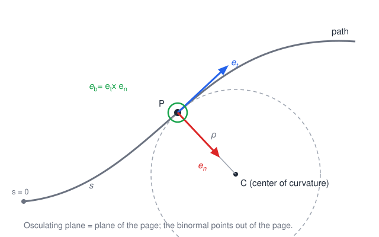
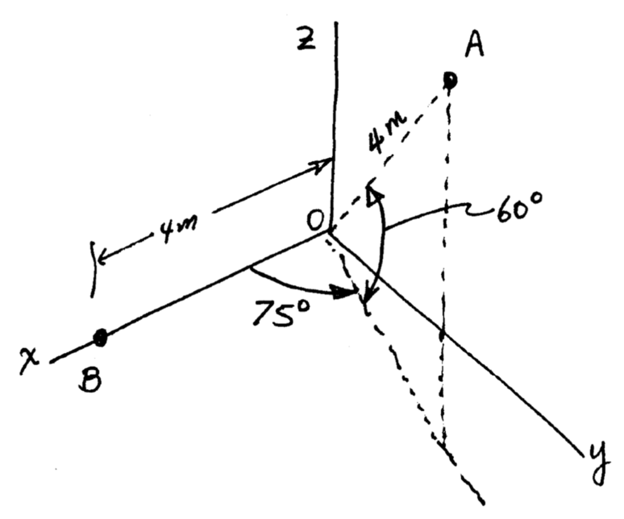
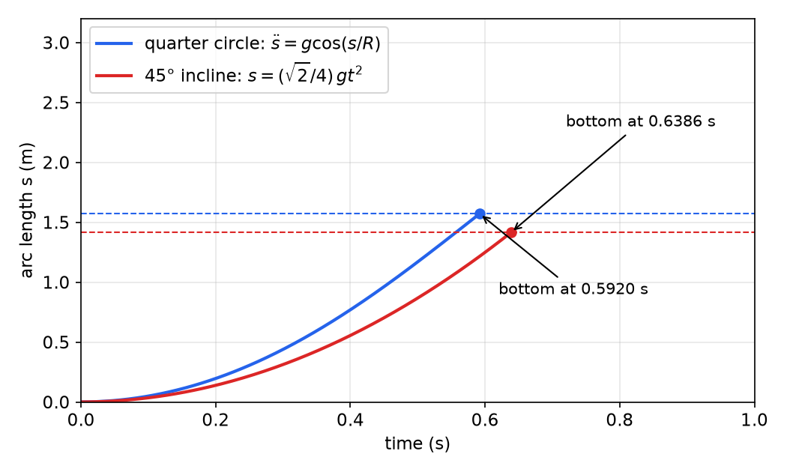
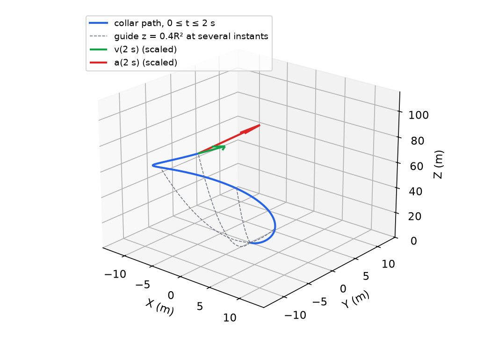
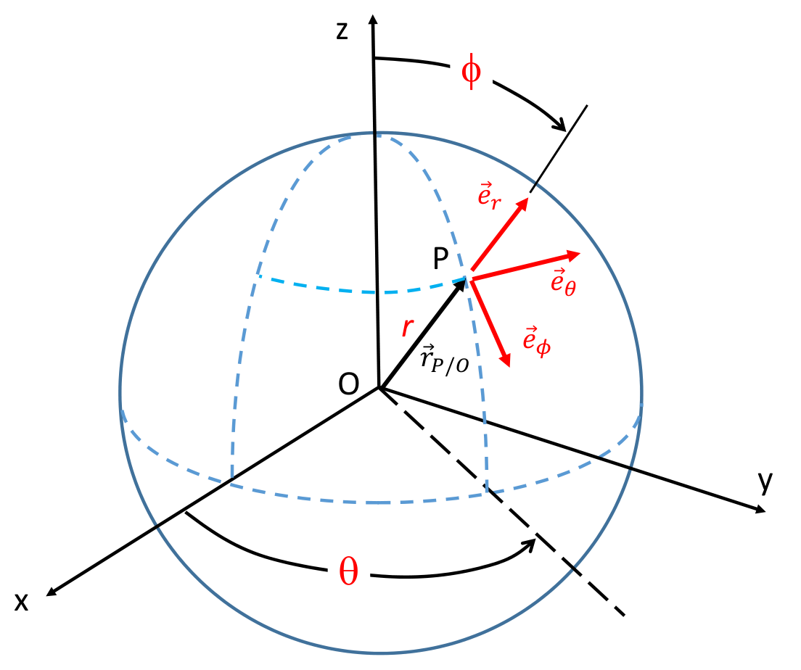
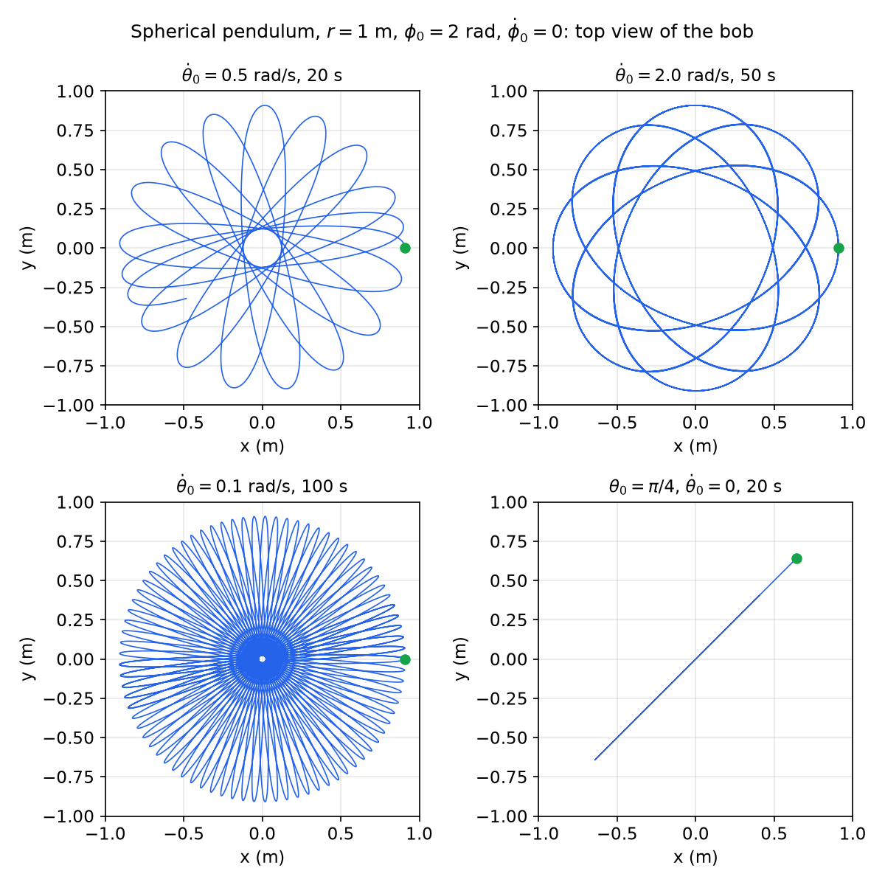
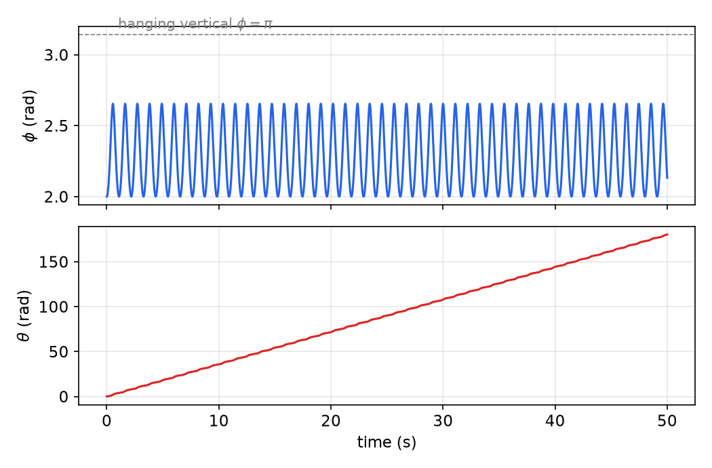

# Particle Kinematics

Every dynamics problem starts by writing the acceleration of each mass point in a form that can be set equal to force over mass. The difficulty is never the definition \\(\bar a = d\bar v/dt\\) but choosing a description of position whose time derivatives are easy to compute and whose components line up with the forces and constraints. This chapter develops the three standard descriptions of a moving point, path (intrinsic) variables, Cartesian coordinates and curvilinear (cylindrical, polar, spherical) coordinates, with full derivations of velocity and acceleration, shows how to mix descriptions when a point is constrained by two different mechanisms, and closes the loop to dynamics by integrating the resulting equations of motion numerically. The rotating unit vectors that appear here are the first instance of the moving-frame calculus developed in [Rotating Frames and Relative Motion](relative-motion.md).

Notation for the whole subsection: vectors carry an overbar (\\(\bar r, \bar v, \bar\omega\\)), unit vectors are \\(\bar e\\) with a subscript or \\(\bar i, \bar j, \bar k\\) (capitals \\(\bar I, \bar J, \bar K\\) for a fixed frame when both appear), \\(\bar r\_{P/O}\\) is the position of \\(P\\) relative to \\(O\\), and a dot is a time derivative taken by an observer fixed in the inertial (Newtonian) frame unless stated otherwise.

## Position, Velocity and Acceleration

Let \\(O\\) be a point fixed in an inertial reference frame and \\(P\\) a moving point. Its **position** is \\(\bar r\_{P/O}(t)\\), its **velocity** and **acceleration** are
\\[
\bar v\_P = \frac{d\bar r\_{P/O}}{dt}, \qquad \bar a\_P = \frac{d\bar v\_P}{dt} = \frac{d^2\bar r\_{P/O}}{dt^2}.
\\]
Velocity and acceleration do not depend on which fixed point \\(O\\) is used, because two fixed points differ by a constant vector.

Any description writes \\(\bar r\\) as components times unit vectors, \\(\bar r = \sum\_k q\_k\\,\bar e\_k\\). Differentiating with the product rule,
\\[
\dot{\bar r} = \sum\_k \dot q\_k\\,\bar e\_k + \sum\_k q\_k\\,\dot{\bar e}\_k .
\\]
The first sum is what one would naively write. The second sum exists whenever the unit vectors change direction as the point moves. Every description in this chapter is organized around computing those \\(\dot{\bar e}\_k\\). A unit vector has constant length, so \\(\bar e\cdot\bar e = 1\\) gives \\(2\bar e\cdot\dot{\bar e} = 0\\): **the derivative of a unit vector is always perpendicular to it.** A unit vector that turns at rate \\(\dot\beta\\) in a fixed plane has \\(\lVert\dot{\bar e}\rVert = \lvert\dot\beta\rvert\\), directed toward increasing \\(\beta\\).

## Path Variables (Intrinsic Coordinates)

When the path of the point is known (a track, a groove, a guide bar), the most natural coordinate is the **arc length** \\(s\\) measured along the path from a reference point. The geometry of the path is then described by a moving triad of unit vectors attached to the point.



*Figure: the path-variable triad at P. The tangent \\(\bar e\_t\\) points along the direction of travel, the normal \\(\bar e\_n\\) points toward the center of curvature C, and the binormal \\(\bar e\_b\\) completes the right-handed set. The dashed circle of radius \\(\rho\\) is the osculating circle, the circle that best fits the path at P.*

### Tangent, normal and binormal

**Definition (tangent).** For a path \\(\bar r(s)\\) parametrized by arc length,
\\[
\bar e\_t = \frac{d\bar r}{ds}.
\\]
It is a unit vector because \\(\lVert d\bar r\rVert = ds\\) for arc length.

**Definition (curvature and normal).** Since \\(\bar e\_t\\) has unit length, \\(d\bar e\_t/ds\\) is perpendicular to \\(\bar e\_t\\). Its magnitude is the **curvature** \\(\kappa\\), the rate at which the tangent turns per unit length, and its direction defines the **principal normal** \\(\bar e\_n\\):
\\[
\frac{d\bar e\_t}{ds} = \kappa\\,\bar e\_n = \frac{1}{\rho}\\,\bar e\_n ,
\\]
where \\(\rho = 1/\kappa\\) is the **radius of curvature**. Geometrically, if the tangent turns through a small angle \\(d\beta\\) while the point moves \\(ds\\), then \\(\lVert d\bar e\_t\rVert = d\beta\\) and \\(ds = \rho\\,d\beta\\), so \\(\rho\\) is the radius of the circle locally traced. The **center of curvature** is
\\[
\bar r\_{C/O} = \bar r\_{P/O} + \rho\\,\bar e\_n .
\\]

**Definition (binormal).** \\(\bar e\_b = \bar e\_t\times\bar e\_n\\). The plane of \\(\bar e\_t\\) and \\(\bar e\_n\\) is the **osculating plane**; for a planar path it is the plane of the path and \\(\bar e\_b\\) is constant.

**Theorem (Frenet–Serret formulas).** For a smooth path with \\(\kappa\neq0\\),
\\[
\frac{d\bar e\_t}{ds} = \kappa\\,\bar e\_n, \qquad
\frac{d\bar e\_n}{ds} = -\kappa\\,\bar e\_t + \tau\\,\bar e\_b, \qquad
\frac{d\bar e\_b}{ds} = -\tau\\,\bar e\_n ,
\\]
where \\(\tau\\) is the **torsion**, the rate at which the osculating plane twists about the tangent.

*Proof sketch.* The first is the definition. Differentiate \\(\bar e\_b\cdot\bar e\_b=1\\) and \\(\bar e\_b\cdot\bar e\_t = 0\\): the first gives \\(d\bar e\_b/ds\perp\bar e\_b\\); the second gives \\((d\bar e\_b/ds)\cdot\bar e\_t = -\bar e\_b\cdot\kappa\bar e\_n = 0\\). So \\(d\bar e\_b/ds\\) is along \\(\bar e\_n\\); call its coefficient \\(-\tau\\). Finally \\(\bar e\_n = \bar e\_b\times\bar e\_t\\), and differentiating with the two known derivatives gives the middle formula. \\(\square\\)

### Velocity and acceleration

With \\(\bar r = \bar r(s(t))\\), the chain rule gives
\\[
\bar v = \frac{d\bar r}{ds}\\,\dot s = \dot s\\,\bar e\_t, \qquad v = \dot s .
\\]
The velocity is always tangent to the path and \\(\dot s\\) is the speed (with sign, relative to the direction of increasing \\(s\\)). Differentiating again,
\\[
\bar a = \ddot s\\,\bar e\_t + \dot s\\,\frac{d\bar e\_t}{dt} = \ddot s\\,\bar e\_t + \dot s\\,\frac{d\bar e\_t}{ds}\\,\dot s,
\\]
so
\\[
\boxed{\bar v = v\\,\bar e\_t, \qquad \bar a = \dot v\\,\bar e\_t + \frac{v^2}{\rho}\\,\bar e\_n .}
\\]
The tangential component \\(\dot v\\) changes the speed; the normal component \\(v^2/\rho\\) changes the direction of travel and always points toward the center of curvature. **There is no binormal component of acceleration**: the acceleration lies in the osculating plane. That fact is what makes the triad useful in kinetics, because a force component along \\(\bar e\_b\\) must be balanced by other forces.

### Recipe: radius of curvature from velocity and acceleration

When \\(\bar v\\) and \\(\bar a\\) are known in some other basis (for example from cylindrical coordinates), the path quantities follow by vector algebra:

1. \\(\bar e\_t = \bar v/\lVert\bar v\rVert\\).
2. \\(\dot v = \bar a\cdot\bar e\_t\\) (projection onto the tangent).
3. The remainder \\(\bar a\_n = \bar a - \dot v\\,\bar e\_t\\) equals \\((v^2/\rho)\bar e\_n\\). Its magnitude gives \\(\rho = v^2/\lVert\bar a\_n\rVert\\) and its direction gives \\(\bar e\_n = \bar a\_n/\lVert\bar a\_n\rVert\\).
4. \\(\bar e\_b = \bar e\_t\times\bar e\_n\\).

An equivalent closed form follows from \\(\bar v\times\bar a = v\bar e\_t\times\left(\dot v\bar e\_t + (v^2/\rho)\bar e\_n\right) = (v^3/\rho)\\,\bar e\_b\\):
\\[
\rho = \frac{\lVert\bar v\rVert^3}{\lVert\bar v\times\bar a\rVert}, \qquad \bar e\_b = \frac{\bar v\times\bar a}{\lVert\bar v\times\bar a\rVert}.
\\]

**Example 2.1 (Particle with given velocity and acceleration directions).** A fixed \\(xyz\\) frame has origin \\(O\\). Point \\(B\\) lies on the \\(x\\) axis 4 m from \\(O\\). Point \\(A\\) is 4 m from \\(O\\); line \\(OA\\) is elevated \\(60^\circ\\) above the \\(xy\\) plane and its projection onto that plane makes \\(75^\circ\\) with the \\(x\\) axis. A 5 kg particle at \\(A\\) has velocity 500 m/s directed from \\(A\\) toward \\(B\\) and acceleration \\(10g\\) directed from \\(A\\) toward \\(O\\). Find \\(\ddot s\\), the radius of curvature \\(\rho\\), the center of curvature, and the force acting on the particle at this instant.



*Figure: geometry of Example 2.1. The velocity points along AB, the acceleration along AO; neither the path nor its curvature is given, yet both follow from these two directions.*

*Positions.*
\\[
\bar r\_{A/O} = 4\cos60^\circ(\cos75^\circ\\,\bar i + \sin75^\circ\\,\bar j) + 4\sin60^\circ\\,\bar k = 0.5176\\,\bar i + 1.9319\\,\bar j + 3.4641\\,\bar k\ \text{m},
\\]
\\[
\bar r\_{B/O} = 4\\,\bar i, \qquad \bar r\_{B/A} = \bar r\_{B/O} - \bar r\_{A/O} = 3.4824\\,\bar i - 1.9319\\,\bar j - 3.4641\\,\bar k\ \text{m}.
\\]

*Tangent.* The velocity is along \\(AB\\), so
\\[
\bar e\_t = \frac{\bar r\_{B/A}}{\lVert\bar r\_{B/A}\rVert} = 0.6598\\,\bar i - 0.3660\\,\bar j - 0.6563\\,\bar k .
\\]

*Tangential acceleration.* With \\(\bar e\_{O/A} = -\bar r\_{A/O}/4 = -0.1294\\,\bar i - 0.4830\\,\bar j - 0.8660\\,\bar k\\) and \\(\bar a = 98.07\\,\bar e\_{O/A} = -12.691\\,\bar i - 47.364\\,\bar j - 84.931\\,\bar k\\) m/s²,
\\[
\ddot s = \dot v = \bar a\cdot\bar e\_t = 64.70\ \text{m/s}^2 .
\\]

*Normal part and radius of curvature.*
\\[
\frac{v^2}{\rho}\bar e\_n = \bar a - \dot v\\,\bar e\_t = -55.381\\,\bar i - 23.682\\,\bar j - 42.466\\,\bar k\ \text{m/s}^2, \qquad \frac{v^2}{\rho} = 73.70\ \text{m/s}^2,
\\]
\\[
\rho = \frac{500^2}{73.70} = 3392\ \text{m}, \qquad \bar e\_n = -0.7515\\,\bar i - 0.3213\\,\bar j - 0.5762\\,\bar k .
\\]
The closed form \\(\rho = v^3/\lVert\bar v\times\bar a\rVert\\) gives the same 3392 m.

*Center of curvature.*
\\[
\bar r\_{C/O} = \bar r\_{A/O} + \rho\\,\bar e\_n = -2549\\,\bar i - 1088\\,\bar j - 1951\\,\bar k\ \text{m}.
\\]

*Forces.* The binormal is \\(\bar e\_b = \bar e\_t\times\bar e\_n = 0.8734\\,\bar j - 0.4871\\,\bar k\\). Write the unknown applied force in the path triad and include gravity:
\\[
-mg\\,\bar k + F\_t\\,\bar e\_t + F\_n\\,\bar e\_n + F\_b\\,\bar e\_b = m\left(\dot v\\,\bar e\_t + \frac{v^2}{\rho}\bar e\_n\right).
\\]
Dot with each unit vector, using \\(\bar k\cdot\bar e\_t = -0.6563\\), \\(\bar k\cdot\bar e\_n = -0.5762\\), \\(\bar k\cdot\bar e\_b = -0.4871\\) and \\(mg = 5(9.807) = 49.035\\) N:
\\[
F\_t = 5(64.70) - 49.035(0.6563) = 291.3\ \text{N}, \quad
F\_n = 5(73.70) - 49.035(0.5762) = 340.2\ \text{N}, \quad
F\_b = -49.035(0.4871) = -23.9\ \text{N}.
\\]
The binormal force is nonzero only because gravity has a binormal component that must be cancelled. The whole analysis is vector algebra, which is why it maps directly onto a few lines of MATLAB:

```matlab
r_AO = 4*[cosd(60)*cosd(75) cosd(60)*sind(75) sind(60)];
r_BA = [4 0 0] - r_AO;
et   = r_BA/norm(r_BA);                 % tangent
a    = 98.07*(-r_AO/norm(r_AO));        % 10 g toward O
vdot = dot(a,et)                        % 64.7036
an   = a - vdot*et;
rho  = 500^2/norm(an)                   % 3.3923e+03
en   = an/norm(an);  eb = cross(et,en);
r_CO = r_AO + rho*en                    % 1.0e+03*[-2.5487 -1.0882 -1.9512]
syms Ft Fn Fb
sol = solve(-5*9.807*[0 0 1] + Ft*et + Fn*en + Fb*eb - 5*a, Ft, Fn, Fb);
double([sol.Ft sol.Fn sol.Fb])          % 291.3356  340.2275  -23.8829
```

### Equation of motion along a known path

For a particle confined to a smooth path, projecting \\(\sum\bar F = m\bar a\\) onto \\(\bar e\_t\\) eliminates the normal and binormal reaction forces, leaving one scalar differential equation for \\(s(t)\\):
\\[
m\ddot s = \sum\bar F\cdot\bar e\_t .
\\]
The normal and binormal projections then give the reactions, \\(m v^2/\rho = \sum\bar F\cdot\bar e\_n\\) and \\(0 = \sum\bar F\cdot\bar e\_b\\).

**Example 2.2 (Straight incline versus circular arc).** A small mass is released from rest and descends a height \\(h = 1\\) m on a frictionless surface, either down a straight \\(45^\circ\\) incline or along a quarter circle of radius \\(R = h\\) that starts with a vertical tangent and ends horizontal. Which reaches the bottom first?

*Straight incline.* \\(\sum F\_t = mg\sin45^\circ = m\ddot s\\), so \\(s = \tfrac{\sqrt2}{4}gt^2\\). The length is \\(\sqrt2\\,h\\), reached at \\(t = \sqrt{4h/g} = 0.6386\\) s.

*Quarter circle.* Let \\(\theta\\) be the angle of the radius to the particle measured from the horizontal through the center, so \\(s = R\theta\\) and the tangent makes angle \\(\theta\\) with the vertical. Then \\(\sum F\_t = mg\cos\theta = m\ddot s\\):
\\[
\ddot s = g\cos\frac{s}{R}.
\\]
This nonlinear equation has no elementary solution for \\(s(t)\\) and is integrated numerically below. The bottom (\\(s = \pi R/2\\)) is reached at \\(t = 0.5920\\) s, about 7.3% sooner than on the incline, even though the arc is 11% longer: the steep start gains speed early. The fastest curve of all is the cycloid, the solution of the brachistochrone problem.

### State-space form and numerical integration

Standard integrators (MATLAB `ode45`, SciPy `solve_ivp`) solve first-order systems \\(\dot{\bar x} = \bar f(t,\bar x)\\), \\(\bar x(t\_0) = \bar x\_0\\). A second-order equation is put in this form by taking the coordinates and their rates as **states**. For the arc, \\(x\_1 = s\\), \\(x\_2 = \dot s\\):
\\[
\dot x\_1 = x\_2, \qquad \dot x\_2 = g\cos(x\_1/R).
\\]
For the simple pendulum \\(\ddot\theta + (g/L)\sin\theta = 0\\), \\(x\_1 = \theta\\), \\(x\_2 = \dot\theta\\) gives \\(\dot x\_1 = x\_2\\), \\(\dot x\_2 = -(g/L)\sin x\_1\\). With \\(L = 1\\) m, \\(\theta(0) = 1\\) rad and \\(\dot\theta(0) = -0.5\\) rad/s the angle oscillates between about \\(\pm1.0\\) rad with period about 2.1 s, longer than the small-angle value \\(2\pi\sqrt{L/g} = 2.006\\) s because of the large amplitude.

```matlab
R = 1; g = 9.81;
fnc = @(t,x) [x(2); g*cos(x(1)/R)];
options = odeset('reltol',1e-7,'abstol',1e-7,'maxstep',1/100);
[T,X] = ode45(fnc,[0 1],[0; 0],options);
plot(T,X(:,1),T,(pi/2)*ones(size(T)),'r--'); xlabel('Time (s)'); ylabel('Arclength (m)')
```

The Python equivalent uses an *event* to stop exactly when the bottom is reached:

```python
import numpy as np
from scipy.integrate import solve_ivp

g, R = 9.81, 1.0
bottom = lambda t, x: x[0] - np.pi*R/2      # event function: zero at the bottom
bottom.terminal = True
sol = solve_ivp(lambda t, x: [x[1], g*np.cos(x[0]/R)], [0, 2], [0, 0],
                rtol=1e-10, atol=1e-10, events=bottom)
print(sol.t_events[0][0], np.sqrt(4/g))      # 0.59196  0.63855
```

Tolerances matter: the defaults of both `ode45` and `solve_ivp` (relative tolerance \\(10^{-3}\\)) are too loose for long simulations of conservative systems. Tightening `reltol`/`abstol` (or `rtol`/`atol`) to \\(10^{-7}\\) or smaller and limiting the step size is the first thing to do when results look suspicious; see Numerical ODEs for the methods behind these solvers.



*Figure: arc length versus time for Example 2.2. Each curve stops at its bottom (dashed level). The circular path covers a longer distance (\\(\pi/2\\) m versus \\(\sqrt2\\) m) yet arrives first, at 0.5920 s against 0.6386 s.*

## Cartesian Coordinates

With fixed unit vectors \\(\bar i, \bar j, \bar k\\),
\\[
\bar r = x\\,\bar i + y\\,\bar j + z\\,\bar k, \qquad \bar v = \dot x\\,\bar i + \dot y\\,\bar j + \dot z\\,\bar k, \qquad \bar a = \ddot x\\,\bar i + \ddot y\\,\bar j + \ddot z\\,\bar k .
\\]
No unit-vector derivatives appear, which is why Cartesian components are the default for numerical work and the final form into which other descriptions are often converted. They are inconvenient when constraints or forces are naturally radial or angular, because the constraint equations become nonlinear in \\(x, y, z\\). Projectile motion (see Kinematics) is the classic case where Cartesian coordinates are ideal.

## Cylindrical and Polar Coordinates

### Unit vectors and their rates

Cylindrical coordinates \\((R, \theta, z)\\) locate \\(P\\) by its distance \\(R\\) from the \\(z\\) axis, the azimuth \\(\theta\\) of the vertical plane containing \\(P\\), and its height \\(z\\). The unit vectors are
\\[
\bar e\_R = \cos\theta\\,\bar i + \sin\theta\\,\bar j, \qquad \bar e\_\theta = -\sin\theta\\,\bar i + \cos\theta\\,\bar j, \qquad \bar k .
\\]
Only \\(\theta\\) changes their directions. Differentiating,
\\[
\dot{\bar e}\_R = \dot\theta(-\sin\theta\\,\bar i + \cos\theta\\,\bar j) = \dot\theta\\,\bar e\_\theta, \qquad
\dot{\bar e}\_\theta = \dot\theta(-\cos\theta\\,\bar i - \sin\theta\\,\bar j) = -\dot\theta\\,\bar e\_R, \qquad \dot{\bar k} = \bar 0 .
\\]
Both results follow the rule stated at the start: each unit vector turns at rate \\(\dot\theta\\) in the horizontal plane, so its derivative has magnitude \\(\dot\theta\\) and points in the direction of increasing \\(\theta\\). Equivalently, the triad rotates with angular velocity \\(\dot\theta\\,\bar k\\) and \\(\dot{\bar e} = \dot\theta\bar k\times\bar e\\) for each member, a rule generalized in [Rotating Frames and Relative Motion](relative-motion.md).

### Velocity and acceleration

The position is \\(\bar r = R\\,\bar e\_R + z\\,\bar k\\). Then
\\[
\bar v = \dot R\\,\bar e\_R + R\\,\dot{\bar e}\_R + \dot z\\,\bar k = \dot R\\,\bar e\_R + R\dot\theta\\,\bar e\_\theta + \dot z\\,\bar k .
\\]
Differentiate once more term by term:
\\[
\bar a = \ddot R\\,\bar e\_R + \dot R\dot\theta\\,\bar e\_\theta + (\dot R\dot\theta + R\ddot\theta)\\,\bar e\_\theta + R\dot\theta(-\dot\theta\\,\bar e\_R) + \ddot z\\,\bar k ,
\\]
\\[
\boxed{\bar a = (\ddot R - R\dot\theta^2)\\,\bar e\_R + (R\ddot\theta + 2\dot R\dot\theta)\\,\bar e\_\theta + \ddot z\\,\bar k .}
\\]
**Polar coordinates** are the special case \\(z = \text{const}\\). The terms have names that recur throughout the subsection: \\(-R\dot\theta^2\\) is the **centripetal** acceleration, \\(R\ddot\theta\\) the tangential (angular-acceleration) term, and \\(2\dot R\dot\theta\\) the **Coriolis** term, which arises because radial motion in a turning direction changes both the length and the direction of the transverse velocity \\(R\dot\theta\bar e\_\theta\\). The transverse component can also be written \\(\frac{1}{R}\frac{d}{dt}(R^2\dot\theta)\\); it vanishes for central forces, which is the conservation of angular momentum about the axis.

**Example 2.3 (Collar on a parabolic guide in a rotating plane).** A collar slides on a guide \\(z = 0.4x^2\\) fixed in a vertical plane that rotates about the vertical \\(z\\) axis at constant \\(\Omega = 2.5\\) rad/s. The collar's distance from the axis increases at the constant rate \\(\dot x = 8\\) m/s, starting at the origin at \\(t = 0\\). Find the velocity as a function of time, the velocity, speed and acceleration at \\(t = 2\\) s, and the radius of curvature of the three-dimensional path at that instant.

*Velocity.* The guide plane contains the axis, so the in-plane coordinate \\(x\\) is the cylindrical \\(R\\): \\(R = vt\\) with \\(v = 8\\) m/s, \\(\dot R = v\\), \\(\ddot R = 0\\), \\(\dot\theta = \Omega\\), \\(\ddot\theta = 0\\). The guide gives \\(z = 0.4R^2\\), \\(\dot z = 0.8R\dot R = 0.8v^2t\\) and \\(\ddot z = 0.8\dot R^2 = 0.8v^2\\). Therefore
\\[
\bar v = v\\,\bar e\_R + vt\Omega\\,\bar e\_\theta + 0.8v^2t\\,\bar k .
\\]
At \\(t = 2\\) s: \\(\bar v = 8\\,\bar e\_R + 40\\,\bar e\_\theta + 102.4\\,\bar k\\) m/s and the speed is \\(\dot s = (8^2 + 40^2 + 102.4^2)^{1/2} = 110.23\\) m/s.

*Acceleration.*
\\[
\bar a = -vt\Omega^2\\,\bar e\_R + 2v\Omega\\,\bar e\_\theta + 0.8v^2\\,\bar k, \qquad \bar a(2) = -100\\,\bar e\_R + 40\\,\bar e\_\theta + 51.2\\,\bar k\ \text{m/s}^2,
\\]
with magnitude 119.25 m/s². The \\(\bar e\_\theta\\) component is pure Coriolis acceleration: the collar moves outward while the plane turns.

*Radius of curvature.* Apply the recipe: \\(\bar e\_t = \bar v/\dot s = 0.0726\\,\bar e\_R + 0.3629\\,\bar e\_\theta + 0.9290\\,\bar k\\); \\(\ddot s = \bar a\cdot\bar e\_t = 54.82\\) m/s²; \\(\bar a - \ddot s\bar e\_t = -103.98\\,\bar e\_R + 20.11\\,\bar e\_\theta + 0.27\\,\bar k\\) m/s², whose magnitude 105.91 m/s² equals \\(\dot s^2/\rho\\). Hence
\\[
\rho = \frac{110.23^2}{105.91} = 114.72\ \text{m}.
\\]
The recipe works in any orthonormal basis, here the instantaneous cylindrical one.



*Figure: path of the collar in Example 2.3 (blue), traced as the parabolic guide (dashed, shown at several instants) sweeps around the vertical axis. At \\(t = 2\\) s the velocity (green) and acceleration (red) are drawn to a common reduced scale; the angle between them is what produces the 114.7 m radius of curvature.*

**Example 2.4 (Collar on a circular guide pulled by a cable).** A cable passes through a hole \\(A\\) and is pulled in at the constant rate 25 m/s, drawing a 0.2 kg collar along a circular guide of radius 0.8 m in a vertical plane. The hole is 1.2 m above the horizontal diameter. At the instant considered the collar is at the right end of that diameter. Find the speed and rate of change of speed, and, with kinetic friction coefficient \\(\mu = 0.4\\), the cable tension. Is the motion possible?

*Geometry.* Use polar coordinates centered at the hole: \\(R\\) is the cable length from \\(A\\) to the collar, \\(\phi\\) the angle of the cable from the vertical. With the collar 0.8 m horizontally and 1.2 m vertically from the hole, \\(R = \sqrt{1.2^2 + 0.8^2} = 1.4422\\) m and \\(\phi = \tan^{-1}(0.8/1.2) = 33.69^\circ\\). At this point of the circle the path tangent \\(\bar e\_t\\) is vertical (upward) and \\(\bar e\_n\\) is horizontal toward the circle's center.

*Velocity.* Equate the path and polar descriptions, \\(v\\,\bar e\_t = \dot R\\,\bar e\_R + R\dot\phi\\,\bar e\_\phi\\), and project. The angle between \\(\bar e\_t\\) (up) and \\(\bar e\_R\\) (from the hole down to the collar) is \\(\pi - \phi\\), and between \\(\bar e\_t\\) and \\(\bar e\_\phi\\) is \\(\pi/2 - \phi\\):
\\[
\dot R = -v\cos\phi, \qquad R\dot\phi = v\sin\phi .
\\]
The cable is pulled in, \\(\dot R = -25\\) m/s, so \\(v = 25/\cos\phi = 30.05\\) m/s and \\(\dot\phi = v\sin\phi/R = 11.556\\) rad/s.

*Acceleration.* Now \\(\dot v\\,\bar e\_t + (v^2/\rho)\bar e\_n = (\ddot R - R\dot\phi^2)\bar e\_R + (R\ddot\phi + 2\dot R\dot\phi)\bar e\_\phi\\) with \\(\ddot R = 0\\), \\(\rho = 0.8\\) m. Projecting onto \\(\bar e\_R\\) and \\(\bar e\_\phi\\):
\\[
-R\dot\phi^2 = -\dot v\cos\phi - \frac{v^2}{\rho}\sin\phi, \qquad R\ddot\phi + 2\dot R\dot\phi = \dot v\sin\phi - \frac{v^2}{\rho}\cos\phi ,
\\]
giving \\(\dot v = -520.8\\) m/s² and \\(\ddot\phi = -450.7\\) rad/s². The collar decelerates violently even though the cable speed is constant.

*Forces.* Tension \\(T\\) acts along the cable toward the hole, the guide exerts a normal force \\(N\\) (assumed toward the center) and friction \\(\mu N\\) opposing the upward sliding, and gravity acts down:
\\[
T\cos\phi - mg - \mu N = m\dot v, \qquad T\sin\phi + N = m\frac{v^2}{\rho}.
\\]
Solving: \\(N = 232.0\\) N, consistent with its assumed direction, but \\(T = -11.3\\) N. A cable cannot push, so **the specified motion is impossible**: the cable would go slack and the collar would not follow the prescribed rate. Without friction the tension is even more negative (\\(T = -122.8\\) N). Checking the sign of every unilateral constraint force (cable tension, contact normal force, friction within \\(\mu N\\)) is an essential last step of any kinetics problem.

## Spherical Coordinates

### Definitions

Spherical coordinates \\((r, \phi, \theta)\\) locate \\(P\\) by its distance \\(r\\) from \\(O\\), the **polar (zenith) angle** \\(\phi\\) measured from the \\(+z\\) axis down to \\(OP\\), and the **azimuthal angle** \\(\theta\\) measured in the \\(xy\\) plane from the \\(x\\) axis to the projection of \\(OP\\).



*Figure: spherical coordinates. \\(\bar e\_r\\) points outward along \\(OP\\), \\(\bar e\_\phi\\) is tangent to the meridian (toward increasing \\(\phi\\), i.e. downward), and \\(\bar e\_\theta\\) is tangent to the parallel (horizontal).*

The unit vectors in Cartesian components are
\\[
\bar e\_r = \sin\phi\cos\theta\\,\bar i + \sin\phi\sin\theta\\,\bar j + \cos\phi\\,\bar k,
\\]
\\[
\bar e\_\phi = \cos\phi\cos\theta\\,\bar i + \cos\phi\sin\theta\\,\bar j - \sin\phi\\,\bar k, \qquad
\bar e\_\theta = -\sin\theta\\,\bar i + \cos\theta\\,\bar j .
\\]
They form a right-handed triad in the order \\((\bar e\_r, \bar e\_\phi, \bar e\_\theta)\\): \\(\bar e\_r\times\bar e\_\phi = \bar e\_\theta\\). Two relations are used repeatedly:
\\[
\bar k = \cos\phi\\,\bar e\_r - \sin\phi\\,\bar e\_\phi, \qquad \cos\theta\\,\bar i + \sin\theta\\,\bar j = \sin\phi\\,\bar e\_r + \cos\phi\\,\bar e\_\phi .
\\]

### Unit-vector rates

Each unit vector depends on \\(\phi\\) and \\(\theta\\), so \\(\dot{\bar e} = (\partial\bar e/\partial\phi)\dot\phi + (\partial\bar e/\partial\theta)\dot\theta\\). From the component forms,
\\[
\frac{\partial\bar e\_r}{\partial\phi} = \bar e\_\phi, \quad \frac{\partial\bar e\_r}{\partial\theta} = \sin\phi\\,\bar e\_\theta, \quad
\frac{\partial\bar e\_\phi}{\partial\phi} = -\bar e\_r, \quad \frac{\partial\bar e\_\phi}{\partial\theta} = \cos\phi\\,\bar e\_\theta, \quad
\frac{\partial\bar e\_\theta}{\partial\phi} = \bar 0, \quad \frac{\partial\bar e\_\theta}{\partial\theta} = -(\cos\theta\\,\bar i + \sin\theta\\,\bar j).
\\]
Hence
\\[
\dot{\bar e}\_r = \dot\phi\\,\bar e\_\phi + \dot\theta\sin\phi\\,\bar e\_\theta, \qquad
\dot{\bar e}\_\phi = -\dot\phi\\,\bar e\_r + \dot\theta\cos\phi\\,\bar e\_\theta, \qquad
\dot{\bar e}\_\theta = -\dot\theta\sin\phi\\,\bar e\_r - \dot\theta\cos\phi\\,\bar e\_\phi .
\\]
A compact check: the triad rotates with angular velocity \\(\bar\omega = \dot\theta\\,\bar k + \dot\phi\\,\bar e\_\theta\\) (the azimuth turns the meridian plane about \\(z\\); the polar angle turns \\(OP\\) within that plane about \\(\bar e\_\theta\\)), and each rate above equals \\(\bar\omega\times\bar e\\). For instance \\(\bar\omega\times\bar e\_r = \dot\theta(\cos\phi\bar e\_r - \sin\phi\bar e\_\phi)\times\bar e\_r + \dot\phi\\,\bar e\_\theta\times\bar e\_r = \dot\theta\sin\phi\\,\bar e\_\theta + \dot\phi\\,\bar e\_\phi\\).

### Velocity and acceleration

With \\(\bar r = r\\,\bar e\_r\\),
\\[
\bar v = \dot r\\,\bar e\_r + r\\,\dot{\bar e}\_r = \dot r\\,\bar e\_r + r\dot\phi\\,\bar e\_\phi + r\dot\theta\sin\phi\\,\bar e\_\theta .
\\]
Differentiate the three terms:
\\[
\frac{d}{dt}(\dot r\\,\bar e\_r) = \ddot r\\,\bar e\_r + \dot r\dot\phi\\,\bar e\_\phi + \dot r\dot\theta\sin\phi\\,\bar e\_\theta,
\\]
\\[
\frac{d}{dt}(r\dot\phi\\,\bar e\_\phi) = (\dot r\dot\phi + r\ddot\phi)\\,\bar e\_\phi - r\dot\phi^2\\,\bar e\_r + r\dot\phi\dot\theta\cos\phi\\,\bar e\_\theta,
\\]
\\[
\frac{d}{dt}(r\dot\theta\sin\phi\\,\bar e\_\theta) = (\dot r\dot\theta\sin\phi + r\ddot\theta\sin\phi + r\dot\theta\dot\phi\cos\phi)\\,\bar e\_\theta - r\dot\theta^2\sin^2\phi\\,\bar e\_r - r\dot\theta^2\sin\phi\cos\phi\\,\bar e\_\phi .
\\]
Collecting components:
\\[
\boxed{\begin{aligned}
a\_r &= \ddot r - r\dot\phi^2 - r\dot\theta^2\sin^2\phi,\\\\
a\_\phi &= r\ddot\phi + 2\dot r\dot\phi - r\dot\theta^2\sin\phi\cos\phi,\\\\
a\_\theta &= r\ddot\theta\sin\phi + 2\dot r\dot\theta\sin\phi + 2r\dot\phi\dot\theta\cos\phi .
\end{aligned}}
\\]
The structure parallels the cylindrical result: centripetal terms \\(-r\dot\phi^2\\) and \\(-r\dot\theta^2\sin^2\phi\\) (the latter is \\(-(r\sin\phi)\dot\theta^2\\), the centripetal acceleration about the \\(z\\) axis at radius \\(r\sin\phi\\), resolved onto \\(\bar e\_r\\)), Coriolis terms \\(2\dot r\dot\phi\\), \\(2\dot r\dot\theta\sin\phi\\) and \\(2r\dot\phi\dot\theta\cos\phi\\), and the tangential terms \\(r\ddot\phi\\), \\(r\ddot\theta\sin\phi\\). As in the cylindrical case, \\(a\_\theta = \frac{1}{r\sin\phi}\frac{d}{dt}\left(r^2\sin^2\phi\\,\dot\theta\right)\\).

**Example 2.5 (Shell in a rotating, elevating barrel).** A gun barrel \\(OA\\) rotates about the vertical \\(z\\) axis at constant \\(\dot\theta = 20\\) rad/s while it is being elevated, so that the polar angle decreases at the constant rate \\(\dot\phi = -10\\) rad/s. A 5 kg shell is propelled along the frictionless barrel by a constant force of 2500 N. At the instant \\(\theta = 90^\circ\\), \\(\phi = 45^\circ\\), \\(r = 4\\) m, \\(\dot r = 100\\) m/s, find the side force from the barrel and the absolute acceleration.

*Kinematics.* With \\(\ddot\phi = \ddot\theta = 0\\),
\\[
a\_r = \ddot r - 4(100) - 4(400)(0.5) = \ddot r - 1200, \quad
a\_\phi = 2(100)(-10) - 4(400)(0.5) = -2800, \quad
a\_\theta = 2(100)(20)(0.7071) + 2(4)(-10)(20)(0.7071) = 1697.1 .
\\]

*Kinetics.* The barrel exerts the propelling force along \\(\bar e\_r\\) and frictionless side forces \\(F\_\phi, F\_\theta\\). Gravity is \\(-mg\\,\bar k = -mg(\cos\phi\\,\bar e\_r - \sin\phi\\,\bar e\_\phi)\\):
\\[
\bar e\_r:\ 2500 - mg\cos\phi = m(\ddot r - 1200), \qquad
\bar e\_\phi:\ F\_\phi + mg\sin\phi = -2800m, \qquad
\bar e\_\theta:\ F\_\theta = 1697.1m .
\\]
So \\(\ddot r = 1693.1\\) m/s², \\(F\_\phi = -14{,}035\\) N, \\(F\_\theta = 8485.3\\) N (side-force magnitude 16,401 N), and \\(\bar a = 493.1\\,\bar e\_r - 2800\\,\bar e\_\phi + 1697.1\\,\bar e\_\theta\\) m/s². The side forces are dominated by Coriolis terms. The same problem is solved with a moving reference frame in [Rotating Frames and Relative Motion](relative-motion.md), and the answers agree.

### The spherical pendulum

A bob of mass \\(m\\) hangs from a fixed point \\(O\\) on an inextensible cable of length \\(r\\) (a crane payload). With \\(\phi\\) measured from the **upward** vertical, the hanging equilibrium is \\(\phi = \pi\\). The cable tension \\(T\\) acts along \\(-\bar e\_r\\) and gravity along \\(-\bar k\\):
\\[
-T\\,\bar e\_r - mg\\,\bar k = m\bar a .
\\]
The tension is unknown, so project onto \\(\bar e\_\theta\\) and \\(\bar e\_\phi\\), both perpendicular to the cable. Using \\(\bar k\cdot\bar e\_\theta = 0\\), \\(\bar k\cdot\bar e\_\phi = -\sin\phi\\) and \\(\dot r = 0\\):
\\[
r\ddot\theta\sin\phi + 2r\dot\theta\dot\phi\cos\phi = 0, \qquad
r\ddot\phi - r\dot\theta^2\sin\phi\cos\phi - g\sin\phi = 0 .
\\]
Solved for the highest derivatives,
\\[
\ddot\theta = -\frac{2\dot\theta\dot\phi\cos\phi}{\sin\phi}, \qquad \ddot\phi = \dot\theta^2\sin\phi\cos\phi + \frac{g}{r}\sin\phi .
\\]
Three consequences are worth noting.

- The \\(\theta\\) equation is \\(\frac{d}{dt}(\sin^2\phi\\,\dot\theta) = 0\\): the angular momentum about the vertical, \\(m r^2\sin^2\phi\\,\dot\theta\\), is conserved because neither tension nor gravity has a moment about the \\(z\\) axis.
- The projection on \\(\bar e\_r\\) gives the tension once the motion is known: \\(T = m r(\dot\phi^2 + \dot\theta^2\sin^2\phi) - mg\cos\phi\\).
- Steady conical motion (\\(\dot\phi = 0\\), \\(\phi = \text{const}\\)) requires \\(\dot\theta^2\cos\phi = -g/r\\); with \\(\beta = \pi - \phi\\) the cone half-angle from the downward vertical, \\(\dot\theta^2 = g/(r\cos\beta)\\).

The equation for \\(\ddot\theta\\) is singular at \\(\sin\phi = 0\\), when the bob passes through the vertical. That is a **coordinate singularity** of spherical coordinates (the azimuth is undefined on the axis), not a physical one; the same issue reappears with Euler angles in [Rigid-Body Kinematics](rigid-body-kinematics.md).

**Simulation.** With the state \\(\bar y = [\phi, \theta, \dot\phi, \dot\theta]^T\\):

```matlab
r = 1;  y0 = [2; 0; 0; 0.5];                         % phi, theta, phidot, thetadot
options = odeset('reltol',1e-7,'abstol',1e-7);
fnc = @(t,y) [y(3); y(4);
              sin(y(1))*cos(y(1))*y(4)^2 + (9.81/r)*sin(y(1));
              -2*y(3)*y(4)/tan(y(1))];
[time,Y] = ode45(fnc,[0 20],y0,options);
X = r*sin(Y(:,1)).*cos(Y(:,2));  Yp = r*sin(Y(:,1)).*sin(Y(:,2));
plot(X,Yp); axis equal; xlabel('x'); ylabel('y')
```

```python
import numpy as np
from scipy.integrate import solve_ivp

g, r = 9.81, 1.0
def f(t, y):
    ph, th, phd, thd = y
    return [phd, thd,
            np.sin(ph)*np.cos(ph)*thd**2 + (g/r)*np.sin(ph),
            -2*phd*thd*np.cos(ph)/np.sin(ph)]

sol = solve_ivp(f, [0, 20], [2.0, 0.0, 0.0, 0.5], rtol=1e-9, atol=1e-9, max_step=0.01)
ph, th = sol.y[0], sol.y[1]
x, y = r*np.sin(ph)*np.cos(th), r*np.sin(ph)*np.sin(th)   # top view of the bob
```

The initial polar angle \\(\phi\_0 = 2\\) rad places the bob \\(65.4^\circ\\) from the downward vertical.



*Figure: top views \\((x, y) = r\sin\phi(\cos\theta, \sin\theta)\\) of the bob, all starting from \\(\phi\_0 = 2\\) rad, \\(\dot\phi\_0 = 0\\) (green dot). With \\(\dot\theta\_0 = 0.5\\) rad/s the bob traces a rosette of precessing loops that never pass through the center (conserved angular momentum about \\(z\\) keeps it off the axis). With \\(\dot\theta\_0 = 2\\) rad/s the orbit is a few slowly precessing ellipses, nearly closed. With \\(\dot\theta\_0 = 0.1\\) rad/s the motion is almost planar and precesses slowly. With no azimuthal rate (\\(\theta\_0 = \pi/4\\), \\(\dot\theta\_0 = 0\\)) the motion is exactly planar: a simple pendulum swinging along a line at \\(45^\circ\\).*



*Figure: \\(\phi(t)\\) and \\(\theta(t)\\) over 50 s for \\(\dot\theta\_0 = 2\\) rad/s. The polar angle oscillates rapidly between 2.00 and 2.65 rad, always on one side of the hanging vertical \\(\phi = \pi\\); the azimuth grows almost linearly to about 180 rad, so the bob circles the vertical while bobbing up and down.*

The angular-momentum integral offers a check on any simulation: \\(\sin^2\phi\\,\dot\theta\\) should stay at its initial value to within the integration tolerance. The energy \\(\tfrac12 m r^2(\dot\phi^2 + \dot\theta^2\sin^2\phi) + mgr\cos\phi\\) gives a second check. Deriving these equations from energy with [Lagrange's equations](lagrange.md) avoids the force analysis altogether.

## Mixed Kinematical Descriptions

A point is often constrained by two mechanisms that each suggest a different coordinate system: a pin in a groove (path variables) that drives a slotted arm (polar coordinates about the arm's pivot), or a block on a floor (Cartesian) pulled by a cord over a pulley (polar about the pulley). Each description gives the same physical \\(\bar v\\) and \\(\bar a\\). Equating them yields vector equations for the unknown rates.

The procedure:

1. Write \\(\bar v\\) in each description, keeping the unknown rates as symbols.
2. Equate. In the plane this is two scalar equations; in space, three.
3. Solve. By hand, dot the equation with the unit vectors of one description; the orthogonality of that triad decouples the unknowns. By computer, express every unit vector in a common Cartesian basis and solve the linear system.
4. Repeat for \\(\bar a\\), using the rates just found. Acceleration equations are always linear in the second derivatives.

**Example 2.6 (Pin in a circular groove driving a slotted arm).** Pin \\(P\\) travels clockwise inside a circular groove of radius 400 mm at a constant speed of 8 m/s. The pin also lies in the slot of arm \\(AB\\), which pivots about the fixed pin \\(A\\), 600 mm to the left of the groove center on the horizontal line through it. The angle \\(\theta\\) locates \\(P\\) on the circle from the vertical through the center; \\(\phi\\) is the arm angle above the horizontal. Find \\(\dot\phi\\) and \\(\ddot\phi\\) at \\(\theta = 60^\circ\\).

*Geometry.* In the triangle \\(A\\)–center–\\(P\\) the angle at the center is \\(\pi - \theta\\), so by the laws of cosines and sines
\\[
R^2 = 0.6^2 + 0.4^2 - 2(0.6)(0.4)\cos(\pi - \theta) \Rightarrow R = 0.8718\ \text{m}, \qquad
\sin\phi = \frac{0.4\sin(\pi - \theta)}{R} \Rightarrow \phi = 23.41^\circ .
\\]
The unit vectors are
\\[
\bar e\_t = \sin\theta\\,\bar i - \cos\theta\\,\bar j, \quad \bar e\_n = -\cos\theta\\,\bar i - \sin\theta\\,\bar j, \quad
\bar e\_R = \cos\phi\\,\bar i + \sin\phi\\,\bar j, \quad \bar e\_\phi = -\sin\phi\\,\bar i + \cos\phi\\,\bar j,
\\]
with \\(\bar e\_n\\) pointing from \\(P\\) to the groove center.

*Velocity.* \\(v\\,\bar e\_t = \dot R\\,\bar e\_R + R\dot\phi\\,\bar e\_\phi\\). Dotting with \\(\bar e\_R\\) and \\(\bar e\_\phi\\) (\\(\bar e\_t\cdot\bar e\_R = \sin(\theta-\phi)\\), \\(\bar e\_t\cdot\bar e\_\phi = -\cos(\theta-\phi)\\)):
\\[
\dot R = v\sin(\theta - \phi) = 4.768\ \text{m/s}, \qquad \dot\phi = -\frac{v\cos(\theta - \phi)}{R} = -7.368\ \text{rad/s}.
\\]

*Acceleration.* \\(\dot v\\,\bar e\_t + (v^2/\rho)\bar e\_n = (\ddot R - R\dot\phi^2)\bar e\_R + (R\ddot\phi + 2\dot R\dot\phi)\bar e\_\phi\\), with \\(\dot v = 0\\), \\(\rho = 0.4\\) m. In \\(\bar i, \bar j\\) components this is the linear system
\\[
\begin{bmatrix}\cos\phi & -R\sin\phi \\\\ \sin\phi & R\cos\phi\end{bmatrix}
\begin{Bmatrix}\ddot R \\\\ \ddot\phi\end{Bmatrix} =
\begin{Bmatrix} R\dot\phi^2\cos\phi + 2\dot R\dot\phi\sin\phi - v^2\cos\theta/\rho \\\\ R\dot\phi^2\sin\phi - 2\dot R\dot\phi\cos\phi - v^2\sin\theta/\rho\end{Bmatrix},
\\]
whose solution is \\(\ddot R = -81.14\\) m/s², \\(\ddot\phi = -28.79\\) rad/s². By hand it is quicker to dot with \\(\bar e\_R\\) and \\(\bar e\_\phi\\), which decouples \\(\ddot R\\) from \\(\ddot\phi\\); numerically there is no advantage either way.

```matlab
syms phi_dot R_dot phi_ddot R_ddot
v = 8; theta = 60*pi/180;
R   = sqrt(0.6^2 + 0.4^2 - 2*0.6*0.4*cos(pi-theta));
phi = asin(0.4*sin(pi-theta)/R);
eR = [cos(phi) sin(phi) 0]';  eP = [-sin(phi) cos(phi) 0]';
et = [sin(theta) -cos(theta) 0]';  en = [-cos(theta) -sin(theta) 0]';
vs = solve(v*et - (R_dot*eR + R*phi_dot*eP), R_dot, phi_dot);
Rd = double(vs.R_dot);  pd = double(vs.phi_dot);          % 4.7683, -7.3684
as = solve((v^2/0.4)*en - ((R_ddot - R*pd^2)*eR + (R*phi_ddot + 2*Rd*pd)*eP), R_ddot, phi_ddot);
double([as.R_ddot as.phi_ddot])                            % -81.1407  -28.7875
```

**Example 2.7 (Blocks connected by a cord over a pulley).** Two 1 kg blocks slide on horizontal surfaces \\(H = 1\\) m apart. A cord runs from upper block \\(A\\) over a small frictionless pulley \\(B\\) at the edge of the upper surface down to the lower block \\(C\\). The upper surface is frictionless; the lower has \\(\mu = 0.25\\). A force \\(F\\) pulls \\(A\\) away from the pulley at a constant 2 m/s. When the cord segment \\(BC\\) makes \\(\phi = 30^\circ\\) below the horizontal, find the acceleration of \\(C\\), the force \\(F\\) and the normal force on \\(C\\).

*Kinematics.* Use polar coordinates centered at the pulley, \\(R = \lVert BC\rVert\\), with \\(\bar e\_R = -\cos\phi\\,\bar i - \sin\phi\\,\bar j\\) and \\(\bar e\_\phi = \sin\phi\\,\bar i - \cos\phi\\,\bar j\\) (\\(\bar i\\) toward the pulley side). Block \\(C\\) moves horizontally, \\(\bar v\_C = v\_C\\,\bar i = \dot R\\,\bar e\_R + R\dot\phi\\,\bar e\_\phi\\). The cord is inextensible and \\(A\\) recedes at \\(v = 2\\) m/s, so \\(\dot R = -v\\) and \\(\ddot R = 0\\). Projections: \\(-v\_C\cos\phi = \dot R\\), \\(v\_C\sin\phi = R\dot\phi\\). With \\(R = H/\sin\phi = 2\\) m,
\\[
v\_C = \frac{2\sqrt3}{3}v = 2.309\ \text{m/s}, \qquad \dot\phi = \frac{\sqrt3}{6}v = 0.577\ \text{rad/s}.
\\]
For the acceleration, \\(a\_C\\,\bar i = (\ddot R - R\dot\phi^2)\bar e\_R + (R\ddot\phi + 2\dot R\dot\phi)\bar e\_\phi\\). Dotting with \\(\bar e\_R\\) eliminates the unknown \\(\ddot\phi\\): \\(-a\_C\cos\phi = -R\dot\phi^2\\), so
\\[
a\_C = \frac{R\dot\phi^2}{\cos\phi} = 0.770\ \text{m/s}^2\ \text{(toward the pulley)}.
\\]
The lower block accelerates although the cord moves at constant speed, purely because the cord direction changes.

*Kinetics.* Block \\(A\\) moves at constant velocity on a frictionless surface, so the tension equals \\(F\\). For block \\(C\\): \\(F\cos\phi - \mu N = m a\_C\\) and \\(F\sin\phi + N - mg = 0\\), giving \\(F = 3.25\\) N and \\(N = 8.18\\) N. Both are positive, so the motion is possible. As \\(\phi\\) grows, the required cord force grows and its vertical component unloads the block; at about \\(\phi = 51^\circ\\) the computed \\(N\\) turns negative and the block would lift off.

## Summary

- **Path variables:** \\(\bar v = v\\,\bar e\_t\\), \\(\bar a = \dot v\\,\bar e\_t + (v^2/\rho)\\,\bar e\_n\\); no binormal acceleration. From any \\(\bar v, \bar a\\): \\(\bar e\_t = \bar v/v\\), \\(\dot v = \bar a\cdot\bar e\_t\\), \\(v^2/\rho = \lVert\bar a - \dot v\bar e\_t\rVert\\), \\(\rho = v^3/\lVert\bar v\times\bar a\rVert\\), center of curvature \\(\bar r + \rho\bar e\_n\\).
- **Frenet–Serret:** \\(\bar e\_t' = \kappa\bar e\_n\\), \\(\bar e\_n' = -\kappa\bar e\_t + \tau\bar e\_b\\), \\(\bar e\_b' = -\tau\bar e\_n\\).
- **Cylindrical:** \\(\bar v = \dot R\bar e\_R + R\dot\theta\bar e\_\theta + \dot z\bar k\\), \\(\bar a = (\ddot R - R\dot\theta^2)\bar e\_R + (R\ddot\theta + 2\dot R\dot\theta)\bar e\_\theta + \ddot z\bar k\\).
- **Spherical** (\\(\phi\\) from \\(+z\\), \\(\theta\\) azimuth): \\(\bar v = \dot r\bar e\_r + r\dot\phi\bar e\_\phi + r\dot\theta\sin\phi\\,\bar e\_\theta\\); \\(a\_r = \ddot r - r\dot\phi^2 - r\dot\theta^2\sin^2\phi\\), \\(a\_\phi = r\ddot\phi + 2\dot r\dot\phi - r\dot\theta^2\sin\phi\cos\phi\\), \\(a\_\theta = r\ddot\theta\sin\phi + 2\dot r\dot\theta\sin\phi + 2r\dot\phi\dot\theta\cos\phi\\).
- Unit-vector rates are \\(\dot{\bar e} = \bar\omega\times\bar e\\) with \\(\bar\omega\\) the rotation rate of the triad (\\(\dot\theta\bar k\\) for cylindrical, \\(\dot\theta\bar k + \dot\phi\bar e\_\theta\\) for spherical).
- **Mixed descriptions:** equate \\(\bar v\\) (then \\(\bar a\\)) from two descriptions; dot with one triad by hand, or solve the Cartesian linear system by computer.
- **Simulation:** put equations in state form \\(\dot{\bar x} = \bar f(t,\bar x)\\), integrate with tight tolerances, and check conserved quantities.
- Always check unilateral constraint forces (tension \\(\ge 0\\), normal force \\(\ge 0\\)) for physical feasibility.

## See Also

- Kinematics: the introductory overview of rectilinear, curvilinear and rotational kinematics.
- Newton's Laws: the kinetics that these accelerations feed.
- [Rotating Frames and Relative Motion](relative-motion.md): moving reference frames, which generalize the unit-vector rates of this chapter.
- [Rigid-Body Kinematics](rigid-body-kinematics.md): Euler angles, joints and rolling.
- [Lagrange's Equations](lagrange.md) and Lagrangian Mechanics: energy-based derivation of equations such as the spherical pendulum's.
- Vector Calculus and Numerical ODEs: the mathematics of curves and of the integrators used here.
