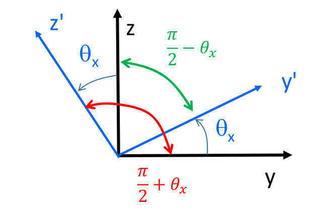
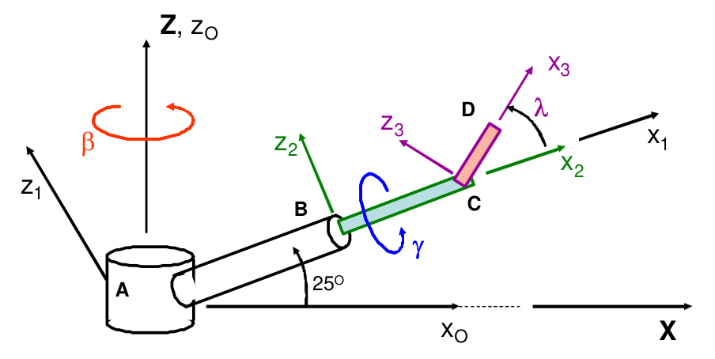
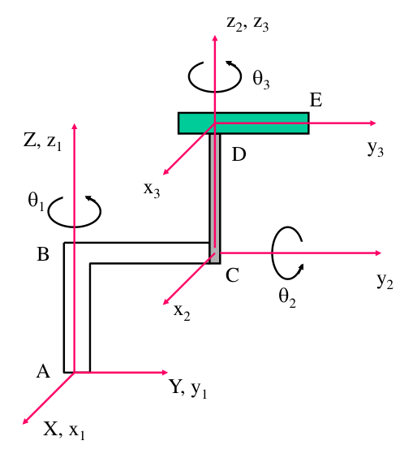
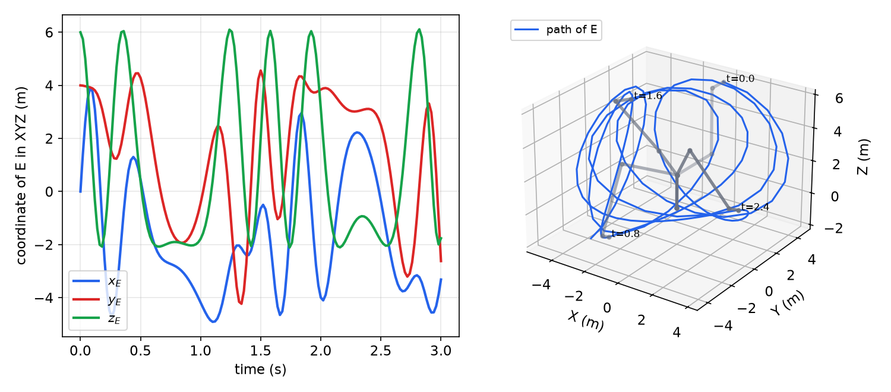
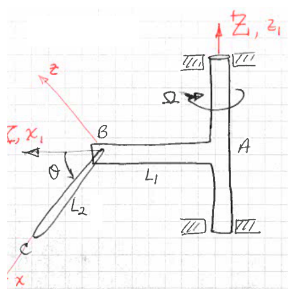
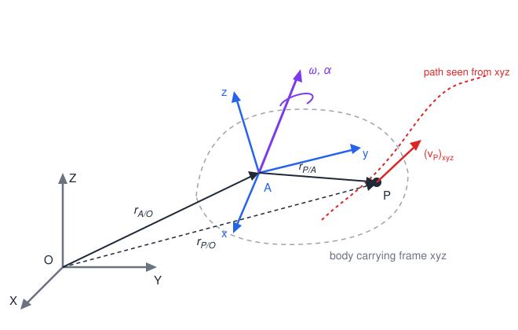

# Rotating Frames and Relative Motion

Machines are chains of bodies, each turning relative to the one that carries it: a robot link on a turret, a pendulum on a spinning shaft, a collar sliding on a rotating arm. Describing such motion directly in a fixed frame quickly becomes unmanageable. The remedy is to attach a coordinate frame to each body and relate them. This chapter builds the two tools that make this work: **rotation transformation matrices**, which convert vector components between frames and give positions and finite displacements; and **angular velocity**, which gives the time derivative of any vector expressed in a rotating frame. Together they yield the relative-velocity and relative-acceleration formulas, with their centripetal and Coriolis terms, that underlie all of three-dimensional rigid-body dynamics.

## Rotation Transformation Matrices

### Direction cosines

Let \\(xyz\\) and \\(x'y'z'\\) be two right-handed Cartesian frames with a common origin and unit vectors \\(\bar i, \bar j, \bar k\\) and \\(\bar i', \bar j', \bar k'\\). Any vector can be resolved in a frame by dotting with its unit vectors:
\\[
\bar A = (\bar A\cdot\bar i)\\,\bar i + (\bar A\cdot\bar j)\\,\bar j + (\bar A\cdot\bar k)\\,\bar k = A\_x\bar i + A\_y\bar j + A\_z\bar k .
\\]
Apply this to the unit vectors of the primed frame. For two unit vectors, \\(\bar i'\cdot\bar i = \cos\angle(x', x)\\), the cosine of the angle between the axes. Denote by \\(\ell\_{p'q}\\) the cosine of the angle between axis \\(p'\\) and axis \\(q\\) (a **direction cosine**; \\(\ell\_{p'q} = \ell\_{qp'}\\)). Then
\\[
\bar i' = \ell\_{x'x}\bar i + \ell\_{x'y}\bar j + \ell\_{x'z}\bar k, \quad
\bar j' = \ell\_{y'x}\bar i + \ell\_{y'y}\bar j + \ell\_{y'z}\bar k, \quad
\bar k' = \ell\_{z'x}\bar i + \ell\_{z'y}\bar j + \ell\_{z'z}\bar k .
\\]

### Transformation of components

Write the same vector in both frames, \\(\bar A = A\_{x'}\bar i' + A\_{y'}\bar j' + A\_{z'}\bar k' = A\_x\bar i + A\_y\bar j + A\_z\bar k\\). Dotting both sides with \\(\bar i'\\) and using the orthonormality of the primed unit vectors gives \\(A\_{x'} = \ell\_{x'x}A\_x + \ell\_{x'y}A\_y + \ell\_{x'z}A\_z\\); dotting with \\(\bar j'\\) and \\(\bar k'\\) gives the other two. In matrix form,
\\[
\begin{Bmatrix}A\_{x'} \\\\ A\_{y'} \\\\ A\_{z'}\end{Bmatrix} =
\begin{bmatrix}\ell\_{x'x} & \ell\_{x'y} & \ell\_{x'z} \\\\ \ell\_{y'x} & \ell\_{y'y} & \ell\_{y'z} \\\\ \ell\_{z'x} & \ell\_{z'y} & \ell\_{z'z}\end{bmatrix}
\begin{Bmatrix}A\_x \\\\ A\_y \\\\ A\_z\end{Bmatrix}, \qquad \\{A'\\} = [R]\\{A\\} .
\\]
\\([R]\\) is the **rotation transformation matrix** from \\(xyz\\) to \\(x'y'z'\\). **Row \\(p\\) of \\([R]\\) holds the \\(xyz\\) components of the \\(p\\)-th primed unit vector.** That is the fastest way to build \\([R]\\) by inspection.

**Theorem (orthonormality).** \\([R]^{-1} = [R]^T\\), i.e. \\([R][R]^T = [R]^T[R] = [U]\\), the identity.

*Proof.* Dotting \\(\bar A\\) instead with \\(\bar i, \bar j, \bar k\\) gives \\(A\_x = \ell\_{x'x}A\_{x'} + \ell\_{y'x}A\_{y'} + \ell\_{z'x}A\_{z'}\\) and so on, i.e. \\(\\{A\\} = [R]^T\\{A'\\}\\). Since \\(\\{A'\\} = [R]\\{A\\}\\) for every \\(\\{A\\}\\), \\([R]^T[R] = [U]\\). Directly: each row of \\([R]\\) is a unit vector (\\(\ell\_{x'x}^2 + \ell\_{x'y}^2 + \ell\_{x'z}^2 = \lVert\bar i'\rVert^2 = 1\\)) and different rows are orthogonal (\\(\bar i'\cdot\bar j' = 0\\)), which is the statement \\([R][R]^T = [U]\\). \\(\square\\)

Because both frames are right-handed, \\(\det[R] = +1\\) (a determinant of \\(-1\\) would describe a reflection). Of the nine direction cosines only three are independent: the six orthonormality conditions constrain the rest, which is why three angles suffice to describe orientation.

**A note on conventions.** \\([R]\\) as defined here transforms *components* of a fixed vector into a new frame (a "passive" or "alias" transformation). Robotics texts usually use the transpose, the matrix whose *columns* are the body unit vectors in the reference frame and which maps body components to reference components; see [Spatial Descriptions and Transformations](../me6407-robotics/spatial-descriptions.md). Both conventions are correct; mixing them is the most common source of errors, so state which one you use.

### Simple rotations

A rotation by \\(\theta\_x\\) about the \\(x\\) axis leaves \\(x' = x\\) and turns \\(y, z\\) in their plane.



*Figure: direction-cosine angles for a rotation \\(\theta\_x\\) about \\(x\\) (out of the page). The angle from \\(z\\) to \\(y'\\) is \\(\pi/2 - \theta\_x\\); the angle from \\(y\\) to \\(z'\\) is \\(\pi/2 + \theta\_x\\).*

Reading off the angles: \\(\ell\_{x'x} = 1\\), the other entries of the first row and column vanish, \\(\ell\_{y'y} = \ell\_{z'z} = \cos\theta\_x\\), \\(\ell\_{y'z} = \cos(\pi/2 - \theta\_x) = \sin\theta\_x\\), \\(\ell\_{z'y} = \cos(\pi/2 + \theta\_x) = -\sin\theta\_x\\). The same reasoning for the other axes gives the three **simple rotation matrices**:
\\[
[R\_x(\theta)] = \begin{bmatrix}1 & 0 & 0 \\\\ 0 & \cos\theta & \sin\theta \\\\ 0 & -\sin\theta & \cos\theta\end{bmatrix}, \quad
[R\_y(\theta)] = \begin{bmatrix}\cos\theta & 0 & -\sin\theta \\\\ 0 & 1 & 0 \\\\ \sin\theta & 0 & \cos\theta\end{bmatrix}, \quad
[R\_z(\theta)] = \begin{bmatrix}\cos\theta & \sin\theta & 0 \\\\ -\sin\theta & \cos\theta & 0 \\\\ 0 & 0 & 1\end{bmatrix}.
\\]
Positive angles follow the right-hand rule about the axis. A useful mnemonic: the \\(+\sin\\) sits in the row of the axis that comes first in the cyclic order \\(x \to y \to z \to x\\) after the rotation axis (for \\(R\_y\\), the row of \\(z\\)... no, of \\(x\\) has \\(-\sin\\)); it is safer to re-derive from the picture or to check one column against the expected primed unit vector.

### Sequences of body-fixed rotations

Orientations are usually built from a sequence of simple rotations, each about an axis of the frame produced by the previous step. Rotate by \\(\theta\_1\\) about \\(X\\) to obtain \\(x\_1y\_1z\_1\\): \\(\\{x\_1\\} = [R\_1]\\{X\\}\\). Then rotate about \\(y\_1\\) by \\(\theta\_2\\) to obtain \\(x\_2y\_2z\_2\\): \\(\\{x\_2\\} = [R\_2]\\{x\_1\\}\\). Then
\\[
\\{x\_2\\} = [R\_2][R\_1]\\{X\\}, \qquad [R] = [R\_n][R\_{n-1}]\cdots[R\_2][R\_1]
\\]
for \\(n\\) successive rotations: **later rotations multiply on the left**. The product is again orthonormal, since
\\[
[R]^T[R] = [R\_1]^T\cdots[R\_{n-1}]^T[R\_n]^T[R\_n][R\_{n-1}]\cdots[R\_1] = [U],
\\]
the innermost pair collapsing to \\([U]\\) repeatedly. To go back to the reference frame, \\(\\{X\\} = [R]^T\\{x\_n\\} = [R\_1]^T[R\_2]^T\cdots[R\_n]^T\\{x\_n\\}\\).

Finite rotations do not commute: \\([R\_y(90^\circ)][R\_x(90^\circ)] \neq [R\_x(90^\circ)][R\_y(90^\circ)]\\). A finite rotation is therefore not a vector, and orientation must be handled with matrices (or angles that index a matrix), never by adding rotation "vectors". Infinitesimal rotations do commute, which is why angular *velocities* are vectors that add (below).

## Positions and Displacements in Chained Frames

The method for any chain of bodies is:

1. Attach a frame to each body (or to an intermediate orientation), and write each frame's transformation from the previous one as a simple rotation, noting its sign.
2. Write the position of the point of interest as a sum of link vectors, each of which has *constant* components in the frame of its own body.
3. Transform each link vector to the reference frame with the transpose of its cumulative matrix, and add.

**Example 3.1 (Three-link arm).** The base \\(A\\) of an arm rotates by \\(\beta\\) about the vertical \\(Z\\) axis. Link \\(AB\\) is elevated \\(25^\circ\\) above the horizontal. Link \\(BC\\) is collinear with \\(AB\\) and turns about it by \\(\gamma\\). Link \\(CD\\) is attached at \\(C\\) and is inclined by \\(\lambda\\) from \\(BC\\). Find the position of \\(D\\) relative to \\(A\\).



*Figure: the arm and its frames. \\(x\_0y\_0z\_0\\) turns with the base (\\(z\_0\\) vertical); \\(x\_1y\_1z\_1\\) has \\(x\_1\\) along \\(AB\\); \\(x\_2y\_2z\_2\\) rolls with \\(BC\\) by \\(\gamma\\) about \\(x\_1\\); \\(x\_3y\_3z\_3\\) has \\(x\_3\\) along \\(CD\\), rotated by \\(-\lambda\\) about \\(y\_2\\).*

*Frames.* \\(\\{x\_0\\} = [R\_z(\beta)]\\{X\\}\\). The elevation is a **negative** rotation about \\(y\_0\\), because a positive \\(R\_y\\) would tip \\(x\\) toward \\(-z\\): \\(\\{x\_1\\} = [R\_y(-25^\circ)]\\{x\_0\\}\\). Then \\(\\{x\_2\\} = [R\_x(\gamma)]\\{x\_1\\}\\) and \\(\\{x\_3\\} = [R\_y(-\lambda)]\\{x\_2\\}\\). Cumulatively,
\\[
[R\_{1/i}] = [R\_y(-25^\circ)][R\_z(\beta)], \quad [R\_{2/i}] = [R\_x(\gamma)][R\_{1/i}], \quad [R\_{3/i}] = [R\_y(-\lambda)][R\_{2/i}] .
\\]

*Position.* Each link lies along the \\(x\\) axis of its own frame:
\\[
\\{r\_{D/A}\\}\_{XYZ} = [R\_{1/i}]^T\begin{Bmatrix}r\_{AB} \\\\ 0 \\\\ 0\end{Bmatrix} + [R\_{2/i}]^T\begin{Bmatrix}r\_{CB} \\\\ 0 \\\\ 0\end{Bmatrix} + [R\_{3/i}]^T\begin{Bmatrix}r\_{DC} \\\\ 0 \\\\ 0\end{Bmatrix}.
\\]
With \\(r\_{AB} = 2\\), \\(r\_{CB} = 1\\), \\(r\_{DC} = 0.5\\), \\(\beta = 50^\circ\\), \\(\gamma = 30^\circ\\), \\(\lambda = 60^\circ\\):
\\[
\\{r\_{D/A}\\}\_{XYZ} = [1.9573,\ 1.9958,\ 1.7134]^T .
\\]

```matlab
RX = @(x) [1 0 0; 0 cos(x) sin(x); 0 -sin(x) cos(x)];
RY = @(x) [cos(x) 0 -sin(x); 0 1 0; sin(x) 0 cos(x)];
RZ = @(x) [cos(x) sin(x) 0; -sin(x) cos(x) 0; 0 0 1];
R1i = RY(-25*pi/180)*RZ(50*pi/180);
R2i = RX(30*pi/180)*R1i;
R3i = RY(-60*pi/180)*R2i;
RDA = R1i'*[2 0 0]' + R2i'*[1 0 0]' + R3i'*[0.5 0 0]'    % [1.9573; 1.9958; 1.7134]
```

**Example 3.2 (Finite displacement of a hub–arm–bar mechanism).** A hub rotates by \\(\theta\\) about the vertical \\(Z\\) axis. A telescoping arm \\(AD\\), pivoted on the hub at \\(A\\), makes angle \\(\beta\\) with the vertical \\(z\_1\\) axis. Bar \\(BC\\) (\\(BC = 120\\) mm) at the end \\(B\\) of the arm is perpendicular to \\(AB\\) and rotates by \\(\gamma\\) about the arm axis. Initially \\(\theta = \gamma = 0\\), \\(\beta = 90^\circ\\), \\(AB = 250\\) mm; finally \\(\theta = \beta = 120^\circ\\), \\(\gamma = -90^\circ\\), \\(AB = 500\\) mm. Find the displacement of \\(C\\).

*Frames.* \\(\\{x\_1\\} = [R\_z(\theta)]\\{X\\}\\) (hub); \\(\\{x\_2\\} = [R\_x(90^\circ - \beta)]\\{x\_1\\}\\) (arm, aligned with the hub frame when \\(\beta = 90^\circ\\), arm along \\(y\_2\\)); \\(\\{x\_3\\} = [R\_y(\gamma)]\\{x\_2\\}\\) (bar, along \\(z\_3\\)).
\\[
\\{r\_{C/A}\\}\_{XYZ} = [R\_z(\theta)]^T[R\_x(90^\circ - \beta)]^T\begin{Bmatrix}0 \\\\ AB \\\\ 0\end{Bmatrix} + [R\_z(\theta)]^T[R\_x(90^\circ - \beta)]^T[R\_y(\gamma)]^T\begin{Bmatrix}0 \\\\ 0 \\\\ BC\end{Bmatrix}.
\\]
Initially \\(\bar r\_{C/A} = [0,\ 250,\ 120]^T\\) mm; finally \\([-315.0,\ -320.4,\ -250.0]^T\\) mm, so
\\[
\Delta\bar r\_{C/A} = [-315.0,\ -570.4,\ -370.0]^T\ \text{mm}.
\\]
A displacement is always the difference of two positions, each computed from its own transformation chain; there is no shortcut that "adds" the angle changes.

**Example 3.3 (Two-bar linkage).** Bent bar \\(ABC\\) rotates by \\(\theta\\) about the fixed \\(X\\) axis, along which segment \\(AB\\) lies. A collar at \\(C\\) lets bar \\(CD\\) rotate by \\(\phi\\) about segment \\(BC\\). \\(AB = BC = 400\\) mm, \\(CD = 200\\) mm, and the fixed bend angle between \\(AB\\) and \\(BC\\) is \\(\beta = 50^\circ\\). When \\(\theta = \phi = 0\\) both bars lie in the \\(XY\\) plane. Find the displacement of \\(D\\) from that position to \\(\theta = 120^\circ\\), \\(\phi = -70^\circ\\).

*Frames.* \\(x\_1y\_1z\_1\\) on \\(ABC\\), rotated by \\(\theta\\) about \\(X\\); \\(x\_2y\_2z\_2\\) also on \\(ABC\\), rotated by \\(-\beta\\) about \\(z\_1\\) so that \\(x\_2\\) points from \\(C\\) to \\(B\\); \\(x\_3y\_3z\_3\\) on \\(CD\\), rotated by \\(\phi\\) about \\(x\_2\\), with \\(y\_3\\) along \\(CD\\). Then \\([R\_{1/i}] = [R\_x(\theta)]\\), \\([R\_{2/i}] = [R\_z(-\beta)][R\_{1/i}]\\), \\([R\_{3/i}] = [R\_x(\phi)][R\_{2/i}]\\), and
\\[
\\{r\_{D/A}\\} = [R\_{1/i}]^T\begin{Bmatrix}400 \\\\ 0 \\\\ 0\end{Bmatrix} + [R\_{2/i}]^T\begin{Bmatrix}-400 \\\\ 0 \\\\ 0\end{Bmatrix} + [R\_{3/i}]^T\begin{Bmatrix}0 \\\\ 200 \\\\ 0\end{Bmatrix}.
\\]
Initially \\([296.09,\ 434.98,\ 0]^T\\) mm, finally \\([195.29,\ -12.43,\ 397.41]^T\\) mm, so \\(\Delta\bar r\_{D/A} = [-100.81,\ -447.41,\ 397.41]^T\\) mm.

The same vector can often be assembled in more than one way. If two consecutive frames differ only by a rotation about a shared axis along which a link lies, that link's components are the same in both frames, and terms can be combined: for instance \\([R\_{3/0}]^T\\{L + d, 0, L\\}^T\\) can replace \\([R\_{1/0}]^T\\{L + d, 0, 0\\}^T + [R\_{3/0}]^T\\{0, 0, L\\}^T\\) when frame 3 differs from frame 1 by a rotation about \\(x\_1\\). Such shortcuts are a good check, but every factor must still carry its transpose.

### Animating a three-arm robot

Because positions are algebraic in the joint angles, a time history of the angles gives the trajectory of every point directly.

**Example 3.4 (Three-arm robot).** Arm \\(ABC\\) rotates relative to the ground by \\(\theta\_1(t)\\) about the vertical \\(Z\\); arm \\(CD\\) rotates relative to \\(ABC\\) by \\(\theta\_2(t)\\) about the horizontal \\(y\_2\\) axis through \\(C\\); arm \\(DE\\) rotates relative to \\(CD\\) by \\(\theta\_3(t)\\) about the axis \\(z\_3\\) through \\(D\\). All frames are parallel when the angles vanish.



*Figure: the robot at \\(\theta\_1 = \theta\_2 = \theta\_3 = 0\\). \\(AB\\) is vertical, \\(BC\\) horizontal along \\(Y\\), \\(CD\\) vertical, and \\(DE\\) a horizontal bar along \\(y\_3\\).*

With the convention that \\([R\_{ij}]\\) transforms *from* frame \\(j\\) *to* frame \\(i\\): \\([R\_{10}] = [R\_z(\theta\_1)]\\), \\([R\_{21}] = [R\_y(\theta\_2)]\\), \\([R\_{32}] = [R\_z(\theta\_3)]\\). The link vectors are constant in their own frames: \\(\bar r\_{C/A} = [0, BC, AB]^T\\) in frame 1, \\(\bar r\_{D/C} = [0, 0, CD]^T\\) in frame 2, \\(\bar r\_{E/D} = [0, DE, 0]^T\\) in frame 3. Hence
\\[
\\{r\_{C/A}\\} = [R\_{10}]^T\\{r\_1\\}, \quad \\{r\_{D/A}\\} = \\{r\_{C/A}\\} + [R\_{10}]^T[R\_{21}]^T\\{r\_2\\}, \quad \\{r\_{E/A}\\} = \\{r\_{D/A}\\} + [R\_{10}]^T[R\_{21}]^T[R\_{32}]^T\\{r\_3\\}.
\\]

```python
import numpy as np
RY = lambda q: np.array([[np.cos(q),0,-np.sin(q)],[0,1,0],[np.sin(q),0,np.cos(q)]])
RZ = lambda q: np.array([[np.cos(q),np.sin(q),0],[-np.sin(q),np.cos(q),0],[0,0,1]])
AB, BC, CD, DE = 2, 3, 4, 1
t = np.arange(0, 3.0001, 0.02)
th1, th2, th3 = 1 - np.cos(3*t), 10*np.sin(2*t), 2.5*np.sin(np.pi*t)
E = []
for a, b, c in zip(th1, th2, th3):
    R10, R21, R32 = RZ(a), RY(b), RZ(c)
    C = R10.T @ [0, BC, AB]
    D = C + R10.T @ R21.T @ [0, 0, CD]
    E.append(D + R10.T @ R21.T @ R32.T @ [0, DE, 0])
E = np.array(E)        # rows: [x_E, y_E, z_E] in the inertial frame
```



*Figure: Example 3.4 with \\(AB = 2\\), \\(BC = 3\\), \\(CD = 4\\), \\(DE = 1\\) (m), \\(\theta\_1 = 1 - \cos3t\\), \\(\theta\_2 = 10\sin2t\\), \\(\theta\_3 = 2.5\sin\pi t\\). Left: inertial coordinates of \\(E\\). Right: path of \\(E\\) with the robot drawn at four instants (gray, darker later). The large \\(\theta\_2\\) amplitude (10 rad) swings \\(CD\\) over the top several times, so \\(z\_E\\) oscillates between \\(-2\\) and \\(6\\) m.*

## Angular Velocity

### The derivative of a unit vector fixed in a rotating frame

Let a frame \\(xyz\\) (unit vectors \\(\bar i, \bar j, \bar k\\)) move relative to a fixed frame \\(XYZ\\), with transformation \\(\\{x\\} = [R(t)]\\{X\\}\\). The rows of \\([R]\\) are the components of \\(\bar i, \bar j, \bar k\\) in \\(XYZ\\), so \\(\bar e\_p = \sum\_q R\_{pq}\bar E\_q\\) with \\(\bar E\_q\\) constant. Differentiating and resolving back in the moving frame,
\\[
\dot{\bar e}\_p = \sum\_q \dot R\_{pq}\bar E\_q = \sum\_k \left([\dot R][R]^T\right)\_{pk}\bar e\_k .
\\]
Differentiating \\([R][R]^T = [U]\\) gives \\([\dot R][R]^T + [R][\dot R]^T = [0]\\), so \\([W] = [\dot R][R]^T\\) is **skew-symmetric** and has only three independent entries. Name them so that
\\[
[W] = \begin{bmatrix} 0 & \omega\_z & -\omega\_y \\\\ -\omega\_z & 0 & \omega\_x \\\\ \omega\_y & -\omega\_x & 0\end{bmatrix} .
\\]
Then \\(\dot{\bar i} = \omega\_z\bar j - \omega\_y\bar k\\), \\(\dot{\bar j} = -\omega\_z\bar i + \omega\_x\bar k\\), \\(\dot{\bar k} = \omega\_y\bar i - \omega\_x\bar j\\), which is exactly
\\[
\boxed{\dot{\bar i} = \bar\omega\times\bar i, \qquad \dot{\bar j} = \bar\omega\times\bar j, \qquad \dot{\bar k} = \bar\omega\times\bar k, \qquad \bar\omega = \omega\_x\bar i + \omega\_y\bar j + \omega\_z\bar k .}
\\]
**Definition.** \\(\bar\omega\\) is the **angular velocity** of the frame (and of any rigid body to which it is attached). It is a single vector that gives the rate of change of every vector fixed in the frame: if \\(\bar r\\) has constant components in \\(xyz\\), then \\(\dot{\bar r} = \bar\omega\times\bar r\\). Its components in the moving frame are read from \\(-[\dot R][R]^T\\), the familiar cross-product matrix of \\(\bar\omega\\).

For a simple rotation \\([R\_z(\theta)]\\), \\([\dot R\_z][R\_z]^T\\) has \\(W\_{12} = \dot\theta\\), so \\(\bar\omega = \dot\theta\\,\bar k\\): a rotation about a fixed axis has angular velocity along that axis with magnitude equal to the angle rate, as expected.

### The derivative of an arbitrary vector

**Theorem (transport theorem).** For any vector \\(\bar A = A\_x\bar i + A\_y\bar j + A\_z\bar k\\) resolved in a frame rotating with \\(\bar\omega\\),
\\[
\boxed{\frac{d\bar A}{dt} = \left(\frac{\partial\bar A}{\partial t}\right)\_{xyz} + \bar\omega\times\bar A, \qquad \left(\frac{\partial\bar A}{\partial t}\right)\_{xyz} = \dot A\_x\bar i + \dot A\_y\bar j + \dot A\_z\bar k .}
\\]
*Proof.* Product rule: \\(\dot{\bar A} = \sum\dot A\_k\bar e\_k + \sum A\_k\dot{\bar e}\_k = (\partial\bar A/\partial t)\_{xyz} + \sum A\_k\\,\bar\omega\times\bar e\_k\\). \\(\square\\)

The partial derivative is the rate seen by an observer riding on the frame, who regards \\(\bar i, \bar j, \bar k\\) as constant. The cross product is the extra rate that a fixed observer sees because the frame carries the vector around. The theorem holds for any two frames, not only for an inertial one: \\((d\bar A/dt)\_{\mathcal A} = (d\bar A/dt)\_{\mathcal B} + \bar\omega\_{\mathcal B/\mathcal A}\times\bar A\\).

Applying it to \\(\bar\omega\\) itself shows that the angular acceleration
\\[
\bar\alpha = \frac{d\bar\omega}{dt} = \left(\frac{\partial\bar\omega}{\partial t}\right)\_{xyz} + \bar\omega\times\bar\omega = \left(\frac{\partial\bar\omega}{\partial t}\right)\_{xyz}
\\]
is obtained by differentiating the components of \\(\bar\omega\\) when \\(\bar\omega\\) is resolved in a frame that rotates *with the body*. If instead \\(\bar\omega\\) is resolved in a frame with a different angular velocity \\(\bar\Omega\\), then \\(\bar\alpha = (\partial\bar\omega/\partial t)\_{xyz} + \bar\Omega\times\bar\omega\\).

### Addition of angular velocities

**Theorem (addition of relative angular velocities).** If body 3 turns relative to body 2 with \\(\bar\omega\_{3/2}\\), body 2 relative to body 1 with \\(\bar\omega\_{2/1}\\), and body 1 relative to the ground with \\(\bar\omega\_{1/0}\\), then
\\[
\bar\omega\_{3/0} = \bar\omega\_{3/2} + \bar\omega\_{2/1} + \bar\omega\_{1/0} .
\\]
*Proof.* Let \\(\bar e\\) be fixed in body 3. By the transport theorem between bodies 2 and 3, \\((d\bar e/dt)\_2 = \bar\omega\_{3/2}\times\bar e\\). Between 1 and 2, \\((d\bar e/dt)\_1 = (d\bar e/dt)\_2 + \bar\omega\_{2/1}\times\bar e\\). Between ground and 1, \\((d\bar e/dt)\_0 = (d\bar e/dt)\_1 + \bar\omega\_{1/0}\times\bar e = (\bar\omega\_{3/2} + \bar\omega\_{2/1} + \bar\omega\_{1/0})\times\bar e\\). This holds for every \\(\bar e\\) fixed in body 3, so the sum is \\(\bar\omega\_{3/0}\\). \\(\square\\)

Each relative angular velocity of a joint is simply the joint rate times the joint axis: a pin with angle \\(\gamma\\) about \\(\bar e\\) contributes \\(\dot\gamma\\,\bar e\\). The axis vectors usually belong to different frames; resolve them in one frame before adding.

### Angular acceleration: differentiate an expression valid for all time

Angular accelerations **do not** add like angular velocities. Differentiating the sum,
\\[
\bar\alpha\_{3/0} = \frac{d}{dt}\left(\dot\gamma\\,\bar e\_{\gamma} + \dot\beta\\,\bar e\_{\beta} + \dot\theta\\,\bar e\_{\theta}\right) = \ddot\gamma\\,\bar e\_\gamma + \dot\gamma\\,\dot{\bar e}\_\gamma + \ddot\beta\\,\bar e\_\beta + \dot\beta\\,\dot{\bar e}\_\beta + \ddot\theta\\,\bar e\_\theta + \dot\theta\\,\dot{\bar e}\_\theta ,
\\]
and each joint axis \\(\bar e\\) turns with the body that carries it, \\(\dot{\bar e} = \bar\omega\_{\text{carrier}}\times\bar e\\). The extra products of rates are what make three-dimensional angular acceleration nonzero even when every joint turns at constant speed. Two rules prevent most mistakes:

1. Write \\(\bar\omega\\) in a form **valid for all time** (in terms of unit vectors that are defined at every instant), differentiate it, and only then substitute the particular instant. Substituting first (for example replacing \\(\bar j\_2\\) by \\(\bar j\_1\\) because the two coincide at this instant) throws away exactly the \\(\dot{\bar e}\\) terms.
2. For each unit vector, identify the body in which it is fixed; its derivative uses that body's angular velocity. A vector fixed in the ground has zero derivative.

**Example 3.5 (Angular velocity and acceleration of the end bar).** In the mechanism of Example 3.2, let \\(\dot\theta, \dot\beta, \dot\gamma\\) be constant. Find \\(\bar\omega\_{BC}\\) and \\(\bar\alpha\_{BC}\\) at the instant \\(\beta = 90^\circ\\), \\(\gamma = 0\\).

*Angular velocity.* Adding the hub rotation about \\(\bar k\_1 = \bar K\\), the arm rotation about \\(\bar i\_1\\) (the angle \\(90^\circ - \beta\\) about \\(x\_1\\) changes at \\(-\dot\beta\\)), and the bar rotation about \\(\bar j\_2\\):
\\[
\bar\omega\_{BC} = \dot\gamma\\,\bar j\_2 - \dot\beta\\,\bar i\_1 + \dot\theta\\,\bar k\_1 \quad\text{(valid for all time)}.
\\]
At this instant \\(\bar j\_2 = \bar j\_1\\), so \\(\bar\omega\_{BC} = -\dot\beta\\,\bar i\_1 + \dot\gamma\\,\bar j\_1 + \dot\theta\\,\bar k\_1\\).

*Angular acceleration.* Differentiate the all-time form. With constant rates and \\(\bar k\_1 = \bar K\\) fixed,
\\[
\bar\alpha\_{BC} = \dot\gamma\\,\dot{\bar j}\_2 - \dot\beta\\,\dot{\bar i}\_1 .
\\]
\\(\bar j\_2\\) is fixed in the arm, whose angular velocity is \\(\bar\omega\_{AD} = \dot\theta\bar k\_1 - \dot\beta\bar i\_1\\); so \\(\dot{\bar j}\_2 = \bar\omega\_{AD}\times\bar j\_2 = -\dot\theta\\,\bar i\_1 - \dot\beta\\,\bar k\_1\\) at this instant. \\(\bar i\_1\\) is fixed in the hub: \\(\dot{\bar i}\_1 = \dot\theta\bar k\_1\times\bar i\_1 = \dot\theta\\,\bar j\_1\\). Therefore
\\[
\bar\alpha\_{BC} = -\dot\theta\dot\gamma\\,\bar i\_1 - \dot\beta\dot\theta\\,\bar j\_1 - \dot\gamma\dot\beta\\,\bar k\_1 .
\\]
Every term is a product of two rates; none would appear if the instantaneous form had been differentiated.

**Example 3.6 (Velocity and acceleration of the linkage end).** For the two-bar linkage of Example 3.3, let \\(\dot\theta = 20\\) rad/s and \\(\dot\phi = 30\\) rad/s be constant. Find \\(\bar v\_D\\) and \\(\bar a\_D\\) at \\(\theta = 120^\circ\\), \\(\phi = 50^\circ\\).

*Setup in frame 2.* Point \\(B\\) lies on the fixed axis, so \\(\bar v\_B = \bar a\_B = \bar 0\\). Resolve everything in \\(x\_2y\_2z\_2\\) (fixed to \\(ABC\\), \\(x\_2\\) from \\(C\\) to \\(B\\), \\(z\_2\\) normal to the plane of \\(ABC\\)), in which \\(\bar i\_1 = \bar I = \cos\beta\\,\bar i\_2 + \sin\beta\\,\bar j\_2\\):
\\[
\bar\omega\_{ABC} = \dot\theta(\cos\beta\\,\bar i\_2 + \sin\beta\\,\bar j\_2), \qquad
\bar\omega\_{CD} = \dot\theta\\,\bar i\_1 + \dot\phi\\,\bar i\_2 = (\dot\phi + \dot\theta\cos\beta)\\,\bar i\_2 + \dot\theta\sin\beta\\,\bar j\_2 ,
\\]
\\[
\bar r\_{C/A} = r\_{AB}\bar i\_1 - r\_{BC}\bar i\_2, \qquad \bar r\_{D/C} = r\_{CD}\\,\bar j\_3 = r\_{CD}(\cos\phi\\,\bar j\_2 + \sin\phi\\,\bar k\_2).
\\]

*Velocity.* \\(\bar v\_C = \bar\omega\_{ABC}\times\bar r\_{C/A} = 6.128\\,\bar k\_2\\) m/s and
\\[
\bar v\_D = \bar v\_C + \bar\omega\_{CD}\times\bar r\_{D/C} = 2.347\\,\bar i\_2 - 6.566\\,\bar j\_2 + 11.638\\,\bar k\_2\ \text{m/s}.
\\]

*Angular acceleration.* \\(\bar i\_1 = \bar I\\) is fixed and the rates are constant, so only \\(\dot\phi\\,\dot{\bar i}\_2\\) survives. \\(\bar i\_2\\) is fixed in \\(ABC\\):
\\[
\bar\alpha\_{CD} = \dot\phi\\,(\bar\omega\_{ABC}\times\bar i\_2) = -\dot\theta\dot\phi\sin\beta\\,\bar k\_2 = -459.6\\,\bar k\_2\ \text{rad/s}^2 .
\\]

*Acceleration.* \\(\bar a\_C = \bar\omega\_{ABC}\times(\bar\omega\_{ABC}\times\bar r\_{C/A}) = 93.89\\,\bar i\_2 - 78.78\\,\bar j\_2\\) m/s² (\\(\bar\alpha\_{ABC} = \bar 0\\)), and
\\[
\bar a\_D = \bar a\_C + \bar\alpha\_{CD}\times\bar r\_{D/C} + \bar\omega\_{CD}\times(\bar\omega\_{CD}\times\bar r\_{D/C}) = 237.39\\,\bar i\_2 - 314.90\\,\bar j\_2 - 317.35\\,\bar k\_2\ \text{m/s}^2 .
\\]
Components depend on the frame, magnitudes do not: \\(\lVert\bar v\_C\rVert = 6.128\\) m/s, \\(\lVert\bar v\_D\rVert = 13.567\\) m/s, \\(\lVert\bar a\_C\rVert = 122.57\\) m/s², \\(\lVert\bar a\_D\rVert = 506.18\\) m/s², whichever frame is used. That invariance is a convenient check when two people (or two programs) use different frames.

```matlab
theta=120*pi/180; phi=50*pi/180; beta=50*pi/180; thetadot=20; phidot=30;
i1 = [cos(beta) sin(beta) 0];  i2 = [1 0 0];      % components in x2y2z2
w_ABC = thetadot*i1;  w_CD = thetadot*i1 + phidot*i2;
R_CA = 0.4*i1 - 0.4*i2;  R_DC = 0.2*[0 cos(phi) sin(phi)];
v_D = cross(w_ABC,R_CA) + cross(w_CD,R_DC)                        % [2.3473 -6.5659 11.6378]
alpha_CD = phidot*cross(w_ABC,i2)                                   % [0 0 -459.6267]
a_C = cross(w_ABC,cross(w_ABC,R_CA));
a_D = a_C + cross(alpha_CD,R_DC) + cross(w_CD,cross(w_CD,R_DC))     % [237.39 -314.90 -317.35]
```

## Velocity and Acceleration of Points of a Rigid Body

Let \\(A\\) and \\(B\\) be two points of a rigid body with angular velocity \\(\bar\omega\\) and angular acceleration \\(\bar\alpha\\). The vector \\(\bar r\_{B/A}\\) is fixed in the body, so \\(\dot{\bar r}\_{B/A} = \bar\omega\times\bar r\_{B/A}\\). Differentiating \\(\bar r\_{B/O} = \bar r\_{A/O} + \bar r\_{B/A}\\) once and twice:
\\[
\boxed{\bar v\_B = \bar v\_A + \bar\omega\times\bar r\_{B/A}, \qquad \bar a\_B = \bar a\_A + \bar\alpha\times\bar r\_{B/A} + \bar\omega\times(\bar\omega\times\bar r\_{B/A}) .}
\\]
The term \\(\bar\omega\times(\bar\omega\times\bar r)\\) is the **centripetal** acceleration: it equals \\(-\omega^2\\) times the component of \\(\bar r\_{B/A}\\) perpendicular to \\(\bar\omega\\), pointing toward the instantaneous axis through \\(A\\). In planar motion (\\(\bar\omega = \omega\bar k\\), \\(\bar r\perp\bar k\\)) it reduces to \\(-\omega^2\bar r\_{B/A}\\).

A corollary used constantly: \\(\bar v\_B - \bar v\_A\\) is perpendicular to \\(\bar r\_{B/A}\\), so **two points of a rigid body have equal velocity components along the line joining them**.

**Example 3.7 (Pinned bar on a rotating T-bar, rigid-body approach).** A vertical shaft turns at constant rate \\(\Omega\\) (sense \\(-\bar K\\)) and carries a horizontal arm \\(AB\\) of length \\(L\_1\\). Bar \\(BC\\) of length \\(L\_2\\) is pinned at \\(B\\) and makes angle \\(\theta\\) below the arm, rotating in the vertical plane containing the arm. Find \\(\bar v\_C\\) and \\(\bar a\_C\\).



*Figure: the rotating T-bar. \\(x\_1y\_1z\_1\\) is fixed to the arm (\\(x\_1\\) outward along the arm through \\(B\\), \\(z\_1\\) vertical); \\(xyz\\) is fixed to \\(BC\\) with \\(x\\) along the bar.*

*Angular velocities.* \\(\bar\omega\_{AB} = -\Omega\\,\bar k\_1\\); the pin axis is \\(\bar j\_1\\), so \\(\bar\omega\_{BC} = \dot\theta\\,\bar j\_1 - \Omega\\,\bar k\_1\\).

*Angular acceleration.* \\(\bar k\_1\\) is fixed and \\(\Omega\\) constant; \\(\bar j\_1\\) turns with the arm:
\\[
\bar\alpha\_{BC} = \ddot\theta\\,\bar j\_1 + \dot\theta(\bar\omega\_{AB}\times\bar j\_1) = \dot\theta\Omega\\,\bar i\_1 + \ddot\theta\\,\bar j\_1 .
\\]

*Velocity.* \\(\bar r\_{B/A} = L\_1\bar i\_1\\), \\(\bar r\_{C/B} = L\_2(\cos\theta\\,\bar i\_1 - \sin\theta\\,\bar k\_1)\\), \\(\bar v\_A = \bar 0\\):
\\[
\bar v\_C = \bar\omega\_{AB}\times\bar r\_{B/A} + \bar\omega\_{BC}\times\bar r\_{C/B} = -L\_2\dot\theta\sin\theta\\,\bar i\_1 - \Omega(L\_1 + L\_2\cos\theta)\\,\bar j\_1 - L\_2\dot\theta\cos\theta\\,\bar k\_1 .
\\]

*Acceleration.* \\(\bar a\_B = \bar\omega\_{AB}\times(\bar\omega\_{AB}\times\bar r\_{B/A}) = -L\_1\Omega^2\\,\bar i\_1\\). Then
\\[
\bar\alpha\_{BC}\times\bar r\_{C/B} = -L\_2\ddot\theta\sin\theta\\,\bar i\_1 + L\_2\dot\theta\Omega\sin\theta\\,\bar j\_1 - L\_2\ddot\theta\cos\theta\\,\bar k\_1,
\\]
\\[
\bar\omega\_{BC}\times(\bar\omega\_{BC}\times\bar r\_{C/B}) = -L\_2(\dot\theta^2 + \Omega^2)\cos\theta\\,\bar i\_1 + L\_2\dot\theta\Omega\sin\theta\\,\bar j\_1 + L\_2\dot\theta^2\sin\theta\\,\bar k\_1,
\\]
and adding,
\\[
\bar a\_C = \left[-L\_1\Omega^2 - L\_2\ddot\theta\sin\theta - L\_2\dot\theta^2\cos\theta - L\_2\Omega^2\cos\theta\right]\bar i\_1 + 2L\_2\dot\theta\Omega\sin\theta\\,\bar j\_1 + \left[-L\_2\ddot\theta\cos\theta + L\_2\dot\theta^2\sin\theta\right]\bar k\_1 .
\\]
The \\(\bar j\_1\\) term, \\(2L\_2\dot\theta\Omega\sin\theta\\), came half from \\(\bar\alpha\times\bar r\\) and half from \\(\bar\omega\times(\bar\omega\times\bar r)\\). The next section shows it is a Coriolis acceleration.

## Moving Reference Frames

### Relative velocity and acceleration

Often a point \\(P\\) is not fixed in any body but moves relative to one, such as a collar sliding on a rotating rod or a pin in a slot. Attach a frame \\(xyz\\) with origin \\(A\\) to the carrying body; the frame moves with \\(\bar v\_A\\), \\(\bar a\_A\\), \\(\bar\omega\\), \\(\bar\alpha\\). Resolve \\(\bar r\_{P/A} = x\bar i + y\bar j + z\bar k\\) in that frame and define the **relative velocity and acceleration**, the motion seen by an observer riding on the frame:
\\[
(\bar v\_P)\_{xyz} = \dot x\bar i + \dot y\bar j + \dot z\bar k, \qquad (\bar a\_P)\_{xyz} = \ddot x\bar i + \ddot y\bar j + \ddot z\bar k .
\\]



*Figure: the moving-frame construction. The frame \\(xyz\\) translates with \\(A\\) and rotates with \\(\bar\omega\\); the red dashed curve is the path of \\(P\\) as drawn by an observer riding on the frame, and \\((\bar v\_P)\_{xyz}\\) is tangent to it.*

**Theorem (moving-frame kinematics).**
\\[
\boxed{\begin{aligned}
\bar v\_P &= \bar v\_A + (\bar v\_P)\_{xyz} + \bar\omega\times\bar r\_{P/A},\\\\
\bar a\_P &= \bar a\_A + (\bar a\_P)\_{xyz} + \bar\alpha\times\bar r\_{P/A} + \bar\omega\times(\bar\omega\times\bar r\_{P/A}) + 2\bar\omega\times(\bar v\_P)\_{xyz} .
\end{aligned}}
\\]
*Proof.* \\(\bar r\_{P/O} = \bar r\_{A/O} + \bar r\_{P/A}\\). By the transport theorem, \\(\dot{\bar r}\_{P/A} = (\bar v\_P)\_{xyz} + \bar\omega\times\bar r\_{P/A}\\), which gives the velocity. Differentiate again. The transport theorem applied to \\((\bar v\_P)\_{xyz}\\) gives \\((\bar a\_P)\_{xyz} + \bar\omega\times(\bar v\_P)\_{xyz}\\); the product rule on \\(\bar\omega\times\bar r\_{P/A}\\) gives \\(\bar\alpha\times\bar r\_{P/A} + \bar\omega\times\left[(\bar v\_P)\_{xyz} + \bar\omega\times\bar r\_{P/A}\right]\\). Collecting, the two copies of \\(\bar\omega\times(\bar v\_P)\_{xyz}\\) combine. \\(\square\\)

The five terms of the acceleration are:

| term | name | meaning |
|---|---|---|
| \\(\bar a\_A\\) | acceleration of the origin | translation of the frame |
| \\((\bar a\_P)\_{xyz}\\) | relative acceleration | what the riding observer measures |
| \\(\bar\alpha\times\bar r\_{P/A}\\) | tangential (Euler) term | the frame's angular acceleration |
| \\(\bar\omega\times(\bar\omega\times\bar r\_{P/A})\\) | centripetal term | rotation of the frame at fixed relative position |
| \\(2\bar\omega\times(\bar v\_P)\_{xyz}\\) | Coriolis acceleration | relative motion in a rotating frame |

The first, third and fourth together are the acceleration of the point of the frame that coincides with \\(P\\) at this instant (the "transport" acceleration). The Coriolis term has two equal halves: the frame rotation turns the relative velocity vector, and the relative motion carries \\(P\\) to a place where the frame's transport velocity is different. When \\(P\\) is fixed in the frame the relative terms vanish and the rigid-body formulas are recovered.

Two choices make or break a problem:

- **Choose the frame so the relative motion is simple**: a straight line (slider in a slot, collar on a rod) or a circle (a pin in a circular groove, the center of a roller on a cam). Then \\((\bar v\_P)\_{xyz}\\) and \\((\bar a\_P)\_{xyz}\\) are written with path variables, \\((\bar v\_P)\_{xyz} = \dot u\\,\bar e\_t\\) and \\((\bar a\_P)\_{xyz} = \ddot u\\,\bar e\_t + (\dot u^2/\rho)\bar e\_n\\), where \\(\rho\\) is the radius of the relative path. Forgetting the normal part on a curved relative path is a classic error.
- **\\(\bar\omega\\) and \\(\bar\alpha\\) are those of the frame**, not of the moving point or of some other body.

**Example 3.7, revisited (observer on the T-bar).** Ride on the arm (frame \\(x\_1y\_1z\_1\\), origin \\(A\\), \\(\bar\omega = -\Omega\bar k\_1\\), \\(\bar\alpha = \bar 0\\)). That observer sees \\(C\\) move on a circle of radius \\(L\_2\\) about \\(B\\), a polar-coordinate problem with \\(R = L\_2\\) constant:
\\[
(\bar v\_C)\_{xyz} = L\_2\dot\theta\\,\bar e\_\theta, \qquad (\bar a\_C)\_{xyz} = -L\_2\dot\theta^2\\,\bar e\_R + L\_2\ddot\theta\\,\bar e\_\theta,
\\]
with \\(\bar e\_R = \cos\theta\\,\bar i\_1 - \sin\theta\\,\bar k\_1\\), \\(\bar e\_\theta = -\sin\theta\\,\bar i\_1 - \cos\theta\\,\bar k\_1\\). The transport terms are \\(\bar\omega\times\bar r\_{C/A} = -\Omega(L\_1 + L\_2\cos\theta)\bar j\_1\\) and \\(\bar\omega\times(\bar\omega\times\bar r\_{C/A}) = -\Omega^2(L\_1 + L\_2\cos\theta)\bar i\_1\\), and the Coriolis term is
\\[
2\bar\omega\times(\bar v\_C)\_{xyz} = 2(-\Omega\bar k\_1)\times L\_2\dot\theta(-\sin\theta\\,\bar i\_1 - \cos\theta\\,\bar k\_1) = 2L\_2\dot\theta\Omega\sin\theta\\,\bar j\_1 .
\\]
Summing reproduces both results of the rigid-body approach exactly. The choice of frame turned a three-dimensional problem into a planar circle plus three transport terms.

**Example 3.8 (Barrel problem with a body-fixed frame).** Redo Example 2.5 of [Particle Kinematics](particle-kinematics.md) with a frame attached to the barrel: \\(x\\) along the barrel, \\(z\\) perpendicular to it in the vertical plane, \\(y\\) completing the triad. The barrel turns about the vertical at \\(\Omega = 20\\) rad/s and its elevation \\(\psi\\) above the horizontal increases at \\(\dot\psi = 10\\) rad/s; \\(\psi = 45^\circ\\), \\(r = 4\\) m, \\(\dot r = 100\\) m/s.

*Frame motion.* The elevation rotates the barrel about \\(-\bar j\\) (a positive \\(\dot\psi\\) tips \\(x\\) upward), and \\(\bar K = \sin\psi\\,\bar i + \cos\psi\\,\bar k\\):
\\[
\bar\omega = \Omega\bar K - \dot\psi\\,\bar j, \qquad \bar\alpha = -\dot\psi\\,\dot{\bar j} = -\dot\psi(\bar\omega\times\bar j) = \dot\psi\Omega(\cos\psi\\,\bar i - \sin\psi\\,\bar k),
\\]
since \\(\ddot\psi = \dot\Omega = 0\\) and \\(\bar K\\) is fixed.

*Acceleration.* With \\(\bar r\_{P/O} = r\bar i\\), \\((\bar v\_P)\_{xyz} = \dot r\bar i\\), \\((\bar a\_P)\_{xyz} = \ddot r\bar i\\), \\(\bar a\_O = \bar 0\\):
\\[
\bar a\_P = (\ddot r - 1200)\\,\bar i + 1697.1\\,\bar j + 2800\\,\bar k\ \text{m/s}^2 .
\\]
Newton's law \\(2500\bar i - mg\bar K + N\_y\bar j + N\_z\bar k = m\bar a\_P\\) gives \\(\ddot r = 1693.1\\) m/s², \\(N\_y = 8485.3\\) N and \\(N\_z = 14{,}035\\) N: the same side force (16,401 N) and the same \\(\ddot r\\) as the spherical-coordinate solution, now obtained without memorizing the spherical acceleration formula.

```matlab
syms u_dot Ny Nz
psi=pi/4; psi_dot=10; r=4; r_dot=100; Omega=20; m=5; g=9.81;
K = [sin(psi); 0; cos(psi)]; i=[1;0;0]; j=[0;1;0]; k=[0;0;1];
w = Omega*K - psi_dot*j;  alpha = -psi_dot*cross(w,j);
aP = u_dot*i + cross(alpha,r*i) + cross(w,cross(w,r*i)) + 2*cross(w,r_dot*i);
sol = solve(2500*i - m*g*K + Ny*j + Nz*k - m*aP, u_dot, Ny, Nz)   % 1693.1, 8485.3, 14035
```

**Example 3.9 (Bar sliding through a clevis-mounted collar).** A vertical shaft spins at constant \\(\Omega\\). Collar \\(C\\) is attached to the shaft by a fork-and-clevis, so the inclination \\(\theta\\) of bar \\(AB\\) is free, and the bar slides through the collar so that the distance \\(\xi\\) from the pivot to end \\(B\\) varies. Find \\(\bar v\_B\\) and \\(\bar a\_B\\).

Attach \\(xyz\\) to the collar with origin at the pin, \\(x\\) along the bar toward \\(B\\), \\(y\\) along the pin axis. Then \\(\bar K = -\cos\theta\\,\bar i + \sin\theta\\,\bar k\\) and
\\[
\bar\omega = \Omega\bar K - \dot\theta\\,\bar j = -\Omega\cos\theta\\,\bar i - \dot\theta\\,\bar j + \Omega\sin\theta\\,\bar k, \qquad
\bar\alpha = -\ddot\theta\\,\bar j - \dot\theta(\Omega\bar K\times\bar j) = \Omega\dot\theta\sin\theta\\,\bar i - \ddot\theta\\,\bar j + \Omega\dot\theta\cos\theta\\,\bar k .
\\]
(\\(\bar j\\), the pin axis, is carried by the fork, whose angular velocity is \\(\Omega\bar K\\); using the collar's full \\(\bar\omega\\) gives the same result because the extra part is parallel to \\(\bar j\\).) With \\(\bar r\_{B/C} = \xi\bar i\\), \\((\bar v\_B)\_{xyz} = \dot\xi\bar i\\), \\((\bar a\_B)\_{xyz} = \ddot\xi\bar i\\):
\\[
\bar v\_B = \dot\xi\\,\bar i + \Omega\xi\sin\theta\\,\bar j + \xi\dot\theta\\,\bar k,
\\]
\\[
\bar a\_B = (\ddot\xi - \xi\dot\theta^2 - \Omega^2\xi\sin^2\theta)\\,\bar i + 2\Omega(\dot\xi\sin\theta + \xi\dot\theta\cos\theta)\\,\bar j + (\xi\ddot\theta + 2\dot\xi\dot\theta - \Omega^2\xi\sin\theta\cos\theta)\\,\bar k .
\\]
With \\(\xi = r\\), \\(\theta = \phi\\), \\(\bar i = \bar e\_r\\), \\(\bar j = \bar e\_\theta\\), \\(\bar k = -\bar e\_\phi\\), this is precisely the spherical-coordinate acceleration of [Particle Kinematics](particle-kinematics.md), derived here in a few lines: spherical coordinates are themselves a moving frame.

**Example 3.10 (Collar driven along a curved bar).** Bar \\(AB\\) rotates clockwise at constant \\(\omega\\) about pin \\(A\\) and forces collar \\(B\\) to slide along a curved bar \\(CD\\), a circular arc of radius \\(R\\) whose center lies \\(R\\) to the right of pin \\(C\\); \\(A\\) and \\(C\\) are \\(1.75R\\) apart on a horizontal line, and at the instant considered \\(B\\) is at the top of the arc. Find \\(\omega\_{CD}\\) and \\(\alpha\_{CD}\\).

*Velocity.* From bar \\(AB\\): \\(\bar v\_B = -\omega\bar K\times\bar r\_{B/A}\\), \\(\bar r\_{B/A} = -0.75R\\,\bar I + R\\,\bar J\\). From a frame on \\(CD\\): \\(\bar v\_B = \dot u\\,\bar e\_t + \omega\_{CD}\bar K\times\bar r\_{B/C}\\), \\(\bar r\_{B/C} = R\bar I + R\bar J\\), with relative tangent \\(\bar e\_t = \bar I\\) and normal \\(\bar e\_n = -\bar J\\) (toward the arc's center). Equating components: \\(\dot u = \tfrac74R\omega\\), \\(\omega\_{CD} = \tfrac34\omega\\) (counterclockwise).

*Acceleration.* \\(\alpha\_{AB} = 0\\), so \\(\bar a\_B = -\omega^2\bar r\_{B/A}\\). On \\(CD\\) the collar moves on a circle of radius \\(R\\), so its relative acceleration has a normal part:
\\[
-\omega^2\bar r\_{B/A} = \ddot u\\,\bar I - \frac{\dot u^2}{R}\bar J + \alpha\_{CD}\bar K\times\bar r\_{B/C} - \omega\_{CD}^2\bar r\_{B/C} + 2\omega\_{CD}\bar K\times(\dot u\\,\bar I).
\\]
Solving: \\(\ddot u = \tfrac{21}{16}R\omega^2\\) and \\(\alpha\_{CD} = 0\\).

**Example 3.11 (Slotted link sliding over a fixed pin).** Body 1 (length 1.0 m) rotates about fixed pin \\(A\\) at a constant \\(\omega\_1 = 5\\) rad/s counterclockwise. Slotted body 2 is pinned to body 1 at \\(B\\), and a stationary pin \\(C\\) slides in body 2's straight slot. At this instant \\(\bar r\_{B/A} = 0.6\bar i + 0.8\bar j\\) m and \\(\bar r\_{C/B} = 1.5\bar i - 0.8\bar j\\) m. Find \\(\omega\_2\\) and \\(\alpha\_2\\).

The trick is to describe the *fixed* pin \\(C\\) as seen from body 2, where it moves along the slot, \\(\bar e\_t = \tfrac{15}{17}\bar i - \tfrac{8}{17}\bar j\\):
\\[
\bar 0 = \bar v\_C = \bar v\_B + \dot u\\,\bar e\_t + \omega\_2\bar k\times\bar r\_{C/B}, \qquad \bar v\_B = \omega\_1\bar k\times\bar r\_{B/A},
\\]
giving \\(\omega\_2 = -0.4498\\) rad/s (clockwise) and \\(\dot u = 4.941\\) m/s. Then
\\[
\bar 0 = \bar a\_C = -\omega\_1^2\bar r\_{B/A} + \ddot u\\,\bar e\_t + \alpha\_2\bar k\times\bar r\_{C/B} - \omega\_2^2\bar r\_{C/B} + 2\omega\_2\bar k\times(\dot u\\,\bar e\_t),
\\]
giving \\(\alpha\_2 = 17.15\\) rad/s² (counterclockwise) and \\(\ddot u = 4.168\\) m/s². The Coriolis term \\(2\omega\_2\dot u = 4.45\\) m/s² is comparable to the other terms and cannot be omitted.

### Chained frames and observers on intermediate bodies

In a chain, the "relative" motion can itself be computed with the moving-frame formulas, one level at a time. The velocity of a point "as seen by an observer on body \\(n\\)" means: use frame \\(n\\) as the reference, i.e. use the angular velocity of the next body *relative to body \\(n\\)*.

**Example 3.12 (Square plate hinged on a rotating bent shaft).** A shaft \\(ABC\\) rotates about the vertical \\(Z\\) axis by \\(\psi(t)\\). Segment \\(AB\\) (length \\(L\\)) is horizontal; segment \\(BC\\) (length \\(L\\)) is bent down by a constant angle \\(\theta\\). A square plate of side \\(L\\) is hinged along \\(BC\\) and turns about it by \\(\phi(t)\\); at \\(\phi = 0\\) the plate hangs in the vertical plane, with corner \\(E\\) a distance \\(L\\) below \\(C\\) along \\(-z\_2\\). Frames: \\(x\_1y\_1z\_1\\) on the shaft (\\(z\_1 = Z\\)), \\(x\_2y\_2z\_2\\) on the shaft with \\(x\_2\\) along \\(BC\\), \\(x\_3y\_3z\_3\\) on the plate (\\(x\_3 = x\_2\\)).

*Position.* \\(\\{x\_1\\} = [R\_z(\psi)]\\{X\\}\\), \\(\\{x\_2\\} = [R\_y(\theta)]\\{x\_1\\}\\), \\(\\{x\_3\\} = [R\_x(\phi)]\\{x\_2\\}\\), and
\\[
\\{r\_{E/A}\\}\_{XYZ} = [R\_{1/0}]^T\begin{Bmatrix}L \\\\ 0 \\\\ 0\end{Bmatrix} + [R\_{2/0}]^T\begin{Bmatrix}L \\\\ 0 \\\\ 0\end{Bmatrix} + [R\_{3/0}]^T\begin{Bmatrix}0 \\\\ 0 \\\\ -L\end{Bmatrix}.
\\]

*Angular velocity and acceleration* (constant \\(\dot\psi, \dot\phi\\); the bend is rigid, \\(\bar\omega\_{2/1} = \bar 0\\)). With \\(\bar k\_1 = -\sin\theta\\,\bar i\_2 + \cos\theta\\,\bar k\_2\\),
\\[
\bar\omega\_{3/0} = \dot\phi\\,\bar i\_2 + \dot\psi\\,\bar k\_1 = (\dot\phi - \dot\psi\sin\theta)\\,\bar i\_2 + \dot\psi\cos\theta\\,\bar k\_2 \quad\text{(valid for all time)},
\\]
\\[
\bar\alpha\_{3/0} = \dot\phi\\,\dot{\bar i}\_2 = \dot\phi(\dot\psi\bar k\_1\times\bar i\_2) = \dot\phi\dot\psi\cos\theta\\,\bar j\_2 .
\\]

*Velocity seen from the shaft.* An observer on the shaft sees the plate rotate about the fixed line \\(BC\\) at \\(\dot\phi\\): with \\(\bar r\_{E/C} = L(\sin\phi\\,\bar j\_2 - \cos\phi\\,\bar k\_2)\\),
\\[
(\bar v\_E)\_2 = \dot\phi\\,\bar i\_2\times\bar r\_{E/C} = L\dot\phi(\cos\phi\\,\bar j\_2 + \sin\phi\\,\bar k\_2) = L\dot\phi(\sin\phi\sin\theta\\,\bar i\_1 + \cos\phi\\,\bar j\_1 + \sin\phi\cos\theta\\,\bar k\_1),
\\]
valid for all time.

*Absolute acceleration of \\(E\\)* at \\(\phi = 0\\): \\(\bar a\_E = \bar a\_B + \bar\alpha\_{3/0}\times\bar r\_{E/B} + \bar\omega\_{3/0}\times(\bar\omega\_{3/0}\times\bar r\_{E/B})\\), with \\(\bar a\_B = \bar\omega\_{1/0}\times(\bar\omega\_{1/0}\times\bar r\_{B/A})\\), \\(\bar r\_{B/A} = L\bar i\_1 = L(\cos\theta\\,\bar i\_2 + \sin\theta\\,\bar k\_2)\\) and \\(\bar r\_{E/B} = L\bar i\_2 - L\bar k\_2\\).

*A particle moving on the plate.* If a particle \\(P\\) moves from \\(C\\) to \\(E\\) at constant speed \\(v\\) along the plate's edge, its acceleration as seen from the shaft (frame 2, in which the plate rotates at constant \\(\dot\phi\\bar i\_2\\) about the fixed point \\(C\\)) is
\\[
(\bar a\_P)\_2 = \dot\phi\bar i\_2\times(\dot\phi\bar i\_2\times\bar r\_{P/C}) + 2\dot\phi\bar i\_2\times(-v\\,\bar k\_3),
\\]
the moving-frame formula with frame 3 carried by frame 2: a centripetal term about the hinge plus a Coriolis term.

**Example 3.13 (Inverse kinematics: joint rates from a measured velocity).** A long rod slides through a collar that pivots by \\(\theta\\) on a pin carried by a vertical shaft precessing by \\(\psi\\) about \\(Z\_0\\); end \\(B\\) of the rod is a distance \\(\xi\\) from the collar center \\(C\\), a fixed point. In the collar frame \\(x\_2y\_2z\_2\\) (\\(x\_2\\) along the rod), \\(\bar K\_0 = -\cos\theta\\,\bar i\_2 + \sin\theta\\,\bar k\_2\\). At \\(\theta = \pi/3\\), \\(\xi = 0.5\\) m the measured velocity is \\(\bar v\_B = \bar i\_2 + 2\bar j\_2 + 3\bar k\_2\\) m/s and the measured acceleration \\(\bar a\_B = 3\bar i\_2 + 4\bar j\_2 + 5\bar k\_2\\) m/s². Find the joint rates and accelerations.

As in Example 3.9, \\(\bar\omega\_2 = -\dot\psi\cos\theta\\,\bar i\_2 - \dot\theta\\,\bar j\_2 + \dot\psi\sin\theta\\,\bar k\_2\\) and \\(\bar v\_B = \dot\xi\\,\bar i\_2 + \xi\dot\psi\sin\theta\\,\bar j\_2 + \xi\dot\theta\\,\bar k\_2\\). Matching components:
\\[
\dot\xi = 1\ \text{m/s}, \qquad \dot\psi = \frac{2}{\xi\sin\theta} = 4.619\ \text{rad/s}, \qquad \dot\theta = 6\ \text{rad/s}.
\\]
For the acceleration, \\(\bar\alpha\_2 = -\ddot\theta\bar j\_2 - \dot\theta(\bar\omega\_2\times\bar j\_2) + \ddot\psi\bar K\_0\\) and the five-term formula with \\((\bar a\_B)\_2 = \ddot\xi\bar i\_2\\) is linear in \\(\ddot\xi, \ddot\psi, \ddot\theta\\). With the rates just found,
\\[
\ddot\xi = 29\ \text{m/s}^2, \qquad \ddot\psi = -41.24\ \text{rad/s}^2, \qquad \ddot\theta = -4.76\ \text{rad/s}^2 .
\\]
Note the structure: the velocity equations are linear in the rates, and once the rates are known the acceleration equations are linear in the second derivatives. Numerical simulation of mechanisms exploits exactly this structure (see [Constrained Systems and Their Simulation](constrained-systems.md)). As a check, the other end \\(A\\) of the rod (a distance \\(L\\) behind \\(C\\)) satisfies \\((\bar v\_B - \bar v\_A)\cdot\bar i\_2 = 0\\): two points of a rigid body share their velocity component along the line joining them.

## Summary

- **Rotation matrix** (component transformation) \\(\\{A'\\} = [R]\\{A\\}\\): rows are the primed unit vectors in unprimed components; \\([R]^{-1} = [R]^T\\), \\(\det[R] = 1\\). Simple rotations \\([R\_x], [R\_y], [R\_z]\\) as given; successive body-fixed rotations multiply on the left, \\([R] = [R\_n]\cdots[R\_1]\\). Finite rotations do not commute.
- **Positions in a chain:** \\(\\{r\\}\_{XYZ} = \sum [R\_{k/0}]^T\\{r\_k\\}\_k\\), each link vector constant in its own frame. Displacements are differences of positions.
- **Angular velocity:** \\(\dot{\bar e} = \bar\omega\times\bar e\\) for any vector fixed in the frame; \\([\tilde\omega] = -[\dot R][R]^T\\). **Transport theorem:** \\(d\bar A/dt = (\partial\bar A/\partial t)\_{xyz} + \bar\omega\times\bar A\\).
- **Addition:** \\(\bar\omega\_{n/0} = \sum\bar\omega\_{k/k-1}\\), each term a joint rate times its axis. **Angular acceleration:** differentiate the expression valid for all time, with \\(\dot{\bar e} = \bar\omega\_{\text{carrier}}\times\bar e\\) for each axis.
- **Rigid body:** \\(\bar v\_B = \bar v\_A + \bar\omega\times\bar r\_{B/A}\\), \\(\bar a\_B = \bar a\_A + \bar\alpha\times\bar r\_{B/A} + \bar\omega\times(\bar\omega\times\bar r\_{B/A})\\).
- **Moving frame:** \\(\bar v\_P = \bar v\_A + (\bar v\_P)\_{xyz} + \bar\omega\times\bar r\_{P/A}\\); \\(\bar a\_P = \bar a\_A + (\bar a\_P)\_{xyz} + \bar\alpha\times\bar r\_{P/A} + \bar\omega\times(\bar\omega\times\bar r\_{P/A}) + 2\bar\omega\times(\bar v\_P)\_{xyz}\\). Choose the frame so the relative path is a line or circle; include \\(\dot u^2/\rho\\) on curved relative paths.

## See Also

- [Particle Kinematics](particle-kinematics.md): curvilinear coordinates, which are moving frames in disguise.
- [Rigid-Body Kinematics](rigid-body-kinematics.md): Euler angles, joints, the Hooke's joint and differential, rolling.
- [Newton–Euler Equations of Rigid-Body Motion](newton-euler.md): where \\(d\bar H/dt = (\partial\bar H/\partial t)\_{xyz} + \bar\omega\times\bar H\\) gives Euler's equations.
- [Spatial Descriptions and Transformations](../me6407-robotics/spatial-descriptions.md) and [Forward Kinematics](../me6407-robotics/forward-kinematics.md): the robotics treatment, with active rotation matrices and homogeneous transforms.
- Matrices: orthogonal matrices and their properties.
- Kinematics: the introductory overview of relative motion.
