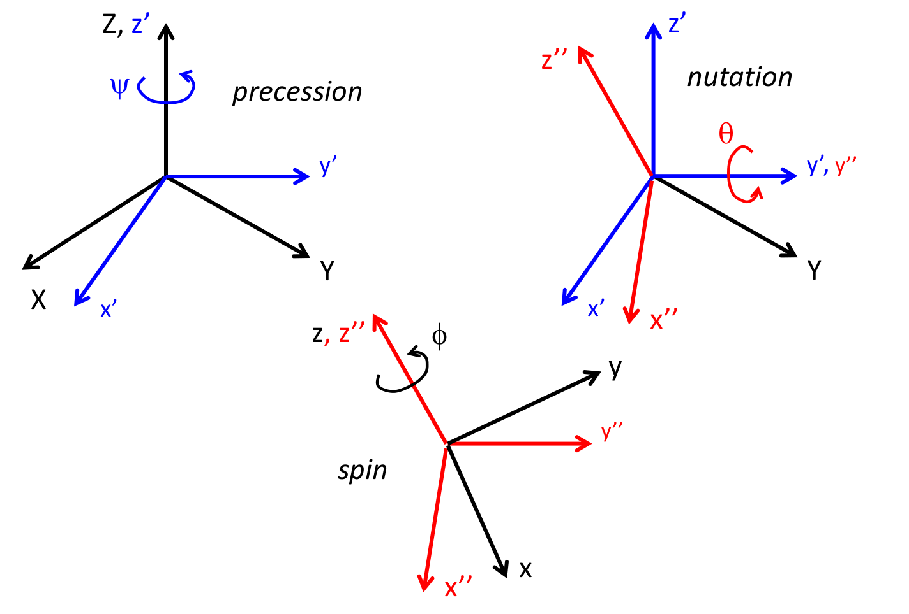
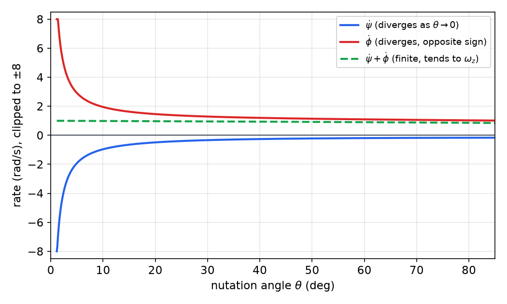
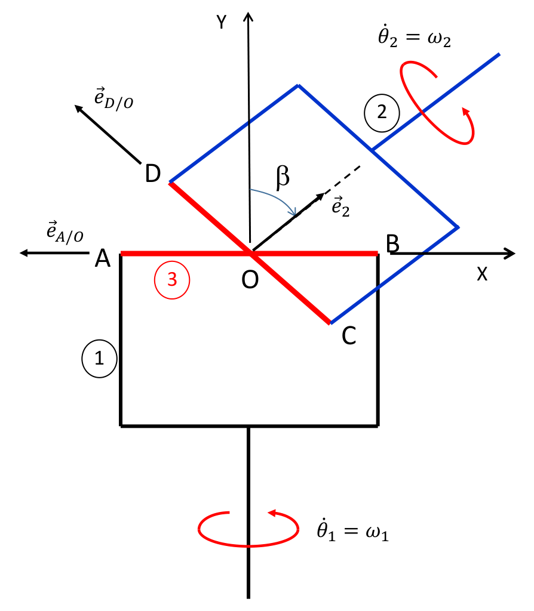
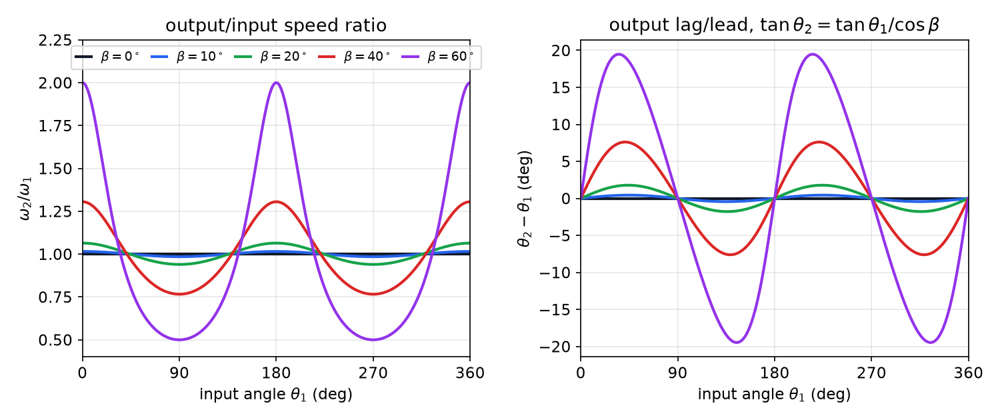
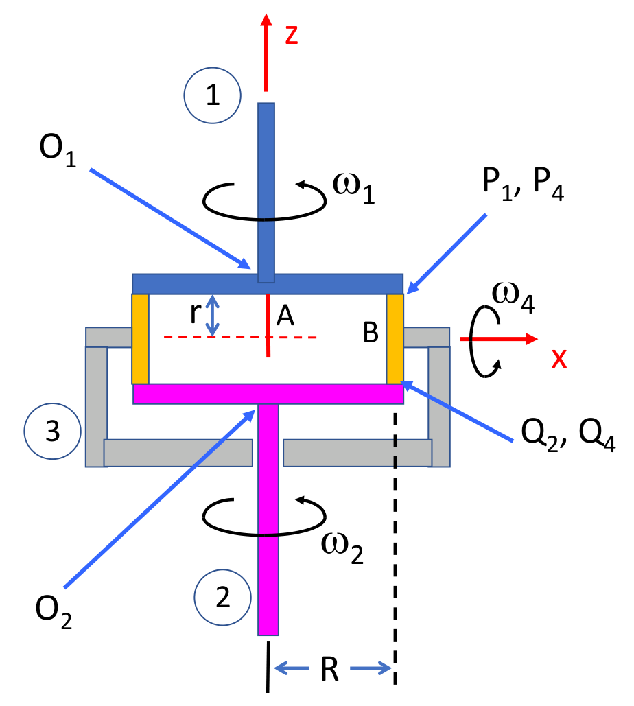
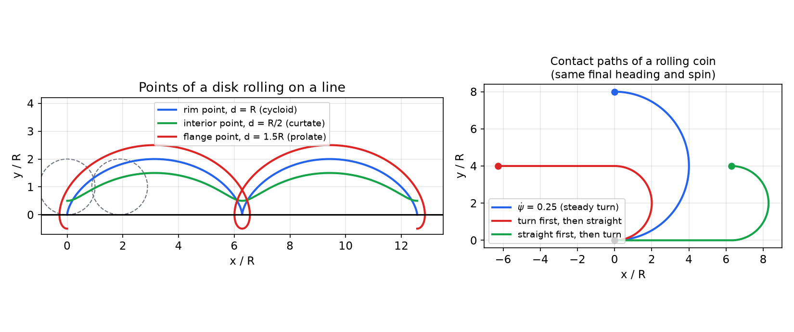
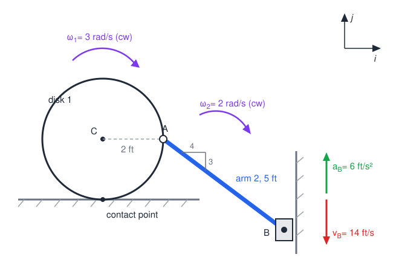

# Rigid-Body Kinematics

The formulas of [Rotating Frames and Relative Motion](relative-motion.md) give the velocity and acceleration of any point of a rigid body once its angular velocity and angular acceleration are known. This chapter supplies what those formulas leave open: how the orientation of a three-dimensional body is described by three angles, how joints such as ball-and-socket, fork-and-clevis and universal joints restrict the motion of linked bodies, and how rolling contact turns into constraints on the rates. Together these constraints let the motion of a whole mechanism be found from a few prescribed inputs, before any force enters the problem.

## Euler Angles

### Three successive rotations

Three numbers are needed to fix the orientation of a body. The Euler-angle description reaches the body frame \\(xyz\\) from a fixed frame \\(XYZ\\) by three rotations applied one after another. Start with the two frames coincident. Rotate by the **precession** angle \\(\psi\\) about \\(Z\\), which gives \\(x'y'z'\\) with \\(z' = Z\\). Rotate by the **nutation** angle \\(\theta\\) about \\(y'\\), which gives \\(x''y''z''\\) with \\(y'' = y'\\). Rotate by the **spin** angle \\(\phi\\) about \\(z''\\), which gives the body frame with \\(z = z''\\). The sequence is z–y–z: the first and third rotations are about axes of the same letter, and the middle one is about a perpendicular axis.

Each rotation is a simple rotation of the previous frame, so the chained-matrix rule of [Rotating Frames and Relative Motion](relative-motion.md) applies:
\\[
\\{x'\\} = [R\_z(\psi)]\\{X\\},\qquad \\{x''\\} = [R\_y(\theta)]\\{x'\\},\qquad \\{x\\} = [R\_z(\phi)]\\{x''\\},
\\]
so \\(\\{x\\} = [R]\\{X\\}\\) with \\([R] = [R\_z(\phi)][R\_y(\theta)][R\_z(\psi)]\\). Multiplying out the three matrices gives

\\[
[R] = \begin{bmatrix} \cos\phi\cos\psi\cos\theta - \sin\phi\sin\psi & \cos\phi\sin\psi\cos\theta + \sin\phi\cos\psi & -\cos\phi\sin\theta \\\\ -\sin\phi\cos\psi\cos\theta - \cos\phi\sin\psi & -\sin\phi\sin\psi\cos\theta + \cos\phi\cos\psi & \sin\phi\sin\theta \\\\ \cos\psi\sin\theta & \sin\psi\sin\theta & \cos\theta \end{bmatrix}.
\\]



*Figure: the three Euler rotations. Top left, precession \\(\psi\\) about \\(Z\\) carries \\(XYZ\\) to \\(x'y'z'\\). Top right, nutation \\(\theta\\) about \\(y'\\) carries \\(x'y'z'\\) to \\(x''y''z''\\). Bottom, spin \\(\phi\\) about \\(z''\\) carries \\(x''y''z''\\) to the body frame \\(xyz\\). Each rotation is taken about an axis of the frame produced by the one before it.*

### Angular velocity

**Theorem (Euler-angle angular velocity).** The angular velocity of the body is the sum of three rate vectors, each about the axis of the rotation that produces it:
\\[
\bar\omega = \dot\psi\\,\bar Z + \dot\theta\\,\bar j'' + \dot\phi\\,\bar k .
\\]
Its components in the body frame are
\\[
\begin{aligned}
\omega\_x &= -\dot\psi\sin\theta\cos\phi + \dot\theta\sin\phi,\\\\
\omega\_y &= \dot\psi\sin\theta\sin\phi + \dot\theta\cos\phi,\\\\
\omega\_z &= \dot\psi\cos\theta + \dot\phi .
\end{aligned}
\\]

*Proof.* The vertical axis \\(\bar Z = \bar z'\\) has components \\((-\sin\theta, 0, \cos\theta)\\) in \\(x''y''z''\\), because the nutation matrix \\([R\_y(\theta)]\\) carries the components of \\(\bar z'\\) to that set. The spin axis \\(\bar k\\) has components \\((0,0,1)\\). Summing the three rates gives the components in \\(x''y''z''\\),
\\[
\\{\omega\\}\_{x''y''z''} = \\{-\dot\psi\sin\theta,\ \dot\theta,\ \dot\phi + \dot\psi\cos\theta\\}^T ,
\\]
and the spin rotation \\([R\_z(\phi)]\\) carries these to the body frame, which gives the three expressions above. \\(\square\\)

The first component of \\(\bar\omega\\) in \\(x''y''z''\\) is \\(-\dot\psi\sin\theta\\), so precession alone tips the spin axis, while nutation and spin enter only through \\(\dot\theta\\) and \\(\dot\phi\\). The body-frame \\(z\\) component is the total spin about the body axis, \\(\dot\phi + \dot\psi\cos\theta\\).

The angular acceleration follows by differentiation. The frame \\(x''y''z''\\) turns only with precession and nutation, so \\(\bar\omega'' = \dot\psi\bar Z + \dot\theta\bar j''\\) and \\(\bar\omega = \bar\omega'' + \dot\phi\bar k\\). Then
\\[
\bar\alpha = \Big(\frac{\partial\bar\omega}{\partial t}\Big)\_{x''y''z''} + \bar\omega''\times\bar\omega ,
\\]
where \\(\bar\omega''\times\bar\omega = \dot\phi\\,\bar\omega''\times\bar k = \dot\phi(\dot\theta\\,\bar i'' + \dot\psi\sin\theta\\,\bar j'')\\). Collecting terms,
\\[
\\{\alpha\\}\_{x''y''z''} = \\{-\ddot\psi\sin\theta - \dot\psi\dot\theta\cos\theta + \dot\theta\dot\phi,\ \ \ddot\theta + \dot\psi\dot\phi\sin\theta,\ \ \ddot\phi + \ddot\psi\cos\theta - \dot\psi\dot\theta\sin\theta\\}^T .
\\]
Because \\(xyz\\) is attached to the body, the body-frame components of \\(\bar\alpha\\) are simply the time derivatives of the components \\(\omega\_x, \omega\_y, \omega\_z\\) above. The two routes give the same result, and the \\(x''y''z''\\) form is the shorter one to write.

### Inverse relations and the singularity

Given the body-frame components of \\(\bar\omega\\), for example from a rate gyro, the Euler rates follow by solving the three equations above. Multiplying the first equation by \\(\sin\phi\\) and the second by \\(\cos\phi\\), and adding, eliminates \\(\dot\psi\\) and leaves \\(\dot\theta\\). Multiplying the second by \\(\sin\phi\\) and the first by \\(\cos\phi\\), and subtracting, eliminates \\(\dot\theta\\) and leaves \\(\dot\psi\sin\theta\\). Then \\(\dot\phi\\) follows from \\(\omega\_z\\):
\\[
\dot\theta = \omega\_x\sin\phi + \omega\_y\cos\phi,\qquad \dot\psi = \frac{\omega\_y\sin\phi - \omega\_x\cos\phi}{\sin\theta},\qquad \dot\phi = \omega\_z - \dot\psi\cos\theta .
\\]

The division by \\(\sin\theta\\) is the warning sign. At \\(\theta = 0\\) the precession axis \\(Z\\) coincides with the spin axis, and \\([R] = [R\_z(\phi + \psi)]\\) depends only on the sum \\(\phi + \psi\\). At \\(\theta = \pi\\) it depends only on \\(\phi - \psi\\). In both cases the motion determines just one combination of the two angles, so \\(\dot\psi\\) and \\(\dot\phi\\) are separately undefined. The figure shows this for fixed body rates: \\(\dot\psi\\) and \\(\dot\phi\\) grow without bound with opposite signs, and only their sum stays finite.



*Figure: Euler rates from the inverse relations for fixed body components \\(\omega\_x = 0.3\\), \\(\omega\_y = 0.2\\), \\(\omega\_z = 1\\) rad/s and \\(\phi = 0.5\\) rad. The rates \\(\dot\psi\\) and \\(\dot\phi\\) diverge as \\(\theta\\) goes to zero, with opposite signs, while their sum tends to \\(\omega\_z\\). At \\(\theta = 0\\) only the sum affects the orientation.*

This is a coordinate singularity of the parametrization, not a property of the body. It is the same mechanism as the azimuth singularity of the spherical pendulum in [Particle Kinematics](particle-kinematics.md). Simulations that pass near \\(\theta = 0\\) either switch to a different angle sequence or integrate the rotation matrix, or unit quaternions, which have no such singularity. The expressions above can be checked symbolically:

```matlab
syms psi theta phi psi_dot theta_dot phi_dot
Rz = @(a) [cos(a) sin(a) 0; -sin(a) cos(a) 0; 0 0 1];
w2 = [-psi_dot*sin(theta); theta_dot; phi_dot + psi_dot*cos(theta)];   % omega in x''y''z''
w  = simplify(Rz(phi)*w2)      % body components, the expressions above
```

## Hooke's Joint

### Geometry and speed ratio

A universal joint, also called a Hooke's or cardan joint, connects two shafts whose axes meet at a point \\(O\\) at angle \\(\beta\\). The input yoke 1 turns about the vertical \\(Y\\) axis at rate \\(\omega\_1\\). The output yoke 2 turns about its own shaft axis \\(\bar e\_2\\), which lies in the \\(XY\\) plane at angle \\(\beta\\) from \\(Y\\). A cross-piece (spider), body 3, joins the yokes at \\(O\\): its arm \\(OA\\) is held by yoke 1 and its arm \\(OD\\) by yoke 2, and the two arms are perpendicular. The output speed is not constant, which is the main drawback of a single joint.



*Figure: the universal joint. Yoke 1 (body 1) turns about \\(Y\\) at \\(\dot\theta\_1 = \omega\_1\\), yoke 2 (body 2) turns about \\(\bar e\_2\\) at \\(\dot\theta\_2 = \omega\_2\\), and the cross (body 3) joins them at \\(O\\). The arm unit vectors \\(\bar e\_{A/O}\\) and \\(\bar e\_{D/O}\\) are perpendicular to each other, \\(\bar e\_{A/O}\\) lies in the plane of yoke 1, and \\(\bar e\_{D/O}\\) is perpendicular to the axis of yoke 2.*

With fixed unit vectors \\(\bar I, \bar J, \bar K\\) along \\(X, Y, Z\\), and with \\(\theta\_1\\) the angle of yoke 1 measured from the \\(-\bar I\\) direction,
\\[
\bar e\_{A/O} = -\cos\theta\_1\\,\bar I + \sin\theta\_1\\,\bar K,\qquad \bar e\_2 = \sin\beta\\,\bar I + \cos\beta\\,\bar J .
\\]
The unit vector \\(\bar e\_{D/O}\\) must be perpendicular to \\(\bar e\_{A/O}\\) and to \\(\bar e\_2\\), so it is parallel to their cross product. The length of that product follows from \\(\lVert\bar a\times\bar b\rVert^2 = 1 - (\bar a\cdot\bar b)^2\\) for unit vectors, with \\(\bar e\_{A/O}\cdot\bar e\_2 = -\sin\beta\cos\theta\_1\\):
\\[
\bar e\_{D/O} = \frac{\bar e\_{A/O}\times\bar e\_2}{\lVert\bar e\_{A/O}\times\bar e\_2\rVert} = \frac{-\sin\theta\_1\cos\beta\\,\bar I + \sin\theta\_1\sin\beta\\,\bar J - \cos\theta\_1\cos\beta\\,\bar K}{\sqrt{1 - \cos^2\theta\_1\sin^2\beta}} .
\\]

The angular velocity of yoke 2 in the ground frame is \\(\omega\_2\bar e\_2\\). The cross turns relative to yoke 1 about \\(\bar e\_{A/O}\\) at a rate \\(\omega\_{31}\\), and yoke 2 turns relative to the cross about \\(\bar e\_{D/O}\\) at a rate \\(\omega\_{23}\\). The addition theorem of [Rotating Frames and Relative Motion](relative-motion.md) then gives
\\[
\omega\_2\\,\bar e\_2 = \omega\_{23}\\,\bar e\_{D/O} + \omega\_{31}\\,\bar e\_{A/O} + \omega\_1\\,\bar J .
\\]

**Example 3.1 (Speed ratio of a universal joint).** Find the output-to-input speed ratio \\(\omega\_2/\omega\_1\\) for a joint of angle \\(\beta\\), and evaluate it for \\(\beta = 40^\circ\\).

*Solution.* Dot the vector equation with the three unit vectors in turn. The equation is a linear system whose unknowns are \\(\omega\_2\\), \\(\omega\_{23}\\) and \\(\omega\_{31}\\), and the dot products decouple it.

- With \\(\bar e\_{A/O}\\): \\(\bar e\_{A/O}\cdot\bar e\_{D/O} = 0\\), \\(\bar e\_{A/O}\cdot\bar e\_{A/O} = 1\\), and \\(\bar e\_{A/O}\cdot\bar J = 0\\), so \\(\omega\_{31} = \omega\_2\\,\bar e\_2\cdot\bar e\_{A/O} = -\omega\_2\sin\beta\cos\theta\_1\\).
- With \\(\bar e\_2\\): \\(\bar e\_2\cdot\bar e\_{D/O} = 0\\), \\(\bar e\_2\cdot\bar e\_{A/O} = -\sin\beta\cos\theta\_1\\), and \\(\bar e\_2\cdot\bar J = \cos\beta\\), so \\(\omega\_2 = -\sin\beta\cos\theta\_1\\,\omega\_{31} + \omega\_1\cos\beta\\). Substituting the first result,
\\[
\omega\_2 = \omega\_1\cos\beta + \omega\_2\sin^2\beta\cos^2\theta\_1 .
\\]

Solving,
\\[
\boxed{\frac{\omega\_2}{\omega\_1} = \frac{\cos\beta}{1 - \cos^2\theta\_1\sin^2\beta}}
\\]
For \\(\beta = 40^\circ\\) the ratio is \\(1/\cos40^\circ = 1.305\\) at \\(\theta\_1 = 0\\) and \\(180^\circ\\), and \\(\cos40^\circ = 0.766\\) at \\(\theta\_1 = 90^\circ\\) and \\(270^\circ\\). \\(\square\\)

The ratio is never exactly one unless \\(\beta = 0\\). It oscillates twice per revolution between \\(\cos\beta\\) and \\(1/\cos\beta\\). For \\(\beta = 10^\circ\\) the fluctuation is under 3 percent, between 0.985 and 1.015, but at \\(\beta = 60^\circ\\) the output speed swings between 0.5 and 2. Integrating the ratio gives \\(\tan\theta\_2 = \tan\theta\_1/\cos\beta\\), so the output angle also leads and lags the input. Two universal joints in series, correctly phased, cancel the fluctuation and form a constant-velocity joint, which is why joints are normally used in tandem.



*Figure: left, the speed ratio \\(\omega\_2/\omega\_1\\) against input angle for \\(\beta\\) from \\(0\\) to \\(60^\circ\\). The curves equal \\(1/\cos\beta\\) at \\(\theta\_1 = 0\\) and \\(\cos\beta\\) at \\(\theta\_1 = 90^\circ\\), and the fluctuation vanishes as \\(\beta\\) does. Right, the resulting angular error \\(\theta\_2 - \theta\_1\\) from \\(\tan\theta\_2 = \tan\theta\_1/\cos\beta\\).*

## Automobile Differential

A differential lets the two driven wheels turn at different speeds while the ring gear drives them together. In the kinematic model, body 3 is the carrier, driven through the ring gear and turning about the axle axis \\(z\\) at \\(\omega\_3\\). Body 4 is the spider gear, of radius \\(r\\), mounted on the carrier so that it can spin about the \\(x\\) axis at \\(\omega\_4\\) relative to the carrier. Bodies 1 and 2 are the side gears on the two half-axles, turning about \\(z\\) at \\(\omega\_1\\) and \\(\omega\_2\\). The side gears and the spider's center \\(B\\) lie at radius \\(R\\) from the axis, and the two contact points \\(P\\) (spider with side gear 1) and \\(Q\\) (spider with side gear 2) lie at \\(\bar r\_{P/B} = r\bar k\\) and \\(\bar r\_{Q/B} = -r\bar k\\).

**Example 3.2 (Differential speed relations).** Find \\(\omega\_3\\) and \\(\omega\_4\\) in terms of \\(\omega\_1\\) and \\(\omega\_2\\).

*Solution.* The spider's angular velocity, valid for all time, is \\(\bar\omega\_{4/0} = \omega\_4\bar i + \omega\_3\bar k\\). The center \\(A\\) of the carrier is on the axis, so \\(\bar v\_A = \bar 0\\) and
\\[
\bar v\_B = \omega\_3\bar k\times R\bar i = \omega\_3R\\,\bar j .
\\]
At the contact \\(P\\), the spider's velocity is \\(\bar v\_{P4} = \bar v\_B + \bar\omega\_{4/0}\times r\bar k = (\omega\_3R - \omega\_4r)\\,\bar j\\). Side gear 1 has \\(\bar v\_{P1} = \omega\_1R\\,\bar j\\). The two contact points must have equal velocities, so
\\[
\omega\_3R - \omega\_4r = \omega\_1R .
\\]
At \\(Q\\), \\(\bar\omega\_{4/0}\times(-r\bar k) = +\omega\_4r\\,\bar j\\), and the same argument gives \\(\omega\_3R + \omega\_4r = \omega\_2R\\). Adding and subtracting the two equations,
\\[
\boxed{\omega\_3 = \frac{\omega\_1 + \omega\_2}{2},\qquad \omega\_4 = \Big(\frac{\omega\_2 - \omega\_1}{2}\Big)\frac{R}{r}}
\\]
\\(\square\\)

The carrier turns at the average of the two wheel speeds. The spider spins only when the wheels turn at different speeds, and on straight travel \\(\omega\_1 = \omega\_2 = \omega\_3\\) and \\(\omega\_4 = 0\\). The same contact-velocity argument, applied to a pair of rolling bodies, is the basic tool for any rolling mechanism.



*Figure: schematic of an automobile differential. Bodies 1 and 2 are the side gears on the two axles, body 3 is the carrier driven through the ring gear, and body 4 is the spider gear mounted on the carrier. The contact points \\(P\\) and \\(Q\\) are the spider's rim contacts with the side gears, and the rolling conditions at \\(P\\) and \\(Q\\) give the two equations of Example 3.2.*

## Joints and Constrained Bars

### Ball-and-socket and fork-and-clevis joints

A **ball-and-socket** joint fixes a point of one body to a point of another, and the bar may turn freely about that point in any direction. Its velocity constraint is that the two points have equal velocities. A **fork-and-clevis** (pin) joint allows rotation about the pin axis, and a clevis that slides on a guide also turns about the guide's axis. Between two such joints, the bar's angular velocity has two independent rates. If the clevis turns with the rate \\(\dot\psi\\) about the guide direction \\(\bar J\\), and the bar turns about the pin axis \\(\bar e\_{\text{pin}}\\) at \\(\dot\beta\\), then
\\[
\bar\omega\_{AB} = \dot\beta\\,\bar e\_{\text{pin}} + \dot\psi\\,\bar J ,
\\]
where \\(\bar e\_{\text{pin}}\\) is perpendicular to both \\(\bar J\\) and the bar. Because the pin axis is carried by the clevis, its rate of change is \\(\dot{\bar e}\_{\text{pin}} = \dot\psi\\,\bar J\times\bar e\_{\text{pin}}\\), and the acceleration formula of [Rotating Frames and Relative Motion](relative-motion.md) becomes
\\[
\bar\alpha\_{AB} = \ddot\beta\\,\bar e\_{\text{pin}} + \dot\beta\dot\psi\\,\bar J\times\bar e\_{\text{pin}} + \ddot\psi\\,\bar J .
\\]

The velocity and acceleration of the bar's ends are linked by \\(\bar v\_A = \bar v\_B + \bar\omega\_{AB}\times\bar r\_{A/B}\\) and \\(\bar a\_A = \bar a\_B + \bar\alpha\_{AB}\times\bar r\_{A/B} + \bar\omega\_{AB}\times(\bar\omega\_{AB}\times\bar r\_{A/B})\\). Each vector equation gives three scalar equations for the unknown rates. Their structure is always the same: the velocity equations are linear in the rates, and once the rates are known the acceleration equations are linear in the second derivatives. This is the reason numerical simulation of mechanisms works (see [Constrained Systems and Their Simulation](constrained-systems.md)).

**Example 3.3 (Bar between a sliding collar and a clevis).** A bar \\(AB\\) has a ball-and-socket at \\(A\\), which slides on the vertical \\(Z\\) axis, and a clevis at \\(B\\), which slides along a horizontal guide parallel to \\(Y\\) at \\(X = 1\\) m. At the instant considered \\(A\\) is 2 m above \\(O\\) and \\(B\\) is at \\((1, 2, 0)\\) m, so \\(\bar r\_{A/B} = -\bar I - 2\bar J + 2\bar K\\) m. The clevis moves with \\(\bar v\_B = 3\bar J\\) m/s, constant. Find the rates \\(\dot\beta\\) and \\(\dot\psi\\) and the accelerations \\(\ddot\beta\\), \\(\ddot\psi\\) and \\(\dot v\_A\\), where \\(v\_A\\) is the downward speed of \\(A\\).

*Solution.* The pin axis is \\(\bar e\_{\text{pin}} = \bar J\times\bar r\_{A/B}/\lVert\bar J\times\bar r\_{A/B}\rVert = (0.8944, 0, 0.4472)\\), and \\(\bar J\times\bar r\_{A/B} = (2, 0, 1)\\). Using \\(\bar v\_A = -v\_A\bar K\\) (downward), the velocity equation \\(\bar v\_A = \bar v\_B + \bar\omega\_{AB}\times\bar r\_{A/B}\\) has the components
\\[
\begin{aligned}
x:&\quad 0.8944\\,\dot\beta + 2\\,\dot\psi = 0,\\\\
y:&\quad 3 - 2.2361\\,\dot\beta = 0,\\\\
z:&\quad -1.7889\\,\dot\beta + \dot\psi + v\_A = 0 .
\end{aligned}
\\]
The \\(y\\) equation gives \\(\dot\beta = 1.3416\\) rad/s, the \\(x\\) equation gives \\(\dot\psi = -0.6\\) rad/s, and the \\(z\\) equation gives \\(v\_A = 3\\) m/s downward.

With these rates, \\(\bar\omega\_{AB} = (1.2, -0.6, 0.6)\\) rad/s, \\(\bar\omega\_{AB}\times\bar r\_{A/B} = (0, -3, -3)\\) m/s, and \\(\bar\omega\_{AB}\times(\bar\omega\_{AB}\times\bar r\_{A/B}) = (3.6, 3.6, -3.6)\\) m/s². The angular acceleration is \\(\bar\alpha = (0.8944\ddot\beta - 0.36,\ \ddot\psi,\ 0.4472\ddot\beta + 0.72)\\) rad/s², and \\(\bar a\_B = \bar 0\\). The acceleration equation \\(\bar a\_A = \bar\alpha\times\bar r\_{A/B} + \bar\omega\times(\bar\omega\times\bar r\_{A/B})\\), with \\(\bar a\_A = -\dot v\_A\bar K\\), gives three equations, whose solution is
\\[
\ddot\beta = 1.610\ \text{rad/s}^2,\qquad \ddot\psi = -3.240\ \text{rad/s}^2,\qquad \dot v\_A = 9.0\ \text{m/s}^2\ \text{(downward)} .
\\]

```matlab
syms va betadot psidot vadot betaddot psiddot
r = [-1; -2; 2];  J = [0; 1; 0];  K = [0; 0; 1];
e = cross(J,r);  e = e/norm(e);                    % pin axis, [0.8944 0 0.4472]
w = betadot*e + psidot*J;
sol = solve(3*J + cross(w,r) + va*K, va, betadot, psidot);
Va = double(sol.va), Betadot = double(sol.betadot), Psidot = double(sol.psidot)   % 3, 1.3416, -0.6
W = Betadot*e + Psidot*J;
alpha = betaddot*e + Betadot*cross(W,e) + psiddot*J;
sol2 = solve(cross(alpha,r) + cross(W,cross(W,r)) + vadot*K, vadot, betaddot, psiddot);
```

The example illustrates the general procedure: write the velocity of each joint point, equate them through the bar's rotation, solve the linear velocity equations, and then repeat for accelerations using the rates just found.

## Rolling Contact

### Rolling without slip

Two bodies in contact roll without slipping when the material points that coincide at the contact have equal velocities. If one body is a fixed surface, the material point of the rolling body at contact has zero velocity. Consider a disk of radius \\(R\\) rolling on a horizontal floor, with center \\(G\\) and angular velocity \\(\omega\\) counterclockwise. The contact point is \\(P\\), with \\(\bar r\_{P/G} = -R\bar j\\), and
\\[
\bar v\_P = \bar v\_G + \omega\bar k\times(-R\bar j) = (v\_G + \omega R)\\,\bar i = \bar 0
\quad\Longrightarrow\quad v\_G = -R\omega .
\\]
The center moves in the direction opposite to the counterclockwise turning, which is the familiar rule for a wheel rolling to the right. Differentiating the constraint gives \\(a\_G = -R\alpha\\). The contact point has zero velocity but in general nonzero acceleration. The rolling condition is therefore a velocity constraint, and its time derivative supplies the acceleration relation.

A point on the rim of such a wheel traces a **cycloid**. If the wheel has turned through angle \\(\theta\\) from the position where the rim point touches the floor, the rim point is at
\\[
x = R\theta - R\sin\theta,\qquad y = R(1 - \cos\theta) .
\\]
The cusps of the curve are the contact points, where the point is momentarily at rest.



*Figure: left, the paths of three points of a disk rolling on a line, which is the cycloid for the rim point, the curtate curve for an interior point and the prolate curve for a flange point. Right, contact paths of a rolling coin with the same final heading and spin, for a steady turn (blue) and for a turn that is taken first (red) or last (green). The contact point of a rolling body traces a path on the ground, and that path is fixed by the rolling constraint.*

### Example 3.4 (Rolling disk driving a slider through an arm)

A disk \\(\mathcal B\_1\\) of radius 2 ft rolls without slipping on the ground. An arm \\(\mathcal B\_2\\) of length 5 ft connects a point \\(A\\) on the disk rim, level with the center \\(C\\), to a slider \\(B\\) that moves vertically. At the instant considered \\(v\_B = 14\\) ft/s downward, \\(\omega\_1 = 3\\) rad/s clockwise, \\(\omega\_2 = 2\\) rad/s clockwise, and \\(a\_B = 6\\) ft/s² upward. Find the angular accelerations \\(\alpha\_1\\) and \\(\alpha\_2\\).



*Figure: the rolling disk, with the arm \\(AB\\) from the rim point \\(A\\) (level with the center \\(C\\)) to the slider \\(B\\). The arm vector is \\(\bar r\_{B/A} = 4\bar i - 3\bar j\\) ft.*

*Solution.* Take counterclockwise as positive for \\(\alpha\_1\\) and \\(\alpha\_2\\). The rates \\(\omega\_1\\) and \\(\omega\_2\\) enter the acceleration only through their squares, and the velocity data are needed only to fix their signs. With \\(\bar r\_{A/C} = 2\bar i\\) ft,
\\[
\bar a\_A = \bar a\_C + \alpha\_1\bar k\times 2\bar i - \omega\_1^2\\,2\bar i = \bar a\_C + 2\alpha\_1\bar j - 18\bar i .
\\]
Differentiating the rolling condition \\(v\_C = -R\omega\_1\\), with \\(R = 2\\) ft, gives \\(\bar a\_C = -2\alpha\_1\bar i\\). For the arm, with \\(\bar r\_{B/A} = 4\bar i - 3\bar j\\) ft,
\\[
\bar a\_B = \bar a\_A + \alpha\_2\bar k\times(4\bar i - 3\bar j) - \omega\_2^2(4\bar i - 3\bar j) = 6\bar j\ \text{ft/s}^2 .
\\]
Substituting \\(\bar a\_A\\) and collecting components,
\\[
\begin{aligned}
\bar i:&\quad -2\alpha\_1 + 3\alpha\_2 = 34,\\\\
\bar j:&\quad 2\alpha\_1 + 4\alpha\_2 = -6 .
\end{aligned}
\\]
Solving, \\(\alpha\_2 = 4\\) rad/s² counterclockwise and \\(\alpha\_1 = -11\\) rad/s², that is, \\(\alpha\_1 = 11\\) rad/s² clockwise. \\(\square\\)

No force enters this problem: the accelerations follow from the kinematic constraints alone. The same structure, with the rolling condition as one of the equations, appears in every rolling problem, and the three-dimensional version is the contact-velocity condition used for the differential and for the bevel gear in [Newton–Euler Equations of Rigid-Body Motion](newton-euler.md).

### Rolling constraints in three dimensions

In three dimensions the rolling condition is still a statement that the velocities of coincident contact points are equal, but it now gives three scalar equations for each contact. Some of them fix the spin of a body relative to its carrier, and the others fix the motion of the carrier. The differential of this chapter is the simplest case, where the spider's spin is fixed by the difference of the wheel speeds. For a bevel gear rolling on a fixed bevel gear, the contact condition gives the spin relative to the arm directly, and the contact line passes through the common apex of the two pitch cones. Those kinematic results are used in the kinetics of [Newton–Euler Equations of Rigid-Body Motion](newton-euler.md).

## Summary

- **Euler angles:** \\([R] = [R\_z(\phi)][R\_y(\theta)][R\_z(\psi)]\\) for the z–y–z sequence. Angular velocity \\(\bar\omega = \dot\psi\bar Z + \dot\theta\bar j'' + \dot\phi\bar k\\), with body components \\(\omega\_x = -\dot\psi\sin\theta\cos\phi + \dot\theta\sin\phi\\), \\(\omega\_y = \dot\psi\sin\theta\sin\phi + \dot\theta\cos\phi\\), \\(\omega\_z = \dot\psi\cos\theta + \dot\phi\\).
- **Inverse relations:** \\(\dot\theta = \omega\_x\sin\phi + \omega\_y\cos\phi\\), \\(\dot\psi = (\omega\_y\sin\phi - \omega\_x\cos\phi)/\sin\theta\\), \\(\dot\phi = \omega\_z - \dot\psi\cos\theta\\). The rates are singular at \\(\theta = 0\\) and \\(\theta = \pi\\), where only \\(\phi \pm \psi\\) is determined.
- **Universal joint:** \\(\omega\_2/\omega\_1 = \cos\beta/(1 - \cos^2\theta\_1\sin^2\beta)\\), oscillating between \\(\cos\beta\\) and \\(1/\cos\beta\\) twice per revolution.
- **Differential:** \\(\omega\_3 = (\omega\_1 + \omega\_2)/2\\) and \\(\omega\_4 = (\omega\_2 - \omega\_1)R/(2r)\\), from equal contact velocities at both sides of the spider.
- **Joints:** a bar with ball-and-socket and clevis joints has \\(\bar\omega = \dot\beta\\,\bar e\_{\text{pin}} + \dot\psi\bar J\\); the velocity equations are linear in the rates, and the acceleration equations are linear in the second derivatives.
- **Rolling:** the contact-point velocity is zero, so \\(v\_G = -R\omega\\) on a flat floor and \\(a\_G = -R\alpha\\); a rim point traces a cycloid whose cusps are the contact points.

## See Also

- [Rotating Frames and Relative Motion](relative-motion.md): the rotation matrices, angular velocity and moving-frame formulas used throughout this chapter.
- [Particle Kinematics](particle-kinematics.md): the spherical pendulum, whose azimuth singularity has the same origin as the Euler-angle singularity.
- [Inertia and Momentum of Rigid Bodies](inertia-momentum.md): the inertia tensor and the momentum of a rigid body, which the kinematics feeds.
- [Newton–Euler Equations of Rigid-Body Motion](newton-euler.md): the equations of motion that use the rates and constraints of this chapter.
- [Lagrange's Equations](lagrange.md) and [Constrained Systems and Their Simulation](constrained-systems.md): constrained equations of motion and their numerical solution.
- Kinematics: the introductory overview of rigid-body and rolling motion.
- [Spatial Descriptions and Transformations](../me6407-robotics/spatial-descriptions.md) and [Forward Kinematics](../me6407-robotics/forward-kinematics.md): the robotics treatment of frames, joints and orientation.
- Rigid-Body Dynamics: the physics viewpoint on rigid-body rotation.
