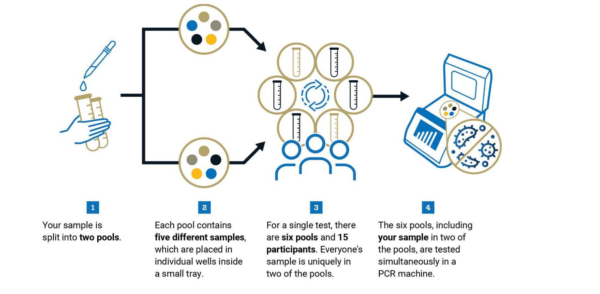
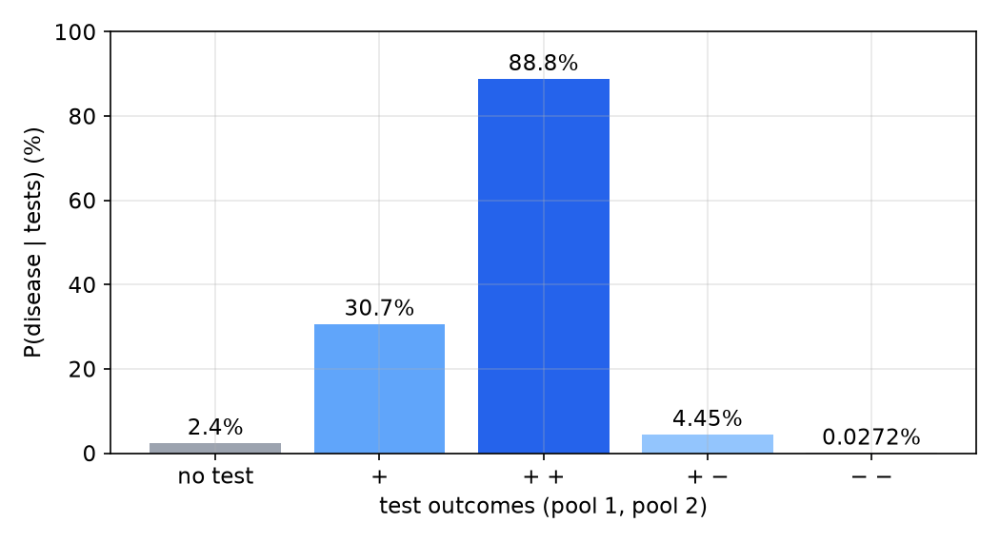
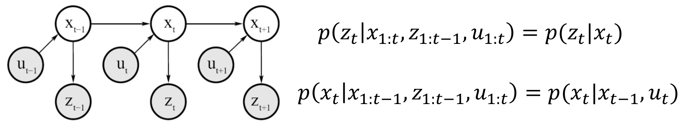
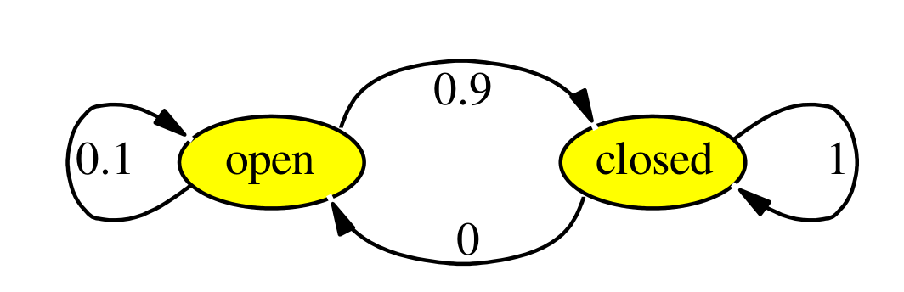
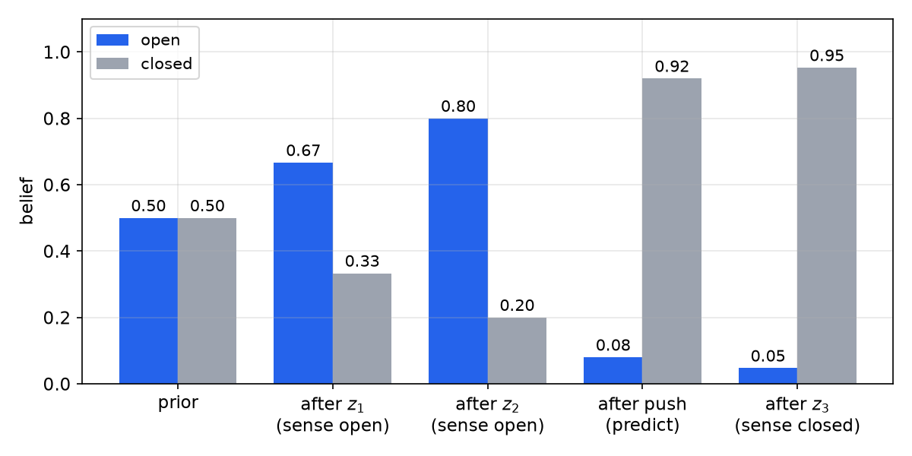
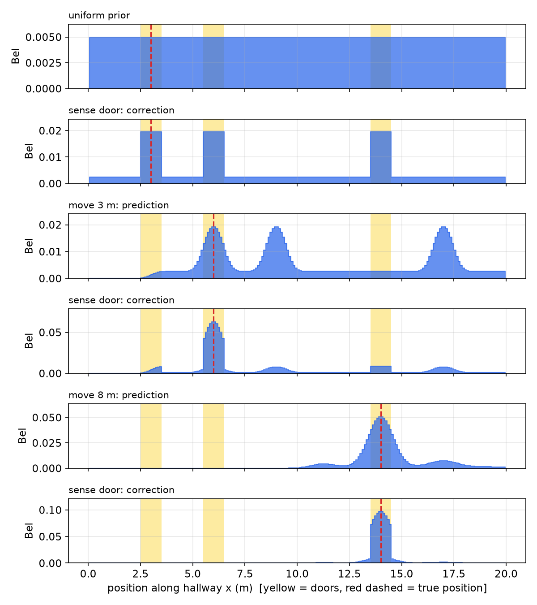

# Bayesian State Estimation

Dead reckoning is short-sighted: it integrates noisy increments and has no notion of its own uncertainty. A robot that carries a probability distribution over its state, a **belief**, and updates it rigorously as it moves and senses, can recover from bad odometry, fuse imperfect sensors and know when it does not know. This chapter reviews the probability needed, develops Bayes' rule through a diagnostic-test example, and derives the **Bayes filter**, the prediction–correction recursion on which particle filters, Kalman filters and hidden Markov models are all built. A grid ("histogram") implementation localizes a robot in a corridor with doors.

## Why Probabilistic Robotics?

The motion model of a robot rests on assumptions: no wheel slip, motion in a plane, and a robot that is never picked up and moved ("kidnapped"). Sensor models rest on others. It is impossible to model everything, and the systems are time-varying: actuators and sensors degrade. A robot that treats its estimate as the truth, an "arrogant" robot, is inherently flawed in a dynamic, uncertain world. A more "humble" robot knows its limitations: it operates on a **belief** about its state rather than an absolute state, and it incorporates probability into estimation. In the words of Thrun, Burgard and Fox (*Probabilistic Robotics*, Ch. 1): "A robot that carries a notion of its own uncertainty and acts accordingly is superior to one that does not."

The probabilistic approach accommodates inaccurate models and imperfect sensors, is robust in real-world applications, and is the best known approach to many hard robotics problems (global localization, SLAM). Its pitfalls are computational cost, the risk of false modelling assumptions (independence, Gaussianity), and the need for approximations.

## A Quick Review of Probability

### Random variables

A **discrete random variable** \\(X\\) takes one of finitely many values \\(\\{x\_1, \dots, x\_n\\}\\), with \\(P(X = x\_i) = P(x\_i)\\). The function \\(P(\cdot)\\) is the **probability mass function** (pmf); its values are non-negative and sum to one. For example, the probability that a robot is in each of four rooms might be \\(P(\text{Room}) = \langle 0.7, 0.2, 0.08, 0.02\rangle\\).

A **continuous random variable** has a **probability density function** (pdf) \\(p(x)\\) with
\\[
\Pr(x\in[a, b]) = \int\_a^b p(x)\\,dx, \qquad \int\_{-\infty}^{\infty}p(x)\\,dx = 1 .
\\]
A density can exceed one; only its integrals are probabilities. Densities can be unimodal (one bump, like a Gaussian) or multimodal (several bumps), and the multimodal case is exactly what arises when a robot is uncertain *which* of several similar places it is in.

### Joint, marginal and conditional probability

The **joint** probability \\(P(X = x \text{ and } Y = y) = P(x, y)\\). If \\(X\\) and \\(Y\\) are **independent**, \\(P(x, y) = P(x)P(y)\\). The **conditional** probability of \\(x\\) given \\(y\\) is
\\[
P(x\mid y) = \frac{P(x, y)}{P(y)}, \qquad\text{equivalently}\qquad P(x, y) = P(x\mid y)P(y),
\\]
and for independent variables \\(P(x\mid y) = P(x)\\): knowing \\(y\\) tells nothing about \\(x\\).

**Example 1 (Favourite-game survey).** A (made-up) survey of 500 players records gender and favourite game.

| | Male | Female | Total |
|---|---|---|---|
| Mario | 120 | 80 | 200 |
| Zelda | 25 | 100 | 125 |
| Other | 50 | 125 | 175 |
| Total | 195 | 305 | 500 |

Dividing by 500 gives the joint distribution \\(P(\text{Gender}, \text{Game})\\) in the interior cells and the marginals in the margins:

| | Male | Female | \\(P(\text{Game})\\) |
|---|---|---|---|
| Mario | 0.24 | 0.16 | 0.40 |
| Zelda | 0.05 | 0.20 | 0.25 |
| Other | 0.10 | 0.25 | 0.35 |
| \\(P(\text{Gender})\\) | 0.39 | 0.61 | 1 |

*Joint.* \\(P(\text{Male}, \text{Mario}) = 120/500 = 0.24\\).

*Marginals.* Summing a joint over one variable gives the distribution of the other: \\(P(x) = \sum\_y P(x, y)\\). The bottom row \\((0.39, 0.61)\\) is \\(P(\text{Gender})\\); the right column \\((0.40, 0.25, 0.35)\\) is \\(P(\text{Game})\\).

*Conditional.* A male player has just bought a console; what is the probability his favourite game will be Zelda?
\\[
P(\text{Zelda}\mid\text{Male}) = \frac{P(\text{Zelda}, \text{Male})}{P(\text{Male})} = \frac{0.05}{0.39} = 0.13 .
\\]
The whole conditional distribution is the Male column divided by its total: \\(P(\text{Game}\mid\text{Male}) = (0.24, 0.05, 0.10)/0.39 = (0.62, 0.13, 0.26)\\), which sums to one up to rounding. Compared with the marginal \\((0.40, 0.25, 0.35)\\), conditioning on gender sharpens the prediction: more information gives a better prediction of the outcome.

### The law of total probability

Because the joint sums (integrates) to the marginal and the joint factors into conditional times marginal,
\\[
P(x) = \sum\_y P(x, y) = \sum\_y P(x\mid y)P(y), \qquad p(x) = \int p(x, y)\\,dy = \int p(x\mid y)p(y)\\,dy .
\\]
This "sum over the ways it could have happened" is the engine of the prediction step below.

## Bayes' Rule

Writing the joint both ways, \\(P(x, y) = P(x\mid y)P(y) = P(y\mid x)P(x)\\), and dividing gives

**Theorem (Bayes' rule).** For \\(P(y) > 0\\),
\\[
\boxed{P(x\mid y) = \frac{P(y\mid x)\\,P(x)}{P(y)} = \frac{\text{likelihood}\times\text{prior}}{\text{evidence}}, \qquad P(y) = \sum\_{x'}P(y\mid x')P(x').}
\\]

- \\(P(x)\\) is the **prior**: what we believed about \\(x\\) before the observation.
- \\(P(x\mid y)\\) is the **posterior**: what we believe after observing \\(y\\).
- \\(P(y\mid x)\\) is the **likelihood**: a model of how the observation is generated from the state, here the sensor model.
- \\(P(y)\\) is the **evidence**: the overall probability of the observation. It does not depend on \\(x\\), so it only normalizes the posterior; by total probability it is the sum of likelihood times prior over all states.

The evidence's independence of \\(x\\) is often exploited by writing \\(P(x\mid y) = \eta\\,P(y\mid x)P(x)\\) and computing \\(\eta\\) at the end so that the posterior sums to one.

### Example: a diagnostic test

**Example 2 (Screening test).** A test is 90% accurate in detecting a disease that occurs in 2.4% of the population. You test positive. What is the probability that you have the disease?

*Context.* The prevalence of a contagious infection in a population typically ranges from 0.3% to 2.4% (the high end in metropolitan areas at the peak of an epidemic), and assume the test detects 85–95% of true cases. Take the peak prevalence 2.4% and 90% detection. "Accuracy" here is really **sensitivity**, the fraction of diseased people who test positive, which is not the same as accuracy (the fraction of all tests that are correct); see [Machine Learning for Robotics](learning.md) for the distinction.

*Model.* Let \\(x\\) = "has the disease" and \\(y\\) = "tests positive":
\\[
P(x) = 0.024, \qquad P(y\mid x) = 0.90,\quad P(\neg y\mid x) = 0.10, \qquad P(y\mid\neg x) = 0.05,\quad P(\neg y\mid\neg x) = 0.95 .
\\]
The false-positive rate \\(P(y\mid\neg x) = 0.05\\) has to be given separately. Complements work *within* a conditioning event, \\(P(y\mid x) = 1 - P(\neg y\mid x)\\), but in general \\(P(y\mid x)\neq 1 - P(y\mid\neg x)\\).

*Evidence.* By total probability,
\\[
P(y) = P(y\mid x)P(x) + P(y\mid\neg x)P(\neg x) = 0.90(0.024) + 0.05(0.976) = 0.0216 + 0.0488 = 0.0704 .
\\]

*Posterior.*
\\[
P(x\mid y) = \frac{P(y\mid x)P(x)}{P(y)} = \frac{0.0216}{0.0704} = 0.307 .
\\]
Despite a positive result from a "90% accurate" test, the probability of disease is only about 31%.

*Intuition.* Of 1000 people, about 24 have the disease and about \\(24\times0.9\approx 21\\) of them test positive. Of the 976 healthy people, \\(976\times0.05\approx 49\\) also test positive. So about 70 people test positive, of whom only 21 are sick: \\(21/70 = 0.3\\). When the disease is rare, false positives from the large healthy population swamp the true positives.

### Recursive updating: the posterior becomes the prior

Bayes' rule is not meant to be applied once. Bayes' own thought experiment: an assistant throws a ball onto a table out of sight; then throws more balls and reports only whether each landed left or right, above or below the first. Every report updates the belief about where the first ball lies, and with more "measurements" the belief concentrates. The posterior after one observation is the prior for the next.

**Example 2, continued (Dual-pool testing).** Pooled saliva testing makes this concrete. In a dual-pool scheme, each participant's sample is split into two pools; each pool contains five different samples; a single run tests six pools covering fifteen participants, each sample appearing in exactly two pools; all six pools are tested together by PCR. Only if *both* of a participant's pools are positive is that person recommended for an individual follow-up diagnostic test. The double-positive requirement minimizes false positives.



*Figure: dual-pool testing. (1) Each sample is split into two pools; (2) each pool holds five different samples; (3) six pools cover fifteen participants, each in two pools; (4) all pools are tested at once.*

Treat the two pool results as two conditionally independent tests with the sensitivity and false-positive rate above (an idealization: the pools share your sample). After a first positive the belief is \\(P(x\mid y\_1) = 0.307\\).

*Second test positive.* The prior is now 0.307:
\\[
P(y\_2\mid y\_1) = 0.90(0.307) + 0.05(0.693) = 0.276 + 0.035 = 0.311, \qquad P(x\mid y\_1, y\_2) = \frac{0.276}{0.311} = 0.89 .
\\]
*Second test negative.* The likelihoods are now \\(P(\neg y\mid x) = 0.10\\) and \\(P(\neg y\mid\neg x) = 0.95\\):
\\[
P(\neg y\_2\mid y\_1) = 0.10(0.307) + 0.95(0.693) = 0.0307 + 0.6585 = 0.689, \qquad P(x\mid y\_1, \neg y\_2) = \frac{0.0307}{0.689} = 0.045 .
\\]
*Both negative.* Starting from the prior twice:
\\[
P(x\mid\neg y\_1, \neg y\_2) = \frac{0.024(0.1)^2}{0.024(0.1)^2 + 0.976(0.95)^2} = \frac{0.00024}{0.00024 + 0.8808} = 0.027\\% .
\\]
In summary: both pools negative, about 0.03%; one positive and one negative, about 5%; both positive, about 90%. This is why only a double positive triggers follow-up.



*Figure: probability of disease after each combination of two test outcomes, computed recursively with the posterior of the first test as the prior of the second. One positive raises 2.4 % to 31 %; two positives give 89 %; a disagreeing pair falls back to 4.5 %.*

## Bayes' Rule for a Robot Sensor

### Causal versus diagnostic reasoning

A robot points a sensor at a door and obtains a measurement \\(z\\). What is \\(P(\text{open}\mid z)\\)? With \\(x\\) the door state and \\(z\\) the sensor reading: the prior is whether the door is open or closed before measuring; the likelihood is the probability of the reading given the door state; the evidence is the probability of the reading; the posterior is the belief after the measurement.

\\(P(\text{open}\mid z)\\) is **diagnostic** reasoning, from effect to cause. \\(P(z\mid\text{open})\\) is **causal** reasoning, from cause to effect. Causal knowledge is usually much easier to obtain: open and close the door many times and record what the sensor says. Bayes' rule converts it into the diagnostic quantity we need:
\\[
P(\text{open}\mid z) = \frac{P(z\mid\text{open})P(\text{open})}{P(z)}, \qquad P(z) = \sum\_{x}P(z\mid x)P(x).
\\]

**Example 3 (Door sensor).** Let \\(P(z\mid\text{open}) = 0.6\\), \\(P(z\mid\neg\text{open}) = 0.3\\) and \\(P(\text{open}) = P(\neg\text{open}) = 0.5\\). Then
\\[
P(\text{open}\mid z) = \frac{0.6\cdot0.5}{0.6\cdot0.5 + 0.3\cdot0.5} = \frac{0.3}{0.45} = \frac23 = 0.67 .
\\]
The measurement \\(z\\) raises the probability that the door is open from 0.5 to 0.67.

### Recursive Bayesian estimation

Suppose measurements \\(z\_1, z\_2, \dots\\) arrive one at a time, and assume they are **conditionally independent given the state**: \\(P(z\_n\mid x, z\_{1:n-1}) = P(z\_n\mid x)\\) (the sensor's noise on one reading tells nothing about its noise on the next, once the true state is known). At step 1, Bayes' rule gives \\(P(x\mid z\_1) = P(z\_1\mid x)P(x)/P(z\_1)\\). At step 2, apply Bayes' rule conditioned throughout on \\(z\_1\\):
\\[
P(x\mid z\_1, z\_2) = \frac{P(z\_2\mid x, z\_1)P(x\mid z\_1)}{P(z\_2\mid z\_1)} = \frac{P(z\_2\mid x)P(x\mid z\_1)}{P(z\_2\mid z\_1)} .
\\]
The prior for step 2 is the posterior of step 1. By induction,
\\[
P(x\mid z\_{1:n}) = \frac{P(z\_n\mid x)\\,P(x\mid z\_{1:n-1})}{P(z\_n\mid z\_{1:n-1})} = \eta\_n\\,P(z\_n\mid x)\\,P(x\mid z\_{1:n-1}).
\\]
This can only be computed incrementally (recursively): step \\(n\\) needs the posterior of step \\(n-1\\). The denominator is the same for every value of \\(x\\), so it is replaced by a normalizer \\(\eta\_n\\) (often written \\(\alpha\\)), a reminder that the result must be normalized to sum to one. Note that the evidence \\(P(z\_n\mid z\_{1:n-1})\\) is *not* \\(P(z\_n)\\); it is computed from the current belief, which is exactly what normalization does.

**Example 4 (Door sensor, two readings).** With the sensor of Example 3:

*Timestep 1.* \\(P(\text{open}\mid z\_1) = \eta\\,(0.6)(0.5) = 0.3\eta\\) and \\(P(\text{closed}\mid z\_1) = \eta\\,(0.3)(0.5) = 0.15\eta\\). Normalizing, \\(\eta = (0.3 + 0.15)^{-1} = 2.22\\), so \\(P(\text{open}\mid z\_1) = 0.67\\), as before. Until \\(\eta\\) is computed the numbers are only proportional to probabilities.

*Timestep 2.* A second reading \\(z\_2\\) from the same sensor (same model; a different sensor would simply contribute its own likelihoods here):
\\[
P(\text{open}\mid z\_1, z\_2) = \eta\\,(0.6)(0.667) = 0.4\eta, \qquad P(\text{closed}\mid z\_1, z\_2) = \eta\\,(0.3)(0.333) = 0.1\eta,
\\]
\\(\eta = (0.4 + 0.1)^{-1} = 2\\), and \\(P(\text{open}\mid z\_1, z\_2) = 0.8\\). Each consistent reading raises the belief further.

## The Bayes Filter

### Problem statement

A robot does not only sense; it also acts, and actions change the state. The estimation problem is:

- **Given** a stream of actions \\(u\\) and observations \\(z\\), \\(d\_t = \\{u\_1, z\_1, u\_2, z\_2, \dots, u\_t, z\_t\\}\\); a **sensor model** \\(P(z\mid x)\\); an **action (motion) model** \\(P(x\mid u, x')\\); and a **prior** \\(P(x\_0)\\).
- **Wanted**: an estimate of the state \\(x\\) of the dynamical system. The posterior over the current state is called the **belief**:
\\[
\mathrm{bel}(x\_t) = P(x\_t\mid z\_{1:t}, u\_{1:t}).
\\]

The robot alternates two kinds of update: **sensing gains information** (the belief sharpens) and **moving loses information** (the belief spreads). In contrast to measurements, actions are never carried out with absolute certainty, so they generally *increase* uncertainty. The action model \\(P(x\_t\mid u\_t, x\_{t-1})\\) is the probability that executing \\(u\_t\\) in state \\(x\_{t-1}\\) takes the system to \\(x\_t\\).

### The Markov assumption

Without further assumptions, the posterior depends on the whole history:
\\[
P(x\_t\mid x\_{0:t-1}, z\_{1:t}, u\_{1:t}) = \frac{P(z\_t\mid x\_{0:t}, z\_{1:t-1}, u\_{1:t})\\,P(x\_t\mid x\_{0:t-1}, z\_{1:t-1}, u\_{1:t})}{P(z\_t\mid z\_{1:t-1}, u\_{1:t})},
\\]
which grows without bound. The **Markov (complete state) assumption** says that the state \\(x\_t\\) summarizes everything in the past that matters for the future:
\\[
p(z\_t\mid x\_{0:t}, z\_{1:t-1}, u\_{1:t}) = p(z\_t\mid x\_t), \qquad p(x\_t\mid x\_{0:t-1}, z\_{1:t-1}, u\_{1:t}) = p(x\_t\mid x\_{t-1}, u\_t).
\\]
The first is the **measurement probability**: a measurement depends only on the current state (measurements are a "projection" of the current state). The second is the **state transition probability** or motion model: the state evolves as a function of the previous state and the current input only. Together they define a **hidden Markov model** (HMM), also called a **dynamic Bayesian network** (DBN).



*Figure: the dynamic Bayesian network of a robot. Each state depends only on the previous state and the current control; each measurement depends only on the current state. The two conditional-independence statements on the right are the Markov assumption.*

The Markov assumption is an idealization. It presumes a static world (no unmodelled people or moving furniture that make successive readings correlated), independent noise, and an unchanging robot. It is violated in practice, and robust filters are designed to tolerate the violation (by inflating noise models, for example).

### Derivation

**Theorem (Bayes filter).** Under the Markov assumption, and if the control \\(u\_t\\) is chosen without knowledge of \\(x\_{t-1}\\) beyond the data, the belief satisfies the recursion
\\[
\boxed{\overline{\mathrm{bel}}(x\_t) = \int p(x\_t\mid u\_t, x\_{t-1})\\,\mathrm{bel}(x\_{t-1})\\,dx\_{t-1}, \qquad \mathrm{bel}(x\_t) = \eta\\,p(z\_t\mid x\_t)\\,\overline{\mathrm{bel}}(x\_t).}
\\]

*Proof.* Apply Bayes' rule to \\(x\_t\\) and \\(z\_t\\), conditioning everything on the rest of the data:
\\[
\mathrm{bel}(x\_t) = p(x\_t\mid z\_{1:t}, u\_{1:t}) = \eta\\,p(z\_t\mid x\_t, z\_{1:t-1}, u\_{1:t})\\,p(x\_t\mid z\_{1:t-1}, u\_{1:t}) = \eta\\,p(z\_t\mid x\_t)\\,\overline{\mathrm{bel}}(x\_t),
\\]
using the measurement Markov property, and defining the **predicted belief** \\(\overline{\mathrm{bel}}(x\_t) = p(x\_t\mid z\_{1:t-1}, u\_{1:t})\\). Expand the predicted belief by total probability over the previous state:
\\[
\overline{\mathrm{bel}}(x\_t) = \int p(x\_t\mid x\_{t-1}, z\_{1:t-1}, u\_{1:t})\\,p(x\_{t-1}\mid z\_{1:t-1}, u\_{1:t})\\,dx\_{t-1}.
\\]
In the first factor the motion Markov property removes everything but \\(x\_{t-1}\\) and \\(u\_t\\). In the second, the future control \\(u\_t\\) carries no information about the past state, so it can be dropped, leaving \\(\mathrm{bel}(x\_{t-1})\\). \\(\square\\)

The two lines are the two halves of every recursive estimator:

- **Prediction (move, time update)**: push the old belief through the motion model. It is a convolution-like integral that spreads probability mass.
- **Correction (sense, measurement update)**: multiply by the likelihood of the actual measurement and renormalize. It is a pointwise product that concentrates probability mass where the measurement is plausible.

Combined into one line,
\\[
\mathrm{bel}(x\_t) = \eta\\,p(z\_t\mid x\_t)\int p(x\_t\mid u\_t, x\_{t-1})\\,\mathrm{bel}(x\_{t-1})\\,dx\_{t-1}.
\\]

**Algorithm (Bayes filter).** Given the belief \\(\mathrm{bel}(x)\\) and a new datum \\(d\\):

1. If \\(d\\) is a measurement \\(z\\): for all \\(x\\), set \\(\mathrm{bel}'(x) = p(z\mid x)\\,\mathrm{bel}(x)\\) and accumulate \\(\eta^{-1} = \sum\_x\mathrm{bel}'(x)\\); then for all \\(x\\), set \\(\mathrm{bel}'(x) = \eta\\,\mathrm{bel}'(x)\\).
2. Else, if \\(d\\) is an action \\(u\\): for all \\(x\\), set \\(\mathrm{bel}'(x) = \int p(x\mid u, x')\\,\mathrm{bel}(x')\\,dx'\\).
3. Return \\(\mathrm{bel}'(x)\\).

Unrolled in time, the filter is a chain of identical blocks: block \\(t\\) takes \\(\mathrm{bel}(x\_{t-1})\\) and \\(u\_t\\) into the prediction, producing \\(\overline{\mathrm{bel}}(x\_t)\\), then takes \\(z\_t\\) into the correction, producing \\(\mathrm{bel}(x\_t)\\), which feeds block \\(t+1\\). All quantities are random variables described by their distributions.

### Example: closing a door

**Example 5 (Door, sense–act–sense).** After two "open" readings the robot believes \\(P(\text{open}\mid z\_1, z\_2) = 0.8\\). It now pushes the door. The action model for \\(u\\) = "push" is: an open door becomes closed with probability 0.9 and stays open with probability 0.1; a closed door stays closed with probability 1.



*Figure: the action model for "push". If the door is open, pushing closes it in 90 % of cases; a closed door stays closed.*

*Prediction.* For a discrete state the integral is a sum:
\\[
P(x\_3\mid z\_1, z\_2, u\_3) = \sum\_{x\_2}P(x\_3\mid u\_3, x\_2)\\,P(x\_2\mid z\_1, z\_2),
\\]
\\[
P(\text{open}\mid z\_{1:2}, u\_3) = P(\text{open}\mid u, \text{open})(0.8) + P(\text{open}\mid u, \text{closed})(0.2) = 0.1(0.8) + 0(0.2) = 0.08,
\\]
\\[
P(\text{closed}\mid z\_{1:2}, u\_3) = 0.9(0.8) + 1(0.2) = 0.92 .
\\]
The two probabilities sum to one, as a prediction from a normalized belief must.

*Correction.* The sensor now reports "closed", \\(z\_3 = z\_{\text{closed}}\\). The sensor model says \\(P(z\_{\text{open}}\mid\text{open}) = 0.6\\) and \\(P(z\_{\text{open}}\mid\text{closed}) = 0.3\\), so \\(P(z\_{\text{closed}}\mid\text{open}) = 0.4\\) and \\(P(z\_{\text{closed}}\mid\text{closed}) = 0.7\\). Then
\\[
P(\text{closed}\mid z\_{1:3}, u\_3) = \eta\\,(0.7)(0.92) = 0.644\eta, \qquad P(\text{open}\mid z\_{1:3}, u\_3) = \eta\\,(0.4)(0.08) = 0.032\eta,
\\]
\\[
\eta = (0.644 + 0.032)^{-1} = 1.48, \qquad P(\text{closed}\mid z\_{1:3}, u\_3) = 1.48\times0.644 = 0.95 .
\\]



*Figure: the belief that the door is open (blue) or closed (gray) through Examples 4 and 5. Two "open" readings raise P(open) from 0.50 to 0.80; the push predicts the door closed with 0.92; a "closed" reading confirms it at 0.95.*

## Grid Localization: the Bayes Filter on a Map

For robot localization the state is the pose, and the sensor model compares what the robot sees with what the map says it *should* see at each pose. The simplest implementation discretizes the state space into cells and stores one probability per cell: a **histogram filter** (grid-based Markov localization). The integral becomes a sum over cells, and the algorithm above applies verbatim.

Consider a robot in a 20 m corridor with three doors, at 3, 6 and 14 m. Its sensor reports "door" or "no door", with \\(P(\text{door}\mid x) = 0.8\\) when the robot is within 0.5 m of a door and 0.1 elsewhere (the sensor sometimes misses and sometimes hallucinates). Motion is commanded in metres along the corridor and executed with Gaussian error.

```python
import numpy as np

N, L = 200, 20.0                                  # 200 cells of 0.1 m
xs = (np.arange(N) + 0.5) * L / N
doors, dw = np.array([3.0, 6.0, 14.0]), 0.5
p_door = np.where(np.min(abs(xs[:, None] - doors), axis=1) < dw, 0.8, 0.1)

def correct(bel, saw_door):
    """Measurement update: bel(x) <- eta * p(z | x) * bel(x)."""
    lik = p_door if saw_door else 1.0 - p_door
    b = lik * bel
    return b / b.sum()

def predict(bel, u, sigma):
    """Motion update: bel(x) <- sum_x' p(x | u, x') bel(x') (Gaussian motion error)."""
    out = np.zeros(N)
    for j in range(N):                            # spread the mass of each cell x'
        w = np.exp(-0.5 * ((xs - xs[j] - u) / sigma) ** 2)
        if w.sum() > 0:
            out += bel[j] * w / w.sum()
    return out / out.sum()

bel = np.ones(N) / N                              # global uncertainty
bel = correct(bel, True)                          # at the first door (x = 3)
bel = predict(bel, 3.0, 0.3); bel = correct(bel, True)    # now at x = 6
bel = predict(bel, 8.0, 0.5); bel = correct(bel, True)    # now at x = 14
print(xs[np.argmax(bel)])                         # -> about 14.0
```



*Figure: grid localization in a corridor with doors at 3, 6 and 14 m (yellow); the red dashed line is the true position. A uniform prior; sensing a door gives three equal peaks; moving 3 m shifts and blurs them; sensing a door again leaves only the hypothesis consistent with both observations (the peak at 6 m); after an 8 m move and a third door the belief is a single sharp peak at 14 m.*

The figure shows every property of the Bayes filter at work. The first correction cannot tell the doors apart, so the belief is **multimodal**: three equally likely hypotheses. The prediction shifts all hypotheses by the commanded motion and blurs them by the motion noise. The second correction is decisive because only one hypothesis (the robot that started at door 1) is now at a door; the hypotheses that started at doors 2 and 3 are at 9 and 17 m, where there is no door. Ambiguity is resolved not by any single measurement but by the *combination* of measurements and motion.

### Map representations

Grid localization works with any map that can predict a measurement from a pose.

- A **grid-based (occupancy) map** divides the environment into cells, for example 3000 cells of 50 cm × 50 cm for an office floor. It is generic and detailed, but memory and computation grow with the number of cells, and with heading the state space is three-dimensional.
- A **line-based (feature) map** stores walls and edges as about 100 line segments, against which the pose \\((x, y, \theta)\\) is matched; it is compact and precise but presumes the environment is well described by lines.
- A **topological map** stores distinctive places as nodes (for example 18 nodes from 50 features) and their connectivity as edges; the belief is a distribution over nodes. It is very compact and good for high-level route planning, but metric position between nodes is lost.

### Belief representations

How the belief itself is stored determines the filter.

- **Continuous, single hypothesis**: one Gaussian bump. The position is a single point with an uncertainty ellipse. There is no ambiguity, which simplifies planning and decisions, but the belief cannot represent multiple hypotheses. This is the [Kalman filter](kalman-filters.md).
- **Continuous, multiple hypotheses**: several bumps, e.g. a mixture of Gaussians or a cloud of samples. This is the [particle filter](particle-filters.md).
- **Discretized metric map**: a probability for every grid cell, as in the histogram filter above.
- **Discretized topological map**: a probability on each node.

The Bayes filter is the common foundation of Kalman filters, particle filters, hidden Markov models, dynamic Bayesian networks and partially observable Markov decision processes (POMDPs). Each is a particular choice of belief representation together with an exact or approximate way of computing the prediction integral and the correction product.

## Summary

- Conditional probability \\(P(x\mid y) = P(x, y)/P(y)\\); marginalization \\(P(x) = \sum\_y P(x, y)\\); total probability \\(P(x) = \sum\_y P(x\mid y)P(y)\\).
- Bayes' rule: posterior = likelihood × prior / evidence, \\(P(x\mid y) = \eta P(y\mid x)P(x)\\). It turns easy causal knowledge (sensor models) into the diagnostic answer we need.
- Rare events and imperfect tests: a 90 %-sensitive test with a 5 % false-positive rate and 2.4 % prevalence gives only 31 % after one positive, 89 % after two.
- Recursive estimation: \\(P(x\mid z\_{1:n}) = \eta P(z\_n\mid x)P(x\mid z\_{1:n-1})\\), assuming measurements are conditionally independent given the state.
- Markov assumption: \\(p(z\_t\mid x\_t)\\) and \\(p(x\_t\mid x\_{t-1}, u\_t)\\) suffice.
- Bayes filter: prediction \\(\overline{\mathrm{bel}}(x\_t) = \int p(x\_t\mid u\_t, x\_{t-1})\mathrm{bel}(x\_{t-1})dx\_{t-1}\\) (moving loses information); correction \\(\mathrm{bel}(x\_t) = \eta p(z\_t\mid x\_t)\overline{\mathrm{bel}}(x\_t)\\) (sensing gains information).
- Grid (histogram) localization implements the filter exactly on a discretized state space and handles multimodal beliefs; Kalman and particle filters are other representations of the same recursion.

## See Also

- Bayes' Theorem, Random Variables and Estimation
- [Internal Sensors and Odometry](sensors.md), the source of the motion model
- [Particle Filters and Monte Carlo Localization](particle-filters.md) and [Kalman and Extended Kalman Filters for Robots](kalman-filters.md)
- Localization and SLAM and Sensing and Perception
- [Machine Learning for Robotics](learning.md), for sensitivity, specificity and accuracy
