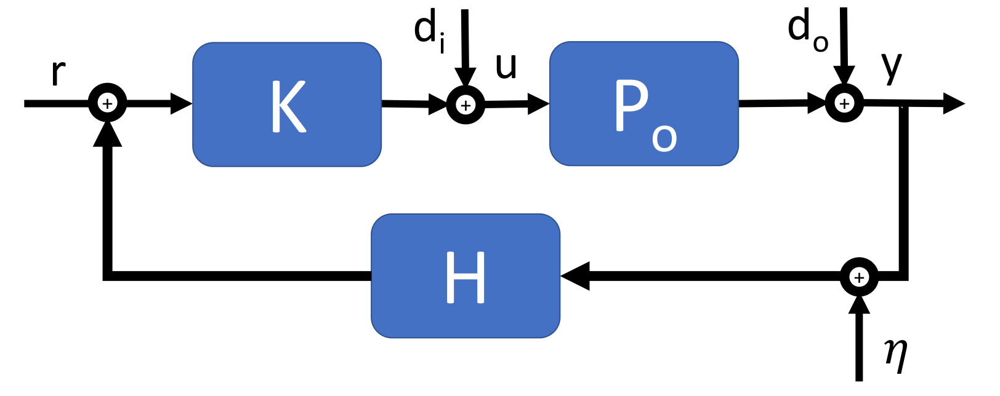
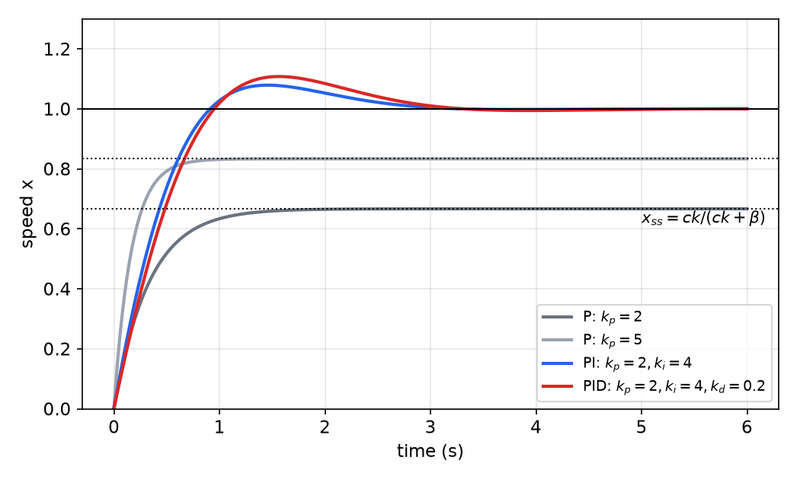
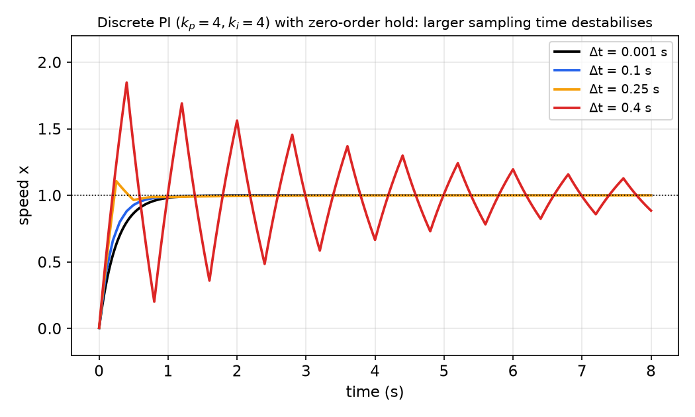
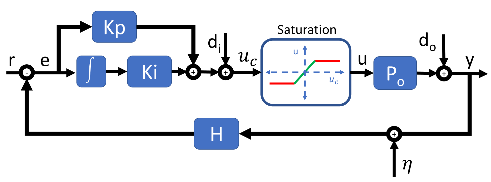
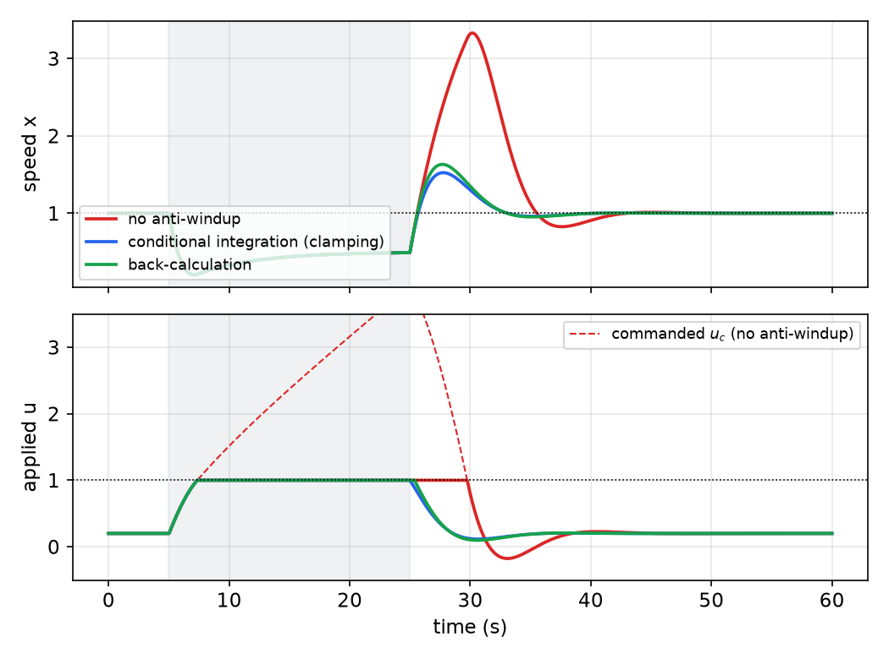

# Feedback Control for Mobile Robots

A robot never does exactly what it is told: motors differ from their data sheets, floors have friction, batteries sag, and wheels slip. Feedback control measures what actually happened and corrects the command accordingly. This chapter develops the ideas on the simplest possible robot, a point moving on a line, then turns to the workhorse PID controller: what each term does, why integral action removes steady-state error, how to implement it in discrete time on a computer, how to tune it, and how to keep it from misbehaving when the actuators saturate. The next chapter applies these tools to steering a unicycle robot toward goals and around obstacles. For a compact overview of PID see PID Control; here we go deeper and stay close to robot practice.

## What Control Theory Is For

**Control theory** is the collection of mathematical methods that make a dynamical system behave in a desirable manner. A working controller needs:

1. a **goal**, expressed as a reference signal (spin a motor shaft at 1 rad/s; move the robot 4 cm forward; follow a ball);
2. a **model** of how inputs affect the system, even a crude one;
3. a **measurement** of the output, for feedback;
4. a **control law** that turns the goal and measurements into inputs.

Throughout, keep an eye on the gap between theory and practice. A simulation with a perfect model will make almost any controller look good; robots expose the assumptions.

## Open Loop and Feedback

### Open-loop control

The simplest structure feeds the reference \\(r\\) through a controller \\(K\\) that produces the input \\(u\\) to the plant \\(P\\), whose output is \\(y\\):
\\[
r \longrightarrow \boxed{K} \xrightarrow{\\;u\\;} \boxed{P} \longrightarrow y .
\\]
Here \\(r\\) is what we want the system to do; \\(K\\) is the controller we design (bang-bang, PID, lead-lag, ...); \\(P\\) is the plant (the robot, motor, or process). If \\(P\\) were known exactly and nothing disturbed it, choosing \\(K = P^{-1}\\) would make \\(y = r\\). Open-loop control is used where it works: a stepper motor commanded a fixed number of steps, a toaster with a timer.

Open loop is not **robust**. Two things defeat it:

- **Model error.** The real plant \\(P\_o\\) differs from the model \\(P\\) used to design \\(K\\). Any mismatch passes straight to the output.
- **Disturbances.** An *input disturbance* \\(d\_i\\) adds to the command before the plant (a slope pushing on the robot, a voltage drop at the motor); an *output disturbance* \\(d\_o\\) adds to the output (a bump that shifts the robot). The open-loop controller never learns of either.

### The feedback loop



*Figure: the standard negative-feedback loop. The reference r is compared with the measured output; the controller K drives the real plant \\(P\_o\\). Input disturbance \\(d\_i\\) and output disturbance \\(d\_o\\) enter as shown; the output passes through the sensor H, which adds noise \\(\eta\\), before being subtracted from r.*

Feedback closes the loop: the output \\(y\\), corrupted by sensor noise \\(\eta\\), passes through the sensor (feedback) block \\(H\\) and is subtracted from the reference to form the **error** \\(e = r - Hy\\) (with \\(H = 1\\) for a perfect sensor, \\(e = r - y\\)). The controller acts on the error. Now model error and disturbances show up in \\(e\\) and are corrected. Feedback buys robustness, but it can also create instability (a too-aggressive loop overcorrects), and the loop can never be better than its sensor: noise \\(\eta\\) enters exactly where the reference does.

Two goals summarize what we ask of a feedback controller:

- **Robustness**: operate correctly despite disturbances, actuation errors, and unknown, poorly estimated or unmodeled parameters;
- **Tracking**: make the output follow the desired reference signal.

## A One-Dimensional Robot

To see each control idea in isolation, model a robot as a point on a line with position \\(x\\), commanded directly in velocity:
\\[
\dot x = cu,
\\]
where \\(c>0\\) is an actuator gain (for example, wheel radius times motor constant). The goal is \\(x(t)\to r\\) as \\(t\to\infty\\), i.e. \\(e = r - x \to 0\\).



*Figure: the cruise-control model \\(\dot x = cu - \beta x\\) with \\(c = \beta = 1\\) and r = 1. Proportional control (gray) settles below the reference at \\(x\_{ss} = ck/(ck+\beta)\\), shown dotted: 2/3 for k = 2 and 5/6 for k = 5. Adding integral action (blue) removes the error. Adding a derivative term (red) to this first-order plant slightly reduces the damping rather than increasing it; see the text.*

### Bang-bang control

The crudest feedback law applies full effort in the right direction:
\\[
u = \begin{cases} u\_{\max} & e > 0 \\\\ u\_{\min} & e < 0 \\\\ 0 & e = 0 \end{cases}
\\]
with \\(u\_{\min} < 0 < u\_{\max}\\). (With \\(e = r - x\\) and \\(c>0\\), a positive error means the robot is short of the target and must move forward; some presentations print the cases the other way round, which would drive the robot away.) Bang-bang control is simple and fast but, because \\(e = 0\\) is never hit exactly in a sampled system, it **chatters**: it overshoots, reverses at full effort, overshoots again. It is fine for a thermostat (with hysteresis), harsh for a motor.

### Proportional control

Make the effort proportional to the error:
\\[
u = ke, \qquad k>0 .
\\]
Small errors get small corrections, so the response is smooth. For the ideal plant, \\(\dot x = ck(r - x)\\), so \\(\dot e = -cke\\) and \\(e(t) = e(0)e^{-ckt}\to 0\\): exponential convergence with time constant \\(1/(ck)\\).

### An unmodeled disturbance

Now suppose the true plant has a drag term we did not model,
\\[
\dot x = cu - \beta x, \qquad \beta>0 ,
\\]
the classic cruise-control model where \\(x\\) is a speed and \\(\beta x\\) is aerodynamic and rolling drag. With \\(u = k(r - x)\\), the closed loop is \\(\dot x = ck(r - x) - \beta x\\). At steady state \\(\dot x = 0\\):
\\[
0 = ck(r - x\_{ss}) - \beta x\_{ss} \quad\Longrightarrow\quad \boxed{x\_{ss} = \frac{ck}{ck + \beta}\\,r \neq r .}
\\]
Proportional control **cannot track** the reference: a **steady-state error** \\(e\_{ss} = \frac{\beta}{ck+\beta}r\\) remains. The intuition is simple: holding the speed at \\(x\\) against drag requires a nonzero input \\(u = \beta x/c\\), and a proportional controller only produces a nonzero input when the error is nonzero. Raising \\(k\\) shrinks the error (2/3 of the reference for \\(ck/\beta = 2\\), 5/6 for 5) but never removes it, and in a real system large gains amplify noise and excite unmodeled dynamics.

### A naïve fix: cancel the model

If \\(\beta\\) and \\(c\\) were known, we could add a **feedforward** term that supplies the needed effort:
\\[
u = ke + \frac{\beta}{c}x \quad\Longrightarrow\quad 0 = c\Big(k(r - x\_{ss}) + \frac\beta c x\_{ss}\Big) - \beta x\_{ss} = ck(r - x\_{ss}) \quad\Longrightarrow\quad x\_{ss} = r .
\\]
This is naïve because physical parameters are never known exactly and change over time (a different floor, a heavier payload). Any mismatch \\(\hat\beta \neq \beta\\) brings the steady-state error back. Model-based feedforward is valuable, but it should be paired with something that does not depend on the model.

### Proportional-integral control

Add a term proportional to the accumulated error:
\\[
u(t) = k\_pe(t) + k\_i\int\_0^te(\tau)\\,d\tau .
\\]
**Why integral action removes the error.** Let \\(z = \int\_0^t e\\,d\tau\\), so \\(\dot z = e\\). The closed loop is the pair
\\[
\dot x = c(k\_pe + k\_iz) - \beta x, \qquad \dot z = r - x .
\\]
If the system settles to an equilibrium at all, then \\(\dot z = 0\\) there, which forces \\(e = r - x\_{ss} = 0\\) *regardless of \\(c\\) and \\(\beta\\)*. The integrator state \\(z\\) settles at whatever value supplies the effort needed to hold the output against the disturbance: \\(ck\_iz\_{ss} = \beta r\\). The integral learns the missing feedforward term automatically.

Whether the loop settles is a stability question. Taking Laplace transforms with zero initial conditions,
\\[
\frac{X(s)}{R(s)} = \frac{c(k\_ps + k\_i)}{s^2 + (\beta + ck\_p)s + ck\_i},
\\]
whose DC gain (\\(s = 0\\)) is exactly 1. A second-order polynomial with positive coefficients has roots with negative real parts, so the loop is stable whenever \\(\beta + ck\_p > 0\\) and \\(ck\_i > 0\\). With \\(c = \beta = 1\\), \\(k\_p = 2\\), \\(k\_i = 4\\) (the blue curve in the figure), the characteristic polynomial is \\(s^2 + 3s + 4\\): natural frequency \\(\omega\_n = 2\\) rad/s and damping ratio \\(\zeta = 3/4\\). The numerator zero at \\(s = -k\_i/k\_p = -2\\) adds some overshoot beyond the 2.8 % that \\(\zeta = 0.75\\) alone would give.

Intuitively: \\(k\_p\\) pushes toward the desired state and contributes to stability; it acts on the **present**. \\(k\_i\\) forces tracking and rejects constant disturbances, but slows the response and can cause oscillation; it acts on the **past**.

### PID control

Finally add a term proportional to the rate of change of the error:
\\[
\boxed{u(t) = k\_pe(t) + k\_i\int\_0^te(\tau)\\,d\tau + k\_d\frac{de(t)}{dt}.}
\\]

- \\(k\_p\\) (**present**) pushes the current state toward the desired one and contributes to stability, but alone gives no tracking guarantee.
- \\(k\_i\\) (**past**) accumulates all error and pushes against it, forcing tracking and disturbance rejection; it slows the response and can cause oscillations through **integral windup**.
- \\(k\_d\\) (**future**) predicts how the error is changing and pushes in the right direction to damp the motion; it can speed up the response but is very sensitive to noise, since differentiation amplifies high frequencies.

In transfer-function form the controller is \\(C(s) = k\_p + k\_i/s + k\_ds\\).

**A caution about the D term.** Derivative action adds damping to plants with *inertia*, where the input sets an acceleration (a mass, a motor shaft driven by torque). For our first-order velocity plant it behaves differently. With a constant reference, \\(\dot e = -\dot x\\), and the closed loop becomes \\((1 + ck\_d)\dot x = c(k\_pe + k\_iz) - \beta x\\), with characteristic polynomial \\((1 + ck\_d)s^2 + (\beta + ck\_p)s + ck\_i\\). The derivative gain acts like extra inertia: with \\(k\_d = 0.2\\) the damping ratio drops from 0.75 to \\(3/(2\sqrt{4\cdot 1.2}) \approx 0.68\\), which is why the red curve overshoots slightly more. The table below describes the typical effect on the second-order (inertial) loops met most often in robotics; always check against the actual plant.

## Measuring Performance

For a step change in the reference, the response is characterized by:

- **Rise time** \\(t\_r\\): time to go from \\(x\\)% to \\(y\\)% of the final value, typically 10 % to 90 %.
- **Overshoot** \\(M\_p\\): the amount by which the output exceeds its final steady-state value, usually as a percentage.
- **Settling time** \\(t\_s\\): time after which the output stays within an \\(x\\)% envelope (often 2 % or 5 %) of the steady state.
- **Steady-state error** \\(e\_{ss}\\): the error that remains as \\(t\to\infty\\).

For a standard second-order system \\(\omega\_n^2/(s^2 + 2\zeta\omega\_ns + \omega\_n^2)\\) with \\(0<\zeta<1\\) these are approximately
\\[
t\_r \approx \frac{1.8}{\omega\_n}, \qquad M\_p = e^{-\zeta\pi/\sqrt{1 - \zeta^2}}, \qquad t\_s \approx \frac{4}{\zeta\omega\_n}\ (2\\%\ \text{envelope}),
\\]
which link the specifications to pole locations; see [time response](../me6401-linear-control/time-response.md) for the derivations.

**Effect of increasing each gain** (rules of thumb for typical loops):

| Increase | Rise time | Overshoot | Settling time | Steady-state error | Stability |
|---|---|---|---|---|---|
| \\(K\_p\\) | decrease | increase | small change | decrease | degrade |
| \\(K\_i\\) | decrease | increase | increase | eliminate\* | degrade |
| \\(K\_d\\) | minor change | decrease | decrease | no effect in theory | improve if \\(K\_d\\) small |

\*Integral action does not eliminate steady-state error in every case. A single integrator guarantees zero error for *step* references and *step* (constant) disturbances, by the argument above. A ramp reference or a ramp disturbance needs a second integrator (or feedforward). These are rules of thumb: the gains interact, and the table can fail for unusual plants, as the D-term example shows.

## Discrete-Time Implementation

A robot's controller runs on a computer that samples the sensors, computes, and updates the actuators at discrete instants \\(t = k\Delta t\\), with **sampling time** \\(\Delta t\\) and step index \\(k\\). Replace each continuous operation by a finite approximation:
\\[
e(t)\to e(k), \qquad \frac{de}{dt}\to\frac{e(k) - e(k-1)}{\Delta t}, \qquad \int\_0^te\\,d\tau \to \sum\_{i=0}^{k}e(i)\\,\Delta t .
\\]
This gives the **positional (direct) form** of the discrete PID:
\\[
\boxed{u(k) = k\_pe(k) + k\_i\sum\_{i=0}^{k}e(i)\Delta t + k\_d\frac{e(k) - e(k-1)}{\Delta t}.}
\\]
The derivative is the backward difference and the integral the rectangle (Euler) rule; trapezoidal integration and filtered derivatives are common refinements. Each time the controller is called it needs only the current error, the previous error and the running sum. Two equivalent ways to code it:

```text
Way 1 (dt inside the states):          Way 2 (dt folded into the gains):
  read e                                 read e
  measure or assume sampling time dt     assume sampling time dt
  eDot = (e - eOld)/dt                   eDot = (e - eOld)
  eSum = eSum + e*dt                     eSum = eSum + e
  u = Kp*e + Ki*eSum + Kd*eDot           u = Kp*e + Ki*eSum*dt + Kd*eDot/dt
  eOld = e                               eOld = e
```

Way 1 is preferable on a robot, where the loop period jitters (ROS callbacks, Python garbage collection, Wi-Fi): measure the actual elapsed time each call and use it.

**Velocity (incremental) form.** Subtracting \\(u(k-1)\\) from \\(u(k)\\) gives
\\[
u(k) = u(k-1) + k\_p\big(e(k) - e(k-1)\big) + k\_i\Delta t\\,e(k) + \frac{k\_d}{\Delta t}\big(e(k) - 2e(k-1) + e(k-2)\big).
\\]
The controller now outputs *changes* in the command. It has no explicit integral sum, which makes bumpless switching between manual and automatic modes easy, and if the stored \\(u(k-1)\\) is the *saturated* actuator value, windup (below) is avoided automatically.

A Python implementation with the practical safeguards discussed in this chapter:

```python
import time

class PID:
    def __init__(self, kp, ki, kd, u_min=-float('inf'), u_max=float('inf')):
        self.kp, self.ki, self.kd = kp, ki, kd
        self.u_min, self.u_max = u_min, u_max
        self.e_sum, self.e_old, self.t_old = 0.0, None, None

    def update(self, e, t=None):
        t = time.monotonic() if t is None else t
        dt = 0.0 if self.t_old is None else t - self.t_old
        de = 0.0 if (self.e_old is None or dt <= 0) else (e - self.e_old) / dt
        u_unsat = self.kp * e + self.ki * (self.e_sum + e * dt) + self.kd * de
        u = min(max(u_unsat, self.u_min), self.u_max)
        # conditional integration (anti-windup): integrate only if not pushing further into saturation
        if u == u_unsat or (u_unsat > self.u_max and e < 0) or (u_unsat < self.u_min and e > 0):
            self.e_sum += e * dt
        self.e_old, self.t_old = e, t
        return u
```

### Sampling, delays and Nyquist

Sampling introduces delay: the command computed from a measurement taken at time \\(k\Delta t\\) is held constant until the next update, which on average acts like a delay of about half a sample, plus any computation and communication latency. Delays are bad for feedback, because the controller reacts to stale information and overcorrects.

The effect is easy to quantify for the proportional loop. With the input held constant over each sample (zero-order hold), the plant \\(\dot x = cu - \beta x\\) is exactly
\\[
x(k+1) = a\\,x(k) + (1 - a)\frac{c}{\beta}u(k), \qquad a = e^{-\beta\Delta t}.
\\]
With \\(u(k) = k\_p(r - x(k))\\), the closed-loop pole is \\(a - (1 - a)ck\_p/\beta\\). Stability needs it inside the unit circle, and the binding condition is \\(a - (1 - a)ck\_p/\beta > -1\\), i.e.
\\[
\frac{ck\_p}{\beta} < \frac{1 + a}{1 - a}.
\\]
For \\(c = \beta = 1\\) and \\(k\_p = 4\\) this requires \\(a > 0.6\\), i.e. \\(\Delta t < \ln(1/0.6) \approx 0.51\\) s. A gain that is perfectly safe in continuous time becomes unstable if the controller runs too slowly. The figure shows the same effect for a PI loop.



*Figure: the cruise-control plant (c = β = 1) under discrete PI control (\\(k\_p = k\_i = 4\\)) with zero-order hold. At Δt = 0.001 s the response matches the continuous design; at 0.1 s it is nearly unchanged; at 0.25 s it overshoots; at 0.4 s it oscillates and barely converges. Slow sampling acts like a delay that erodes stability margins.*

How fast should the loop run? The **Nyquist–Shannon sampling theorem** says the sampling frequency must be at least twice the highest frequency present in the signal, or that content aliases into lower frequencies. For control, that is a bare minimum: a rule of thumb is to sample 10 to 30 times faster than the closed-loop bandwidth. (Think of an animation of a bouncing ball rendered at 15, 30, 60 and 120 frames per second: at low frame rates the motion is jerky and the impact can be missed entirely.) The full theory is in [sampling](../me6403-digital-control/sampling.md) and the [digital control](../me6403-digital-control/README.md) chapters.

## Limitations of PID

PID is popular because it needs no model, has three intuitive knobs, and works surprisingly often. It also has real limitations:

- **It is linear.** Robots are nonlinear (the unicycle model, angle wrapping, friction). A PID tuned at one operating point may misbehave at another.
- **It is symmetric.** It must be able to drive the system both ways with equal authority; many actuators cannot (a brake only decelerates; a thruster may only push).
- **Deadbands.** Small commands may not actuate at all (static friction, motor deadzones), and constantly hunting around the setpoint wears out mechanisms. A small deadband on the error is often added deliberately.
- **Limited disturbance rejection.** One integrator rejects constant disturbances; fast ramps and higher-order disturbances are not fully rejected.
- **At the mercy of its sensors.** There is no model to predict or sanity-check measurements; a bad sensor reading becomes a bad command, and the D term amplifies noise. (State estimators such as the [Kalman filter](kalman-filters.md) address this.)

## Saturation and Integral Windup

Physical actuators have limited range: a valve is fully open or closed, a motor reaches its maximum velocity or current, an aircraft control surface hits its deflection limit. When the controller asks for more than the actuator can deliver, the actuator **saturates** and delivers a constant value. While saturated, the loop is effectively *open*: further changes in the command have no effect.



*Figure: a PI loop with a saturating actuator. The controller computes the commanded input \\(u\_c\\); the saturation block passes it unchanged in the linear range and clips it at the limits, so the plant receives the applied input u.*

The integrator, however, does not know this. The error stays large while the actuator is pinned, so the integral keeps growing: it **winds up**. When the disturbance finally passes, the error changes sign, but the bloated integral keeps the command saturated until the opposite error has "unwound" it. The result is a large overshoot and a long, sluggish recovery.



*Figure: PI cruise control (\\(\dot x = u - 0.2x - d\\), \\(k\_p = 0.5\\), \\(k\_i = 0.3\\), \\(\lvert u\rvert\le 1\\)) holding speed 1. A hill (shaded, d = 0.9) needs more input than the actuator can supply, so the speed sags to 0.5 whatever the controller does. Without anti-windup (red) the commanded input (dashed) climbs far above the limit; when the hill ends the actuator stays saturated for several more seconds and the speed overshoots to more than three times the setpoint. With clamping (blue) or back-calculation (green) the overshoot is far smaller and recovery is quick. Some overshoot is unavoidable because the disturbance disappears abruptly.*

### Anti-windup remedies

1. **Conditional integration (clamping).** In a digital controller, stop integrating while the actuator is saturated, at least when integrating would push further into saturation. The crude form sets the integral gain to zero when saturated, `if (u_c > u_max) { Ki = 0; }`; a better form freezes the integral sum, because zeroing \\(k\_i\\) also removes the integral's *current* contribution and makes the command jump. Clamping the integral term itself to predetermined bounds is a related, simpler variant.
2. **Back-calculation (tracking).** Feed the saturation error \\(e\_s = u - u\_c\\) (applied minus commanded, zero in the linear range) back into the integrator through a tracking gain \\(k\_t\\):
\\[
\frac{d}{dt}I = k\_ie + k\_t(u - u\_c), \qquad u\_c = k\_pe + I + (\text{D term}).
\\]
While unsaturated, the extra term is zero and the controller is an ordinary PID. While saturated, it drives the integrator toward the value consistent with the actuator limit, with time constant \\(1/k\_t\\). This is the standard scheme in Åström and Murray's *Feedback Systems*, which also filters the derivative, \\(k\_ds/(1 + sT\_f)\\), and applies it to \\(-y\\) rather than to \\(e\\) to avoid a "derivative kick" on reference steps.
3. **Velocity form.** The incremental PID computes \\(u(k) = u\_{\text{sat}}(k-1) + \Delta u(k)\\) and never accumulates beyond the limit.
4. **Avoid saturation in the first place.** Rate-limit or shape the reference (do not ask a robot at rest for full speed instantly), and choose gains with the actuator limits in mind.

## Designing and Tuning PID Controllers

Systematic design (loop shaping, pole placement, optimal control) is the subject of full courses on classical, multivariable and modern control; see [root locus](../me6403-digital-control/root-locus.md), [classical design](../me6403-digital-control/classical-design.md) and [state feedback](../me6401-linear-control/state-feedback.md). For PID in practice:

**Manual tuning.** A common procedure, using the gain-effect table:

1. Set \\(k\_i = k\_d = 0\\). Raise \\(k\_p\\) until the response is reasonably fast, backing off if it oscillates.
2. Add \\(k\_i\\) slowly until the steady-state error disappears in an acceptable time; reduce \\(k\_p\\) a little if overshoot grows.
3. If needed, add a small \\(k\_d\\) (with a filtered derivative) to reduce overshoot; stop if the command becomes noisy.
4. Test with realistic disturbances and saturation, not just a clean step.

**Ziegler–Nichols.** An online (on-the-fly) method: with \\(k\_i = k\_d = 0\\), raise \\(k\_p\\) until sustained oscillation at the *ultimate gain* \\(K\_u\\) with period \\(T\_u\\), then read the gains from a table (for PID, \\(K\_p = 0.6K\_u\\), \\(K\_i = K\_p/(0.5T\_u)\\), \\(K\_d = 0.125K\_pT\_u\\); see PID Control). The result is aggressive (roughly quarter-amplitude decay) and is a starting point, not an answer. Driving a robot to sustained oscillation is not always safe.

**Model-based tools.** With even a rough model, interactive tools such as MATLAB's SISO Tool (`sisotool`) or Python's `control` library let you place closed-loop poles and inspect step responses before touching hardware:

```matlab
s = tf('s'); c = 1; beta = 1;
P = c/(s + beta);
C = pid(2, 4, 0);            % Kp, Ki, Kd
step(feedback(C*P, 1))
```

```python
import control as ct
P = ct.tf([1], [1, 1])
C = ct.tf([2, 4], [1, 0])    # 2 + 4/s
t, y = ct.step_response(ct.feedback(C * P, 1))
```

### Applying PID to a mobile robot

On a differential-drive robot several PID loops run at once, at different rates. Inside the motor driver (on the TurtleBot's servos), a fast velocity loop makes each wheel spin at its commanded rate. Above it, a slower loop on the main computer computes the robot's forward speed \\(v\\) and turn rate \\(\omega\\) from a task error: \\(\omega = \text{PID}(e\_\theta)\\) on the heading error toward a target, and \\(v = \text{PID}(e\_d)\\) on the distance error. A ball-following robot, for instance, uses the horizontal pixel offset of the ball in the camera image as \\(e\_\theta\\) and the error between the ball's measured range and the desired following distance as \\(e\_d\\). Two practical lessons follow. First, lower-level loops must be much faster than the loops that command them, so that the upper loop can treat them as ideal. Second, the camera's frame rate and processing delay limit the outer loop's bandwidth, so its gains must be modest. The [behavior-control chapter](behavior-control.md) builds on this.

## Summary

- Open-loop control cannot correct model error or disturbances; feedback on the error \\(e = r - y\\) can, at the price of possible instability and sensitivity to sensor noise.
- Proportional control of \\(\dot x = cu - \beta x\\) leaves a steady-state error: \\(x\_{ss} = \frac{ck}{ck + \beta}r\\).
- Integral action forces \\(e\_{ss} = 0\\) for constant references and disturbances, because at equilibrium \\(\dot z = e = 0\\); PI loop: \\(X/R = c(k\_ps + k\_i)/(s^2 + (\beta + ck\_p)s + ck\_i)\\).
- PID: \\(u = k\_pe + k\_i\int e + k\_d\dot e\\): present, past, future. Derivative action damps inertial plants but amplifies noise.
- Discrete PID: \\(u(k) = k\_pe(k) + k\_i\sum e(i)\Delta t + k\_d(e(k) - e(k-1))/\Delta t\\); use the measured \\(\Delta t\\); slow sampling destabilizes (P loop needs \\(ck\_p/\beta < (1 + a)/(1 - a)\\), \\(a = e^{-\beta\Delta t}\\)).
- Sample at least twice the highest signal frequency (Nyquist), in practice 10 to 30 times the loop bandwidth.
- Saturation plus integral action causes windup; fix with conditional integration, back-calculation \\(\dot I = k\_ie + k\_t(u - u\_c)\\), or the velocity form.
- Tune manually, by Ziegler–Nichols, or with a model in a design tool, and always test with disturbances and limits.

## See Also

- PID Control (overview and Ziegler–Nichols table)
- [Coordinate Transforms and Differential-Drive Kinematics](transforms-kinematics.md)
- [Behavior-Based Control](behavior-control.md)
- [Time response of linear systems](../me6401-linear-control/time-response.md) and [stability](../me6401-linear-control/stability.md)
- [Sampling](../me6403-digital-control/sampling.md) and [Digital control](../me6403-digital-control/README.md)
- Robot Control
