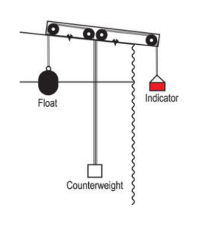
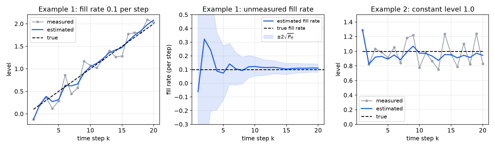
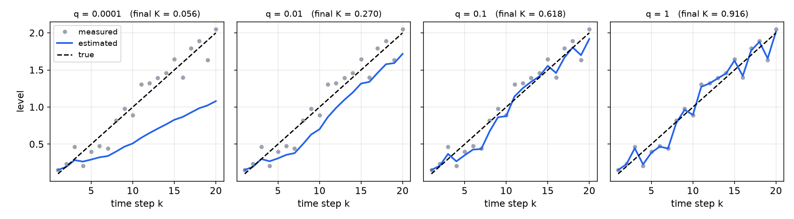
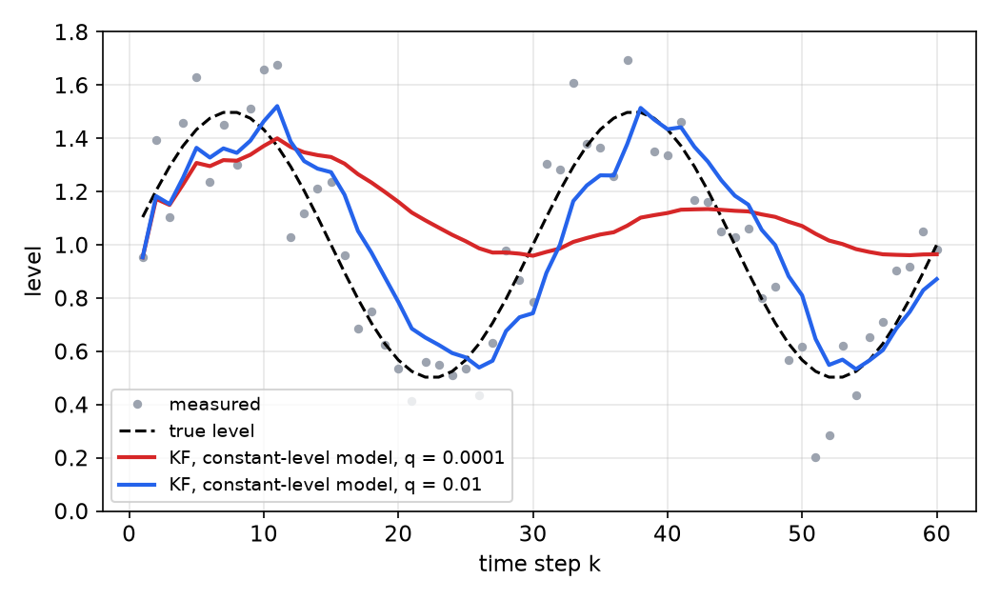
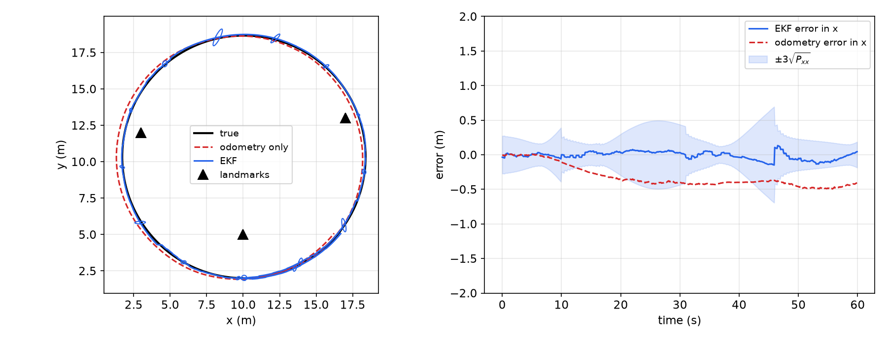

# Kalman and Extended Kalman Filters for Robots

The particle filter approximates the Bayes filter with samples. The **Kalman filter** (KF) takes the opposite route: it assumes that the motion and measurement models are linear and the noises Gaussian, and then the Bayes filter can be computed *exactly* with a handful of matrix operations, because a Gaussian belief stays Gaussian. The result is the optimal estimator for linear-Gaussian systems and one of the most widely used algorithms in engineering. Mobile robots are not linear, so the chapter ends with the **extended Kalman filter** (EKF), which linearizes about the current estimate. The emphasis here is the discrete predict–update form used on robots, derived from Gaussian conditioning, together with intuition for tuning the noise covariances. The continuous-time theory, steady-state Riccati equations and the duality with LQR are in [Optimal Estimation and the Kalman Filter](../me6401-linear-control/kalman-filter.md).

## What the Bayes Filter Needs

The Bayes filter alternates
\\[
\overline{\mathrm{bel}}(x\_t) = \int p(x\_t\mid u\_t, x\_{t-1})\\,\mathrm{bel}(x\_{t-1})\\,dx\_{t-1} \quad\text{(prediction: moving loses information)},
\\]
\\[
\mathrm{bel}(x\_t) = \eta\\,p(z\_t\mid x\_t)\\,\overline{\mathrm{bel}}(x\_t) \quad\text{(correction: sensing gains information)}.
\\]
To implement it we need: a **representation** of the belief; a **process (motion) model** \\(p(x\_t\mid u\_t, x\_{t-1})\\), built from an update equation \\(x\_t = f(x\_{t-1}, u\_t)\\) plus noise; a **sensor model** \\(p(z\_t\mid x\_t)\\); and an **initial belief** \\(\mathrm{bel}(x\_0)\\).

There are two ways to represent a distribution. A **sample-based** representation keeps the data points themselves, which is the particle filter. A **parametric** representation fits a model with a few parameters to them, as a line \\(y = mx + b\\) summarizes a scatter of points by two numbers. The Kalman filter is parametric: it stores only the mean and covariance of a Gaussian.

## Gaussians

The one-dimensional Gaussian (normal) density with mean \\(\mu\\) and variance \\(\sigma^2\\) is
\\[
p(x) = \frac{1}{\sigma\sqrt{2\pi}}\exp\\!\left(-\frac{(x - \mu)^2}{2\sigma^2}\right),
\\]
and the \\(n\\)-dimensional Gaussian with mean \\(\mu\\) and covariance \\(\Sigma\\) (symmetric, positive definite) is
\\[
p(x) = \frac{1}{\sqrt{(2\pi)^n\det\Sigma}}\exp\\!\left(-\tfrac12(x - \mu)^T\Sigma^{-1}(x - \mu)\right), \qquad x\sim\mathcal N(\mu, \Sigma).
\\]
Its level sets are ellipsoids whose axes are the eigenvectors of \\(\Sigma\\), with semi-axes proportional to the square roots of the eigenvalues.

Gaussians are closed under the operations the Bayes filter performs, which is the whole reason the KF exists.

**Linear transformation.** If \\(x\sim\mathcal N(\mu, \Sigma)\\) and \\(y = Ax + b\\), then \\(y\sim\mathcal N(A\mu + b, A\Sigma A^T)\\). The mean follows by linearity of expectation; the covariance from \\(E[(y - \bar y)(y - \bar y)^T] = A\\,E[(x - \mu)(x - \mu)^T]A^T\\). Adding an independent Gaussian \\(w\sim\mathcal N(0, Q)\\) adds its covariance: \\(y + w\sim\mathcal N(A\mu + b, A\Sigma A^T + Q)\\).

Now partition a jointly Gaussian vector:
\\[
x = \begin{bmatrix} x\_1 \\\\ x\_2\end{bmatrix}\sim\mathcal N\\!\left(\begin{bmatrix}\mu\_1 \\\\ \mu\_2\end{bmatrix}, \begin{bmatrix}\Sigma\_{11} & \Sigma\_{12} \\\\ \Sigma\_{21} & \Sigma\_{22}\end{bmatrix}\right), \qquad \Sigma\_{21} = \Sigma\_{12}^T .
\\]

**Marginalization (easy).** \\(p(x\_1) = \int p(x\_1, x\_2)\\,dx\_2 = \mathcal N(\mu\_1, \Sigma\_{11})\\): just read off the corresponding blocks. (This is the linear transformation with \\(A = [I\ \ 0]\\).)

**Conditioning (not so easy).** Given an observed value \\(x\_2 = b\\),
\\[
\boxed{p(x\_1\mid x\_2 = b) = \mathcal N(\tilde\mu, \tilde\Sigma), \qquad \tilde\mu = \mu\_1 + \Sigma\_{12}\Sigma\_{22}^{-1}(b - \mu\_2), \qquad \tilde\Sigma = \Sigma\_{11} - \Sigma\_{12}\Sigma\_{22}^{-1}\Sigma\_{21}.}
\\]

*Proof sketch.* Define \\(e = x\_1 - \Sigma\_{12}\Sigma\_{22}^{-1}x\_2\\). It is a linear function of \\(x\\), hence Gaussian, and its covariance with \\(x\_2\\) is \\(\Sigma\_{12} - \Sigma\_{12}\Sigma\_{22}^{-1}\Sigma\_{22} = 0\\). Uncorrelated jointly Gaussian variables are independent, so conditioning on \\(x\_2\\) does not change the distribution of \\(e\\): it has mean \\(\mu\_1 - \Sigma\_{12}\Sigma\_{22}^{-1}\mu\_2\\) and covariance \\(\Sigma\_{11} - \Sigma\_{12}\Sigma\_{22}^{-1}\Sigma\_{21}\\) (expand \\(\operatorname{Cov}(e)\\)). Then \\(x\_1 = e + \Sigma\_{12}\Sigma\_{22}^{-1}b\\) given \\(x\_2 = b\\), which yields \\(\tilde\mu\\) and \\(\tilde\Sigma\\). \\(\square\\)

Three features of this formula reappear in the Kalman filter. The mean is the prior mean plus a gain \\(\Sigma\_{12}\Sigma\_{22}^{-1}\\) times the "surprise" \\(b - \mu\_2\\). The covariance shrinks by a positive semidefinite amount (\\(\tilde\Sigma\preceq\Sigma\_{11}\\)), so observing never increases uncertainty, and the posterior covariance does not depend on the observed value \\(b\\). And the expensive part is the inverse \\(\Sigma\_{22}^{-1}\\), which in the KF is the inverse of the innovation covariance, of the dimension of the measurement.

## The Linear-Gaussian Model

The Kalman filter assumes:

- **Linear motion**: \\(x\_k = Ax\_{k-1} + Bu\_k + w\_k\\).
- **Linear observation**: \\(z\_k = Hx\_k + \delta\_k\\).
- **Gaussian noise**: \\(w\_k\sim\mathcal N(0, Q)\\) and \\(\delta\_k\sim\mathcal N(0, R)\\), zero-mean, white (independent over time), and independent of each other.
- A **Gaussian initial belief** \\(x\_0\sim\mathcal N(\hat x\_0, P\_0)\\), with very large \\(P\_0\\) if the start is unknown.

The components:

| Symbol | Size | Meaning |
|---|---|---|
| \\(x\\) | \\(n\times1\\) | state estimate |
| \\(P\\) | \\(n\times n\\) | covariance (uncertainty) of the estimate |
| \\(A\\) | \\(n\times n\\) | state transition: how the state evolves from \\(k-1\\) to \\(k\\) with no input or noise ("modelled ideal dynamics") |
| \\(B\\) | \\(n\times m\\) | control-input matrix: effect of the control \\(u\_k\\) ("ideal control") |
| \\(u\\) | \\(m\times1\\) | control (motion) vector |
| \\(w\_k\\), \\(Q\\) | \\(n\times1\\), \\(n\times n\\) | process (motion) noise and its covariance |
| \\(H\\) | \\(p\times n\\) | measurement matrix: maps the state to the *expected* measurement |
| \\(z\\) | \\(p\times1\\) | measurement |
| \\(\delta\_k\\), \\(R\\) | \\(p\times1\\), \\(p\times p\\) | measurement noise and its covariance |
| \\(K\\) | \\(n\times p\\) | Kalman gain |

\\(w\_k, Q, \delta\_k, R\\) are the terms that model uncertainty. In probabilistic language the two models are Gaussians,
\\[
p(x\_k\mid u\_k, x\_{k-1}) = \mathcal N(x\_k;\\,Ax\_{k-1} + Bu\_k,\\,Q), \qquad p(z\_k\mid x\_k) = \mathcal N(z\_k;\\,Hx\_k,\\,R),
\\]
each belief is uniquely characterized by its mean and covariance, and computing the posterior means computing a new mean and covariance from the old ones using the action and the measurement. We treat \\(A, B, H, Q, R\\) as constant (a time-invariant filter), although all formulas hold with time-varying matrices. The Markov assumption is built into the white-noise assumption.

## The Kalman Filter Equations

Write \\(\bar x\_k, \bar P\_k\\) for the mean and covariance after the time update (the predicted belief), and \\(x\_k, P\_k\\) after the measurement update.

**Time update (prediction).** The belief \\(\mathcal N(x\_{k-1}, P\_{k-1})\\) is pushed through the linear motion model plus independent noise. By the linear-transformation property,
\\[
\boxed{\bar x\_k = Ax\_{k-1} + Bu\_k, \qquad \bar P\_k = AP\_{k-1}A^T + Q.}
\\]
The noise \\(w\_k\\) is *not* added to the estimate: its mean is zero, and its effect enters through \\(Q\\) in the covariance. \\(AP\_{k-1}A^T\\) transports the old uncertainty; \\(+Q\\) adds new uncertainty. This is the "move loses information" half.

**Measurement update (correction).** Given the prediction, the state and the measurement are jointly Gaussian:
\\[
\begin{bmatrix} x\_k \\\\ z\_k\end{bmatrix}\sim\mathcal N\\!\left(\begin{bmatrix}\bar x\_k \\\\ H\bar x\_k\end{bmatrix}, \begin{bmatrix}\bar P\_k & \bar P\_kH^T \\\\ H\bar P\_k & H\bar P\_kH^T + R\end{bmatrix}\right),
\\]
because \\(z\_k = Hx\_k + \delta\_k\\) gives \\(\operatorname{Cov}(x\_k, z\_k) = \bar P\_kH^T\\) and \\(\operatorname{Cov}(z\_k) = H\bar P\_kH^T + R\\). Conditioning on the observed \\(z\_k\\) with the boxed formula above (\\(\Sigma\_{12} = \bar P\_kH^T\\), \\(\Sigma\_{22} = H\bar P\_kH^T + R\\)) gives
\\[
\boxed{K\_k = \bar P\_kH^T(H\bar P\_kH^T + R)^{-1}, \qquad x\_k = \bar x\_k + K\_k(z\_k - H\bar x\_k), \qquad P\_k = (I - K\_kH)\bar P\_k.}
\\]
This is the "sense gains information" half. The covariance formula is \\(\tilde\Sigma = \bar P\_k - \bar P\_kH^TS\_k^{-1}H\bar P\_k = (I - K\_kH)\bar P\_k\\), with \\(S\_k = H\bar P\_kH^T + R\\) the **innovation covariance**.

**Anatomy of the update.** In \\(x\_k = \bar x\_k + K(z\_k - H\bar x\_k)\\): \\(\bar x\_k\\) is the estimate based on the prior state and the control input; \\(z\_k\\) is the actual sensor reading; \\(H\bar x\_k\\) is the *predicted* sensor reading; their difference \\(\nu\_k = z\_k - H\bar x\_k\\) is the **innovation** (the measurement surprise); and \\(K\nu\_k\\) is the correction. The gain is a measure of how informative the current measurement is relative to the prediction.

**Optimality.** Among all linear updates \\(x\_k = \bar x\_k + K(z\_k - H\bar x\_k)\\), the error covariance is (for any \\(K\\), the "Joseph form")
\\[
P\_k = (I - KH)\bar P\_k(I - KH)^T + KRK^T .
\\]
Setting the derivative of \\(\operatorname{tr}P\_k\\) with respect to \\(K\\) to zero, \\(-2(I - KH)\bar P\_kH^T + 2KR = 0\\), gives \\(K(H\bar P\_kH^T + R) = \bar P\_kH^T\\), the Kalman gain. So \\(K\_k\\) is the gain that minimizes the mean-square estimation error. Under the Gaussian assumptions the KF is moreover the optimal estimator among *all* estimators, linear or not, because it computes the exact posterior; for non-Gaussian noise it remains the best *linear* estimator.

### Intuition from the scalar case

With a scalar state, \\(H = 1\\) and measurement variance \\(r\\), the gain is \\(K = \bar p/(\bar p + r)\\), and
\\[
x\_k = (1 - K)\bar x\_k + Kz\_k, \qquad p\_k = (1 - K)\bar p = \frac{\bar p\\,r}{\bar p + r} = \left(\frac1{\bar p} + \frac1r\right)^{-1}.
\\]
The estimate is a weighted average of the prediction and the measurement, each weighted by the other's variance, and the posterior *information* (inverse variance) is the sum of the two informations.

- **Complete trust in the measurement** (\\(R\to0\\)): \\(K\to1\\) (in general \\(KH\to I\\) in the measured directions, "\\(K\to H^{-1}\\)"), and the estimate follows the measurement.
- **No trust in the measurement** (\\(R\to\infty\\)): \\(K\to0\\), and the estimate follows the model prediction, ignoring the sensor.

## Worked Example: Water-Tank Level

**Example 1 (Tank level).** We want to estimate how much water is in a tank from noisy measurements of a float gauge. The level may be changing (the tank may be filling or emptying).



*Figure: a float gauge. The float rides on the water surface and moves an indicator through a pulley line with a counterweight; the reading is noisy because of waves and friction.*

*State.* Track the level \\(l\_k\\) and the fill rate \\(f\_k = dl/dt\\). With sample period \\(t\\) and an assumed constant fill rate, \\(l\_k = l\_{k-1} + tf\_{k-1}\\) and \\(f\_k = f\_{k-1}\\):
\\[
x\_k = \begin{bmatrix} l\_k \\\\ f\_k\end{bmatrix} = \begin{bmatrix} 1 & t \\\\ 0 & 1\end{bmatrix}\begin{bmatrix} l\_{k-1} \\\\ f\_{k-1}\end{bmatrix} = Ax\_{k-1}.
\\]

*Uncertainty.* The covariance \\(P\_k = \begin{bmatrix}\sigma\_{ll} & \sigma\_{lf} \\\\ \sigma\_{fl} & \sigma\_{ff}\end{bmatrix}\\) measures how reliable the estimate is. It is partly determined by the **process noise** \\(Q\\), our belief that the state may change because of events we cannot model. Low \\(Q\\) says we trust the state model; high \\(Q\\) says there may be changes we cannot predict from \\(x\_{k-1}\\) (and \\(u\_k\\)).

*Measurement.* Ideally we would measure the whole state, \\(z\_k = x\_k\\). In reality we sense only part of it, plus noise. Only the level is measured:
\\[
z\_k = \begin{bmatrix} 1 & 0\end{bmatrix}\begin{bmatrix} l\_k \\\\ f\_k\end{bmatrix} + \delta\_k, \qquad R = r .
\\]

*Parameters.* Sample period \\(t = 1\\) (1 Hz); measurement variance \\(r = 0.1\\); very little process noise, only on the fill rate, \\(Q = \begin{bmatrix} 0 & 0 \\\\ 0 & 0.00001\end{bmatrix}\\); initial estimate \\(x\_0 = \begin{bmatrix} 0 \\\\ 0\end{bmatrix}\\) with \\(P\_0 = \begin{bmatrix} 1000 & 0 \\\\ 0 & 1000\end{bmatrix}\\) (very unsure of both, no correlation).

*The first step.* \\(\bar P\_1 = AP\_0A^T + Q = \begin{bmatrix} 2000 & 1000 \\\\ 1000 & 1000.00001\end{bmatrix}\\): the prediction is uncertain, and the level and fill-rate errors are now correlated (an error in \\(f\\) produces an error in \\(l\\)). Then \\(S\_1 = 2000.1\\) and
\\[
K\_1 = \frac{1}{2000.1}\begin{bmatrix} 2000 \\\\ 1000\end{bmatrix} = \begin{bmatrix} 0.99995 \\\\ 0.49998\end{bmatrix}, \qquad x\_1\approx\begin{bmatrix} z\_1 \\\\ z\_1/2\end{bmatrix}.
\\]
The level jumps essentially to the first measurement. The fill-rate estimate also moves, through the correlation in \\(\bar P\_1\\), even though the fill rate was never measured: half of the unexplained level is attributed to filling. Later measurements correct this guess.

*Simulations.* In Example 1a the tank fills at a constant 0.1 per step (true level ramping from 0 to 2 over 20 steps), with measurement noise uniform on \\(\pm0.3\\). In Example 1b the fill rate is zero and the level is constant at 1.0.



*Figure: left, Example 1a: noisy level measurements (gray), Kalman estimate (blue) and true level (dashed). Centre, the fill-rate estimate, never measured directly, converges to the true 0.1 per step, and its ±2σ band shrinks. Right, Example 1b: constant level 1.0. The estimate jumps to about the first measurement and then settles near 1, much smoother than the measurements.*

The Kalman filter figures out the fill rate even with no ability to sense it directly: the model links level and rate, and the sequence of level measurements is informative about the rate.

```python
import numpy as np

def kalman(zs, A, H, Q, R, x0, P0, B=None, us=None):
    x, P, out = x0.astype(float), P0.astype(float), []
    for k, z in enumerate(zs):
        x = A @ x + (B @ us[k] if B is not None else 0)        # time update
        P = A @ P @ A.T + Q
        S = H @ P @ H.T + R                                     # innovation covariance
        K = P @ H.T @ np.linalg.inv(S)                          # Kalman gain
        x = x + K @ (np.atleast_1d(z) - H @ x)                  # measurement update
        P = (np.eye(len(x)) - K @ H) @ P
        out.append(x.copy())
    return np.array(out)

A = np.array([[1., 1.], [0., 1.]]); H = np.array([[1., 0.]])
Q = np.diag([0., 1e-5]); R = np.array([[0.1]])
k = np.arange(1, 21); z = 0.1 * k + np.random.uniform(-0.3, 0.3, 20)
est = kalman(z, A, H, Q, R, np.zeros(2), 1000 * np.eye(2))     # columns: level, fill rate
```

### Model error and the choice of q

To see what happens when the model is wrong, simplify. Model the level alone as constant, \\(x\_k = l\_k = x\_{k-1}\\) (\\(A = 1\\)), measured directly, \\(z\_k = l\_k + \delta\_k\\) (\\(H = 1\\)). This is not a good model of a filling tank, deliberately. The scalar filter is
\\[
\bar x\_k = x\_{k-1}, \quad \bar p\_k = p\_{k-1} + q, \qquad K\_k = \frac{\bar p\_k}{\bar p\_k + r}, \quad x\_k = \bar x\_k + K\_k(z\_k - \bar x\_k), \quad p\_k = (1 - K\_k)\bar p\_k .
\\]

**Scenario 1: the model is right.** The true level is constant at 1. Take \\(x\_0 = 0\\), \\(p\_0 = 1000\\), \\(r = 0.1\\), \\(q = 0.0001\\): we think the sensor has noticeable noise but believe the model to be accurate. The first reading is \\(z\_1 = 0.9\\):
\\[
\bar x\_1 = 0, \quad \bar p\_1 = 1000 + 0.0001 = 1000.0001, \quad K\_1 = \frac{1000.0001}{1000.0001 + 0.1} = 0.9999,
\\]
\\[
x\_1 = 0 + 0.9999(0.9 - 0) = 0.8999, \qquad p\_1 = (1 - 0.9999)(1000.0001) = 0.1 .
\\]
One measurement replaces an almost uninformative prior, and the uncertainty drops from 1000 to the measurement variance 0.1. At step 2, \\(\bar p\_2 = 0.1001\\) and \\(K\_2 = 0.1001/0.2001 = 0.50\\); at step 3, \\(K\_3\approx0.33\\). In fact, with \\(q = 0\\) and \\(p\_0\to\infty\\) one shows by induction that \\(p\_k = r/k\\) and \\(K\_k = 1/k\\): the Kalman filter for a constant is exactly the **running average** of the measurements, \\(x\_k = x\_{k-1} + \frac1k(z\_k - x\_{k-1})\\). The estimate settles close to the true value even with significant noise, but partly because the simple model matches what is happening.

**Scenario 2: the model is wrong.** Use the same constant-level model while the tank is actually filling, the true level ramping from 0 to 2 over 20 steps. Vary \\(q\\).



*Figure: the constant-level filter tracking a rising level, for four values of the process noise q (r = 0.1). With q = 0.0001 the filter trusts its wrong model and lags badly, reaching only about 1.1 when the truth is 2. With q = 0.01 it is closer but still lags (about 1.7 at step 20). With q = 0.1 it tracks with a slight lag. With q = 1 the estimate essentially reproduces the measurements: no filtering.*

The behaviour can be predicted. In steady state the scalar filter's predicted variance satisfies \\(\bar p = (1 - K)\bar p + q\\) with \\(K = \bar p/(\bar p + r)\\), i.e. the scalar Riccati equation
\\[
\bar p^2 - q\bar p - qr = 0 \quad\Rightarrow\quad \bar p\_\infty = \frac{q + \sqrt{q^2 + 4qr}}{2}, \qquad K\_\infty = \frac{\bar p\_\infty}{\bar p\_\infty + r}.
\\]
The filter is then the first-order recursion \\(x\_k = (1 - K)x\_{k-1} + Kz\_k\\), an exponential moving average. If the truth rises by \\(s\\) per step, the tracking error \\(e\_k = l\_k - x\_k\\) (ignoring noise) obeys \\(e\_k = (1 - K)(e\_{k-1} + s)\\), so in steady state
\\[
e\_\infty = \frac{(1 - K\_\infty)s}{K\_\infty}.
\\]
With \\(r = 0.1\\) and \\(s = 0.1\\):

| \\(q\\) | \\(K\_\infty\\) | steady lag \\(e\_\infty\\) | behaviour |
|---|---|---|---|
| 0.0001 | 0.031 | 3.1 | trusts the wrong model; huge lag (not yet reached in 20 steps) |
| 0.01 | 0.270 | 0.27 | lags; about 1.73 when the truth is 2 |
| 0.1 | 0.618 | 0.06 | tracks with slight lag, still smooths |
| 1 | 0.916 | 0.01 | follows the measurements; almost no smoothing |

The trade-off is between lag (bias from the model error) and noise. The steady-state variance of the estimate due to measurement noise is \\(p\_\infty = (1 - K\_\infty)\bar p\_\infty = K\_\infty r\\): with \\(q = 1\\) it is \\(0.92r\\), nearly the raw measurement noise.

**Conclusions.** A bad model can still give reasonable estimates if we trust the model less and the measurements more, by increasing \\(q\\). But if we trust the measurements too much, we are not really filtering anymore. In practice, \\(Q\\) is a tuning knob that represents everything the model leaves out.

**A sinusoidal level.** The same lesson appears when the true level oscillates, \\(l\_k = 1 + 0.5\sin(2\pi k/30)\\), over 60 periods, while the filter still assumes a constant level. The estimate is smoother than the measurements but lags behind the real data, and with small \\(q\\) it keeps converging toward its model of a constant level (the mean).



*Figure: a mismatched constant-level model tracking a wave. With q = 0.0001 (red) the estimate flattens toward the mean level; with q = 0.01 (blue) it follows the wave with a phase lag. A model that includes the wave dynamics would remove the lag.*

## Back to Robotics: the Full Formulation

### Control inputs

On a robot the time update includes a control, \\(x\_k = Ax\_{k-1} + Bu\_k + w\_k\\): the state depends on the previous state and on the commands. For the tank, \\(u\_k\\) could be the opening of an inlet valve and \\(B\\) its effect on the level. In the localization loop the **time update is "move"** (lose information: \\(P\\) grows by \\(Q\\)) and the **measurement update is "sense"** (gain information: \\(P\\) shrinks by \\(KH\bar P\\)).

**Example 2 (Vertical position and velocity of a vehicle).** Track the height \\(y\\) and vertical velocity \\(v\\) of a vehicle (a drone or elevator) with commanded acceleration \\(a\\) as the control input; only the position is measured. The constant-acceleration kinematics over a period \\(t\\) are \\(y\_k = y\_{k-1} + v\_{k-1}t + \frac12at^2\\) and \\(v\_k = v\_{k-1} + at\\):
\\[
\begin{bmatrix} y\_k \\\\ v\_k\end{bmatrix} = \begin{bmatrix} 1 & t \\\\ 0 & 1\end{bmatrix}\begin{bmatrix} y\_{k-1} \\\\ v\_{k-1}\end{bmatrix} + \begin{bmatrix} t^2/2 \\\\ t\end{bmatrix}a, \qquad z\_k = \begin{bmatrix} 1 & 0\end{bmatrix}\begin{bmatrix} y\_k \\\\ v\_k\end{bmatrix} + \delta\_k .
\\]
So \\(A = \begin{bmatrix} 1 & t \\\\ 0 & 1\end{bmatrix}\\), \\(B = \begin{bmatrix} t^2/2 \\\\ t\end{bmatrix}\\), \\(H = \begin{bmatrix} 1 & 0\end{bmatrix}\\), and the predicted measurement is \\(\bar z\_k = H\bar x\_k\\). A physically motivated process noise comes from treating the actual acceleration as \\(a + \epsilon\\) with \\(\epsilon\sim\mathcal N(0, \sigma\_a^2)\\); the disturbance enters through \\(B\\), so \\(Q = \sigma\_a^2BB^T = \sigma\_a^2\begin{bmatrix} t^4/4 & t^3/2 \\\\ t^3/2 & t^2\end{bmatrix}\\).

### Implementing a Kalman filter

1. Break the problem down to its mathematical basics.
2. Model the state process: what is the state, and how does it evolve?
3. Model the measurement process: what do the sensors measure, and what does that tell you about the state?
4. Model the noise for both processes; the basic KF assumes Gaussian white noise.
5. Test the filter: is it behaving as it should? (Innovations should be zero-mean and consistent with \\(S\_k\\); errors in simulation should stay within the \\(\pm3\sqrt{P}\\) bounds.)
6. Refine: try changing the noise parameters; if necessary, go back and refine the state process.

The KF assumptions are a **linear system model**, **Gaussian distributions** and **white noise**. Robots violate the first.

## The Extended Kalman Filter

### Why linearize?

Many systems, mobile robots among them, are highly nonlinear. A differential-drive robot's state is \\(x = [x\ \ y\ \ \theta]^T\\) with a \\(3\times3\\) covariance \\(P\\), and its pose is corrected by odometry, laser scans, visual features or GPS. Its dynamics cannot be written \\(x\_k = Ax\_{k-1}\\): the heading enters through \\(\cos\theta\\) and \\(\sin\theta\\). Range and bearing measurements are nonlinear in the pose as well. A Gaussian pushed through a nonlinear function is no longer Gaussian, so the KF's exactness is lost. The **extended Kalman filter** keeps the KF's structure by linearizing the models about the current estimate.

### The model

\\[
x\_k = f(x\_{k-1}, u\_k, w\_k), \quad w\_k\sim\mathcal N(0, Q), \qquad z\_k = h(x\_k, v\_k), \quad v\_k\sim\mathcal N(0, R).
\\]
Expand to first order about the latest estimate and zero noise:
\\[
f(x\_{k-1}, u\_k, w\_k)\approx f(\hat x\_{k-1}, u\_k, 0) + A\_k(x\_{k-1} - \hat x\_{k-1}) + W\_kw\_k, \qquad h(x\_k, v\_k)\approx h(\bar x\_k, 0) + H\_k(x\_k - \bar x\_k) + V\_kv\_k,
\\]
with the Jacobians
\\[
A\_k = \frac{\partial f}{\partial x}\bigg\rvert\_{\hat x\_{k-1}, u\_k, 0}, \qquad W\_k = \frac{\partial f}{\partial w}\bigg\rvert\_{\hat x\_{k-1}, u\_k, 0}, \qquad H\_k = \frac{\partial h}{\partial x}\bigg\rvert\_{\bar x\_k, 0}, \qquad V\_k = \frac{\partial h}{\partial v}\bigg\rvert\_{\bar x\_k, 0}.
\\]
Applying the linear KF to this linearized model gives the EKF.

**Algorithm (Extended Kalman filter).**
\\[
\textbf{Time update:}\qquad \bar x\_k = f(x\_{k-1}, u\_k, 0), \qquad \bar P\_k = A\_kP\_{k-1}A\_k^T + W\_kQW\_k^T,
\\]
\\[
\textbf{Measurement update:}\qquad K\_k = \bar P\_kH\_k^T(H\_k\bar P\_kH\_k^T + V\_kRV\_k^T)^{-1}, \qquad x\_k = \bar x\_k + K\_k\big(z\_k - h(\bar x\_k, 0)\big), \qquad P\_k = (I - K\_kH\_k)\bar P\_k .
\\]
The *means* are propagated through the full nonlinear functions \\(f\\) and \\(h\\); only the *covariances* use the Jacobians. \\(W\_k\\) maps the process noise into the state space (it may have fewer columns than rows, when noise enters through the inputs), and \\(V\_k\\) does the same for the measurement noise (often \\(V = I\\)).

The EKF is no longer optimal. It is a good approximation when the models are nearly linear over the region of uncertainty, i.e. when \\(P\\) is small compared with the scale on which \\(f\\) and \\(h\\) curve. With large uncertainty (a poor initial guess) the linearization can be badly wrong and the filter can diverge, which is why the EKF needs a good starting estimate and why it cannot do global localization.

### EKF localization of a differential-drive robot

**Example 3 (Unicycle with range–bearing landmarks).** Take the unicycle model with odometry inputs \\(u = (v, \omega)\\) measured with noise \\(w = (\epsilon\_v, \epsilon\_\omega)\sim\mathcal N(0, Q)\\), sample time \\(\Delta t\\):
\\[
f(x, u, w) = \begin{bmatrix} x + (v + \epsilon\_v)\Delta t\cos\theta \\\\ y + (v + \epsilon\_v)\Delta t\sin\theta \\\\ \theta + (\omega + \epsilon\_\omega)\Delta t\end{bmatrix}, \qquad
A = \begin{bmatrix} 1 & 0 & -v\Delta t\sin\theta \\\\ 0 & 1 & v\Delta t\cos\theta \\\\ 0 & 0 & 1\end{bmatrix}, \qquad
W = \begin{bmatrix}\Delta t\cos\theta & 0 \\\\ \Delta t\sin\theta & 0 \\\\ 0 & \Delta t\end{bmatrix}.
\\]
The robot measures range and bearing to known landmarks \\(m = (m\_x, m\_y)\\). With \\(\Delta x = m\_x - x\\), \\(\Delta y = m\_y - y\\), \\(q = \Delta x^2 + \Delta y^2\\):
\\[
h(x) = \begin{bmatrix}\sqrt q \\\\ \operatorname{atan2}(\Delta y, \Delta x) - \theta\end{bmatrix}, \qquad
H = \begin{bmatrix} -\Delta x/\sqrt q & -\Delta y/\sqrt q & 0 \\\\ \Delta y/q & -\Delta x/q & -1\end{bmatrix},
\\]
with additive noise \\(R = \operatorname{diag}(\sigma\_r^2, \sigma\_\phi^2)\\) (\\(V = I\\)). Each visible landmark is processed as a separate measurement update, which is valid when the noises on different landmarks are independent. The bearing innovation must be wrapped to \\((-\pi, \pi]\\); forgetting this is the most common EKF bug.

```python
import numpy as np
wrap = lambda a: (a + np.pi) % (2 * np.pi) - np.pi

def ekf_predict(x, P, u, Q, dt):
    v, w = u; th = x[2]
    A = np.array([[1, 0, -v * dt * np.sin(th)], [0, 1, v * dt * np.cos(th)], [0, 0, 1]])
    W = np.array([[dt * np.cos(th), 0], [dt * np.sin(th), 0], [0, dt]])
    x = x + np.array([v * dt * np.cos(th), v * dt * np.sin(th), w * dt])
    return x, A @ P @ A.T + W @ Q @ W.T

def ekf_update(x, P, z, m, R):
    dx, dy = m - x[:2]; q = dx * dx + dy * dy; r = np.sqrt(q)
    H = np.array([[-dx / r, -dy / r, 0], [dy / q, -dx / q, -1]])
    nu = z - np.array([r, np.arctan2(dy, dx) - x[2]]); nu[1] = wrap(nu[1])
    K = P @ H.T @ np.linalg.inv(H @ P @ H.T + R)
    x = x + K @ nu; x[2] = wrap(x[2])
    return x, (np.eye(3) - K @ H) @ P
```

In the simulation below the robot drives a circle of radius about 8 m (\\(v = 1\\) m/s, \\(\omega = 0.12\\) rad/s, \\(\Delta t = 0.1\\) s) with odometry noise of 0.05 m/s and 2 deg/s, and measures range (\\(\sigma = 0.2\\) m) and bearing (\\(\sigma = 3°\\)) to any of three landmarks within 6 m, every 0.5 s.



*Figure: left, true path (black), odometry only (red dashed) and EKF estimate (blue) with 2σ position ellipses. Right, error in x for the EKF and for odometry, with the EKF's ±3σ bound. Odometry error drifts without bound; the EKF error stays small. The bound grows while no landmark is in range and collapses when one comes into view (for example near 10 and 46 s), and the error stays inside it: the filter is consistent.*

The right panel shows the localization loop in action. Between landmark sightings the EKF is pure dead reckoning and its covariance grows, exactly as derived in [Internal Sensors and Odometry](sensors.md). Each observation snaps the estimate back and shrinks the covariance.

## The Kalman Filter in a Navigation Pipeline

1. Start with an initial pose guess and a high uncertainty.
2. Every time step, if an odometry measurement has arrived, update the predicted state and covariance with the prediction equations (dead reckoning).
3. Every time step, if an external measurement has arrived (landmark, scan match, GPS), update the state estimate and covariance with the measurement equations.

The two updates run asynchronously at their sensors' rates; the filter simply applies whichever datum arrives.

| | Kalman filter (EKF) | Particle filter |
|---|---|---|
| Belief | continuous, unimodal | continuous, multimodal |
| Implementation | harder (models, Jacobians) | easier |
| Efficiency | more efficient | less efficient |
| Prior | requires a good starting guess | does not require an accurate prior |

Variants address the EKF's weaknesses: the **unscented Kalman filter** propagates a small set of deterministically chosen sigma points through the nonlinear functions instead of linearizing; the **information filter** propagates the inverse covariance and makes multi-sensor fusion additive; and EKF-SLAM augments the state with landmark positions (see Localization and SLAM).

## Summary

- Gaussians are closed under linear maps (\\(A\mu + b\\), \\(A\Sigma A^T\\)), marginalization (read off blocks) and conditioning (\\(\tilde\mu = \mu\_1 + \Sigma\_{12}\Sigma\_{22}^{-1}(b - \mu\_2)\\), \\(\tilde\Sigma = \Sigma\_{11} - \Sigma\_{12}\Sigma\_{22}^{-1}\Sigma\_{21}\\)).
- Linear-Gaussian model: \\(x\_k = Ax\_{k-1} + Bu\_k + w\_k\\), \\(z\_k = Hx\_k + \delta\_k\\), \\(w\sim\mathcal N(0, Q)\\), \\(\delta\sim\mathcal N(0, R)\\).
- Time update: \\(\bar x\_k = Ax\_{k-1} + Bu\_k\\), \\(\bar P\_k = AP\_{k-1}A^T + Q\\). Measurement update: \\(K\_k = \bar P\_kH^T(H\bar P\_kH^T + R)^{-1}\\), \\(x\_k = \bar x\_k + K\_k(z\_k - H\bar x\_k)\\), \\(P\_k = (I - K\_kH)\bar P\_k\\). The gain minimizes the trace of the posterior covariance.
- \\(R\to0\\): follow the measurements; \\(R\to\infty\\): follow the model. With \\(q = 0\\) a constant is estimated by the running average (\\(K\_k = 1/k\\)).
- Scalar steady state: \\(\bar p\_\infty = (q + \sqrt{q^2 + 4qr})/2\\), \\(K\_\infty = \bar p\_\infty/(\bar p\_\infty + r)\\); ramp lag \\((1 - K)s/K\\). Increasing \\(q\\) reduces model-error lag at the cost of noise.
- EKF: propagate means through \\(f, h\\), covariances through the Jacobians \\(A, W, H, V\\); needs a good initial guess; wrap angles.

## See Also

- [Optimal Estimation and the Kalman Filter](../me6401-linear-control/kalman-filter.md), for the continuous-time theory, Riccati equations and LQG
- [Observers](../me6401-linear-control/observers.md), the deterministic counterpart of the KF
- [Bayesian State Estimation](bayes-filters.md) and [Particle Filters and Monte Carlo Localization](particle-filters.md)
- [Internal Sensors and Odometry](sensors.md), for the odometry error model
- [Coordinate Transforms and Differential-Drive Kinematics](transforms-kinematics.md), for the unicycle model
- Sensing and Perception and Localization and SLAM
- Distributions
