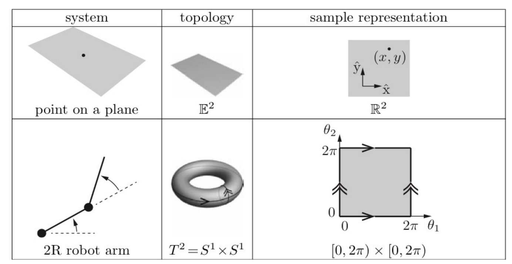
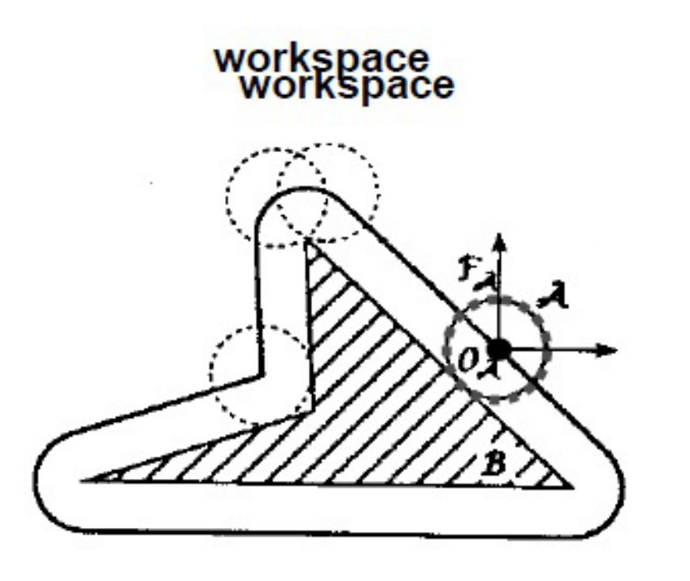
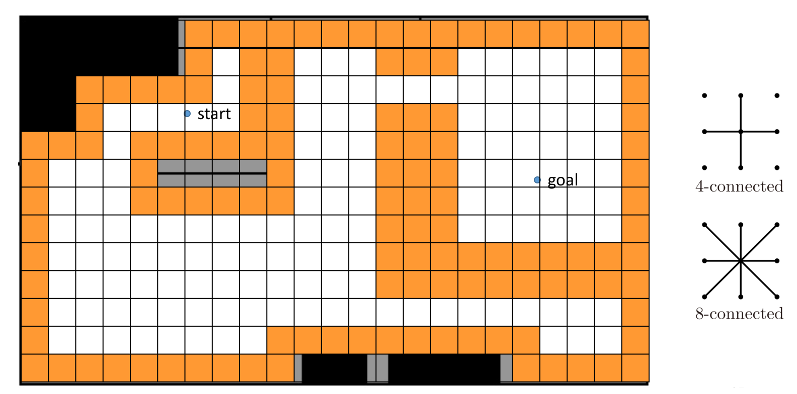
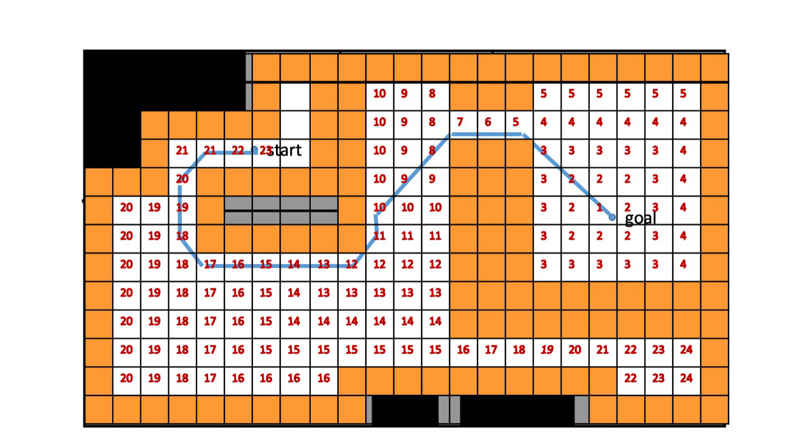
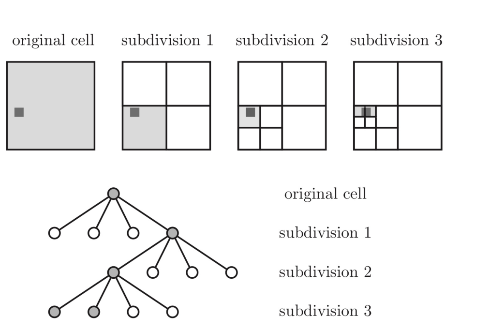
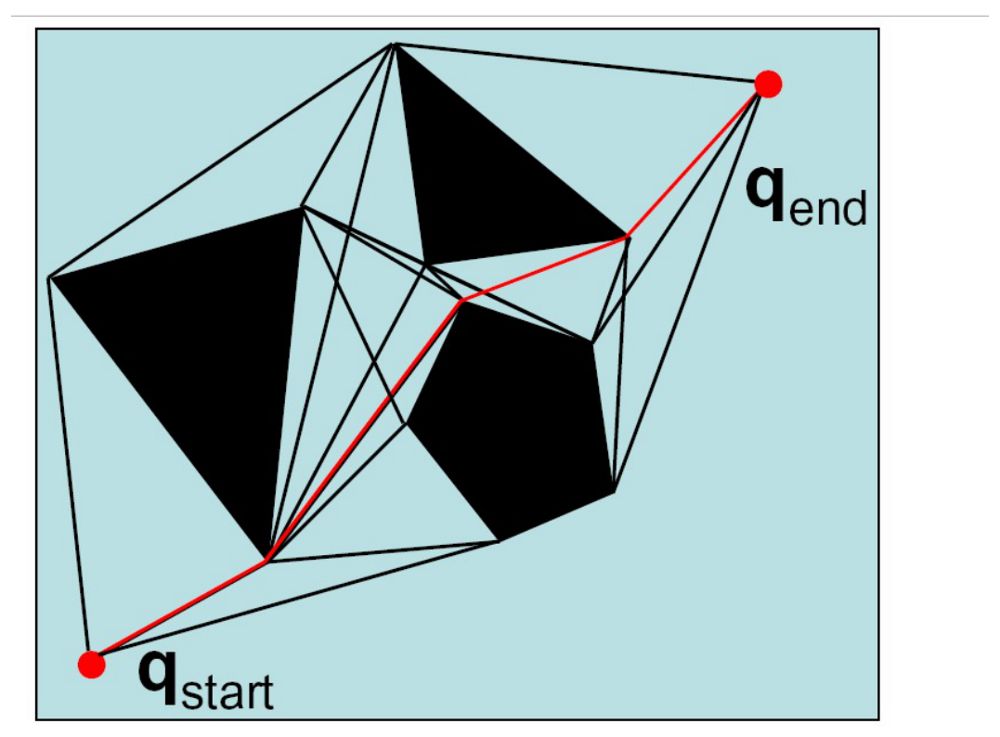
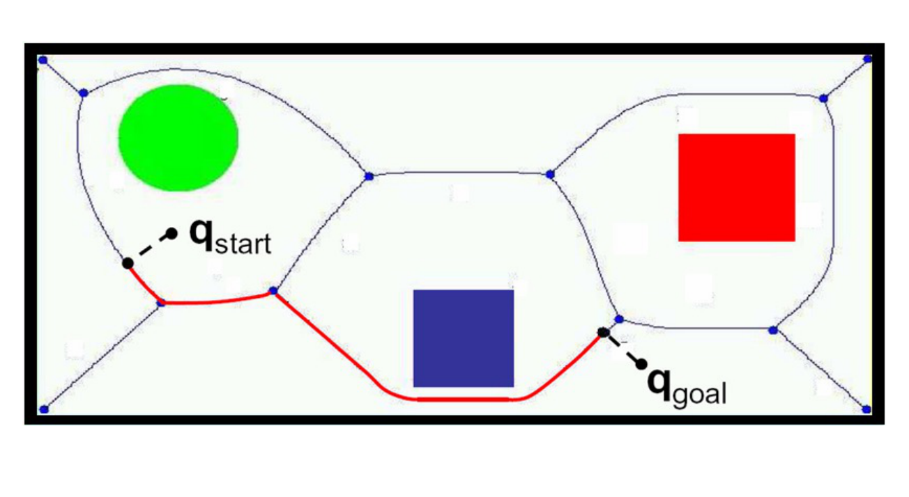
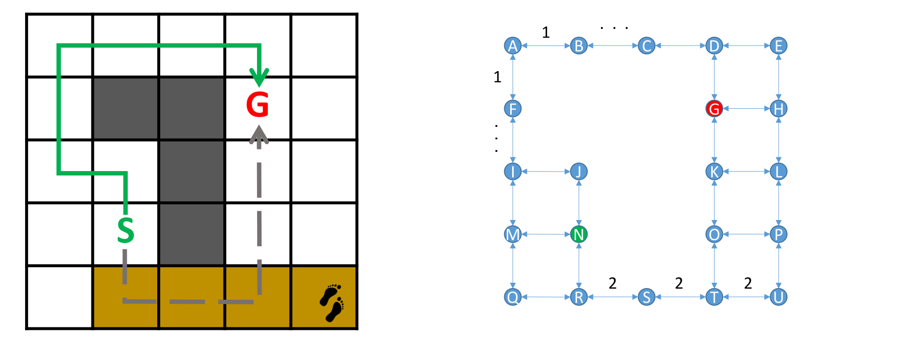
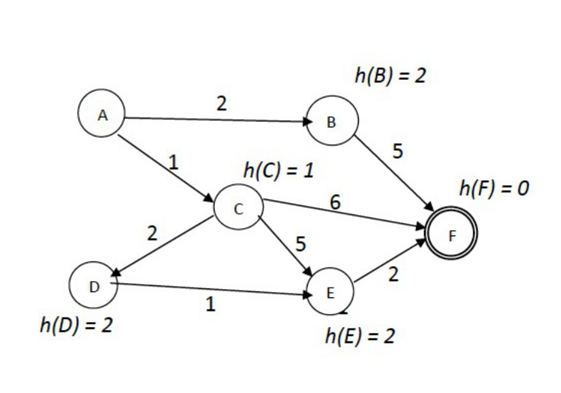
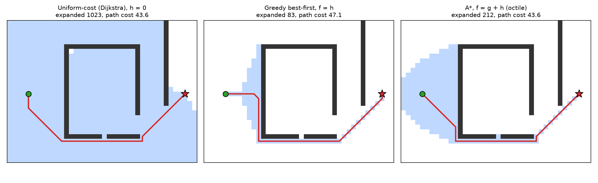

# Configuration Space and Path Planning

Feedback control drives a robot to a nearby reference, and the localization filters tell it where it is. Neither answers the question: given a goal far away, through a building full of walls and furniture, *which way should the robot go?* This chapter formulates path planning in the **configuration space** of the robot, where the robot becomes a point and obstacles grow; discretizes the free space into a graph by occupancy grids, quadtrees, visibility graphs, Voronoi diagrams or cell decompositions; and searches the graph with breadth-first, depth-first, uniform-cost, greedy and A\* search. The A\* algorithm, with an admissible heuristic, is implemented on a grid at the end.

## The Path-Planning Problem

So far we have studied **control** (given a reference state, automatically generate control inputs) and **localization and mapping** (build a map and track the robot's position in it). Planning closes the gap between them. Classic examples include the **piano mover's problem** (move a piano through the rooms and doorways of an apartment without collision) and a mobile manipulator reaching objects around a home. Planning is not unique to robotics: car navigation, non-player characters in games, and multi-modal freight transport (trucks, trains and ships between pick-up and delivery nodes) are all path-planning problems on graphs.

**Mobile robot path planning** is the problem of identifying a trajectory that, when executed, takes the robot to the goal. Its inputs are a representation of the **world and the robot** (their geometry), the **actions** the robot can take, and the **start and goal** states; its output is a feasible path.

## Configuration Space

**Definition (Configuration, C-space, degrees of freedom).** A **configuration** \\(q\\) of a robot is a complete specification of the position of every point on the robot. The **configuration space** (C-space) \\(\mathcal C\\) is the space of all possible configurations. The number of **degrees of freedom** (DOF) is the smallest number of real-valued coordinates needed to represent a configuration, i.e. the dimension of \\(\mathcal C\\).

For rigid bodies of known shape:

- a door on a hinge has 1 DOF, its angle \\(\phi\\);
- a point in the plane has 2 DOF, \\((x, y)\\);
- a coin lying in the plane has 3 DOF, \\((x, y, \theta)\\): position plus the orientation of the face.

A differential-drive robot is like the coin: its C-space is \\((x, y, \theta)\\), three-dimensional, even though it can only move in two independent directions at any instant (the non-holonomic constraint restricts velocities, not configurations).

### Topology

C-spaces have shapes. The C-space of a point on a plane is the plane \\(\mathbb E^2\\), represented by \\(\mathbb R^2\\) with coordinates \\((x, y)\\). The C-space of a two-link (2R) planar arm is two angles \\((\theta\_1, \theta\_2)\\); each angle lives on a circle \\(S^1\\), so the C-space is the **torus** \\(T^2 = S^1\times S^1\\). We represent it by the square \\([0, 2\pi)\times[0, 2\pi)\\), with opposite edges identified: leaving the right edge re-enters on the left.



*Figure: C-space examples. A point on a plane has C-space \\(\mathbb E^2\\), represented by \\(\mathbb R^2\\). A 2R arm has C-space the torus \\(T^2 = S^1\times S^1\\), represented by a square with opposite edges identified (arrows).*

**Topology** is an intrinsic property of a space. Two spaces are **topologically equivalent** if one can be continuously deformed into the other without cutting or gluing: a sphere and a cube are equivalent; a sphere and a torus are not. A **representation singularity** occurs when a small change in configuration causes a large jump in coordinates, which happens whenever the chosen coordinates have a different topology from the space represented. The heading \\(\theta\\) wrapping from \\(2\pi\\) to \\(0\\) is the everyday example: two nearly identical headings, \\(359°\\) and \\(1°\\), have very different coordinates. A planner (or filter) that measures distances between configurations must respect the topology, e.g. by wrapping angle differences.

### Obstacles, free space and unknown space

The world contains **obstacles** (where the robot can't or shouldn't go), **free space** (unoccupied) and **unknown** space (the robot might be able to go there; it may contain unknown obstacles, and states there may be unreachable). When planning we typically assume that all unknown space is free: an optimistic plan is re-planned when the robot discovers an obstacle, whereas a pessimistic one may find no path at all.

In C-space, the **C-obstacle** \\(\mathcal C\_{\text{obs}}\\) is the set of configurations at which the robot intersects an obstacle, and the **free space** is \\(\mathcal C\_{\text{free}} = \mathcal C\setminus\mathcal C\_{\text{obs}}\\). For a point robot in the plane, C-obstacles are simply the obstacles, and a plan is a curve from \\(q\_{\text{init}}\\) to \\(q\_{\text{goal}}\\) through \\(\mathcal C\_{\text{free}}\\).

### Robots with extent: growing the obstacles

A robot that is not a point can be reduced to one by **expanding the obstacles** by the robot's shape. For a robot \\(\mathcal A\\) that translates without rotating, with reference point at the origin of its own frame, the robot placed at \\(q\\) occupies \\(\mathcal A + q\\). It collides with obstacle \\(\mathcal O\\) exactly when \\(\mathcal A + q\\) meets \\(\mathcal O\\), i.e. when \\(q = o - a\\) for some \\(o\in\mathcal O\\), \\(a\in\mathcal A\\). Hence
\\[
\mathcal C\_{\text{obs}} = \mathcal O\oplus(-\mathcal A) = \\{o - a : o\in\mathcal O,\ a\in\mathcal A\\},
\\]
the **Minkowski sum** of the obstacle with the reflected robot. For a disk robot of radius \\(\rho\\), symmetric about its centre, \\(-\mathcal A = \mathcal A\\), and the C-obstacle is the obstacle grown by \\(\rho\\) in every direction: polygon edges move outward by \\(\rho\\) and the corners become circular arcs of radius \\(\rho\\).



*Figure: the C-obstacle of a disk robot. Sliding the disk (reference point O) around the boundary of the hatched triangular obstacle traces the grown, rounded outline; the robot's reference point must stay outside it.*

A useful practical simplification: a TurtleBot-like robot is close enough to circular to be modelled as a disk of fixed radius \\(\rho\\), so its C-space can be taken as the plane with all obstacles grown by \\(\rho\\) (the heading can then be ignored for collision checking).

If the robot is not round and can rotate, the C-obstacle depends on the orientation. For a rectangular robot near a rectangular obstacle, each orientation \\(\phi\\) gives a different grown polygon in \\((x, y)\\), and stacking these slices for \\(\phi\\) from \\(0°\\) to \\(180°\\) gives a twisted three-dimensional C-obstacle in \\((x, y, \phi)\\). Planning must then happen in 3-D.

### Planning in C-space

After the C-space transform, we plan for a point robot. The advantage is that point-robot planning is efficient and well understood. The disadvantage is that computing the exact C-obstacles is complicated, especially in higher dimensions. The alternative is to plan in the original space and only **collision-check** the configurations of interest; this is the basis of sampling-based planners (PRM, RRT; see Motion Planning).

**Definition (Path planning).** Find a collision-free path \\(q:[0, 1]\to\mathcal C\\) with \\(q(0) = q\_{\text{start}}\\), \\(q(1) = q\_{\text{goal}}\\) and \\(q(s)\in\mathcal C\_{\text{free}}\\) for all \\(s\in[0, 1]\\).

Path planning is a geometric special case of **motion planning**, which also accounts for dynamics, duration of motion and constraints on the motion or control inputs.

Planners are compared by several **properties**:

- **completeness**: does it find a path whenever one exists, and report failure otherwise? (*Resolution-complete*: yes, if the discretization is fine enough. *Probabilistically complete*: with probability approaching one as computation grows.)
- **optimality**: is the path found the shortest (or least-cost)?
- **computational complexity** in time and memory;
- **online vs offline**: does it plan while moving, re-planning as the map changes, or once in advance?
- **multi-query vs single-query**: is a structure built once and reused for many start–goal pairs (roadmaps), or rebuilt per query?

## Discretizing the Free Space

The continuous problem is intractable in general. The strategy is to **reduce the problem in continuous C-space to a tractable problem in a discrete space**, a graph, and then search the graph. There are two families: exhaustive grids, and roadmaps that capture the connectivity of free space in a small graph.

### Occupancy grids

Overlay a grid on the map. A cell is **occupied** if it touches a (grown) obstacle, otherwise **free**. Each free cell is a node, and edges join neighbouring free cells, with either **4-connectivity** (north, south, east, west) or **8-connectivity** (also the diagonals, with cost \\(\sqrt2\\) times the cell size).



*Figure: an occupancy grid of a floor plan. Cells touching the C-space-grown obstacles are occupied (orange); free cells are white. Right: 4-connected and 8-connected neighbourhoods.*

Grids are simple and general, but resolution is a real trade-off. A slightly larger cell size can make the goal unreachable: a narrow doorway that is two cells wide at fine resolution may be blocked entirely when every cell touching the door frame is marked occupied. Grids are therefore only *resolution-complete*. And the number of cells grows as \\((1/\text{cell size})^d\\) in \\(d\\) dimensions.

### The wavefront planner

The simplest grid planner is the **wavefront** (brushfire, or grassfire) planner. Label the goal 0. Label every free neighbour of the goal 1; every unlabelled free neighbour of a 1-cell 2; and so on, until the wave reaches the start (or every reachable cell). The label of a cell is its distance to the goal in steps; the computation is a breadth-first search outward from the goal. The path from the start then simply follows decreasing labels down to the goal.



*Figure: wavefront labels propagated from the goal through the free cells of the floor plan; the start cell has label 23. The blue path from start to goal descends the labels one step at a time.*

The wavefront is complete at its resolution and gives shortest paths (in steps) from *every* cell to the goal at once, a navigation function that remains useful if the robot is pushed off its path.

### Variable-resolution grids: quadtrees

To reduce the number of cells, use fine cells only where needed. **Hierarchical cell decomposition** with a **quadtree**:

1. Start with one large default cell covering the map.
2. If part of a cell contains an obstacle, subdivide it into four quadrants.
3. Continue splitting partially filled ("mixed") cells until a minimum allowed cell size is reached.
4. Do not split cells that are entirely filled with an obstacle (or entirely free).



*Figure: quadtree decomposition around a small obstacle (dark square). Only the mixed cell containing the obstacle is subdivided at each level; the corresponding tree has gray (mixed) nodes that are split and white (pure) leaves.*

On a floor plan the result is fine cells along walls and large cells in open rooms. The leaves are the nodes of the search graph, with edges between adjacent leaves. (The 3-D analogue is the octree.)

## Roadmaps

Occupancy grids perform an **exhaustive** search over the state space, representing and evaluating far more states than the robot needs to traverse. **Roadmap** methods instead precompute a (hopefully) small graph, the roadmap, such that staying on the "roads" avoids obstacles. A query connects \\(q\_{\text{start}}\\) and \\(q\_{\text{goal}}\\) to nearby roadmap points and then searches the roadmap. Roadmaps suit multi-query planning in a static environment.

### Visibility graphs

The **visibility graph** has as nodes \\(q\_{\text{start}}\\), \\(q\_{\text{goal}}\\) and all vertices of the polygonal (C-)obstacles. Two nodes are joined by an edge if they are mutually visible, i.e. the straight segment between them does not pass through an obstacle's interior; polygon edges themselves are included.

**Theorem (Shortest paths among polygons).** In the plane with polygonal obstacles, the shortest collision-free path between two points is a polygonal line whose interior vertices are obstacle vertices. Hence the shortest path lies in the visibility graph.

*Proof sketch.* A shortest path is locally straight wherever it is in free space (otherwise it could be shortened). It can only bend where it touches an obstacle, and touching an edge in its middle does not help it bend; it must bend around a convex vertex. So it consists of straight segments between start, obstacle vertices and goal, each segment collision-free: exactly the edges of the visibility graph. \\(\square\\)



*Figure: the visibility graph among black polygonal obstacles. Edges join mutually visible vertices; the shortest path from \\(q\_{\text{start}}\\) to \\(q\_{\text{end}}\\) (red) runs vertex to vertex, grazing the obstacles.*

Computing visibility naively tests each of the \\(O(n^2)\\) vertex pairs against all \\(n\\) edges, \\(O(n^3)\\). The **rotational sweep** algorithm does better: for each vertex, sort the other vertices by angle and rotate a ray (the sweep line) around it, maintaining the ordered list of obstacle edges the ray crosses; a vertex is visible if no edge in the list lies in front of it. This costs \\(O(n\log n)\\) per vertex and \\(O(n^2\log n)\\) in total.

Visibility graphs give **shortest paths**, but those paths stay as close as possible to obstacles, touching their corners. Any deviation from the path (tracking error, localization error) can cause a collision, so in practice the obstacles are grown by an extra safety margin. The method also requires polygonal obstacles.

### Voronoi diagrams

If safety matters more than optimality, go to the other extreme: stay as far as possible from obstacles.

**Definition (Generalized Voronoi diagram).** The generalized Voronoi diagram (GVD) of a set of obstacles is the set of all points in free space that are equidistant to their two (or more) nearest obstacles.

The GVD is a network of curves running down the middle of corridors and between obstacles; for polygonal obstacles its edges are line segments and parabolic arcs. To plan, **retract** \\(q\_{\text{start}}\\) and \\(q\_{\text{goal}}\\) onto the diagram (move each away from its nearest obstacle until it reaches the diagram), then search along the diagram's edges.



*Figure: a generalized Voronoi diagram among a disk and two squares. The start and goal connect to the diagram by short retraction segments (dashed), and the path (red) follows Voronoi edges, keeping maximum clearance.*

For point sites in the plane, the Voronoi diagram is computed in \\(O(n\log n)\\) by **Fortune's algorithm**, a sweep-line method that maintains a "beach line" of parabolic arcs behind a moving sweep line. The GVD's drawbacks: it is difficult to compute in higher dimensions; staying away from obstacles is not necessarily the best heuristic, since paths can be far too conservative (and long) in open space; and it is unstable, since small changes in the obstacle configuration can cause large changes in the diagram. On the other hand, a robot with range sensors can follow a Voronoi edge *reactively*, by balancing the distances to the nearest obstacles on either side.

### Cell decomposition

**Exact cell decomposition** partitions \\(\mathcal C\_{\text{free}}\\) into simple convex regions (cells) whose union is exactly the free space. The **trapezoidal (vertical) decomposition** draws a vertical line up and down from every polygon vertex until it hits an obstacle; the free space splits into trapezoids (some degenerate into triangles). Two cells are adjacent if they share a boundary segment. The **connectivity graph** has a node per cell and an edge per adjacency. To plan, find the cells containing start and goal, search the connectivity graph, and turn the sequence of cells into a path, for example through the midpoints of the shared boundaries. Since each cell is convex, any two points in it are joined by a straight segment, so the method is complete. The decomposition has \\(O(n)\\) cells and can be computed in \\(O(n\log n)\\) by a sweep.

### Common structure

Occupancy grids, quadtrees, visibility graphs, Voronoi diagrams and cell decompositions differ in how they discretize the free space, but every one of them **produces a graph that we then need to search**. The rest of the chapter is about searching graphs.

## Searching Graphs

A **graph traversal** problem asks for a path from a start vertex to a goal vertex. Optional requirements: the path must pass certain nodes, or be the shortest, or reach any one of several goals. The solution is a search algorithm.

A grid becomes a graph by making each free cell a node and joining neighbouring cells with edges (bidirectional, with cost 1 for 4-connectivity). In a 5 × 5 grid world with some wall cells, the free cells become nodes A–U, and the start and goal cells become two of them. All planning happens in the robot's "brain": no action is actually taken until a complete path is found.

### The general search process

1. Check: have we run out of options? If so, planning failed.
2. Check: are we at the goal? If so, succeed and return the path.
3. **Expand** the current state: consider each legal action (each graph neighbour), generating new states kept in a list, the **frontier** (or open list).
4. Choose one state from the frontier to simulate next.
5. Repeat.

The states fall into three sets: **explored** (expanded already), **frontier** (generated but not yet expanded) and **unexplored**. The tree of states generated from the start is the **search tree**; the same graph node can appear in it several times (in the grid example, expanding N gives J, M, R; expanding J gives I and N again). We could loop back to N forever, so we must avoid going in circles.

### Tree search and graph search

```
function TREE-SEARCH(problem) returns a solution, or failure
  initialize the frontier using the initial state of problem
  loop do
    if the frontier is empty then return failure
    choose a leaf node and remove it from the frontier
    if the node contains a goal state then return the corresponding solution
    expand the chosen node, adding the resulting nodes to the frontier

function GRAPH-SEARCH(problem) returns a solution, or failure
  initialize the frontier using the initial state of problem
  initialize the explored set to be empty
  loop do
    if the frontier is empty then return failure
    choose a leaf node and remove it from the frontier
    if the node contains a goal state then return the corresponding solution
    add the node to the explored set
    expand the chosen node, adding the resulting nodes to the frontier
      only if not in the frontier or explored set
```

(After Russell and Norvig, *Artificial Intelligence: A Modern Approach*.) Graph search keeps a history of visited nodes, the explored set, to avoid loopy and redundant paths. The one line left open, *which leaf node to choose*, is what distinguishes all the search algorithms below: **a search strategy is defined by the order of node expansion**.

Search strategies are **uninformed** (they use only the topology of the graph, which states are connected by which actions) or **informed** (they use an estimate of which actions are likely to be better).

### Breadth-first and depth-first search

**Breadth-first search (BFS)** expands the shallowest unexpanded node. The frontier is a **FIFO queue**: new successors go to the back. On a binary tree, BFS expands A; then B, C; then D, E, F, G: level by level.

**Depth-first search (DFS)** expands the deepest unexpanded node. The frontier is a **LIFO stack**. On a binary tree, DFS goes down the leftmost branch first (A, B, D, H, ...) and backtracks only at dead ends.

Let \\(b\\) be the branching factor (successors per node) and \\(d\\) the depth of the shallowest goal.

- **BFS** is complete and finds the path with the fewest edges (the shortest path when all edges cost the same). But it stores the whole frontier, \\(O(b^d)\\) nodes, and memory is the binding constraint. With \\(b = 10\\) and \\(d = 10\\) there are about \\(10^{10}\\) nodes: at a million nodes per second that is about \\(10^4\\) s, roughly 3 hours (bad), and at 1 kB per node it is 10 terabytes of memory (much worse).
- **DFS** needs only \\(O(bm)\\) memory for maximum depth \\(m\\) (the current path and its siblings). But it does not guarantee the shortest path, and in infinite or cyclic spaces (without an explored set) it might not terminate.

### Uniform-cost search

BFS and DFS ignore **action costs**. Suppose part of the grid is mud, where each move costs 2 instead of 1. The path with the fewest steps may cross the mud and cost more than a longer path around it.



*Figure: a grid where the bottom row is mud (cost 2 per move). The fewest-steps route from S to G (gray dashed) runs through the mud; the cheapest route (green) goes over the top. Right: the same world as a weighted graph.*

**Uniform-cost search (UCS)** expands the unexpanded node with the least total path cost \\(g(n)\\) from the start. The frontier is a **priority queue** ordered by \\(g\\). UCS is Dijkstra's algorithm, but focused on finding the shortest path to a single goal node rather than to every node.

```
function UNIFORM-COST-SEARCH(problem) returns a solution, or failure
  node <- a node with STATE = problem.INITIAL-STATE, PATH-COST = 0
  frontier <- a priority queue ordered by PATH-COST, with node as the only element
  explored <- an empty set
  loop do
    if EMPTY?(frontier) then return failure
    node <- POP(frontier)            /* chooses the lowest-cost node in frontier */
    if problem.GOAL-TEST(node.STATE) then return SOLUTION(node)
    add node.STATE to explored
    for each action in problem.ACTIONS(node.STATE) do
      child <- CHILD-NODE(problem, node, action)
      if child.STATE is not in explored or frontier then
        frontier <- INSERT(child, frontier)
      else if child.STATE is in frontier with higher PATH-COST then
        replace that frontier node with child
```

Two details matter. The goal test is applied when a node is **popped**, not when it is generated: a goal generated early via an expensive edge may later be reached more cheaply. And a frontier entry is **replaced** when a cheaper path to the same state is found. With non-negative edge costs, nodes are popped in non-decreasing order of \\(g\\), so the first time the goal is popped its \\(g\\) is optimal.

Both BFS and UCS explore a lot of unneeded space, because they are uninformed: UCS expands a "disk" of increasing cost around the start in every direction, including away from the goal.

## Informed Search

On a road map, an uninformed search from one coast to the other expands a huge disk of cities around the start; an informed search expands a narrow wedge toward the goal. The information is a **heuristic**.

**Definition (Heuristic).** A heuristic \\(h(n)\\) is an estimate of the cost of the cheapest path from node \\(n\\) to the goal. It should guide the search toward the goal and be cheap to compute.

Typical heuristics: the straight-line distance \\(h\_{\text{SLD}}\\) for road maps ("waypoint A is better than B because it is closer to the goal as the crow flies"); the Euclidean or Manhattan distance on grids. They are only approximations, because they cannot see walls and unknown obstacles: the actual path may have to detour around a wall the heuristic ignores.

### Greedy best-first search

**Greedy best-first search** expands the node that appears closest to the goal: it orders the frontier by \\(f(n) = h(n)\\). It is "greedy" in doing what seems best now, ignoring the cost already paid.

**Example 1 (Greedy search on a grid).** On a 5 × 5 grid with wall cells and the Manhattan-distance heuristic, the start S has three free neighbours with \\(h = 5\\) (left), 3 (up) and 5 (down). Greedy expands the \\(h = 3\\) cell, which is a dead end against the wall; its only new neighbour has \\(h = 4\\), so the search backs off to that cell, then climbs to a cell with \\(h = 3\\) above it, then to the top row, and follows \\(h = 3, 2, 1\\) along the top to G. The path goes up the left side and across the top; few cells are expanded.

Greedy search is **not guaranteed to find the shortest path** (it ignores \\(g\\)), and in a U-shaped obstacle opening toward the goal it dives into the U and must back out. With a good heuristic, however, it can be very efficient.

### A\* search

A\* (developed for SRI's Shakey robot) combines the optimality of uniform-cost search with the efficiency of greedy search. It avoids expanding paths that are already expensive by ordering the frontier by
\\[
\boxed{f(n) = g(n) + h(n)} = \text{estimated total cost of the cheapest path from start through } n \text{ to the goal},
\\]
with \\(g(n)\\) the known cost so far and \\(h(n)\\) the heuristic estimate of the remaining cost. Otherwise A\* is exactly the UCS pseudocode above with \\(g\\) replaced by \\(f\\) as the priority.

**Example 2 (A\* trace).** Consider the directed graph with edges \\(A\to B\\) (2), \\(A\to C\\) (1), \\(B\to F\\) (5), \\(C\to F\\) (6), \\(C\to D\\) (2), \\(C\to E\\) (5), \\(D\to E\\) (1), \\(E\to F\\) (2), and heuristic \\(h(B) = 2\\), \\(h(C) = 1\\), \\(h(D) = 2\\), \\(h(E) = 2\\), \\(h(F) = 0\\). Start at \\(A\\), goal \\(F\\); break ties alphabetically. Find the order of expansion and the final path.



*Figure: the weighted directed graph of Example 2, with the heuristic value of each node.*

| Step | Expand | Frontier after expansion, entries \\(g + h = f\\) (path) |
|---|---|---|
| 1 | A | B: 2 + 2 = 4 (AB); C: 1 + 1 = 2 (AC) |
| 2 | C (f = 2) | B: 4 (AB); D: 3 + 2 = 5 (ACD); E: 6 + 2 = 8 (ACE); F: 7 + 0 = 7 (ACF) |
| 3 | B (f = 4) | B→F gives g = 7, f = 7: no improvement on ACF. Frontier: D 5, F 7, E 8 |
| 4 | D (f = 5) | D→E gives g = 4, f = 6 < 8: replace E by 4 + 2 = 6 (ACDE). Frontier: E 6, F 7 |
| 5 | E (f = 6) | E→F gives g = 6, f = 6 < 7: replace F by 6 + 0 = 6 (ACDEF) |
| 6 | F (f = 6) | goal popped: stop |

The **expansion order is A, C, B, D, E, F**, and the **final path is A–C–D–E–F with cost 1 + 2 + 1 + 2 = 6**. Note that F entered the frontier at step 2 with cost 7 (path ACF) but was not accepted then: the goal test on popping let A\* find the cheaper path through D and E. Note also that B was expanded even though it is not on the best path: its optimistic estimate \\(f = 4\\) was the lowest at the time, and A\* must check every node whose \\(f\\) is below the optimal cost.

### Admissibility and optimality

**Definition (Admissible heuristic).** \\(h\\) is admissible if \\(h(n)\le h^\*(n)\\) for every node \\(n\\), where \\(h^\*(n)\\) is the true cost of the cheapest path from \\(n\\) to the goal. An admissible heuristic never overestimates; it is optimistic.

Straight-line distance never overestimates road distance. On a grid with 4-connected moves the Manhattan distance \\(\lvert\Delta x\rvert + \lvert\Delta y\rvert\\) is admissible; with 8-connected moves (diagonals of cost \\(\sqrt2\\)) it is not, since it overestimates diagonal moves, and the **octile distance** \\(\max(\lvert\Delta x\rvert, \lvert\Delta y\rvert) + (\sqrt2 - 1)\min(\lvert\Delta x\rvert, \lvert\Delta y\rvert)\\) or the Euclidean distance should be used. In Example 2 the true costs to go are \\(h^\*(B) = 5\\), \\(h^\*(C) = 5\\), \\(h^\*(D) = 3\\), \\(h^\*(E) = 2\\), and each \\(h\\) is no larger, so it is admissible.

**Theorem (Optimality of A\*).** If edge costs are positive (bounded below by some \\(\epsilon > 0\\)), the graph is finite or locally finite, and \\(h\\) is admissible, then A\* (tree search, goal test on popping) returns an optimal path.

*Proof sketch.* Let \\(C^\*\\) be the optimal cost, and suppose A\* were about to pop a suboptimal goal node \\(G'\\) with \\(f(G') = g(G') > C^\*\\). At every moment before termination, some node \\(n\\) on an optimal path is in the frontier with its optimal \\(g(n)\\) (the start is, initially, and expanding such a node puts its successor on the optimal path into the frontier). For that node \\(f(n) = g(n) + h(n)\le g(n) + h^\*(n) = C^\*< f(G')\\), so A\* would pop \\(n\\) before \\(G'\\). Repeating the argument, the optimal goal is popped first. \\(\square\\)

For graph search with an explored set, the stronger condition of **consistency** (monotonicity), \\(h(n)\le c(n, n') + h(n')\\) for every edge, guarantees that a node's \\(g\\) is optimal when it is first expanded, so it never needs reopening. Consistent heuristics are admissible, and distances like straight-line or Manhattan distance are consistent by the triangle inequality. (The heuristic of Example 2 is consistent.)

### Comparing heuristics: the 8-puzzle

**Example 3 (8-puzzle).** Tiles 1–8 slide in a 3 × 3 frame with one blank. Start and goal states:

| Start | | | | Goal | | |
|---|---|---|---|---|---|---|
| 7 | 2 | 4 | | blank | 1 | 2 |
| 5 | blank | 6 | | 3 | 4 | 5 |
| 8 | 3 | 1 | | 6 | 7 | 8 |

Two admissible heuristics:

- \\(h\_1\\) = number of misplaced tiles. Every tile 1–8 is out of place, so \\(h\_1(S) = 8\\). (The blank is not counted: it is not a tile, and counting it can overestimate, since the final move places a tile and the blank together. A count of 9 that includes the blank is a common slip.) Admissible because each misplaced tile needs at least one move.
- \\(h\_2\\) = total Manhattan distance of the tiles from their goal squares. For tiles 1 to 8: \\(3 + 1 + 2 + 2 + 2 + 3 + 3 + 2 = 18\\). Admissible because each move shifts one tile by one square.

(The optimal solution of this instance takes 26 moves, so both underestimate.)

**Definition (Dominance).** If \\(h\_1\\) and \\(h\_2\\) are both admissible and \\(h\_2(n)\ge h\_1(n)\\) for all \\(n\\), then \\(h\_2\\) **dominates** \\(h\_1\\).

A dominating heuristic is closer to the ground truth and is better for search: A\* with \\(h\_2\\) never expands more nodes than with \\(h\_1\\) (apart from ties), because every node with \\(f < C^\*\\) must be expanded and fewer nodes satisfy \\(g + h\_2 < C^\*\\). Here \\(h\_2\ge h\_1\\) always, since every misplaced tile is at Manhattan distance at least 1. Empirically the difference is dramatic: the number of nodes expanded grows explosively with solution depth for uninformed search (hundreds already at depth 6, beyond a thousand by depth 7), slowly for \\(h\_1\\) (tens at depth 10), and stays tiny for \\(h\_2\\).

If the heuristic is **not admissible**, A\* still finds a solution, but possibly not an optimal one.

### The effect of h on A\*

With \\(d(x)\\) the true cost from \\(x\\) to the goal:

- \\(h(x) = 0\\): uninformed; A\* reduces to uniform-cost search.
- \\(h(x)\le d(x)\\): optimistic; A\* is guaranteed to find a shortest path. The lower \\(h\\), the more nodes A\* expands.
- \\(h(x) = d(x)\\): exact; A\* follows the best path and never expands anything else. But computing the exact cost-to-go is as hard as the problem itself.
- \\(h(x) > d(x)\\): pessimistic; A\* is not guaranteed to find a best path, but can be very fast. (Weighted A\*, \\(f = g + wh\\) with \\(w > 1\\), returns a path at most \\(w\\) times the optimal cost.)

A\* is one of the most frequently used algorithms for path planning, manipulation and obstacle avoidance because of its efficiency, primarily on 2-D grids and graphs. Its descendants (D\*, D\* Lite, anytime and lifelong A\*) re-plan incrementally as the map changes.

### Implementing A\* on a grid

```python
import heapq, math
import numpy as np

def astar(grid, start, goal, mode='astar'):
    """8-connected grid search. grid[r, c] = 1 for obstacles.
    mode: 'ucs' (h = 0), 'greedy' (f = h) or 'astar' (f = g + h)."""
    H, W = grid.shape
    moves = [(dr, dc, math.hypot(dr, dc)) for dr in (-1, 0, 1) for dc in (-1, 0, 1) if dr or dc]
    def h(n):                                        # octile distance: admissible, consistent
        dr, dc = abs(n[0] - goal[0]), abs(n[1] - goal[1])
        return 0.0 if mode == 'ucs' else max(dr, dc) + (math.sqrt(2) - 1) * min(dr, dc)
    g, parent, closed = {start: 0.0}, {start: None}, set()
    frontier, tie = [(h(start), 0, start)], 0
    while frontier:
        _, _, n = heapq.heappop(frontier)
        if n in closed:
            continue                                 # stale entry (a cheaper copy was popped)
        closed.add(n)
        if n == goal:                                # goal test on pop
            break
        for dr, dc, c in moves:
            m = (n[0] + dr, n[1] + dc)
            if not (0 <= m[0] < H and 0 <= m[1] < W) or grid[m]:
                continue
            if dr and dc and (grid[n[0] + dr, n[1]] or grid[n[0], n[1] + dc]):
                continue                             # do not cut obstacle corners
            if m not in closed and g[n] + c < g.get(m, math.inf):
                g[m], parent[m] = g[n] + c, n
                tie += 1
                pri = h(m) if mode == 'greedy' else g[m] + h(m)
                heapq.heappush(frontier, (pri, tie, m))
    path, n = [], goal
    while n is not None:
        path.append(n); n = parent.get(n)
    return path[::-1], g.get(goal), closed
```

Instead of decreasing a key inside the heap, the code pushes a new entry whenever a cheaper path is found and skips stale entries when they are popped, the usual "lazy deletion" implementation of the replace step in the pseudocode.



*Figure: searching a 30 × 40 grid (8-connected, no corner cutting) from the green start to the red goal around a walled room with a gap and a long wall. Blue cells were expanded. Uniform-cost search expands 1023 cells, nearly the whole map, and finds the optimal path (cost 43.6). Greedy search expands only 83 cells but hugs the wall and returns a longer path (47.1). A\* with the octile heuristic expands 212 cells and returns the optimal path.*

The figure summarizes the chapter's search results. UCS is optimal but blind. Greedy is fast but not optimal. A\* with an admissible heuristic is optimal and expands only the nodes whose optimistic estimate \\(f\\) is below the optimal cost.

## Summary

- A configuration specifies every point of the robot; the C-space is the set of configurations, its dimension the number of DOF; C-spaces have topology (the 2R arm's is a torus), and coordinate representations can have singularities (angle wrap).
- C-obstacles for a translating robot are Minkowski sums \\(\mathcal O\oplus(-\mathcal A)\\); for a disk robot, the obstacles grown by its radius. Rotation adds a dimension.
- Path planning: find \\(q(s)\in\mathcal C\_{\text{free}}\\), \\(s\in[0, 1]\\), from start to goal. Planners are judged on completeness, optimality, complexity, online/offline and single/multi-query use.
- Discretizations: occupancy grids (4- or 8-connected; resolution-complete), wavefront (BFS from the goal), quadtrees, visibility graphs (shortest paths, touch obstacles), Voronoi diagrams (maximum clearance, unstable), trapezoidal cell decomposition (complete). All produce a graph to search.
- BFS (FIFO; fewest edges; memory \\(O(b^d)\\)), DFS (LIFO; little memory; not optimal), UCS (priority on \\(g\\); Dijkstra), greedy (priority on \\(h\\); fast, not optimal), A\* (priority on \\(f = g + h\\)).
- A\* is optimal with an admissible heuristic (\\(h\le h^\*\\)); consistency (\\(h(n)\le c(n, n') + h(n')\\)) avoids re-expansions; a dominating admissible heuristic expands fewer nodes. Worked example: expansion order A C B D E F, path A–C–D–E–F, cost 6. 8-puzzle: \\(h\_1 = 8\\), \\(h\_2 = 18\\).

## See Also

- Motion Planning, for sampling-based planners, trajectory generation and planning under uncertainty
- Graph Algorithms and Data Structures, for Dijkstra's algorithm and priority queues
- Complexity
- [Behavior-Based Control](behavior-control.md), which follows the planned waypoints
- Localization and SLAM, for the maps that planning uses
- Mobile Robots and Locomotion
