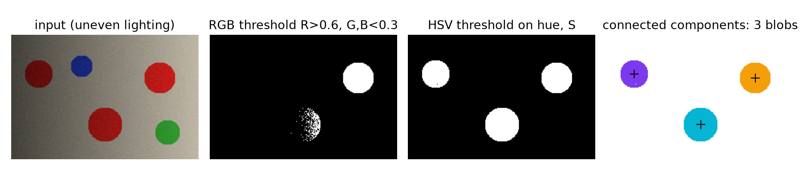
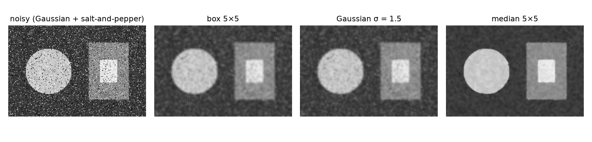
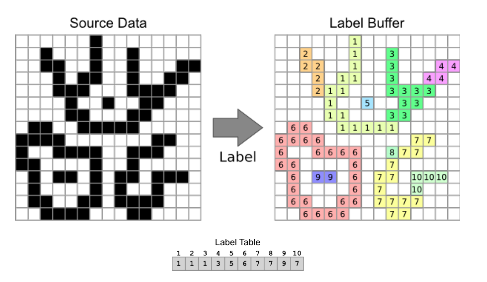
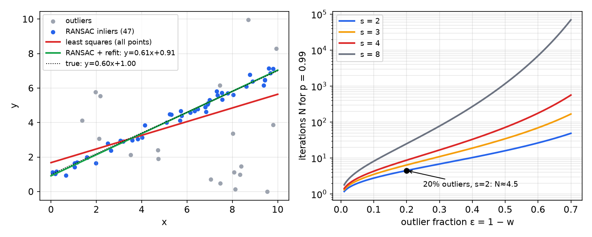
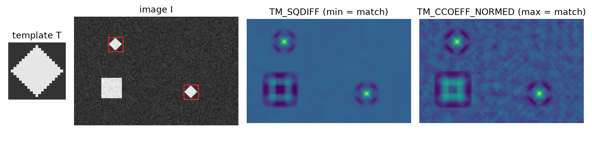

# Image Processing for Robots

A camera is the cheapest rich sensor a robot can carry, but what it delivers is only a grid of numbers. This chapter covers the classical image-processing toolkit that turns those numbers into something a controller can use: a bearing to a colored ball, the outline of an object, a line on the floor, the location of a known pattern. We start with images as arrays and their statistics, move through point (monadic) operations and color spaces, then neighbourhood filtering (box, Gaussian, median, sharpening) with a fully worked example, and finish with three analysis techniques used constantly in robotics: connected-component labeling, RANSAC model fitting, and template matching. Deeper treatments are in the Computer Vision section, especially Image Processing and Features.

## Images as Arrays

### From light to pixels

Image formation is a chain: **illumination** lights the scene; **optics** (the lens) focus the light; the **sensor** converts photons to charge and then to numbers; **processing** (demosaicing, white balance, compression) produces an image; and a **display** shows it. The key transition is from analog (continuous light intensity over a continuous image plane) to digital (quantized values on a discrete grid).

A digital grayscale image is a 2-D array \\(I[u, v]\\) of **pixels** (picture elements). The usual image convention puts the origin at the **top-left** corner, with \\(x\\) (or the column index \\(u\\)) increasing to the right and \\(y\\) (row index \\(v\\)) increasing *downward*, the opposite of the usual mathematical \\(y\\)-axis. A \\(512\times512\\) image has \\(512^2 = 262{,}144\\) pixels, about 0.26 megapixels. In code, beware that arrays are indexed `img[row, col]`, i.e. `img[y, x]`.

Each pixel stores an **intensity**. The most common encoding uses one byte (8 bits), so values run from 0 (black) to 255 (white). A small dark shape on a white background is then simply a matrix whose background entries are 255 and whose shape entries are smaller numbers (20, 75, 127, 200 and so on). Everything that follows is arithmetic on such matrices.

### Image statistics and histograms

Simple statistics (average, median, mode) can be computed over the whole image or over windows and regions. The **histogram** is the distribution of pixel intensities: for each intensity bin (0 to 255), the number of pixels with that value. It can be computed per channel and per region. A dark image has its histogram bunched at the left; a washed-out, low-contrast image has a narrow peak; an image of a bright object on a dark background is **bimodal**, with two peaks and a valley that suggests a threshold.

Why care?

1. **Statistics tell you when something is wrong.** A histogram piled at 0 or 255 means under- or over-exposure (clipping); a sudden shift between frames means the lighting or exposure changed.
2. **They are useful in computation.** Thresholds, normalization, and auto-exposure all use them. One humanoid robot (Sony's QRIO) looked at its own hand every time it powered on: the hand was painted a known medium gray, RGB (161, 161, 161), and comparing the observed color to the known one let the robot calibrate its camera to the current lighting before recognising objects.

### Color images

A color image has three channels, red, green and blue, so it is a 3-D array of size width × height × channels; each pixel is an \\((R, G, B)\\) triple. (OpenCV stores the channels in BGR order, a frequent source of bugs.)

## Color Spaces

The **RGB** model is additive: colors are mixed from red, green and blue light, and the space is a cube with black at \\((0, 0, 0)\\) and white at \\((255, 255, 255)\\). It matches how displays emit light and how sensors measure it, but in RGB the **lighting and color properties are coupled**: dimming the light scales all three channels, so a red ball in shadow has a very different RGB value from the same ball in sunlight.

The **HSV** model (hue, saturation, value) is closer to human color perception and decouples them. It is drawn as a cylinder (or cone):

- **Hue** \\(H\\) is the angle around the cylinder (0° red, 120° green, 240° blue), the "color" itself;
- **Saturation** \\(S\\) is the distance from the axis: how pure the color is, versus gray;
- **Value** \\(V\\) is the height: brightness.

With channels scaled to \\([0, 1]\\), let \\(M = \max(R, G, B)\\), \\(m = \min(R, G, B)\\) and \\(C = M - m\\). Then \\(V = M\\), \\(S = C/M\\) (and 0 if \\(M = 0\\)), and
\\[
H = 60° \times \begin{cases} \dfrac{G - B}{C} \bmod 6 & M = R \\\\ \dfrac{B - R}{C} + 2 & M = G \\\\ \dfrac{R - G}{C} + 4 & M = B \end{cases}
\\]
(undefined when \\(C = 0\\), a gray pixel). Scaling all of \\(R, G, B\\) by a lighting factor \\(k\\) scales \\(V\\) by \\(k\\) but leaves \\(H\\) and \\(S\\) unchanged, which is exactly why HSV is preferred for color segmentation under uneven lighting.

**Practical HSV thresholding.** To find a red ball, threshold hue near 0°, require a minimum saturation (to reject white, gray and black, whose hue is meaningless), and a small minimum value (to reject pixels too dark to trust). Two details: red straddles the wrap-around at 0°/360°, so it needs two hue ranges combined with OR; and OpenCV stores 8-bit hue as \\(H/2\\) in \\([0, 179]\\), with \\(S\\) and \\(V\\) in \\([0, 255]\\).

```python
import cv2, numpy as np
hsv = cv2.cvtColor(bgr, cv2.COLOR_BGR2HSV)
mask = cv2.inRange(hsv, (0, 120, 50), (10, 255, 255)) | cv2.inRange(hsv, (170, 120, 50), (179, 255, 255))
mask = cv2.morphologyEx(mask, cv2.MORPH_OPEN, np.ones((3, 3), np.uint8))   # remove speckle
```



*Figure: a synthetic scene with three red, one blue and one green disc under lighting that brightens from left to right. A fixed RGB threshold (R > 0.6, G and B < 0.3) finds only the brightly lit red disc fully and the middle one partially, and misses the dark one at left. An HSV threshold on hue and saturation finds all three. Connected-component labeling then separates the mask into three blobs, with centroids marked +.*

## Point (Monadic) Operations

A **monadic** (point) operation maps each pixel to a new value using only that pixel:
\\[
O[u, v] = f\big(I[u, v]\big),
\\]
ignoring the neighbours. Because \\(f\\) acts on one intensity at a time, it can be implemented as a 256-entry lookup table.

- **Brightness:** \\(O = I + b\\), clipped to \\([0, 255]\\). Shifts the histogram.
- **Contrast:** \\(O = a(I - c) + c\\) with gain \\(a\\) about a pivot \\(c\\). Contrast is the difference between the maximum and minimum intensity in an image or region; \\(a>1\\) stretches the histogram, \\(a<1\\) compresses it.
- **Contrast stretching (normalization):** map the observed range \\([I\_{\min}, I\_{\max}]\\) linearly onto \\([0, 255]\\): \\(O = 255\\,(I - I\_{\min})/(I\_{\max} - I\_{\min})\\). A dark image whose intensities lie between about 90 and 150 becomes one spanning the full range.
- **Histogram equalization:** map each intensity through the scaled cumulative distribution, \\(O = \operatorname{round}\big(255\\,\mathrm{CDF}(I)\big)\\) with \\(\mathrm{CDF}(k) = \sum\_{j\le k}p(j)\\), which spreads the histogram as uniformly as possible. Because the mapping is between discrete levels, the output histogram has a comb-like look, with gaps between occupied bins.
- **Gamma correction:** \\(O = 255\\,(I/255)^{\gamma}\\), which brightens (\\(\gamma<1\\)) or darkens (\\(\gamma>1\\)) mid-tones while fixing black and white.
- **Thresholding:** \\(O = 255\\) if \\(I>t\\), else 0. The result is a **binary** image, the input to blob analysis. Otsu's method picks \\(t\\) automatically by minimizing the within-class variance of the two resulting groups, which works well for bimodal histograms.

Point operations also act on color vectors. The **sepia** effect is the per-pixel linear map
\\[
\begin{bmatrix} R' \\\\ G' \\\\ B'\end{bmatrix} = \begin{bmatrix} 0.393 & 0.769 & 0.189 \\\\ 0.349 & 0.686 & 0.168 \\\\ 0.272 & 0.534 & 0.131\end{bmatrix}\begin{bmatrix} R \\\\ G \\\\ B\end{bmatrix},
\\]
clipped to 255. Each output channel is a weighted luminance with a warm bias. Color-space conversions are point operations of the same kind (linear for RGB to grayscale, \\(Y = 0.299R + 0.587G + 0.114B\\); nonlinear for RGB to HSV).

## Neighbourhood Filtering

### Local operators

**Image filtering** computes a function of the local neighbourhood at each pixel. A **local operator** takes the window \\(\mathcal{W}\\) of pixels \\(u - h\ldots u + h\\), \\(v - h\ldots v + h\\) around \\((u, v)\\) in the \\(W\times H\\) input and produces one output pixel \\(O[u, v] = f(\mathcal{W})\\): a many-to-one mapping. Filtering is used to *enhance* images (denoise, resize, increase contrast), to *extract information* (texture, edges, distinctive points), and to *detect patterns* (template matching); it is also the core operation of convolutional neural networks.

### Linear filters, correlation and convolution

A **linear filter** replaces each pixel by a fixed linear combination of its neighbours. The array of coefficients is the **kernel** (mask, filter). For an image \\(F\\), a kernel \\(H\\) of size \\((2k + 1)\times(2k + 1)\\) indexed from \\(-k\\) to \\(k\\), and output \\(G\\):
\\[
\boxed{G[i, j] = \sum\_{u = -k}^{k}\sum\_{v = -k}^{k}H[u, v]\\,F[i + u, j + v].}
\\]
Strictly, this is **cross-correlation**. **Convolution** flips the kernel, \\(G[i, j] = \sum\_{u, v}H[u, v]\\,F[i - u, j - v]\\), written \\(G = H \ast F\\). The two agree for symmetric kernels (box, Gaussian), which is why the names are often used interchangeably; OpenCV's `filter2D` actually computes correlation. Convolution has the nicer algebra: it is commutative and associative, so a sequence of filters can be merged into one kernel.

**Example 1 (A single 3×3 average).** For the local data and the \\(3\times3\\) mean kernel
\\[
\begin{bmatrix} 10 & 5 & 3 \\\\ 4 & 6 & 1 \\\\ 1 & 1 & 8\end{bmatrix}, \qquad H = \frac19\begin{bmatrix} 1 & 1 & 1 \\\\ 1 & 1 & 1 \\\\ 1 & 1 & 1\end{bmatrix},
\\]
the output at the centre is \\((10 + 5 + 3 + 4 + 6 + 1 + 1 + 1 + 8)/9 = 39/9 \approx 4\\). The centre value 6 is pulled toward its neighbours: averaging **blurs**.

**Example 2 (Box-filtering a test image).** Let \\(f\\) be a \\(10\times10\\) image of zeros containing a \\(5\times5\\) block of 90s (rows 3 to 7, columns 4 to 8, counting from 1) with one 0 "hole" inside at row 6, column 5, and an isolated 90 at row 9, column 3:
\\[
f = \begin{bmatrix}
0&0&0&0&0&0&0&0&0&0 \\\\ 0&0&0&0&0&0&0&0&0&0 \\\\ 0&0&0&90&90&90&90&90&0&0 \\\\ 0&0&0&90&90&90&90&90&0&0 \\\\ 0&0&0&90&90&90&90&90&0&0 \\\\
0&0&0&90&0&90&90&90&0&0 \\\\ 0&0&0&90&90&90&90&90&0&0 \\\\ 0&0&0&0&0&0&0&0&0&0 \\\\ 0&0&90&0&0&0&0&0&0&0 \\\\ 0&0&0&0&0&0&0&0&0&0
\end{bmatrix}.
\\]
Apply \\(h[m, n] = \sum\_{k, l}g[k, l]\\,f[m + k, n + l]\\) with \\(g = \frac19\mathbf{1}\_{3\times3}\\), only at the 64 positions where the window fits entirely inside the image. Sliding along the second row of \\(f\\): the window centred at row 2, column 2 covers only zeros (0); one step right it covers one 90 (90/9 = 10); then two (20); then three (30), and stays at 30 while the window's bottom row lies along the top edge of the block. A window centred at row 5, column 4 straddles the left edge of the block and includes the hole: it covers five 90s, giving \\(450/9 = 50\\). Inside the block the window covers nine 90s (output 90), except where it includes the hole (\\(8\times90/9 = 80\\)). The full \\(8\times8\\) output is
\\[
h = \begin{bmatrix}
0&10&20&30&30&30&20&10 \\\\ 0&20&40&60&60&60&40&20 \\\\ 0&30&60&90&90&90&60&30 \\\\ 0&30&50&80&80&90&60&30 \\\\
0&30&50&80&80&90&60&30 \\\\ 0&20&30&50&50&60&40&20 \\\\ 10&20&30&30&30&30&20&10 \\\\ 10&10&10&0&0&0&0&0
\end{bmatrix}.
\\]
(Indexing \\(h\\) from 1, its entry \\((i, j)\\) is the average centred at \\(f\\)'s pixel \\((i + 1, j + 1)\\).) Reading the result: the sharp edges of the block have become **ramps** (0, 10, 20, 30 ...); the hole is only **partly filled** (80 and 50 instead of 90); and the single bright outlier at the bottom has been **spread** into a patch of 10s rather than removed. Averaging reduces noise, but it smears both edges and outliers.

**Shift and identity kernels.** The kernel with a single 1 at the centre returns the image unchanged. A single 1 one place to the *right* of centre gives \\(G[i, j] = F[i, j + 1]\\): each output pixel takes the value of its right neighbour, so the image moves one pixel to the *left*. A 1 to the left of centre shifts the image right. (Under true convolution the directions reverse, another reason to know which operation a library implements.)

### Border handling

Near the image border the window extends past the edge. Options:

- **Zero padding (constant):** assume zeros outside. Simple, but it darkens the border.
- **Extend (replicate):** repeat the border values outward.
- **Wrap:** tile the image, taking values from the opposite side (natural for periodic signals, odd for photographs).
- **Mirror (reflect):** reflect across the edge, so that one index beyond the edge uses one index inside.
- **Crop:** only compute pixels whose window fits (the "valid" output, as in Example 2); the output shrinks by \\(k\\) on each side.
- **Kernel crop:** drop the kernel weights that fall outside and renormalize the rest so they still sum to 1.

Any of these can create artifacts at the edges; mirror and replicate are the usual defaults.

### The median filter

The **median filter** outputs the median intensity in the window. It is *not* a convolution: the median is nonlinear, so the neighbours are not combined by a weighted sum. Its key advantage is that the output always equals one of the original pixel values. A mean creates new values unrelated to anything in the image, so an outlier is smeared into its neighbours (the patch of 10s in Example 2), whereas the median simply discards it as long as fewer than half the window's pixels are outliers. That makes the median filter the standard remedy for **salt-and-pepper (impulse) noise**, and it also preserves step edges better than the mean.



*Figure: a synthetic image corrupted by Gaussian noise (σ = 20) and 8 % salt-and-pepper noise, then filtered. The 5×5 box filter and the Gaussian (σ = 1.5) reduce the Gaussian noise but leave blotches where the impulses were and blur the edges. The 5×5 median removes the impulses almost completely and keeps the edges crisp. With larger windows, mean and Gaussian filters blur more, while the median begins to round corners.*

### The Gaussian kernel

The box filter weights every neighbour equally and has a square footprint, which causes ringing in the frequency domain and a blocky blur. The **Gaussian kernel** weights neighbours by distance:
\\[
G\_\sigma(x, y) = \frac{1}{2\pi\sigma^2}\exp\left(-\frac{x^2 + y^2}{2\sigma^2}\right).
\\]
The standard deviation \\(\sigma\\) sets the amount of smoothing: an owl photo blurred with \\(\sigma\\) = 1, 5, 10 and 30 pixels goes from slightly soft to an unrecognizable smear. The kernel is truncated at about \\(\pm3\sigma\\) (a window of roughly \\(6\sigma + 1\\) pixels) and renormalized. The common \\(3\times3\\) approximation is
\\[
\frac{1}{16}\begin{bmatrix} 1 & 2 & 1 \\\\ 2 & 4 & 2 \\\\ 1 & 2 & 1\end{bmatrix} = \left(\frac14\begin{bmatrix} 1 \\\\ 2 \\\\ 1\end{bmatrix}\right)\left(\frac14\begin{bmatrix} 1 & 2 & 1\end{bmatrix}\right).
\\]
The factorization shows a key property: the Gaussian is **separable**, \\(G\_\sigma(x, y) = g\_\sigma(x)g\_\sigma(y)\\), so a 2-D Gaussian filter can be applied as a 1-D filter along rows followed by one along columns, costing \\(2(2k + 1)\\) instead of \\((2k + 1)^2\\) multiplications per pixel. Gaussian smoothing is also the standard first step before differentiating an image (edge detection), because derivatives amplify noise.

### Sharpening (unsharp masking)

Subtracting a smoothed image from the original leaves the fine **detail** (edges and texture): detail = original − smoothed, with kernel \\(\delta - \frac19\mathbf{1}\\), where \\(\delta\\) is the identity kernel. Adding the detail back, scaled by \\(a\\), **sharpens**: sharpened = original + \\(a\cdot\\)detail. For \\(a = 1\\) and the \\(3\times3\\) mean:
\\[
\begin{bmatrix} 0&0&0 \\\\ 0&1&0 \\\\ 0&0&0\end{bmatrix} + \left(\begin{bmatrix} 0&0&0 \\\\ 0&1&0 \\\\ 0&0&0\end{bmatrix} - \frac19\begin{bmatrix} 1&1&1 \\\\ 1&1&1 \\\\ 1&1&1\end{bmatrix}\right) = \begin{bmatrix} 0&0&0 \\\\ 0&2&0 \\\\ 0&0&0\end{bmatrix} - \frac19\begin{bmatrix} 1&1&1 \\\\ 1&1&1 \\\\ 1&1&1\end{bmatrix}.
\\]
This is **unsharp masking** (named after the darkroom technique). It exaggerates intensity differences at edges, which makes a portrait look crisper, but it also amplifies noise. The kernel sums to 1, so flat regions are unchanged.

## Image Analysis for Robotics

Robots use image processing for obstacle detection, object recognition, person detection and recognition, guidance-marker detection, and object tracking, feeding mapping, localization, path planning, navigation and manipulation. A distinction worth keeping straight: **detection** ("that's a person") is much easier than **recognition** ("that's Johnny", the specific instance). Much of indoor robotics also relies on **RGB-D** cameras (color plus per-pixel depth), which make segmenting objects from a table far easier; here we stay with plain RGB.

### Connected-component labeling

After thresholding, a binary image contains blobs of foreground pixels. **Connected-component labeling** (also called connected-component analysis, blob extraction, region labeling) assigns a unique label to each connected set of foreground pixels, an application of graph theory in which pixels are nodes and adjacent foreground pixels are joined by edges. With **4-connectivity** a pixel's neighbours are the four sharing an edge; with **8-connectivity** the diagonals count too. Once labeled, each blob's area, bounding box and centroid are easy to compute, and the centroid of the target blob is exactly the bearing signal a ball-following controller needs.

**The two-pass algorithm.** Scan the image in raster order, top-left to bottom-right. For 8-connectivity, the already-visited neighbours of the current pixel \\(X\\) form the mask

```text
A B C
D X
```

*First pass.* Keep a counter \\(l\\) (next new label) and an **equivalence table** (a parent array, one entry per provisional label).

```text
l = 1
for each pixel X in raster order:
    if X is foreground:
        if A, B, C, D are all unlabelled (0):
            label X with l;  parent[l] = l;  l = l + 1
        else:
            num = smallest non-zero label among A, B, C, D
            label X with num
            for every other non-zero label m among A, B, C, D:
                record that m and num are equivalent (union them in the parent table)
```

For example, if \\(A = 0\\), \\(B = 1\\), \\(C = 1\\), \\(D = 0\\), then \\(X = 1\\). A **conflict** arises when two different labels meet: with \\(A = 0\\), \\(B = 0\\), \\(C = 4\\), \\(D = 3\\), \\(X\\) gets the minimum label 3, and the table entry for label 4 is updated from 4 to 3 (table \\([1, 1, 3, 4]\\) becomes \\([1, 1, 3, 3]\\)): labels 3 and 4 belong to the same blob, which the scan discovered from two directions. (Some descriptions also relabel the neighbours \\(A\\) to \\(D\\) in the buffer; recording the equivalence is what matters, since earlier pixels with the old label are fixed in the second pass anyway.)



*Figure: the first pass on a 14×14 binary image (left). The label buffer (right) holds provisional labels 1 to 10; shapes that join lower down received different labels near their tops. The label table records each label's parent: 1 1 1 3 5 6 7 7 9 7.*

*Second pass.* Resolve each provisional label to the root of its equivalence class (follow parents until a label is its own parent) and relabel every pixel. For the table above, \\(4\to3\to1\\) and \\(2\to1\\), \\(8\to7\\), \\(10\to7\\), so the final blobs are: Blob 1 = labels \\(\\{1, 2, 3, 4\\}\\); Blob 2 = \\(\\{5\\}\\); Blob 3 = \\(\\{6\\}\\); Blob 4 = \\(\\{7, 8, 10\\}\\); Blob 5 = \\(\\{9\\}\\). In a second example, a \\(9\times17\\) image produces 7 provisional labels whose equivalence classes are \\(\\{1, 2\\}\\) and \\(\\{3, 4, 5, 6, 7\\}\\): two components.

The equivalence table is a **union-find** (disjoint-set) structure; with path compression and union by rank the whole algorithm runs in essentially linear time in the number of pixels. In OpenCV:

```python
n, labels, stats, centroids = cv2.connectedComponentsWithStats(mask, connectivity=8)
# stats[i] = [x, y, width, height, area]; label 0 is the background
big = [i for i in range(1, n) if stats[i, cv2.CC_STAT_AREA] > 50]
```

Filtering blobs by area (and aspect ratio or fill ratio) rejects noise that survived thresholding.

### Fitting models with RANSAC

Beyond blobs, robots look for geometric primitives: straight lines (lane markings, wall edges), circles (balls), planes (a table top in a point cloud). When the target can be written as an equation with a few parameters, **RANSAC** often works well. When it cannot (textures, patterns, faces), use template matching or learned object recognition.

**Definition (RANSAC).** **Random sample consensus** is an iterative method to estimate the parameters of a mathematical model from observed data that contains outliers, such that the outliers have no influence on the estimate.

Ordinary least squares minimizes the sum of squared residuals over *all* points, so a few gross outliers, whose squared residuals are huge, can pull the fit far from the true model. RANSAC instead hypothesizes models from minimal random samples and lets the data vote.

**Algorithm (RANSAC).**

1. Randomly choose \\(s\\) data points, where \\(s\\) is the minimum number needed to fit the model (2 for a line, 3 for a circle or a plane).
2. Fit the model to these \\(s\\) points.
3. Count the **inliers**: points whose distance to the model is below a threshold \\(t\\).
4. Repeat steps 1 to 3 \\(N\\) times.
5. Keep the model with the largest inlier set.
6. (Recommended) Refit the model by least squares using only the inliers of step 5.

For a line through \\(p\_1 = (x\_1, y\_1)\\) and \\(p\_2 = (x\_2, y\_2)\\), the distance of a point \\((x, y)\\) is
\\[
d = \frac{\lvert (y\_2 - y\_1)x - (x\_2 - x\_1)y + x\_2y\_1 - y\_2x\_1\rvert}{\lVert p\_2 - p\_1\rVert}.
\\]

**Parameters.** The inlier threshold \\(t\\) should match the expected inlier noise: for Gaussian noise of standard deviation \\(\sigma\\) in the perpendicular distance, \\(t\approx2\sigma\\) keeps about 95 % of true inliers. The number of rounds \\(N\\) depends on the expected outlier fraction and on how sure we want to be of success, as follows. The same procedure applies to any model that can be fitted from a fixed number of samples.

**Derivation (Number of iterations).** Let \\(w\\) be the probability that a randomly chosen point is an inlier (so the outlier fraction is \\(\epsilon = 1 - w\\)), and let \\(s\\) be the sample size. Treating draws as independent, a sample consists entirely of inliers with probability \\(w^s\\), and is contaminated with probability \\(1 - w^s\\). The algorithm fails only if *all* \\(N\\) samples are contaminated, which happens with probability \\((1 - w^s)^N\\). Requiring success with probability \\(p\\):
\\[
(1 - w^s)^N = 1 - p \quad\Longrightarrow\quad \boxed{N = \frac{\log(1 - p)}{\log(1 - w^s)},}
\\]
rounded up. (Any logarithm base works, since only the ratio appears.)

**Example 3 (RANSAC iteration count).** Fit a line (\\(s = 2\\)) to data with 20 % outliers (\\(w = 0.8\\)) and require the correct line with probability \\(p = 0.99\\). An all-inlier pair has probability \\(0.8^2 = 0.64\\), a bad pair \\(0.36\\), and
\\[
N = \frac{\log(0.01)}{\log(0.36)} = \frac{-4.605}{-1.022} \approx 4.5 \quad\Longrightarrow\quad N = 5 .
\\]
Only five rounds to fit a good model to data containing 20 % gross outliers. The count grows quickly with the outlier fraction and the sample size: for \\(s = 2\\) with 50 % outliers, \\(N = \log 0.01/\log 0.75 \approx 16\\); for a plane (\\(s = 3\\)) with 20 % outliers, \\(N = \log 0.01/\log(1 - 0.512) \approx 6.4\\), so 7; with 50 % outliers, \\(N = \log 0.01/\log 0.875 \approx 34.5\\), so 35. Because \\(w\\) is rarely known in advance, implementations often start pessimistic and update \\(N\\) from the inlier ratio of the best model found so far (adaptive RANSAC).



*Figure: left, 66 points from the line y = 0.6x + 1 with noise, about 30 % replaced by uniformly scattered outliers, plus a clump of gross outliers at lower right. Least squares (red) is dragged to y = 0.40x + 1.68; RANSAC with a 0.5 threshold followed by an inlier refit (green) recovers y = 0.61x + 0.91. Right, the iterations needed for 99 % success versus outlier fraction, for sample sizes s = 2, 3, 4 and 8, with the worked example marked.*

### Template matching

When the target is a known pattern (a logo, a marker, a specific face) rather than a simple equation, **template matching** looks for the place where a small template image best matches the target image. It is a brute-force sliding window: place the \\(M\_x\times M\_y\\) template at every position of the \\(S\_w\times S\_h\\) source in raster order and score the match. The scores form a **response map** whose extremum marks the best location.

With template \\(T\\), image \\(I\\), template coordinates \\((x', y')\\), and window position \\((x, y)\\), OpenCV's `matchTemplate` offers six measures (sums over the template's \\(w\times h\\) pixels):

1. `TM_SQDIFF`, sum of squared differences: \\(R(x, y) = \sum\_{x', y'}\big(T(x', y') - I(x + x', y + y')\big)^2\\). Best match at the **minimum**.
2. `TM_SQDIFF_NORMED`: \\(R = \dfrac{\sum(T - I)^2}{\sqrt{\sum T(x', y')^2\cdot\sum I(x + x', y + y')^2}}\\).
3. `TM_CCORR`, cross-correlation: \\(R = \sum T(x', y')\\,I(x + x', y + y')\\). Best at the maximum.
4. `TM_CCORR_NORMED`: \\(R = \dfrac{\sum TI}{\sqrt{\sum T^2\sum I^2}}\\).
5. `TM_CCOEFF`, correlation of mean-subtracted signals: \\(R = \sum T'(x', y')\\,I'(x + x', y + y')\\), with \\(T' = T - \frac{1}{wh}\sum T\\) and \\(I'\\) the window minus its own mean.
6. `TM_CCOEFF_NORMED`: \\(R = \dfrac{\sum T'I'}{\sqrt{\sum T'^2\sum I'^2}}\\), the normalized cross-correlation coefficient, in \\([-1, 1]\\).

Expanding the square shows how they relate:
\\[
\sum(T - I)^2 = \sum T^2 - 2\sum TI + \sum I^2 .
\\]
The first term is constant; if the last term (the local image energy) were also constant, minimizing SSD would be the same as maximizing raw correlation. It is not constant: raw correlation is maximized by any bright patch, which is why the normalized measures exist. `TM_CCOEFF_NORMED` is invariant to affine brightness changes \\(I\to aI + b\\) (\\(a>0\\)) within the window, so it tolerates lighting changes best; SSD is the simplest and most common when lighting is controlled.



*Figure: a diamond template is searched for in a noisy image containing two diamonds (boxed) and a bright square distractor. The SSD response (dark = low = good) and the normalized correlation-coefficient response (bright = good) both peak sharply at the two diamonds; the square produces a weaker, broad response.*

**Scale.** Template matching is not scale-invariant. If the object may appear at a different size, rerun the search over a pyramid of rescaled images (multi-scale template matching), often on edge maps to reduce sensitivity to color and lighting. Rotation needs a similar search over angles.

**Template matching is not object recognition.** It assumes the exact shape and appearance are known: it is pixel matching. It will find *this* dog in *this* photo, but not a different dog. Recognizing a *class* of objects across many images is fundamentally a machine-learning problem (see [Learning for robotics](learning.md) and deep vision).

```python
res = cv2.matchTemplate(gray, templ, cv2.TM_CCOEFF_NORMED)
_, max_val, _, max_loc = cv2.minMaxLoc(res)
if max_val > 0.8:                                       # accept only confident matches
    x, y = max_loc; h, w = templ.shape
    cv2.rectangle(bgr, (x, y), (x + w, y + h), (0, 0, 255), 2)
```

## OpenCV and Robust Pipelines

OpenCV covers most classical image processing (everything except modern object recognition): reading and writing images, capturing and saving video, filtering and geometric transforms, feature detection, cascade detectors for faces, eyes and cars, and video analysis (motion estimation, background subtraction, tracking). Segmentation, connected components and template matching are single function calls, and RANSAC is built into its model-fitting routines (homographies, fundamental matrices). In ROS, `cv_bridge` converts between ROS image messages and OpenCV arrays (see [ROS and Linux for Robotics](ros.md)).

A typical ball-following pipeline is then: blur slightly (Gaussian), convert to HSV, threshold with two hue ranges, open morphologically, label connected components, keep the largest blob above a minimum area, compute its centroid, convert the horizontal offset into a bearing, and hand the bearing to a [heading controller](behavior-control.md).

**Never assume image-processing output is perfect.** Vision fails, sometimes absurdly: a state-of-the-art image-text model that labels an apple "Granny Smith" with 85.6 % confidence switches to "iPod" with 99.7 % once a handwritten "iPod" label is stuck on the fruit, and a car's driver-assist display has been seen classifying the moon as a yellow traffic light. Structure robot code to be resilient to occasional errors: check blob sizes and shapes for plausibility, require detections to persist over several frames, smooth or filter estimates over time (the [Bayes](bayes-filters.md) and [Kalman filter](kalman-filters.md) chapters do this properly), and define safe behavior when the target is lost.

## Summary

- Images are arrays \\(I[v, u]\\) (row, column) with the origin at the top-left; 8-bit intensities in \\([0, 255]\\); color adds a channel dimension (BGR in OpenCV).
- Histograms reveal exposure problems and drive thresholds, stretching and equalization (\\(O = 255\\,\mathrm{CDF}(I)\\)).
- HSV separates hue and saturation from brightness, so color thresholds survive lighting changes; red needs two hue ranges.
- Monadic operations \\(O = f(I)\\) act per pixel (brightness, contrast, gamma, threshold, color transforms).
- Linear filtering: \\(G[i, j] = \sum\_{u, v}H[u, v]F[i + u, j + v]\\) (correlation; convolution flips the kernel). Box filters blur edges into ramps and spread outliers; the median removes impulse noise and keeps edges; the Gaussian \\(G\_\sigma\\) is smooth and separable, \\(\frac1{16}[1\ 2\ 1]^T[1\ 2\ 1]\\); unsharp masking adds back detail.
- Borders: zero, replicate, wrap, mirror, crop, or kernel crop.
- Two-pass connected-component labeling with a union-find equivalence table.
- RANSAC: sample \\(s\\) points, fit, count inliers, repeat; \\(N = \log(1 - p)/\log(1 - w^s)\\) (5 rounds for a line with 20 % outliers at 99 %); refit on inliers.
- Template matching slides a template and scores with SSD or normalized correlation; it is not scale-invariant and not object recognition.
- Design pipelines that tolerate vision errors.

## See Also

- Computer Vision, Image Processing, Features, 3-D Vision and Deep Vision
- Robot Sensing and [Robot Sensors](sensors.md)
- [Behavior-Based Control](behavior-control.md), which consumes the bearings computed here
- [ROS and Linux for Robotics](ros.md)
- Probability: estimation
