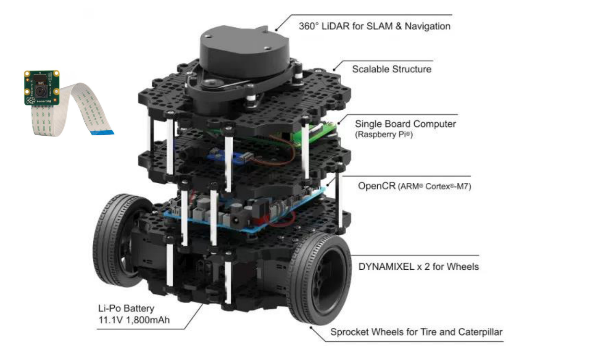
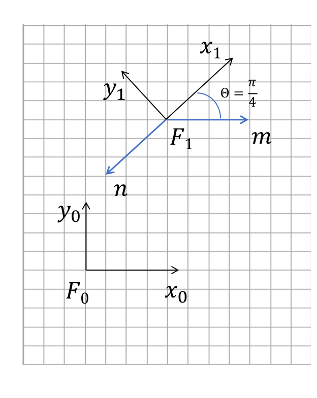
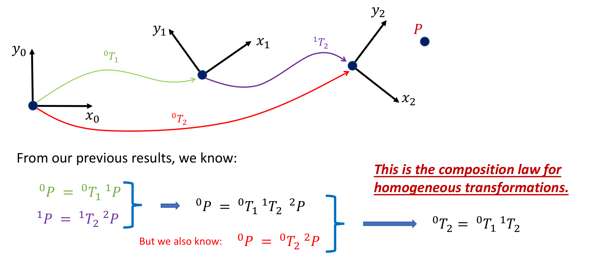
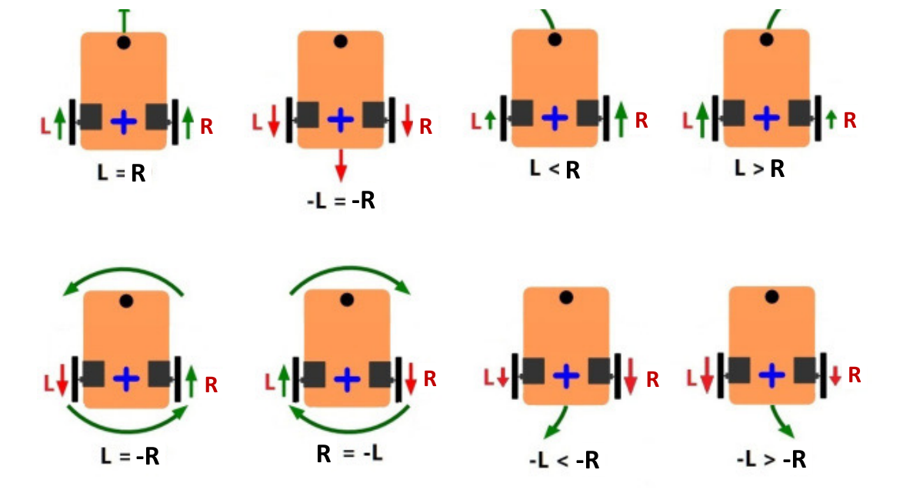
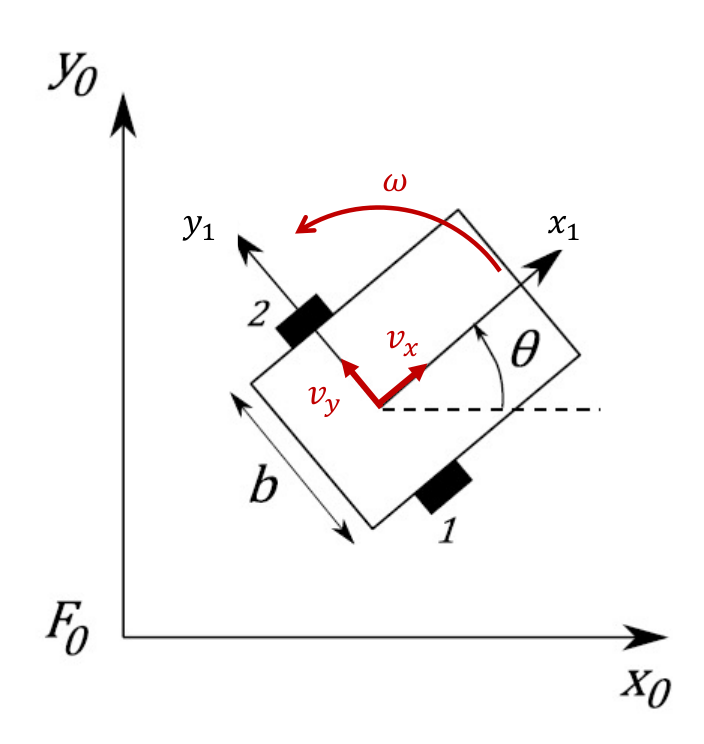
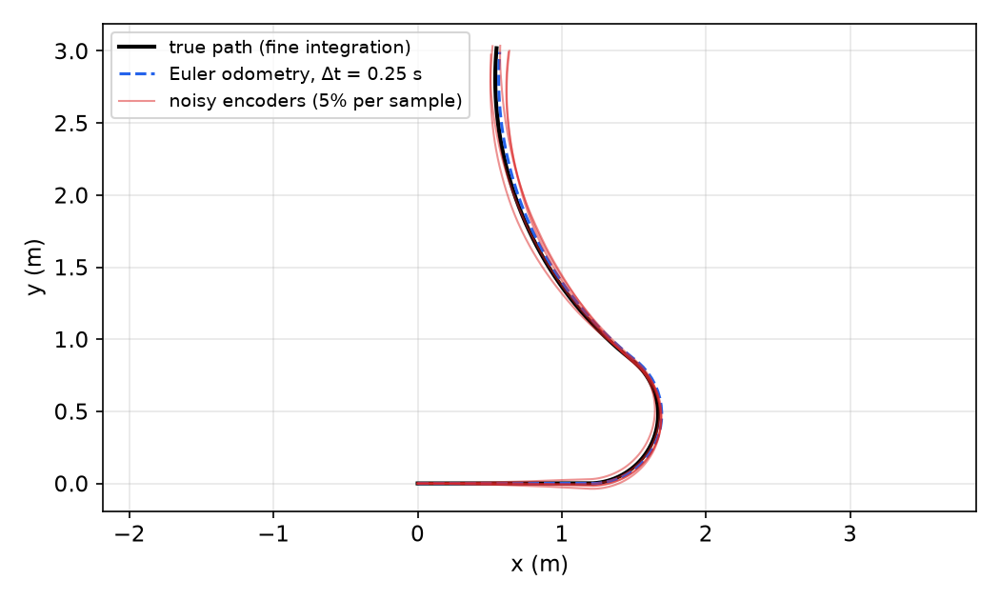

# Coordinate Transforms and Differential-Drive Kinematics

Almost everything a mobile robot does is bookkeeping between reference frames. Perception estimates where frames are (the robot, a camera, an obstacle), planning decides how a frame should move, and control makes a frame follow that plan. This chapter builds the planar machinery that all later chapters rely on: rotation matrices and the group \\(SO(2)\\), homogeneous transforms and the group \\(SE(2)\\), their inverses and composition, and then the kinematics of the differential-drive robot, the unicycle model, and odometry.



*Figure: the TurtleBot 3 Burger, the differential-drive platform used as the running example in this subsection. From top: a 360° LiDAR, stacked plates, a Raspberry Pi single-board computer, an OpenCR (ARM Cortex-M7) motor/IMU board, two Dynamixel servos driving the wheels, and an 11.1 V 1,800 mAh Li-Po battery. A Raspberry Pi camera module is shown at left.*

## Reference Frames, Points and Vectors

A **reference frame** (coordinate frame) is an origin together with a set of orthonormal axes. In the plane we write frame \\(\\{A\\}\\) with axes \\(x\_A, y\_A\\). A **point** \\(P\\) is a location in space; it has no coordinates until we pick a frame. Its **coordinate vector** in frame \\(\\{A\\}\\), written \\({}^AP\\), is the displacement from the origin of \\(\\{A\\}\\) to \\(P\\) expressed along the axes of \\(\\{A\\}\\). The leading superscript always names the frame in which a quantity is expressed.

The relative pose of frame \\(\\{B\\}\\) with respect to frame \\(\\{A\\}\\) is denoted \\({}^A\xi\_B\\) ("the pose of \\(B\\) in \\(A\\)", or equivalently "the transform from \\(B\\) coordinates to \\(A\\) coordinates"). The same point has a coordinate vector in each frame, and \\({}^A\xi\_B\\) is precisely the object that converts \\({}^BP\\) into \\({}^AP\\). In this chapter the abstract \\(\xi\\) becomes a concrete matrix.

It is important to distinguish two kinds of vectors:

- A **bound vector** (a point's coordinate vector) depends on where the origin is: if the frame is translated, the coordinates change.
- A **free vector** (a displacement, velocity or force direction) has no fixed base point: translating the frame does not change it, only rotating the frame does.

Who defines the "global" frame? Nobody in particular: the first developer of a system picks whatever is convenient (a corner of the building, the robot's start pose, latitude/longitude on the Earth), and everything else is expressed relative to it. A robot that sees a couch "200 cm in front of me" has measured the couch at \\((200, 0)\\) in its *local* frame; to put it on a house map you need the robot's pose in the house frame. A real robot such as a PR2 carries dozens of frames (base, each link, each camera, each sensor), and a ROS system keeps them all in a tree managed by the `tf2` library (see [ROS and Linux for Robotics](ros.md)).

Ground robots move in a plane, so localization and path planning use 2-D transforms. The planar case is also the cleanest place to learn the ideas that generalize to \\(SO(3)\\) and \\(SE(3)\\) for arms, drones and cameras.

### A worked geometric example

**Example 1 (Two planar frames).** Let \\(F\_0\\) be the world frame. Frame \\(F\_1\\) has its origin at \\({}^0d = (4, 8)\\) and is rotated by \\(\Theta = \pi/4\\): its \\(x\_1\\) axis points along the 45° diagonal and \\(y\_1\\) along 135°. A point \\(P\\) lies at the same height as the origin of \\(F\_1\\), 4 units to its right. Two free vectors are drawn from the origin of \\(F\_1\\): \\(m\\), horizontal with length 4, and \\(n\\), pointing down-left at 225° with length \\(3\sqrt2\\).



*Figure: the worked example. \\(F\_1\\) sits at (4, 8) in \\(F\_0\\) and is rotated by \\(\pi/4\\). The vector m is horizontal and n points down and to the left.*

By inspection of the grid:

- In \\(F\_0\\): \\({}^0P = (8, 8)^T\\), \\({}^0m = (4, 0)^T\\), \\({}^0n = (-3, -3)^T\\). (In 3-D one could write \\((4, 0, 0)\\) and \\((-3, -3, 0)\\); in the plane the \\(z\\)-coordinate is always zero.)
- In \\(F\_1\\): \\(m\\) makes an angle of \\(-45°\\) with \\(x\_1\\), so \\({}^1m = 4(\cos(-\pi/4), \sin(-\pi/4))^T = (2\sqrt2, -2\sqrt2)^T\\). The vector \\(n\\) points exactly along \\(-x\_1\\), so \\({}^1n = (-3\sqrt2, 0)^T\\). The point \\(P\\) is displaced from the origin of \\(F\_1\\) by \\(m\\), so \\({}^1P = (2\sqrt2, -2\sqrt2)^T\\).

Simple geometry works for one example, but we need a systematic method that a computer can apply to hundreds of frames many times per second. That method is matrix algebra.

## Rotations in the Plane

### Why not just an angle?

Given two frames with a common origin, the orientation of frame 1 relative to frame 0 could be described by a single angle \\(\theta\\). That is a poor primary representation for two reasons:

1. **Discontinuity.** Angles wrap: \\(\theta = 2\pi - \epsilon\\) and \\(\theta = \epsilon\\) are nearly the same orientation, yet numerically far apart. Algorithms that subtract or average angles break near the wrap point (the behavior-control chapter returns to this problem).
2. **No generalization.** A single angle does not extend to 3-D, where orientation needs three parameters and the order of rotations matters.

The better representation describes the *axes* of frame 1 in frame 0.

### The rotation matrix

Project the unit axes of frame 1 onto the axes of frame 0. Writing \\(x\_1 \cdot x\_0\\) for the dot product of unit vectors,
\\[
{}^0x\_1 = \begin{bmatrix} x\_1\cdot x\_0 \\\\ x\_1 \cdot y\_0 \end{bmatrix} = \begin{bmatrix} \cos\theta \\\\ \sin\theta \end{bmatrix}, \qquad
{}^0y\_1 = \begin{bmatrix} y\_1\cdot x\_0 \\\\ y\_1 \cdot y\_0 \end{bmatrix} = \begin{bmatrix} -\sin\theta \\\\ \cos\theta \end{bmatrix}.
\\]
Here \\({}^0x\_1\\) means "the \\(x\\)-axis of frame 1, expressed in frame 0". Stacking these as columns gives the **rotation matrix**
\\[
{}^0R\_1 = \begin{bmatrix} {}^0x\_1 & {}^0y\_1 \end{bmatrix} = \begin{bmatrix} \cos\theta & -\sin\theta \\\\ \sin\theta & \cos\theta \end{bmatrix}.
\\]
The columns of a rotation matrix are the rotated frame's axes written in the reference frame. That one sentence is the easiest way to write any rotation matrix down, and to debug one.

### Transforming coordinates by a rotation

Let \\(P\\) be rigidly attached to frame 1 with \\({}^1P = (p\_x, p\_y)^T\\), meaning \\(P = p\_x \hat x\_1 + p\_y \hat y\_1\\) as a geometric vector. Its coordinates in frame 0 are its projections onto \\(x\_0\\) and \\(y\_0\\):
\\[
{}^0P = \begin{bmatrix} P\cdot x\_0 \\\\ P\cdot y\_0 \end{bmatrix}
= \begin{bmatrix} (p\_x x\_1 + p\_y y\_1)\cdot x\_0 \\\\ (p\_x x\_1 + p\_y y\_1)\cdot y\_0 \end{bmatrix}
= \begin{bmatrix} p\_x (x\_1\cdot x\_0) + p\_y (y\_1\cdot x\_0) \\\\ p\_x (x\_1\cdot y\_0) + p\_y (y\_1 \cdot y\_0) \end{bmatrix}.
\\]
The dot product is linear, which is what allowed us to distribute it. Collect the coefficients into a matrix:
\\[
{}^0P = \begin{bmatrix} x\_1\cdot x\_0 & y\_1\cdot x\_0 \\\\ x\_1\cdot y\_0 & y\_1\cdot y\_0 \end{bmatrix}\begin{bmatrix} p\_x \\\\ p\_y\end{bmatrix}
= \begin{bmatrix} \cos\theta & -\sin\theta \\\\ \sin\theta & \cos\theta \end{bmatrix}\begin{bmatrix} p\_x \\\\ p\_y\end{bmatrix}
= {}^0R\_1\\,{}^1P .
\\]
In general, for any two frames with a common origin,
\\[
\boxed{{}^AP = {}^AR\_B\\,{}^BP .}
\\]
The subscripts "cancel" like a chain: the inner \\(B\\) of \\({}^AR\_B\\) matches the frame of \\({}^BP\\).

### Properties: the special orthogonal group

Every rotation matrix \\(R\\) satisfies:

1. each column is a unit vector;
2. the columns are mutually orthogonal (\\(c\_1 \cdot c\_2 = 0\\));
3. \\(\det R = +1\\).

Properties 1 and 2 say \\(R^TR = I\\), that is, \\(R\\) is **orthogonal**, so \\(R^{-1} = R^T\\). Property 3 makes it **special**: orthogonal matrices with \\(\det = -1\\) also exist, but they are reflections (they turn a right-handed frame into a left-handed one) and are not physical rotations.

**Definition (SO(n)).** The **special orthogonal group** \\(SO(n)\\) is the set of \\(n\times n\\) real matrices with \\(R^TR = I\\) and \\(\det R = 1\\). It is a group under matrix multiplication: the product of two rotations is a rotation, the identity is a rotation, and every rotation has the inverse \\(R^T\\).

For the planar case, multiplying two rotation matrices adds their angles, \\(R(\alpha)R(\beta) = R(\alpha + \beta)\\), which follows from the angle-addition formulas. Planar rotations therefore commute; rotations in 3-D do not.

Since \\({}^0P = {}^0R\_1{}^1P\\) and \\({}^0R\_1\\) is invertible,
\\[
{}^1P = ({}^0R\_1)^{-1}\\,{}^0P = ({}^0R\_1)^T\\,{}^0P, \qquad\text{so}\qquad {}^BR\_A = ({}^AR\_B)^{-1} = ({}^AR\_B)^T .
\\]

**Example 1, continued (free vectors by rotation).** With \\(\cos\frac\pi4 = \sin\frac\pi4 = 0.5\sqrt2\\):
\\[
{}^0R\_1 = \begin{bmatrix} 0.5\sqrt2 & -0.5\sqrt2 \\\\ 0.5\sqrt2 & 0.5\sqrt2 \end{bmatrix}, \qquad
{}^1R\_0 = ({}^0R\_1)^T = \begin{bmatrix} 0.5\sqrt2 & 0.5\sqrt2 \\\\ -0.5\sqrt2 & 0.5\sqrt2 \end{bmatrix}.
\\]
Because \\(m\\) and \\(n\\) are free vectors, a pure rotation converts them between frames:
\\[
{}^0m = {}^0R\_1 \begin{bmatrix} 2\sqrt2 \\\\ -2\sqrt2 \end{bmatrix} = \begin{bmatrix} 0.5\cdot 2\cdot 2 + 0.5\cdot2\cdot2 \\\\ 0.5\cdot2\cdot2 - 0.5\cdot2\cdot2 \end{bmatrix} = \begin{bmatrix} 4 \\\\ 0\end{bmatrix}, \qquad
{}^0n = {}^0R\_1 \begin{bmatrix} -3\sqrt2 \\\\ 0 \end{bmatrix} = \begin{bmatrix} -3 \\\\ -3\end{bmatrix},
\\]
and in the other direction \\({}^1m = {}^1R\_0(4, 0)^T = (2\sqrt2, -2\sqrt2)^T\\) and \\({}^1n = {}^1R\_0(-3,-3)^T = (-3\sqrt2, 0)^T\\). These match the geometric answers. The point \\(P\\), however, is *not* a free vector, and rotation alone gives the wrong answer for it: \\({}^0R\_1{}^1P = (4, 0)^T \neq (8, 8)^T\\). We also need the translation.

## Homogeneous Transforms and SE(2)

### Rotation plus translation

Now let frame 1 be both rotated by \\(\theta\\) and translated so that its origin sits at \\({}^0d = (d\_x, d\_y)^T\\) in frame 0. Picture first the rotated frame sharing the origin of frame 0, then slide the frame and the attached point \\(P\\) by the fixed vector \\(d\\). The slide adds \\(d\\) to the coordinates of every attached point, so
\\[
{}^0P = {}^0R\_1\\,{}^1P + {}^0d .
\\]
This affine map is correct but inconvenient: chaining several of them produces nested sums. The fix is to add a constant coordinate 1.

**Definition (Homogeneous transformation).** Append a 1 to each coordinate vector. Then
\\[
\begin{bmatrix} {}^0P \\\\ 1 \end{bmatrix} = \begin{bmatrix} {}^0R\_1\\,{}^1P + {}^0d \\\\ 1 \end{bmatrix} = \begin{bmatrix} {}^0R\_1 & {}^0d \\\\ 0\_2 & 1 \end{bmatrix}\begin{bmatrix} {}^1P \\\\ 1 \end{bmatrix}, \qquad 0\_2 = \begin{bmatrix} 0 & 0 \end{bmatrix}.
\\]
The \\(3\times3\\) matrix
\\[
{}^AT\_B = \begin{bmatrix} {}^AR\_B & {}^Ad\_B \\\\ 0\_2 & 1 \end{bmatrix} = \begin{bmatrix} \cos\theta & -\sin\theta & d\_x \\\\ \sin\theta & \cos\theta & d\_y \\\\ 0 & 0 & 1 \end{bmatrix}
\\]
is the **homogeneous transform** from frame \\(B\\) to frame \\(A\\). It encodes the pose \\({}^A\xi\_B\\): the columns of the upper-left block are the axes of \\(B\\) in \\(A\\), and the last column is the origin of \\(B\\) in \\(A\\).

**Definition (SE(n)).** The **special Euclidean group** \\(SE(n)\\) is the set of \\((n+1)\times(n+1)\\) matrices \\(\begin{bmatrix} R & d \\\\ 0\_n & 1\end{bmatrix}\\) with \\(R\in SO(n)\\) and \\(d \in \mathbb{R}^n\\). A planar pose \\((x, y, \theta)\\) is an element of \\(SE(2)\\).

Free vectors have homogeneous coordinate 0 instead of 1: \\(\begin{bmatrix} {}^0m \\\\ 0\end{bmatrix} = {}^0T\_1\begin{bmatrix} {}^1m \\\\ 0\end{bmatrix}\\) picks up the rotation but not the translation, which is exactly the behaviour of a displacement.

### The inverse transform

To go from \\(A\\) coordinates back to \\(B\\) coordinates, solve \\({}^AP = R\\,{}^BP + d\\) for \\({}^BP\\): \\({}^BP = R^T({}^AP - d) = R^T\\,{}^AP - R^Td\\). In matrix form:

**Theorem (Inverse of a homogeneous transform).** For \\(R \in SO(n)\\) and \\(d\in\mathbb{R}^n\\),
\\[
\begin{bmatrix} R & d \\\\ 0\_n & 1 \end{bmatrix}^{-1} = \begin{bmatrix} R^T & -R^Td \\\\ 0\_n & 1 \end{bmatrix}, \qquad {}^BT\_A = ({}^AT\_B)^{-1}.
\\]

*Proof.* Multiply block-wise and use \\(RR^T = I\\):
\\[
\begin{bmatrix} R & d \\\\ 0\_n & 1 \end{bmatrix}\begin{bmatrix} R^T & -R^Td \\\\ 0\_n & 1 \end{bmatrix} = \begin{bmatrix} RR^T & -RR^Td + d \\\\ 0\_n & 1 \end{bmatrix} = \begin{bmatrix} I\_{n} & 0 \\\\ 0\_n & 1 \end{bmatrix} = I\_{n+1}. \quad\blacksquare
\\]
The formula is cheaper and numerically cleaner than a general matrix inverse. Note that the translation of the inverse is *not* simply \\(-d\\): the offset must be re-expressed in the new frame by \\(R^T\\).

**Example 1, continued (homogeneous transforms).** For \\(F\_1\\) at \\((4, 8)\\) rotated by \\(\pi/4\\):
\\[
{}^0T\_1 = \begin{bmatrix} 0.5\sqrt2 & -0.5\sqrt2 & 4 \\\\ 0.5\sqrt2 & 0.5\sqrt2 & 8 \\\\ 0 & 0 & 1 \end{bmatrix}.
\\]
The inverse has rotation block \\(R^T\\) and translation
\\[
-R^Td = -\begin{bmatrix} 0.5\sqrt2(4 + 8) \\\\ 0.5\sqrt2(-4 + 8) \end{bmatrix} = \begin{bmatrix} -6\sqrt2 \\\\ -2\sqrt2 \end{bmatrix},
\qquad
{}^1T\_0 = \begin{bmatrix} 0.5\sqrt2 & 0.5\sqrt2 & -6\sqrt2 \\\\ -0.5\sqrt2 & 0.5\sqrt2 & -2\sqrt2 \\\\ 0 & 0 & 1 \end{bmatrix}.
\\]
Now the point: \\({}^1T\_0\\,(8, 8, 1)^T\\) has first entry \\(0.5\sqrt2(8 + 8) - 6\sqrt2 = 8\sqrt2 - 6\sqrt2 = 2\sqrt2\\) and second entry \\(0.5\sqrt2(-8 + 8) - 2\sqrt2 = -2\sqrt2\\), so \\({}^1P = (2\sqrt2, -2\sqrt2)^T\\), matching the geometry. Conversely \\({}^0T\_1\\,(2\sqrt2, -2\sqrt2, 1)^T = (2 + 2 + 4,\\; 2 - 2 + 8, 1)^T = (8, 8, 1)^T\\). Multiplying out \\({}^0T\_1{}^1T\_0\\) gives \\(I\_3\\), as it must.

### Composition



*Figure: composition of transforms. Frame 1 is located in frame 0 by \\({}^0T\_1\\) (green), frame 2 in frame 1 by \\({}^1T\_2\\) (purple). The direct transform \\({}^0T\_2\\) (red) is their product.*

Suppose frame 2 is known relative to frame 1, and frame 1 relative to frame 0. For any point \\(P\\) (all coordinate vectors homogeneous),
\\[
{}^0P = {}^0T\_1\\,{}^1P, \qquad {}^1P = {}^1T\_2\\,{}^2P \quad\Longrightarrow\quad {}^0P = {}^0T\_1\\,{}^1T\_2\\,{}^2P .
\\]
But also \\({}^0P = {}^0T\_2\\,{}^2P\\). Since this holds for every \\(P\\),

**Theorem (Composition law).**
\\[
\boxed{{}^0T\_2 = {}^0T\_1\\,{}^1T\_2 .}
\\]
Indices chain like the rotation case: adjacent inner indices must match. Writing out the blocks,
\\[
{}^0T\_1{}^1T\_2 = \begin{bmatrix} {}^0R\_1{}^1R\_2 & {}^0R\_1{}^1d\_2 + {}^0d\_1 \\\\ 0 & 1 \end{bmatrix},
\\]
so rotations multiply (angles add in the plane), and the second offset is rotated into frame 0 before being added to the first.

**Example 2 (Composing two poses).** Keep \\({}^0T\_1\\) from Example 1 and let frame 2 sit 2 units along \\(x\_1\\), rotated by \\(\pi/2\\) relative to frame 1:
\\[
{}^1T\_2 = \begin{bmatrix} 0 & -1 & 2 \\\\ 1 & 0 & 0 \\\\ 0 & 0 & 1\end{bmatrix}.
\\]
Then \\({}^0R\_2 = R(\pi/4 + \pi/2) = R(3\pi/4)\\), and the origin of frame 2 in frame 0 is
\\[
{}^0R\_1\begin{bmatrix} 2 \\\\ 0\end{bmatrix} + \begin{bmatrix} 4 \\\\ 8 \end{bmatrix} = \begin{bmatrix} \sqrt2 + 4 \\\\ \sqrt2 + 8\end{bmatrix} \approx \begin{bmatrix} 5.414 \\\\ 9.414\end{bmatrix},
\qquad
{}^0T\_2 = \begin{bmatrix} -0.5\sqrt2 & -0.5\sqrt2 & 4 + \sqrt2 \\\\ 0.5\sqrt2 & -0.5\sqrt2 & 8 + \sqrt2 \\\\ 0 & 0 & 1\end{bmatrix}.
\\]
Geometrically: walk 2 units along the 45° diagonal from \\((4,8)\\), and face 135°.

The composition law is why transform trees work. A robot \\(\\{R\\}\\) in the world \\(\\{O\\}\\) carries a camera \\(\\{C\\}\\) that sees an object \\(\\{B\\}\\). Then \\({}^OT\_B = {}^OT\_R\\,{}^RT\_C\\,{}^CT\_B\\): localization provides the first factor, the robot's mechanical design the second, and perception the third. A second, fixed camera \\(\\{F\\}\\) gives another chain \\({}^OT\_F\\,{}^FT\_B\\) to the same object pose; disagreement between chains is a useful calibration check. In 3-D everything above holds with \\(4\times4\\) matrices, \\(R \in SO(3)\\), and \\(d\in\mathbb{R}^3\\).

### Summary of the transform rules

| Rule | Formula |
|---|---|
| Transform | \\({}^AT\_B = \begin{bmatrix} {}^AR\_B & d \\\\ 0 & 1\end{bmatrix}\\) |
| Apply to a point | \\(\begin{bmatrix} {}^AP \\\\ 1\end{bmatrix} = {}^AT\_B\begin{bmatrix} {}^BP \\\\ 1\end{bmatrix}\\) |
| Apply to a free vector | \\({}^Av = {}^AR\_B\\,{}^Bv\\) |
| Inverse | \\({}^BT\_A = ({}^AT\_B)^{-1} = \begin{bmatrix} R^T & -R^Td \\\\ 0 & 1\end{bmatrix}\\) |
| Composition | \\({}^AT\_C = {}^AT\_B\\,{}^BT\_C\\) |

A practical note: `tf2` in ROS stores rotations as **quaternions** rather than matrices. Rotation matrices are easier to read and reason about; quaternions are more compact (four numbers instead of nine in 3-D), avoid the singularities of Euler angles, and are cheaper to renormalize. For a planar robot the quaternion of a yaw \\(\theta\\) is \\((x, y, z, w) = (0, 0, \sin\frac\theta2, \cos\frac\theta2)\\), and the yaw is recovered as \\(\theta = \operatorname{atan2}(2(wz + xy),\\, 1 - 2(y^2 + z^2))\\).

## Wheeled Mobile Robots

### Wheel types and configurations

Wheeled robots range from self-driving cars and sidewalk delivery robots to small educational kits. Four wheel designs dominate:

- **Standard wheel**: two degrees of freedom, rotation about the axle and about the (vertical) contact point. It rolls forward but resists sideways sliding.
- **Castor wheel**: two degrees of freedom, with the steering axis offset from the contact point so it swivels passively to trail the motion.
- **Swedish (omni or mecanum) wheel**: passive rollers on the rim, at 90° or 45°, add a third degree of freedom so the wheel can slide sideways.
- **Ball (spherical) wheel**: three degrees of freedom, mechanically awkward (hard to suspend and drive).

Common three-wheel configurations include omnidirectional (three omni wheels in a triangle), differential (two driven wheels plus a castor), omni-steer, tricycle, and two-steer arrangements. Three ground contacts guarantee static stability provided the centre of gravity lies inside the contact triangle. Four or more wheels improve stability but make the support **hyperstatic** (statically indeterminate): on uneven ground one wheel lifts off unless the suspension is flexible. Larger wheels climb higher obstacles but need more torque or gear reduction.

A robot that can move instantaneously in any direction of its configuration space is **holonomic** (omnidirectional robots built from Swedish wheels, as used in RoboCup small-size soccer). Most practical arrangements, including the car and the differential drive, are **non-holonomic**: their velocity is constrained, though not their reachable positions, and they need more control effort (consider parallel parking).

### The differential drive

A **differential-drive** robot has two standard wheels on a common axis, each driven by its own motor, plus one or more passive castors for balance. Steering comes entirely from the difference between wheel speeds. Many commercial robots use it (the TurtleBot, the Fetch mobile manipulator, small home robots), because it is mechanically simple and can turn in place.



*Figure: steering by relative wheel speeds (L = left, R = right; arrows show wheel and resulting body motion). Equal speeds drive straight forward or backward; unequal speeds curve toward the slower wheel; equal and opposite speeds spin the robot in place. The bottom-right cases are the curved reversing motions.*

## Differential-Drive Kinematics

**Kinematics** relates the actuator inputs (wheel rates) to the motion of the robot, ignoring the forces and masses that produce that motion (which is **dynamics**). It answers: "if the wheels turn at these rates, how does the robot move?" The robot's pose cannot usually be measured directly (unless the environment is instrumented, as with motion capture), but wheel rates can, and integrating the resulting velocity gives a pose estimate called **odometry**. Kinematic models are wrong in detail, since real wheels slip and deform, but, in George Box's words, "all models are wrong, but some are useful."

### Setup and notation



*Figure: differential-drive geometry. The robot frame \\((x\_1, y\_1)\\) sits at the midpoint of the axle, with heading \\(\theta\\) measured from \\(x\_0\\). Wheel 1 is on the right and wheel 2 on the left; b is the wheel separation. The body velocity has components \\(v\_x\\) (forward) and \\(v\_y\\) (sideways), and \\(\omega\\) is the turning rate.*

- Global (world) frame \\(F\_0 = (x\_0, y\_0)\\); robot frame \\((x\_1, y\_1)\\) at the axle midpoint \\((p\_x, p\_y)\\), with \\(x\_1\\) pointing forward.
- Pose \\(q = (x, y, \theta)^T\\), the planar pose of the robot frame in \\(F\_0\\) (an element of \\(SE(2)\\)).
- Wheel radius \\(r\\); wheel separation (track width, often loosely called wheelbase) \\(b\\).
- Wheel angular rates \\(\dot\varphi\_1\\) (right wheel) and \\(\dot\varphi\_2\\) (left wheel), positive when that wheel drives the robot forward.
- Body-frame velocity \\((v\_x, v\_y)\\) and angular rate \\(\omega = \dot\theta\\). In the world frame we write \\((\dot x, \dot y, \dot\theta)\\).

**Assumptions.** Motion is planar; each wheel touches the ground at a single point; wheels do not deform; wheels roll without slipping, either longitudinally or laterally; steering axes (here, none) are normal to the ground; there is no rolling friction.

In general, the kinematic model of a wheeled robot is a map
\\[
f(\dot\varphi\_1, \ldots, \dot\varphi\_n, \beta\_1, \ldots, \beta\_m, \dot\beta\_1, \ldots, \dot\beta\_m) = \begin{bmatrix}\dot x \\\\ \dot y \\\\ \dot\theta\end{bmatrix}
\\]
from wheel rates and, for steered wheels, steering angles \\(\beta\\) and their rates. **Forward kinematics** computes the robot velocity from the wheel rates; **inverse kinematics** computes the wheel rates needed for a desired robot velocity. We work with velocities, not positions, because the wheel angles alone do not determine the robot's position: the same final wheel angles can be reached along different paths ending in different places. Position is obtained only by integrating velocity over time.

### The non-holonomic constraint

A wheel that rolls without lateral slip cannot move along its own axle. Both wheels share the axle, so the axle midpoint cannot move sideways:
\\[
v\_y = 0 .
\\]
In world coordinates, the velocity component perpendicular to the heading vanishes:
\\[
\dot x\sin\theta - \dot y\cos\theta = 0 .
\\]
This is a constraint on velocities that cannot be integrated into a constraint on positions (the robot can reach any \\((x, y, \theta)\\), for example by parallel parking), which is the definition of a **non-holonomic** constraint. Three configuration variables, but only two independent velocity inputs.

### Translational velocity

If only wheel 1 turns, at rate \\(\dot\varphi\_1\\), its contact point moves forward at \\(r\dot\varphi\_1\\) while wheel 2 is stationary: the robot pivots about wheel 2, and the axle midpoint, halfway between, moves forward at \\(\tfrac12 r\dot\varphi\_1\\). Similarly for wheel 2 alone. The kinematics is linear in the wheel rates, so by superposition the forward speed of the midpoint is the average of the wheel rim speeds:
\\[
v\_x = \frac{r}{2}(\dot\varphi\_1 + \dot\varphi\_2) .
\\]

### Rotational velocity

Decompose a general motion into two simple ones.

- **Pure translation.** Both wheels turn at the same rate in the same direction: the robot moves straight at \\(v\_x\\), with \\(\dot\varphi\_1 = \dot\varphi\_2 = v\_x/r\\).
- **Pure rotation.** The wheels turn at equal and opposite rates: the robot spins about the axle midpoint. Each wheel is at distance \\(b/2\\) from the centre of rotation, so its rim speed must be \\(\omega b/2\\): \\(\dot\varphi\_1 = \frac{\omega b}{2r}\\), \\(\dot\varphi\_2 = -\frac{\omega b}{2r}\\) (a positive, counter-clockwise \\(\omega\\) needs the right wheel forward).

Superposing the two gives the **inverse kinematics**:
\\[
\boxed{\dot\varphi\_1 = \frac{v\_x}{r} + \frac{\omega b}{2r} = \frac{2v\_x + \omega b}{2r}, \qquad \dot\varphi\_2 = \frac{v\_x}{r} - \frac{\omega b}{2r} = \frac{2v\_x - \omega b}{2r}.}
\\]
Adding and subtracting these two equations inverts them and gives the **forward kinematics**:
\\[
\boxed{v\_x = \frac{r}{2}(\dot\varphi\_1 + \dot\varphi\_2), \qquad \omega = \dot\theta = \frac{r}{b}(\dot\varphi\_1 - \dot\varphi\_2).}
\\]
The first equation agrees with the superposition argument above, a useful sanity check. The rotation rate is the same in the body and world frames, because both frames share the vertical axis. In right/left notation with track width \\(L\\): \\(v\_x = \frac r2(\dot\phi\_R + \dot\phi\_L)\\) and \\(\omega = \frac rL(\dot\phi\_R - \dot\phi\_L)\\).

Collecting the body-frame velocity:
\\[
\begin{bmatrix} v\_x \\\\ v\_y \\\\ \omega\end{bmatrix} = \begin{bmatrix} \frac r2(\dot\varphi\_1 + \dot\varphi\_2) \\\\ 0 \\\\ \frac rb(\dot\varphi\_1 - \dot\varphi\_2) \end{bmatrix} = \begin{bmatrix} \frac r2 & \frac r2 \\\\ 0 & 0 \\\\ \frac rb & -\frac rb\end{bmatrix}\begin{bmatrix} \dot\varphi\_1 \\\\ \dot\varphi\_2\end{bmatrix}.
\\]

### Instantaneous centre of curvature

When \\(\omega\neq0\\) the robot moves instantaneously on a circle of radius
\\[
\rho = \frac{v\_x}{\omega} = \frac{b}{2}\\,\frac{\dot\varphi\_1 + \dot\varphi\_2}{\dot\varphi\_1 - \dot\varphi\_2}
\\]
about the **instantaneous centre of curvature** (ICC), which lies on the axle line at distance \\(\rho\\) to the left of the midpoint (to the right if \\(\rho<0\\)). Equal wheel rates give \\(\rho\to\infty\\) (straight line); opposite rates give \\(\rho = 0\\) (spin in place); one stopped wheel gives \\(\rho = \pm b/2\\) (pivot about that wheel).

**Example 3 (TurtleBot 3 Burger numbers).** Take \\(r = 0.033\\) m and \\(b = 0.160\\) m.

*Forward kinematics.* With \\(\dot\varphi\_R = 7\\) rad/s and \\(\dot\varphi\_L = 5\\) rad/s:
\\[
v = \frac{0.033}{2}(7 + 5) = 0.198\ \text{m/s}, \qquad \omega = \frac{0.033}{0.160}(7 - 5) = 0.4125\ \text{rad/s}, \qquad \rho = \frac{0.198}{0.4125} = 0.48\ \text{m}.
\\]
*Inverse kinematics.* To drive at \\(v = 0.2\\) m/s while turning at \\(\omega = 1\\) rad/s:
\\[
\dot\varphi\_R = \frac{2(0.2) + 1(0.160)}{2(0.033)} = \frac{0.56}{0.066} = 8.48\ \text{rad/s}, \qquad
\dot\varphi\_L = \frac{0.4 - 0.16}{0.066} = 3.64\ \text{rad/s}.
\\]
If a wheel's motor limit is, say, 6 rad/s, the request is infeasible; a controller must then scale \\(v\\) down (keeping \\(\omega\\), which usually matters more for obstacle avoidance) until both rates fit.

## World-Frame Motion: the Unicycle Model

The body velocity is a free vector, so it is converted to the world frame by the rotation \\(R(\theta)\\) alone:
\\[
{}^0v = \begin{bmatrix} \cos\theta & -\sin\theta \\\\ \sin\theta & \cos\theta\end{bmatrix}\begin{bmatrix} v\_x \\\\ 0 \end{bmatrix} = \begin{bmatrix} v\_x\cos\theta \\\\ v\_x\sin\theta\end{bmatrix}, \qquad \dot\theta = \omega .
\\]
Writing \\(v = v\_x\\) for the forward speed, this is the **unicycle model**:
\\[
\boxed{\begin{bmatrix}\dot x \\\\ \dot y \\\\ \dot\theta \end{bmatrix} = \begin{bmatrix} v\cos\theta \\\\ v\sin\theta \\\\ \omega \end{bmatrix} = \begin{bmatrix} \cos\theta & 0 \\\\ \sin\theta & 0 \\\\ 0 & 1\end{bmatrix}\begin{bmatrix} v \\\\ \omega\end{bmatrix}.}
\\]
It is the same model as a single wheel rolling upright on the plane, and it hides the wheel geometry behind two intuitive inputs: forward speed and turn rate. Controllers are designed in terms of \\((v, \omega)\\), and the inverse kinematics above converts them to wheel commands. Substituting the forward kinematics gives the model directly in wheel rates:
\\[
\dot x = \frac r2(\dot\varphi\_R + \dot\varphi\_L)\cos\theta, \qquad \dot y = \frac r2(\dot\varphi\_R + \dot\varphi\_L)\sin\theta, \qquad \dot\theta = \frac rb(\dot\varphi\_R - \dot\varphi\_L).
\\]

For a general planar body (holonomic or not) the full local/global velocity relation is the planar rotation extended by an identity on \\(\omega\\):
\\[
\begin{bmatrix}\dot x \\\\ \dot y \\\\ \dot\theta \end{bmatrix} = \begin{bmatrix} \cos\theta & -\sin\theta & 0 \\\\ \sin\theta & \cos\theta & 0 \\\\ 0 & 0 & 1\end{bmatrix}\begin{bmatrix} v\_x \\\\ v\_y \\\\ \omega\end{bmatrix}, \qquad
\begin{bmatrix} v\_x \\\\ v\_y \\\\ \omega\end{bmatrix} = \begin{bmatrix} \cos\theta & \sin\theta & 0 \\\\ -\sin\theta & \cos\theta & 0 \\\\ 0 & 0 & 1\end{bmatrix}\begin{bmatrix}\dot x \\\\ \dot y \\\\ \dot\theta \end{bmatrix}.
\\]
The inverse is again the transpose. For a differential drive, the second relation applied to any feasible world velocity must return \\(v\_y = 0\\), which is the non-holonomic constraint once more.

## Odometry

**Odometry** (dead reckoning) estimates the pose by integrating the measured wheel motion. Wheel encoders count ticks: an encoder with \\(N\\) ticks per wheel revolution that registers \\(\Delta n\\) ticks in one sampling interval reports a wheel rotation \\(\Delta\varphi = 2\pi\\,\Delta n/N\\).

### Discrete update

Over a sampling interval \\(\Delta t\\), let the right and left wheels roll distances \\(\Delta s\_R = r\Delta\varphi\_R\\) and \\(\Delta s\_L = r\Delta\varphi\_L\\). From the kinematics,
\\[
\Delta s = \frac{\Delta s\_R + \Delta s\_L}{2}, \qquad \Delta\theta = \frac{\Delta s\_R - \Delta s\_L}{b}.
\\]
Three update rules are common.

1. **Euler (first order):** \\(x\_{k+1} = x\_k + \Delta s\cos\theta\_k\\), \\(y\_{k+1} = y\_k + \Delta s\sin\theta\_k\\), \\(\theta\_{k+1} = \theta\_k + \Delta\theta\\). It assumes the heading is frozen during the step.
2. **Midpoint (second order):** use \\(\theta\_k + \Delta\theta/2\\) in the cosine and sine. It is much more accurate for the same step and costs nothing extra.
3. **Exact arc:** if the wheel rates are constant during the step, the robot moves exactly on a circular arc of radius \\(\rho = \Delta s/\Delta\theta\\), and
\\[
x\_{k+1} = x\_k + \rho\big(\sin(\theta\_k + \Delta\theta) - \sin\theta\_k\big), \qquad y\_{k+1} = y\_k - \rho\big(\cos(\theta\_k + \Delta\theta) - \cos\theta\_k\big),
\\]
falling back to the straight-line formula when \\(\lvert\Delta\theta\rvert\\) is tiny.

In the language of transforms, each step composes the current pose with a small body-frame motion: \\({}^0T\_{k+1} = {}^0T\_k\\,{}^kT\_{k+1}\\), where \\({}^kT\_{k+1}\\) is the arc expressed in the robot's own frame at step \\(k\\).

```python
import numpy as np

def odom_step(x, y, th, dphi_r, dphi_l, r=0.033, b=0.160):
    """Midpoint odometry update from wheel rotation increments (rad)."""
    ds_r, ds_l = r * dphi_r, r * dphi_l
    ds, dth = 0.5 * (ds_r + ds_l), (ds_r - ds_l) / b
    thm = th + 0.5 * dth
    return x + ds * np.cos(thm), y + ds * np.sin(thm), np.arctan2(np.sin(th + dth), np.cos(th + dth))
```

### Why odometry drifts



*Figure: odometry for a TurtleBot-sized robot (r = 0.033 m, b = 0.160 m) driving straight, curving left, then curving gently right. Black: the true path. Blue dashed: Euler odometry with a coarse 0.25 s step, which drifts on the turns. Red: five runs with 5 % random error on every wheel-rate sample; small heading errors accumulate into position errors that grow with distance travelled.*

Odometry is a good short-term estimate and a poor long-term one. Errors enter from:

- **systematic sources**: an error in \\(r\\) (tyre wear, unequal wheel diameters) or in \\(b\\) (the effective contact points are not where the drawing says), which bias every step the same way;
- **random sources**: wheel slip, uneven floors, encoder quantization, and timing jitter;
- **integration error** from too coarse an update rule.

Heading errors are the most damaging: an error \\(\delta\theta\\) produces a lateral position error of roughly \\(s\\,\delta\theta\\) after a further distance \\(s\\), so position error grows without bound. The remedy is to fuse odometry with exteroceptive measurements (LiDAR, camera, landmarks) in a probabilistic filter, the subject of the [Bayes filter](bayes-filters.md), [Kalman filter](kalman-filters.md) and [particle filter](particle-filters.md) chapters.

## Summary

- A coordinate vector \\({}^AP\\) depends on the frame; free vectors change only under rotation, points under rotation and translation.
- Rotation matrices have the rotated axes as columns: \\({}^0R\_1 = \begin{bmatrix}\cos\theta & -\sin\theta \\\\ \sin\theta & \cos\theta\end{bmatrix}\\), \\({}^AP = {}^AR\_B{}^BP\\), and \\(R^{-1} = R^T\\); they form \\(SO(2)\\) (orthogonal, determinant +1).
- Homogeneous transforms \\({}^AT\_B = \begin{bmatrix} R & d \\\\ 0 & 1\end{bmatrix}\in SE(2)\\) map points; \\(({}^AT\_B)^{-1} = \begin{bmatrix} R^T & -R^Td \\\\ 0 & 1\end{bmatrix}\\); \\({}^AT\_C = {}^AT\_B{}^BT\_C\\).
- Differential drive: \\(v = \frac r2(\dot\varphi\_R + \dot\varphi\_L)\\), \\(\omega = \frac rb(\dot\varphi\_R - \dot\varphi\_L)\\); inverse \\(\dot\varphi\_{R,L} = (2v \pm \omega b)/(2r)\\); turning radius \\(\rho = v/\omega\\).
- The non-holonomic constraint \\(v\_y = 0\\), i.e. \\(\dot x\sin\theta - \dot y\cos\theta = 0\\), restricts velocities but not reachable poses.
- Unicycle model: \\(\dot x = v\cos\theta\\), \\(\dot y = v\sin\theta\\), \\(\dot\theta = \omega\\).
- Odometry integrates wheel increments (\\(\Delta s\\), \\(\Delta\theta = (\Delta s\_R - \Delta s\_L)/b\\)); prefer midpoint or exact-arc updates; error grows without bound and must be corrected by other sensors.

## See Also

- Robot Kinematics and Mobile Robots and Locomotion
- [Feedback Control for Mobile Robots](feedback-control.md)
- [Behavior-Based Control](behavior-control.md), which uses the unicycle model and the look-ahead transform
- [ROS and Linux for Robotics](ros.md), for `tf2` transform trees
- Localization and SLAM
- Matrices and Eigenvalues
- [Nonlinear control](../me6402-nonlinear-control/README.md), including [nonlinear controllability](../me6402-nonlinear-control/controllability.md)
