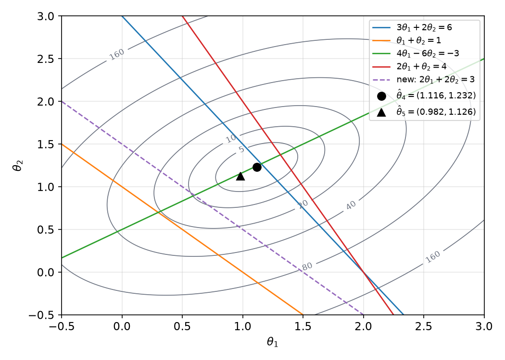
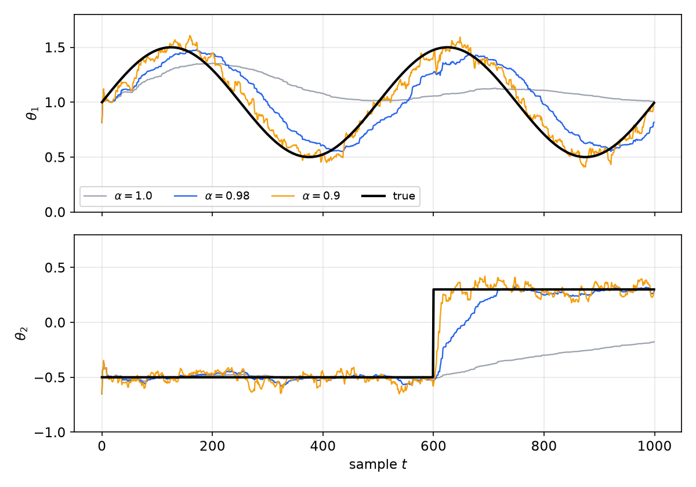
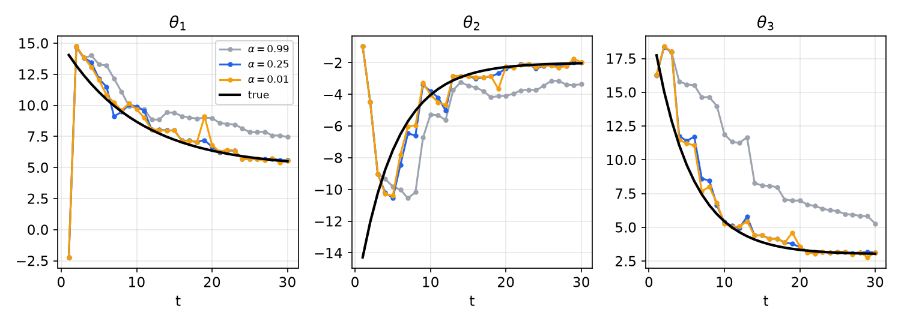
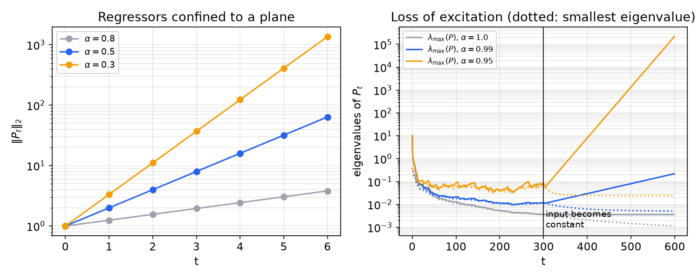

# Least Squares and Recursive Least Squares

Least squares is the workhorse of system identification. Whenever the unknown parameters enter a model linearly, the best fit in the squared-error sense has a closed form, its statistical properties are known, and it can be updated one sample at a time with no matrix inversion. This chapter derives the estimator twice (once without calculus for the straight line, once with the normal equations for a general linearly parameterized model), analyses its covariance and conditioning, generalizes it to weighted least squares, and then develops **recursive least squares (RLS)**: the matrix-inversion-lemma derivation, the role of the initial conditions, exponential forgetting for time-varying parameters, and the covariance wind-up that occurs when the data stop exciting the model. The [previous chapter](statistical-inference.md) supplies the statistics; the [Kalman filter chapter](state-estimation.md) will show RLS to be a special case of state estimation.

## Linearly Parameterized Models

### The model structure

Consider a system with observable inputs \\(u\_1,\dots,u\_m\\) and a single output \\(y\\). It is **linearly parameterized** if the input–output relation has the form
\\[
y = b\_1u\_1 + b\_2u\_2 + \cdots + b\_mu\_m .
\\]
Collect the unknown coefficients in the **parameter vector** and the observable quantities in the **regressor**:
\\[
\theta = \begin{bmatrix}b\_1 & b\_2 & \cdots & b\_m\end{bmatrix}^T\in\mathbb{R}^m,\qquad
\varphi = \begin{bmatrix}u\_1 & u\_2 & \cdots & u\_m\end{bmatrix}^T\in\mathbb{R}^m,\qquad
\boxed{y = \varphi^T\theta} .
\\]
The "inputs" in \\(\varphi\\) can be anything we can compute from measured signals:

- **Linear dynamic system (FIR).** \\(y(t) = b\_1u(t-1)+\cdots+b\_mu(t-m)\\), with \\(\varphi(t) = [u(t-1)\ \cdots\ u(t-m)]^T\\).
- **Nonlinear dynamic system.** \\(y(t) = b\_1u(t-1) + b\_2u(t-1)u(t-2)\\), with \\(\varphi(t) = [u(t-1)\ \ u(t-1)u(t-2)]^T\\). The system is nonlinear in its signals, but the regression is still linear.
- **Autoregressive (ARX) models**, where \\(\varphi\\) contains past outputs as well (see [Model Structures](model-structures.md)).

The key requirement is that **the parameters enter linearly**. Nonlinearity in the signals is harmless; it is moved into the regressor. Several worked examples below show how to rearrange an apparently nonlinear problem into this form.

### The predictor and the cost

Given an estimate \\(\hat\theta\\), the model predicts
\\[
\hat y(t\mid\hat\theta) = \varphi^T(t)\hat\theta ,
\\]
and the estimate is chosen to minimize the mean squared prediction error over \\(N\\) observations:
\\[
V\_N(\theta) = \frac{1}{N}\sum\_{t=1}^{N}\big(y(t) - \varphi^T(t)\theta\big)^2,\qquad \hat\theta = \arg\min\_{\theta}V\_N(\theta).
\\]
\\(V\_N\\) is a quadratic function of \\(\theta\\): a bowl whose bottom, where the slope is zero in every direction, is the optimal parameter vector.

## Fitting a Line Without Calculus

The simplest case, \\(\hat Y = \beta\_0 + \beta\_1x\\), shows the structure of every least-squares solution. Define the residuals \\(\varepsilon\_i = Y\_i - \hat Y\_i\\) and the **sum of squared errors**
\\[
\mathrm{SSE}(\beta\_0,\beta\_1) = \sum\_{i=1}^{N}(Y\_i - \beta\_0 - \beta\_1x\_i)^2 .
\\]
The classical derivation sets the two partial derivatives to zero. A purely algebraic derivation by completing the square (Im, 1996) shows more directly why the minimum is unique. Let \\(\mu\_X = \frac1N\sum x\_i\\), \\(\mu\_Y = \frac1N\sum Y\_i\\) and abbreviate
\\[
S\_{xx} = \sum(x\_i-\mu\_X)^2,\qquad S\_{xY} = \sum(x\_i-\mu\_X)(Y\_i-\mu\_Y),\qquad S\_{YY} = \sum(Y\_i-\mu\_Y)^2 .
\\]

**Step 1: add and subtract the means.** Inside each residual,
\\[
Y\_i - \beta\_0 - \beta\_1x\_i = \underbrace{(\mu\_Y - \beta\_0 - \beta\_1\mu\_X)}\_{\text{constant}} + \underbrace{\big[(Y\_i-\mu\_Y) - \beta\_1(x\_i-\mu\_X)\big]}\_{\text{centred}} .
\\]
**Step 2: square and sum.** The cross term is \\(2(\mu\_Y-\beta\_0-\beta\_1\mu\_X)\sum[(Y\_i-\mu\_Y)-\beta\_1(x\_i-\mu\_X)]\\), and it vanishes because deviations from a mean sum to zero. Hence
\\[
\mathrm{SSE} = N(\mu\_Y-\beta\_0-\beta\_1\mu\_X)^2 + \beta\_1^2S\_{xx} - 2\beta\_1S\_{xY} + S\_{YY} .
\\]
**Step 3: complete the square in \\(\beta\_1\\).**
\\[
\beta\_1^2S\_{xx} - 2\beta\_1S\_{xY} + S\_{YY} = S\_{xx}\left(\beta\_1 - \frac{S\_{xY}}{S\_{xx}}\right)^2 + S\_{YY} - \frac{S\_{xY}^2}{S\_{xx}} .
\\]
So
\\[
\mathrm{SSE} = \underbrace{N(\mu\_Y-\beta\_0-\beta\_1\mu\_X)^2}\_{①} + \underbrace{S\_{xx}\left(\beta\_1-\frac{S\_{xY}}{S\_{xx}}\right)^2}\_{②} + \underbrace{S\_{YY}\left[1-\frac{S\_{xY}^2}{S\_{xx}S\_{YY}}\right]}\_{③}.
\\]
**Step 4: minimize.** Terms ① and ② are squares, hence nonnegative, and they are the only terms that depend on the parameters. Term ③ depends only on the data. The minimum is reached when ① and ② are both zero:
\\[
\boxed{\hat\beta\_1 = \frac{S\_{xY}}{S\_{xx}} = \frac{\sum(x\_i-\mu\_X)(Y\_i-\mu\_Y)}{\sum(x\_i-\mu\_X)^2},\qquad \hat\beta\_0 = \mu\_Y - \hat\beta\_1\mu\_X} .
\\]
The minimum value is term ③, \\(\mathrm{SSE}\_{\min} = S\_{YY}(1-r^2)\\), where \\(r = S\_{xY}/\sqrt{S\_{xx}S\_{YY}}\\) is the sample correlation coefficient. This identity is the meaning of \\(R^2 = r^2\\): the fraction of the variance of \\(Y\\) about its mean that the line removes. The fitted line always passes through the centroid \\((\mu\_X,\mu\_Y)\\).

The statistical properties of these estimates (unbiasedness, \\(\sigma\_{\hat\beta\_1} = \sigma/\sqrt{S\_{xx}}\\), the t-test) were derived in [Parameter Estimation and Hypothesis Testing](statistical-inference.md#significance-of-a-regression).

## The Normal Equations

### Derivation

For the general model, differentiate the cost with respect to the vector \\(\theta\\) and set the gradient to zero:
\\[
\frac{\partial V\_N}{\partial\theta} = \frac{2}{N}\sum\_{t=1}^{N}\big[\varphi^T(t)\theta - y(t)\big]\varphi(t) = 0 .
\\]
Separate the terms that contain \\(\theta\\) from those that do not:
\\[
\Big[\sum\_{t=1}^{N}\varphi(t)\varphi^T(t)\Big]\theta = \sum\_{t=1}^{N}y(t)\varphi(t) .
\\]
These are the **normal equations**. The \\(m\times m\\) matrix on the left is the (unnormalized) **auto-covariance matrix** of the regressors, and the \\(m\times 1\\) vector on the right is the **cross-covariance** between regressors and output. In matrix form, arrange the regressors as the columns of an \\(m\times N\\) matrix and the outputs in a vector,
\\[
\Phi = \begin{bmatrix}\varphi(1) & \varphi(2) & \cdots & \varphi(N)\end{bmatrix},\qquad Y = \begin{bmatrix}y(1) & \cdots & y(N)\end{bmatrix}^T,
\\]
so that \\(\sum\varphi\varphi^T = \Phi\Phi^T\\) and \\(\sum y\varphi = \Phi Y\\).

**Theorem (least-squares estimate).** If the regressors \\(\varphi(1),\dots,\varphi(N)\\) span \\(\mathbb{R}^m\\), i.e. \\(\operatorname{rank}\Phi = m\\) (which requires \\(N\ge m\\)), then \\(\Phi\Phi^T\\) is positive definite, the cost has a unique minimizer, and
\\[
\boxed{\hat\theta = PB,\qquad P = \big(\Phi\Phi^T\big)^{-1} = \Big[\sum\_{t=1}^{N}\varphi(t)\varphi^T(t)\Big]^{-1},\qquad B = \Phi Y = \sum\_{t=1}^{N}y(t)\varphi(t)} .
\\]
*Proof.* For any \\(z\ne0\\), \\(z^T\Phi\Phi^Tz = \lVert\Phi^Tz\rVert^2 = \sum\_t(\varphi^T(t)z)^2\\). This is zero only if \\(z\\) is orthogonal to every regressor, which is impossible when the regressors span \\(\mathbb{R}^m\\). So \\(\Phi\Phi^T\\) is positive definite and invertible. The Hessian of \\(V\_N\\) is \\(\frac{2}{N}\Phi\Phi^T\\), so \\(V\_N\\) is strictly convex and its unique stationary point is the global minimum. ∎

In the more common "data matrix" notation, with the regressors as *rows* of \\(X = \Phi^T\\), the same result reads \\(\hat\theta = (X^TX)^{-1}X^TY\\).



*Figure: four inconsistent equations in two unknowns (solid lines) have no common solution. The contours of the summed squared residual are ellipses centred on the least-squares estimate \\(\hat\theta\_4\\) (circle). A fifth equation (dashed) moves the estimate to \\(\hat\theta\_5\\) (triangle). The ellipses' shape is set by \\(\Phi\Phi^T\\): elongated ellipses mean a poorly determined direction.*

### Geometric interpretation

Rewrite the stationarity condition as \\(\Phi(Y - \Phi^T\hat\theta) = 0\\): **the residual vector is orthogonal to every regressor sequence**. The fitted output \\(\hat Y = \Phi^T\hat\theta\\) is the orthogonal projection of \\(Y\\) onto the column space of \\(\Phi^T\\), and \\(\Phi^T(\Phi\Phi^T)^{-1}\Phi\\) is the projection matrix. Least squares splits the data into a part explained by the model and a residual uncorrelated (in the sample sense) with everything the model could use. This orthogonality is what the [Kalman filter](state-estimation.md) generalizes to "the innovation is orthogonal to the past data".

### Statistical properties

Suppose the data obey \\(y(t) = \varphi^T(t)\theta\_0 + e(t)\\) with \\(e\\) zero mean, variance \\(\sigma^2\\), uncorrelated in time, and **uncorrelated with the regressors** (deterministic regressors, for instance). Substituting,
\\[
\hat\theta = P\sum\varphi(t)\big[\varphi^T(t)\theta\_0 + e(t)\big] = \theta\_0 + P\sum\_{t}\varphi(t)e(t).
\\]
Hence \\(E[\hat\theta] = \theta\_0\\) (unbiased) and
\\[
\mathrm{Cov}(\hat\theta) = P\Big[\sum\_{t}\sum\_{s}\varphi(t)E[e(t)e(s)]\varphi^T(s)\Big]P = P\big(\sigma^2\Phi\Phi^T\big)P = \sigma^2P .
\\]
So **the matrix \\(P\\) is, up to the noise variance, the covariance of the parameter estimate**. Its diagonal holds the squared standard errors of the individual parameters. For the line fit, \\(\varphi = [1\ \ x]^T\\), inverting the \\(2\times2\\) matrix \\(\Phi\Phi^T\\) reproduces \\(\mathrm{Var}(\hat\beta\_1) = \sigma^2/S\_{xx}\\) and \\(\mathrm{Var}(\hat\beta\_0) = \sigma^2(1/N + \mu\_X^2/S\_{xx})\\). This interpretation of \\(P\\) carries straight into RLS, where \\(P\_t\\) measures how uncertain the current estimate is.

If the noise is correlated with the regressors, the estimate is biased. The typical case is an ARX model whose regressor contains past noisy outputs; [Optimal Estimation and the Kalman Filter](../me6401-linear-control/kalman-filter.md#system-identification) shows a simulated example, and [Model Structures](model-structures.md) discusses the remedies.

**Example 1 (Four equations, two unknowns).** Find the least-squares solution of
\\[
3\theta\_1+2\theta\_2 = 6,\qquad \theta\_1+\theta\_2 = 1,\qquad 4\theta\_1-6\theta\_2 = -3,\qquad 2\theta\_1+\theta\_2 = 4 .
\\]
Each equation is an observation \\(y = \varphi^T\theta\\):
\\[
\Phi = \begin{bmatrix}3 & 1 & 4 & 2\\\\ 2 & 1 & -6 & 1\end{bmatrix},\qquad Y = \begin{bmatrix}6 & 1 & -3 & 4\end{bmatrix}^T .
\\]
Then
\\[
\Phi\Phi^T = \begin{bmatrix}30 & -15\\\\ -15 & 42\end{bmatrix},\quad \det = 1035,\quad
P\_4 = \frac{1}{1035}\begin{bmatrix}42 & 15\\\\ 15 & 30\end{bmatrix} = \begin{bmatrix}0.0406 & 0.0145\\\\ 0.0145 & 0.0290\end{bmatrix},
\\]
\\[
B\_4 = \Phi Y = \begin{bmatrix}15\\\\ 35\end{bmatrix},\qquad \hat\theta\_4 = P\_4B\_4 = \begin{bmatrix}1.116\\\\ 1.232\end{bmatrix}.
\\]
A fifth observation \\(2\theta\_1 + 2\theta\_2 = 3\\) arrives. Reprocessing the whole batch, \\(\Phi\_5\Phi\_5^T = \begin{bmatrix}34 & -11\\\\ -11 & 46\end{bmatrix}\\) (determinant 1443), \\(B\_5 = [21\ \ 41]^T\\) and
\\[
\hat\theta\_5 = \frac{1}{1443}\begin{bmatrix}46 & 11\\\\ 11 & 34\end{bmatrix}\begin{bmatrix}21\\\\ 41\end{bmatrix} = \begin{bmatrix}0.982\\\\ 1.126\end{bmatrix}.
\\]
The same update is computed recursively in Example 5 below.

**Example 2 (Locating a ship by three theodolites).** Three stations sit at the vertices of an equilateral triangle of side \\(L\\): \\((0,0)\\), \\((L/2,\sqrt3L/2)\\) and \\((L,0)\\). Each measures the bearing angle \\(\alpha\_i\\) to a ship at the unknown position \\((x,y)\\). The bearings are nonlinear functions of position,
\\[
\tan\alpha\_1 = \frac{y}{x},\qquad \tan\alpha\_2 = \frac{\tfrac{\sqrt3}{2}L - y}{x-\tfrac12L},\qquad \tan\alpha\_3 = \frac{y}{x-L},
\\]
but clearing the denominators makes the *unknowns* enter linearly, with the measured tangents as coefficients:
\\[
x\tan\alpha\_1 - y = 0,\qquad x\tan\alpha\_2 + y = \tfrac{\sqrt3}{2}L + \tfrac12L\tan\alpha\_2,\qquad x\tan\alpha\_3 - y = L\tan\alpha\_3 .
\\]
With \\(\theta = [x\ \ y]^T\\),
\\[
\Phi = \begin{bmatrix}\tan\alpha\_1 & \tan\alpha\_2 & \tan\alpha\_3\\\\ -1 & 1 & -1\end{bmatrix},\qquad
Y = \begin{bmatrix}0\\\\ \tfrac12L\tan\alpha\_2 + \tfrac{\sqrt3}{2}L\\\\ L\tan\alpha\_3\end{bmatrix},\qquad
\Phi\Phi^T = \begin{bmatrix}\sum\_i\tan^2\alpha\_i & -\tan\alpha\_1+\tan\alpha\_2-\tan\alpha\_3\\\\ -\tan\alpha\_1+\tan\alpha\_2-\tan\alpha\_3 & 3\end{bmatrix},
\\]
and \\(\hat\theta = (\Phi\Phi^T)^{-1}\Phi Y\\). Three noisy bearings over-determine two unknowns, and least squares reconciles them. (Strictly the noise now multiplies the unknowns, an errors-in-variables problem, so the estimate is slightly biased; for small angular errors the bias is negligible.)

**Example 3 (Two-link robot arm, linear in the parameters).** A planar two-link arm moving without gravity has the joint torques
\\[
\tau\_1 = H\_{11}\ddot q\_1 + H\_{12}\ddot q\_2 - h\dot q\_2^2 - 2h\dot q\_1\dot q\_2,\qquad \tau\_2 = H\_{22}\ddot q\_2 + H\_{21}\ddot q\_1 + h\dot q\_1^2,
\\]
with
\\[
\begin{aligned}
H\_{11} &= m\_1\ell\_{c1}^2 + I\_1 + m\_2(\ell\_1^2+\ell\_{c2}^2+2\ell\_1\ell\_{c2}\cos q\_2) + I\_2, & H\_{22} &= m\_2\ell\_{c2}^2 + I\_2,\\\\
H\_{12} &= H\_{21} = m\_2(\ell\_{c2}^2+\ell\_1\ell\_{c2}\cos q\_2) + I\_2, & h &= m\_2\ell\_1\ell\_{c2}\sin q\_2 .
\end{aligned}
\\]
The dynamics are highly nonlinear in the joint variables, and the physical parameters appear in products. Group them as
\\[
b\_1 = m\_2,\quad b\_2 = m\_2\ell\_{c2},\quad b\_3 = I\_1 + m\_1\ell\_{c1}^2,\quad b\_4 = I\_2 + m\_2\ell\_{c2}^2 .
\\]
Collecting the terms of \\(\tau\_1\\) and \\(\tau\_2\\) by these groups gives \\(\tau\_i = \varphi\_i^T\theta\\) with \\(\theta = [b\_1\ b\_2\ b\_3\ b\_4]^T\\) and the measurable regressors
\\[
\varphi\_1 = \begin{bmatrix}\ell\_1^2\ddot q\_1\\\\ \ell\_1\cos q\_2\\,(2\ddot q\_1+\ddot q\_2) - \ell\_1\sin q\_2\\,(2\dot q\_1\dot q\_2+\dot q\_2^2)\\\\ \ddot q\_1\\\\ \ddot q\_1+\ddot q\_2\end{bmatrix},\qquad
\varphi\_2 = \begin{bmatrix}0\\\\ \ell\_1\ddot q\_1\cos q\_2 + \ell\_1\dot q\_1^2\sin q\_2\\\\ 0\\\\ \ddot q\_1+\ddot q\_2\end{bmatrix}.
\\]
(Check the \\(b\_4\\) column: \\(H\_{11}\\) contributes \\(m\_2\ell\_{c2}^2+I\_2 = b\_4\\) times \\(\ddot q\_1\\) and \\(H\_{12}\\) contributes \\(b\_4\\) times \\(\ddot q\_2\\).) The two torques form a two-output regression \\(y = [\tau\_1\ \ \tau\_2]^T = \Psi^T\theta\\) with \\(\Psi = [\varphi\_1\ \ \varphi\_2]\\), solved by weighted least squares (next section) or recursively. Only the four groupings are identifiable: \\(m\_1\\), \\(\ell\_{c1}\\) and \\(I\_1\\) appear only through \\(b\_3\\) and cannot be separated by any experiment. This is the standard linear-in-parameters property of rigid-body dynamics used in [adaptive manipulator control](../me6402-nonlinear-control/adaptive-control.md); see also [Manipulator Control](../me6407-robotics/control.md).

## Weighted Least Squares

When some observations are more reliable than others, or when several outputs with different units are fitted together, weight the squared errors:
\\[
V\_W(\theta) = \sum\_{t=1}^{N}w\_t\big(y(t)-\varphi^T(t)\theta\big)^2 = (Y-\Phi^T\theta)^TW(Y-\Phi^T\theta),\qquad W = \mathrm{diag}(w\_1,\dots,w\_N)\succ0 .
\\]
Setting the gradient \\(-2\Phi W(Y-\Phi^T\theta)\\) to zero gives
\\[
\boxed{\hat\theta\_W = \big(\Phi W\Phi^T\big)^{-1}\Phi WY} .
\\]
More generally \\(W\\) may be any symmetric positive definite matrix. Under \\(\mathrm{Cov}(e) = R\\), the estimate has covariance \\((\Phi W\Phi^T)^{-1}\Phi WRW\Phi^T(\Phi W\Phi^T)^{-1}\\), which is minimized by \\(W = R^{-1}\\), giving \\(\mathrm{Cov}(\hat\theta) = (\Phi R^{-1}\Phi^T)^{-1}\\).

**Theorem (Gauss–Markov).** If \\(e\\) has zero mean and covariance \\(R\\) and is uncorrelated with deterministic regressors, then among all *linear unbiased* estimators of \\(\theta\\), weighted least squares with \\(W = R^{-1}\\) has the smallest covariance (it is the **best linear unbiased estimator**, BLUE). If \\(e\\) is Gaussian it is also the maximum-likelihood estimator; see [Optimal Estimation and the Kalman Filter](../me6401-linear-control/kalman-filter.md#maximum-likelihood-is-weighted-least-squares).

The intuition is simple: weight each observation by the inverse of its noise variance, so that precise measurements count more. For a multi-output regression such as the robot arm, a block weighting \\(W\\) expresses how much each torque error matters, and the recursive form is
\\[
\hat\theta(t) = \hat\theta(t-1) + P\_t\Psi(t)W\big(y(t)-\Psi^T(t)\hat\theta(t-1)\big),\quad
P\_t = P\_{t-1} - P\_{t-1}\Psi(t)\big[W^{-1}+\Psi^T(t)P\_{t-1}\Psi(t)\big]^{-1}\Psi^T(t)P\_{t-1},
\\]
which follows from the general matrix inversion lemma below with a rank-two (one per output) update.

## Ill-Conditioning and Rank Deficiency

The theorem above requires \\(\Phi\Phi^T\\) to be invertible. When it is singular or nearly so, least squares fails or becomes unreliable.

**Eigenvalue view.** Let \\(\Phi\Phi^T = V\Lambda V^T\\) with eigenvalues \\(\lambda\_1\ge\cdots\ge\lambda\_m\ge0\\). Then \\(P = V\Lambda^{-1}V^T\\) has eigenvalues \\(1/\lambda\_i\\). If the regressors are highly correlated, some \\(\lambda\_m\approx0\\), so \\(1/\lambda\_m\\) is enormous: by \\(\mathrm{Cov}(\hat\theta) = \sigma^2P\\), the parameter combination along the corresponding eigenvector \\(v\_m\\) is essentially undetermined, and the estimate swings wildly with small changes in the noise.

**Successive-orthogonalization view.** Regress \\(x\_j\\) (one regressor sequence) on all the others and call the residual \\(u\\). A classical identity (Hastie, Tibshirani and Friedman, *The Elements of Statistical Learning*, §3.2.3) states that the multiple-regression coefficient of \\(x\_j\\) equals the univariate coefficient of \\(Y\\) on \\(u\\):
\\[
\hat\theta\_j = \frac{\langle u, Y\rangle}{\langle u, u\rangle}.
\\]
It measures the *additional* contribution of \\(x\_j\\) after adjusting for the rest. If \\(x\_j\\) is almost a combination of the others, \\(u\approx0\\) and \\(\hat\theta\_j\\) becomes a ratio of two small numbers: unstable, and so is every other coefficient in the correlated set.

**Example 4 (Is the normal equation solvable?).** A data set produces the system \\(M\theta = B\\) with
\\[
M = \begin{bmatrix}2 & 6 & 9 & 10\\\\ 14 & 5 & 8 & 2\\\\ 2 & 8 & 10 & 4\\\\ 8 & 6.5 & 9 & 3\end{bmatrix},\qquad B = \begin{bmatrix}5\\\\ 8\\\\ 9\\\\ 4\end{bmatrix},
\\]
where \\(M\\) is claimed to be \\(\sum\varphi\varphi^T\\). Row reduction gives
\\[
\mathrm{rref}(M) = \begin{bmatrix}1 & 0 & 0 & -0.7123\\\\ 0 & 1 & 0 & -5.4521\\\\ 0 & 0 & 1 & 4.9041\\\\ 0 & 0 & 0 & 0\end{bmatrix},
\\]
so \\(\operatorname{rank}M = 3<4\\): \\(M\\) is singular and \\(\theta\\) has no unique solution. Three remedies exist. (i) Change the experiment so that the regressors span \\(\mathbb{R}^4\\): a richer, *persistently exciting* input ([Input Design](input-design.md)). (ii) Reduce the number of parameters, for example replace a long FIR model by a few Laguerre basis functions ([Model Structures](model-structures.md)). (iii) Use a method designed for more parameters than independent observations, such as ridge regression or partial least squares ([PCA, ICA and Partial Least Squares](latent-variable-models.md)). Note also a sanity check: this \\(M\\) is not symmetric, so it cannot be a sum of outer products \\(\varphi\varphi^T\\), which is always symmetric positive semidefinite. Checking such structural properties catches data-handling errors early.

**Ridge regression.** Adding a penalty \\(\lambda\lVert\theta\rVert^2\\) to the cost gives \\(\hat\theta = (\Phi\Phi^T + \lambda I)^{-1}\Phi Y\\), which is always invertible for \\(\lambda>0\\). It trades a small bias for a large reduction in variance. We will see below that RLS with initial matrix \\(P\_0\\) silently solves exactly such a regularized problem, with \\(P\_0^{-1}\\) in place of \\(\lambda I\\). See Regularization.

## Recursive Least Squares

### Motivation

Batch least squares processes data already collected. Many applications need the estimate updated **online**, as each sample arrives:

- adaptive control and fault detection, where the plant drifts;
- **adaptive noise cancellation**, as in a wearable ring photoplethysmograph (PPG). The heart signal \\(e(t)\\) is corrupted by a motion artifact, which is modelled as the output of a linear system driven by an accelerometer signal \\(u(t)\\). The corrupted measurement is \\(y(t) = e(t) + \varphi^T(t)\theta\\) with \\(\varphi(t)\\) built from recent accelerations. The artifact "system" \\(\theta\\) changes with posture and grip, so it must be re-estimated continuously, and the clean signal is recovered as \\(y(t) - \varphi^T(t)\hat\theta(t)\\).

Recomputing \\((\Phi\Phi^T)^{-1}\\) at every step costs \\(O(m^3)\\) and requires storing all the data. A recursive algorithm updates \\(\hat\theta\\) from the previous estimate and the new sample only, in \\(O(m^2)\\) operations and fixed memory, which allows a higher sampling rate on modest hardware.

The goal: given \\(B\_{t-1}\\), \\(P\_{t-1}\\) and \\(\hat\theta(t-1) = P\_{t-1}B\_{t-1}\\) from data up to \\(t-1\\), compute \\(B\_t\\), \\(P\_t\\) and \\(\hat\theta(t)\\) using only the new pair \\(\varphi(t)\\), \\(y(t)\\).

### Step 1: recursions for \\(B\\) and \\(P^{-1}\\)

Both sums grow by one term:
\\[
B\_t = \sum\_{i=1}^{t}y(i)\varphi(i) = B\_{t-1} + y(t)\varphi(t),\qquad
P\_t^{-1} = \sum\_{i=1}^{t}\varphi(i)\varphi^T(i) = P\_{t-1}^{-1} + \varphi(t)\varphi^T(t) .
\\]
The inverse covariance is updated by a **rank-one** matrix. What we need, though, is \\(P\_t\\) itself.

### Step 2: the matrix inversion lemma

**Lemma (matrix inversion lemma, Sherman–Morrison–Woodbury).** If \\(A\\) (\\(n\times n\\)) and \\(C\\) (\\(k\times k\\)) are invertible and \\(U\\), \\(V\\) are \\(n\times k\\) and \\(k\times n\\), then
\\[
(A + UCV)^{-1} = A^{-1} - A^{-1}U\big(C^{-1} + VA^{-1}U\big)^{-1}VA^{-1},
\\]
provided the inverse on the right exists.
*Proof.* Multiply \\(A+UCV\\) by the right-hand side:
\\[
\begin{aligned}
&I + UCVA^{-1} - U(C^{-1}+VA^{-1}U)^{-1}VA^{-1} - UCVA^{-1}U(C^{-1}+VA^{-1}U)^{-1}VA^{-1}\\\\
&= I + UCVA^{-1} - UC\big(C^{-1} + VA^{-1}U\big)(C^{-1}+VA^{-1}U)^{-1}VA^{-1} = I + UCVA^{-1} - UCVA^{-1} = I. \quad ∎
\end{aligned}
\\]
With \\(k = 1\\) the inner inverse is a scalar division, which is what makes RLS cheap.

For RLS we can derive the rank-one case directly, which also shows where each term comes from. Start from \\(P\_t^{-1} = P\_{t-1}^{-1} + \varphi(t)\varphi^T(t)\\). Premultiply by \\(P\_t\\) and postmultiply by \\(P\_{t-1}\\):
\\[
P\_{t-1} = P\_t + P\_t\varphi(t)\varphi^T(t)P\_{t-1} . \tag{a}
\\]
Postmultiply (a) by \\(\varphi(t)\\) and factor; the bracket is a scalar, \\((1\times m)(m\times m)(m\times1)\\):
\\[
P\_{t-1}\varphi(t) = P\_t\varphi(t)\big[1 + \varphi^T(t)P\_{t-1}\varphi(t)\big]
\quad\Rightarrow\quad
P\_t\varphi(t) = \frac{P\_{t-1}\varphi(t)}{1 + \varphi^T(t)P\_{t-1}\varphi(t)} . \tag{b}
\\]
Postmultiply (b) by \\(\varphi^T(t)P\_{t-1}\\); by (a) the left side is \\(P\_{t-1}-P\_t\\):
\\[
\boxed{P\_t = P\_{t-1} - \frac{P\_{t-1}\varphi(t)\varphi^T(t)P\_{t-1}}{1 + \varphi^T(t)P\_{t-1}\varphi(t)}} .
\\]
No matrix inversion is required, only a scalar division. The subtracted term is positive semidefinite, so \\(P\_t\le P\_{t-1}\\): each new sample can only reduce the uncertainty.

### Step 3: the parameter update

We want \\(\hat\theta(t) = P\_tB\_t\\) in the **prediction–error–correction** form
\\[
\hat\theta(t) = \hat\theta(t-1) + K\_t\big(y(t) - \varphi^T(t)\hat\theta(t-1)\big),
\\]
where the bracket is the prediction error made with the old estimate and \\(K\_t\\) is the correction gain. Using \\(B\_{t-1} = P\_{t-1}^{-1}\hat\theta(t-1)\\) and \\(P\_{t-1}^{-1} = P\_t^{-1} - \varphi(t)\varphi^T(t)\\),
\\[
\begin{aligned}
\hat\theta(t) = P\_tB\_t &= P\_t\big[B\_{t-1} + y(t)\varphi(t)\big] = P\_t\big[\big(P\_t^{-1} - \varphi(t)\varphi^T(t)\big)\hat\theta(t-1) + y(t)\varphi(t)\big]\\\\
&= \hat\theta(t-1) + P\_t\varphi(t)\big[y(t) - \varphi^T(t)\hat\theta(t-1)\big].
\end{aligned}
\\]
By (b), \\(K\_t = P\_t\varphi(t) = P\_{t-1}\varphi(t)/(1+\varphi^T(t)P\_{t-1}\varphi(t))\\).

**Algorithm (recursive least squares).** Initialize \\(\hat\theta(0)\\) (arbitrary, often zero) and \\(P\_0\succ0\\) (often a multiple of the identity). For \\(t = 1,2,\dots\\):
\\[
\boxed{\begin{aligned}
\varepsilon(t) &= y(t) - \varphi^T(t)\hat\theta(t-1) &&\text{(prediction error)}\\\\
K\_t &= \frac{P\_{t-1}\varphi(t)}{1 + \varphi^T(t)P\_{t-1}\varphi(t)} &&\text{(gain)}\\\\
\hat\theta(t) &= \hat\theta(t-1) + K\_t\\,\varepsilon(t) &&\text{(correction)}\\\\
P\_t &= P\_{t-1} - K\_t\varphi^T(t)P\_{t-1} &&\text{(covariance update)}
\end{aligned}}
\\]
The correction moves the estimate in the direction \\(P\_{t-1}\varphi(t)\\), not \\(\varphi(t)\\): \\(P\\) rescales the step so that well-determined directions move little and uncertain directions move a lot. This is the structural difference from a gradient (LMS) update, and the reason RLS converges in far fewer samples.

```python
import numpy as np
def rls_step(theta, P, phi, y, alpha=1.0):
    """One RLS update; alpha < 1 gives exponential forgetting."""
    Pphi = P @ phi
    den = alpha + phi @ Pphi
    K = Pphi / den
    theta = theta + K * (y - phi @ theta)
    P = (P - np.outer(Pphi, Pphi) / den) / alpha
    return theta, P
```

**Example 5 (The fifth equation, recursively).** Continue Example 1 from \\(\hat\theta\_4 = [1.116\ \ 1.232]^T\\) and \\(P\_4\\). The new regressor is \\(\varphi\_5 = [2\ \ 2]^T\\), \\(y\_5 = 3\\):
\\[
P\_4\varphi\_5 = \begin{bmatrix}0.1101\\\\ 0.0870\end{bmatrix},\qquad \varphi\_5^TP\_4\varphi\_5 = 0.394,\qquad
K\_5 = \frac{1}{1.394}\begin{bmatrix}0.1101\\\\ 0.0870\end{bmatrix} = \begin{bmatrix}0.0790\\\\ 0.0624\end{bmatrix}.
\\]
The prediction error is \\(y\_5 - \varphi\_5^T\hat\theta\_4 = 3 - 4.696 = -1.696\\), so
\\[
\hat\theta\_5 = \begin{bmatrix}1.116\\\\ 1.232\end{bmatrix} + \begin{bmatrix}0.0790\\\\ 0.0624\end{bmatrix}(-1.696) = \begin{bmatrix}0.982\\\\ 1.126\end{bmatrix},
\\]
identical to the batch result. This is exact, not approximate: RLS started from the batch \\(P\_4\\) and \\(\hat\theta\_4\\) reproduces batch least squares on all the data.

## Initial Conditions

In practice there is no batch solution to start from. The recursion is started with a guess \\(\hat\theta(0)\\) and a matrix \\(P\_0\\). How do they affect the estimate?

**Theorem (RLS initial conditions).** With \\(P\_0\succ0\\), the RLS estimate \\(\hat\theta(t)\\) is the exact minimizer of
\\[
J\_t(\theta) = \underbrace{\frac12\sum\_{i=1}^{t}\big[y(i) - \varphi^T(i)\theta\big]^2}\_{\text{(A) squared prediction error}} + \underbrace{\frac12\big(\theta-\hat\theta(0)\big)^TP\_0^{-1}\big(\theta-\hat\theta(0)\big)}\_{\text{(B) weighted distance from the initial guess}},
\\]
and \\(P\_t^{-1} = P\_0^{-1} + \sum\_{i=1}^{t}\varphi(i)\varphi^T(i)\\).

*Proof.* \\(J\_t\\) is strictly convex because \\(P\_0^{-1}\succ0\\). Setting its gradient to zero,
\\[
\frac{dJ\_t}{d\theta} = -\sum\_{i=1}^{t}\big(y(i)-\varphi^T(i)\theta\big)\varphi(i) + P\_0^{-1}\big(\theta-\hat\theta(0)\big) = 0,
\\]
and collecting terms,
\\[
\Big[\underbrace{P\_0^{-1} + \sum\_{i=1}^{t}\varphi(i)\varphi^T(i)}\_{=:P\_t^{-1}}\Big]\theta = \sum\_{i=1}^{t}y(i)\varphi(i) + P\_0^{-1}\hat\theta(0) .
\\]
This has exactly the form of the batch normal equations with an extra "prior data" term: define \\(B\_0 = P\_0^{-1}\hat\theta(0)\\), so that \\(\hat\theta(0) = P\_0B\_0\\), and \\(B\_t = B\_0 + \sum\_{i\le t}y(i)\varphi(i)\\). Then the minimizer is \\(\hat\theta(t) = P\_tB\_t\\), and \\(P\_t\\), \\(B\_t\\) satisfy the same one-step recursions as before, \\(P\_t^{-1} = P\_{t-1}^{-1} + \varphi(t)\varphi^T(t)\\) and \\(B\_t = B\_{t-1} + y(t)\varphi(t)\\), starting from \\(P\_0\\) and \\(B\_0\\). Steps 2 and 3 above used nothing else, so the minimizer obeys
\\[
\hat\theta(t) = \hat\theta(t-1) + \frac{P\_{t-1}\varphi(t)}{1+\varphi^T(t)P\_{t-1}\varphi(t)}\big[y(t) - \varphi^T(t)\hat\theta(t-1)\big],
\\]
which is the RLS recursion with initial values \\(\hat\theta(0)\\) and \\(P\_0\\). ∎

**Interpretation.**

1. The initial conditions act as **fictitious prior data**: \\(P\_0^{-1}\\) plays the role of \\(\sum\varphi\varphi^T\\) for observations made before \\(t = 1\\). This is the Bayesian reading made precise in [the Kalman filter chapter](state-estimation.md): \\(\hat\theta(0)\\) is the prior mean and \\(P\_0\\) (times \\(\sigma^2\\)) the prior covariance.
2. As \\(t\\) grows, term (A) grows with the data while (B) stays fixed, so the influence of the initial conditions fades.
3. Early on, \\(\hat\theta\\) is pulled toward \\(\hat\theta(0)\\), strongly so if the eigenvalues of \\(P\_0^{-1}\\) are large (small \\(P\_0\\)).
4. If the eigenvalues of \\(P\_0^{-1}\\) are small (large \\(P\_0\\)), the estimate responds quickly to the prediction errors.
5. Hence **\\(P\_0\\) expresses the confidence in \\(\hat\theta(0)\\)**: small \\(P\_0\\) for a trusted guess, large \\(P\_0\\) (say \\(100I\\) to \\(1000I\\)) for ignorance. Term (B) is also a ridge penalty, which is why RLS never needs \\(\sum\varphi\varphi^T\\) to be invertible.
6. Optimal initial conditions can be derived from preliminary data: run batch least squares on an initial data segment and use its \\(\hat\theta\\) and \\(P\\) as \\(\hat\theta(0)\\), \\(P\_0\\), as in Example 5.

**Example 6 (RLS by hand and the choice of \\(P\_0\\)).** Run RLS with \\(\hat\theta(0) = 0\\), \\(P\_0 = kI\\) on two observations: \\(\varphi(1) = [1\ \ 1]^T\\), \\(y(1) = 3\\); \\(\varphi(2) = [1\ \ 0]^T\\), \\(y(2) = 2\\).

*Case \\(k = 1\\).* At \\(t = 1\\), \\(\varphi^TP\_0\varphi = 2\\), \\(K\_1 = [1\ \ 1]^T/3\\) and the prediction error is 3, so
\\[
\hat\theta(1) = \begin{bmatrix}1\\\\ 1\end{bmatrix},\qquad
P\_1 = I - \frac13\begin{bmatrix}1 & 1\\\\ 1 & 1\end{bmatrix} = \begin{bmatrix}2/3 & -1/3\\\\ -1/3 & 2/3\end{bmatrix}.
\\]
At \\(t = 2\\), \\(P\_1\varphi(2) = [2/3\ \ -1/3]^T\\), \\(\varphi^TP\_1\varphi = 2/3\\), and the prediction error is \\(2 - 1 = 1\\):
\\[
\hat\theta(2) = \begin{bmatrix}1\\\\ 1\end{bmatrix} + \frac{1}{5/3}\begin{bmatrix}2/3\\\\ -1/3\end{bmatrix} = \begin{bmatrix}7/5\\\\ 4/5\end{bmatrix} = \begin{bmatrix}1.4\\\\ 0.8\end{bmatrix}.
\\]
*Case \\(k = 100\\).* The two noise-free equations \\(\theta\_1+\theta\_2 = 3\\), \\(\theta\_1 = 2\\) are consistent with \\(\theta\_0 = [2\ \ 1]^T\\). By the theorem, \\(\hat\theta(2) = (P\_0^{-1} + \sum\varphi\varphi^T)^{-1}\sum\varphi y\\):
\\[
\hat\theta(2) = \left(\frac{I}{k} + \begin{bmatrix}2 & 1\\\\ 1 & 1\end{bmatrix}\right)^{-1}\begin{bmatrix}5\\\\ 3\end{bmatrix} =
\begin{cases}[1.4\ \ 0.8]^T, & k = 1,\\\\ [1.990\ \ 1.000]^T, & k = 100.\end{cases}
\\]
With \\(k = 100\\) the estimate is much closer to the truth: a large \\(P\_0\\) means low confidence in the initial guess \\(\hat\theta(0) = 0\\), so the regularizing pull toward zero is weak.

*Exact convergence in \\(m\\) steps.* If the data are noise-free and \\(\varphi(1),\dots,\varphi(m)\\) are linearly independent, then as \\(k\to\infty\\), \\(P\_0^{-1}\to0\\) and \\(\hat\theta(m) = (\sum\_{i\le m}\varphi\varphi^T)^{-1}\sum\varphi y = \theta\_0\\): RLS with a very large \\(P\_0\\) reaches the true parameters after \\(m\\) samples.

*The orthogonal projection algorithm* drops the "1" from the denominators,
\\[
\hat\theta(t) = \hat\theta(t-1) + \frac{P\_{t-1}\varphi(t)}{\varphi^T(t)P\_{t-1}\varphi(t)}\varepsilon(t),\qquad
P\_t = P\_{t-1} - \frac{P\_{t-1}\varphi(t)\varphi^T(t)P\_{t-1}}{\varphi^T(t)P\_{t-1}\varphi(t)} ,
\\]
with \\(P\_0 = I\\). Each step makes the new prediction error exactly zero and \\(P\_t\\) projects onto the directions not yet observed, so for noise-free data with linearly independent regressors it gives the exact parameters in \\(m\\) steps. The price: the correction is large, noise is not averaged, and once \\(\varphi^TP\_{t-1}\varphi\approx0\\) (the excited directions are exhausted) the gain explodes. It is not robust to noise.

## Exponential Forgetting

Standard RLS weights all past data equally. Since \\(P\_t\to0\\) as data accumulate, the gain dies out and the estimator stops learning: ideal for constant parameters, useless when they drift. The remedy is to discount old data.

### The forgetting-factor cost

Minimize the exponentially weighted cost
\\[
J\_t(\theta) = \sum\_{i=1}^{t}\alpha^{t-i}\big(y(i) - \varphi^T(i)\theta\big)^2,\qquad 0<\alpha\le1 .
\\]
The newest sample has weight 1, a sample \\(k\\) steps old has weight \\(\alpha^k\\). The effective memory is \\(\sum\_k\alpha^k = 1/(1-\alpha)\\) samples: \\(\alpha = 0.98\\) remembers about 50 samples, \\(\alpha = 0.9\\) about 10.

The normal equations are \\(P\_t^{-1}\hat\theta(t) = B\_t\\) with
\\[
P\_t^{-1} = \sum\_{i\le t}\alpha^{t-i}\varphi(i)\varphi^T(i) = \alpha P\_{t-1}^{-1} + \varphi(t)\varphi^T(t),\qquad B\_t = \alpha B\_{t-1} + y(t)\varphi(t).
\\]
Apply the matrix inversion lemma with \\(A = \alpha P\_{t-1}^{-1}\\), so \\(A^{-1} = P\_{t-1}/\alpha\\):
\\[
P\_t = \frac{P\_{t-1}}{\alpha} - \frac{(P\_{t-1}/\alpha)\varphi\varphi^T(P\_{t-1}/\alpha)}{1 + \varphi^TP\_{t-1}\varphi/\alpha}
= \frac{1}{\alpha}\left[P\_{t-1} - \frac{P\_{t-1}\varphi(t)\varphi^T(t)P\_{t-1}}{\alpha + \varphi^T(t)P\_{t-1}\varphi(t)}\right].
\\]
Repeating Step 3 with \\(B\_{t-1} = P\_{t-1}^{-1}\hat\theta(t-1)\\) and \\(\alpha P\_{t-1}^{-1} = P\_t^{-1} - \varphi\varphi^T\\) gives \\(\hat\theta(t) = \hat\theta(t-1) + P\_t\varphi(t)\varepsilon(t)\\), and multiplying the \\(P\_t\\) update by \\(\varphi(t)\\) gives \\(P\_t\varphi = P\_{t-1}\varphi/(\alpha + \varphi^TP\_{t-1}\varphi)\\). Hence:

**Algorithm (RLS with exponential forgetting).**
\\[
\boxed{\hat\theta(t) = \hat\theta(t-1) + \frac{P\_{t-1}\varphi(t)}{\alpha + \varphi^T(t)P\_{t-1}\varphi(t)}\big(y(t)-\varphi^T(t)\hat\theta(t-1)\big),\quad
P\_t = \frac{1}{\alpha}\left[P\_{t-1} - \frac{P\_{t-1}\varphi(t)\varphi^T(t)P\_{t-1}}{\alpha + \varphi^T(t)P\_{t-1}\varphi(t)}\right]}
\\]
Dividing by \\(\alpha<1\\) inflates \\(P\\) at every step, which keeps the gain from vanishing. In steady state \\(P\_t^{-1}\approx\frac{1}{1-\alpha}E[\varphi\varphi^T]\\), so the estimate behaves like a least-squares fit over a sliding window of about \\(1/(1-\alpha)\\) samples.

**The trade-off.** A short memory tracks fast parameter changes, but averages over few samples, so the estimate is noisy; a long memory averages the noise well but lags behind changes. The choice of \\(\alpha\\) is a bias–variance trade-off in time.

### Simulation: tracking a drifting parameter

Consider a two-tap FIR model \\(y(t) = \theta\_1(t)u(t) + \theta\_2(t)u(t-1) + e(t)\\) with white Gaussian input, noise standard deviation 0.2, and parameters
\\[
\theta\_1(t) = 1 + 0.5\sin(2\pi t/500),\qquad \theta\_2(t) = \begin{cases}-0.5, & t<600,\\\\ 0.3, & t\ge600 .\end{cases}
\\]
\\(\theta\_1\\) drifts smoothly; \\(\theta\_2\\) jumps once.

```python
import numpy as np
rng = np.random.default_rng(3); N = 1000; t = np.arange(N)
th_true = np.vstack([1 + 0.5*np.sin(2*np.pi*t/500), np.where(t < 600, -0.5, 0.3)])
u = rng.standard_normal(N + 1)
for alpha in (1.0, 0.98, 0.9):
    th, P = np.zeros(2), 100*np.eye(2); hist = []
    for k in range(N):
        phi = np.array([u[k+1], u[k]])
        y = phi @ th_true[:, k] + 0.2*rng.standard_normal()
        th, P = rls_step(th, P, phi, y, alpha)
        hist.append(th)
```



*Figure: RLS tracking a drifting parameter \\(\theta\_1\\) (top) and a step in \\(\theta\_2\\) at \\(t = 600\\) (bottom). Without forgetting (\\(\alpha = 1\\), gray), the gain dies out: \\(\theta\_1\\) converges to the long-run average and the step in \\(\theta\_2\\) is followed only very slowly. With \\(\alpha = 0.98\\) (memory about 50 samples, blue) the estimate tracks with a visible lag; with \\(\alpha = 0.9\\) (about 10 samples, orange) it tracks closely but is noticeably noisier.*

The root-mean-square tracking errors after the initial transient are 0.37 and 0.40 for \\(\alpha = 1\\), 0.19 and 0.14 for \\(\alpha = 0.98\\), and 0.07 and 0.09 for \\(\alpha = 0.9\\). In this example the drift is fast compared with the noise, so the short memory wins; with more noise or slower drift the optimum moves toward \\(\alpha\\) closer to 1.

**Example 7 (Three-tap FIR with slowly varying parameters).** A data set of 32 inputs and 30 outputs comes from \\(y(t) = \theta\_1(t)u(t) + \theta\_2(t)u(t-1) + \theta\_3(t)u(t-2)\\) plus small noise, with parameters that decay from about \\((14.0, -14.3, 17.7)\\) toward \\((5.4, -2.0, 3.0)\\). RLS with \\(P\_0 = 100I\\) and \\(\hat\theta(0) = 0\\) gives, at the last sample (true values 5.50, −2.04, 3.04):

| \\(\alpha\\) | \\(\hat\theta\_1\\) | \\(\hat\theta\_2\\) | \\(\hat\theta\_3\\) |
|---|---|---|---|
| 0.99 | 7.45 | −3.36 | 5.28 |
| 0.25 | 5.58 | −1.98 | 3.13 |
| 0.01 | 5.56 | −1.97 | 3.13 |



*Figure: RLS on the three-tap data set. With \\(\alpha = 0.99\\) (gray) the estimates remember the large early parameter values and lag far behind the truth (black). With \\(\alpha = 0.25\\) or 0.01 they track closely, but the very short memory of \\(\alpha = 0.01\\) reacts to every noisy sample.*

With only three parameters and almost noise-free data, even a memory of one or two samples identifies the parameters, which is why the small \\(\alpha\\) values look good here. With realistic noise a forgetting factor as small as 0.01 is unusable: each estimate is essentially fitted to the last \\(m\\) samples, so measurement noise passes straight into the parameters. Practical values lie between about 0.95 and 0.999.

## Covariance Wind-Up

Forgetting has a dangerous side effect. It inflates \\(P\\) in *every* direction at every step, but data only deflate \\(P\\) in the directions the regressors actually excite. If some direction is never excited, its uncertainty grows without bound.

**Theorem (wind-up without persistent excitation).** Run RLS with forgetting factor \\(0<\alpha<1\\). Suppose that from some time on, every regressor \\(\varphi(t)\\) lies in a fixed subspace \\(\mathcal{S}\\) of dimension \\(r<m\\), and let \\(n\\) be a unit vector orthogonal to \\(\mathcal{S}\\) such that \\(n\\) is also an eigenvector of \\(P\\) at that time. Then \\(n^TP\_tn\\) grows as \\(\alpha^{-t}\\): \\(P\_t\\) diverges geometrically.

*Proof.* Write \\(P\_{t-1} = VDV^T\\) with orthonormal eigenvectors, ordered so that the first \\(r\\) span \\(\mathcal{S}\\) (the structure is preserved by the recursion, as shown next). Each \\(\varphi(t) = \sum\_{i\le r}b\_iv\_i\\) has no component along \\(v\_{r+1},\dots,v\_m\\). Hence \\(P\_{t-1}\varphi = \sum\_{i\le r}\lambda\_ib\_iv\_i\\) also lies in \\(\mathcal{S}\\), and
\\[
P\_{t-1}\varphi\varphi^TP\_{t-1} = V\begin{bmatrix}\mathcal{B} & 0\\\\ 0 & 0\end{bmatrix}V^T
\\]
touches only the first \\(r\\) modal coordinates, with some \\(r\times r\\) block \\(\mathcal{B}\\). With the scalar \\(a = \alpha + \varphi^TP\_{t-1}\varphi\\),
\\[
P\_t = V\begin{bmatrix}\big(\mathrm{diag}(\lambda\_1,\dots,\lambda\_r) - \mathcal{B}/a\big)/\alpha & 0\\\\ 0 & \mathrm{diag}(\lambda\_{r+1},\dots,\lambda\_m)/\alpha\end{bmatrix}V^T .
\\]
The block structure is preserved, and the unexcited eigenvalues are simply multiplied by \\(1/\alpha>1\\) at every step, so they grow as \\(\alpha^{-t}\\). ∎

**Example 8 (Regressors confined to a plane).** A three-tap FIR data set has six regressors
\\[
\varphi(t) = [u(t)\ \ u(t-1)\ \ u(t-2)]^T:\quad
\begin{bmatrix}2\\\\ -1\\\\ 0\end{bmatrix},\ \begin{bmatrix}-1\\\\ 2\\\\ -1\end{bmatrix},\ \begin{bmatrix}-4\\\\ -1\\\\ 2\end{bmatrix},\ \begin{bmatrix}11\\\\ -4\\\\ -1\end{bmatrix},\ \begin{bmatrix}-10\\\\ 11\\\\ -4\end{bmatrix},\ \begin{bmatrix}-13\\\\ -10\\\\ 11\end{bmatrix}.
\\]
Every one satisfies \\(\varphi\_1 + 2\varphi\_2 + 3\varphi\_3 = 0\\): they all lie in the plane with normal \\(n = [1\ 2\ 3]^T/\sqrt{14}\\). The input sequence \\(0, -1, 2, -1, -4, 11, -10, -13\\) was generated so that \\(u(t) + 2u(t-1) + 3u(t-2) = 0\\). With \\(P\_0 = I\\) (so \\(n\\) is an eigenvector), the theorem predicts \\(n^TP\_tn = \alpha^{-t}\\). After six samples,
\\[
\lVert P\_6\rVert = \alpha^{-6} = 3.81\ (\alpha = 0.8),\qquad 64\ (\alpha = 0.5),\qquad 1372\ (\alpha = 0.3),
\\]
which is exactly what the simulation gives. The smaller \\(\alpha\\), the faster the divergence. The true parameters also jump, from \\((5,-2,3)\\) to \\((3,2,-3)\\) at \\(t = 3\\), and the estimates fail to follow: whatever the data say about the plane, they say nothing about the component of \\(\theta\\) along \\(n\\).



*Figure: left, \\(\lVert P\_t\rVert\\) for the planar regressors of Example 8 grows exactly as \\(\alpha^{-t}\\). Right, a two-parameter model excited by white noise until \\(t = 300\\), then by a constant input. Afterwards the regressor \\([u(t)\ u(t-1)]^T = [1\ 1]^T\\) excites only one direction; the eigenvalue of \\(P\\) in the orthogonal direction grows as \\(\alpha^{-t}\\), reaching about \\(2\times10^5\\) after 300 samples with \\(\alpha = 0.95\\). Without forgetting (gray) nothing diverges.*

**Consequences.** While the input remains poor, the estimate itself may look fine: the prediction error is small because the model is only being asked to predict along the excited directions, and if the true \\(\theta\\) lies close to the excited subspace the estimate is acceptable. The danger comes when excitation returns: the huge \\(P\\) produces an enormous gain, and the estimate (and any controller built on it) jumps violently, the phenomenon called **estimator wind-up** or **bursting** in adaptive control. Remedies, all standard:

- **Persistent excitation**: keep the input rich enough that \\(\sum\varphi\varphi^T\\) has no vanishing eigenvalues ([Identifiability](identifiability.md), [Input Design](input-design.md)).
- **Conditional updating (dead zone)**: update only when the regressor carries enough energy or the prediction error exceeds the noise level; equivalently, skip samples with small inputs because their signal-to-noise ratio is poor.
- **Bounding \\(P\\)**: reset \\(P\\) to \\(P\_0\\) when its trace exceeds a limit, or use constant-trace algorithms that rescale \\(P\\) after each update.
- **Directional forgetting**: forget only in the directions that the current regressor excites.

**Example 9 (Scalar RLS for a human-operator gain).** A term project by Hogan Welch (2021) estimated how hard a person pushes on a crane payload. The operator's force is modelled as \\(F(s) = K\_p\frac{\omega\_n^2}{s^2+2\zeta\omega\_ns+\omega\_n^2}E(s)\\), driven by the position error \\(e\\), with \\(\zeta = 0.8\\) and \\(\omega\_n = 1.2\\) rad/s fixed from grip-force studies and only the gain \\(K\_p\\) varying between people. Discretizing the second-order filter (time step 0.01 s) and running it on the measured error produces a signal \\(\varphi(t)\\), and then \\(f(t) = K\_p\varphi(t)\\) is linear in the single unknown. Scalar RLS was run with \\(\hat K\_p(0) = 5\\) (typical of earlier operators) and \\(P(0) = 100\\) (low confidence, fast initial response). For a scalar, persistent excitation only requires \\(\varphi\\) not to vanish, but samples with small \\(\varphi\\) were excluded by a threshold because their signal-to-noise ratio was poor. \\(P(t)\\) dropped sharply at first contact and then decayed slowly, as \\(\Delta P = -P^2\varphi^2/(1+P\varphi^2)\le0\\) requires. \\(\hat K\_p\\) converged to a different value in each trial, which argued for online rather than offline estimation. With the gain held constant within a trial, no forgetting was needed (\\(\alpha = 1\\)); a change of operator mid-task would require restarting the estimator or using forgetting.

## Summary

- A model is linear in the parameters if \\(y = \varphi^T\theta\\); nonlinear functions of measured signals go into \\(\varphi\\).
- Line fit: \\(\hat\beta\_1 = S\_{xY}/S\_{xx}\\), \\(\hat\beta\_0 = \mu\_Y - \hat\beta\_1\mu\_X\\), minimum \\(\mathrm{SSE} = S\_{YY}(1-r^2)\\).
- Normal equations: \\(\hat\theta = PB\\), \\(P = (\sum\varphi\varphi^T)^{-1}\\), \\(B = \sum y\varphi\\); unique iff the regressors span \\(\mathbb{R}^m\\). The residual is orthogonal to the regressors, and \\(\mathrm{Cov}(\hat\theta) = \sigma^2P\\).
- Weighted LS: \\(\hat\theta = (\Phi W\Phi^T)^{-1}\Phi WY\\); \\(W = R^{-1}\\) is BLUE (Gauss–Markov).
- Near-collinear regressors make \\(P\\) huge along some directions: improve the input, reduce the parameterization, or regularize (ridge, PLS).
- RLS: \\(K\_t = P\_{t-1}\varphi/(1+\varphi^TP\_{t-1}\varphi)\\), \\(\hat\theta(t) = \hat\theta(t-1)+K\_t\varepsilon(t)\\), \\(P\_t = P\_{t-1}-K\_t\varphi^TP\_{t-1}\\); derived with the matrix inversion lemma, no matrix inversion needed.
- RLS minimizes \\(\frac12\sum e^2 + \frac12(\theta-\hat\theta(0))^TP\_0^{-1}(\theta-\hat\theta(0))\\): \\(P\_0\\) encodes confidence in \\(\hat\theta(0)\\); a large \\(P\_0\\) gives fast convergence.
- Forgetting factor \\(\alpha\\): memory \\(1/(1-\alpha)\\) samples; \\(P\_t = \frac1\alpha[P\_{t-1}-\frac{P\_{t-1}\varphi\varphi^TP\_{t-1}}{\alpha+\varphi^TP\_{t-1}\varphi}]\\). Small \\(\alpha\\) tracks fast but is noisy.
- Without persistent excitation, forgetting makes the unexcited eigenvalues of \\(P\\) grow as \\(\alpha^{-t}\\) (wind-up).

## See Also

- [Parameter Estimation and Hypothesis Testing](statistical-inference.md): bias, variance and significance of the estimates.
- [Observers and the Kalman Filter for Estimation](state-estimation.md): RLS as a Kalman filter for a constant state.
- [Optimal Estimation and the Kalman Filter](../me6401-linear-control/kalman-filter.md): RLS as recursive maximum likelihood, and its bias for ARX models.
- [Model Structures and Prediction-Error Methods](model-structures.md) and [Identifiability](identifiability.md): which regressors to use and when they are informative.
- [Adaptive Control](../me6402-nonlinear-control/adaptive-control.md): online estimation inside a control loop.
- Singular Value Decomposition: numerically robust least squares and the pseudo-inverse.
- Regularization: ridge and lasso.
