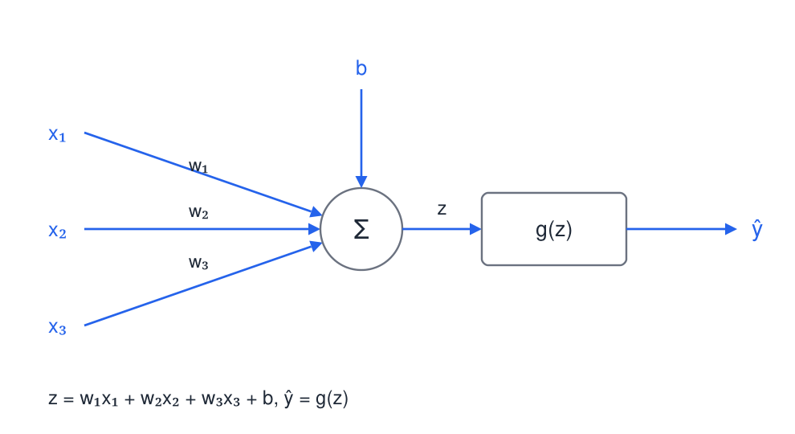
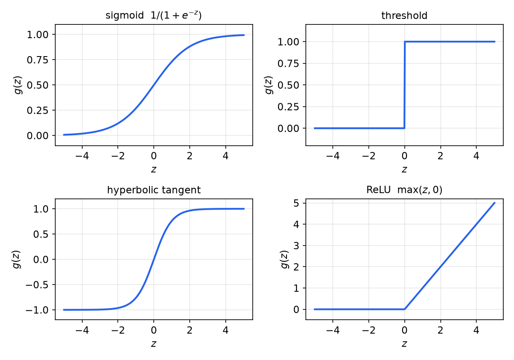
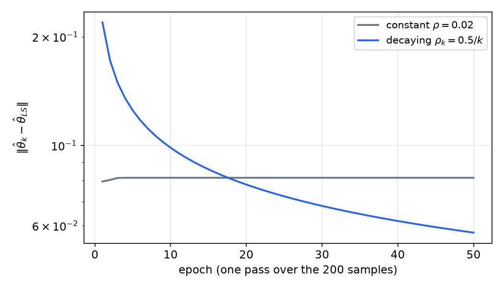
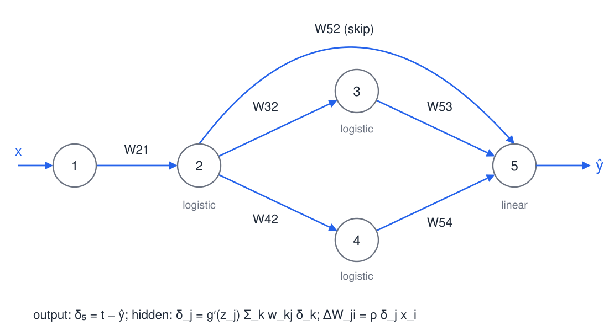
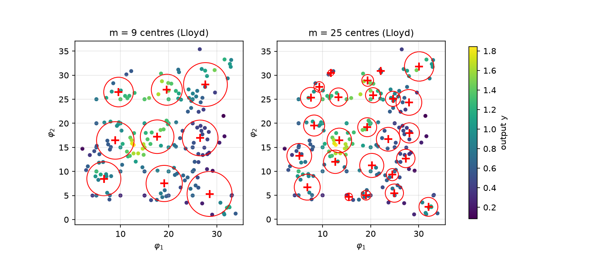

# Neural-Network Models

Many systems are nonlinear in a way that no fixed low-order polynomial captures. A **neural network** is a black-box model built from many simple nonlinear units, each a weighted sum followed by an activation function, and its weights are fitted to data. This chapter develops the building blocks in order: the single neuron, its training by gradient descent (which reduces to the least-squares rule of the [previous chapter](least-squares.md) when the neuron is linear), multilayer networks trained by backpropagation, and radial basis function networks, which are linear in their output weights and fit their centres by clustering. The chapter closes with the validation issues that decide whether a network model is useful. The nonlinear black-box structures are the neural counterpart of the ARX and output-error families in the [model-structures chapter](model-structures.md).

## The Artificial Neuron

### Structure

A neuron receives inputs \\(x\_1,\dots,x\_n\\), forms the weighted sum plus bias
\\[
z = \sum\_{i=1}^{n} w\_i x\_i + b = w^T x + b ,
\\]
and passes it through an activation function, \\(\hat y = g(z)\\). The weights \\(w\_i\\) and the bias \\(b\\) are the adjustable parameters. The bias shifts the threshold of the activation, which is equivalent to adding a constant input \\(x\_0 = 1\\) with weight \\(w\_0 = b\\).

*Figure: a single neuron. Inputs are weighted, summed together with the bias to give \\(z\\), and the activation \\(g\\) produces the output \\(\hat y\\). Training adjusts the three weights and the bias so that \\(\hat y\\) matches the target.*

### Activation functions

The activation is what makes the unit nonlinear. The common choices are:

- the **sigmoid** \\(g(z) = 1/(1+e^{-z})\\), with derivative \\(g'(z) = g(z)\big(1-g(z)\big)\\);
- the **threshold** \\(g(z) = 1\\) for \\(z\ge 0\\) and \\(0\\) otherwise, which is discontinuous and therefore has no gradient;
- the **hyperbolic tangent** \\(g(z) = \tanh z = (1-e^{-2z})/(1+e^{-2z})\\), with \\(g'(z) = 1-g^2(z)\\);
- the **rectified linear unit** \\(g(z) = \max(z,0)\\), with derivative one for \\(z>0\\) and zero for \\(z<0\\).

The sigmoid derivative follows from \\(g' = e^{-z}/(1+e^{-z})^2\\), which equals \\(g(1-g)\\). The hyperbolic tangent is a rescaled sigmoid, \\(\tanh z = 2\sigma(2z)-1\\). The derivatives matter because training uses them, and the sigmoid and tanh have derivatives that can be computed from the output itself. This saves computation in backpropagation, which the training section makes precise.

*Figure: the activation functions used in neural networks. The sigmoid and tanh saturate at both ends, the threshold switches abruptly, and the ReLU is linear for positive arguments. Gradient-based training needs the derivative, so the threshold is avoided in fitting, although it is used as a classifier.*

### A neuron as a classifier

With the threshold activation, a neuron classifies a point \\(x\\) by the sign of \\(w^Tx+b\\). The boundary \\(w^Tx+b=0\\) is a hyperplane, and the neuron can classify exactly the data sets that a hyperplane separates. This is the **linear separability** limit of the single perceptron. The bias controls where the hyperplane sits, and the weight vector controls its orientation. Data that are not linearly separable, such as the exclusive-or pattern, need more than one neuron, which is the motivation for multilayer networks.

## Training a Single Neuron

### Gradient descent

Let the error be \\(e = \hat y - y\\) and take the squared-error loss \\(E = \tfrac12 e^2\\). Gradient descent with learning rate \\(\rho>0\\) moves each weight against the gradient,
\\[
\Delta w\_i = -\rho\\,\frac{\partial E}{\partial w\_i} = -\rho\\,e\\,g'(z)\\,x\_i .
\\]
This is a supervised rule: the change in each weight is proportional to its input, the error, and the slope of the activation. For a training set with inputs \\(x^j\\) and targets \\(y^j\\), the rule is applied to one sample at a time (online) or to the sum over all samples (batch). A full pass over the data is an **epoch**, and presenting the same data repeatedly is called **recycling**.

The unsupervised alternative does not use a target. A Hebbian rule \\(\Delta w\_i \propto x\_i\\,\hat y\\) strengthens the weights that were active together, and self-organizing maps build on this idea to reduce the dimension of data. It is not used for fitting input–output models in this chapter.

### The linear neuron: the Widrow–Hoff rule

If the activation is the identity, \\(\hat y = w^Tx + b\\), then \\(g' = 1\\) and the rule becomes
\\[
\Delta w = \rho\\,\big(y - w^Tx\big)\\,x ,
\\]
where the bias is absorbed into \\(w\\) through a constant input. This is the **Widrow–Hoff** or **least-mean-squares (LMS)** algorithm. It is a stochastic approximation to the least-squares problem. Batch gradient descent on \\(J\_N = \frac1N\sum\_j (\hat y^j-y^j)^2\\) has the update \\(w \leftarrow w + \frac{2\rho}{N}\sum\_j (y^j - w^Tx^j)\\,x^j\\), and its fixed points satisfy the normal equations \\(\sum\_j x^jx^{jT}\\,w = \sum\_j y^jx^j\\). So a linear neuron trained in batch mode converges to the least-squares solution of the [previous chapter](least-squares.md), and the online rule is the same calculation performed one sample at a time, with no matrix to store or invert.

**Convergence.** The fixed-step rule behaves differently in the two cases that matter. If the data are exactly linear, so that some \\(w^\*\\) gives zero error for every sample, the rule converges to \\(w^\*\\) for a constant \\(\rho\\) that is small enough. For convergence of the expected weight vector, the standard condition is \\(0<\rho<2/\lambda\_{\max}\big(E[xx^T]\big)\\). If the data are noisy, so that \\(\min J\_N>0\\), the weights never settle. Each epoch moves them away from the minimizer, and a constant learning rate leaves them fluctuating around it with an amplitude that shrinks only as \\(\rho\\) is reduced. The remedy is a decaying rate, \\(\rho\_k = c/k\\), where \\(k\\) counts the updates. This satisfies the Robbins–Monro conditions \\(\sum\_k\rho\_k = \infty\\) and \\(\sum\_k\rho\_k^2 < \infty\\), under which the stochastic iteration converges to the least-squares solution. The price is slow convergence.

*Figure: distance between the LMS weights and the batch least-squares solution, one point per epoch of 200 samples, on a log scale. With constant \\(\rho = 0.02\\) (gray) the distance settles at a plateau set by \\(\rho\\). With \\(\rho\_k = 0.5/k\\), where \\(k\\) counts individual updates (blue), the distance keeps falling and passes below the constant-rate curve after about eighteen epochs.*

**Example 1 (Widrow–Hoff on a three-parameter linear model).** Let \\(y = x^T\theta\_0 + v\\) with \\(\theta\_0 = [1,\ -0.5,\ 0.25]^T\\), inputs \\(x\\) standard normal, and noise of standard deviation 0.5. Over 200 samples the batch least-squares estimate is the reference point. The LMS weights started at zero are compared with it after each epoch. The figure shows that with \\(\rho = 0.02\\) the weights settle about 0.08 from the least-squares solution and stay there, because the noise keeps them moving. With the decaying rate \\(\rho\_k = 0.5/k\\) the distance is larger at first, since the early steps are big, and then falls steadily toward the reference point. The lesson is the one stated above: a constant step size buys speed at the price of a noise floor, and a decaying step buys accuracy at the price of time.

## Multilayer Networks

### Architecture and forward pass

Units are arranged in layers. Layer \\(0\\) holds the inputs, layers \\(1,\dots,M-1\\) are hidden, and layer \\(M\\) is the output. Every unit in one layer feeds every unit in the next. The notation is:

- \\(w^m\_{ji}\\) is the weight from unit \\(i\\) of layer \\(m-1\\) to unit \\(j\\) of layer \\(m\\);
- \\(b^m\_j\\) is the bias of unit \\(j\\) in layer \\(m\\);
- \\(z^m\_j = \sum\_i w^m\_{ji}\\,x^m\_i + b^m\_j\\) is its weighted input, and \\(y^m\_j = g^m\_j(z^m\_j)\\) its output, which is the input \\(x^{m+1}\_j\\) of the next layer.

The outputs are computed from layer \\(0\\) to layer \\(M\\), which is the **forward pass**. Output units are often linear, so that the network can represent unbounded targets, while hidden units use a sigmoid, tanh or ReLU activation.

### Universal approximation

Why use several layers? The principal result is an existence theorem.

**Theorem (universal approximation).** Let \\(K\\) be a compact subset of \\(\mathbb{R}^n\\), let \\(f\colon K\to\mathbb{R}\\) be continuous, and let \\(g\\) be a continuous, bounded, nonconstant activation (the sigmoid is an example). For every \\(\varepsilon>0\\) there exist a finite number of hidden units and weights such that a one-hidden-layer network \\(\hat f(x) = \sum\_{j} c\_j\\,g(w\_j^Tx + b\_j)\\) satisfies \\(\sup\_{x\in K}\lvert f(x)-\hat f(x)\rvert < \varepsilon\\).

This result is due to Cybenko (1989) for sigmoidal activations and to Hornik (1991) for general bounded nonconstant ones. It says that networks are flexible enough. It does not say how many units are needed, how to find the weights, or whether the fit generalizes. Those questions are the subject of training and validation below.

## Training by Backpropagation

### The chain rule through the layers

Consider one sample with loss \\(E = \tfrac12(\hat y - y)^2\\), where \\(\hat y\\) is the output unit. The gradient with respect to any weight follows from the chain rule through the path from that weight to the output. It is convenient to define, for each unit \\(j\\),
\\[
\delta\_j = -\frac{\partial E}{\partial z\_j},
\\]
the sensitivity of the loss to the unit's weighted input. The weight update is then \\(\Delta w^m\_{ji} = -\rho\\,\partial E/\partial w^m\_{ji} = \rho\\,\delta\_j\\,x^m\_i\\), because \\(\partial z\_j/\partial w\_{ji} = x\_i\\). For the output unit, \\(\delta = -\partial E/\partial \hat y \cdot \partial \hat y/\partial z = (y-\hat y)\\,g'(z)\\), and for a linear output \\(\delta = y-\hat y\\).

For a hidden unit \\(j\\), the loss depends on \\(z\_j\\) only through the outputs of the units \\(k\\) that it feeds, so
\\[
\frac{\partial E}{\partial z\_j} = \sum\_k \frac{\partial E}{\partial z\_k}\\,\frac{\partial z\_k}{\partial y\_j}\\,\frac{\partial y\_j}{\partial z\_j} = -\\,g'\_j(z\_j)\sum\_k \delta\_k\\,w\_{kj}.
\\]
Hence the **backpropagation recursion**
\\[
\boxed{\delta\_j = g'\_j(z\_j)\sum\_k w\_{kj}\\,\delta\_k,\qquad \Delta w\_{ji} = \rho\\,\delta\_j\\,x\_i}.
\\]
The sensitivities are computed from the output layer backward, reusing the \\(\delta\\) of each layer for the layer before it. A forward pass computes the \\(z\\) and \\(y\\) values, a backward pass computes the \\(\delta\\) values, and then every weight is updated. This is why training scales linearly in the number of weights, rather than requiring a separate derivative for each.

Two details matter in practice. Gradient descent on a network is not convex, so training finds a local minimum that depends on the initial weights. Second, the activation derivatives appear in every term of the recursion, so saturated units (for example, a sigmoid with a large input) produce small updates and slow training.

### Worked example: a network with a skip connection

**Example 2 (Backpropagation with a direct connection).** Consider a network with input \\(x\\) feeding unit \\(2\\) through \\(W\_{21}\\). Unit \\(2\\) feeds units \\(3\\) and \\(4\\) through \\(W\_{32}\\) and \\(W\_{42}\\), and it also feeds the linear output unit \\(5\\) directly through a **skip connection** \\(W\_{52}\\). Units \\(3\\) and \\(4\\) feed unit \\(5\\) through \\(W\_{53}\\) and \\(W\_{54}\\). The figure below shows the network. Take \\(x=2\\), target \\(t=2\\), and
\\[
W\_{21}=2,\ W\_{32}=3,\ W\_{42}=-2,\ W\_{52}=1,\ W\_{53}=5,\ W\_{54}=2,
\\]
with the activation values \\(g\_2 = 0.5\\), \\(g\_3 = 0.2\\), \\(g\_4 = 0.75\\) and learning rate \\(\rho=0.2\\). The output is
\\[
o\_5 = W\_{52}g\_2 + W\_{53}g\_3 + W\_{54}g\_4 = 0.5 + 1.0 + 1.5 = 3,\qquad \delta\_5 = t-o\_5 = -1 .
\\]
The hidden sensitivities follow from the recursion with \\(g'(z) = g(1-g)\\) for logistic units. For unit 3, \\(\delta\_3 = g\_3(1-g\_3)W\_{53}\delta\_5 = 0.16\cdot 5\cdot(-1) = -0.8\\). For unit 4, \\(\delta\_4 = g\_4(1-g\_4)W\_{54}\delta\_5 = 0.1875\cdot 2\cdot(-1) = -0.375\\). For unit 2, both routes to the output contribute, the one through units 3 and 4 and the direct skip, so
\\[
\delta\_2 = g\_2(1-g\_2)\big[W\_{52}\delta\_5 + W\_{32}\delta\_3 + W\_{42}\delta\_4\big] = 0.25\big[-1 - 2.4 + 0.75\big] = -0.6625 .
\\]
Therefore
\\[
\Delta W\_{21} = \rho\\,\delta\_2\\,x = 0.2\cdot(-0.6625)\cdot 2 = -0.265 .
\\]
The skip connection enters the recursion exactly like the other paths: its contribution is \\(W\_{52}\delta\_5\\), which equals \\(-1\\) here, not \\(W\_{52}\\). Dropping the factor \\(\delta\_5\\) is the common error, and it changes the answer.

*Figure: the five-unit network of the backpropagation example. Logistic hidden units 2, 3 and 4 feed a linear output unit 5, and unit 2 also feeds the output directly through \\(W\_{52}\\). The gradient for \\(W\_{21}\\) sums the contributions of all three paths from unit 2 to the output. Connections from the input to units 3 and 4 do not affect \\(W\_{21}\\) and are omitted.*

### Classification and extrapolation

Multilayer networks are also trained for classification. The example below uses four classes of produce, each described by five measured features (diameter, density, mass, red-light absorption and firmness), with one hidden layer of six units, gradient descent, and a 60/40 split of the 100 samples per class into training and test sets. The training error is driven down by repeated epochs, and the per-class accuracy on the held-out data was tracked against the number of epochs. In the course computation, the tomato class oscillated between about 55% and 97% accuracy until roughly 6000 epochs, after which all classes plateaued at 100%. Beyond the plateau, further epochs cannot improve the accuracy on these data.

**Example 3 (Extrapolation fails outside the training ranges).** Four hypothetical "mutant" fruits, with feature values outside the ranges of the training data, were then classified by the same trained networks. Most were misclassified at every number of epochs. A network that has never seen a region of the input space has no information about it, so more training cannot repair the error. Smaller perturbations of a class, for example the milder oranges, were often classified correctly. The lesson is about the data, not the optimizer: a black-box model is trustworthy only near the data it was fitted to.

## Radial Basis Function Networks

### The model

A radial basis function (RBF) network replaces the sigmoid units of the hidden layer by localized bumps centred at \\(\gamma\_m\\) with widths \\(\beta\_m\\). For a two-dimensional input \\(\varphi\\), the Gaussian basis is
\\[
g\_m(\varphi) = \frac{1}{2\pi\beta\_m^2}\exp\Big(-\frac{\lVert\varphi-\gamma\_m\rVert^2}{2\beta\_m^2}\Big),
\\]
and the output is the linear combination \\(\hat y = \sum\_{m=1}^{M}\alpha\_m g\_m(\varphi)\\). The network is linear in the output weights \\(\alpha\_m\\). For fixed centres and widths, the weights are found by least squares. If \\(G\\) is the \\(M\times N\\) matrix whose columns are the basis vectors evaluated at the \\(N\\) training inputs, then \\(\alpha = (GG^T)^{-1}Gy\\), exactly the normal equations of the [least-squares chapter](least-squares.md) with \\(\Phi = G\\).

This two-stage structure is the main attraction of RBF networks. The centres and widths enter nonlinearly, but they can be fixed by an unsupervised clustering step. Only the weights require supervised fitting, and that fit is a linear problem with a unique solution.

### Choosing the centres: Lloyd's algorithm

The centres are placed by Lloyd's algorithm, the k-means iteration. Start with \\(M\\) centres on a grid. Assign every training point to its nearest centre, then move each centre to the mean of the points assigned to it. Repeat while the mean squared distance from points to their centres keeps decreasing. Each step reduces the distortion, so the algorithm converges, though possibly to a local optimum. The width of basis \\(m\\) is the root-mean-square distance of its cluster from the centre,
\\[
\beta\_m = \Big(\frac{\sum\_i Q\_{im}\lVert\varphi\_i-\gamma\_m\rVert^2}{\sum\_i Q\_{im}}\Big)^{1/2},
\\]
where \\(Q\_{im}=1\\) if point \\(i\\) belongs to cluster \\(m\\) and zero otherwise. A cluster with one point has zero width, and an empty cluster has no defined width. Both are degenerate and must be handled, as the example shows.

**Example 4 (RBF networks with 9, 25 and 100 centres).** The training data are 210 two-dimensional inputs with scalar outputs, and a separate test set of 185 points is held back. The centres were initialized on a regular grid of \\(\sqrt M\\) by \\(\sqrt M\\) points spanning the data range. Reproducing the procedure on these data gives the following.

| Centres \\(M\\) | Lloyd iterations | Degenerate cells | Training MSE | Test MSE |
|---|---|---|---|---|
| 9 | 7 | 0 | 0.073 | 0.080 |
| 25 | 13 | 0 | 0.029 | 0.095 |
| 100 | 7 | 27 empty, 23 of zero width | 0.113 | 0.294 |

With 9 centres the model fits the training data reasonably and predicts the test data about as well. With 25 centres the training error falls by more than half, yet the test error rises, which is the signature of overfitting: the extra parameters fit noise in the training set. With 100 centres the cells are too finely divided for 210 samples. Many cells are empty or contain one point, so their bases are degenerate. Dropping them leaves 50 usable bases, and the fit is poor on both data sets. The exact values depend on the initial grid, which is why the table reports this implementation rather than a fixed reference. The qualitative conclusions do not depend on it: more centres lower the training error, and past a point they raise the test error, and degenerate clusters are the first sign that the basis is too rich.

*Figure: centres (red crosses) and dilations (red circles) found by Lloyd's algorithm for 9 centres (left) and 25 centres (right), on the two-dimensional training inputs. Points are colored by their output value. With 25 centres some circles are tiny, because they enclose one or two points, and the corresponding basis functions fit individual samples rather than the underlying surface.*

This is the standard model-validation illustration, and its lesson is general. A model is judged by its error on data that were not used to fit it, not by how well it reproduces the training set.

## Validation and Complexity Control

### Hold-out data and early stopping

Two standard mechanisms keep a network from fitting noise. The first is a **hold-out** or validation set: the error on data not used for fitting is recorded alongside the training error, and the model with the smallest validation error is kept. The second, related mechanism is **early stopping** in gradient training. Training that runs too long fits the noise, so the validation error is monitored during training and training stops when it begins to rise. Both rely on the same principle as the model-selection rules of the [model-structures chapter](model-structures.md): the criterion must be evaluated on data that were not used to choose the parameters.

### Regularization

A penalty on the weights limits the effective size of the model. Adding \\(\lambda\lVert\alpha\rVert^2\\) to the least-squares cost of an RBF network gives ridge regression, \\(\alpha = (GG^T+\lambda I)^{-1}Gy\\), which is always well posed for \\(\lambda>0\\) even when some basis functions are degenerate. This is the remedy that the \\(M=100\\) case calls for, and it is the same ridge idea discussed in the [least-squares chapter](least-squares.md). Training algorithms for multilayer networks also use Bayesian regularization, in which the weight penalty is chosen from the data, together with scaled conjugate gradient and Levenberg–Marquardt methods for fast convergence.

## Other Network Types and Dynamic Models

Dynamic black-box models use networks in the same way as the linear structures. A **nonlinear ARX** (NARX) model takes the regressor of an ARX model and applies a network to it,
\\[
y(t) = f\big(y(t-1),\dots,y(t-n\_a),\\,u(t-1),\dots,u(t-n\_b);\\,\theta\big) + e(t).
\\]
With white noise, the one-step predictor is \\(\hat y(t\mid\theta) = f(\varphi(t);\theta)\\), a direct application of the general predictor of the model-structures chapter with \\(H=1\\). Feeding past outputs back into the network makes the predictor nonlinear in the parameters, so training is by backpropagation through the regressors or by an output-error scheme, and the convergence issues of nonlinear PEM apply.

Other architectures serve different purposes. **Recurrent** networks keep a hidden state that stores the time history, so they can model dynamics without explicit delays. **Convolutional** networks use shared kernels to reduce the number of weights for spatial or temporal patterns. **Self-organizing feature maps** reduce the dimension of data with the unsupervised rule mentioned above. The RBF network has the clean two-stage fit of fixed nonlinear basis functions followed by a linear fit of the output weights, the nonlinear-basis analogue of the Laguerre network of the model-structures chapter.

## Summary

- A neuron forms \\(z = w^Tx + b\\) and outputs \\(\hat y = g(z)\\); the sigmoid satisfies \\(g' = g(1-g)\\), and the tanh satisfies \\(g' = 1-g^2\\).
- Gradient descent on \\(\tfrac12 e^2\\) gives \\(\Delta w\_i = -\rho\\,e\\,g'(z)\\,x\_i\\). With a linear activation this is the Widrow–Hoff rule, whose batch fixed point is the least-squares solution.
- A constant learning rate leaves noisy data fluctuating around the minimizer; a decaying rate \\(\rho\_k = c/k\\) converges, slowly.
- The universal approximation theorem guarantees, for continuous targets on compact sets, a one-hidden-layer approximation of any accuracy, but says nothing about the number of units or generalization.
- Backpropagation: \\(\delta\_j = g'\_j(z\_j)\sum\_k w\_{kj}\delta\_k\\) and \\(\Delta w\_{ji} = \rho\\,\delta\_j x\_i\\). Skip connections add their own terms, \\(W\_{52}\delta\_5\\) in the example, and the example gives \\(\Delta W\_{21} = -0.265\\).
- RBF networks use Gaussian bases with centres and RMS-distance widths from Lloyd's algorithm; the output weights are a linear least-squares fit, \\(\alpha = (GG^T)^{-1}Gy\\).
- Model complexity is controlled by hold-out error, early stopping, and regularization such as \\(\lambda\lVert\alpha\rVert^2\\).

## See Also

- [Least Squares and Recursive Least Squares](least-squares.md): the normal equations that the linear neuron and the RBF output layer reduce to.
- [Model Structures and Prediction-Error Methods](model-structures.md): the NARX predictor and the general black-box framework.
- [Parameter Estimation and Hypothesis Testing](statistical-inference.md): the sampling distribution of estimates and the meaning of test error.
- Neural Networks: the machine-learning view of multilayer networks and training.
- Deep Learning: architectures and training at scale.
- Regularization: ridge, lasso and related penalties.
- Unconstrained Optimization: gradient, Gauss–Newton and Levenberg–Marquardt methods for training.
- [Latent-Variable Models](latent-variable-models.md): PCA, ICA and PLS as alternative ways to reduce the inputs of a regression.
