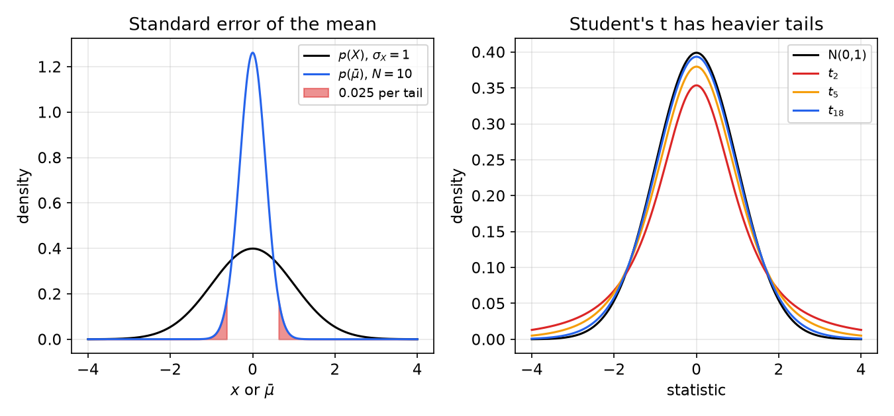
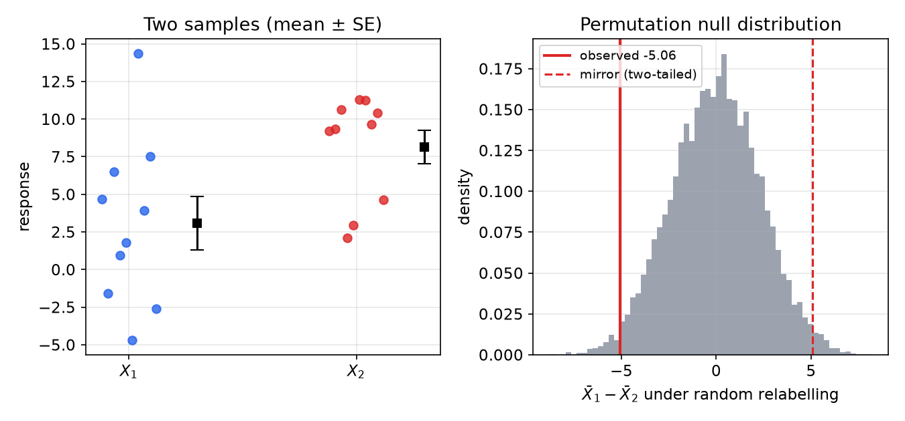
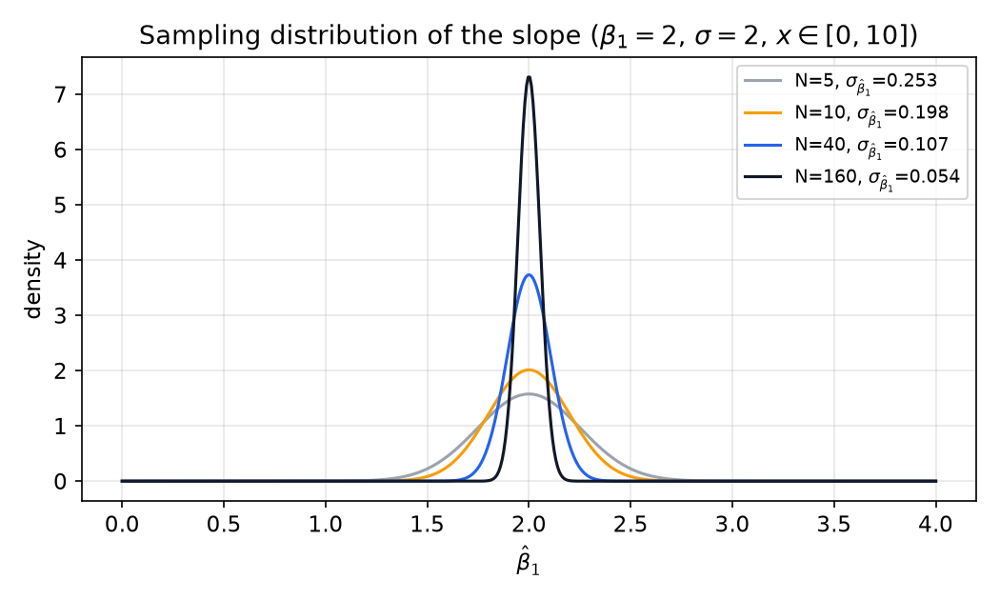
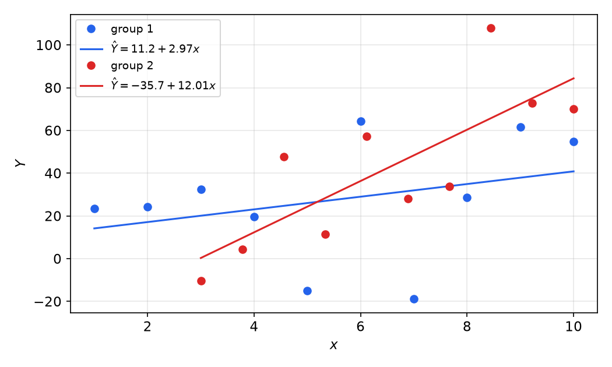

# Parameter Estimation and Hypothesis Testing

System identification turns noisy measurements into numbers: the coefficients of a model. Two questions follow every such number: how far from the truth is it likely to be, and is it different from something else (zero, another group, another model)? This chapter answers both with the classical tools of statistical inference: random variables and their moments, estimators and their bias and variance, hypothesis tests built on the sampling distribution of an estimate, Student's *t*, the permutation test, and the significance of the coefficients of a fitted line. The same ideas reappear in every later chapter, where the "parameter" becomes a vector \\(\theta\\) and the "sample mean" becomes a least-squares estimate.

## Why Statistics in System Identification?

### Goals of model and parameter estimation

A model estimated from data serves three purposes:

1. **Prediction.** A mathematical model predicts the future behaviour of a process: a car responding to its accelerator, a robot arm to its motor current, an immune cell to a pathogen.
2. **Discrimination.** It lets us ask whether two data sets come from distinct processes, for example whether a treatment changed a response.
3. **Extraction.** It extracts processes or signatures that are not obvious in the raw data: the fetal ECG buried in a maternal recording, a motion artifact to be removed from a sensor, the genes that track a disease.

### From impulse responses to a regression

For a deterministic process with input \\(u(t)\\) and output \\(y(t)\\), think of the input as a train of sampled impulses. If the process is linear and time invariant, the output is the superposition of the responses to the past impulses. Truncated to a finite memory this is the **finite impulse response (FIR)** model
\\[
y(t) = b\_1u(t-1) + b\_2u(t-2) + \cdots + b\_mu(t-m),
\\]
where \\(b\_1,\dots,b\_m\\) are the parameters to identify. Collect them in a parameter vector and the lagged inputs in a **regression vector**:
\\[
\theta = \begin{bmatrix} b\_1 & b\_2 & \cdots & b\_m\end{bmatrix}^T,\qquad
\varphi(t) = \begin{bmatrix} u(t-1) & u(t-2) & \cdots & u(t-m)\end{bmatrix}^T,\qquad
y(t) = \varphi^T(t)\theta .
\\]
Real measurements are corrupted, so the data obey
\\[
y(t) = \varphi^T(t)\theta + e(t),
\\]
where \\(e(t)\\) lumps measurement noise, biological variability, wear and every other unmodelled effect. Given records of \\(u\\) and \\(y\\), the parameters are estimated by minimizing a **cost function** such as the mean squared prediction error
\\[
V\_N(\theta) = \frac{1}{N}\sum\_{t=1}^{N}\big(y(t) - \hat y(t\mid\theta)\big)^2,\qquad \hat y(t\mid\theta) = \varphi^T(t)\theta .
\\]
This is the least-squares problem of the [next chapter](least-squares.md). Because \\(e(t)\\) is random, so is the minimizer \\(\hat\theta\\): repeat the experiment and you get a different estimate. Understanding the noise is therefore a prerequisite for estimating parameters and for saying how much they can be trusted.

### Deterministic and random processes

A **deterministic** process maps each input to one output. A **random** process has two kinds of noise: **process noise**, which enters the dynamics and changes the true state, and **measurement noise**, added by the sensor at the output. The distinction matters again for the Kalman filter in [Observers and the Kalman Filter for Estimation](state-estimation.md). Here we only need the language of probability to describe \\(e(t)\\).

## Random Variables: A Review

This section collects the facts used in the rest of the subsection. A fuller treatment is in Random Variables and Expectation.

**Definition (random variable).** A random variable \\(X\\) is a function that maps every point of a sample space onto the real line. A continuous random variable has a **probability density function (pdf)** \\(p(x)\\) with \\(p\ge 0\\) and \\(\int p(x)\\,dx = 1\\); the **cumulative distribution function (CDF)** is
\\[
F(x) = \Pr(X\le x) = \int\_{-\infty}^{x} p(x')\\,dx' .
\\]
In MATLAB the theoretical CDF is `normcdf` (or `cdf`), the empirical CDF `ecdf`; in R, `pnorm` and `ecdf`.

**The Gaussian density.** The density we most often assume for noise is the normal density \\(N(\mu,\sigma^2)\\):
\\[
p(x) = \frac{1}{\sqrt{2\pi}\\,\sigma}\exp\\!\left[-\frac12\left(\frac{x-\mu}{\sigma}\right)^2\right].
\\]
About 68% of its probability lies within \\(\pm\sigma\\) of \\(\mu\\) and 95% within \\(\pm1.96\sigma\\). It is justified by the central limit theorem: noise that is the sum of many small independent effects is approximately Gaussian.

### Moments

The **expected value** (mean) is
\\[
E[X] = \int\_{-\infty}^{\infty}x\\,p(x)\\,dx\quad\text{(continuous)},\qquad E[X] = \sum\_i p\_ix\_i\quad\text{(discrete)} .
\\]
Expectation is linear: \\(E[aX+bY] = aE[X]+bE[Y]\\) for constants \\(a,b\\), whatever the dependence between \\(X\\) and \\(Y\\).

The **variance** is the expected squared deviation from the mean. Expanding the square and using linearity,
\\[
\mathrm{Var}[X] = E\big[(X-E[X])^2\big] = E[X^2] - 2E[X]E[X] + (E[X])^2 = E[X^2] - (E[X])^2 .
\\]
The **standard deviation** is \\(\sigma\_X = \sqrt{\mathrm{Var}[X]}\\). Two scaling rules follow directly: \\(\mathrm{Var}[aX+c] = a^2\mathrm{Var}[X]\\) and \\(\sigma\_{aX} = \lvert a\rvert\sigma\_X\\).

### Independence, correlation and covariance

**Definition (independence).** \\(X\\) and \\(Y\\) are statistically independent if their joint density factorizes,
\\[
p\_{XY}(x,y) = p\_X(x)\\,p\_Y(y).
\\]
The **conditional density** of \\(X\\) given \\(Y=y\\) is \\(p\_{X\mid Y}(x\mid y) = p\_{XY}(x,y)/p\_Y(y)\\), so independence means \\(p\_{X\mid Y} = p\_X\\): knowing \\(Y\\) tells you nothing about \\(X\\).

**Definition (correlation, orthogonality, covariance).** The **correlation** of two random variables is the expectation of their product,
\\[
E[XY] = \int\\!\\!\int xy\\,p\_{XY}(x,y)\\,dx\\,dy .
\\]
They are **orthogonal** if \\(E[XY] = 0\\). Their **covariance** is the correlation of the centred variables,
\\[
\mathrm{Cov}(X,Y) = E\big[(X-\mu\_X)(Y-\mu\_Y)\big] = E[XY] - \mu\_X\mu\_Y ,
\\]
and the dimensionless **correlation coefficient** is \\(\rho = \mathrm{Cov}(X,Y)/(\sigma\_X\sigma\_Y)\in[-1,1]\\).

If \\(X\\) and \\(Y\\) are independent, the double integral factorizes and \\(E[XY] = E[X]E[Y]\\), so \\(\mathrm{Cov}(X,Y) = 0\\). **The converse is false.** Take \\(X\sim N(0,1)\\) and \\(Y = X^2\\). Then \\(\mathrm{Cov}(X,Y) = E[X^3] - E[X]E[X^2] = 0\\) because odd moments of a symmetric density vanish, yet \\(Y\\) is completely determined by \\(X\\). Zero correlation is a statement about second moments only. This gap between "uncorrelated" and "independent" is exactly what separates principal component analysis from independent component analysis in [PCA, ICA and Partial Least Squares](latent-variable-models.md).

**Variance of a sum.** Expanding the square,
\\[
\mathrm{Var}[aX+bY] = a^2\mathrm{Var}[X] + b^2\mathrm{Var}[Y] + 2ab\\,\mathrm{Cov}(X,Y).
\\]
For uncorrelated variables the cross term vanishes and variances add. For a random vector \\(x\\) with mean \\(\mu\\), the **covariance matrix** \\(C = E[(x-\mu)(x-\mu)^T]\\) is symmetric positive semidefinite, and for a constant matrix \\(A\\), \\(\mathrm{Cov}(Ax) = ACA^T\\). Every covariance propagation in this subsection, from the slope variance below to the Kalman filter's \\(APA^T + Q\\), is an instance of this rule.

## Estimators and Their Properties

**Definition (estimator).** An estimator \\(\hat\theta = g(X\_1,\dots,X\_N)\\) is a function of the data used to guess an unknown parameter \\(\theta\\). Because the data are random, \\(\hat\theta\\) is a random variable with its own distribution, the **sampling distribution**.

The quality of an estimator is judged by its sampling distribution:

- **Bias**: \\(b(\hat\theta) = E[\hat\theta] - \theta\\). The estimator is **unbiased** if \\(b = 0\\).
- **Variance**: \\(\mathrm{Var}[\hat\theta]\\), the spread over repeated experiments. Its square root is the **standard error**.
- **Mean squared error**: adding and subtracting \\(E[\hat\theta]\\),
\\[
\mathrm{MSE} = E\big[(\hat\theta-\theta)^2\big] = E\big[(\hat\theta - E\hat\theta + E\hat\theta - \theta)^2\big] = \mathrm{Var}[\hat\theta] + b^2(\hat\theta),
\\]
  because the cross term \\(2(E\hat\theta-\theta)E[\hat\theta - E\hat\theta]\\) is zero. A small bias can be worth accepting for a large reduction in variance; this trade is the basis of regularization (ridge regression, PLS) in later chapters.
- **Consistency**: \\(\hat\theta\to\theta\\) in probability as \\(N\to\infty\\). An unbiased estimator whose variance tends to zero is consistent.

See Point Estimation for maximum-likelihood estimators and the Cramér–Rao bound, which states that no unbiased estimator can have variance below the inverse Fisher information. For the mean of Gaussian data that bound is \\(\sigma^2/N\\), which the sample mean attains.

### The sample mean

Let \\(X\_1,\dots,X\_N\\) be independent samples from a distribution with mean \\(\mu\\) and variance \\(\sigma\_X^2\\). The natural estimator of the mean is
\\[
\bar\mu = \frac1N\sum\_{i=1}^{N}X\_i .
\\]
**Unbiasedness.** By linearity, \\(E[\bar\mu] = \frac1N\sum E[X\_i] = \frac1N\cdot N\\,E[X] = \mu\\).

**Variance.** Write the deviation of the estimate as a sum of the individual deviations:
\\[
\mathrm{Var}[\bar\mu] = E\big[(\bar\mu - \mu)^2\big] = \frac{1}{N^2}E\Big[\Big(\sum\_{i=1}^N(X\_i-\mu)\Big)^2\Big]
= \frac{1}{N^2}\Big\\{\sum\_{i}E\big[(X\_i-\mu)^2\big] + \sum\_{i\ne j}E\big[(X\_i-\mu)(X\_j-\mu)\big]\Big\\}.
\\]
The samples are independent, so every cross term is a covariance equal to zero, and every square term is \\(\mathrm{Var}(X)\\):
\\[
\mathrm{Var}[\bar\mu] = \frac{1}{N^2}\\,N\\,\mathrm{Var}(X) = \frac{\sigma\_X^2}{N},\qquad
\boxed{\sigma\_{\bar\mu} = \frac{\sigma\_X}{\sqrt N}} .
\\]
\\(\sigma\_{\bar\mu}\\) is the **standard error of the mean (SEM)**. The data themselves keep their spread \\(\sigma\_X\\) however many samples we take, but the estimate of their mean becomes sharper as \\(1/\sqrt N\\): four times as many samples halve the uncertainty. If the data are Gaussian, \\(\bar\mu\\) is exactly Gaussian (a linear combination of Gaussians); otherwise it is approximately Gaussian for large \\(N\\) by the central limit theorem:
\\[
p(\bar\mu) = \frac{1}{\sqrt{2\pi}\\,\sigma\_{\bar\mu}}\exp\\!\left[-\frac12\left(\frac{\bar\mu-\mu}{\sigma\_{\bar\mu}}\right)^2\right].
\\]



*Figure: left, the density of individual observations (\\(\sigma\_X = 1\\), black) and of the mean of \\(N = 10\\) of them (blue, \\(\sigma\_{\bar\mu} = 1/\sqrt{10} = 0.32\\)). The red tails each hold 2.5% of the probability of \\(\bar\mu\\): a two-tailed test at \\(\alpha = 0.05\\) rejects a hypothesized mean that falls in them. Right, Student's t densities with 2, 5 and 18 degrees of freedom have heavier tails than the standard normal, and approach it as the degrees of freedom grow.*

### The sample variance

The variance \\(\sigma\_X^2\\) is rarely known and must itself be estimated. The estimator \\(\frac1N\sum(X\_i-\bar\mu)^2\\) is biased low, because the residuals are measured from \\(\bar\mu\\), which is fitted to the same data and so sits closer to them than \\(\mu\\) does. Indeed,
\\[
\sum\_{i=1}^N(X\_i-\bar\mu)^2 = \sum\_{i=1}^N(X\_i-\mu)^2 - N(\bar\mu-\mu)^2,
\\]
and taking expectations gives \\(N\sigma\_X^2 - N\cdot\sigma\_X^2/N = (N-1)\sigma\_X^2\\). Hence the unbiased **sample variance** divides by \\(N-1\\):
\\[
s^2 = \frac{1}{N-1}\sum\_{i=1}^{N}(X\_i-\bar\mu)^2,\qquad E[s^2] = \sigma\_X^2 .
\\]
The \\(N-1\\) counts the **degrees of freedom** left after one parameter (the mean) has been estimated. The same logic gives \\(N-2\\) for a line fit, which estimates two parameters.

## Hypothesis Testing

A hypothesis test is a formal procedure for deciding whether an observed effect, typically a difference in means, is larger than chance alone would plausibly produce.

### The framework

1. **State the hypotheses.** The **null hypothesis** \\(H\_0\\) is the "no effect" statement, for example \\(H\_0:\ \mu = E[X] = 0\\). The **alternative** is \\(H\_1:\ \mu\ne0\\) (two-sided) or \\(\mu>0\\) (one-sided). Note that the hypotheses are statements about a *parameter*, here the mean.
2. **Choose a significance level** \\(\alpha\\), conventionally 0.05: the probability of rejecting \\(H\_0\\) when it is true that we are willing to tolerate.
3. **Compute a test statistic** from the data whose distribution under \\(H\_0\\) is known.
4. **Compute the p-value**: the probability, under \\(H\_0\\), of a statistic at least as extreme as the one observed.
5. **Decide**: if \\(p<\alpha\\), reject \\(H\_0\\) in favour of \\(H\_1\\); otherwise the data do not provide sufficient evidence against \\(H\_0\\) (which is not the same as evidence for it).

Two errors are possible. A **type I error** rejects a true \\(H\_0\\) and occurs with probability \\(\alpha\\). A **type II error** keeps a false \\(H\_0\\); its probability \\(\beta\\) depends on the true effect size, the noise and \\(N\\), and \\(1-\beta\\) is the **power** of the test. More data shrink the standard error, which raises the power for any fixed effect. See Hypothesis Testing for the general theory.

**One or two tails.** For \\(H\_1:\ \mu\ne\mu\_0\\), extreme values in either direction count against \\(H\_0\\), so \\(\alpha\\) is split as 0.025 in each tail. A one-tailed test puts all of \\(\alpha\\) on one side and is legitimate only if the direction was specified before seeing the data.

### The normal test as a parameter-estimation problem

The test of a single mean is a small parameter-estimation problem. The data are assumed to follow a model, here a Gaussian with unknown true mean \\(\mu\\) and standard deviation \\(\sigma\\). To test \\(H\_0:\ \mu = \mu\_0\\) we need the distribution of the *estimate* of \\(\mu\\), and the steps are:

1. **Estimate the mean**, \\(\bar\mu = \frac1N\sum x\_i\\).
2. **Estimate the standard deviation of the mean**, \\(\sigma\_{\bar\mu} = \sigma\_X/\sqrt N\\).
3. **Compute the probability of the null hypothesis**: under \\(H\_0\\), \\(\bar\mu\sim N(\mu\_0,\sigma\_{\bar\mu}^2)\\), so
\\[
z = \frac{\bar\mu - \mu\_0}{\sigma\_{\bar\mu}}\sim N(0,1),\qquad p = 2\big[1-\Phi(\lvert z\rvert)\big],
\\]
   where \\(\Phi\\) is the standard normal CDF. Reject \\(H\_0\\) if \\(p<\alpha\\), i.e. if \\(\lvert z\rvert>1.96\\) for \\(\alpha = 0.05\\).

A common mistake is to report the *density* \\(p(\bar\mu)\\) evaluated at the observed value as if it were a probability. A density value is not a probability and can exceed one; the p-value is a tail *area*, computed from the CDF.

### Student's t-test

The normal test assumes that \\(\sigma\_X\\) is known. In practice it is replaced by the sample estimate \\(s\\), which is itself uncertain, especially for small \\(N\\). The extra uncertainty fattens the tails of the test statistic.

**Theorem (Student).** If \\(Z\sim N(0,1)\\) and \\(U\sim\chi^2\_r\\) are independent, then \\(T = Z/\sqrt{U/r}\\) has the Student t distribution with \\(r\\) degrees of freedom. For Gaussian data, \\(\bar\mu\\) and \\(s^2\\) are independent and \\((N-1)s^2/\sigma^2\sim\chi^2\_{N-1}\\), so
\\[
T = \frac{\bar\mu-\mu\_0}{s/\sqrt N} = \frac{(\bar\mu-\mu\_0)/(\sigma/\sqrt N)}{\sqrt{\dfrac{(N-1)s^2/\sigma^2}{N-1}}}\sim t\_{N-1}\quad\text{under } H\_0 .
\\]
The t density has heavier tails than the normal (figure above), so for the same statistic the t-test gives a *larger* p-value. The difference matters for small samples (the two-sided 5% critical value is 2.26 for 9 degrees of freedom against 1.96 for the normal) and disappears as \\(N\\) grows.

### Comparing two groups

The most common question is whether two groups differ: is \\(E[X\_1]\ne E[X\_2]\\)? Define the difference of the sample means \\(Z = \bar X\_1 - \bar X\_2\\). If the groups are independent, the variance of a difference of independent variables is the *sum* of their variances:
\\[
\mathrm{Var}(Z) = \mathrm{Var}(\bar X\_1) + \mathrm{Var}(\bar X\_2)\quad\Rightarrow\quad
\sigma\_{\bar X\_1-\bar X\_2} = \sqrt{\frac{\sigma\_{X\_1}^2}{N\_1} + \frac{\sigma\_{X\_2}^2}{N\_2}} .
\\]
The test of \\(H\_0:\ \mu\_1-\mu\_2 = 0\\) uses \\(z = (\bar X\_1-\bar X\_2)/\sigma\_{\bar X\_1-\bar X\_2}\\). Two t-test versions replace the unknown variances by estimates:

- the **pooled (Student) t-test** assumes equal variances, estimates a common \\(s\_p^2 = \frac{(N\_1-1)s\_1^2+(N\_2-1)s\_2^2}{N\_1+N\_2-2}\\), and uses \\(N\_1+N\_2-2\\) degrees of freedom;
- **Welch's t-test** uses \\(s\_1^2/N\_1 + s\_2^2/N\_2\\) as above, with an effective (Welch–Satterthwaite) number of degrees of freedom, and is the safer default when the spreads differ.

**Example 1 (Difference of two means).** Two samples of \\(N = 10\\) measurements each:

| | values | mean | \\(s\\) (\\(N-1\\)) |
|---|---|---|---|
| \\(X\_1\\) | 4.69, −1.59, 6.51, 0.96, 1.81, −4.71, 14.37, 3.94, 7.51, −2.60 | 3.090 | 5.608 |
| \\(X\_2\\) | 9.21, 9.33, 10.63, 2.13, 2.94, 11.31, 11.27, 9.65, 10.40, 4.65 | 8.151 | 3.519 |

*Normal test.* The standard error of the difference is
\\[
\sigma\_{\bar X\_1-\bar X\_2} = \sqrt{\frac{5.608^2}{10}+\frac{3.519^2}{10}} = \sqrt{3.145+1.238} = 2.094,
\\]
so \\(z = (3.090-8.151)/2.094 = -2.417\\) and the two-tailed \\(p = 2[1-\Phi(2.417)] = 0.016\\). At \\(\alpha = 0.05\\) we reject \\(H\_0\\): the means differ.

*t-tests.* The same statistic referred to the t distribution gives \\(p = 0.026\\) for the pooled test (18 degrees of freedom) and \\(p = 0.029\\) for Welch's test (15.1 effective degrees of freedom). The p-values are slightly larger than the normal test's because the t-test accounts for the uncertainty in the estimated variances; the normal test pretends that the sample variances are the population variances. All three reject \\(H\_0\\) at 5%.

```matlab
[h,p] = ttest2(X1,X2)                     % pooled t-test, p = 0.0265
[h,p] = ttest2(X1,X2,'Vartype','unequal') % Welch, p = 0.0287
```

## The Permutation Test

The tests above are **parametric**: they assume a model for the data (Gaussian) and derive the null distribution of the statistic from it. When the data are skewed, heavy tailed or few, that assumption can be poor. A **permutation test** builds the null distribution empirically from the data themselves.

**Idea.** Under \\(H\_0\\) the two groups come from the same distribution, so the group labels are arbitrary: any relabelling of the pooled data is as likely as the observed one (the observations are *exchangeable*). Shuffle the labels many times, recompute the difference of means each time, and see where the observed difference falls in this empirical distribution.

**Algorithm.**

1. Compute the observed statistic \\(\Delta\_{obs} = \bar X\_1-\bar X\_2\\).
2. Pool the data, \\(X = [X\_1, X\_2]\\).
3. For \\(i = 1,\dots,B\\) (\\(B = 1000\\) is a reasonable minimum): randomly permute the pooled data, assign the first \\(N\_1\\) values to group 1 and the rest to group 2, and record \\(\Delta\_i\\).
4. The two-tailed p-value is the fraction of permuted differences at least as large in magnitude as the observed one:
\\[
p = \frac{1}{B}\\,\\#\\{i:\ \lvert\Delta\_i\rvert\ge\lvert\Delta\_{obs}\rvert\\}.
\\]
   For a one-tailed test drop the absolute values.

```r
meanTrue <- mean(X2) - mean(X1)
X <- c(X1, X2)
meanPermute <- numeric(1000)
for (i in 1:1000) {                      # 1000 is a good number
  idx <- sample(length(X))
  meanPermute[i] <- mean(X[idx[1:length(X2)]]) - mean(X[idx[-(1:length(X2))]])
}
plot(density(meanPermute))               # empirical null distribution
pPermute <- mean(abs(meanPermute) > abs(meanTrue))  # two-tailed
```

The same in Python:

```python
import numpy as np
rng = np.random.default_rng(1)
pool = np.r_[X1, X2]; d_obs = X1.mean() - X2.mean()
perm = np.empty(10000)
for i in range(perm.size):
    p = rng.permutation(pool)
    perm[i] = p[:10].mean() - p[10:].mean()
p_value = np.mean(np.abs(perm) >= abs(d_obs))
```

**Example 1 (continued).** The observed difference is \\(\Delta\_{obs} = -5.06\\). With \\(B = 10\\,000\\) permutations, 2.9% of the permuted differences exceed 5.06 in magnitude, so \\(p\approx0.029\\) (one run with \\(B = 1000\\) gave 0.022). The p-value is itself a Monte Carlo estimate with standard error \\(\sqrt{p(1-p)/B}\\), about 0.005 for \\(B = 1000\\) and 0.0017 for \\(B = 10\\,000\\), which explains the run-to-run variation. The conclusion agrees with the t-tests: the difference is significant at the 5% level, but not overwhelmingly so.



*Figure: left, the two samples of Example 1 with their means ± one standard error. Group 1 is much more scattered. Right, the distribution of the difference of means over 10,000 random relabellings of the pooled data. The observed difference (solid red) and its mirror image (dashed) cut off about 2.9% of the distribution in the two tails together.*

**Other nonparametric tests.** When no model for the data is trusted, alternatives that use the empirical distribution include the **Wilcoxon rank-sum** (Mann–Whitney) test, which compares ranks rather than values and is robust to outliers, and the two-sample **Kolmogorov–Smirnov** test, which compares the entire empirical CDFs and so detects differences in shape as well as location. Permutation tests extend to any statistic (medians, variances, regression slopes, classifier accuracy) with no new theory, which makes them a valuable default in model comparison.

## Significance of a Regression

Many experiments ask whether one variable depends on another: memory against age in a mouse, sensor voltage against position, a cytokine level against cerebral blood flow. We fit a line, and then ask whether the relationship is real or could be chance. That is a hypothesis test on the slope.

### Model and estimates

The data model is
\\[
Y\_i = \beta\_0 + \beta\_1x\_i + \varepsilon\_i,\qquad \varepsilon\_i\sim N(0,\sigma^2)\ \text{independent},\quad i = 1,\dots,N,
\\]
with the \\(x\_i\\) treated as known, deterministic values. The least-squares estimates (derived in [Least Squares and Recursive Least Squares](least-squares.md)) are, with \\(\mu\_X = \frac1N\sum x\_i\\) and \\(\mu\_Y = \frac1N\sum Y\_i\\),
\\[
\hat\beta\_1 = \frac{\sum\_{i}(x\_i-\mu\_X)(Y\_i-\mu\_Y)}{\sum\_{i}(x\_i-\mu\_X)^2},\qquad \hat\beta\_0 = \mu\_Y - \hat\beta\_1\mu\_X .
\\]

**Hypotheses.** \\(H\_0:\ \beta\_1 = 0\\) (no relationship) against \\(H\_1:\ \beta\_1\ne0\\). To test it we need the mean and variance of \\(\hat\beta\_1\\).

### The slope is unbiased

Because \\(\sum(x\_i-\mu\_X) = 0\\), the \\(\mu\_Y\\) in the numerator can be dropped, \\(\sum(x\_i-\mu\_X)(Y\_i-\mu\_Y) = \sum(x\_i-\mu\_X)Y\_i\\). So \\(\hat\beta\_1\\) is a **linear combination of the observations** with deterministic weights:
\\[
\hat\beta\_1 = \sum\_{i=1}^{N}c\_iY\_i,\qquad c\_i = \frac{x\_i-\mu\_X}{S\_{xx}},\qquad S\_{xx} = \sum\_{i=1}^N(x\_i-\mu\_X)^2 .
\\]
The expectation acts only on the \\(Y\_i\\). With \\(E[Y\_i] = \beta\_0+\beta\_1x\_i\\),
\\[
E[\hat\beta\_1] = \frac{1}{S\_{xx}}\sum(x\_i-\mu\_X)(\beta\_0+\beta\_1x\_i)
= \frac{1}{S\_{xx}}\Big[\beta\_0\underbrace{\sum(x\_i-\mu\_X)}\_{0} + \beta\_1\sum(x\_i-\mu\_X)x\_i\Big] = \beta\_1,
\\]
since \\(\sum(x\_i-\mu\_X)x\_i = \sum(x\_i-\mu\_X)^2 = S\_{xx}\\). The slope estimate is unbiased.

### The variance of the slope

The \\(Y\_i\\) are independent with variance \\(\sigma^2\\), and the \\(c\_i\\) are constants, so \\(\mathrm{Var}(c\_iY\_i) = c\_i^2\sigma^2\\) and the variances add:
\\[
\mathrm{Var}[\hat\beta\_1] = \sum\_{i=1}^N c\_i^2\sigma^2 = \frac{\sum(x\_i-\mu\_X)^2}{S\_{xx}^2}\\,\sigma^2 = \frac{\sigma^2}{S\_{xx}},\qquad
\boxed{\sigma\_{\hat\beta\_1} = \frac{\sigma}{\sqrt{\sum\_{i=1}^N(x\_i-\mu\_X)^2}}} .
\\]
Three things shrink the uncertainty of the slope: less noise \\(\sigma\\), more points, and **more spread in \\(x\\)**. The last is an experimental-design lesson: to measure a slope, sample the input over as wide a range as possible. It anticipates the role of input richness in [Input Design](input-design.md) and [Identifiability](identifiability.md), and it is the scalar case of the parameter covariance \\(\sigma^2(\Phi\Phi^T)^{-1}\\) in least squares.



*Figure: the sampling distribution of \\(\hat\beta\_1\\) for a true slope of 2, noise \\(\sigma = 2\\) and \\(x\\) spread evenly over [0, 10]. With 5 points the standard error is 0.25; with 160 it is 0.054. The estimate is unbiased for every \\(N\\); only its spread changes, roughly as \\(1/\sqrt N\\).*

### The variance of the intercept

From \\(\hat\beta\_0 = \bar Y - \hat\beta\_1\mu\_X\\) and the variance-of-a-sum rule,
\\[
\mathrm{Var}(\hat\beta\_0) = \mathrm{Var}(\bar Y) + \mu\_X^2\mathrm{Var}(\hat\beta\_1) - 2\mu\_X\mathrm{Cov}(\bar Y,\hat\beta\_1).
\\]
The covariance term vanishes: \\(\bar Y = \sum\frac1NY\_i\\) and \\(\hat\beta\_1 = \sum c\_iY\_i\\), so with independent \\(Y\_i\\),
\\[
\mathrm{Cov}(\bar Y,\hat\beta\_1) = \sum\_i\frac1Nc\_i\sigma^2 = \frac{\sigma^2}{N}\\,\frac{\sum(x\_i-\mu\_X)}{S\_{xx}} = 0 .
\\]
Therefore
\\[
\boxed{\mathrm{Var}(\hat\beta\_0) = \frac{\sigma^2}{N} + \mu\_X^2\frac{\sigma^2}{S\_{xx}} = \sigma^2\left(\frac1N + \frac{\mu\_X^2}{S\_{xx}}\right)} .
\\]
Both terms are needed. Dropping \\(\sigma^2/N\\) (writing \\(\sigma\_{\hat\beta\_0} = \mu\_X\sigma\_{\hat\beta\_1}\\)) underestimates the uncertainty of the intercept and can make a non-significant intercept look significant. The intercept is uncertain because the line's level \\(\bar Y\\) is uncertain, and because an error in the slope swings the line about the centroid \\((\mu\_X,\bar Y)\\), moving its value at \\(x = 0\\) by \\(\mu\_X\\) times the slope error.

### Exact distributions and the t-test for coefficients

The variances above contain the unknown \\(\sigma^2\\). Its estimate from the residuals \\(e\_i = Y\_i - \hat\beta\_0 - \hat\beta\_1x\_i\\) is the **mean squared error**
\\[
\mathrm{MSE} = s^2 = \frac{1}{N-2}\sum\_{i=1}^N e\_i^2 ,
\\]
with \\(N-2\\) degrees of freedom because two parameters were fitted. The following results make the test exact for Gaussian noise. It is convenient to centre the regressor, writing \\(Y\_i = \alpha + \beta(x\_i-\mu\_X) + \varepsilon\_i\\) with \\(\alpha = \beta\_0+\beta\_1\mu\_X\\).

**Theorem 1.** \\(\hat\alpha = \bar Y\sim N(\alpha,\sigma^2/N)\\).
*Proof.* \\(E[\bar Y] = \frac1N\sum[\alpha+\beta(x\_i-\mu\_X)] = \alpha\\) because \\(\sum(x\_i-\mu\_X) = 0\\); its variance is \\(\sigma^2/N\\); a linear combination of independent normals is normal. ∎

**Theorem 2.** \\(\hat\beta\sim N(\beta,\ \sigma^2/S\_{xx})\\). *Proof:* the derivation above, plus normality of linear combinations. ∎

**Theorem 3.** \\((N-2)s^2/\sigma^2\sim\chi^2\_{N-2}\\), and \\(\hat\alpha\\), \\(\hat\beta\\) and \\(s^2\\) are mutually independent.
*Argument.* Expanding around the estimates gives the identity
\\[
\sum\_{i=1}^N\big(Y\_i-\alpha-\beta(x\_i-\mu\_X)\big)^2 = N(\hat\alpha-\alpha)^2 + (\hat\beta-\beta)^2S\_{xx} + \sum\_{i=1}^N e\_i^2 .
\\]
Dividing by \\(\sigma^2\\), the left side is a sum of \\(N\\) squared standard normals, \\(\chi^2\_N\\); the first two terms on the right are each \\(\chi^2\_1\\). Cochran's theorem (see Hogg, McKean and Craig, *Introduction to Mathematical Statistics*) makes the decomposition rigorous: the residual term carries the remaining \\(N-2\\) degrees of freedom and is independent of the other two.

**Theorem 4 (confidence interval and test for the slope).** Under the model,
\\[
T = \frac{\hat\beta\_1-\beta\_1}{\sqrt{\mathrm{MSE}/S\_{xx}}}\sim t\_{N-2},
\\]
so a \\((1-\alpha)\\) confidence interval is \\(\hat\beta\_1\pm t\_{\alpha/2,N-2}\sqrt{\mathrm{MSE}/S\_{xx}}\\), and \\(H\_0:\beta\_1 = 0\\) is rejected when \\(\lvert\hat\beta\_1\rvert/\sqrt{\mathrm{MSE}/S\_{xx}}>t\_{\alpha/2,N-2}\\).
*Proof.* By Theorems 2 and 3, \\(Z = (\hat\beta\_1-\beta\_1)/(\sigma/\sqrt{S\_{xx}})\sim N(0,1)\\) and \\(U = (N-2)s^2/\sigma^2\sim\chi^2\_{N-2}\\) are independent. Then \\(Z/\sqrt{U/(N-2)}\\) is t-distributed by Student's theorem, and the unknown \\(\sigma\\) cancels between numerator and denominator, leaving \\(T\\). Inverting \\(\Pr(-t\_{\alpha/2}\le T\le t\_{\alpha/2}) = 1-\alpha\\) gives the interval. ∎

The intercept is tested the same way with \\(\sqrt{\mathrm{MSE}(1/N+\mu\_X^2/S\_{xx})}\\) as its standard error. The hypothesis test for a regression coefficient therefore has exactly the same form as the test for a difference in means: an estimate, its standard error, and a reference distribution.

**Example 2 (Two regression data sets).** Two data sets of 10 points: group 1 has \\(x = 1,2,\dots,10\\); group 2 has \\(x\\) evenly spaced from 3 to 10.

| | \\(\hat\beta\_0\\) (SE) | \\(t\\), \\(p\\) | \\(\hat\beta\_1\\) (SE) | \\(t\\), \\(p\\) | \\(s\\) | \\(R^2\\) |
|---|---|---|---|---|---|---|
| group 1 | 11.21 (19.63) | 0.57, 0.584 | 2.97 (3.16) | 0.94, 0.376 | 28.7 | 0.10 |
| group 2 | −35.70 (23.08) | −1.55, 0.160 | 12.01 (3.36) | 3.58, **0.0072** | 23.7 | 0.62 |

The table reproduces the output of R's `lm(Y ~ X)` exactly. Only the slope of group 2 is significant. Its 95% confidence interval is \\(12.01\pm2.306\times3.358 = [4.27,\ 19.75]\\), which excludes zero; the interval for the slope of group 1, \\([-4.33,\ 10.26]\\), contains it. Neither intercept differs significantly from zero.



*Figure: the two data sets of Example 2 with their least-squares lines. Group 1 (blue) scatters so much about its line that the slope cannot be distinguished from zero; group 2 (red) has a clear upward trend.*

Referring the same statistics to the normal distribution instead of \\(t\_8\\) would give \\(p = 0.0003\\) for the group-2 slope instead of 0.007: with only 8 degrees of freedom the normal approximation is badly anticonservative.

### Significance is not strength

A p-value measures how surprising the data would be under \\(H\_0\\), not how large or important the effect is. Two published examples illustrate the difference.

- In a study of brain injury in mice, regressions of individual cytokines against cerebral blood flow were fitted separately for injured (3xCHI) and sham animals (Sankar, Pybus et al., 2019). For RANTES the injured group gave \\(R^2 = 0.75\\), \\(p = 0.005\\), while the sham group gave \\(p = 0.31\\); for IL-17, \\(R^2 = 0.69\\), \\(p = 0.011\\) against \\(R^2 = 0.01\\), \\(p = 0.81\\). Strong fits in one group and none in the other suggest the *relationship itself* differs between groups, a stronger statement than a difference in means.
- A human study of VEGF against age reported \\(r = 0.22\\), \\(p = 0.03\\) (Chakraborty et al., 2018). The relationship is "significant", but \\(r^2 = 0.05\\): age explains 5% of the variance in VEGF, and the fitted line is nearly flat. With enough samples, the standard error becomes so small that any nonzero slope, however tiny, becomes significant.

Report the effect size (slope with its confidence interval, \\(R^2\\)) alongside the p-value, and ask whether the effect matters for the purpose of the model.

## Summary

- An estimator is a random variable; judge it by its bias, variance and mean squared error \\(\mathrm{MSE} = \mathrm{Var}+\mathrm{bias}^2\\).
- The sample mean is unbiased with standard error \\(\sigma\_{\bar\mu} = \sigma\_X/\sqrt N\\); the sample variance divides by \\(N-1\\).
- Zero covariance does not imply independence; independence implies zero covariance.
- A hypothesis test needs an estimate, its standard error and its null distribution; the p-value is a tail area, \\(p = 2[1-\Phi(\lvert z\rvert)]\\).
- Replacing \\(\sigma\\) by \\(s\\) turns the normal test into Student's t-test with heavier tails; for two independent groups, \\(\sigma\_{\bar X\_1-\bar X\_2} = \sqrt{\sigma\_1^2/N\_1+\sigma\_2^2/N\_2}\\).
- The permutation test builds the null distribution by relabelling the pooled data; it needs no distributional model.
- For a fitted line, \\(\hat\beta\_1\\) is unbiased with \\(\sigma\_{\hat\beta\_1} = \sigma/\sqrt{S\_{xx}}\\) and \\(\mathrm{Var}(\hat\beta\_0) = \sigma^2(1/N+\mu\_X^2/S\_{xx})\\); with \\(\mathrm{MSE} = \sum e\_i^2/(N-2)\\), the coefficient statistic is \\(t\_{N-2}\\)-distributed.
- Statistical significance is not practical significance: report effect sizes and confidence intervals.

## See Also

- [Least Squares and Recursive Least Squares](least-squares.md): the estimator whose statistics this chapter analyses, in vector form.
- [PCA, ICA and Partial Least Squares](latent-variable-models.md): uncorrelated versus independent components.
- Probability, especially Hypothesis Testing, Point Estimation and Common Distributions.
- [Random Processes](../ece6601-random-processes/README.md): noise as a stochastic signal.
- Model Evaluation: resampling and cross-validation from the machine-learning side.
