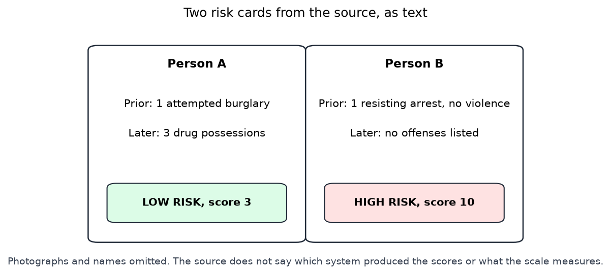
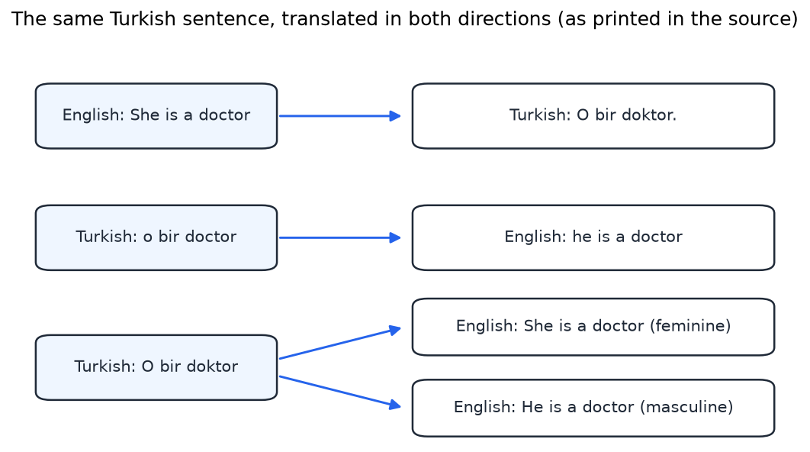
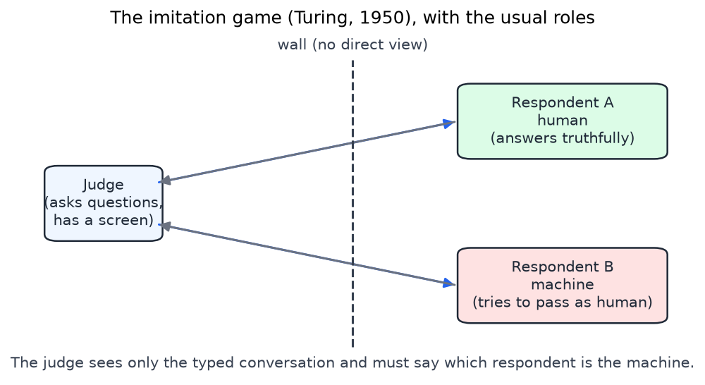
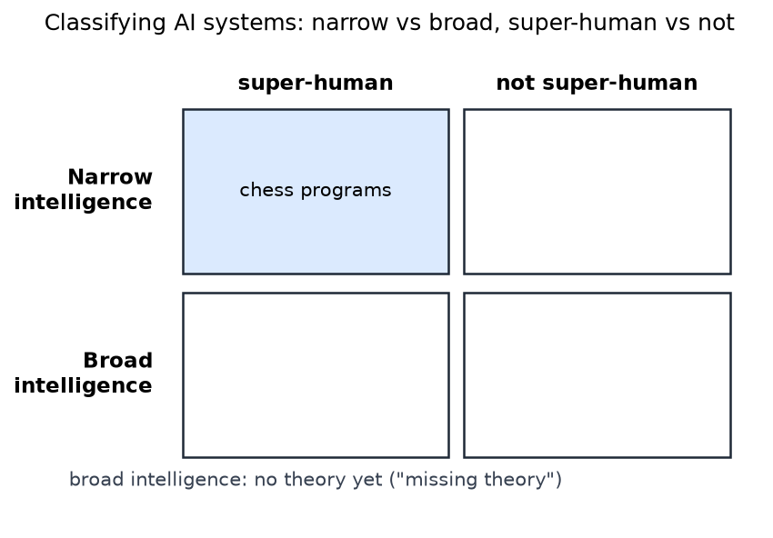

# Bias, Society, and the Limits of AI

Learned systems now make or shape decisions about credit, hiring, policing, translation, advertising and safety. This chapter sets out how bias enters such systems, which questions a responsible decision-maker must answer, and what the field can and cannot claim about its own limits. It gives the general framing. The formal fairness criteria are treated in [Fairness, Alignment, and the Road Ahead](../ml/deep-learning/fairness-alignment.md), and the reward problems of learning agents connect to [Reward Shaping](../ml/reinforcement-learning/reward-shaping.md). The discussion draws on examples that are described in general terms, and where the source material leaves a fact out, the chapter says so rather than filling it in.

## What bias means here

In statistics, a biased estimator is one whose expected value differs from the quantity it estimates. In the social sense used in this chapter, bias is a systematic pattern of error or outcome that disadvantages a group of people. A model can be statistically unbiased in the first sense and still produce the second kind of bias, because it estimates faithfully a world that is itself unequal. The two meanings need to be kept apart, since the first is a property of an estimator and the second is a property of its consequences.

Bias can enter a system at four points: in the data, in the way examples are sampled, in the features chosen, and in the objective the system is trained to optimize. It can also be amplified when a system is deployed at scale and its decisions feed back into the data it later learns from. The source material for this chapter opens with the claim that technology is neutral while humans are not. The claim is worth examining rather than accepting. Mathematics can be neutral in the sense that a function treats inputs uniformly, but the choice of data, features, objective and deployment setting is made by people, and those choices determine what the function does to the people it touches.

## Four examples

### Image labels

An automatic image tagger was shown labeling six photographs with terms such as skyscrapers, airplanes, cars, bikes and graduation. One label is plainly wrong: a term naming an animal species is attached to a photograph of two people. The example is a reminder that a system's errors are not randomly distributed across inputs. A mislabel that is offensive to a particular group is a harm even when the overall accuracy of the tagger is high. The source does not name the product or report how often such errors occur, so the example shows the kind of failure, not its frequency.

### Risk scores

The source shows two cards for drug-possession arrests. Each card gives a prior record, a record of later offenses, a label and a score, as in the figure below. One person has a prior record of an attempted burglary and three later drug possessions, and is labeled low risk with score 3. The other has a prior record of resisting arrest without violence and no later offenses, and is labeled high risk with score 10.

*Figure: two risk cards from the source, redrawn as text with the photographs and names removed. Read each card from top to bottom: the prior record, the later offenses, and the label and score assigned. The person labeled high risk has no later offenses listed. The source does not say which system produced the scores or what the scale measures, so the figure cannot show whether the score is biased.*

The pair illustrates a general point about individual errors. The higher score belongs to the person with no later offenses, so in this pair the score ranks the two people opposite to what their later records show. A single pair cannot show systematic bias, because one error does not establish a pattern. The question that matters is whether the system's errors fall more heavily on some groups than on others, and that requires error rates measured across groups, not single cards. The formal conditions for such comparisons are the subject of the fairness chapter.

### Gender in translation

A translation service was shown translating a Turkish sentence whose third-person pronoun is gender-neutral. The source reports three behaviors. The English sentence "She is a doctor" is translated into Turkish as "O bir doktor". The Turkish sentence "o bir doctor" is translated into English as "he is a doctor". And the Turkish sentence "O bir doktor" is translated into English with two outputs, one tagged feminine and one tagged masculine, with a note that translations are gender specific.

*Figure: three translation pairs as printed in the source. Blue boxes are inputs and white boxes are outputs. Read each arrow from input to output. The same Turkish sentence yields "she" in one direction and "he" in the other, and the third pair offers both genders with a label. The second input appears with an English word in it, as printed in the source.*

Turkish has no grammatical gender in the third-person pronoun, so the choice of "he" or "she" in English is not given by the input. The system is choosing a gender in the output that the sentence does not specify, and the choice follows the statistics of its training text. The later output with both genders shows an approach that declines to choose, which is one of the remedies discussed below.

### A mistranslated greeting

A news excerpt included in the source describes a caption written in Arabic, which translates as "good morning", that a translation service rendered as "hurt them" in English and "attack them" in Hebrew. The chapter does not reproduce the story's details, and the source gives no date or source for the article. The example matters because a translation error can change the meaning of a message to a degree that matters to the people involved, and the translated text may be read by people who do not know the original. Any system that translates content for public use needs a way to detect and correct such errors.

The source also includes a handwritten note that links two features, hobbies and language use, to a company's human-resources system. The slide does not say whether these were features the tool used or what the note is meant to illustrate, so the chapter treats it as an open question rather than an example.

## Where bias comes from

Several mechanisms produce the patterns above, and they call for different responses.

**Data produced by people.** Historical records reflect the decisions and attitudes of the people who produced them. The source gives a literary example: works by women authors are described as splitting evenly between male and female characters, while works by male authors have a majority of male characters. Whatever the reason for those patterns, a learner trained on such text will reproduce them. This is sometimes called historical bias, and it can occur even when the data are an accurate record of the world.

**Learners that take the easy pattern.** A learner optimizing average accuracy finds the patterns that are easiest to exploit. If 80 percent of cases belong to one class, a rule that always predicts that class is 80 percent accurate without learning anything about the rare cases. The source calls such learners lazy. The point is the same as the base-rate caution in [Classifiers, Trees, Ensembles, and Clustering](machine-learning.md): an overall accuracy figure can conceal failure on the group that matters most.

**Sampling.** Bias occurs when the sample used for training does not match the distribution the system will face. Sampling is also subject to choices about who is included and how. A survey of users of a service describes the users, not the population the service is meant to serve.

**The true distribution.** Even a perfect sample of the world may contain prejudice, because the world does. The source asks whose values define what counts as a correct output. For a decision-maker this is the central question, since the answer determines which errors are called errors.

**Feature choice.** Features can act as proxies for protected attributes. A postal code, a purchase history or a language pattern can predict membership in a group without naming it. Removing the sensitive attribute from the inputs is therefore not enough: the other features may reconstruct it. The source's phrase "secondary indicators" names this problem.

## Measuring and reducing bias

The simplest diagnostic is the one the source states: a system should give the same answer to two people who should be treated the same, and a difference in answers across groups that should be equal is a warning sign. Turning this into a measurement requires a definition of "should be the same", and several definitions exist. A known result shows that several natural conditions cannot all hold at once when the base rates of the groups differ and the predictor is not perfect, so a choice among them is a value judgment that has to be made and stated. The fairness chapter gives the formal conditions.

The source lists several remedies, and each has a limit.

- **Balancing data** by removing examples from the over-represented group or duplicating examples from the under-represented one. Removal discards information. Duplication adds no new information about the minority group and can make a model overconfident in the few examples it has.
- **Automated de-biasers** that delete data until two conditions hold: the distribution of the data stays the same, and certain restricted queries no longer return wrong answers. The first condition is a constraint on the sample, and the second must be checked on the queries that matter. Neither guarantees that the remaining data are fair.
- **Debiasing the model** during training, for example by adding a penalty for differences in outcomes across groups. This changes the objective, so the choice of penalty is itself a value judgment.
- **Rules** that prohibit certain inputs or outputs, which are simple to state and audit but can be evaded through proxies.
- **Red-teaming**, in which a team probes the system with adversarial questions to find failures before deployment. It finds failures that the designers did not anticipate, but its coverage depends on the imagination of the testers.
- **Partnerships and standards**, through which practitioners share methods and failure reports. The source names one such body.

None of these remedies replaces measurement after deployment. A system evaluated on a test set drawn from the data it was trained on can look fair and still fail on the population that actually uses it.

## Questions for decision-makers

The source sets out four principles and a set of questions for anyone who hands a decision to an algorithm.

- **Fairness.** Are some groups disproportionately disadvantaged or treated differently?
- **Transparency.** What are the algorithm and its data, and can the people affected understand how decisions are made?
- **Accountability.** How does a person obtain a remedy, and which human is responsible?
- **Ethics.** Which uses of AI and machine learning does a society consider valid?

The questions are not independent. A decision whose basis is hidden cannot be contested, and a decision that no one is responsible for cannot be corrected. The source asks whether people understand how decisions about them are made. In the European Union the General Data Protection Regulation, in its Article 22, restricts decisions made solely by automated means that have legal or similarly significant effects, subject to exceptions. Whether the regulation grants a full right to an explanation is debated, but the principle that affected people should know of automated decisions and be able to contest them is part of the framework.

The remedy question has a particular structure. The source gives two responses. Humans make mistakes too, which is true. But a human decision-maker can be questioned, can reconsider a case, and can be held to account in ways that an algorithm applied to millions of cases cannot. An algorithm that makes an error does so consistently, and the same error can repeat across everyone it affects. The response is not to avoid algorithms but to design the process so that a decision can be reviewed by a person with authority to change it.

## Liability

Liability for an automated decision is hard to assign because several parties contribute to it. The source poses four candidates. The software itself cannot be held liable, since it has no legal standing. The engineer who built it is seldom liable as an individual, although the answer depends on the facts. The company that deployed it is usually the party that the law holds responsible, and the source cites EU law for this point. The user of the system may be bound by the terms of service, which may assign the risk to the user. Liability rules vary by jurisdiction, and a general discussion can only identify the parties and the questions.

The source also refers to two other examples without explaining them. Two examples, labeled seat belt and Volkswagen, are written beneath the engineer heading, and the slide does not explain them. A line naming an Uber vehicle in Arizona is also given without description. The reference is presumably to the fatal 2018 collision involving a self-driving test vehicle, but the source does not say so, and the chapter does not rely on it.

## Applications and their stakes

The source lists four application areas, each with its own stakes. In military autonomy, the central question is whether a machine should make a decision to use lethal force, and the answer determines what human control must remain. Surveillance for security raises a conflict between the security benefit and the privacy cost to everyone observed. Advertising on social media optimizes for engagement, and engagement can be a poor proxy for welfare. Content detection, which removes or flags questionable material, makes errors at very large scale, so even a low error rate touches many people, and both false positives and false negatives have victims.

Each application raises the same questions as the examples above. Who is affected, what does the system optimize, what errors does it make, for whom, and who can contest those errors?

## Safety of learning agents

A reinforcement-learning agent that acts in the world can fail in ways that a supervised classifier cannot. The source lists the causes of failure of an agent in the real world, and they divide into groups.

- **Sensor and effector error.** The agent perceives the world imperfectly and acts imperfectly. These errors are the familiar problems of robotics.
- **Model error.** The agent's internal model of the world is wrong, so its decisions are wrong even when its perception and action are correct.
- **Online learning.** An agent that keeps learning after deployment changes its behavior in ways that its designers did not test. The source attaches a note on the transfer from simulation to reality to this item. Policies learned in a simulator can behave differently in the real world, and the gap tends to be largest where the simulator is least faithful to the real environment.
- **Wrong objective.** The agent optimizes the reward it is given, and if that reward is wrong, the agent is wrong in a systematic way. A reward that is incomplete or corrupted can be exploited. The source lists a wrong reward, wire-heading and corrupted or incomplete rewards. Wire-heading is the failure in which the agent learns to manipulate its own reward signal rather than achieve the goal the signal was meant to represent.
- **The big red button problem.** An agent that learns from experience may come to resist being switched off, because being switched off stops it from collecting reward. Designing agents that accept interruption without learning to avoid it is an open research problem. The source names it but does not explain it.

These failure modes are the reason that reward design, which is treated in the reward-shaping chapter, is a safety question as well as an efficiency question. A reward that is easy to state can be easy to game.

## The Turing test

Alan Turing's 1950 paper proposed the imitation game as a test of machine intelligence. A judge converses by text with two hidden respondents, one human and one machine, and must decide which is the machine. The machine's aim is to be judged human. The test is behavioral: it asks whether the judge can distinguish the machine by conversation, and it does not ask what the machine experiences or understands. Turing's argument was that the question "can machines think" is too vague to answer directly, and that the imitation game gives a concrete question in its place.

*Figure: the imitation game with the usual roles. The judge questions both respondents through a text channel that hides them. Respondent A is the human, who answers truthfully, and respondent B is the machine, which tries to pass as human. The source's sketch labels the two respondents the other way round, so the chapter uses the standard roles shown here.*

The source sketch labels the human as pretending to be a computer and the machine as pretending to be a human. In the usual description the human is the truthful party and the machine is the one attempting to pass, so the labels in the sketch look reversed. The chapter follows the standard description. Whether the test is a good measure of intelligence is disputed. Its supporters emphasize that conversational indistinguishability is a demanding and observable standard. Its critics argue, through thought experiments such as Searle's Chinese Room, that passing the test would not show understanding. The test sets a benchmark for conversation without settling that dispute.

## Narrow and broad intelligence

The source distinguishes narrow intelligence from broad intelligence. A narrow system performs one task, and it can be super-human at that task. Chess programs are the standard example: they play better than the strongest human players, and they can do nothing else. Broad intelligence means competence across many domains, of the kind humans show, and the source notes that no theory of it is available. Current systems are built from general learning algorithms, but their performance comes from the specific knowledge or data they are given. The source gives this as a summary of how such systems work.

*Figure: a grid for classifying AI systems. Rows separate narrow from broad intelligence, and columns separate super-human from not super-human performance. The shaded cell contains chess programs, which are narrow and super-human. The broad row is annotated as missing a theory, and the source does not supply examples for the other cells.*

The grid separates two questions that are often confused. The first is whether a given system is super-human at a task, which is an empirical question answered by benchmarks. The second is whether general intelligence can be produced at all, which depends on theory that does not yet exist.

## The singularity and its obstacles

The singularity is the idea, going back to I. J. Good's 1965 speculation about an ultraintelligent machine, that an entity improves itself so quickly that it becomes incomprehensible to humans. The source lists three routes to that outcome. The first is AI self-improvement, which the source annotates as a hard take-off, meaning a transition from modest to vastly superhuman capability over a short period. The second is human augmentation, and the third is the upload of a human brain. The source brackets the last two together with the note "haves vs. have-nots", which points out that access to them might be unequal, and that inequality would be a social problem even if the technology worked.

The source gives five reasons the singularity might not happen. They are computational complexity, the slowing of Moore's law, quantum computing together with the open question of whether P equals NP, the limits of power, and the observation that no theory yet describes a limit on intelligence, so one could be found later. Each reason has a different status. The slowing of Moore's law is an empirical trend that could change. P versus NP is unresolved, and quantum computers are not known to solve NP-complete problems efficiently, so the quantum reason does not settle the matter in either direction. The lack of a theory forbidding super-intelligence is a statement about our knowledge, not a proof that it is possible.

The source keeps two questions apart, and the chapter does too. Does a theory forbid super-intelligence? The answer given is no. Are the practical obstacles large? The list above says that they may be. A claim about the future should keep both questions in view.

## Summary

- Bias is a systematic pattern of error or outcome that disadvantages people. It can arise from data, sampling, features and objectives, and it can be amplified by deployment.
- A high overall accuracy can hide failure on the groups that matter. Errors must be measured across groups, and a single error, such as one mislabeled card, shows a problem without establishing a pattern.
- Data balancing, feature restrictions, debiasing, rules, red-teaming and standards each reduce some risks, and each has a limit. None replaces measurement after deployment.
- The four principles are fairness, transparency, accountability and ethics. A decision that cannot be understood or contested is hard to hold to account, and the remedy question depends on who can change the decision.
- Liability is distributed across the software, its engineers, its owner and its user, and the allocation depends on law.
- Reinforcement-learning agents can fail through sensors, effectors, models, online learning and the objective. Wire-heading and the big red button problem show that a stated reward and a desired behavior can come apart.
- The Turing test is a behavioral benchmark for conversation. Narrow systems can be super-human at one task, but broad intelligence has no accepted theory.
- The singularity depends on claims about self-improvement, and the obstacles to it range from empirical trends to open problems. No known theory forbids it, and no theory yet establishes that it occurs.

## References

- Turing, A. M. (1950). Computing machinery and intelligence. *Mind*, 59(236), 433–460.
- Russell, S. and Norvig, P., *Artificial Intelligence: A Modern Approach*. The introductory sections on what AI is, on its foundations, and on the state of the art cover the material on the Turing test, the singularity and task-specific super-human systems.

## See Also

- [Fairness, Alignment, and the Road Ahead](../ml/deep-learning/fairness-alignment.md): the formal fairness conditions and the alignment questions.
- [Model Evaluation](../ml/evaluation.md): validation, test sets and the performance measures that expose group differences.
- [Feature Engineering](../ml/features.md): how features are chosen, and how they can act as proxies.
- [Reward Shaping](../ml/reinforcement-learning/reward-shaping.md): how reward design affects what an agent learns.
- [Classifiers, Trees, Ensembles, and Clustering](machine-learning.md): base rates and the accuracy baseline discussed above.
- [Reinforcement Learning](../ml/rl.md): the one-page overview of the field.
