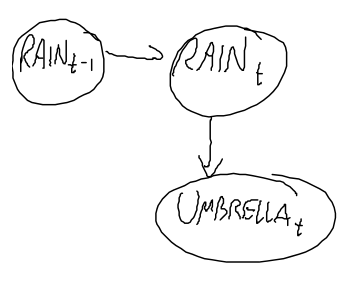
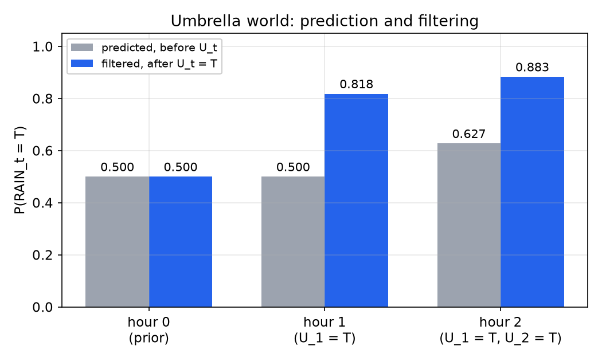
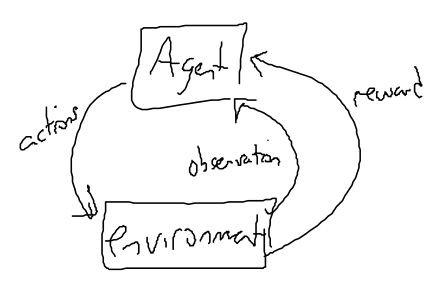
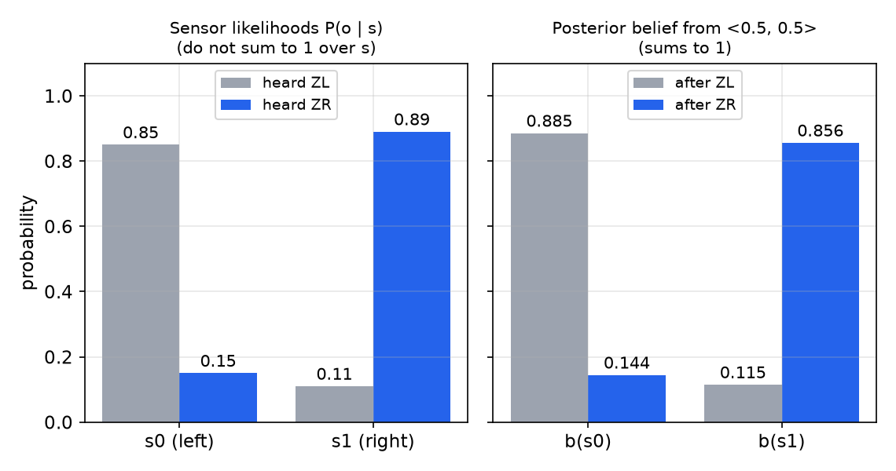
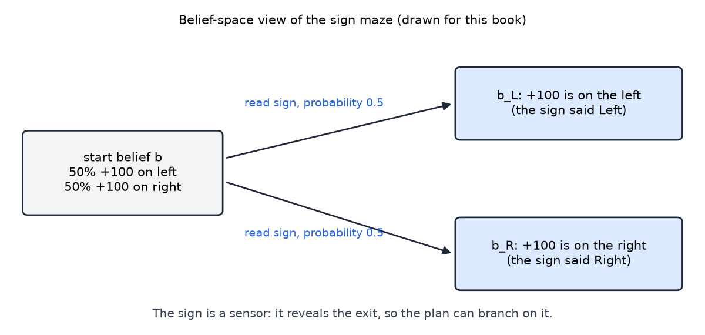

# Filtering over Time and Belief States

Many problems involve a quantity that changes over time and is seen only through noisy evidence: the weather behind a sequence of umbrella sightings, the position of a robot behind its sensor readings, the state of a machine behind its alarms. **Filtering** is the problem of maintaining a probability distribution over the hidden state as evidence arrives, one time step at a time. This chapter builds the model that makes filtering tractable, a Markov chain with an observation model, derives the forward recursion that updates the distribution at each step, and then carries the same idea, the **belief state**, over to decision problems in which the agent never observes the state directly. The approximate and specialized methods that build on this machinery are treated in the chapters on [particle filtering](particle-filtering.md) and [hidden Markov models](hidden-markov-models.md).

## Markov Chains

A **discrete-time Markov chain** is a sequence of random variables \\(X\_0, X\_1, X\_2, \ldots\\) that takes values in a finite set, with the property that the next value depends on the past only through the present value:
\\[
P(X\_t \mid X\_{0:t-1}) = P(X\_t \mid X\_{t-1}).
\\]
This is the **first-order Markov assumption**. Its content is that the present summarizes the past. If the transition probabilities do not depend on \\(t\\), the chain is **stationary** and is specified by a transition matrix \\(\mathbf{P}\\) whose entry \\(P\_{ij} = P(X\_t = j \mid X\_{t-1} = i)\\) is the probability of moving from state \\(i\\) to state \\(j\\). Each row of \\(\mathbf{P}\\) sums to one.

Write the distribution of \\(X\_t\\) as a row vector \\(\pi\_t\\). Summing over the previous state gives
\\[
\pi\_{t+1}(j) = \sum\_i \pi\_t(i)\\, P\_{ij}, \qquad\text{or}\qquad \pi\_{t+1} = \pi\_t \mathbf{P}.
\\]
Starting from \\(\pi\_0\\), the distribution at any later time is obtained by repeated multiplication by \\(\mathbf{P}\\). No other history is needed.

**Example 1 (the weather chain).** Each day is sunny (S) or rainy (R). The day after a sunny day is sunny with probability 0.8, and the day after a rainy day is sunny with probability 0.6. So a sunny day is followed by a rainy day with probability \\(1 - 0.8 = 0.2\\), and a rainy day is followed by a rainy day with probability \\(1 - 0.6 = 0.4\\). In matrix form, with rows indexed by today's weather and columns by tomorrow's,
\\[
\mathbf{P} = \begin{bmatrix} 0.8 & 0.2 \\\\ 0.6 & 0.4 \end{bmatrix}.
\\]
Suppose day 1 is sunny with probability \\(\pi\_1 = (0.9,\ 0.1)\\). Then
\\[
\pi\_2 = \pi\_1 \mathbf{P} = \big(0.9(0.8) + 0.1(0.6),\ 0.9(0.2) + 0.1(0.4)\big) = (0.78,\ 0.22).
\\]
So \\(P(D\_2 = S) = 0.78\\). The rainy probability is the complement of 0.78, which is 0.22. (The source material gives it as 0.2, which does not add up with 0.78 to one; the arithmetic that follows it uses 0.22, so the value 0.22 is used here.) The next day is
\\[
\pi\_3 = \pi\_2 \mathbf{P} = \big(0.78(0.8) + 0.22(0.6),\ 0.78(0.2) + 0.22(0.4)\big) = (0.756,\ 0.244).
\\]
Continuing, \\(\pi\_4(S) = 0.7512\\), and the sequence settles toward a **stationary distribution** \\(\pi\\) that satisfies \\(\pi = \pi \mathbf{P}\\). For this chain, \\(0.75 = 0.75(0.8) + 0.25(0.6)\\) and \\(0.25 = 0.75(0.2) + 0.25(0.4)\\), so \\(\pi = (0.75,\ 0.25)\\). The stationary distribution does not depend on the starting day, and the chain forgets its initial condition as it runs.

The weather chain is the simplest model of the kind filtering needs. Its states are not observed. Filtering adds evidence about them, and the next section does this.

## Hidden Markov Structure

Suppose the state \\(X\_t\\) is hidden, and at each time we receive an observation (evidence) \\(E\_t\\). We need two conditional distributions:

- the **transition model** \\(P(X\_t \mid X\_{t-1})\\), which says how the world changes;
- the **sensor model** \\(P(E\_t \mid X\_t)\\), which says how well the sensor reports the state.

together with a **prior** \\(P(X\_0)\\), the distribution before any evidence. The model adds one more assumption, the **sensor Markov assumption**: the current evidence depends only on the current state,
\\[
P(E\_t \mid X\_{0:t}, E\_{1:t-1}) = P(E\_t \mid X\_t).
\\]

With these assumptions the full joint distribution factors. By the chain rule,
\\[
P(X\_{0:T}, E\_{1:T}) = P(X\_0) \prod\_{t=1}^{T} P(X\_t \mid X\_{0:t-1}, E\_{1:t-1})\\, P(E\_t \mid X\_{0:t}, E\_{1:t-1}),
\\]
and the two Markov assumptions reduce each factor to the transition model and the sensor model:
\\[
P(X\_{0:T}, E\_{1:T}) = P(X\_0) \prod\_{t=1}^{T} P(X\_t \mid X\_{t-1})\\, P(E\_t \mid X\_t).
\\]
A model with this factorization is a **dynamic Bayesian network** (DBN): one slice of the network, with the same conditional probability tables at each time, repeated over time. The chapter on [Bayesian network inference](bayes-net-inference.md) treats the general machinery; here the structure is a chain, which is what makes a simple recursion possible.

**Example 2 (the umbrella world).** Suppose we cannot see the weather, but we see whether people arriving at a building carry umbrellas. The hidden variable is \\(R\_t\\), whether it rains on day \\(t\\), and the evidence is \\(U\_t\\), whether the person arriving carries an umbrella. The models are

| Transition, \\(P(R\_t \mid R\_{t-1})\\) | \\(R\_t = T\\) | \\(R\_t = F\\) |
|---|---|---|
| \\(R\_{t-1} = T\\) | 0.7 | 0.3 |
| \\(R\_{t-1} = F\\) | 0.3 | 0.7 |

| Sensor, \\(P(U\_t \mid R\_t)\\) | \\(U\_t = T\\) | \\(U\_t = F\\) |
|---|---|---|
| \\(R\_t = T\\) | 0.9 | 0.1 |
| \\(R\_t = F\\) | 0.2 | 0.8 |

Each row sums to one. The prior is \\(P(R\_0) = (0.5,\ 0.5)\\), and the network is drawn below. The arrow from \\(R\_{t-1}\\) to \\(R\_t\\) is the transition model, and the arrow from \\(R\_t\\) to \\(U\_t\\) is the sensor model.

*Figure: the umbrella world as a dynamic Bayesian network. Rain on day \\(t-1\\) influences rain on day \\(t\\), and rain on day \\(t\\) influences whether the person carries an umbrella. The unobserved rain variable has a chain of arrows; each observation hangs from the state it reports.*

## The Filtering Problem

The model supports three kinds of question about the hidden state given the evidence \\(e\_{1:t}\\) received so far.

1. **Filtering** (estimation of the current state): \\(P(X\_t \mid e\_{1:t})\\).
2. **Prediction**: \\(P(X\_{t+k} \mid e\_{1:t})\\) for \\(k > 0\\), the distribution of a future state.
3. **Smoothing** (not treated in the source material): \\(P(X\_k \mid e\_{1:t})\\) for \\(k < t\\), an estimate of a past state using later evidence.

Filtering is the one that must run in real time. The agent receives a new observation at each step and needs the current belief, so the computation has to reuse the previous step rather than start from the beginning. The forward recursion does exactly that.

### The forward recursion

Suppose the agent has already processed \\(e\_{1:t}\\) and receives \\(e\_{t+1}\\). We want \\(P(X\_{t+1} \mid e\_{1:t+1})\\). Apply Bayes' rule with \\(e\_{1:t}\\) kept as background conditioning:
\\[
\begin{aligned}
P(X\_{t+1} \mid e\_{1:t+1}) &= P(X\_{t+1} \mid e\_{1:t}, e\_{t+1}) \\\\
&= \frac{P(e\_{t+1} \mid X\_{t+1}, e\_{1:t})\\, P(X\_{t+1} \mid e\_{1:t})}{P(e\_{t+1} \mid e\_{1:t})}.
\end{aligned}
\\]
The denominator does not depend on \\(X\_{t+1}\\). It is a normalizing constant, and we write it as \\(1/\alpha\\). The sensor Markov assumption removes the earlier evidence from the first factor, because \\(E\_{t+1}\\) is independent of \\(E\_{1:t}\\) given \\(X\_{t+1}\\). This gives the **update with the new evidence**:
\\[
P(X\_{t+1} \mid e\_{1:t+1}) = \alpha\\, P(e\_{t+1} \mid X\_{t+1})\\, P(X\_{t+1} \mid e\_{1:t}).
\\]
The source material writes the normalizing factor as \\(P(e\_{1:t}) = 1\\) at this point. That is a convention about the constant, which is absorbed into \\(\alpha\\), not an identity, and the form above states it precisely.

The second factor is the **prediction** of the next state from the current belief. Introduce the current state \\(X\_t\\) and sum over it:
\\[
P(X\_{t+1} \mid e\_{1:t}) = \sum\_{x\_t} P(X\_{t+1} \mid x\_t, e\_{1:t})\\, P(x\_t \mid e\_{1:t}) = \sum\_{x\_t} P(X\_{t+1} \mid x\_t)\\, P(x\_t \mid e\_{1:t}).
\\]
The last equality uses the first-order Markov property in its conditional form: \\(X\_{t+1}\\) is independent of \\(E\_{1:t}\\) given \\(X\_t\\). This follows from the factorization above, since the only parent of \\(X\_{t+1}\\) is \\(X\_t\\).

Combining the two steps, and writing \\(f\_{1:t}\\) for the filtered belief \\(P(X\_t \mid e\_{1:t})\\) as a vector indexed by the states,
\\[
P(X\_{t+1} \mid e\_{1:t+1}) = \alpha\\, P(e\_{t+1} \mid X\_{t+1}) \sum\_{x\_t} P(X\_{t+1} \mid x\_t)\\, P(x\_t \mid e\_{1:t}).
\\]
In matrix form, with \\(\mathbf{T}\\) the transition matrix and \\(\mathbf{O}\_{t+1} = \operatorname{diag}\big(P(e\_{t+1} \mid X\_{t+1} = j)\big)\\) the diagonal matrix of sensor probabilities for the observed value,
\\[
f\_{1:t+1} = \alpha\\, \mathbf{O}\_{t+1}\\, \mathbf{T}^{\top} f\_{1:t}.
\\]
This is the **forward recursion**. The filtered belief at time \\(t\\) is all the agent needs to store. Its update uses only the transition model, the sensor model for the new observation, and the previous filtered belief. The agent does not recompute from \\(e\_1\\). The derivation above says why storing one distribution per step is enough: every term needed for the next step is contained in the current filtered belief.

The recursion is exact. Its cost per step is proportional to the square of the number of states, which is small for the umbrella world and grows quickly for models with many state variables. That growth is the reason approximate methods such as the particle filter exist.

## Worked Example: The Umbrella World

Take the prior \\(P(R\_0) = (0.5,\ 0.5)\\) and observations \\(U\_1 = T\\), \\(U\_2 = T\\). We compute \\(P(R\_2 \mid U\_{1:2})\\) step by step.

**Hour 0.** No observation has arrived, so \\(f\_0 = (0.5,\ 0.5)\\).

**Hour 1.** The prediction is
\\[
P(R\_1) = \sum\_{r\_0} P(R\_1 \mid r\_0)\\, P(r\_0) = (0.7 \cdot 0.5 + 0.3 \cdot 0.5,\ 0.3 \cdot 0.5 + 0.7 \cdot 0.5) = (0.5,\ 0.5).
\\]
Multiply by the sensor probabilities for \\(U\_1 = T\\), which are \\((0.9,\ 0.2)\\), and normalize:
\\[
f\_1 = \alpha\\,(0.9 \cdot 0.5,\ 0.2 \cdot 0.5) = \alpha\\,(0.45,\ 0.10).
\\]
Here \\(\alpha = 1/0.55\\), so \\(f\_1 = (0.818,\ 0.182)\\). One sighting of an umbrella raises the probability of rain from 0.5 to about 0.82.

**Hour 2.** The prediction uses \\(f\_1\\), not the prior:
\\[
P(R\_2 \mid U\_1 = T) = \big(0.7 \cdot 0.818 + 0.3 \cdot 0.182,\ 0.3 \cdot 0.818 + 0.7 \cdot 0.182\big) = (0.627,\ 0.373).
\\]
The sensor update for \\(U\_2 = T\\) gives unnormalized values \\((0.9 \cdot 0.627,\ 0.2 \cdot 0.373) = (0.5645,\ 0.0745)\\). Normalizing by their sum, \\(0.6391\\),
\\[
f\_2 = (0.883,\ 0.117).
\\]
The probability that it rained on day 2 is about 0.88, given two sightings of umbrellas.

The table collects the quantities that the recursion produces.

| Time \\(t\\) | Evidence | Predicted \\(P(R\_t = T \mid e\_{1:t-1})\\) | Filtered \\(P(R\_t = T \mid e\_{1:t})\\) |
|---|---|---|---|
| 0 | none | 0.500 | 0.500 |
| 1 | \\(U\_1 = T\\) | 0.500 | 0.818 |
| 2 | \\(U\_2 = T\\) | 0.627 | 0.883 |

*Figure: predicted (gray) and filtered (blue) probability of rain at each hour. Each filtered bar is the prediction multiplied by the sensor probability for the observed umbrella and normalized. Hour 2 is predicted from the filtered belief at hour 1, which is why the gray bar at hour 2 is above 0.5.*

The numbers show the two parts of the update at work. The prediction at hour 2 is already above 0.5 because the belief from hour 1 is carried through the transition model, and the second sighting pushes the filtered value higher again, to 0.883. The evidence is what separates the filtered belief from the prediction.

## Belief States for Partially Observable Problems

Filtering estimates the state for its own sake. In a decision problem the agent must also act, and the action changes the world. The standard model is the **Markov decision process** (MDP) of the [MDP chapter](mdps.md): states \\(S\\), actions \\(A\\), transitions \\(T(s, a, s') = P(s' \mid a, s)\\), and rewards \\(R(s, a)\\). The agent learns a policy \\(\pi(s) = a\\), and in an MDP it is assumed to observe \\(s\\) exactly.

A **partially observable MDP** (POMDP) removes that assumption. The agent receives an observation \\(o\\) drawn from a sensor model \\(P(o \mid s)\\) and never sees the state. Its only information is the history of its actions and observations. The sensors may be noisy, and some actions exist only to gather information. The agent-environment loop changes accordingly: the environment sends an observation and a reward to the agent, and the agent sends an action back.

*Figure: the agent-environment loop of a POMDP, as drawn for this book. The agent receives an observation and a reward, and returns an action. Unlike an MDP loop, the state is never sent to the agent.*

The key idea is that the agent summarizes its history by a **belief state**: a probability distribution over the states,
\\[
b(s) = P(s \mid \text{history}).
\\]
The belief is a sufficient statistic. Two histories that produce the same belief lead to the same optimal action, so the agent can replace the history by the belief and treat the decision as a problem over beliefs.

## The Belief Update

Suppose the agent has belief \\(b\\), takes action \\(a\\), and receives observation \\(o\\). The new belief \\(b'\\) is the posterior over the new state \\(s'\\). By Bayes' rule,
\\[
b'(s') = P(s' \mid o, a, b) = \frac{P(o \mid s', a, b)\\, P(s' \mid a, b)}{P(o \mid a, b)}.
\\]
The sensor model depends only on the current state, so \\(P(o \mid s', a, b) = P(o \mid s')\\). The transition model gives the predicted distribution, \\(P(s' \mid a, b) = \sum\_s P(s' \mid a, s)\\, b(s)\\). The denominator does not depend on \\(s'\\), so it is a normalizer \\(\alpha\\). The belief update is therefore
\\[
b'(s') = \alpha\\, P(o \mid s') \sum\_s P(s' \mid a, s)\\, b(s).
\\]
This is the same forward recursion as before. The action enters through the transition model, and the observation enters through the sensor model. Write it as \\(b' = \text{FORWARD}(b, a, o)\\). The function is deterministic: given \\(b\\), \\(a\\), and \\(o\\), there is exactly one \\(b'\\).

**Example 3 (the zombie world).** There are two states: \\(s\_0\\), zombies on the left, and \\(s\_1\\), zombies on the right. The actions are Left, Right and Listen. Left and Right commit to a side, and Listen gathers information without changing the state. The noisy observations are \\(ZL\\) (zombies heard on the left) and \\(ZR\\) (heard on the right). The sensor model for Listen is
\\[
P(ZL \mid s\_0) = 0.85, \quad P(ZR \mid s\_0) = 0.15, \quad P(ZL \mid s\_1) = 0.11, \quad P(ZR \mid s\_1) = 0.89.
\\]
The rewards are \\(-100\\) for a wrong commitment, \\(+10\\) for a right one, and \\(-1\\) for Listen. The initial belief is \\(b = (0.5,\ 0.5)\\).

Listening leaves the state unchanged, so its transition model is the identity and the belief update reduces to \\(b'(s) \propto P(o \mid s)\\, b(s)\\). The source for this example gives the belief after hearing ZL as \\((0.85,\ 0.15)\\) and after hearing ZR as \\((0.11,\ 0.89)\\). Those numbers are the **sensor likelihoods**, \\(P(o \mid s)\\) for the two states. They are not posterior probabilities, and they do not sum to one over the states. The posterior from the uniform prior is computed explicitly:
\\[
P(s\_0 \mid ZL) = \frac{0.85 \cdot 0.5}{0.85 \cdot 0.5 + 0.11 \cdot 0.5} = \frac{0.85}{0.96} = 0.885, \qquad
P(s\_0 \mid ZR) = \frac{0.15 \cdot 0.5}{0.15 \cdot 0.5 + 0.89 \cdot 0.5} = \frac{0.15}{1.04} = 0.144.
\\]
So after ZL the belief is \\((0.885,\ 0.115)\\), and after ZR it is \\((0.144,\ 0.856)\\).

*Figure: left, the sensor likelihoods \\(P(o \mid s)\\) for each observation. They are not beliefs, and each observation's column does not sum to one. Right, the posterior beliefs that result from the uniform prior \\((0.5,\ 0.5)\\). Each pair sums to one.*

Two listens that both hear ZL show how the belief sharpens. With a uniform prior the posterior after \\(k\\) identical observations is a power ratio, so after two ZL observations
\\[
P(s\_0 \mid ZL, ZL) = \frac{0.85^2}{0.85^2 + 0.11^2} = \frac{0.7225}{0.7346} = 0.984.
\\]

### Is listening worth it?

The belief lets us compare acting now with listening first. We assume, which the source does not state, that a commitment (Left or Right) ends the episode and is scored by the reward of the true state.

- **Commit now.** With belief \\((0.5,\ 0.5)\\), either side has expected reward \\(0.5(+10) + 0.5(-100) = -45\\).
- **Listen once, then commit.** The probability of hearing ZL is \\(0.5(0.85) + 0.5(0.11) = 0.48\\). After ZL the best commitment is Left, with expected reward \\(0.885(10) + 0.115(-100) = -2.60\\). The probability of hearing ZR is \\(0.5(0.15) + 0.5(0.89) = 0.52\\). After ZR the best commitment is Right, with expected reward \\(0.856(10) + 0.144(-100) = -5.87\\). Including the cost of listening,
\\[
V = -1 + 0.48(-2.60) + 0.52(-5.87) = -1 - 1.25 - 3.05 = -5.30.
\\]

Listening once is much better than committing at once, \\(-5.30\\) against \\(-45\\). The reason is that the belief converts the information into expected reward. The agent pays one unit to learn which side is more likely, and the cost of a wrong commitment, 100, dominates everything else.

## The Belief-State MDP

Because the belief update is deterministic, the POMDP can be recast as an MDP over beliefs. The **belief transition probability** is the probability of moving from \\(b\\) to \\(b'\\) under action \\(a\\). It is the probability of the observation that produces \\(b'\\):
\\[
\tau(b, a, b') = P(b' \mid a, b) = \sum\_{o} P(o \mid a, b)\\, \mathbf{1}\big[\\, b' = \text{FORWARD}(b, a, o)\\,\big],
\\]
where \\(\mathbf{1}[\cdot]\\) is 1 when its condition holds and 0 otherwise, and
\\[
P(o \mid a, b) = \sum\_{s'} P(o \mid s') \sum\_s P(s' \mid a, s)\\, b(s).
\\]
The indicator is the "why?" step of the source material. It is 1 for exactly one \\(o\\) in each case, because \\(b\\), \\(a\\) and \\(o\\) determine \\(b'\\). Expanding the sum over observations gives the same expression as the source's.

The reward of a belief is the expected reward under it:
\\[
\rho(b, a) = \sum\_s b(s)\\, R(s, a).
\\]
The source writes \\(\rho(b) = \sum\_s R(s)\\, b(s)\\) with no action. Keeping the action is the general form, and it changes nothing in the zombie example, where the reward depends on the commitment.

The Bellman equation for the belief-state MDP has the same shape as for an MDP. With discount \\(\gamma\\) (the source does not use one in this passage, and \\(\gamma\\) is kept general here),
\\[
V(b) = \max\_a \Big[\\, \rho(b, a) + \gamma \sum\_{o} P(o \mid a, b)\\, V\big(\text{FORWARD}(b, a, o)\big) \Big].
\\]
Two features make this a hard problem. The belief space is continuous: a belief over two states is a point on a line segment, and over \\(n\\) states it is a point in an \\((n-1)\\)-dimensional simplex. And, for finite horizons, the value function over beliefs is piecewise linear and convex, which allows exact methods based on sets of linear functions, with pruning of dominated pieces. Belief-state planning, value iteration over beliefs, and the purge step are developed in the chapter on [POMDPs](../ml/reinforcement-learning/pomdps.md). This chapter stops at the formulation.

## A Sign Maze

A small example in the source shows why the belief is needed. An agent starts at a junction with two exits at the far end of two branches. One exit gives reward \\(+100\\) and the other \\(-100\\). The agent can see its own position but not which exit is good. At the junction there is a sign that says which side holds \\(+100\\).

If the agent knew the good exit, it would walk straight to it. The sign is useful, so the best plan goes first to the sign, reads it, and then returns to the correct exit. Two shortcuts fail:

- Solve the two fully observable problems separately, one for each exit being good, and average the two policies. The average goes straight toward the exits and never visits the sign, so at the junction it has no sensible action.
- Plan over the world states without the unknown exit. The agent does not know which world it is in, so the plan is not executable.

The method that works is to plan in belief space. The initial belief is 50% on each exit. Reading the sign moves the agent to one of two belief states, each reached with probability 0.5, in which the exit is known. Value iteration over these beliefs produces a plan that goes to the sign first, and then to the matching exit.

*Figure: the sign maze in belief space, drawn for this book. The start belief is uncertain about where the good exit is. Reading the sign leads to one of two belief states, each with probability 0.5, and each resolves the uncertainty. A plan over beliefs chooses the sign first because it has the highest expected value.*

The example is the POMDP idea in miniature. The sign is an information-gathering action, and its value appears only when the agent plans over beliefs. An MDP over the physical states has no notion of information, so it cannot represent the choice to read the sign.

## Summary

- A Markov chain is specified by an initial distribution and a transition matrix. The distribution evolves by \\(\pi\_{t+1} = \pi\_t \mathbf{P}\\), and the weather example gives \\(P(D\_2 = S) = 0.78\\) and \\(P(D\_3 = S) = 0.756\\).
- A hidden Markov model with a transition model \\(P(X\_t \mid X\_{t-1})\\) and a sensor model \\(P(E\_t \mid X\_t)\\) factors the joint distribution as \\(P(X\_0)\prod\_t P(X\_t \mid X\_{t-1})\\, P(E\_t \mid X\_t)\\).
- Filtering uses the forward recursion \\(P(X\_{t+1} \mid e\_{1:t+1}) = \alpha\\, P(e\_{t+1} \mid X\_{t+1}) \sum\_{x\_t} P(X\_{t+1} \mid x\_t)\\, P(x\_t \mid e\_{1:t})\\). The agent stores only the previous filtered belief.
- In the umbrella world the filtered probability of rain is 0.818 after one umbrella and 0.883 after two.
- In a POMDP the agent plans over the belief state. The belief update is \\(b'(s') = \alpha\\, P(o \mid s') \sum\_s P(s' \mid a, s)\\, b(s)\\), and it is deterministic given \\((b, a, o)\\).
- Sensor likelihoods are not posteriors. The zombie example gives the posteriors \\((0.885,\ 0.115)\\) after ZL and \\((0.144,\ 0.856)\\) after ZR from the uniform prior.
- Listening once before committing has expected value \\(-5.30\\), against \\(-45\\) for committing at once, in the zombie example. This is the value of information in belief space.

## References

- Russell, S. and Norvig, P., *Artificial Intelligence: A Modern Approach*, 3rd ed. Section 15.1 (time and uncertainty), Section 15.2 (inference in temporal models, including the umbrella world and the forward recursion), Section 15.5 (dynamic Bayesian networks), and Section 17.4 (partially observable MDPs).

## See Also

- [Probability and Bayes' rule](probability.md)
- [Bayesian networks: structure and independence](bayes-nets.md)
- [Inference in Bayesian networks](bayes-net-inference.md)
- [Markov decision processes](mdps.md)
- [Particle filtering](particle-filtering.md)
- [Hidden Markov models and sequence recognition](hidden-markov-models.md)
- [Partially observable MDPs](../ml/reinforcement-learning/pomdps.md)
