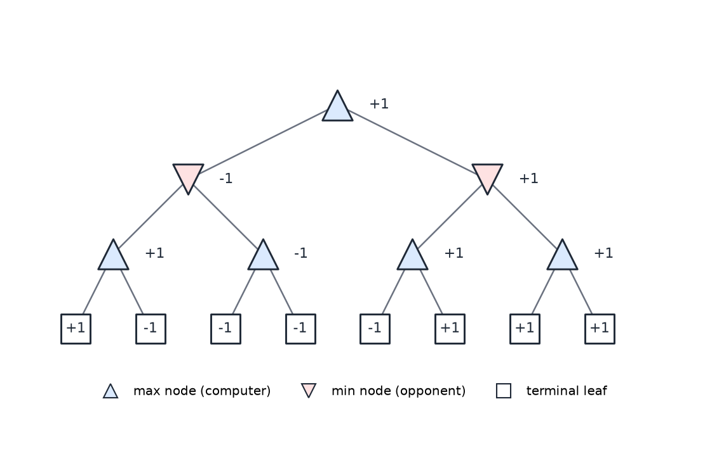
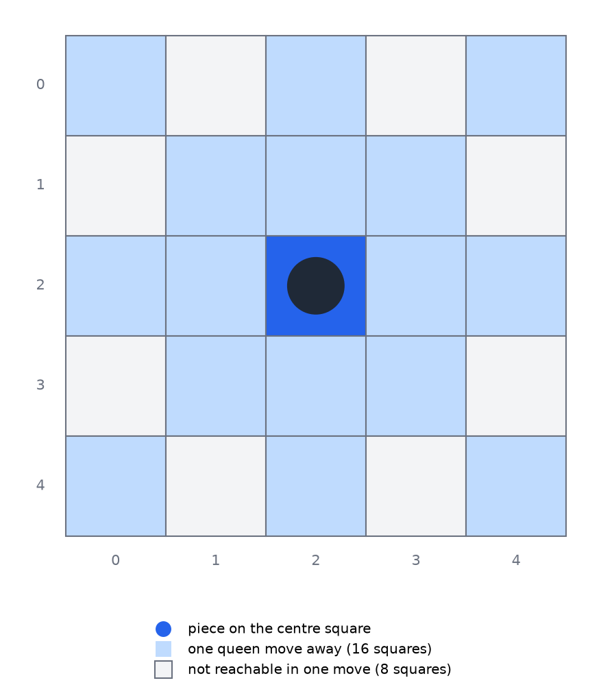
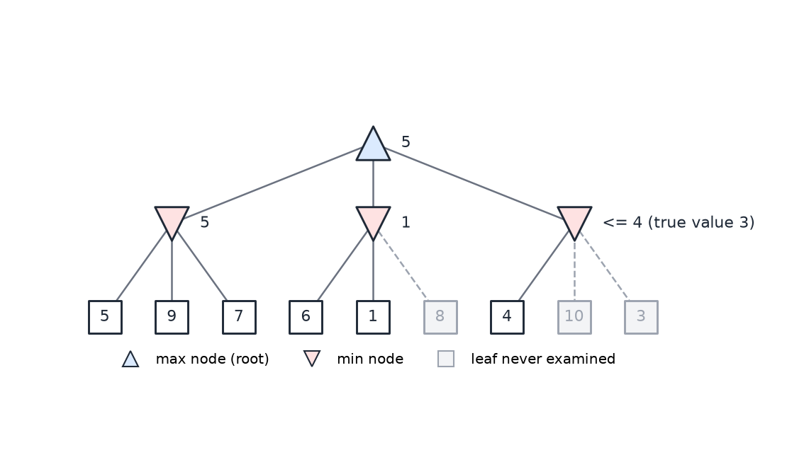
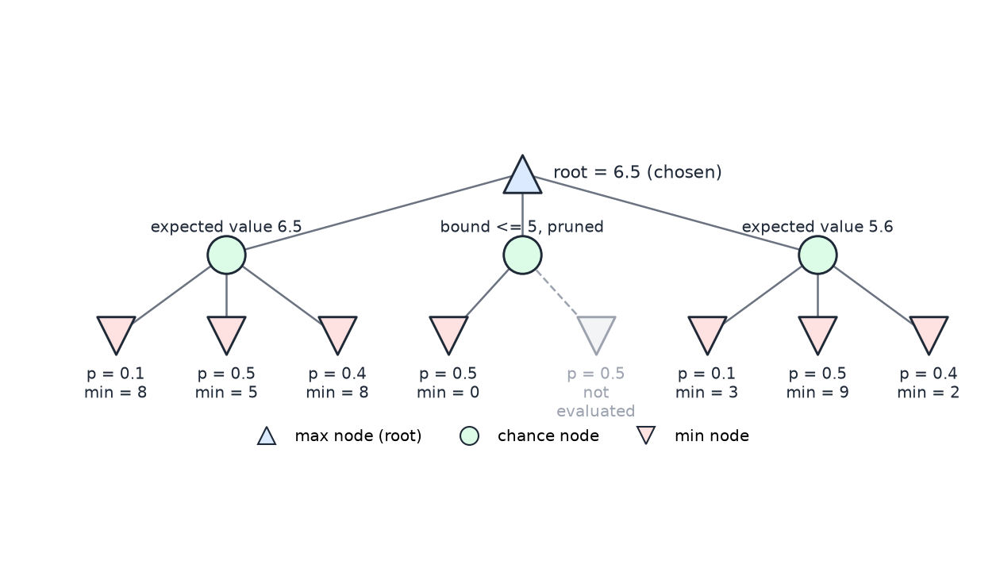

# Game Playing and Adversarial Search

A game is the simplest model of a problem in which another agent works against you. The program chooses a move, the opponent replies, and the outcome depends on both choices. This chapter covers how a program searches such a game tree. It treats adversarial search only: the minimax rule, the practical limits that make full search impossible (depth limits, evaluation functions, quiescence and iterative deepening), the pruning rule alpha-beta, the extension to more than two players, and expectimax for games that contain chance. Search for a single agent, such as route finding, is in [State-Space Search](state-space-search.md). Mixed strategies and Nash equilibria, which go beyond the minimax rule, are in [Two-Player Games and Nash Equilibria](../ml/reinforcement-learning/two-player-games.md).

## The Isolation game

Most of the examples in this chapter use Isolation, a two-player game on a small square grid. It is simple enough to analyze by hand and large enough that full search is out of reach, which makes it a good test for the ideas that follow. The rules are as follows.

- The board is a \\(5 \times 5\\) grid. The first player, O, places its piece on any square.
- The second player, X, then places its piece on any remaining square.
- After placement, each player moves like a queen in chess: any distance horizontally, vertically or diagonally.
- A square that a piece has landed on becomes blocked. Only the landing square is blocked. The path between the start and the landing square is not, which is what distinguishes Isolation from the game Snake.
- Pieces cannot move through blocked squares and cannot leave the board.
- A player with no legal move on their turn loses. The last player who can still move wins.

A whole game tree can be drawn only on a board much smaller than \\(5 \times 5\\). Take a \\(2 \times 3\\) board with one square unavailable. O then has five possible first moves, one for each remaining square. After O's move, X has its own choices, and each later move is restricted to queen moves, so the number of choices shrinks as the board fills. The tree is built level by level, and some nodes have two children while others have three. The same rules on the full board produce a tree far too large to inspect.

The choice of O's first square matters a great deal. An early piece can partition the board into two regions, and the outcome is often decided by which region has more room. The strategy is complex, which is why a program needs a search rather than a list of rules.

## Game trees and terminal values

A game tree has one node for each board position reached in play. Its root is the position in which the computer must move. Its edges are the legal moves, and its leaves are the positions where the game has ended. The computer is called the **max** player, because it chooses the move with the largest value. The opponent is the **min** player, who chooses the move with the smallest value. In the figures below, max nodes are drawn as upward triangles and min nodes as downward triangles, following the usual convention.

At a terminal leaf the outcome is known. This chapter uses one convention throughout for those leaves: a win for the computer is \\(+1\\) and a loss is \\(-1\\). The quiescence example in a later section uses a different scale, because its leaves are heuristic scores and not final outcomes. There, a win is scored 100 and a loss \\(-1\\), so that a win outranks any count of moves. Both conventions give the same order of outcomes. Only the magnitude of a win differs.

The search aims to choose a move that is best for the computer assuming the opponent plays as well as possible. The assumption that the opponent is perfect is a safe one. Against any other opponent, the minimax move guarantees at least the minimax value, so planning for the worst case costs nothing in security.

## Minimax

The **minimax** rule computes the value of every node from the leaves upward. The procedure is as follows.

1. Score each terminal node: \\(+1\\) for a computer win and \\(-1\\) for a computer loss.
2. Start at the bottom level and move up one level at a time.
3. At a max node, the value is the largest value among its children.
4. At a min node, the value is the smallest value among its children.
5. Repeat until the root is reached.
6. At the root, the computer chooses a child whose value equals the root value.

The intuition behind the max rule is simple. If any child of a max node is \\(+1\\), the computer can move there and win, so the node is worth \\(+1\\). If no child is \\(+1\\), the computer cannot force a win against a perfect opponent. The min rule works the same way from the opponent's side: if any child of a min node is \\(-1\\), the opponent can force the computer into a loss.

*Figure: minimax backup on an illustrative depth-three tree (constructed for this chapter). Max nodes are upward triangles and min nodes are downward triangles. Each leaf is a terminal \\(+1\\) or \\(-1\\). The values are backed up from the leaves to the root, and the root's \\(+1\\) comes from the right-hand min node.*

Take the tree in the figure. The leaves under the left max node \\(A\\_1\\) are \\(+1\\) and \\(-1\\), so \\(A\\_1\\) is worth \\(\max(+1, -1) = +1\\). The second max node \\(A\\_2\\) has two \\(-1\\) leaves, so \\(A\\_2 = -1\\). The left min node \\(A\\) is worth \\(\min(+1, -1) = -1\\). The opponent can reach the losing leaf under \\(A\\_2\\), so the computer should avoid this side.

On the right, \\(B\\_1 = \max(-1, +1) = +1\\) and \\(B\\_2 = \max(+1, +1) = +1\\). The min node \\(B\\) is then worth \\(\min(+1, +1) = +1\\). At the root, \\(\max(-1, +1) = +1\\), so the computer moves to the right-hand subtree. The root value says that the position is a forced win for the computer: whatever the opponent replies, the move to \\(B\\) ends in a win.

The minimax rule needs the whole tree. Every node is visited once, so the work is proportional to the number of nodes. For a branching factor \\(b\\) and depth \\(d\\) that number is about \\(b^{d}\\), and this exponential growth is the difficulty in practice.

## Why full search is infeasible

A search that reaches the end of the game on every line is called a full search. For the \\(5 \times 5\\) Isolation board, the number of leaves can be bounded simply. O has 25 possible first placements, X has 24, then at most 23, 22, and so on. The number of leaves is therefore less than \\(25!\\). The value is

\\[
25! = 15\\,511\\,210\\,043\\,330\\,985\\,984\\,000\\,000 \approx 1.55 \times 10^{25}.
\\]

If a machine evaluated \\(10^{9}\\) positions per second, a full search would take \\(1.55 \times 10^{25} / 10^{9} = 1.55 \times 10^{16}\\) seconds. A year is about \\(3.16 \times 10^{7}\\) seconds, so this is about \\(4.9 \times 10^{8}\\) years. A rounder version of the same estimate uses \\(25! \approx 10^{25}\\) and gives \\(10^{16}\\) seconds, about \\(3.2 \times 10^{8}\\) years. Either way, a full search from the start of the game is out of reach by a wide margin.

A sharper bound can be attempted. The last few moves have few options, so one can replace the late branching by a smaller factor. Using a branching factor of 12 for the last 13 moves and a tail of \\(12!\\) orderings gives the product

\\[
25 \cdot 24 \cdot 12^{13} \cdot 12! \approx 3.1 \times 10^{25}.
\\]

This product is about \\(3.1 \times 10^{25}\\), not the \\(3 \times 10^{23}\\) that the spoken version of the estimate gives. More importantly, the refined value is larger than \\(25! \approx 1.55 \times 10^{25}\\), so the refinement, as stated, does not tighten the crude bound. This chapter uses \\(25!\\) as the bound on the number of leaves.

The number of leaves is not the same as the work done, but it sets the scale. The branching factor \\(b\\) is the average number of legal moves per position, and it is not constant on this board. The center square has the most queen moves. From the center there are two squares in each of eight directions, so sixteen moves in all.

*Figure: the \\(5 \times 5\\) Isolation board with a piece on the center square. The sixteen darker squares are the destinations of single queen moves from the center, two in each of eight directions. The eight light gray squares are the knight-like squares that cannot be reached in one queen move.*

The corners have twelve moves, and most other squares have twelve or fewer. A program that measures the branching factor in practice, by playing random moves, finds an average of about 8 on the \\(5 \times 5\\) board. Then a depth-25 tree has about \\(8^{25} = 2^{75} \approx 3.8 \times 10^{22}\\) nodes. At \\(10^{9}\\) nodes per second that is about \\(3.8 \times 10^{13}\\) seconds, or \\(1.2 \times 10^{6}\\) years. Brute force to the end is not feasible. Interesting games cannot be searched to the end, because the branching factor, the depth, or both are too large.

## Depth-limited search

The practical response is to stop the search before the end of the game. A **depth-limited** search expands the tree to a fixed depth and treats the nodes at that depth as if they were terminal. It needs a rule for scoring the nodes at the limit, and that rule is an evaluation function, discussed below.

The depth is set by a time budget. Suppose a human player waits about two seconds before losing interest, and the program evaluates \\(10^{9}\\) nodes per second. The budget is then about \\(2 \times 10^{9}\\) nodes. With a branching factor of 8, the search must satisfy \\(8^{X} < 2 \times 10^{9}\\). Taking base-10 logarithms,

\\[
X < \frac{\log\_{10}(2 \times 10^{9})}{\log\_{10} 8} = \frac{9.301}{0.903} \approx 10.3.
\\]

A depth of 10 would fit the budget on paper, since \\(8^{10} \approx 1.07 \times 10^{9}\\). The procedure uses depth 9 as a safety margin, giving \\(8^{9} \approx 1.3 \times 10^{8}\\) nodes. The margin is there because the branching factor varies during a game, and a single bad position can make a search much more expensive than the average suggests.

The procedure for a depth-limited search is as follows.

1. Fix the time budget, and estimate the branching factor \\(b\\).
2. Find the largest depth \\(X\\) for which \\(b^{X}\\) fits the node budget.
3. Subtract a safety margin to allow for variation in the branching factor.
4. Search to that depth, and score the nodes at the limit with an evaluation function.

The depth-limited search returns a move, and the move is only as good as the evaluation function at the frontier. Two positions that look equally good to the evaluation may differ greatly in reality.

### Evaluation functions

An **evaluation function** maps a non-terminal position to a number, with higher values better for the computer. The first and simplest candidate in Isolation is the number of the computer's own legal moves. The intuition is that a win needs moves left at the end of the game, so a position with more moves is better. Several candidates are worth comparing.

| Candidate | Verdict |
|---|---|
| Number of my moves | Simple and useful; a win needs moves at the end |
| Number of opponent moves | Rejected: rewards boards where the opponent can move freely |
| Squares remaining | Rejected: falls on every move and says nothing about quality |
| Squares remaining minus my moves | Rejected: penalizes boards where the computer has many moves |
| My moves minus opponent moves | Favoured for simple Isolation, because the aim is to take away the opponent's options |
| My moves minus twice the opponent moves | Weighted variant: the computer pursues the opponent |

The function "my moves minus opponent moves" measures the difference in mobility. A position in which the computer can move far more freely than the opponent scores highly, and a position in which the opponent has the better mobility scores low. The weighted variant changes the balance. Doubling the opponent's term makes the computer prefer to cut the opponent's options even at a cost to its own. Whether this helps depends on the rules, and small changes in the function can change which strategy wins.

The practical lesson is that the only reliable way to choose an evaluation function is to test many variants and see which of them win games. A function that looks sensible can still be defeated by a horizon effect, which is the next topic.

### The horizon effect

The **horizon effect** is the situation in which a human sees that the game will be decided by the next move, but the program cannot search far enough to see it. Here is an example on the \\(5 \times 5\\) board. O moves diagonally down and to the left. This creates a partition in which X has six moves and O has seven, and O wins. The win is 13 moves away, far beyond the depth of the search. At the next-to-last depth, the evaluation prefers two moves that both lose, and rates the winning move lower.

The natural remedy is to add a partition check to the evaluation function. If the board is split, the function counts how many squares each side can reach, and the side with more room is preferred. The cost is that counting reachable squares is comparable to searching one level deeper. It roughly doubles the time to evaluate a position, and because that cost is paid at every node of the frontier, it is multiplied by the branching factor at each deeper level. Whether the extra cost pays off depends on the rules.

### Quiescence search

Depth-limited search can be fooled by a position in which the recommended move is about to change. **Quiescence search** extends the search beyond the depth limit while the recommended branches keep changing, and stops when they stop changing. The search is then said to be quiescent.

A small example shows the idea. Here the score is the number of the computer's moves, with a range of 0 to 5 at this depth. A loss is scored \\(-1\\) and a win 100, as explained in the terminal-value convention above.

- At level 1, the two center moves and the top-left move are recommended, each with score 4.
- At level 2, the two center moves are best, with score 3.
- At level 3, the center moves are rated worse than the top-left move. Levels 4 to 6 repeat that pattern.
- The recommendations do not change again after level 3. The search is quiescent, and it can stop there.

The cost is the problem. Quiescence repeats work that the depth limit was meant to save, so it should be used only where the results are changing, which is often at the start or the end of a game.

## Iterative deepening

**Iterative deepening** searches to depth 1, then depth 2, then depth 3, and so on, and keeps the best move found at the deepest completed level. Its procedure is simple.

1. Search to level 1 and store the best move found.
2. Search to level 2. If the search finishes before time runs out, replace the stored move with its best move.
3. Continue to levels 3, 4 and so on, repeating the same step.
4. When time runs out, return the stored move from the deepest completed level.

It may seem wasteful to search the same positions again at each level. It is not, because the number of nodes grows exponentially with depth. The total work is dominated by the last level searched. For a branching factor of 2, the tree sizes for depths 0 to 5 are 1, 3, 7, 15, 31 and 63 nodes. The iterative-deepening totals, the sums over all levels searched so far, are 1, 4, 11, 26, 57 and 120. At depth 5 the total is less than twice the size of the deepest tree, which has 63 nodes. For a branching factor of 3, the tree sizes for depths 0 to 4 are 1, 4, 13, 40 and 121. The totals are 1, 5, 18, 58 and 179, which is less than \\(1.5\\) times the size of the tree at depth 4.

In general, a tree with branching factor \\(k\\) and depth \\(d\\) has

\\[
\frac{k^{d+1} - 1}{k - 1}
\\]

nodes. The overhead of iterative deepening shrinks as \\(k\\) grows, which is the usual case in games.

The method also suits a clock. The branching factor changes during a game: early positions have many options, so a fixed two-second limit can be exceeded, while late positions have few options and allow a deeper search. A common strategy for games with a total time limit is to use an opening book for the first moves, search more deeply in the middle game, and spend little time near the end. An alternative is a fixed time per move, using iterative deepening and quiescence to find the few moves that deserve more time.

## Alpha-beta pruning

Minimax examines every node, but many nodes cannot change the answer. **Alpha-beta pruning** skips them. It always returns the same root move as minimax, and it does so with fewer evaluations. The method keeps two bounds during the search. Alpha is the best value that the max player can already guarantee on the path from the root. Beta is the best value that the min player can already guarantee on that path.

The procedure is as follows.

1. Search the children from left to right.
2. At a min node, stop searching its remaining children once a child's value is at most alpha. The max player will never choose this node, so its remaining children do not matter.
3. At a max node, stop once a child's value is at least beta. The min player will never allow this node.
4. Propagate values upward exactly as in minimax.

The root decision is unchanged. A pruned node may return a bound rather than its exact value, but the bound is enough to show that the node cannot affect the choice at the root.

*Figure: alpha-beta on an illustrative tree (constructed for this chapter). The root is a max node over three min nodes, each with three leaves. Gray dashed leaves are never examined. The third min node returns a bound of 4 rather than its true value 3, which is enough to show it cannot beat the value 5 found at the first min node.*

Walk through the figure. The first min node has leaves 5, 9 and 7, so its value is 5 and alpha becomes 5 at the root. The second min node examines leaf 6 and then leaf 1. The value 1 is at most alpha, which is 5, so the remaining leaf 8 is pruned. The second min node is worth 1, and the root is not affected. The third min node examines leaf 4 first. Since 4 is at most alpha, its other leaves, 10 and 3, are pruned, and the node returns a bound of at most 4. Its true value is 3. The root value stays 5, the same answer minimax gives. Six of the nine leaves are examined.

Pruning at the max nodes works the same way with the roles reversed. At a max node, once a child reaches beta, the rest of the node cannot matter to the min player above, because the min player would never let the game reach this node.

### Cost and move ordering

The saving depends on the order in which children are examined. Minimax costs about \\(b^{d}\\) node evaluations. Alpha-beta with the best moves ordered first costs about \\(b^{d/2}\\), which halves the exponent. With random ordering the expected cost is about \\(b^{3d/4}\\). The best order is not known in advance, but a cheap heuristic for ordering often captures most of the gain.

A small example makes the point. Suppose that on the right side of a tree the branch with value 4 is searched first. The min node above it is then at most 4. The max node above already has 5 from the left side, so the remaining right-side branches cannot change the root and are pruned. If the same branches were searched in the other order, the cut would be lost, and more of the tree would have to be examined to reach the same conclusion. The lesson is to search the most promising children first, and to test cheap ordering heuristics before accepting the default left-to-right order.

## Several players: Max-N

With more than two players, the minimax rule no longer applies directly, because one player's gain is not another's loss. The standard extension is **Max-N**. Each leaf stores a tuple with one score per player, for example (player 1, player 2, player 3). At each internal node the player to move chooses the child whose tuple has the largest entry in that player's own position.

The procedure is as follows.

1. At each leaf, evaluate the board from each player's perspective, giving one score per player.
2. At each node, the player to move chooses the child whose tuple has the largest entry in that player's position.
3. Pass that child's tuple up to the parent.
4. Repeat up to the root. Ties go to the leftmost child by default.

As a worked fragment, the leftmost leaf of a three-player tree scores (1, 2, 6). At the lowest choice level, player 3 chooses among pairs of children, and player 2 then chooses at the next level up. Player 1 chooses at the root. The method works for any number of players, because each node compares only one coordinate of the tuples.

Alpha-beta can be extended to Max-N, but the extension needs more structure. A known result, due to Korf, gives the condition: pruning is possible when the sum of the players' values has an upper bound and each player's value has a lower bound. For the Isolation count of moves, zero is a natural lower bound for each player, and the number of empty squares bounds the sum, since the total number of moves cannot exceed them. On a board with 22 empty squares the sum is at most 22, so the values average about 7 per player. Immediate pruning is possible when one player's value already reaches the bound on the sum, because sibling branches cannot give the player to move more than that bound. Deep pruning, the kind available in two-player games, is generally not possible in this setting.

## Expectimax and stochastic games

Some games contain chance. In backgammon, dice limit the moves available on each turn, so the future is uncertain. Chance can be added to a game tree as **chance nodes**, and the resulting algorithm is **expectimax**, short for "expect to max". Each chance node takes the expected value of its children, weighted by their probabilities. For a chance node with children of values \\(V\\_i\\) and probabilities \\(p\\_i\\),

\\[
V(\text{chance}) = \sum\_i p\_i \\, V\_i, \qquad \sum\_i p\_i = 1.
\\]

The procedure is as follows.

1. At a max node, the value is the largest child value.
2. At a chance node, the value is the probability-weighted sum of its children, as above.
3. At a min node, the value is the smallest child value.
4. Repeat to the root.

### Sloppy Isolation

A stochastic version of Isolation, called Sloppy Isolation, lets players fail to land where they intend. The rules as stated are these.

- In the general case, the intended square is reached with probability 0.8, the move undershoots by one square with probability 0.1, and the move overshoots by one square with probability 0.1.
- When the move is toward the border so that overshoot is impossible, the intended square is reached with probability 1.
- A move to the last square of a line succeeds with probability 0.9 and falls short with probability 0.1.
- A move over by one square succeeds with probability 0.9 and overshoots with probability 0.1.

The stated rules do not say when each case applies. This chapter treats the 80/10/10 rule as the rule for interior moves. Where only one kind of miss is possible, as in the two 90/10 cases, it uses the 90/10 values. The six-square example below follows that reading.

### A six-square example

Consider a six-square board on which O has four moves. Moving to the top-left square succeeds 90% of the time and lands on the square immediately to the left 10% of the time. Moving one square to the left succeeds 90% of the time and overshoots 10% of the time. The other two moves cannot miss. Each O move is followed by a chance node, and X then chooses a move from which the outcomes are again uncertain. Leaves score O's number of moves.

Evaluate the four O branches in turn.

- **Top-left branch.** X has three options. Moving immediately to the right gives an expected value of \\(0.9 \cdot 1 + 0.1 \cdot 2 = 1.1\\). Moving all the way to the right begins with \\(0.9 \cdot 2 = 1.8\\), which already exceeds 1.1, so the rest of that option is pruned because X would not choose it. The third option, a certain diagonal move, has value 1. X minimizes, so X takes the value 1, and this branch is worth 1.
- **Second and third branches.** Every lower value in these branches is 2, so each is worth 2.
- **Fourth branch.** The options give \\(0.9 \cdot 1 + 0.1 \cdot 2 = 1.1\\), \\(0.9 \cdot 2 + 0.1 \cdot 1 = 1.9\\), and a certain value of 1. The minimum is 1, so this branch is worth 1.

The root chooses a branch worth 2. Either of the two branches with value 2 is optimal; which one is picked depends on tie-breaking. A branch of value 1 does not save O, because X has a reply that leaves O with little room. The my-moves evaluation does not show whether X might err in that reply. A deeper search would be needed to capture that chance.

### Pruning with chance nodes

Alpha-beta extends to expectimax, but the bounds must be handled with care. A pruning decision is valid only when the bounds on the values of unexplored children are known. For expectimax, if every value in the tree is at most some known maximum, the unexplored weight of a chance node can be bounded by that maximum times the remaining probability.

The **challenge tree** in the figure shows this at work. The root is a max node over three chance nodes. Every value in the tree is at most 10, and that bound is used for the unexplored parts.

*Figure: expectimax on a challenge tree (constructed from the stated values, with the bound 10 on every value). The root is a max node. Each chance node is a probability-weighted average of min-node values. The middle chance node's second min node is pruned, and the right chance node is fully evaluated but loses to the left.*

- **Left chance node.** The probabilities 0.1, 0.5 and 0.4 weight min values 8, 5 and 8, so the expected value is \\(0.1 \cdot 8 + 0.5 \cdot 5 + 0.4 \cdot 8 = 0.8 + 2.5 + 3.2 = 6.5\\).
- **Middle chance node.** The probabilities are 0.5 and 0.5. The first min node has value 0, so it contributes nothing. The second can contribute at most \\(0.5 \cdot 10 = 5\\). The total is therefore at most 5, which is less than the 6.5 already found at the left. The second min node is not evaluated.
- **Right chance node.** The probabilities 0.1, 0.5 and 0.4 weight min values 3, 9 and 2. After the first two children the partial total is \\(0.1 \cdot 3 + 0.5 \cdot 9 = 4.8\\), and the last child can still add up to \\(0.4 \cdot 10 = 4\\). The bound stays above 6.5 until the last child is seen. Its exact value is \\(0.1 \cdot 3 + 0.5 \cdot 9 + 0.4 \cdot 2 = 0.3 + 4.5 + 0.8 = 5.6\\), which is below 6.5. This branch is evaluated fully, but it does not win.

The root chooses the left branch, with value 6.5. The tree shows one pruned node and one branch that loses only at its last child. The lesson from the middle node is the same as for alpha-beta: if a chance node's first child is 0, the rest of its weight is bounded and can be cut sooner, so the children most likely to decide the value should be evaluated first.

## Notes on solving the full game

The search methods above are used to play the game well. Solving the full \\(5 \times 5\\) Isolation game, that is, finding the value of the opening position under perfect play, is a different and harder task. The following ideas are standard tools for it. Their combined effect on the full game comes from a student report, and its conclusions are not verified here.

**Symmetry.** The board has eight symmetries: four rotations and four reflections. Two positions related by a symmetry have the same value, so the search needs to store only one of them. On the \\(5 \times 5\\) board, the 25 possible first placements fall into six classes under these symmetries. These are the four corners, the four edge centres, the eight edge squares next to corners, the four inner diagonal squares, the four inner edge-middle squares, and the center itself. A lookup of a position that has already been solved can return its value without expanding the subtree. In the reported work, symmetry checks paid off only down to about the third level of the tree, after which the cost of the check outweighed the saving.

**Partitions.** Once the two players are separated by a partition, each player's remaining moves are independent of the other's. The player with the longer path wins. This reduces the problem to a simple count, and a position with a clear partition can be solved at once.

**Mirroring.** A reflection strategy for the first player is to take the center and then answer each move of the second player with its 180-degree rotation about the center. Under this rotation a queen move remains a queen move. Of the 24 squares available to the second player, 16 lie on queen lines from the center, so their rotations are legal queen moves from the center. The remaining eight squares are the knight-like squares. Their rotations are also knight-like, so the mirror reply is not a queen move and is unavailable. The strategy is therefore incomplete as stated. The reported claim that the second player wins under perfect play has not been checked here.

**Practical advice.** A program for the full game would build an opening book of the best first moves, use hash tables to recognize equivalent positions, implement minimax with iterative deepening and alpha-beta pruning, and devote most of its effort to the evaluation function.

## Summary

- Minimax assigns each node the value of the best outcome the computer can guarantee against a perfect opponent. Terminal values are \\(+1\\) for a win and \\(-1\\) for a loss.
- Full search of the \\(5 \times 5\\) Isolation game is infeasible. The leaves number fewer than \\(25! \approx 1.55 \times 10^{25}\\), and a branching factor of about 8 gives roughly \\(8^{25} \approx 3.8 \times 10^{22}\\) nodes at depth 25.
- A depth-limited search with a budget of \\(2 \times 10^{9}\\) nodes goes to depth 9. The inequality \\(8^{X} < 2 \times 10^{9}\\) gives \\(X \approx 10.3\\), and the chosen depth includes a safety margin.
- The evaluation function at the frontier decides the move. "My moves minus opponent moves" is a sound starting point, and candidate functions are best tested by play.
- Quiescence search extends the search while the recommended moves keep changing. Iterative deepening keeps the best move from the deepest completed level, and its overhead is small when the branching factor is large.
- Alpha-beta returns the same root move as minimax while skipping nodes that cannot change it. With good move ordering, the cost falls from about \\(b^{d}\\) to about \\(b^{d/2}\\).
- Max-N extends minimax to several players by comparing tuples of scores. Pruning needs a known upper bound on the sum of the values.
- Expectimax adds chance nodes that take probability-weighted averages. Pruning them requires bounds on the unexplored values.

## See Also

- [State-Space Search](state-space-search.md): uninformed and heuristic search for a single agent, which uses the same tree machinery.
- [Two-Player Games and Nash Equilibria](../ml/reinforcement-learning/two-player-games.md): mixed strategies, normal form and equilibria beyond the minimax value.
- [Repeated and Stochastic Games](../ml/reinforcement-learning/repeated-games.md): repeated play, where strategies depend on the history of the game.
- [Options and Monte Carlo Tree Search](../ml/reinforcement-learning/options-mcts.md): sampling-based tree search, which replaces the full expansion used here.
- [Probability and Bayes' Rule](probability.md): the probability calculus behind the chance nodes of expectimax.
