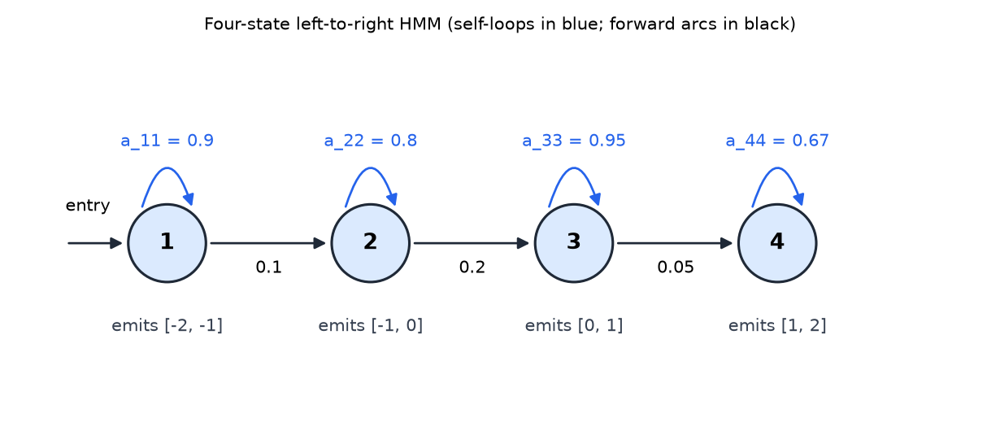
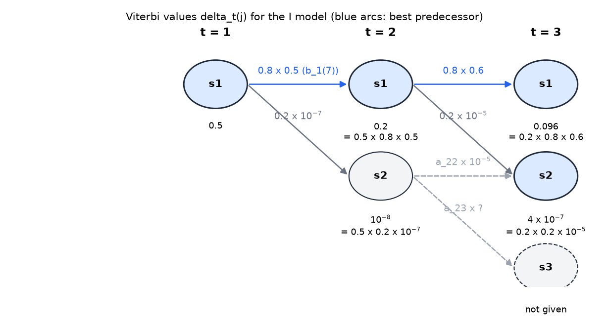
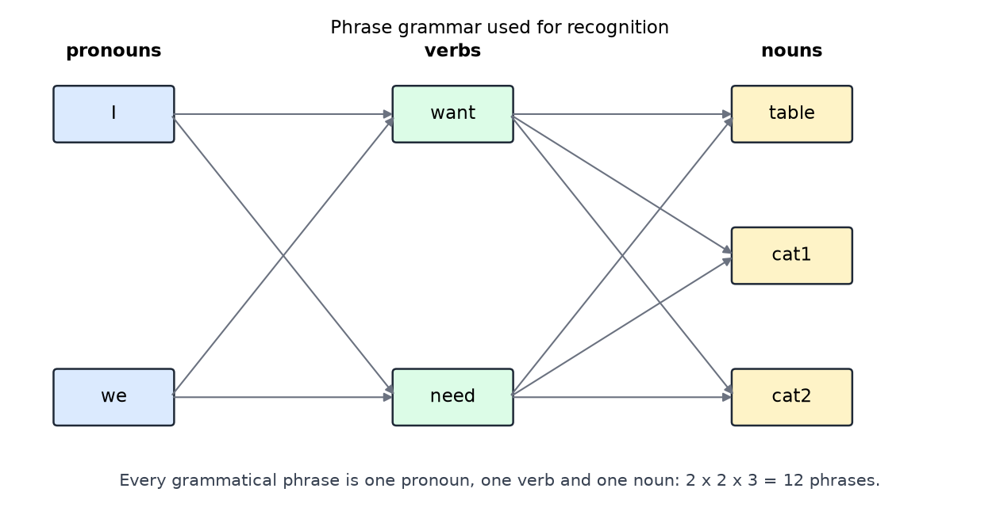

# Hidden Markov Models and Sequence Recognition

Many signals carry structure in time. Speech, handwriting, sign language and even the whistles of dolphins are sequences in which small units combine into larger ones, and the same unit can be produced quickly or slowly. Recognizing such a signal raises two questions: how to compare two sequences that stretch differently in time, and how to model a sequence by a machine whose states are hidden and which emits observations. Dynamic time warping answers the first question. The **hidden Markov model** (HMM) answers the second, and comes with algorithms for recognition (the Viterbi algorithm) and for training (the Baum-Welch algorithm). An HMM is the special case of the [filtering](filtering.md) model with a single hidden variable, and the [particle filter](particle-filtering.md) is an approximate method for the same kind of model.

## Comparing Sequences in Time

### A motivating problem: dolphin whistles

Atlantic spotted dolphins produce whistles that act as signature names, and marine biologists want to annotate their recordings automatically by class of whistle. A **spectrogram** shows time on the horizontal axis, frequency on the vertical axis, and the power in each frequency band as brightness. In ocean recordings, frequencies below about 5 kHz are dominated by boat and wave noise. The whistles lie between about 5 kHz and 17 kHz, and they are the easiest sounds to see in a spectrogram.

Two properties of the whistles make recognition hard. First, the same whistle class can be drawn out or quick, so the same contour arrives at different speeds. Second, a dolphin raises or lowers its base frequency, so the absolute frequency is a poor feature. What is preserved across these changes is the pattern of rises and falls. The natural feature is the **delta frequency**, the change from one sample to the next,
\\[
\Delta y\_t = y\_t - y\_{t-1}.
\\]
For the frequency sequence 5, 14, 10, 7, 10, 14 kHz, the delta sequence is 9, −4, −3, 3, 4. The differences are 14 − 5, 10 − 14, 7 − 10, 10 − 7 and 14 − 10.
### Euclidean distance and its failure

The simplest comparison is the Euclidean distance between two sequences of equal length,
\\[
d(x, y) = \sqrt{\sum\_{i} (x\_i - y\_i)^2}.
\\]
Two delta sequences of different length must first be made equal. In the example the longer one has 21 samples and the shorter one has 12, and the shorter is padded with zeros to 21. The squared differences for the first four pairs (top value, bottom value) are \\((0, 0) \to 0\\), \\((0, 5) \to 25\\), \\((2, 5) \to 9\\) and \\((3, 5) \to 4\\). The source reports the total distance as \\(\sqrt{170} \approx 13\\). Its first four terms sum to 38, and the remaining terms are not given in the source, so we take the total as reported.

The padded distance is poor for a specific reason. The two sequences have the same shape but the shape is at different positions in time. Euclidean matching compares sample \\(i\\) with sample \\(i\\), so a feature at time 3 in one sequence and time 5 in the other is compared with the wrong partner.

### Dynamic time warping

**Dynamic time warping** (DTW) allows the alignment between the two sequences to bend. Warping means that the alignment path is not the straight diagonal. A monotone path \\(\pi = ((i\_1, j\_1), \ldots, (i\_K, j\_K))\\) pairs the samples of \\(x\\) with those of \\(y\\), starts at \\((1, 1)\\), ends at \\((n, m)\\), and each step advances \\(i\\), \\(j\\) or both by one. The cost of the path is the sum of the squared differences of the matched pairs, and DTW chooses the path with the smallest cost.

The optimal path is found by dynamic programming. Let \\(D(i, j)\\) be the smallest cost of aligning the first \\(i\\) samples of \\(x\\) with the first \\(j\\) samples of \\(y\\), ending at \\((i, j)\\). Then
\\[
D(i, j) = (x\_i - y\_j)^2 + \min\big\\{ D(i-1, j),\ D(i, j-1),\ D(i-1, j-1) \big\\},
\\]
with \\(D(1, 1) = (x\_1 - y\_1)^2\\), and the distance is \\(\sqrt{D(n, m)}\\). Each cell depends only on three neighbors, so the table has \\(nm\\) entries and the cost is \\(O(nm)\\).
The source describes the same procedure as a sequence of local choices. A rule of that kind is greedy and need not be globally optimal; the dynamic program is what guarantees the optimum.

Applied to the dolphin example, the source aligns the first sample of each sequence (both zero), matches each sample of the longer sequence by value: a sample of value 0 stays on the first sample of the shorter one (0 is nearer to 0 than to 5), a sample of value 2 also stays there, and a sample of value 3 is nearer to 5 and so steps up. Later samples follow the same rule, and the path finishes at the last pair. The reported distance is \\(\sqrt{34} \approx 6\\), which is less than half of the padded distance of 13. The four pairs that the source gives explicitly are \\((0, 0) \to 0\\), \\((0, 0) \to 0\\), \\((2, 0) \to 4\\) and \\((3, 5) \to 4\\), which sum to 8. The source does not give the remaining terms, and we use its total.

### Limiting the warping

Unrestricted DTW can match two dissimilar signals too well. A different short signal can be warped to match the first part of the long one closely, so the path passes through a negative section and then a positive one, and the total cost falls below what the signals deserve. The fix is a **band** that bounds how far the path may deviate from the diagonal. Pairs outside the band are forbidden. Bands of this kind are called Sakoe-Chiba bands after their originators, and their width is set empirically and checked by cross-validation.

A refinement uses a different band for each section of the signal, tighter where the signal varies less. The source calls per-section bounds complicated to train and moves on to HMMs, which handle variation in duration within the model itself.

## Hidden Markov Models

### Definition

A hidden Markov model describes a sequence of observations \\(o\_1, \ldots, o\_T\\) as the output of a hidden state sequence \\(q\_1, \ldots, q\_T\\). It has three ingredients:

- an **initial distribution** \\(\pi\_i = P(q\_1 = i)\\);
- a **transition matrix** \\(a\_{ij} = P(q\_t = j \mid q\_{t-1} = i)\\), with \\(\sum\_j a\_{ij} = 1\\);
- an **emission distribution** \\(b\_j(o) = P(o \mid q\_t = j)\\) for each state \\(j\\), which gives the density of the observation in state \\(j\\).

The model is written \\(\lambda = (\mathbf{A}, \mathbf{B}, \pi)\\). The hidden states follow a first-order Markov chain, which is the transition model of the filtering chapter, and each observation depends only on the state that emits it. The joint probability of a state sequence and an observation sequence is then
\\[
P(o\_{1:T}, q\_{1:T} \mid \lambda) = \pi\_{q\_1}\\, b\_{q\_1}(o\_1) \prod\_{t=2}^{T} a\_{q\_{t-1} q\_t}\\, b\_{q\_t}(o\_t).
\\]
This follows from the chain rule, applying the Markov property to the states and the output independence to the observations. The state sequence is hidden, so the quantities of interest are the total probability of the observations, obtained by summing over all state sequences, and the single best state sequence.

### Left-to-right topology and durations

Signals with a sequential structure use a **left-to-right** topology: the model can stay in a state or move forward, but never return. The four-state example in the source has this form. Its output is a curve that rises in four parts,
\\[
y(0) = -2, \quad y(10) = -1, \quad y(15) = 0, \quad y(35) = 1, \quad y(38) = 2,
\\]
with a straight line between the points. The first part spans 10 frames, the second 5, the third 20, and the fourth 3. Each part is a state, and each state emits values in its own range.

*Figure: the four-state left-to-right HMM for the rising curve, drawn for this book. Blue loops are the self-transitions, which keep the model in a state for several frames. The black arcs are the forward transitions, and the entry arrow starts the model in state 1. Each state emits values in the range shown beneath it.*

The transition probabilities can be read from the durations. If a state is left after each frame with probability \\(1 - a\_{ii}\\), the number of frames it lasts is a geometric random variable. The probability of staying exactly \\(d\\) frames is \\(a\_{ii}^{d-1}(1 - a\_{ii})\\), and the expected duration is
\\[
E[d] = \sum\_{d=1}^{\infty} d\\, a\_{ii}^{d-1}(1 - a\_{ii}) = \frac{1}{1 - a\_{ii}}.
\\]
So if a state typically lasts \\(D\\) frames, its exit probability is \\(1/D\\) and its self-transition is \\(1 - 1/D\\). The source gives this as its shortcut for building a model by inspection. For the four states:

| State | Frames in part | Self-transition \\(a\_{ii}\\) | Exit probability | Expected frames \\(1/(1 - a\_{ii})\\) | Output range |
|---|---|---|---|---|---|
| 1 | 10 | 0.9 | 0.1 | 10 | \\([-2, -1]\\) |
| 2 | 5 | 0.8 | 0.2 | 5 | \\([-1, 0]\\) |
| 3 | 20 | 0.95 | 0.05 | 20 | \\([0, 1]\\) |
| 4 | 3 | 0.67 | 0.33 | 3.03 | \\([1, 2]\\) |

The fourth state's expected duration, about 3.03, matches its three frames.

A subtlety appears when a self-transition is zero. The formula then gives one frame. A state emits its output on entry and then leaves, so every state emits at least once. Toolkits often add a dummy start state to make this explicit, and the source notes it as a point of convention.

A model built by inspection, from the parts of the curve, is only a first pass. Training from examples is treated below.

### Emission distributions

The emissions in the four-state example are **box-car** (uniform) densities. Each state is equally likely to produce any value in its own range, because every value in the part of the curve it models is equally represented. State 1 covers \\([-2, -1]\\), state 2 covers \\([-1, 0]\\), state 3 covers \\([0, 1]\\), and state 4 covers \\([1, 2]\\). On each interval of width one the density is 1.

The emissions are densities, not probabilities, and a density can exceed one. The source calls this a convenient fiction for the discussion. The algorithms below multiply densities, and they work in logarithms to avoid underflow.

For signals with continuous features, the usual choice is a Gaussian,
\\[
b\_j(o) = \frac{1}{\sqrt{2\pi\sigma\_j^2}} \exp\\!\Big(-\frac{(o - \mu\_j)^2}{2\sigma\_j^2}\Big),
\\]
or, for vector features, a multivariate Gaussian. The central limit theorem supports Gaussians when many small factors contribute to a feature, but many real outputs are bimodal. A mixture of Gaussians handles this,
\\[
b\_j(o) = \sum\_{m=1}^{M} c\_{jm}\\, \mathcal{N}(o;\\, \mu\_{jm}, \Sigma\_{jm}), \qquad \sum\_m c\_{jm} = 1,
\\]
and enough Gaussians can approximate any density. In practice the number is kept small, two or three, because more components tend to overfit.

## Scoring a Sequence

### Sign language: two models

The first application in the source is sign language. Two signs, "I" and "We", each get an HMM. The observed feature is the vertical change of the hand, \\(\Delta y\\). A reader might expect the horizontal change to separate the two signs better. The source deliberately uses the weaker vertical feature, to show that timing alone can still separate them.

The model for "I" has three states, one for each of three separate motions: the arm comes up toward the chest, pauses, and goes back down. States 1 and 3 have large self-transitions, because the hand spends a long time there. State 2 is short, so its self-transition is smaller, and its output favors a \\(\Delta y\\) near zero. The outputs are Gaussians.

The model for "We" also has three states. A listener might ask why not four, and the answer is simplicity: the simplest topology is tried first. The middle section of "We" varies more in \\(\Delta y\\) and lasts longer. The middle state therefore has a higher self-transition and a wider, lower output distribution.

The source compares the two middle states. Both have output mean zero. The source gives the probability of a zero reading in the middle state as 0.9 for "I" and 0.7 for "We", and the probability of moving from the middle state to the last state as 0.5 for "I" and 0.3 for "We". The middle-state differences are what separate the gestures. The lesson the source draws is that even weak features separate two gestures, because the differences accumulate through time. The longer the gesture, the easier it is to recognize.

### Recognition by the Viterbi algorithm

Recognition computes \\(P(O \mid \lambda)\\) for each candidate model and chooses the one with the highest probability. The state sequence is hidden, so every state sequence is possible, and the sum over them is organized by a **trellis**: one row per state and one column per time step. Each path through the trellis is a state sequence, and its probability is the product in the joint formula above.

The exact likelihood sums over all paths. The forward recursion does this in time proportional to \\(N^2 T\\) for \\(N\\) states and \\(T\\) steps,
\\[
\alpha\_1(j) = \pi\_j\\, b\_j(o\_1), \qquad \alpha\_t(j) = \Big[\sum\_i \alpha\_{t-1}(i)\\, a\_{ij}\Big] b\_j(o\_t), \qquad P(O \mid \lambda) = \sum\_j \alpha\_T(j).
\\]
The source uses instead the probability of the single best path, which is the Viterbi score and is much cheaper to explain. The two differ only by replacing the sum over predecessors with a maximum. The Viterbi value is a lower bound on the likelihood, and it is the usual score in practice.

The **Viterbi algorithm** keeps, at each node, only the best incoming path. Define \\(\delta\_t(j)\\) as the probability of the best path that ends in state \\(j\\) at time \\(t\\), and \\(\psi\_t(j)\\) as the predecessor on that path. Then
\\[
\delta\_1(j) = \pi\_j\\, b\_j(o\_1), \qquad \delta\_t(j) = \max\_i \big[\delta\_{t-1}(i)\\, a\_{ij}\big]\\, b\_j(o\_t), \qquad \psi\_t(j) = \arg\max\_i \big[\delta\_{t-1}(i)\\, a\_{ij}\big].
\\]
The best score is \\(\max\_j \delta\_T(j)\\), and the best state sequence is recovered by following the stored predecessors backwards from the best final state. The steps are:

1. Start in the initial state with probability one. For the models here the path begins in state 1 at \\(t = 1\\).
2. At each later time and for each state \\(j\\), compute the best incoming value \\(\delta\_{t-1}(i)\\, a\_{ij}\\) over the predecessors \\(i\\) that the topology allows, and multiply by the output \\(b\_j(o\_t)\\).
3. Keep the largest value at each node and record its predecessor.
4. At the last time, choose the best node among the allowed final states. In the example that is state 3.
5. Follow the recorded predecessors backwards to recover the state sequence.

The local comparison is not the same as the path comparison. A greedy rule would compare only the transitions out of the current node. The Viterbi rule compares whole paths, because a locally weak step can lie on the best overall path, and a locally strong one can lead to a dead end.

### A worked trellis

The source gives illustrative values for the "I" model, chosen to be consistent rather than measured. The first observation is \\(\Delta y = 3\\), and only state 1 is possible at \\(t = 1\\), with \\(b\_1(3) = 0.5\\). At \\(t = 2\\), \\(\Delta y = 7\\). The transition from state 1 to itself is 0.8 and to state 2 is 0.2. The output \\(b\_1(7) = 0.5\\), since 7 is two away from the state-1 mean of 5 as 3 was. The output \\(b\_2(7) \approx 10^{-7}\\), which is nearly zero.

The Viterbi values follow from the rule above.

| Time \\(t\\) | Observation | \\(\delta\_t(1)\\) | \\(\delta\_t(2)\\) |
|---|---|---|---|
| 1 | \\(\Delta y = 3\\), \\(b\_1 = 0.5\\) | 0.5 | not reachable |
| 2 | \\(\Delta y = 7\\), \\(b\_1 = 0.5\\), \\(b\_2 = 10^{-7}\\) | \\(0.5 \times 0.8 \times 0.5 = 0.2\\) | \\(0.5 \times 0.2 \times 10^{-7} = 10^{-8}\\) |
| 3 | \\(b\_1 = 0.6\\), \\(b\_2 = 10^{-5}\\) | \\(0.2 \times 0.8 \times 0.6 = 0.096\\) | \\(4 \times 10^{-7}\\) |

At \\(t = 2\\) a local comparison favors staying in state 1, since \\(0.8 \times 0.5 = 0.4\\) beats \\(0.2 \times 10^{-7}\\). The whole-path values agree: staying gives \\(0.5 \times 0.8 \times 0.5 = 0.2\\), and moving gives \\(10^{-8}\\).

At \\(t = 3\\) the value for state 2 has two candidate predecessors. From state 1 the path value is \\(\delta\_2(1)\\, a\_{12}\\, b\_2(o\_3) = 0.2 \times 0.2 \times 10^{-5} = 4 \times 10^{-7}\\). From state 2 it is \\(\delta\_2(2)\\, a\_{22}\\, b\_2(o\_3) = 10^{-8} \times a\_{22} \times 10^{-5}\\), which is at most \\(10^{-13}\\) because \\(a\_{22} \le 1\\). The source writes the second product as \\(10^{-8} \times 0.5 \times 10^{-5}\\), with the exponent garbled in the spoken version. Using the stated factors, that product is \\(5 \times 10^{-14}\\). Either way it is far below \\(4 \times 10^{-7}\\), so the path through state 1 wins, whatever the self-transition of state 2 is. The surviving predecessor of state 2 at \\(t = 3\\) is state 1.

The source reports the probability of the best complete path for the "I" model as about 0.00035. The values after \\(t = 3\\) appear only in a figure in the source and are not given in the text, so this final value cannot be reproduced from the numbers above. It is quoted as the source's result.

*Figure: the first three steps of the Viterbi trellis for the "I" model, computed from the values in the text. Each node shows the best path value \\(\delta\_t(j)\\) with the product that gives it. Solid blue arcs are the best predecessors. Dashed gray arcs are the alternatives that lose, and the state-3 node at \\(t = 3\\) is not determined by the values given.*

The comparison with the "We" model gives a much smaller probability for the best "We" path, and the difference lies in the middle state. When the middle 0 of the observed sequence is replaced by the values \\(-1\\), 0 and 1, the source reports \\(1.42 \times 10^{-5}\\) for "I" and \\(2.91 \times 10^{-5}\\) for "We", so the sequence then favors "We", whose longer middle state fits it better. The revised "We" tables appear only in the source's figure.

### Numerical note

Products of many probabilities below one underflow in floating-point arithmetic, and the path values in a long trellis can fall below the smallest representable number. Practical implementations work with logarithms, so products become sums. The logarithm does not change which path is best.

## Training

### Viterbi alignment

Models are normally trained from examples rather than built by inspection. The source gives an illustration with three examples of "I", with lengths of 16, 5 and 14 frames of \\(\Delta y\\), and a three-state left-to-right topology. The training procedure is as follows.

1. Split each example into roughly equal parts, one per state. The average length is \\((16 + 5 + 14)/3 \approx 11.7\\) frames, so each state starts with about four frames.
2. Set the transitions from the average number of frames per state: exit probability \\(1/\text{average frames}\\), and self-transition one minus that. The initial exit probability is \\(1/4\\).
3. Fit one Gaussian per state from the frames assigned to it.
4. For each boundary frame, move it to a neighboring state if it is closer to that state's mean, measured in standard deviations.
5. Recompute the durations, transitions and Gaussians from the new segmentation.
6. Repeat steps 4 and 5 until no boundary moves.

The first state gets twelve frames: \\(1, 3, 7, 9, 7\\) from the first example, \\(2, 10\\) from the second, and \\(1, 3, 7, 8, 7\\) from the third. Their mean is \\(65/12 \approx 5.42\\). The sum of squares is \\(465\\), so the population variance is \\(465/12 - (65/12)^2 = 38.75 - 29.34 = 9.41\\), and the standard deviation is about 3.07, which matches the source. The source gives the second and third states as having means of about \\(-0.6\\) and \\(-5\\) and standard deviations of about 3.1 and 2.6.

The boundary tests are direct. A value of 2 in the first example is \\(3.4/3.1 \approx 1.1\\) standard deviations from the first-state mean and \\(2.6/3.1 \approx 0.8\\) from the second-state mean, so it stays in state 2. A value of \\(-7\\) in the second example is much nearer the third-state mean of \\(-5\\), so it moves. In the third example the value \\(-3\\) is \\(2.4/3.1 \approx 0.77\\) standard deviations from state 2 and \\(2/2.6 \approx 0.77\\) from state 3, so it is slightly nearer state 3 and moves.

After the first pass the frame counts per state are 14, 7 and 14. The average durations are \\(14/3 \approx 4.7\\), \\(7/3 \approx 2.3\\) and \\(14/3 \approx 4.7\\) frames, so the exit probabilities are \\(0.21\\), \\(0.43\\) and \\(0.21\\), and the self-transitions are \\(0.79\\), \\(0.57\\) and \\(0.79\\). The source reports the recomputed Gaussians as: state 1 with mean 5.2 and standard deviation 3.0, state 2 with mean 0 and standard deviation 1, and state 3 with mean \\(-5\\) and standard deviation 2.5. In the next pass the value 2 in the first example moves to state 1, and the means shift again. The procedure converges when no boundary moves.

The source calls this Viterbi alignment. It is usually called Viterbi training or segmental k-means, and it initializes the model for Baum-Welch.

### Baum-Welch re-estimation

Hard assignment is an approximation, because each frame contributes to one state only. **Baum-Welch** re-estimation uses soft assignments: every frame contributes to every state, in proportion to the probability that the frame belongs to that state. A value of 9 in the example is mostly in state 1, but it also affects states 2 and 3 slightly. A value of 2 has a high probability of belonging to state 1 or state 2, so it influences those two states more than state 3. The source describes this as "very similar to expectation maximization", and it is an instance of that algorithm.

The soft counts come from the **forward** and **backward** variables. Define
\\[
\beta\_T(i) = 1, \qquad \beta\_t(i) = \sum\_j a\_{ij}\\, b\_j(o\_{t+1})\\, \beta\_{t+1}(j).
\\]
The probability that the model is in state \\(i\\) at time \\(t\\) is
\\[
\gamma\_t(i) = P(q\_t = i \mid O, \lambda) = \frac{\alpha\_t(i)\\, \beta\_t(i)}{P(O \mid \lambda)},
\\]
and the probability of a transition from \\(i\\) to \\(j\\) between \\(t\\) and \\(t+1\\) is
\\[
\xi\_t(i, j) = \frac{\alpha\_t(i)\\, a\_{ij}\\, b\_j(o\_{t+1})\\, \beta\_{t+1}(j)}{P(O \mid \lambda)}.
\\]
The re-estimation formulas are then
\\[
\hat{a}\_{ij} = \frac{\sum\_{t} \xi\_t(i, j)}{\sum\_{t} \gamma\_t(i)}, \qquad
\hat{\mu}\_i = \frac{\sum\_t \gamma\_t(i)\\, o\_t}{\sum\_t \gamma\_t(i)}, \qquad
\hat{\sigma}\_i^2 = \frac{\sum\_t \gamma\_t(i)\\, (o\_t - \hat{\mu}\_i)^2}{\sum\_t \gamma\_t(i)}.
\\]
The first formula is the expected number of transitions from \\(i\\) to \\(j\\), divided by the expected number of times in \\(i\\). The other two are weighted means and variances, with the state occupancies as weights. The Viterbi alignment is the special case in which each \\(\gamma\_t(i)\\) is 0 or 1.

Each Baum-Welch iteration does not decrease the likelihood of the training data, and in practice the procedure converges to a model that is often better than the initial estimate. The source names a classic tutorial on HMMs, a master's thesis that continues the sign-language example, and an open-source toolkit, HTK. Its advice is to run a toolkit and watch the means and variances change across iterations.

## Richer Output Distributions

The features used so far are one number per frame. The source lists more: the horizontal change \\(\Delta x\\), which separates "I" from "We" better; the vertical change, which works for other signs; the size of the hand, which shows whether it moves toward or away from the camera; and the angle of the hand to the horizontal. With two hands, each feature can be measured for both.

The source says "now that we have eight features." The list it gives has three features per hand, which is six for two hands, and the missing feature is not named. This chapter uses the six named features.

Adding features adds dimensions to the output distribution, and the training and recognition algorithms are unchanged except that the Gaussians are multivariate. More dimensions need more training data. Segmentally boosted models, described below, address the case of hundreds of dimensions, most of them noise unless the hand matches.

## A Vocabulary and Its Topologies

The vocabulary grows to four signs, "want", "need", "table" and "cat". The topology of each follows its motion.

"Want" and "need" each have three states: the onset (hands up), the motion of the sign, and the drop (hands down). "Table" has the hands going up and down twice, which needs four states. A later example goes up and down three times. Rather than add states for each repetition, the model adds a loop from state 3 back to state 2, so the motion can repeat any number of times. The source notes that people often repeat a motion while they are thinking hard, which the loop captures as well.

"Cat" has a one-handed form and a two-handed form. There are two options: one three-state model with a mixture of Gaussians, or two separate signs, "cat1" and "cat2", which the recognizer reports as "cat". The source chooses the second, and notes that it often gives the highest accuracy when there are enough examples of each variant.

The rule is to try the simple topology first, and add states only when the data demand them, choosing by cross-validation on test sets independent of the training data.

## Phrase Recognition with a Grammar

A sign language sentence is a sequence of signs, and a grammar restricts the sequences that are allowed. The source's grammar has one pronoun, then one verb, then one noun. The pronouns are "I" and "we", the verbs are "want" and "need", and the nouns are "table", "cat1" and "cat2". The number of phrases is \\(2 \times 2 \times 3 = 12\\). The count is twelve.

*Figure: the phrase grammar as a graph, drawn for this book. A phrase is one pronoun, then one verb, then one noun, so there are two pronouns, two verbs and three nouns, giving \\(2 \times 2 \times 3 = 12\\) phrases. The trellis for recognition is built from the models of these signs, with the grammar edges between them.*

The trellis has 22 state rows: 12 for the pronouns and verbs, 4 for "table", and 6 for "cat1" and "cat2". Grammar edges run from pronoun rows to verb rows to noun rows.

Test the trellis on the sentence "I need cat", which gives about twenty samples of \\(\Delta y\\) through time. The grammar fixes which states can be reached at each time. At \\(t = 1\\) only the first state of "I" or "we" is possible, because the grammar requires a pronoun. At \\(t = 2\\) the path can stay or enter the second state of a pronoun. At \\(t = 3\\) all three states of the pronouns are reachable. At \\(t = 4\\) the path can move into "want" or "need". Through \\(t = 6\\) the path is still in pronouns and verbs. At \\(t = 7\\) it can enter "table", "cat1" or "cat2". At \\(t = 8\\) and \\(t = 9\\) the second and third states of the noun models are reached. At \\(t = 10\\) the back-transition from state 3 to state 2 in "table" becomes possible. The path must end in the last state of one of the three nouns, and not every trellis state is reachable at the end.

At the size of a real vocabulary, about 6,000 signs in the source's example, the trellis and the cost of updating every path become the bottleneck, which motivates beam search.

### Stochastic beam search

Full Viterbi extends every path at every time step, so it is breadth first. **Beam search** keeps only the most probable paths and discards the rest. Pruning with a fixed threshold is risky, because a poor match early in a phrase can become a good match later, after a hesitation or a false start, much as a stutter in speech can be followed by a clean word.

The source's remedy is a stochastic version. Each path survives with a chance proportional to its probability, so good paths are kept most often, but poor paths keep some chance of survival. The algorithm is:

1. At each time step, extend every surviving path to each state its topology allows, and compute its probability.
2. Choose which paths survive at random, each with probability proportional to its value.
3. Continue to the end of the observation sequence, and take the best surviving path.

The source does not give the number of surviving paths, and it reports that the method works very well in practice. The idea is related to fitness-proportional selection in genetic algorithms and to the random acceptance of simulated annealing, both of which keep weak candidates with a small chance.
## Improving the Models

Four further techniques address the gap between a model of isolated signs and real sentences. The source calls some of them its secret weapons, and they apply to any problem with a language-like structure.

**Context training.** A sign's shape depends on its neighbors. An isolated "need" starts and ends at rest. In "I need cat", the start of "need" runs into the end of "I", and its end runs into the start of "cat", so the hands move less. This is the sign-language analogue of coarticulation in speech, where one phoneme affects its neighbors. The procedure trains the isolated models with the alignment described above, finds each two-sign context in the data (such as "I need", which is far less common than "need" alone), cuts out its frames, trains a six-state model made of the three states of the first sign followed by the three of the second, and iterates Baum-Welch over these larger models, which the source calls embedded training.

The source's list of contexts includes "need-cat1", "need-cat2", "want-cat1", "want-cat2", "I-want", "we-need", "we-want" and "I-need". It omits "need-table" and "want-table", which the grammar also allows, so a complete system should train them as well. Three-sign contexts are worth trying when enough data exist. The source expects context training to halve the error rate for tasks with a language structure. That is the source's claim, and the data behind it are not given.

**Statistical grammar.** Real language is less neatly segmented than a three-slot grammar. Recording a large amount of language allows the estimation of how often "need" follows "I", compared with how often "want" follows "I" and how often "want" follows "we". These co-occurrence probabilities bias recognition toward likely sequences. The source gives an error arithmetic: context training divides the error rate \\(E\\) by 2, and the statistical grammar divides it by about 4 more, for a total division by 8. The factors are the source's own results, and no data are given for them in the text.

**State tying.** Two models can share a state, so that the shared state is trained on data from both. The start of "I" and of "we", where the hand moves to the chest, look alike, so one initial state can serve both and get twice the training data. The same applies to the final states, where the hand returns to rest. Context training complicates tying: only the first state of "I" and "we", and the last state of "table" and "cat", should be tied in the isolated models. In the contexts, even the last states of "table" and "cat2" may not be tied if features beyond \\(\Delta y\\) are used. The practical rule is to look for states with close means and variances, and then check that tying them makes sense for the motion expected.

**Segmentally boosted HMMs.** Gesture models can use hundreds of output dimensions, for example appearance models in which each dimension measures how closely the current hand image matches one visual model. A model that matches poorly returns essentially random values, so most dimensions are noise unless the hand matches. The remedy is boosting, which weights the feature dimensions by how well each separates the data of one state from the others. In outline, the method aligns and trains the HMMs normally, then for each state asks which features best separate its aligned data from the data of the other states, and weights the dimensions accordingly.

The source reports that these models were often about 20 percent better than ordinary HMMs, and up to 70 percent better on some data sets. It describes the method as combining some advantages of discriminative models with generative ones. It was not yet in a toolkit at the time of the source.

## Why HMMs Are Poor Generators

Early speech work hoped that the HMMs used for recognition could also generate speech. That did not work well with the simple form of the model. The four-state model of the rising curve shows why. Sampling each state's box-car distribution in turn, with no regard to the previous sample, gives values such as these: state 1 gives \\(-1, -1, -2, -1.5, -1, -1.25, -1.75, -2\\), state 2 gives \\(0, -0.5, -0.25, -0.75, -1\\), state 3 gives a sequence of 19 values that alternate between 0 and 1, and state 4 gives \\(1.5, 1.75, 1\\).
Plotted in order, these values look nothing like the rising curve. Each output distribution has no sense of continuity between frames, because the model samples each frame from its state alone, with no memory of the previous output. The source names two fixes. The first is to use more states, which forces a better ordering of the outputs but overfits. The second, which the source calls the better idea, is to model the state transitions with an HMM and to generate the final data with a different, context-aware process inside each state. The source points to speech-synthesis research that combines HMMs with deep belief networks as an example. For the modern counterpart, the [transformers chapter](../ml/deep-learning/transformers.md) covers models that generate sequences with attention rather than with a fixed state machine.

## Summary

- Dynamic time warping aligns two sequences with a monotone path that minimizes the summed squared differences, computed by the recursion \\(D(i, j) = (x\_i - y\_j)^2 + \min\\{D(i-1, j), D(i, j-1), D(i-1, j-1)\\}\\). In the example the distance drops from \\(\sqrt{170} \approx 13\\) with zero padding to \\(\sqrt{34} \approx 6\\).
- An HMM has an initial distribution, a transition matrix and emission densities. Its joint probability factors as \\(\pi\_{q\_1} b\_{q\_1}(o\_1) \prod\_t a\_{q\_{t-1} q\_t} b\_{q\_t}(o\_t)\\).
- A self-transition \\(a\_{ii}\\) gives an expected duration of \\(1/(1 - a\_{ii})\\) frames. The four-state example has expected durations 10, 5, 20 and 3.
- The Viterbi algorithm recovers the best state path by keeping the best predecessor at each node. In the "I" example, the path through state 1 gives \\(\delta\_3(2) = 4 \times 10^{-7}\\), and the alternative through state 2 is \\(5 \times 10^{-14}\\) and is pruned.
- Viterbi alignment trains a model by hard assignment, and Baum-Welch trains it by soft assignment with forward and backward variables. The Baum-Welch updates are weighted means and variances, and transitions are expected counts.
- Output distributions can be Gaussians, mixtures of Gaussians, or box-cars. Densities, not probabilities, are multiplied, so computations use logarithms.
- Grammars, context training, statistical grammars, state tying and segmentally boosted models adapt the basic HMM to sequences with language-like structure.

## References

- Russell, S. and Norvig, P., *Artificial Intelligence: A Modern Approach*, 3rd ed., Section 15.3 (hidden Markov models).
- Rabiner, L. R., "A tutorial on hidden Markov models and selected applications in speech recognition," *Proceedings of the IEEE*, 77(2), 257-286, 1989. The source points to a classic HMM tutorial without naming it; this is the usual reference for the material above.

## See Also

- [Filtering over time and belief states](filtering.md)
- [Particle filtering](particle-filtering.md)
- [Inference in Bayesian networks](bayes-net-inference.md)
- [Transformers, attention and speech self-supervision](../ml/deep-learning/transformers.md)
