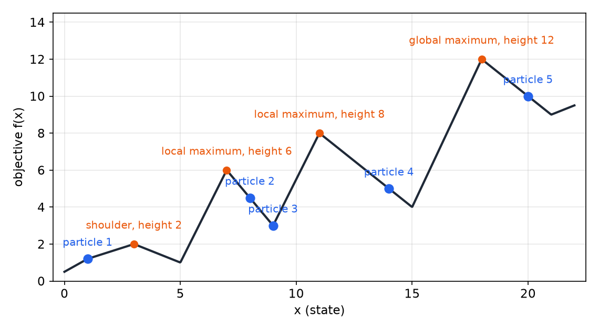
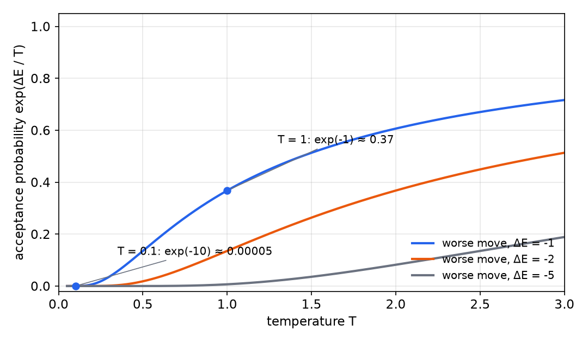
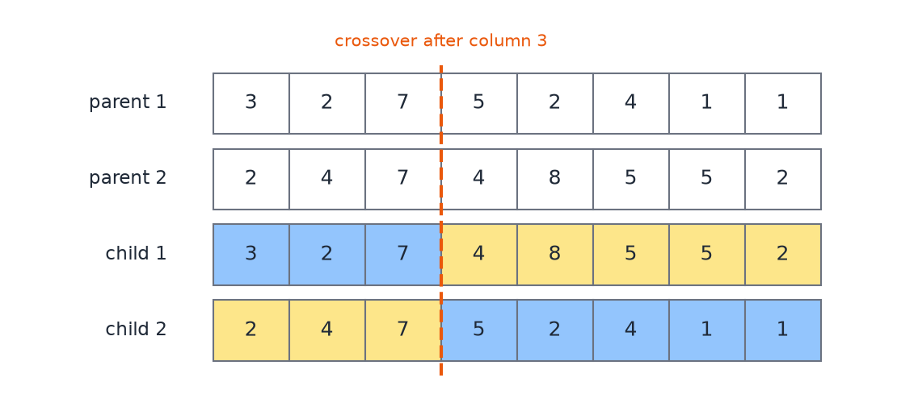
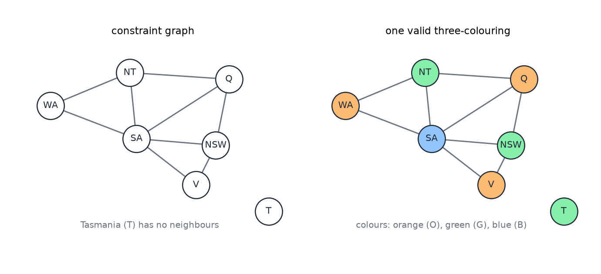
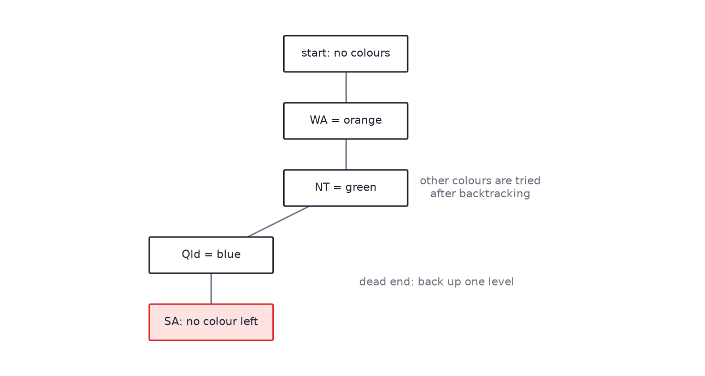

# Local Search, Constraint Satisfaction, and the Pacman Project

Some problems have no natural path from a start state to a goal. The task is to find a complete configuration that satisfies the goal, such as a board of queens with no attacks, or an assignment of colors with no clashes. The path to the answer does not matter. Local search moves from one complete configuration to a neighboring one and improves it step by step. Constraint satisfaction gives the same kind of problem a structure of variables, domains and constraints, and then uses inference to prune the search. This chapter covers both, and then the Pacman search project, which applies the search methods of the previous chapter to a grid world. For the path-based search that the Pacman project uses, see [State-Space Search](state-space-search.md). For the adversarial case, see [Game Playing and Adversarial Search](game-playing.md). The local methods are developed further in [Metaheuristics](../optimization/metaheuristics.md), and the probabilistic background is in [Probability and Bayes' Rule](probability.md).

## Iterative improvement

The simplest idea is to start from a random configuration and improve it. The principle is to begin with the simple solution and add intelligence only when it is needed. Many problems are solved well this way, and in some of them the result is within a small margin of the optimum.

A traveling-salesman tour illustrates the idea. Connect the cities in a random order. Find every place where two edges cross. Revise the tour to remove each crossing. Removing a crossing always shortens the tour, so the process stops when no crossing remains. The source reports that for very large instances, thousands of cities, this procedure gets within about one percent of the optimal tour. That is a reported result, and it is not derived here.

### N-Queens

The N-Queens problem places \\(N\\) queens on an \\(N \times N\\) board so that no two attack each other along a row, a column or a diagonal. Local search suits it because the state is easy to change. Restrict each move to one queen moving within its own column, so that every board has exactly one queen per column. The state is then determined by the row of the queen in each column.

Improve a board by making the single move that most reduces the number of attacking pairs, and repeat until the count is zero. On a random four-queen board with five attacking pairs, the greedy choice works quickly. Move the queen involved in three attacks to the top row, which removes three of the five attacks. Then move the queen involved in two attacks to the bottom row, which removes the remaining two. The problem is solved in two moves.

Greedy repair does not always succeed. On a board with 17 attacking pairs, the best single move reduces the count to 12. On other boards, every single move adds attacks. Every move of one queen creates new horizontal attacks while the original attack remains, and the search is stuck in a **local minimum**. The problem is solvable, but a method that accepts only improving moves cannot escape. The methods below address this.

## Hill climbing

**Hill climbing** maximizes a one-dimensional objective, moving to a neighboring point of higher value until no neighbor is higher. The procedure is as follows.

1. Start at a chosen point \\(x\\).
2. Look one step to the left and one step to the right, by the step size.
3. Move to the neighbor with a higher value. If neither neighbor is higher, stop.
4. Repeat from the new position.

The method stops at a **local maximum**, a peak that is lower than the highest peak in the landscape. A computer that sees only one step ahead cannot tell which peak is the highest. The figure shows a schematic objective with a shoulder, two local maxima and a global maximum. The heights and starting points are those stated in the source, and the positions of the peaks are chosen to match them.

*Figure: a schematic objective, with the heights and starting points of the source's example and peak positions chosen for illustration. Blue dots are starts. From \\(x = 1\\) the search climbs to a shoulder at height 2 and stops. Starts at \\(x = 8\\) and \\(x = 9\\) stop at the peaks of heights 6 and 8. The start at \\(x = 14\\) reaches the same peak of height 8 as the start at \\(x = 9\\), and the start at \\(x = 20\\) reaches the global maximum of height 12.*

Three remedies are standard. **Random restart** starts from several random points, climbs from each, and keeps the best result. With enough restarts it succeeds in the limit, but it wastes effort. **Taboo search** remembers the places already visited and restarts a climb that reaches a place already seen. A third remedy keeps a list of the local maxima found so far and tries to predict where an unexplored maximum might lie. None of these is guaranteed to be efficient, but each adds a source of exploration that pure hill climbing lacks.

The step size also matters. A step that is too small stops on a shoulder or a plateau, because no neighbor looks higher. A step that is too large can skip a sharp peak, or can jump over a peak and bounce around it without converging. The usual remedy is to begin with a large step and shrink it over time. Simulated annealing achieves the same effect in a principled way.

## Simulated annealing

**Simulated annealing** draws its method from a physical process. When a material is hot, its molecules are mobile and can rearrange. As it cools slowly, the molecules settle into low-energy arrangements. Mud cracks into regular patterns as it dries, a honeycomb is a low-wax structure for a given storage, and columnar basalt forms hexagonal columns as lava cools. Steel is heated, cooled slowly and so fixed in a lattice with the desired hardness. The algorithm applies the same idea to optimization: high temperature allows large random moves, and gradual cooling reduces the randomness until the search converges.

The algorithm maximizes a value. Let \\(\Delta E\\) be the value of the new position minus the value of the current one, so \\(\Delta E < 0\\) means a worse move.

1. Choose a starting position and a high starting temperature \\(T\\).
2. Pick a random position near the current one.
3. If the new position is better (\\(\Delta E > 0\\)), move to it.
4. If it is not better, move to it with probability \\(e^{\Delta E / T}\\). A move with \\(\Delta E = 0\\) has probability \\(e^{0} = 1\\), so plateau moves are always taken.
5. Otherwise stay where you are.
6. Lower \\(T\\) according to a schedule, and repeat from step 2.

The acceptance rule explains the behavior. As \\(T\\) grows large, \\(\Delta E / T\\) tends to zero for any fixed \\(\Delta E\\), so \\(e^{\Delta E / T}\\) tends to 1. Every move is then accepted, including very bad ones, which lets the search leave a local peak. As \\(T\\) falls, bad moves become unlikely. Take \\(\Delta E = -1\\). At \\(T = 1\\) the acceptance probability is \\(e^{-1} \approx 0.37\\). At \\(T = 0.1\\) it is \\(e^{-10} \approx 4.5 \times 10^{-5}\\). At \\(T = 0.01\\) it is \\(e^{-100} \approx 3.7 \times 10^{-44}\\). At this temperature the method is ordinary hill climbing: it keeps sampling until it finds an improving neighbor. The temperature is never set to exactly zero, since \\(e^{\Delta E / 0}\\) is undefined.

*Figure: the probability \\(e^{\Delta E / T}\\) of accepting a worse move, plotted against temperature for three values of \\(\Delta E\\). Each curve rises from near zero at low temperature toward one at high temperature. Larger losses (more negative \\(\Delta E\\)) are accepted less often at every temperature.*

The source states that the method converges to the global maximum if the temperature starts high enough and falls slowly enough. This is the standard form of the guarantee. The schedule itself is not given in numbers, and in practice the convergence rate depends heavily on it. A simulation of shaking a box with a ball in it shows the idea: if the shaking decreases slowly, the ball settles into the deepest well, and if it decreases too fast, the ball can stay in a shallow one.

### Local beam search

Hill climbing with random restarts works on one particle at a time. **Local beam search** keeps \\(K\\) particles. At each step it generates random neighbors of every particle and keeps the \\(K\\) best neighbors for the next iteration, comparing all of them against one another. Unlike random restart, the particles share information: each choice depends on the whole pool of neighbors. **Stochastic beam search** chooses successors with some randomness as well as by fitness. This prevents the search from settling on the first local maximum it finds, and it resembles simulated annealing.

### Genetic algorithms

Genetic algorithms use selection, crossover and mutation on a population of candidate solutions. For N-Queens the encoding is natural. Since each column has exactly one queen, a board is written as the row of the queen in each column, from left to right. The board with queens in rows 8, 6, 4, 2, 7, 5, 3, 1 is written 86427531.

The fitness of a board is the number of pairs of queens that do not attack each other. On an \\(8 \times 8\\) board there are \\(\binom{8}{2} = 28\\) pairs of queens, so the fitness is \\(28\\) minus the number of attacking pairs, and a fitness of 28 means a solved board. The algorithm is as follows.

1. Create an initial population, here four random boards.
2. Compute each board's fitness.
3. Select parents with probability proportional to fitness.
4. Pair the parents, choose a random crossover point for each pair, and make two children by swapping the tails.
5. Apply mutation: each digit has a small chance of changing to another digit.
6. Replace the population with the children and repeat from step 2 until a board has fitness 28.

Take a population whose boards have 4, 5, 8 and 17 attacking pairs. Their fitness values are \\(28 - 4 = 24\\), \\(23\\), \\(20\\) and \\(11\\). The total is 78, so the selection probabilities are \\(24/78 \approx 31\%\\), \\(23/78 \approx 29\%\\), \\(20/78 \approx 26\%\\) and \\(11/78 \approx 14\%\\). A random draw from a 100-sided die selects a board by the range of its share: rolls 1 to 31 select the first board, 32 to 60 the second, 61 to 86 the third and 87 to 100 the fourth.

Crossover of two parents is a swap of tails at a cut point. Let parent 1 be 32752411 and parent 2 be 24748552, with the cut between columns 3 and 4. Child 1 takes the first three digits of parent 1 and the last five of parent 2, giving 327 followed by 48552, which is 32748552. Child 2 takes the first three digits of parent 2 and the last five of parent 1, giving 247 followed by 52411, which is 24752411. Each child keeps a block of columns from each parent.

Mutation adds the random change that no parent contains. Each digit has a small probability of changing, so a child can acquire a row that appears in neither parent. Without mutation, the population can lose a needed value for good. The method is therefore a combination of selection that favors good boards and randomness that creates new ones.

*Figure: the crossover of parent 1 (32752411) and parent 2 (24748552) after column 3. Blue digits come from parent 1 and yellow digits from parent 2. Child 1 is 32748552, and child 2 is 24752411.*

These methods share a pattern. Hill climbing, simulated annealing and genetic algorithms each borrow a physical or biological process, and each uses randomness to escape local maxima. Random restart, simulated annealing and genetic algorithms can be seen as members of a beam-search family, in which several particles are released and their successors are generated with progressively less randomness until they converge. The main lesson is that randomness is part of the method, not an error to be removed.

## Constraint satisfaction problems

A **constraint satisfaction problem** (CSP) has three parts. The variables are the items to be assigned, such as regions of a map. Each variable has a domain, the set of values it may take, such as colors. The constraints restrict which combinations are allowed. A solution is an assignment of a value to every variable that satisfies every constraint.

A constraint may be unary, restricting one variable (Tasmania may not be purple), or binary, relating two variables (two neighboring regions may not share a color). Constraints may also involve three or more variables, and soft constraints express preferences rather than requirements. Problems with preferences are constraint optimization problems. Examples of CSPs include Sudoku, car assembly, class scheduling and transportation planning.

The **constraint graph** has one node for each variable and one arc for each binary constraint. The graph shows the structure of the problem, and general-purpose CSP algorithms exploit that structure. A region with no neighbors, such as Tasmania in the Australia problem, is independent of the rest of the problem and can be solved alone.

### Map coloring

Color the map of Australia so that no two neighboring regions share a color. The variables are the seven regions: Western Australia (WA), the Northern Territory (NT), South Australia (SA), Queensland (Q), New South Wales (NSW), Victoria (V) and Tasmania (T). The domains are the colors orange, green and blue. The constraints say that each pair of neighbors must differ. Western Australia borders the Northern Territory and South Australia. The Northern Territory borders Western Australia, South Australia and Queensland. South Australia borders all the mainland regions, and Queensland borders the Northern Territory, South Australia and New South Wales. New South Wales borders Queensland, South Australia and Victoria, and Victoria borders New South Wales and South Australia.

*Figure: left, the constraint graph of the Australia map, one node per region and one arc per shared border. Right, a valid coloring with three colors, which was checked by hand: WA orange, NT green, SA blue, Q orange, NSW green, V orange. Tasmania is isolated and may take any color.*

Three colors suffice for this map, as the figure shows. The search problem is to find such a coloring systematically.

### Backtracking search

**Backtracking** assigns variables one at a time and retreats when it reaches a dead end. Its states are the partial assignments made so far, and the procedure is as follows.

1. The initial state is the empty assignment.
2. Check whether the current assignment is complete and consistent. If it is, it is a solution.
3. Pick an unassigned variable and assign it a value that does not conflict with the assignment so far.
4. If some variable has no legal value (a dead end), return to the previous decision and try its next value.
5. Repeat until a solution is found, or every possibility has been tried and failure is reported.

On the Australia map, take Western Australia orange and the Northern Territory green. Queensland may then be orange or blue, and choose blue. South Australia now has no color available: it cannot be orange because of Western Australia, green because of the Northern Territory, or blue because of Queensland. The search backs up. The figure shows this path.

*Figure: the first assignments of backtracking. WA is orange, NT green and Queensland blue. South Australia has no color left, so the search backs up to the last decision and tries another value.*

Plain backtracking works but can be slow. Three ideas improve it: how to choose the next variable, how to choose its value, and how to prune earlier.

### Ordering heuristics

The **minimum remaining values** (MRV) heuristic chooses the unassigned variable with the fewest legal values left, since it is the most likely to fail. After Western Australia is orange and the Northern Territory is green, South Australia has only blue left, while Queensland has orange and blue. MRV selects South Australia next. If several variables tie, the **degree** heuristic chooses the one with the most constraints on the unassigned variables. In the constraint graph Queensland has three neighbors (the Northern Territory, South Australia and New South Wales), while Western Australia has two, so degree breaks a tie between them in favor of Queensland.

The **least constraining value** heuristic chooses, for the selected variable, the value that rules out the fewest options for its neighbors. This leaves the most room for the rest of the problem. It is cheap to compute and often avoids a later dead end, but it does not guarantee that one will be avoided.

### Forward checking

**Forward checking** keeps the remaining legal values of every unassigned variable. After each assignment it removes the assigned value from the domains of the unassigned neighbors. If a neighbor's domain becomes empty, the search backs up immediately, without waiting to reach that variable.

On the Australia map, take Western Australia orange. This removes orange from the Northern Territory and South Australia. Assign Queensland green, which removes green from its neighbors, the Northern Territory, South Australia and New South Wales. The Northern Territory and South Australia are now left with blue alone, and New South Wales with orange or blue. Now assign Victoria blue. This removes blue from New South Wales and from South Australia, which is also a neighbor of Victoria. South Australia's domain becomes empty, and the search backs up at once. Forward checking detects this failure at the moment it occurs, which is the early warning that plain backtracking lacks. It does not detect every failure, though, as the next method shows.

### Arc consistency

A binary constraint between variables \\(X\\) and \\(Y\\) is **arc consistent** if, for every value remaining in the domain of \\(X\\), some value in the domain of \\(Y\\) is consistent with it. A network is arc consistent when every arc satisfies this condition. Enforcing arc consistency removes unsupported values from domains, and it can detect failures that forward checking misses.

The propagation procedure is as follows.

1. When a variable is reduced to a single value, look at its neighbors and remove that value from any neighbor's domain where it conflicts.
2. For each neighbor whose domain changed, repeat the check on that neighbor's own neighbors.
3. Stop when nothing changes, or report failure when some domain becomes empty.

A worked example shows the mechanism. Take Western Australia orange and Queensland green, as in the forward-checking example. Forward checking leaves the Northern Territory and South Australia each with blue alone. No domain is empty, so forward checking does not stop here, but the two regions are neighbors. Arc consistency asks whether each value of the Northern Territory has support in South Australia's domain. The Northern Territory's only value, blue, has none, because South Australia must then take a different color and its only remaining color is blue. Blue is removed from the Northern Territory, which leaves its domain empty, and failure is reported before the search makes any further assignment. The cost of propagation is extra work at each node, and it can avoid much deeper search.

### Structured problems

Two kinds of structure allow faster solutions. A problem that splits into independent components can be solved one component at a time. A problem with \\(n\\) binary variables and no independent parts has a search space of \\(2^{n}\\), but splitting it into four independent problems of 20 variables each has a space of \\(4 \cdot 2^{20}\\), which is far smaller.

When the constraint graph is a tree, the problem can be solved in time \\(O(n d^{2})\\), where \\(n\\) is the number of variables and \\(d\\) the domain size, instead of the \\(O(d^{n})\\) of general search. The method is as follows.

1. Pick any variable as the root and order the variables so that each comes after its parent.
2. Going from the last variable back to the first, make each parent arc consistent with its child. If a domain becomes empty, report failure.
3. Assign the root any available value. Going forward, assign each child a value consistent with its parent. Because the tree is arc consistent, any such value leads to a solution.

When the graph has loops, **cutset conditioning** assigns values to a few variables first, deletes those values from the neighbors' domains, and leaves a graph that is a tree. For the Australia map, assigning South Australia removes its color from the neighbors, and the remaining regions form a tree: Western Australia, the Northern Territory, Queensland, New South Wales and Victoria form a path, and Tasmania is a separate node. The fast tree method then finishes the problem.

### Iterative methods for CSPs

N-Queens is also a CSP, with one variable per column and the rows as domains, and iterative methods suit it. The **min-conflicts** method works as follows.

1. Assign every variable a random value.
2. While conflicts remain, choose a conflicted variable and move it to the value that minimizes the number of conflicts.
3. Repeat until no conflicts remain.

For four queens the full state space has \\(4^{4} = 256\\) assignments, one queen per column, and minimizing attacks finds a solution quickly. The source reports that min-conflicts solves N-Queens with \\(N\\) as large as ten million, and that for a million queens it takes an average of about 50 moves. These are reported claims, kept here as stated, and they have not been checked.

Iterative improvement works well when many solutions exist. The difficulty rises sharply as the ratio of constraints to variables reaches a critical value, where most random instances become very hard to solve. The problems at that ratio are a standard benchmark for CSP methods.

## The Pacman project

The Pacman project applies the search methods of the state-space chapter to a grid world, where a Pacman agent eats food while avoiding ghosts. It has two parts: a short tutorial on the Python environment, and the search tasks themselves. The tasks are described here without numbering.

### Python environment

The tutorial introduces the Unix working environment, a text editor, and the Python features that the later tasks use. It was written for Python 2.5 to 2.7, and its examples use Python 2 syntax, such as `print` statements and lists returned by `map` and `filter`. Readers porting the examples to Python 3 should expect these differences.

The tutorial covers arithmetic and strings, lists and slices, tuples, sets and dictionaries, loops and list comprehensions, functions, and classes. Two graded tasks follow. The first asks for a function that totals the cost of an order from a price table, and the test case is an order of 2 pounds of apples at 2.00, 3 pounds of pears at 1.75 and 4 pounds of limes at 0.75, which costs \\(2(2.00) + 3(1.75) + 4(0.75) = 12.25\\). The second asks for a function that chooses, from a list of shops, the one where an order costs least. Given two shops, one charging 2.00 for apples and 1.00 for oranges and the other charging 1.00 and 5.00, an order of one pound of apples and three of oranges costs 5.00 at the first and 16.00 at the second, so the first shop is chosen. An order of three pounds of apples costs 6.00 at the first and 3.00 at the second, so the second is chosen.

### The search tasks

The search tasks ask for generic graph-search functions, applied to Pacman mazes. The functions are depth-first, breadth-first, uniform-cost and A\* search, and they share one structure. A single routine takes the search problem and a fringe, and the choice of fringe, a stack, a queue or a priority queue, determines the method. The problem interface gives a start state, a successor function that returns the child states with their actions and step costs, and a goal test. A search function returns a list of legal actions from start to goal.

Each search node must carry the information needed to reconstruct the path, not only its state. The usual approaches are either a parent map, which records how each state was reached and is traced back from the goal, or a full action list stored with each node. Priorities are set as follows: uniform-cost search orders by \\(g\\), the cheapest known cost to reach a state, and A\* orders by \\(g + h\\). The heuristic \\(h\\) must not feed into the value of \\(g\\), since the cost of a path depends only on the steps taken.

The source's reference values give a check on depth-first search. On the medium maze, with successors pushed onto the stack in the order the successor function returns them, the solution has length 130. With the order reversed, it has length 246. Neither solution is necessarily cheapest, which shows that depth-first search does not find least-cost paths in general. Breadth-first search finds the shortest path in steps, and uniform-cost search finds the cheapest path when costs vary. Varying the cost function changes which path is best. Charging more for steps near ghosts, or less for steps through food, changes the route Pacman takes.

A\* with the Manhattan distance to the goal on the big maze expands about 549 nodes, against about 620 for uniform-cost search. Tie-breaking can change these counts. Both searches return a path of the same optimal cost, since both are optimal, and the heuristic reduces the number of nodes expanded.

### Visiting all four corners

A harder problem asks for the shortest path that touches the four corners of a maze. The state must record Pacman's position and which corners have been visited, and nothing else. A full game state is the wrong representation, because it makes the search very slow and includes details that do not affect the goal. On the small corners maze, the shortest such path has 28 steps. Breadth-first search on the medium corners maze expands just under 2,000 nodes.

A heuristic for this problem must account for every corner that remains, not only one of them. Consider a \\(7 \times 7\\) corner maze in four states: Pacman in the middle with all four corners food, the same with one corner eaten, Pacman two steps from the nearest remaining corner, and Pacman on an eaten corner with three remaining. A heuristic based on the distance to the nearest remaining corner gives 2 for the third state and 6 for the fourth, which is backwards, since the fourth state is nearer to the remaining food. A heuristic based on the distance to the farthest corner gives 6 for the first state and 10 for the third, which is also backwards, because the third state is nearer to food. A useful heuristic must therefore combine the distances to all remaining corners. Averaging them is a candidate, and the test is whether it orders these states correctly. The heuristic must be admissible and consistent, and it must be zero at every goal state.

### Eating all the food

The food problem asks for a path that eats every pellet, ignoring ghosts and power pellets. The distance to the goal is the cost of the cheapest tour through the remaining pellets. Finding that tour exactly takes time proportional to \\(n!\\) for \\(n\\) pellets, so an exact heuristic is infeasible. A workable heuristic uses the pairwise distances between pellets, which is cheaper and still admissible. The source reports reference values for these problems: on a small test maze, the optimal cost with the null heuristic is 7. On a second layout, uniform-cost search returns a path of length 27 after about 5,057 expansions, in about 2.5 seconds on the source's implementation. The source does not state which algorithm produced these figures. A\* with the null heuristic gives the same ordering as uniform-cost search, so the figures apply to either reading, and they are attributed here to uniform-cost search.

Some food problems are too hard to solve optimally in reasonable time. For these the project asks for a fast, reasonable path. A greedy agent eats the nearest dot each time. Its path is quick to find but not optimal, and a small example shows the greed fails. The task is to find the nearest food with a search and to build a small maze in which the nearest-dot strategy is not the shortest route to eat all the dots. On the large test maze the greedy path costs 350.

## Summary

- Iterative improvement starts from a complete configuration and improves it. Greedy moves can reach a local minimum from which no single move helps.
- Hill climbing stops at local maxima. Random restart, taboo lists and step-size control are remedies, and simulated annealing accepts worse moves with probability \\(e^{\Delta E / T}\\) under a falling temperature.
- Local beam search shares information among \\(K\\) particles. Genetic algorithms use selection, crossover and mutation, and the fitness of an N-Queens board is \\(28\\) minus its attacking pairs.
- A CSP consists of variables, domains and constraints, and its constraint graph reveals the structure that algorithms can exploit.
- Backtracking with minimum-remaining-values ordering, forward checking and arc consistency prunes the search. Tree-structured CSPs are solved in time \\(O(n d^{2})\\).
- The Pacman project applies generic graph search to mazes. Its corners and food problems show that a good heuristic for several goals must depend on all the remaining goals.

## See Also

- [State-Space Search](state-space-search.md): the path-based search methods that the Pacman project implements.
- [Game Playing and Adversarial Search](game-playing.md): search when an opponent moves between the agent's moves.
- [Metaheuristics](../optimization/metaheuristics.md): the local and population methods of this chapter in a general optimization setting.
- [Probability and Bayes' Rule](probability.md): the probability background for the randomized methods.
