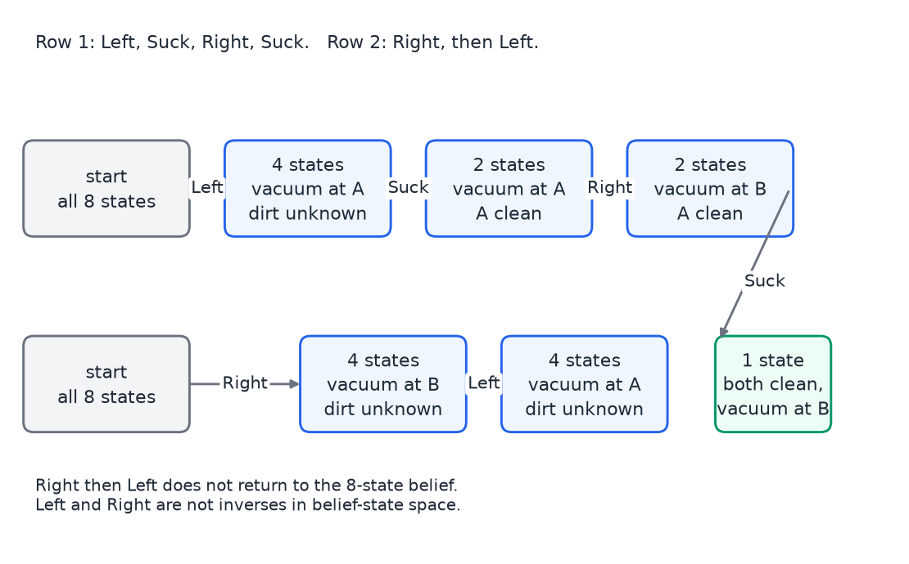
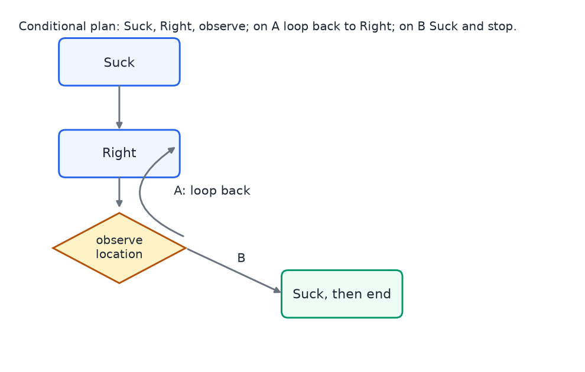
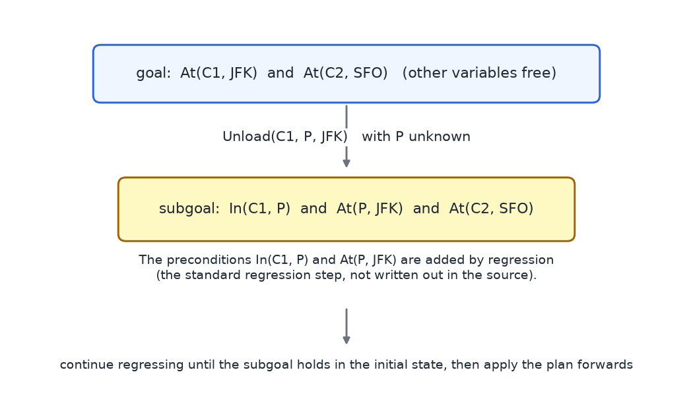

# Logic and Planning

Search finds a path when the world is deterministic and fully observable: the agent knows the state it is in, its actions have known effects, and the plan can be executed without looking at the world again. Most real problems are not like this. This chapter has two halves that address the two relaxations. The first half is logic, a language for representing what an agent knows about a world with many objects and relations, and a way of drawing conclusions from that knowledge without re-examining the world. The second half is planning when the agent cannot see the whole state, where the object of study becomes a belief state (the set of states the agent thinks it might be in) and, for classical planning, action schemas that describe whole families of actions at once. The chapter ends with the situation calculus, which uses first-order logic to write plans and their effects.

The material follows the usual order of AI texts: propositional logic, first-order logic, then planning. The planning sections also link to the Markov decision process treatment in [Markov Decision Processes](mdps.md), which takes up the stochastic case with numerical values.

## Why Logic?

Problem-solving agents represent a state as an opaque object. Two states are either equal or not, which works for route finding but cannot say that a cargo item is inside a plane unless every such combination is listed as a separate state.

Logic gives a factored or structured representation. A factored state is a set of variables, each with a value. A structured state includes objects and relations between them. Propositional logic is the simplest factored language: each variable is a true-or-false sentence about the world. First-order logic adds objects, functions and relations, and quantifiers that range over objects.

Logic has a second advantage that matters for agents. Once an agent holds a set of sentences that it takes to be true, it can derive new sentences from them by inference, without looking at the world again. If the starting sentences are correct, the derived sentences are correct. If a starting sentence is false, the derived sentences can be false too.

Early logical systems succeeded in narrow domains but could not cover everything: two-valued truth does not fit an uncertain world, and writing every fact by hand is laborious. Logic remains the language in which plans and their effects are written down.

## Propositional Logic

### Symbols, connectives and sentences

A propositional language has a set of symbols, each standing for a fact that is true or false. The worked example uses five symbols: B (a burglary has occurred), E (an earthquake has occurred), A (the alarm is sounding), M (Mary calls) and J (John calls). Each symbol is true, false or unknown to the agent.

Sentences are built with five connectives: negation \\(\neg\\), conjunction \\(\land\\), disjunction \\(\lor\\), implication \\(\Rightarrow\\) and biconditional \\(\Leftrightarrow\\). The following sentences are typical:

- \\((E \lor B) \Rightarrow A\\): the alarm sounds whenever an earthquake or a burglary occurs.
- \\(A \Rightarrow (J \land M)\\): when the alarm sounds, both John and Mary call.
- \\(J \Leftrightarrow M\\): John calls if and only if Mary calls.
- \\(J \Leftrightarrow \neg M\\): exactly one of John and Mary calls.

### Truth tables and implication

A **model** is an assignment of truth values to every symbol, for example B true and E false. A sentence is true or false in a given model, and its truth is defined recursively by truth tables. For two symbols P and Q there are four rows, FF, FT, TF and TT, and each compound sentence takes a value in each row.

| P Q | \\(\neg P\\) | \\(P \land Q\\) | \\(P \lor Q\\) | \\(P \Rightarrow Q\\) | \\(P \Leftrightarrow Q\\) |
|---|---|---|---|---|---|
| F F | T | F | F | T | T |
| F T | T | F | T | T | F |
| T F | F | F | T | F | F |
| T T | F | T | T | T | T |

Two points about this table need care. Disjunction is inclusive: \\(P \lor Q\\) is true when both are true. Implication is defined only by its table: \\(P \Rightarrow Q\\) is false only when P is true and Q is false. It is therefore true whenever P is false, which differs from the everyday reading of "if P then Q". Two examples make the point. Let O be "5 is an odd number" and P be "Paris is the capital of France". Then \\(O \Rightarrow P\\) is true, because a true consequent makes the implication true. Let E be "5 is an even number" and M be "Moscow is the capital of France". Then \\(E \Rightarrow M\\) is true, because a false antecedent makes it true by definition.

**Exercise (reading the truth tables).** The following three sentences are true in the rows shown.

- \\(P \land (P \Rightarrow Q)\\) is true only in row TT. P is true in rows TF and TT, and \\(P \Rightarrow Q\\) is true in FF, FT and TT, so both hold only in TT.
- \\(\neg(\neg P \lor \neg Q)\\) is equivalent to \\(P \land Q\\), so it is true only in row TT.
- The biconditional between those two sentences is true in all four rows. It is valid.

The formulas are reconstructed from the answers.

### Models, entailment and inference

Suppose the agent's knowledge base consists of three sentences: \\((E \lor B) \Rightarrow A\\), \\(A \Rightarrow (J \land M)\\), and B. The agent can answer questions about each symbol by reasoning from these sentences.

1. B is true, because it is given.
2. \\(E \lor B\\) is then true, because a true disjunct makes the disjunction true. The first sentence then forces A to be true.
3. A is true, so the second sentence forces \\(J \land M\\) to be true. Both J and M are true.
4. E is not determined. There are models with E true and models with E false that satisfy all three sentences. E is therefore unknown to the agent. Unknown is not the same as false.

In general, a sentence \\(\alpha\\) is **entailed** by a knowledge base KB when \\(\alpha\\) is true in every model in which KB is true. The agent above therefore knows J and M, and does not know E.

The most direct way to check entailment is **model checking**: enumerate all the models over the symbols involved and check every row. With n symbols there are \\(2^n\\) rows, so the method takes exponential time in the worst case. Deciding satisfiability for general propositional sentences is NP-complete, so no method is known to avoid this blow-up in general, and the more efficient algorithms rely on structure in the particular sentences.

### Valid, satisfiable and unsatisfiable sentences

A sentence is **valid** when it is true in every model. It is **satisfiable** when it is true in at least one model, and **unsatisfiable** when it is false in every model. Every valid sentence is satisfiable.

**Exercise (validity).** The following five sentences are classified below.

1. \\(P \lor \neg P\\) is valid. It is true when P is true and true when P is false. (The spoken label in the source says "P and not P is valid". That is wrong for this sentence, whose reasoning describes \\(P \lor \neg P\\). The valid sentence is the disjunction.)
2. \\(P \land \neg P\\) is unsatisfiable. A symbol cannot be both true and false.
3. \\(P \lor Q \lor (P \Leftrightarrow Q)\\) is valid. It is true in the three rows where P or Q holds. In the fourth row, FF, both P and Q are false, so \\(P \Leftrightarrow Q\\) holds.
4. \\((P \Rightarrow Q) \lor (Q \Rightarrow P)\\) is valid. Under the truth tables one of the two implications must hold: if P is true and Q is false, then \\(Q \Rightarrow P\\) holds, and if P is false then \\(P \Rightarrow Q\\) holds.
5. \\(((\text{Food} \Rightarrow \text{Party}) \lor (\text{Drinks} \Rightarrow \text{Party})) \Rightarrow ((\text{Food} \land \text{Drinks}) \Rightarrow \text{Party})\\) is valid. Both sides reduce to \\(\neg\text{Food} \lor \neg\text{Drinks} \lor \text{Party}\\), so the implication holds in every model.

### Limits of propositional logic

Three limits are the reason for the move to first-order logic.

1. **No uncertainty.** A propositional sentence is true, false or unknown. It cannot express "the alarm is probably sounding". Probability theory handles that case, and is the subject of the next chapters in this section.
2. **No objects.** Propositional logic talks only about facts. It cannot describe objects with properties such as size, weight or color, or relations between objects, except by inventing a separate symbol for each object and each relation.
3. **No shorthand for many objects.** Suppose a vacuum world has 1000 locations, and we want to say that every location is free of dirt. In propositional logic that sentence is a conjunction of 1000 separate propositions. A general statement about all locations should be a single sentence.

## Factored and Structured Representations

- **Atomic.** A state has no internal structure. Two states are only identical or not, and each is a goal or not. Problem-solving search uses this representation.
- **Factored.** A state is a set of variables. Propositional logic and probability use this representation, with variables such as B, E, A, M and J.
- **Structured.** A state includes objects and relations between them. Programming languages and databases work this way, and first-order logic provides it.

Each logic also makes two commitments. The **ontological commitment** is what the logic says the world contains. Propositional logic has facts. Probability theory has facts, to which it attaches degrees of belief. First-order logic has objects, functions and relations. The **epistemological commitment** is what an agent can believe about those things. In propositional and first-order logic each fact is true, false or unknown. In probability each degree of belief is a real number between 0 and 1. 

## First-Order Logic

### Models: objects, functions and relations

A first-order model has a set of objects. The worked example uses four tiles A, B, C and D, together with the numbers 1, 2 and 3. The model specifies three kinds of interpretation.

- **Constants** name objects. Two constants may name the same object, and some objects may have no name.
- **Functions** map objects to objects. The example has a function NumberOf with NumberOf(A) = 1, NumberOf(B) = 3, NumberOf(C) = 3 and NumberOf(D) = 2.
- **Relations** are sets of tuples. The binary relation Above is \\(\\{(A, B), (C, D)\\}\\), meaning A is above B and C is above D. The unary relation Vowel is \\(\\{(A)\\}\\). A 0-ary relation Rainy is the empty set when it is not raining, and the set containing the empty tuple when it is.

### Syntax and quantifiers

Atomic sentences apply a predicate to terms, for example Vowel(A) or Above(A, B). Terms refer to objects and can be constants, variables (lowercase x, y and so on) or functions applied to terms, such as NumberOf(A). Sentences combine with the same connectives as before, and two quantifiers are added: the universal quantifier \\(\forall x\\) ("for all x") and the existential quantifier \\(\exists x\\) ("there exists an x").

Two example sentences show the quantifiers at work. The sentence \\(\forall x\\,(\text{Vowel}(x) \Rightarrow \text{NumberOf}(x) = 1)\\) says every vowel has number 1. The sentence \\(\exists x\\,(\text{NumberOf}(x) = 2)\\) says that some object has number 2, without saying which.

There are two conventions that prevent most errors. A universal sentence usually uses an implication, because it describes a type of object: "for all vowels, ...". An existential sentence usually uses a conjunction, because it names one object of a type: "there is an object that is a vowel and has number 2". Using an implication with \\(\exists\\) or a conjunction with \\(\forall\\) almost always states something other than what was meant.

### The vacuum world in first-order logic

The vacuum world has constants A (the left location), B (the right location), V (the vacuum) and two dirt objects D1 and D2. The relations are Loc(x), Vacuum(x), Dirt(x) and At(x, l) for "object x is at location l". Some sentences are then:

- The vacuum is at A: At(V, A).
- No dirt is in any location: \\(\forall d\\,\forall l\\,\big((\text{Dirt}(d) \land \text{Loc}(l)) \Rightarrow \neg\text{At}(d, l)\big)\\). The same sentence holds with two locations or two thousand. This is the point of the quantifiers.
- The vacuum is in a location that has dirt: \\(\exists l\\,\exists d\\,\big(\text{Dirt}(d) \land \text{Loc}(l) \land \text{At}(V, l) \land \text{At}(d, l)\big)\\).

"First order" means that the quantifiers range over objects, not over relations. A higher-order logic can quantify over relations. For example, the sentence \\(\forall R\\,\big(\text{Transitive}(R) \Leftrightarrow \forall a\\,\forall b\\,\forall c\\,(R(a,b) \land R(b,c) \Rightarrow R(a,c))\big)\\) defines transitivity for every relation R at once. It is valid in a higher-order logic and cannot be written in first-order logic.

### Validity and definitions

**Exercise (first-order validity).** Classify each sentence as valid, satisfiable but not valid, or unsatisfiable.

1. \\(\exists x\\,\exists y\\,(x = y)\\) is valid. Every model has at least one object, and x and y can both name it.
2. \\(\exists x\\,(x = x) \Rightarrow \forall y\\,\exists z\\,(y = z)\\) is valid. The left side is always true, and for the right side we may pick \\(z = y\\), so that \\(y = y\\) holds.
3. \\(\forall x\\,(P(x) \lor \neg P(x))\\) is valid. Every object is either in the relation P or outside it.
4. \\(\exists x\\,P(x)\\) is satisfiable but not valid. The relation P can be empty, in which case the sentence is false.

Writing definitions in first-order logic needs more care. Three items show the pitfalls.

- "Sam has two jobs" can be written \\(\exists x\\,\exists y\\,(\text{Job}(x, \text{Sam}) \land \text{Job}(y, \text{Sam}) \land \neg(x = y))\\). The clause \\(\neg(x = y)\\) is needed, because without it x and y could name the same job, and the sentence would be satisfied by a person with one job.
- Membership in a set can be given by two axioms, using a function \\(\text{Add}(y, s)\\) that puts y into the set s. The first says \\(\forall x\\,\forall s\\,\text{Member}(x, \text{Add}(x, s))\\). The second says that membership in s carries over to \\(\text{Add}(y, s)\\). These axioms say what is a member, but not what is not a member. So the statement "3 is not a member of the empty set" cannot be proved from them.
- Adjacency on a grid is given by two implications: a cell is adjacent to its right-hand neighbor and to the cell above it. The adjacency is then given in one direction only. The sentence does not say that the right-hand neighbor is adjacent back, and it cannot prove that two distant cells are not adjacent.

The moral is that a definition should be a biconditional, not a one-way implication.

## Planning Under Uncertainty

### Why planning must interleave with execution

A problem-solving agent plans the whole path first and then executes it without sensing. This works only when the world behaves as the model says. The source illustrates the point with a study of blindfolded walkers, asked to walk in a straight line. Their tracks, recorded by GPS, start straight and then loop or wander. The walkers could not see any shadows, so nothing corrected their direction. A walker on a sunny day, who could see shadows and steer by them, produced a much straighter track. The moral is that the agent needs feedback from the environment, and planning and execution must be interleaved.

There are several reasons a plan computed in advance will fail.

1. **Stochastic actions.** Wheels slip, brakes skid, and a walking person does not walk straight. The outcome of an action is not known in advance.
2. **State-dependent outcomes.** Going forward through an intersection gives different results at a red light and at a green light.
3. **Other agents.** Other cars and people act, and their actions are known only when they happen.
4. **Partial observability.** A road may be closed, and a sign may reveal this only when the agent reaches it. At the start the agent does not know which state it is in.
5. **An incomplete model.** A map or positioning system may be inaccurate or missing information.
6. **Hierarchical plans.** "Go from A to S" is a high-level step. The steering and pedal actions that carry it out are scheduled during execution, not written into the plan.

The remedy for partial observability is to plan in the space of **belief states**. A belief state is a set of world states that the agent considers possible. Each observation then narrows the belief.

### Belief states in the sensorless vacuum world

The vacuum world has two locations, A (left) and B (right). Dirt may or may not be present in each location, and the vacuum may be in either location. That gives \\(2 \times 2 \times 2 = 8\\) world states. The actions are Right, Left and Suck, where Suck cleans the current location.

If the world is deterministic and the agent can observe the state, planning is easy. From a dirty start, the sequence Suck, Right, Suck reaches the goal in which both squares are clean.

Now suppose the agent is **sensorless**: its sensors have failed, so it does not know its state. Its belief state at the start is the set of all eight world states. The effect of each action on the belief state is then computed as follows.

- **Right** moves the vacuum to B in every possible world. The resulting belief state has four states, all with the vacuum at B. The dirt status of A and B is still unknown.
- **Right, then Left** does not return to the starting belief state. Left moves the vacuum to A in every world, so the result is a belief state of four states with the vacuum at A. In belief-state space, Left and Right are not inverses of each other, because the belief can only lose information through actions that move the vacuum into a known location.
- **Left, Suck, Right, Suck** ends in a single world state. Left leaves four states with the vacuum at A. Suck cleans A, which leaves two states. Right moves the vacuum to B, leaving two states with A clean. Suck then cleans B, leaving one state in which both squares are clean and the vacuum is at B.



*Figure: belief states of the sensorless vacuum world. Each box holds the world states the agent cannot yet tell apart. The top row is Left, Suck, Right, Suck, ending in one state; the bottom row shows Right then Left leaving four states.*

A plan that reaches the goal without observing anything is a **conformant** plan. If the goal is "my square is clean", the single action Suck is conformant. Applied to the eight-state belief state, it leaves four states, and in each of them the current square is clean. Each of those four states has the vacuum at a location where the square is clean, so the goal is met in every world state of the new belief.

A conformant plan can also reach a more specific goal. Starting from "my square is clean, nothing else known", the goal "I am in the right-hand location and it is clean" is reached by Right, then Suck.

### Local sensing and observations

Suppose now that the vacuum knows its own location and whether its current square is dirty, but nothing about the other square. Each cycle has two steps: act, then observe. The action maps the belief state forward, and the observation splits it into pieces.

In a deterministic world each world state has exactly one successor, so an action keeps the belief the same size or makes it smaller, when two states merge. An observation cannot add world states. It can only partition the belief state. An observation may separate nothing, but it cannot make the agent more confused.

For example, start from a belief state of two states, in which the vacuum is at A and B may or may not be dirty. Move Right, so the vacuum is at B. Then observe the square. The observation "B is dirty" leaves one state, and "B is clean" leaves one state.

### Stochastic actions and plans with loops

Now let the wheels slip. A Left or Right move may fail and leave the robot where it was, while Suck always works. Actions increase the uncertainty, because each state in the belief state may have several outcomes, so the belief state gets larger. Observations partition the belief state and bring the uncertainty back down.

An exercise asks which of four plans always work, and which might work. The plans are Suck, Right, Suck; Right, Suck, Left, Suck; Suck, Right, Right, Suck; and Suck, Right, Suck, Right, Suck. Every plan that works in the deterministic world might work here, and all four meet this weaker "might work" criterion. But no finite plan is guaranteed to work. A successful plan has to include at least one move, and each move can slip again on every attempt. A finite sequence therefore cannot be guaranteed to succeed, however long it is.

The remedy is a plan with branches and loops. A plan can be a tree. An observation node has one branch for each possible observation, and a branch may loop back to an earlier action. One plan for the slipping robot is: Suck; then Right, and observe. If the observation is still A, loop back to Right. If the observation is B, do Suck and end. In linear notation the plan is "Suck; while the observation is A, do Right; then Suck."

If each slip is independent, so that a move sometimes succeeds, this plan reaches the goal with probability 1 in the limit. No bounded number of steps is guaranteed. The guarantee holds only at infinity, because the loop may run for an unknown number of iterations.



*Figure: a conditional plan with a loop. Observation A loops back to Right; observation B does Suck and stops.*

There are two kinds of guarantee for a branching plan, and they are checked differently.

- An **unbounded** solution guarantees the goal with no limit on the number of steps. Every leaf of the plan must be a goal state, because the agent does not choose which observation occurs. A single-path plan needs only one goal leaf, but a branching plan needs every branch that the observations can select to end at a goal.
- A **bounded** solution guarantees the goal within a fixed number of steps. Branches are allowed, but loops are not. If every branch reaches a goal in one, two or three steps, the plan is bounded. A loop may take an unknown number of steps, and so it rules out a bounded guarantee.

### Searching for plans over belief states

Plans of this kind can be found by a search that works like problem solving, but over belief states. The branches of the plan (the observations) are part of the plan, not branches of the search. The search expands two kinds of branch.

1. Apply each action to the current belief state. This is a branch of the search.
2. Split the belief state on each possible observation. This is a branch of the plan.

The search tries Right first and then Suck, expanding nodes until some portion of the tree forms a complete plan. A portion is a complete plan when every leaf is a goal. The plan is kept only if every leaf of that portion is a goal.

### Predict and update

A straight-line plan can be written as a formula. For the trip from A through S to F, the state reached is \\(\text{Result}(\text{Go}(S, F), \text{Result}(\text{Go}(A, S), s\_0))\\). The plan is valid if that state is in the set of goal states.

In a stochastic and partially observable world, the belief state is tracked by a two-step cycle. Let b be the current belief state.

- **Predict.** For an action a, the predicted belief is \\(\hat b = \\{\\, \text{Result}(s, a) : s \in b \\,\\}\\). This set is usually larger than b, because each state may have several outcomes.
- **Update.** After the observation o is received, the belief becomes \\(b' = \\{\\, s \in \hat b : o \text{ is observed in } s \\,\\}\\). This set is no larger than \\(\hat b\\).

**Worked trace (kindergarten world).** In this variant the moves always work, but small children may drop dirt into any location at any time. Start in A and count the possible states at each step.

1. Start in A. Suck predicts two possible states, with or without dirt in A.
2. Observe that A is clean. The only possible observation is "A is clean" in both states, and the belief state keeps two states, since the observation does not separate them.
3. Right predicts four possibilities, because dirt may or may not have been dropped in either location.
4. Observe that B is dirty. Only one state is consistent with that observation, so the belief state has one state.

The weakness of this method is that belief states grow fast: four states is already sizeable, and sixteen or more is common. The remedy is to describe a belief state with variables. The belief "the vacuum is on the right" is one fact that stands for every world state in which that holds, and this is the step to the factored representation used in classical planning.

## Classical Planning

### States and action schemas

Classical planning factors the world into k Boolean variables. The state space then has \\(2^k\\) world states. The two-location vacuum world uses three variables (dirt at A, dirt at B, and the vacuum at A), which gives \\(2^3 = 8\\) states.

A world state is a complete assignment of true or false to every variable. A belief state can take several forms:

- a complete assignment, which is the core of classical planning for deterministic and fully observable domains;
- a partial assignment, in which some variables are unknown. For example, "the vacuum is at A" is true and the other variables are unknown. That belief stands for four world states;
- any Boolean formula, which stands for the set of world states that satisfy it.

An **action schema** covers a whole family of actions with one description. The schema below describes flying a plane from one airport to another.

```text
Action(Fly(p, from, to))
  PRECOND: Plane(p) and Airport(from) and Airport(to) and At(p, from)
  EFFECT:  not At(p, from) and At(p, to)
```

The schema looks like a first-order term, but the world is still propositional. The schema stands for every plane and every pair of airports.

### The air-cargo domain

The air-cargo domain adds two more schemas to Fly. Load(c, p, a) puts cargo c onto plane p at airport a, and Unload(c, p, a) takes it off. Each has preconditions and effects, in the same form as Fly. The domain therefore has three schemas: Fly, Load and Unload.

The initial state says where each cargo item and each plane is. A small instance has two cargo items, two planes and two airports. The goal says which cargo must be at which airport.

The schemas scale well. With 10 airports and 100 planes there are \\(100 \times 10 \times 10 = 10{,}000\\) Fly actions. A few thousand cargo items add many more Load and Unload actions, but the three schemas still describe all of them.

### Progression and regression

There are two directions for a search over states. **Progression** is forward search. It starts in the initial state and applies applicable actions, such as Load(C1, P1, SFO), until a state satisfies the goal. Because it searches exact world states, it behaves like ordinary deterministic problem solving. The factored representation allows other tricks, which are described next.

**Regression** is backward search. It starts from the goal description, which is partial. For a goal "C1 is at JFK and C2 is at SFO", all other variables may take any value. For each goal literal, the planner finds an action schema that achieves it. The only schema that adds an At fact for cargo is Unload, so for At(C1, JFK) the planner chooses Unload(C1, P, JFK), with the plane P left unknown. Regressing the goal through this action gives a new partial subgoal. The standard subgoal includes the preconditions of the action, namely In(C1, P) and At(P, JFK), together with the rest of the goal that the action does not achieve. The planner repeats this step until the subgoal is satisfied by the initial state, and then applies the plan forwards.



*Figure: regression of the air-cargo goal through Unload(C1, P, JFK). The subgoal adds the action's preconditions.*

An example shows why regression can be much cheaper. Suppose there is one action, Buy(b), whose precondition is knowing the ISBN b and whose effect is Own(b). The goal is Own(0136042597). Forward search starts from "own nothing", and every ISBN is a possible action, a branching factor of ten million in this example. Backward search finds that the single schema matches the goal in exactly one way, with b equal to that ISBN. The plan is one step long.

### Plan-space search

Plan-space search works on plans instead of states. It starts with an empty plan, containing only the start and goal, which is flawed because the goal is not yet achieved. It repeatedly adds an operator that repairs a flaw. A simple example is dressing: the planner adds "put on right shoe" and then "put on left shoe". The two steps can happen in either order, so the plan is drawn as parallel branches.

Plan-space search was popular in the 1980s, but it has since faded. Forward state search is the most common approach now, because concrete states make it easier to find good heuristics.

### Heuristics from relaxed problems

A heuristic for a search over states is often found by solving a simpler problem. The standard way to simplify is to **relax** the problem: delete a precondition or an effect, so the problem becomes strictly easier. The exact cost of the relaxed problem is then used as an estimate of the cost of the original. Because every plan for the original problem is also a plan for the relaxed one, the relaxed cost never exceeds the true cost. The heuristic is therefore admissible.

The sliding puzzle makes this concrete. Its single action is Slide(t, A, B), which moves tile t from square A to the blank square B.

- Preconditions: On(t, A), Tile(t), Blank(B) and Adjacent(A, B).
- Effects: On(t, B), Blank(A), not On(t, A) and not Blank(B).

Dropping the precondition Blank(B) lets a tile slide into any adjacent square, even one that is not blank. Each move then takes a tile one step in a grid, and the cost of the relaxed problem is the Manhattan distance, the number of horizontal and vertical steps each tile must make to reach its goal. For example, a tile at row 1, column 1 whose goal is at row 2, column 3 has Manhattan distance \\(\|1-2\| + \|1-3\| = 3\\).

Dropping also the precondition that A and B are adjacent lets a tile move anywhere in one step. Each misplaced tile then costs one move, which gives the number-of-misplaced-tiles heuristic.

A program can generate such heuristics automatically from the schemas.

## Situation Calculus

### Motivation and situations

Plans that must handle "move all cargo from A to B, however many pieces" need a universal quantifier, which propositional planning cannot express. The **situation calculus** is ordinary first-order logic with a set of conventions for talking about actions and their effects over time.

- Actions are objects, written as functions, for example Fly(p, from, to).
- Situations are objects too. Each situation corresponds to a sequence of actions, not to a world state. Two action sequences that reach the same world state give two different situations.
- S0 is the initial situation. The function \\(\text{Result}(a, s)\\) gives the situation reached by doing action a in situation s.
- \\(\text{Poss}(a, s)\\) says that action a is possible in situation s. A possibility axiom has the form "if the preconditions hold in s, then a is possible in s". For flying, the axiom is

\\[
\text{Plane}(p, s) \land \text{Airport}(x, s) \land \text{Airport}(y, s) \land \text{At}(p, x, s) \Rightarrow \text{Poss}(\text{Fly}(p, x, y), s).
\\]

### Fluents and successor-state axioms

A **fluent** is a predicate whose truth changes from situation to situation, such as At(p, x, s) or In(c, p, s). By convention the situation is the last argument.

A successor-state axiom states, for each fluent, when it holds after an action. There is one axiom per fluent, not one per action. The schema is: if the action is possible, the fluent holds after the action exactly when the action made it true, or it held before and the action did not make it false.

For the fluent In, the axiom says that cargo c is in plane p after action a exactly when a loads c into p, or c was already in p and a is not an unloading of c from p:

\\[
\text{Poss}(a, s) \Rightarrow \Big[\text{In}(c, p, \text{Result}(a, s)) \Leftrightarrow \big(a \text{ loads } c \text{ into } p\big) \lor \big(\text{In}(c, p, s) \land \neg\big(a \text{ unloads } c \text{ from } p\big)\big)\Big].
\\]

The universal quantifiers over c, p, a and s are left implicit, as is usual. This one axiom says what happens to In under every action, so the frame problem, that of saying what does not change, is handled by the second disjunct. The effect of a plan is then computed by applying Result to the actions in order, starting from S0, and checking that the resulting situation satisfies the goal.

## Summary

- Propositional logic represents facts as true, false or unknown. Entailment is checked by model enumeration, which takes time exponential in the number of symbols.
- A sentence is valid if it is true in every model. The sentence \\(P \lor 
eg P\\) is valid, and \\(P \land 
eg P\\) is unsatisfiable.
- First-order logic adds objects, functions, relations and quantifiers. A universal sentence uses an implication and an existential sentence uses a conjunction. Definitions should be biconditionals.
- Plans under partial observability are built over belief states: actions map beliefs forward and observations split them. A conformant plan reaches the goal without observing.
- A plan with a loop reaches the goal with probability 1 in the limit, but no finite plan is guaranteed when actions can fail.
- Classical planning uses action schemas. In the air-cargo domain three schemas describe all the actions, and 100 planes with 10 airports give 10,000 Fly actions.
- Regression searches backward from the goal and can give a one-step plan where forward search branches by millions. Relaxed problems give admissible heuristics such as the Manhattan distance.
- The situation calculus uses Result, Poss and successor-state axioms, one per fluent.

## References

- Russell, S. and Norvig, P., *Artificial Intelligence: A Modern Approach*. The textbook treatment of logical agents, planning and Markov decision processes that this section follows in outline.

## See Also

- [Markov Decision Processes](mdps.md): the stochastic, fully observable counterpart of this chapter, with values and policies.
- [State-Space Search](state-space-search.md): the deterministic search methods that the planning sections here relax.
- [Game Playing and Adversarial Search](game-playing.md): search when an opponent is present.
- [Partially Observable MDPs](../ml/reinforcement-learning/pomdps.md): belief-state planning with values and the purge operation.
- [Probability and Bayes' Rule](probability.md): degrees of belief, the alternative to the three-valued logic used here.
