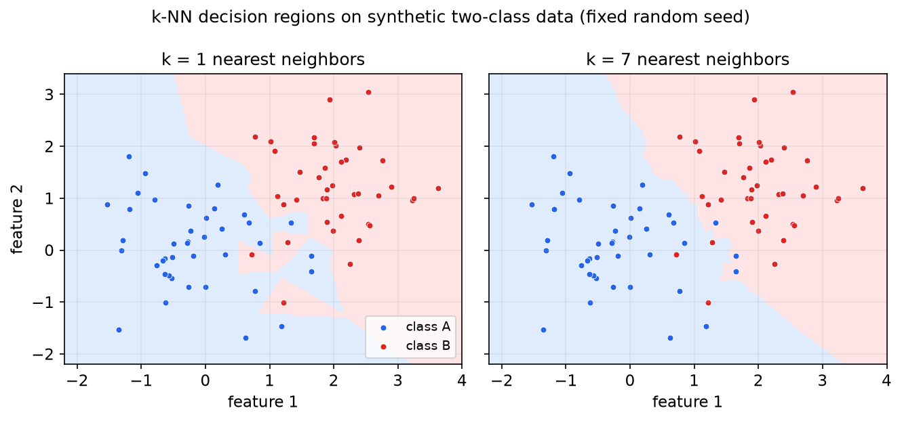
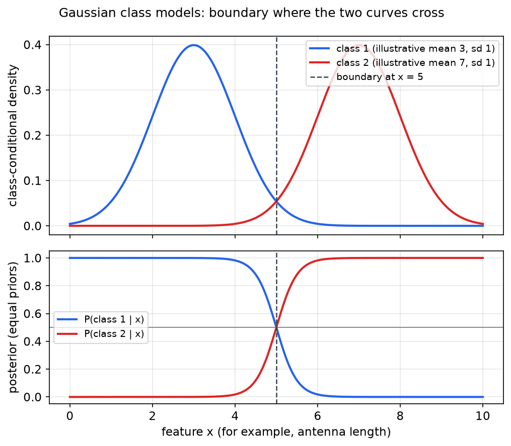
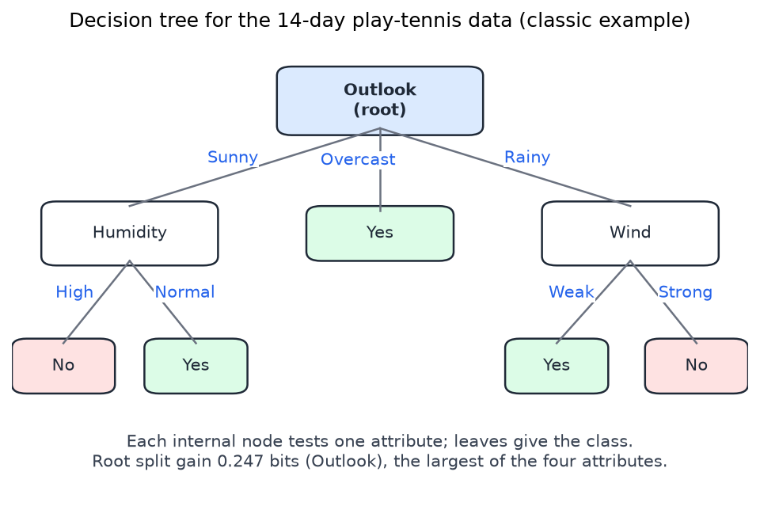

# Classifiers, Trees, Ensembles, and Clustering

This chapter covers the classical methods of supervised and unsupervised learning that do not use hidden layers: nearest neighbors, Gaussian and naive Bayes classifiers, decision trees, the ensembles built from trees, and the clustering algorithms k-means and expectation-maximization. The common question is how to build a rule from examples that also works on cases not yet seen. The methods answer it under different assumptions about the data, and the sections keep those assumptions explicit. Bayes' rule, used by several of these methods, is developed in [Probability and Bayes' Rule](probability.md). Neural networks, which replace these rules with differentiable functions, are treated in [Neurons, Perceptrons, and Feedforward Networks](neural-network-basics.md) and [Backpropagation and Network Architectures](backpropagation.md).

## Supervised classification

A supervised classifier receives training pairs \\((\mathbf{x}\_i, y\_i)\\), where \\(\mathbf{x}\_i\\) is a feature vector and \\(y\_i\\) is its label from a finite set of classes, and returns a function \\(h\\) that labels new feature vectors. The features might be the width and length of a wound, the words in an email, or the antenna and abdomen lengths of an insect.

The **training error** is the fraction of training examples that \\(h\\) gets wrong. The **generalization error** is the expected error on new examples drawn from the same process, and it is the quantity that matters. Every method below can drive the training error to zero by memorizing the data, so the practical problem is controlling how much a method fits the training set.

## Nearest neighbors

The one-nearest-neighbor rule stores the training set and labels a query with the label of the closest stored point, usually under Euclidean distance. The **k-nearest-neighbor** rule takes the \\(k\\) closest points and returns their majority label.

```
KNN-CLASSIFY(x, train, k):
    neighbors = the k training points closest to x (by distance)
    return majority label among neighbors
```

Suppose the nearest training point to a query is labeled \\(+\\), but the next two nearest are labeled \\(O\\). The 1-nearest-neighbor answer is \\(+\\), and the 3-nearest-neighbor answer is \\(O\\). The single nearest point may be an outlier, and the vote over several points is more stable. Small \\(k\\) follows the training data closely and gives a jagged boundary. Large \\(k\\) smooths the boundary and eventually predicts the majority class everywhere, so \\(k\\) is chosen by validation.

The region where the 1-nearest-neighbor rule predicts a class is a union of Voronoi cells, so the boundary is piecewise linear, made of perpendicular bisectors between points of different classes. A single added point can move it sharply.



*Figure: decision regions of the 1-nearest-neighbor rule (left) and the 7-nearest-neighbor rule (right) on the same synthetic two-class data. Points are colored by class, and the shading shows the class each rule predicts at every location. The 1-nearest-neighbor boundary fragments around isolated points, while the 7-nearest-neighbor boundary is smoother. The data are generated with a fixed random seed and serve only as an illustration.*

## Evaluating a classifier honestly

### Training, validation and test sets

Training accuracy cannot choose a method. Consider 1-nearest-neighbor with the training data reused as the test set. Every point is its own nearest neighbor, so accuracy is 100 percent, which says nothing about new data. This is overfitting, and it is the central tension of machine learning: a method flexible enough to fit real patterns is also flexible enough to fit noise.

Two held-out roles are needed. A **validation** set (or a cross-validation procedure) chooses hyperparameters such as \\(k\\) or the number of Gaussians. A **test** set, used once at the end, estimates final performance. If the same data both choose the parameters and report the performance, the report is optimistic. The split should be random, and the training data should cover the cases the deployed system will meet. A split that reserves the first eighty percent of time-ordered data for training can fail if the two periods differ systematically.

### Cross-validation

Cross-validation repeats the split to make better use of limited data. A standard procedure for 100 labeled examples is:

1. Reserve 10 examples, chosen at random, as the final test set. They are used once, at the end.
2. From the remaining 90, choose 18 at random as a validation set and use the other 72 for training.
3. Train on the 72, measure accuracy on the 18, and record it.
4. Repeat with new random splits and average the accuracies.

The number of distinct validation sets is the number of ways to choose 18 of 90 examples,

\\[
\binom{90}{18} = \frac{90!}{18!\\,72!} \approx 3.8 \times 10^{18} .
\\]

No procedure can enumerate that many splits, so the average over a modest number of random splits, often 100, estimates the average over all of them. A single split may happen to contain unusually easy or hard cases, and averaging gives both a more reliable accuracy and a measure of its spread.

```
CROSS-VALIDATE(data90, k, R = 100):
    accs = []
    repeat R times:
        shuffle data90; split into train (72) and validation (18)
        model = train(train, k)
        accs.append(accuracy(model, validation))
    return mean(accs)
```

To choose \\(k\\), compute the averaged accuracy for each candidate and keep the best. Because the choice used only the 90 examples, the 10 reserved examples remain an honest estimate for the chosen method. For very small data sets, leave-one-out cross-validation trains on \\(n - 1\\) examples and tests on the one left out, for each example in turn. Leave-two-out does the same with pairs, giving \\(\binom{10}{2} = 45\\) splits for 10 examples. Both have high variance on noisy data, so random splits are usually preferred.

### Reading the results

A large spread of accuracy across folds suggests sensitivity to outliers or to variables the features do not capture. A large change in accuracy when \\(k\\) moves from 10 to 11 suggests an unstable method. A large gap between training and validation accuracy means overfitting or too little data. Low accuracy on both means the features or the algorithm are inadequate.

### Accuracy needs a baseline

Accuracy means little without the class frequencies. If 10 percent of the examples are positive, a classifier that always answers negative scores 90 percent and has no ability at all. The right comparison is the majority-class baseline, and when one class is rare, measures such as precision and recall of that class are needed. The same point returns in [Bias, Society, and the Limits of AI](bias-and-society.md).

## Gaussian class models

### Gaussian densities

A one-dimensional Gaussian with mean \\(\mu\\) and variance \\(\sigma^2\\) has density

\\[
\mathcal{N}(x;\mu,\sigma^2) = \frac{1}{\sqrt{2\pi}\\,\sigma}\exp\\!\left(-\frac{(x-\mu)^2}{2\sigma^2}\right) .
\\]

About 68 percent of its mass lies within one standard deviation of the mean, 95 percent within two, and 99.7 percent within three. The Gaussian is a natural model for a feature that is a sum of many small independent contributions, because the central limit theorem says such sums tend toward a normal distribution as the number of terms grows. Insect body measurements often fit this pattern. The approximation fails with few contributors, dependent contributions or heavy skew, so it should be checked against the data.

### Posterior probabilities from class curves

A Gaussian classifier fits one Gaussian to each class from its sample mean and standard deviation. To classify a value \\(x\\), read each class curve's height at \\(x\\) and normalize the heights to sum to one. With class-conditional densities \\(f\_j\\) and priors \\(P(c\_j)\\), Bayes' rule gives

\\[
P(c\_j \mid x) = \frac{f\_j(x)\\, P(c\_j)}{\sum\_k f\_k(x)\\, P(c\_k)} .
\\]

With equal priors the priors cancel, and the posterior is exactly the normalized height. Unequal priors must be multiplied in before normalizing.

### Decision boundaries

The boundary is the set of points where the two weighted class curves cross. Take equal priors and equal variances \\(\sigma\\). Setting the two densities equal and taking logarithms gives

\\[
-\frac{(x-\mu\_1)^2}{2\sigma^2} = -\frac{(x-\mu\_2)^2}{2\sigma^2} .
\\]

The \\(x^2\\) terms cancel, leaving a linear equation with solution \\(x = (\mu\_1 + \mu\_2)/2\\). The boundary is the midpoint of the means. With illustrative means 3 and 7 and unit standard deviations, the boundary is at \\(x = 5\\), where the classes are equally likely. These illustrative values are not measurements from any data set.

The standard field example of this method separates grasshoppers from katydids by antenna length. The source's numbers place short antennae with grasshoppers and long antennae with katydids, so the grasshopper class lies to the left of the boundary. One remark in the source reverses this and puts grasshoppers on the right. That contradicts the rest of the example, so the numbers are followed here.

With priors \\(\pi\_1\\) and \\(\pi\_2\\), keeping the log-prior terms gives

\\[
x = \frac{\mu\_1 + \mu\_2}{2} + \frac{\sigma^2}{\mu\_1 - \mu\_2}\\,\ln\frac{\pi\_2}{\pi\_1} .
\\]

If class 1 is twice as common, \\(\pi\_1 = 2/3\\) and \\(\pi\_2 = 1/3\\). With the same means and \\(\sigma = 1\\), the shift is \\(\ln(1/2)/(3 - 7) = 0.173\\), and the boundary moves to \\(x = 5.173\\), toward the rarer class's mean. The rule then favors the common class, which is correct when the priors are right.

With unequal variances the quadratic terms do not cancel, and the boundary is a quadratic equation that can have two thresholds: a narrow class can rise above a wide one in the middle, leaving the wide class to win on either side. In two dimensions the boundaries of Gaussian classes are conic sections.



*Figure: the upper panel shows two class-conditional Gaussians with illustrative means 3 and 7 and unit standard deviations. The dashed line marks the boundary at \\(x = 5\\), where the curves cross. The lower panel shows the normalized posteriors, which are each height divided by the sum of the two. Each posterior equals 0.5 at the boundary and approaches 0 or 1 away from it.*

### Error at a boundary, and cost-sensitive thresholds

The error of a boundary is the probability mass of each class on the wrong side. Consider classifying a mosquito species from its wingbeat frequency, with a boundary at 517 Hz. The part of the right-hand species' distribution that falls left of 517 Hz is misclassified, with area 12.2 percent. The part of the other species' distribution that falls right of 517 Hz is misclassified, with area 8.02 percent. The total error is \\(12.2\\% + 8.02\\% = 20.22\\%\\). If the species are equally common, placing the boundary where the curves cross minimizes this total, so 20.22 percent is the smallest error this feature allows under these Gaussian models.

Equal weighting of errors is often wrong. Suppose missing a dangerous species costs ten times as much as a false alarm. The expected cost of predicting dangerous is \\(C\_{\text{false alarm}} P(\text{harmless} \mid x)\\), and the expected cost of predicting harmless is \\(C\_{\text{miss}} P(\text{dangerous} \mid x)\\). The rule therefore predicts dangerous when

\\[
P(\text{dangerous} \mid x) \ge \tfrac{1}{10}\\, P(\text{harmless} \mid x) .
\\]

This moves the threshold in the likelihood ratio, not in the area ratio. The region predicted dangerous grows, so more harmless cases are flagged and fewer dangerous cases are missed. Total error can rise while the expensive errors fall, which is the purpose of the weighting.

## Naive Bayes

### The naive factorization

Bayes' rule gives the posterior of each class for a feature vector \\(\mathbf{d}\\):

\\[
P(c\_j \mid \mathbf{d}) = \frac{P(\mathbf{d} \mid c\_j)\\, P(c\_j)}{P(\mathbf{d})} .
\\]

The prior is found by counting, and the denominator is the same for every class, so it can be dropped when classes are compared. The likelihood \\(P(\mathbf{d} \mid c\_j)\\) is the hard part, since a joint table has an entry for every combination of feature values. The **naive Bayes** model assumes that the features are conditionally independent given the class:

\\[
P(\mathbf{d} \mid c\_j) = \prod\_{i=1}^{n} P(d\_i \mid c\_j) .
\\]

In a Bayes network this is drawn as the class with an arrow to each feature: the class is the cause, and once it is known the features carry no further information about one another. The assumption is rarely exactly true, but the model often classifies well anyway.

### Maximum likelihood and maximum a posteriori

**Maximum likelihood** chooses \\(\arg\max\_{c\_j} \prod\_i P(d\_i \mid c\_j)\\), which assumes equal priors. **Maximum a posteriori** chooses \\(\arg\max\_{c\_j} P(c\_j) \prod\_i P(d\_i \mid c\_j)\\). Equal priors are a sensible choice when priors are untrusted in a new setting, the training data are too few to estimate them, or they really are about equal.

Estimation is counting. The prior of a class is the fraction of training examples with that label, and \\(P(d\_i = v \mid c)\\) is the fraction of class-\\(c\\) examples whose \\(i\\)th feature equals \\(v\\). Counts are usually smoothed by adding a small constant, so that an unseen value does not zero the whole product.

```
NB-TRAIN(examples):
    for each class c:    P(c) = count(c) / N
    for each feature i, value v, class c:
        P(f_i = v | c) = count(f_i = v, c) / count(c)

NB-CLASSIFY(d, mode):
    for each class c:    score(c) = prod_i P(d_i | c)            # maximum likelihood
                         score(c) = P(c) * prod_i P(d_i | c)     # maximum a posteriori
    return argmax_c score(c)
```

### Worked example: a first name and a gender

A database holds eight people, three male and five female. Three have the name Drew: one male and two female. For a person named Drew, Bayes' rule gives

\\[
P(\text{male} \mid \text{Drew}) = \frac{\tfrac13 \cdot \tfrac38}{\tfrac38} = \tfrac13 , \qquad
P(\text{female} \mid \text{Drew}) = \frac{\tfrac25 \cdot \tfrac58}{\tfrac38} = \tfrac23 .
\\]

The posteriors sum to one, and the rule predicts female. The denominator \\(P(\text{Drew}) = 3/8\\) cancels in the comparison, so the decision depends only on the numerators \\(\tfrac18\\) and \\(\tfrac14\\).

### Worked example: spam with three keywords

A spam filter has a class \\(S\\) and three binary features: the word Piazza (less likely in spam), the word Bank, and the word Diplomat (more likely in spam). Write \\(\neg p\\) for Piazza absent, \\(b\\) for Bank present and \\(\neg d\\) for Diplomat absent. The naive factorization gives

\\[
P(S \mid \neg p, b, \neg d) = \frac{P(\neg p \mid S)\\, P(b \mid S)\\, P(\neg d \mid S)\\, P(S)}{P(\neg p, b, \neg d)} .
\\]

The denominator must be computed correctly. Because the model conditions every feature on the class, it is the sum of the same numerator terms over both classes:

\\[
P(\neg p, b, \neg d) = \sum\_{c \in \\{S,\ \neg S\\}} P(\neg p \mid c)\\, P(b \mid c)\\, P(\neg d \mid c)\\, P(c) .
\\]

A common error writes the denominator as \\(P(\neg p)\\, P(b)\\, P(\neg d)\\). That treats the features as independent without conditioning on the class, which the model does not assume, so the number is wrong. For the decision alone the denominator cancels, since only the spam and non-spam numerators are compared.

### Why the naive model helps

The model needs one table per feature rather than one per combination of features, so storage grows linearly with the number of features. Classification is a few lookups and multiplications. A feature whose distribution is nearly the same in both classes has a likelihood ratio close to one and barely moves the decision. Eye color is a standard example: when brown-eyed women and brown-eyed men are almost equally common, that feature cancels out, and discriminating features decide. If the independence assumption is clearly false, arcs can be added between features and full Bayes-network inference used, as described in [Bayesian Networks: Structure and Independence](bayes-nets.md).

## Choosing a method

The **no free lunch** theorem of Wolpert and Macready states, informally, that averaged over all possible target functions no learning algorithm beats any other on examples it has not seen. An advantage on one class of problems is paid for by a disadvantage on another. Naive Bayes will not always be best, and neither will any other single method, so each must be validated on the problem at hand.

The methods differ in the boundaries they can produce. One-nearest-neighbor boundaries are arbitrarily complex but fragment when data are scarce. A one-Gaussian-per-class classifier gives a smooth quadratic boundary, which generalizes better if the process really is Gaussian and the data are noisy. Mixtures of Gaussians approximate any boundary given enough components. Placing a Gaussian on each training point gives kernel density estimation (Parzen windows), which acts like a smoothed nearest-neighbor rule, and the kernel bandwidth controls smoothness in much the way \\(k\\) does. In the extreme, when \\(k\\) equals the training-set size, every query receives the majority class and the features are ignored.

Plot the data first when the number of features allows it. Compact blobs with few concavities suggest Gaussian models, and interpenetrating classes with distinct boundaries suggest nearest-neighbor or kernel methods. In high dimensions, trees or boosting show which features matter.

## Decision trees

### The tennis example

A decision tree labels an example by asking about its attributes in sequence. Each internal node tests one attribute, each branch is one value of that attribute, and each leaf gives a class. The classic illustration uses fourteen days described by outlook, temperature, humidity and wind.



*Figure: a decision tree for the fourteen-day play-tennis data. Each box tests one attribute, and each line leaving it is one of that attribute's values. Leaves give the class. To predict, follow the branches from the root: an overcast day is a yes, a sunny day is decided by humidity, and a rainy day by wind.*

### Entropy and information gain

The standard criterion for a test is **information gain**. The entropy of a distribution \\(p\\) over classes is \\(H(p) = -\sum\_i p\_i \log\_2 p\_i\\). For a binary set with \\(p\\) positive and \\(n\\) negative examples, with \\(q = p/(p+n)\\),

\\[
B(q) = -\bigl( q \log\_2 q + (1 - q)\log\_2(1 - q) \bigr) ,
\\]

which is zero for a pure set and equals one bit at \\(q = \tfrac12\\). An attribute \\(A\\) splits the set into subsets with \\(p\_k\\) positive and \\(n\_k\\) negative examples. The expected remaining entropy is

\\[
\mathrm{Remainder}(A) = \sum\_{k} \frac{p\_k + n\_k}{p + n}\\, B\\!\left(\frac{p\_k}{p\_k + n\_k}\right) ,
\\]

and the gain is \\(\mathrm{Gain}(A) = B\\!\left(\frac{p}{p+n}\right) - \mathrm{Remainder}(A)\\). The attribute with the largest gain is tested at the node.

For the play-tennis data, \\(p = 9\\) and \\(n = 5\\), so the entropy of the whole set is \\(B(9/14) = 0.9403\\) bits. The branch counts below are written as (positive, negative).

- **Outlook**: sunny (2, 3), overcast (4, 0), rainy (3, 2). The remainder is \\(\tfrac{5}{14}B(\tfrac25) + \tfrac{4}{14}\cdot 0 + \tfrac{5}{14}B(\tfrac35) = 0.6935\\), so the gain is \\(0.247\\) bits.
- **Humidity**: high (3, 4), normal (6, 1). The remainder is \\(\tfrac{7}{14}B(\tfrac37) + \tfrac{7}{14}B(\tfrac67) = 0.7885\\), and the gain is \\(0.1518\\) bits.
- **Wind**: weak (6, 2), strong (3, 3). The remainder is \\(\tfrac{8}{14}B(\tfrac68) + \tfrac{6}{14} = 0.8922\\), and the gain is \\(0.048\\) bits.
- **Temperature**: hot (2, 2), mild (4, 2), cool (3, 1). The remainder is \\(\tfrac{4}{14} + \tfrac{6}{14}B(\tfrac23) + \tfrac{4}{14}B(\tfrac34) = 0.9110\\), and the gain is \\(0.029\\) bits.

Outlook has the largest gain and becomes the root. The humidity gain computes to 0.1518, which rounds to 0.152, although 0.151 is often quoted.

The restaurant example in the standard textbook treatment shows a different pattern. Splitting on the number of patrons (none, some, full) gives branches (0, 2), (4, 0) and (2, 4) out of six positive and six negative examples. The remainder is \\(\tfrac{6}{12}B(\tfrac13) = 0.4591\\), so the gain is \\(0.541\\) bits. Restaurant type splits every branch evenly, so its gain at the root is zero, although it becomes useful deeper in the tree. Information gain looks one split ahead, so it can miss attributes that matter only in combination.

### Growing a tree greedily

The learner chooses the attribute with the largest gain at each node, creates a branch for each value, and recurses. It stops when the examples at a node share one label, in which case the node is a leaf with that label, or when no attributes remain, in which case it predicts the majority label. The same attribute may appear more than once on a path.

```
DT-LEARN(examples, attributes):
    if all examples have the same label: return leaf(label)
    if attributes is empty:              return leaf(majority label)
    A = attribute in attributes with largest information gain on examples
    node = test on A
    for each value v of A:
        node[v] = DT-LEARN({e in examples : e.A = v}, attributes minus A)
    return node
```

Short trees are preferred because of the **minimum description length** principle: a hypothesis is good when the bits needed to describe the model plus the bits needed to describe the data given the model are few. A small tree that fits the data well has a short total description, while a large tree that memorizes the data does not.

For a continuous attribute the tree tests \\(x < \theta\\), and the learner chooses the threshold with the largest gain from the midpoints between sorted values. Two thresholds on two attributes partition the plane into rectangles.

Trees have limits. A tree partitions the input space into axis-aligned regions, so a function with global structure is hard for it to represent. The parity of \\(n\\) bits is the standard example: flipping any input changes the output, so every root-to-leaf path tests all \\(n\\) bits and a tree computing parity has \\(2^n\\) leaves. A single-layer perceptron fails in the opposite way, representing majority easily but not parity.

## Ensembles

### Random forests

A random forest is an ensemble of decision trees, each grown on a bootstrap sample (drawn with replacement from the training set, at the same size) and each considering a random subset of attributes at every split. The forest predicts by majority vote. This is **bagging** (bootstrap aggregation). Averaging over trees that differ reduces the variance that makes a single deep tree unreliable. The examples left out of each bootstrap sample give an error estimate without a separate validation set, and counting how often each feature is used ranks the features.

### Boosting

Boosting combines weak classifiers, each slightly better than chance, in sequence, with each new classifier concentrating on the examples the earlier ones got wrong. AdaBoost is the standard form. Consider ten points, five positive and five negative, with weak classifiers that are horizontal or vertical threshold splits.

1. Start with equal weights \\(w\_i = 1/10\\).
2. Choose the weak classifier with the lowest weighted error. Suppose it classifies all five negatives and two of the five positives correctly, so \\(\varepsilon\_1 = 0.3\\).
3. Compute its vote, \\(\alpha\_1 = \tfrac12 \ln\frac{1 - \varepsilon\_1}{\varepsilon\_1} = \tfrac12 \ln\frac{7}{3} = 0.4236\\).
4. Reweight. Misclassified examples are multiplied by \\(e^{\alpha\_1} = 1.5275\\), and correct ones by \\(e^{-\alpha\_1} = 0.6547\\). Each misclassified point now has weight \\(0.1528\\) and each correct point \\(0.0655\\).
5. Normalize. The misclassified total is \\(0.3 \times 1.5275 = 0.4583\\), and the correct total is \\(0.7 \times 0.6547 = 0.4583\\). After normalization each group has total weight one half. This is general: after a round, the previous classifier has weighted error one half, so the next classifier must differ from it.
6. Repeat on the reweighted set. The next two rounds have votes \\(\alpha\_2 \approx 0.65\\) and \\(\alpha\_3 \approx 0.92\\), which correspond to weighted errors of about 0.214 and 0.137. Their training weights are not given in the source, so the values are taken as stated.

The final classifier is \\(H(\mathbf{x}) = \operatorname{sign}\bigl(\sum\_t \alpha\_t h\_t(\mathbf{x})\bigr)\\). For a negative point on which the three classifiers vote \\(-1\\), \\(-1\\) and \\(+1\\), the sum is \\(-0.42 - 0.65 + 0.92 = -0.15\\), which is negative and therefore correct. Classifiers with smaller weighted error receive larger votes.

```
ADABOOST(examples, T):
    w_i = 1/N for each example
    for t = 1..T:
        h_t = weak classifier with lowest weighted error eps_t
        alpha_t = 0.5 * ln((1 - eps_t) / eps_t)
        for each example i:
            w_i = w_i * exp(alpha_t) if h_t(x_i) is wrong, else w_i * exp(-alpha_t)
        normalize w
    return H(x) = sign(sum_t alpha_t * h_t(x))
```

A related example compares candidate boundaries on a new training set. The one that misclassifies only three negative examples has the largest vote, \\(\alpha = 0.88\\). The size of that training set is not given, so the value cannot be checked, but under the same formula it corresponds to a weighted error of about 0.145.

## Clustering

### k-means

Clustering finds groups in unlabeled data. **k-means** fixes the number of clusters \\(k\\) and represents each cluster by its mean. It alternates two steps: each point is assigned to its nearest mean (the expectation step), and each mean is recomputed as the average of its points (the maximization step). Means start at random positions or random data points, and the steps repeat until the assignments stop changing.

```
KMEANS(data, k):
    means = k random positions (or random data points)
    repeat:
        for each x in data: label(x) = argmin_j ||x - means[j]||      # assignment
        for each j: means[j] = average of {x : label(x) = j}          # update
    until labels stop changing
    return means, labels
```

The algorithm seeks to minimize the within-cluster sum of squares

\\[
J = \sum\_{n} \lVert \mathbf{x}\_n - \boldsymbol{\mu}\_{z\_n} \rVert^2 ,
\\]

where \\(z\_n\\) is the cluster of point \\(n\\). The assignment step minimizes each point's term with the means fixed, so it cannot increase \\(J\\). The update step sets each mean to its cluster average, which minimizes \\(\sum\_{n \in C} \lVert \mathbf{x}\_n - \boldsymbol{\mu} \rVert^2\\) because its gradient vanishes there. So \\(J\\) never increases. With finitely many assignments the algorithm terminates, at a local minimum that depends on the start, which is why random restarts are used. The spread of results across restarts measures how stable the clustering is.

### Mixtures of Gaussians and EM

A mixture of Gaussians, \\(p(\mathbf{x}) = \sum\_k \pi\_k\\, \mathcal{N}(\mathbf{x}; \boldsymbol{\mu}\_k, \Sigma\_k)\\), generalizes k-means by allowing soft membership and cluster-specific shapes. **Expectation-maximization** (EM) fits it. The expectation step computes responsibilities, the posterior probability that point \\(n\\) came from component \\(k\\):

\\[
r\_{nk} = \frac{\pi\_k\\, \mathcal{N}(\mathbf{x}\_n; \boldsymbol{\mu}\_k, \Sigma\_k)}{\sum\_j \pi\_j\\, \mathcal{N}(\mathbf{x}\_n; \boldsymbol{\mu}\_j, \Sigma\_j)} .
\\]

The maximization step uses \\(N\_k = \sum\_n r\_{nk}\\):

\\[
\boldsymbol{\mu}\_k = \frac{1}{N\_k} \sum\_n r\_{nk}\\, \mathbf{x}\_n , \qquad
\Sigma\_k = \frac{1}{N\_k} \sum\_n r\_{nk} (\mathbf{x}\_n - \boldsymbol{\mu}\_k)(\mathbf{x}\_n - \boldsymbol{\mu}\_k)^{\top} , \qquad
\pi\_k = \frac{N\_k}{N} .
\\]

Each iteration does not decrease the likelihood, and the algorithm converges to a local maximum. The link to k-means is direct. With equal mixing weights and a common spherical covariance \\(\sigma^2 I\\), the responsibilities approach zero or one as \\(\sigma\\) shrinks, and the updates become the k-means updates. Soft responsibilities describe a point between two clusters more accurately, because it contributes to both rather than being forced into one. The mixture has more parameters, so it needs more iterations and data, but it can represent clusters of different sizes and orientations.

## Summary

- Nearest-neighbor rules need no training, and the number \\(k\\) of neighbors controls smoothness. It is chosen by validation.
- Cross-validation averages accuracy over random splits of the non-test data, and the reserved test set is used once. Compare accuracy with the majority-class baseline when classes are imbalanced.
- With equal priors and variances, the Gaussian boundary is the midpoint of the means. With unequal priors and means \\(\mu\_1 < \mu\_2\\), it shifts by \\(\sigma^2 \ln(\pi\_2/\pi\_1)/(\mu\_1 - \mu\_2)\\) toward the rarer class.
- Cost-sensitive decisions threshold the ratio of posteriors at the inverse cost ratio, trading more errors on the cheap class for fewer on the expensive one.
- Naive Bayes multiplies one table entry per feature, assuming features are independent given the class. The denominator sums over classes and does not factor into unconditional probabilities.
- Decision trees split on the attribute with the largest information gain, \\(B(q) - \mathrm{Remainder}\\). For the play-tennis data, outlook has gain 0.247 bits and is the root.
- Random forests average trees grown on bootstrap samples. AdaBoost reweights examples by their errors and combines weak classifiers by a weighted vote.
- k-means alternates nearest-mean assignment and mean updates, and never increases the within-cluster sum of squares. EM for a Gaussian mixture uses soft responsibilities and reduces to k-means as the variances shrink.

## References

- Russell, S. and Norvig, P., *Artificial Intelligence: A Modern Approach*. The restaurant decision-tree example is drawn from the textbook's chapter on learning from examples.
- Wolpert, D. H. and Macready, W. G., the no free lunch theorem, stated here informally.

## See Also

- [Supervised Learning](../ml/supervised.md): the general framework for learning from labeled examples.
- [Unsupervised Learning](../ml/unsupervised.md): clustering and density estimation in more depth.
- [Evaluation](../ml/evaluation.md): validation, test sets and performance measures.
- [Features](../ml/features.md): choosing and transforming the inputs these methods use.
- [Entropy](../information-theory/entropy.md): the background to information gain.
- [Probability and Bayes' Rule](probability.md): the foundations of the posterior and naive Bayes calculations.
