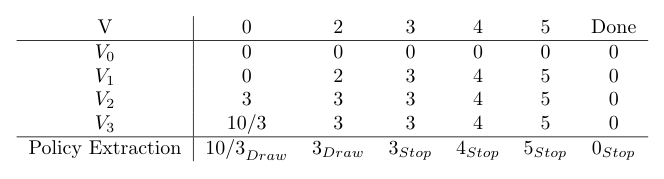
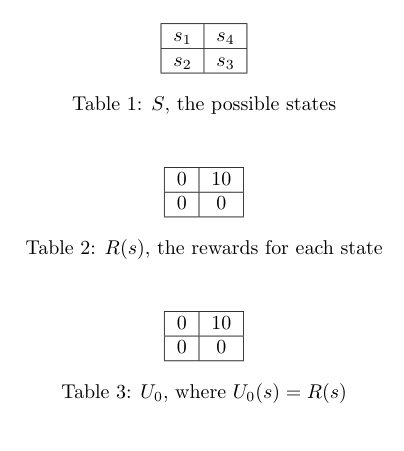
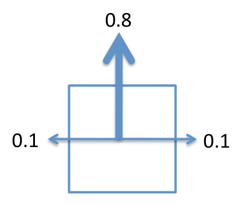
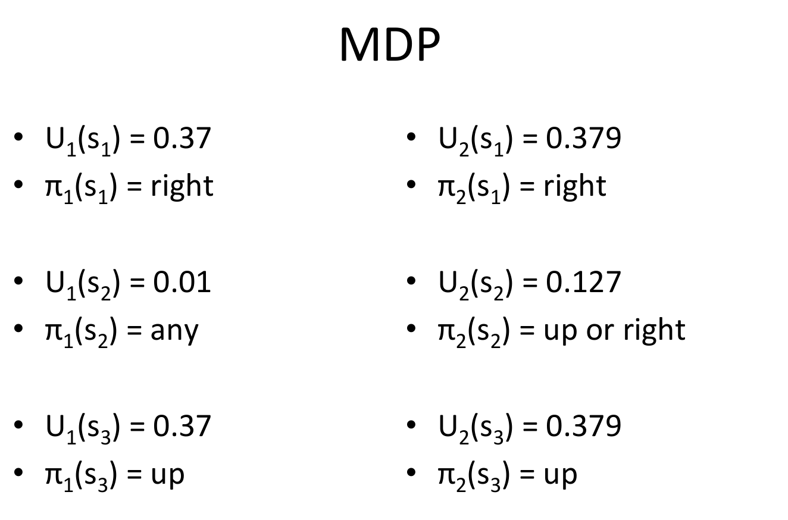

# MDP Examples and Value Iteration

The previous chapter defined Markov decision processes and the Bellman equation, and showed value iteration on a grid. This chapter works through three more examples in full. The first is a small card game, micro-blackjack, whose optimal policy follows from a few lines of value iteration and shows how a finite horizon appears in a model that has no explicit deadline. The second is a pursuit game in which an adversary moves against the agent, which connects value iteration to the minimax search of adversarial games. The last two are complete solutions to two-step value iteration on a four-state grid with noisy moves, one with a reward state that is not absorbing and one with an absorbing sink. In each case the numbers are checked by hand, and the places where a worked solution is inconsistent with its own statement are identified and resolved.

## Micro-Blackjack

The game is played with cards drawn with replacement. Each card is equally likely to be 2, 3 or 4. At each step the player may draw or stop while the running total is below 6. A total of 6 or more forces a stop. On stopping the player receives the total as utility, up to 5, and zero if the total is 6 or more. Drawing gives no utility. The discount factor is \\(\gamma = 1\\), so the game is undiscounted.

### States, actions and the model

The state is the running total together with a terminal state, \\(S = \\{0, 2, 3, 4, 5, \text{Done}\\}\\). The actions are \\(A = \\{\text{Draw}, \text{Stop}\\}\\). Totals of 1 are never reached, because the first card is at least 2. Choosing Stop moves to Done with probability 1. The transitions for Draw follow from the card values:

- From 0, a draw goes to 2, 3 or 4, each with probability \\(1/3\\).
- From 2, a draw goes to 4 or 5 with probability \\(1/3\\) each, and to Done with probability \\(1/3\\), since the total 6 is a bust.
- From 3, a draw goes to 5 with probability \\(1/3\\), and to Done with probability \\(2/3\\), because totals of 6 and 7 both end the game.
- From 4 or 5, every draw goes to Done with probability 1.

The source states the transition function as a case list whose first case, \\(s' - s \in \\{2, 3, 4\\}\\), also covers the terminal outcomes. The explicit Done cases override the general case, so the probability of Done from 3 is \\(2/3\\), as the list above gives. The reward for stopping is the total, \\(R(s, \text{Stop}, s') = s\\) for \\(s \le 5\\), and zero for a draw.

### The optimal policy

For each state the choice is between stopping now, worth \\(s\\), and drawing, worth the expected value of the next state. Drawing at state 2 leads to 4, 5 or a bust, with expected value \\((4 + 5 + 0)/3 = 3\\). That beats stopping at 2, so the agent draws. At state 3, drawing leads to 5 with probability \\(1/3\\) and to a bust otherwise, so its expected value is \\(5/3\\), less than the 3 gained by stopping. At 4 and 5 drawing always busts. The optimal policy is therefore

\\[
\pi^{\*}(s) =
\begin{cases}
\text{Draw} & s \le 2, \\
\text{Stop} & s \ge 3.
\end{cases}
\\]

The policy has a threshold structure: draw while the total is at most 2, and stop at 3 or more. The source states it in one line and then gives the value iteration that confirms it.

### Value iteration

With \\(\gamma = 1\\) and zero draw rewards, the update simplifies. Let \\(V\_k\\) be the value after \\(k\\) sweeps. Then

\\[
V\_{k+1}(s) = \max\Big\\{\\, s, \\; \tfrac{1}{3}\sum\_{s' \in D(s)} V\_k(s') \Big\\},
\\]

where \\(D(s)\\) is the set of states reachable from \\(s\\) by drawing, counting Done with value zero. The second term is the expected value of drawing, and the first is the value of stopping. Starting from the all-zero vector, the sweeps give:

*Figure: the value of each state over three sweeps of value iteration, with the extracted policy in the last row. Columns are the states and rows are the sweeps. Each entry is the best of stopping and drawing. The last row gives the extracted action beside its value.*

The sweeps are checked here, one by one.

- \\(V\_1(0) = \max\\{0, 0\\} = 0\\), \\(V\_1(2) = \max\\{2, 0\\} = 2\\), \\(V\_1(3) = 3\\), \\(V\_1(4) = 4\\) and \\(V\_1(5) = 5\\). Only the stop values survive the first sweep, because every draw leads to a state whose value is still zero.
- \\(V\_2(0) = \max\\{0, \tfrac{1}{3}(2 + 3 + 4)\\} = 3\\).
- \\(V\_2(2) = \max\\{2, \tfrac{1}{3}(4 + 5 + 0)\\} = 3\\).
- \\(V\_2(3) = \max\\{3, \tfrac{1}{3} \cdot 5\\} = 3\\). Stopping is still better.
- \\(V\_3(0) = \max\\{0, \tfrac{1}{3}(3 + 3 + 4)\\} = \tfrac{10}{3}\\).
- \\(V\_3(2) = \max\\{2, \tfrac{1}{3}(4 + 5)\\} = 3\\), so the argmax at 2 is Draw.

The values are unchanged in the next sweep, since \\(V\_4(0) = \tfrac{1}{3}(3 + 3 + 4) = \tfrac{10}{3}\\), \\(V\_4(2) = 3\\) and \\(V\_4(3) = 3\\). So \\(V\_3\\) is already exact, and the value of state 0 is \\(10/3\\). The source asks how many sweeps give exact values and gives the answer 3. This is consistent with the arithmetic: \\(V\_2(0) = 3\\) differs from \\(V\_3(0) = 10/3\\), while \\(V\_3\\) and \\(V\_4\\) agree everywhere. The game is finite in effect. Every path ends in a stop or a bust after at most three draws, because each draw adds at least 2 and a total of 6 or more ends the game. So the values stabilise in finitely many sweeps.

The extracted policy in the table agrees with the argument above. At 0 and 2 the value of drawing exceeds the value of stopping, \\(10/3 > 0\\) and \\(3 > 2\\), and at 3, 4 and 5 stopping is best.

## Pursuit-Evasion

The second example is a pursuit game. Pac-Man is in a two-by-two maze, and a ghost hunts him. On Pac-Man's turn he moves one step horizontally or vertically to a neighboring square. The ghost then moves the same way. The ghost moves first. After every move, if the two occupy the same square Pac-Man is eaten and receives utility \\(-100\\). Otherwise he receives \\(+1\\). The ghost minimises Pac-Man's utility, so the game is adversarial. It is not guaranteed to terminate.

*Figure: the start of the pursuit game. The ghost is in the top-left square and Pac-Man in the bottom-right. The four squares form a cycle, so each square has two neighbors and the diagonal squares are opposite each other.*

The source gives one worked trajectory. If the ghost moves down and Pac-Man then moves left, Pac-Man earns \\(+1\\) after the ghost's move and \\(-100\\) after his own, for a total of \\(-99\\), because his move lands him on the ghost. The example is a simple check on the scoring: capture is recorded at the move that causes it.

### A truncated minimax value

With \\(\gamma = 0.5\\), the discount is applied once per move. After two ghost moves and two Pac-Man moves, four moves have been made and none has ended in capture. Each yields \\(+1\\), so the truncated value is

\\[
1 + 0.5 + 0.25 + 0.125 = 1.875.
\\]

No minimax tree needs to be built to get this, because the sequence of rewards is the same in every line of play that avoids capture.

### The infinite game

The value of the infinite game with \\(\gamma = 0.5\\) is given in the source as 2. This is the geometric series \\(\sum\_{t \ge 0} (0.5)^t = 1/(1 - 0.5) = 2\\), which holds if Pac-Man avoids capture forever and earns \\(+1\\) on every move. The source does not justify why the ghost cannot force a capture, so the argument is supplied here.

Label the squares top-left, top-right, bottom-left and bottom-right. Adjacency makes these four squares a cycle, and in a four-cycle every square has two neighbors that are opposite each other. Suppose the ghost starts diagonally opposite Pac-Man, as in the figure. Two facts give the invariant.

1. On the ghost's turn, the ghost is opposite Pac-Man. Whatever neighboring square the ghost moves to, that square is adjacent to Pac-Man's square, because both of the ghost's neighbors are adjacent to the square diagonally opposite it. So after the ghost's move, the ghost is adjacent to Pac-Man and not on his square, and no capture has occurred.
2. On Pac-Man's turn the ghost is adjacent to him. Pac-Man moves to the square opposite the ghost. That square is one of Pac-Man's own neighbors, so the move is legal, and it is not the ghost's square. The invariant is restored: the ghost is now opposite Pac-Man, as in fact 1.

Pac-Man is never caught, and he earns \\(+1\\) on every move, so the value is \\(\sum\_t (0.5)^t = 2\\). Pac-Man cannot earn more than \\(+1\\) per move, so the minimax value of the infinite game is exactly 2.

### Why value iteration suits this game

The source contrasts value iteration with minimax search. A truncated minimax tree grows exponentially with the search depth, because each level multiplies the number of lines by the number of moves. The number of distinct states does not grow in this way. Value iteration uses this, by storing one value per state and reusing it wherever the state recurs, so the work is proportional to the number of states rather than the number of lines of play.

### The game value as a recursion

With \\(\gamma = 1\\), the value of the game to Pac-Man in state \\(s\\) is a recursion over one round of play, which consists of a Pac-Man move followed by a ghost move. Let \\(A\_P(s)\\) and \\(A\_G(s)\\) be the moves available to Pac-Man and the ghost, let \\(N(s, a)\\) be the successor state, and let \\(R\\) be the reward for entering a state. The source's typeset expression omits the brackets, so the grouping is taken here to put each reward inside the bracket of the move that produced it:

\\[
P^{\*}(s) = \max\_{a \in A\_P(s)} \Big[ R(N(s, a)) + \min\_{a' \in A\_G(N(s,a))} \big( R(N(N(s,a), a')) + P^{\*}(N(N(s,a), a')) \big) \Big].
\\]

The successor is taken twice, because each round consists of two moves. This is the usual minimax analogue of the Bellman equation.

## A Two-Step Solution on a Four-State Grid

The first complete solution in the source is for a four-state grid with noisy moves. The states form a two-by-two grid. State \\(s\_1\\) is top-left, \\(s\_4\\) is top-right, \\(s\_2\\) is bottom-left and \\(s\_3\\) is bottom-right. A move goes in the intended direction with probability 0.75, veers left and right with probability 0.10 each, and goes in the reverse direction with probability 0.05. A move into a wall leaves the agent in its state. The rewards are \\(R(s\_4) = 10\\) and zero for the other three states. The initial utilities are \\(U\_0 = R\\).

*Figure: the setup for two steps of value iteration, as drawn in the source. The grid places the states as described above. The reward table gives 10 for \\(s\_4\\), and \\(U\_0\\) copies the reward.*

### The transition model

The solution builds one table for each state. For \\(s\_1\\), the rows are the four actions and the columns are the successors, with the probabilities of the intended move, the two veers and the reverse summed where they reach the same state.

| Action | \\(s\_1\\) | \\(s\_2\\) | \\(s\_3\\) | \\(s\_4\\) | Sum |
|---|---|---|---|---|---|
| Up | 0.85 | 0.05 | 0 | 0.10 | 1 |
| Down | 0.15 | 0.75 | 0 | 0.10 | 1 |
| Left | 0.85 | 0.10 | 0 | 0.05 | 1 |
| Right | 0.15 | 0.10 | 0 | 0.75 | 1 |

For Up from \\(s\_1\\), the intended move is a wall and stays at \\(s\_1\\) with probability 0.75, and the left veer is also a wall, which adds 0.10 to \\(s\_1\\), giving 0.85. The right veer goes to \\(s\_4\\), and the reverse goes down to \\(s\_2\\), giving the entries 0.10 and 0.05. The other tables are built the same way, and each row sums to 1.

### The discount factor

The source does not state the discount factor. The arithmetic implies \\(\gamma = 0.5\\): the first sweep gives \\(U\_1(s\_1) = 0 + 7.5\gamma = 3.75\\) and that is the value printed. This chapter uses \\(\gamma = 0.5\\) throughout.

### Two sweeps of value iteration

The first sweep compares the four actions at \\(s\_1\\), using \\(U\_0 = (0, 0, 0, 10)\\) for \\((s\_1, s\_2, s\_3, s\_4)\\). The expected values are:

| Action | Expected successor value |
|---|---|
| Up | \\(0.10 \times 10 = 1\\) |
| Down | \\(0.10 \times 10 = 1\\) |
| Left | \\(0.05 \times 10 = 0.5\\) |
| Right | \\(0.75 \times 10 = 7.5\\) |

The maximum is 7.5, so \\(U\_1(s\_1) = 0 + 0.5 \times 7.5 = 3.75\\). From \\(s\_2\\) no action reaches \\(s\_4\\), so \\(U\_1(s\_2) = 0\\). From \\(s\_3\\) the probability of reaching \\(s\_4\\) under Up is 0.75, so \\(U\_1(s\_3) = 0.5 \times 0.75 \times 10 = 3.75\\). For \\(s\_4\\), the best action keeps the agent in \\(s\_4\\) with probability 0.85, so \\(U\_1(s\_4) = 10 + 0.5 \times 0.85 \times 10 = 14.25\\).

The second sweep uses \\(U\_1 = (3.75, 0, 3.75, 14.25)\\). The expected successor values are:

| State | Up | Down | Left | Right | Max | \\(U\_2\\) |
|---|---|---|---|---|---|---|
| \\(s\_1\\) | 4.6125 | 1.9875 | 3.90 | 11.25 | 11.25 | 5.625 |
| \\(s\_2\\) | 3.1875 | 0.5625 | 0.5625 | 3.1875 | 3.1875 | 1.59375 |
| \\(s\_3\\) | 11.25 | 3.90 | 1.9875 | 4.6125 | 11.25 | 5.625 |
| \\(s\_4\\) | 12.675 | 5.325 | 5.325 | 12.675 | 12.675 | 16.3375 |

For \\(s\_4\\), the value is \\(10 + 0.5 \times 12.675 = 16.3375\\). The second-sweep values are therefore \\(U\_2 = (5.625, 1.59375, 5.625, 16.3375)\\). The solution writes the symbolic expansion for \\(U\_2(s\_2)\\) with some terms in \\(T(s\_1, \cdot, \cdot)\\) rather than \\(T(s\_2, \cdot, \cdot)\\). The numerical rows use the correct \\(s\_2\\) probabilities, and the answer is unaffected.

*Figure: the movement model used in the next exercise, with 0.8 for the intended direction and 0.1 for each side. The same convention applies: a blocked move leaves the agent in place.*

## A Sink Grid and Its Policy

The second complete solution is for a four-state grid in which \\(s\_4\\) is an absorbing sink. The layout is the same, with \\(s\_1\\) top-left, \\(s\_4\\) top-right, \\(s\_2\\) bottom-left and \\(s\_3\\) bottom-right. The rewards are \\(-0.04\\) for \\(s\_1\\), \\(s\_2\\) and \\(s\_3\\), and \\(+1\\) for \\(s\_4\\). The moves succeed with probability 0.8, and each side has probability 0.1. The initial utilities are \\(U\_0(s\_1) = U\_0(s\_2) = U\_0(s\_3) = 0.1\\) and \\(U\_0(s\_4) = 1.0\\), and the discount factor is \\(\gamma = 0.5\\). Walls leave the agent in place, which is implied by the arithmetic.

The solution writes each action's expected value as a sum of three terms: the intended move with probability 0.8 and the two side moves with 0.1 each.

### First sweep

At \\(s\_1\\) the four actions have expected values Up 0.19, Down 0.19, Left 0.10 and Right 0.82. The Right value is \\(0.8 \cdot 1.0 + 0.1 \cdot 0.1 + 0.1 \cdot 0.1 = 0.82\\), since the intended move reaches the sink. So

\\[
U\_1(s\_1) = -0.04 + 0.5 \times 0.82 = 0.37, \qquad \pi\_1(s\_1) = \text{Right}.
\\]

At \\(s\_2\\) every action leads to states whose utility is 0.1, so every action has expected value 0.1 and the policy is any action. Then \\(U\_1(s\_2) = -0.04 + 0.05 = 0.01\\). At \\(s\_3\\) the Up action reaches the sink with probability 0.8, giving 0.82 and \\(U\_1(s\_3) = 0.37\\), with \\(\pi\_1(s\_3) = \text{Up}\\).

The solution does not write out \\(U\_1(s\_4)\\). Because \\(s\_4\\) is absorbing, it keeps \\(U(s\_4) = 1.0\\) in every expansion. This is the reading the problem statement asks for. Applying the stated update literally to the absorbing state would give \\(U\_1(s\_4) = 1 + 0.5 \times 1 = 1.5\\). Changing it would alter the second sweep, and the chapter follows the problem statement in holding the sink at 1.0.

### Second sweep

The second sweep uses \\(U\_1(s\_1) = 0.37\\), \\(U\_1(s\_2) = 0.01\\) and \\(U\_1(s\_3) = 0.37\\). For \\(s\_2\\) the four expected values are Up 0.334, Down 0.046, Left 0.046 and Right 0.334. Up and Right tie, so

\\[
U\_2(s\_2) = -0.04 + 0.5 \times 0.334 = 0.127, \qquad \pi\_2(s\_2) \in \\{\text{Up}, \text{Right}\\}.
\\]

The solution gives \\(U\_2(s\_1)\\) and \\(U\_2(s\_3)\\) only in its summary. The calculation is the same as before. For \\(s\_1\\), Right has expected value \\(0.8 \cdot 1.0 + 0.1 \cdot 0.37 + 0.1 \cdot 0.01 = 0.838\\), so \\(U\_2(s\_1) = -0.04 + 0.5 \times 0.838 = 0.379\\). For \\(s\_3\\), Up gives \\(0.8 \cdot 1.0 + 0.1 \cdot 0.01 + 0.1 \cdot 0.37 = 0.838\\), so \\(U\_2(s\_3) = 0.379\\). These match the summary values, which were not written out in the solution.

*Figure: the summary slide of the sink exercise, listing \\(U\_1\\) and the policy \\(\pi\_1\\) for each state beside \\(U\_2\\) and \\(\pi\_2\\). Read each row across: \\(U\_1\\) and \\(\pi\_1\\) come from the first sweep, and \\(U\_2\\) and \\(\pi\_2\\) from the second.*

The summary lists the following.

| State | \\(U\_1\\) | \\(\pi\_1\\) | \\(U\_2\\) | \\(\pi\_2\\) |
|---|---|---|---|---|
| \\(s\_1\\) | 0.37 | Right | 0.379 | Right |
| \\(s\_2\\) | 0.01 | any | 0.127 | Up or Right |
| \\(s\_3\\) | 0.37 | Up | 0.379 | Up |

The policy after two sweeps sends \\(s\_1\\) right, \\(s\_3\\) up, and leaves \\(s\_2\\) a tie between up and right. The solution gives no policy for \\(s\_4\\), which is a sink.

### What the two exercises show

The two grids differ in one place: whether the reward state is a sink. In the first, \\(s\_4\\) has a transition row, and the agent can leave it. Its utility grows by the sum of its own reward and the discounted value of staying, which is why \\(U\_1(s\_4) = 14.25\\) and the values are larger overall. In the second, the sink's value is fixed, which keeps the utilities of the other states small. In both, the values converge toward a fixed point, and the policy is the argmax at each state. Two sweeps are not enough to converge in general; the chapter stops at two because the exercises do.

## Summary

- In micro-blackjack the optimal policy is to draw while the total is at most 2 and to stop at 3 or more. Value iteration with \\(\gamma = 1\\) reaches the exact values \\(V(0) = 10/3\\), \\(V(2) = 3\\) and \\(V(3) = 3\\) after three sweeps.
- The discount factor is not stated in the two-step grid solutions. The arithmetic implies \\(\gamma = 0.5\\), and the chapter uses that value.
- In the pursuit game the value of the infinite game with \\(\gamma = 0.5\\) is 2. Pac-Man avoids capture by always moving to the square opposite the ghost, which is one of his neighbors in the four-cycle maze.
- Value iteration reuses stored values for repeated states, while minimax search grows exponentially with depth.
- For the four-state grid with a reward state, two sweeps give \\(U\_2 = (5.625, 1.59375, 5.625, 16.3375)\\).
- For the four-state grid with a sink, the sink is held at 1.0. Two sweeps give \\(U\_2 = (0.379, 0.127, 0.379)\\) for the three non-sink states, and the policy is Right at \\(s\_1\\), Up or Right at \\(s\_2\\) and Up at \\(s\_3\\).

## References

- Russell, S. and Norvig, P., *Artificial Intelligence: A Modern Approach*. The grid world and the value-iteration method used in this chapter appear in the standard textbook treatment of MDPs.

## See Also

- [Markov Decision Processes](mdps.md): the model, the Bellman equation and value iteration on the 4 by 3 grid.
- [Q-Learning and Reinforcement Learning Practice](q-learning.md): the same grid-style problems solved from sampled experience.
- [Convergence and Analysis](../ml/reinforcement-learning/convergence.md): why value iteration converges and how fast.
- [Game Playing and Adversarial Search](game-playing.md): minimax and alpha-beta, which the pursuit game is compared with.
- [Logic and Planning](logic-and-planning.md): the deterministic and belief-state planning that the MDP model generalises.
