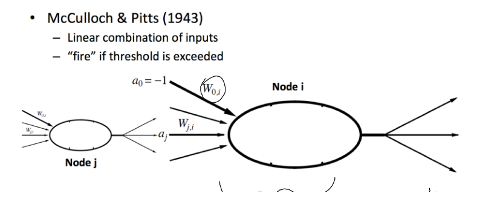
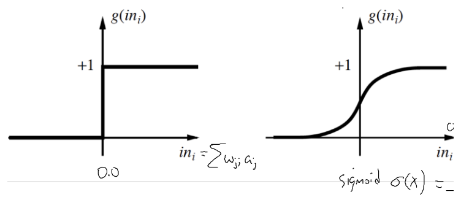
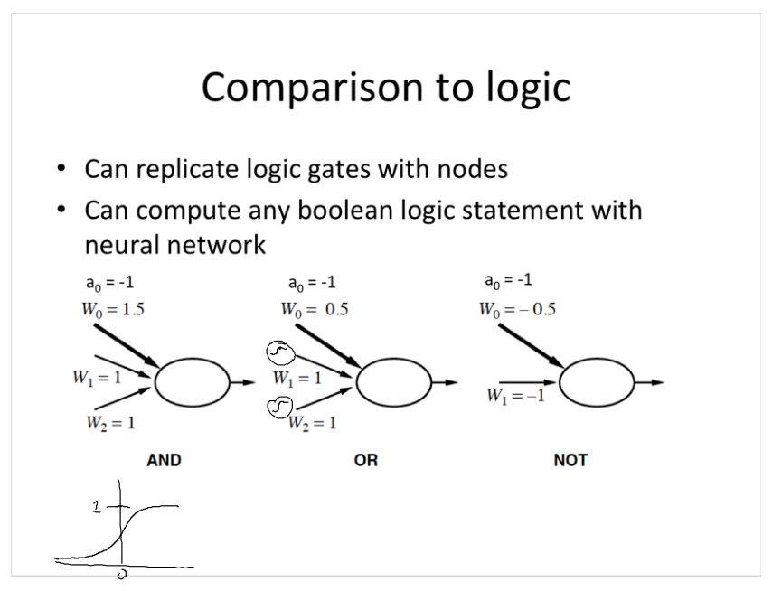
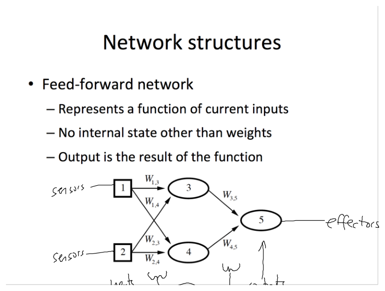
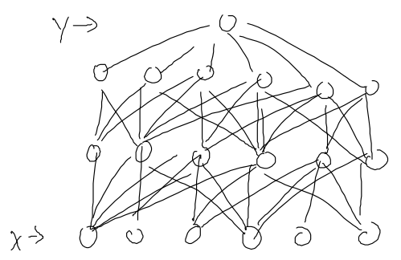
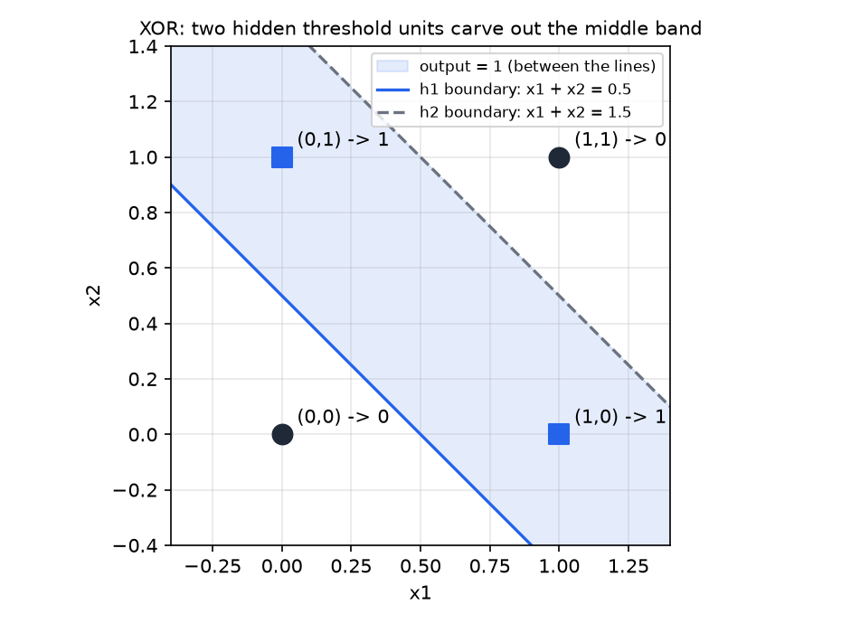

# Neurons, Perceptrons, and Feedforward Networks

A neural network is a parametric function built by wiring simple units together. Each unit forms a weighted sum of its inputs and passes the result through a nonlinear function, and the weights are the parameters that learning adjusts. This chapter covers the basic unit, the activation functions it uses, the logic that threshold units can express, feedforward networks, the perceptron and its learning rule, what a single layer cannot represent, and a forward pass worked with numbers. Learning in networks with hidden layers needs backpropagation, which is the subject of [Backpropagation and Network Architectures](backpropagation.md).

## The Unit: A Weighted Sum and an Activation

The model of a neuron used in artificial networks was proposed by McCulloch and Pitts in 1943. A biological neuron receives signals through its dendrites, integrates them in the cell body, and sends a pulse down its axon when the combined input is strong enough. The artificial unit keeps the two stages: a linear combination of inputs, and a threshold-like output.

Let unit \\(j\\) send an activation \\(a\_j\\) along a link of weight \\(W\_{j,i}\\) to unit \\(i\\). Unit \\(i\\) also receives a fixed bias input \\(a\_0 = -1\\) through a weight \\(W\_{0,i}\\). Its input and output are

\\[
\text{in}\_i = \sum\_{j=0}^{n} W\_{j,i}\\, a\_j, \qquad a\_i = g(\text{in}\_i),
\\]

where \\(g\\) is the activation function. The sum starts at \\(j = 0\\), so the bias is included in the same sum as the other inputs.

*Figure: a McCulloch-Pitts unit as drawn in the source material. Node \\(j\\) sends \\(a\_j\\) along the link with weight \\(W\_{j,i}\\) to node \\(i\\), and node \\(i\\) also receives the fixed bias input \\(a\_0 = -1\\) through \\(W\_{0,i}\\). Node \\(i\\) sums its inputs and passes the sum through \\(g\\).*

### The sign convention for the bias

Because \\(a\_0 = -1\\), the bias term in the sum is \\(-W\_{0,i}\\). The bias weight therefore acts as a threshold: the unit's input is \\(\sum\_{j \ge 1} W\_{j,i} a\_j - W\_{0,i}\\), and the unit is active when the weighted inputs exceed \\(W\_{0,i}\\). Many texts write the bias as a plus term instead. The two conventions differ only by the sign of the bias weight, but they give different numbers in a worked example, so this chapter fixes the convention above and uses it throughout, including in the forward-pass example. When a bias is written as \\(b\\) below, it enters the sum as \\(-b\\).

## Activation Functions

Four activation functions appear in the standard treatment.

**Step.** The threshold function is

\\[
g(x) = \begin{cases} 0 & \text{if } x < 0, \\\\ 1 & \text{if } x \ge 0. \end{cases}
\\]

The step function gives the original binary unit, which outputs 1 or 0. It has zero slope everywhere except at the jump, where the slope is undefined. This matters for learning, and the perceptron section returns to it.

**Sigmoid.** The logistic function is

\\[
\sigma(x) = \frac{1}{1+e^{-x}},
\\]

a smooth curve that rises from 0 to 1 with \\(\sigma(0) = \tfrac12\\). It is differentiable everywhere, which is what gradient-based learning requires. Its derivative has a simple form, and the derivation is short enough to write out:

\\[
\sigma'(x) = \frac{d}{dx}\bigl(1+e^{-x}\bigr)^{-1} = \frac{e^{-x}}{\bigl(1+e^{-x}\bigr)^2} = \frac{1}{1+e^{-x}} \cdot \frac{e^{-x}}{1+e^{-x}} = \sigma(x)\bigl(1-\sigma(x)\bigr).
\\]

The last step uses \\(\frac{e^{-x}}{1+e^{-x}} = 1 - \frac{1}{1+e^{-x}} = 1 - \sigma(x)\\). The useful consequence is that the derivative can be computed from the output that the forward pass has already produced: if \\(y = \sigma(x)\\), then \\(\sigma'(x) = y(1-y)\\). No second evaluation of the exponential is needed.

**Hyperbolic tangent.** The function \\(\tanh(x)\\) is an S-shaped curve from \\(-1\\) to \\(+1\\) passing through the origin. It is a rescaled sigmoid, since \\(\tanh(x) = 2\sigma(2x) - 1\\), and it is zero-centered, which is one reason it is sometimes preferred to the sigmoid for hidden units.

**Rectified linear unit.** The ReLU function is

\\[
g(x) = \begin{cases} 0 & \text{if } x < 0, \\\\ x & \text{if } x \ge 0, \end{cases}
\\]

which is linear on each side of the origin. It is cheap to compute and its derivative is one wherever the unit is active.

*Figure: the step activation (left) and the sigmoid (right), each plotted against the input \\(\text{in}\_i\\). The step jumps from 0 to 1 at zero. The sigmoid rises through \\(\tfrac12\\) at zero and approaches 0 and 1 at the ends. The sigmoid formula is written beneath the right-hand plot.*

### Why the nonlinearity matters

Suppose the activation were the identity, \\(g(x) = x\\). A two-layer network with weight matrices \\(W\_1\\) and \\(W\_2\\) would then compute

\\[
W\_2 \bigl(W\_1 a\bigr) = \bigl(W\_2 W\_1\bigr) a,
\\]

which is a single linear map. Any number of linear layers collapses to one. The nonlinear \\(g\\) is what lets depth add expressive power: each unit contributes its own bend, and the composition of bends can represent shapes no single linear map can.

## Logic with Threshold Units

A threshold unit can implement the basic Boolean connectives. With the bias convention above, the three gates below are correct.

| Gate | \\(W\_0\\) (threshold) | \\(W\_1\\) | \\(W\_2\\) | Net input \\(W\_1 x\_1 + W\_2 x\_2 - W\_0\\) |
|---|---|---|---|---|
| AND | 1.5 | 1 | 1 | \\(x\_1 + x\_2 - 1.5\\) |
| OR | 0.5 | 1 | 1 | \\(x\_1 + x\_2 - 0.5\\) |
| NOT | \\(-0.5\\) | \\(-1\\) | (none) | \\(0.5 - x\_1\\) |

Each gate fires (output 1) exactly when its net input is positive. No net input is zero for these inputs, so the convention at zero does not matter, and the table checks each case. For AND, the net input is \\(x\_1 + x\_2 - 1.5\\). It is positive only when both inputs are 1, giving \\(2 - 1.5 = 0.5 > 0\\), while the other three input pairs give \\(-0.5\\) or \\(-1.5\\). For OR, the net input is \\(x\_1 + x\_2 - 0.5\\), which is positive whenever at least one input is 1. For NOT, the net input \\(0.5 - x\_1\\) is positive only when \\(x\_1 = 0\\).

The same convention gives other gates. NOR outputs 1 only when both inputs are 0. Take \\(W\_0 = -0.5\\) and \\(W\_1 = W\_2 = -1\\), so the net input is \\(0.5 - x\_1 - x\_2\\). The four cases are:

- \\((0,0)\\): net input \\(0.5 > 0\\), output 1.
- \\((0,1)\\): net input \\(-0.5\\), output 0.
- \\((1,0)\\): net input \\(-0.5\\), output 0.
- \\((1,1)\\): net input \\(-1.5\\), output 0.

Because AND, OR and NOT can be composed, any Boolean function can be built from threshold units. The standard construction writes the function in disjunctive normal form: one AND unit for each input pattern that makes the function true, and one OR unit to combine them. The number of units can grow exponentially with the number of inputs in the worst case, but the representational point holds. Threshold units are universal for Boolean logic.

*Figure: the three threshold units as drawn in the source material. Each unit has the bias input \\(a\_0 = -1\\) with weight \\(W\_0\\), and the inputs with weights \\(W\_1\\) and \\(W\_2\\). The handwritten sketch at lower left is the sigmoid, the smooth activation that the later sections use for learning.*

## Feedforward Networks

A feedforward network connects units in layers, with links only from one layer to the next. It represents a function of its current inputs. It has no internal state other than its weights, so the same input always produces the same output. Input units pass their values on without an activation, and each later unit applies its activation to its weighted input.

*Figure: a feedforward network as drawn in the source material. Two sensor inputs, 1 and 2, connect to two hidden units, 3 and 4, which connect to one output unit, 5. The weights \\(W\_{1,3}\\), \\(W\_{1,4}\\), \\(W\_{2,3}\\), \\(W\_{2,4}\\) run from inputs to hidden units, and \\(W\_{3,5}\\), \\(W\_{4,5}\\) from hidden units to the output. The output is the value the network returns for the sensor readings.*

For the network in the figure, the output is a nested function. With the bias terms omitted for clarity, each hidden unit computes \\(a\_k = g(\sum\_j W\_{j,k} a\_j)\\), and the output is

\\[
a\_5 = g\Bigl(W\_{3,5}\\, g\bigl(W\_{1,3} a\_1 + W\_{2,3} a\_2\bigr) + W\_{4,5}\\, g\bigl(W\_{1,4} a\_1 + W\_{2,4} a\_2\bigr)\Bigr).
\\]

Changing any weight changes the function the network computes. Learning is the search for weights that make this function match the training data, and the nested form makes clear why the search is hard: every weight appears inside a composition.

*Figure: a deep network drawn as a stack of fully connected layers. The input row is at the bottom and the single output at the top. Each layer is a bipartite graph with every unit linked to every unit in the layer above. The graph as a whole is the model, and learning sets its weights.*

Written with matrices, each layer is one matrix-vector product followed by the elementwise activation: the vector of layer \\(\ell\\) is \\(g(W^{(\ell)} a^{(\ell-1)})\\), with the bias absorbed as a fixed input. Index notation is more convenient for the derivations in the next chapter, and the matrix form is the one used in implementations.

The feedforward networks in this chapter have no cycles. A recurrent network has directed cycles, usually with a unit delay, so its state carries over from one input to the next. Recurrent networks are introduced in the next chapter, where their training is also described.

## The Perceptron

The perceptron is a feedforward network with no hidden layer: each output unit is connected directly to the inputs. For a single output unit, the model is one threshold or sigmoid unit, and its output is a classifier. The perceptron was studied as a learning machine long before networks with hidden layers were trained, and its learning rule is the simplest case of gradient descent on a network.

### The learning rule

Suppose the output unit is a sigmoid or another differentiable \\(g\\), and let the error on one training example \\((\mathbf x, y)\\) be the squared error

\\[
E = \tfrac{1}{2}\bigl(y - h\_{\mathbf W}(\mathbf x)\bigr)^2, \qquad h\_{\mathbf W}(\mathbf x) = g(\text{in}), \qquad \text{in} = \sum\_j W\_j x\_j.
\\]

The factor \\(\tfrac12\\) cancels the 2 that differentiation produces, and it does not change the minimiser. The partial derivative with respect to a weight follows from the chain rule, since \\(E\\) depends on \\(W\_j\\) only through \\(\text{in}\\), and \\(\partial \text{in}/\partial W\_j = x\_j\\):

\\[
\frac{\partial E}{\partial W\_j} = -\bigl(y - h\_{\mathbf W}(\mathbf x)\bigr)\\, g'(\text{in})\\, x\_j.
\\]

Gradient descent with learning rate \\(\alpha\\) moves each weight against this gradient:

\\[
W\_j \leftarrow W\_j - \alpha \frac{\partial E}{\partial W\_j} = W\_j + \alpha\bigl(y - h\_{\mathbf W}(\mathbf x)\bigr)\\, g'(\text{in})\\, x\_j.
\\]

The update has an intuitive reading. The error \\(y - h\\) gives the direction of the needed change in the output. The factor \\(g'(\text{in})\\) says how sensitive the output is to the input at this point, so a unit in its saturated region changes little. The factor \\(x\_j\\) says that a weight on a large input has more influence on the output. The product of the three is the amount the weight moves.

For the step activation, \\(g'\\) is zero except at the jump, where it does not exist, so the derivation above does not apply directly. The classical perceptron rule replaces \\(g'\\) by 1 and updates by \\(W\_j \leftarrow W\_j + \alpha(y - h)x\_j\\). The rule is still the usual way to describe the learning procedure for the threshold unit, and it converges when the data are linearly separable. The sigmoid version is the one that extends to hidden layers.

### Thrashing and the learning rate

When there are many training examples, a step that improves the fit to one example can undo the fit to another. Consider a weight that one example pushes up and a second pushes down. Updating on each example in turn makes the weight oscillate. The remedy is to keep the learning rate small and to cycle through all the examples many times. Each pass through the full training set is an **epoch**. The learning proceeds in slow, repeated improvements, similar to hill climbing on the error surface. The next chapter treats the learning rate and the training curve in detail.

## What a Single Layer Cannot Represent

A single threshold unit computes a linear decision: its output is 1 on one side of a hyperplane \\(\sum\_j W\_j x\_j = W\_0\\) and 0 on the other. A set of training examples is **linearly separable** when some hyperplane puts all the positive examples on one side and all the negative ones on the other. A single-layer perceptron can learn exactly the linearly separable classifications. It represents AND and OR, since both are separable, but it cannot represent XOR.

**Theorem (XOR is not linearly separable).** No single threshold unit computes XOR on two binary inputs.

*Proof.* Suppose a unit outputs 1 exactly when \\(w\_1 x\_1 + w\_2 x\_2 > t\\). XOR requires output 0 at \\((0,0)\\), so \\(0 \le t\\). It requires output 0 at \\((1,1)\\), so \\(w\_1 + w\_2 \le t\\). It requires output 1 at \\((1,0)\\) and \\((0,1)\\), so \\(w\_1 > t\\) and \\(w\_2 > t\\), and adding these gives \\(w\_1 + w\_2 > 2t\\). Combining the last two inequalities, \\(2t < w\_1 + w\_2 \le t\\), so \\(t < 0\\). This contradicts \\(0 \le t\\). \\(\blacksquare\\)

A second layer removes the obstacle. XOR can be written as "one of the inputs is on, but not both", which is the difference of two threshold functions. Use two hidden units, \\(h\_1\\) with threshold 0.5 and \\(h\_2\\) with threshold 1.5, both with weights \\(1, 1\\). Then \\(h\_1 = [x\_1 + x\_2 > 0.5]\\) is OR and \\(h\_2 = [x\_1 + x\_2 > 1.5]\\) is AND. An output unit with threshold 0.5 and weights \\(1\\) (from \\(h\_1\\)) and \\(-1\\) (from \\(h\_2\\)) computes \\(h\_1 - h\_2 > 0.5\\). Checking the four inputs:

- \\((0,0)\\): \\(h\_1 = 0\\), \\(h\_2 = 0\\), output 0.
- \\((0,1)\\): \\(h\_1 = 1\\), \\(h\_2 = 0\\), output 1.
- \\((1,0)\\): \\(h\_1 = 1\\), \\(h\_2 = 0\\), output 1.
- \\((1,1)\\): \\(h\_1 = 1\\), \\(h\_2 = 1\\), output 0.

*Figure: the four corners of the square of binary inputs. The blue line is the boundary of \\(h\_1\\), the dashed gray line is the boundary of \\(h\_2\\). The shaded band between the two lines is the region where the output is 1. The two points at \\((0,1)\\) and \\((1,0)\\) lie in the band, and the points \\((0,0)\\) and \\((1,1)\\) lie outside it. A single line cannot separate the squares from the circles, but the band can.*

Not every nonlinear decision is hard for a single layer. Majority over an odd number \\(n\\) of binary inputs is linearly separable: give every input weight 1 and set the threshold to \\(n/2\\). The net input is then \\(\sum\_j x\_j - n/2\\), positive exactly when more than half the inputs are on. A perceptron learns majority quickly, while the source's comparison puts the number of examples a decision tree needs for majority over eleven inputs at about \\(2^{11} = 2048\\).

The reverse also holds. On a problem such as the restaurant decision in the standard benchmark, a single-layer perceptron does poorly, and a decision tree does well. This is one instance of the no-free-lunch principle: no learning method is best across all problems, so the choice of model has to match the structure of the data. Hidden layers widen what networks can represent, but they do not remove the need to choose a model class.

## Multilayer Networks and Forward Propagation

Adding a hidden layer changes the picture. Two sigmoid or step units in one hidden layer, with opposite orientations, produce a ridge: a band that is high in a region and low outside it. Units in the next layer that combine ridges with different positions produce bumps. With enough hidden units, a single hidden layer of sigmoid units can approximate any continuous function on a bounded set to any desired accuracy. This is the universal approximation theorem, in its standard form. The theorem does not say how many units are needed or how to find the weights. It says only that the representation exists, and the next chapter addresses how the weights are found.

The forward pass computes the output of a network from its inputs and weights, one layer at a time. The example below uses a network with two inputs, two hidden sigmoid units and two output sigmoid units. Each hidden and output unit has a bias, and the biases are written as \\(b\_1 = 0.35\\) for the hidden layer and \\(b\_2 = 0.60\\) for the output layer. In the convention of this chapter each bias enters its sum with a minus sign. The inputs are \\(i\_1 = 0.05\\) and \\(i\_2 = 0.10\\). The input-to-hidden weights are \\(w\_1 = 0.15\\) (from \\(i\_1\\) to \\(h\_1\\)), \\(w\_2 = 0.20\\) (from \\(i\_2\\) to \\(h\_1\\)), \\(w\_3 = 0.25\\) (from \\(i\_1\\) to \\(h\_2\\)) and \\(w\_4 = 0.30\\) (from \\(i\_2\\) to \\(h\_2\\)). The hidden-to-output weights are \\(w\_5 = 0.40\\) (from \\(h\_1\\) to \\(o\_1\\)), \\(w\_6 = 0.45\\) (from \\(h\_1\\) to \\(o\_2\\)), \\(w\_7 = 0.50\\) (from \\(h\_2\\) to \\(o\_1\\)) and \\(w\_8 = 0.55\\) (from \\(h\_2\\) to \\(o\_2\\)). The targets are \\(y\_1 = 0.01\\) and \\(y\_2 = 0.99\\).

**Hidden layer.** The net inputs and outputs of the two hidden units are

\\[
\text{in}\_{h\_1} = 0.15(0.05) + 0.20(0.10) - 0.35 = -0.3225, \qquad \text{out}\_{h\_1} = \sigma(-0.3225) = 0.4201,
\\]

\\[
\text{in}\_{h\_2} = 0.25(0.05) + 0.30(0.10) - 0.35 = -0.3075, \qquad \text{out}\_{h\_2} = \sigma(-0.3075) = 0.4237.
\\]

The source writes the input of \\(h\_2\\) as \\(-0.31\\), which is \\(-0.3075\\) rounded. Its printed output of 0.423 is the sigmoid of the rounded input. The exact input gives 0.4237, which rounds to 0.424. This chapter uses the exact values throughout.

**Output layer.** The output units receive the hidden outputs with the output bias \\(b\_2 = 0.60\\):

\\[
\text{in}\_{o\_1} = 0.40(0.42007) + 0.50(0.42373) - 0.60 = -0.2201, \qquad \text{out}\_{o\_1} = \sigma(-0.2201) = 0.4452,
\\]

\\[
\text{in}\_{o\_2} = 0.45(0.42007) + 0.55(0.42373) - 0.60 = -0.1779, \qquad \text{out}\_{o\_2} = \sigma(-0.1779) = 0.4556.
\\]

**Error.** The error for this example is the squared error summed over the output units, with the factor \\(\tfrac12\\) as in the perceptron:

\\[
E = \tfrac{1}{2}\Bigl[(0.01 - 0.4452)^2 + (0.99 - 0.4556)^2\Bigr] = \tfrac{1}{2}\bigl[0.18940 + 0.28558\bigr] = 0.2375.
\\]

The source prints an error of 0.202 for this example. The printed outputs 0.445 and 0.456 give \\(\tfrac12\bigl[(0.435)^2 + (0.534)^2\bigr] = 0.237\\), and the exact outputs give 0.2375. The value 0.202 does not follow from the outputs that the example prints, so the error here is 0.237. The forward pass is the only part of the example this chapter needs. The derivative of the error with respect to each weight, which is what training uses, is derived in the next chapter, and the complete hand computation is in [Worked Neural-Network Exercises](neural-network-exercises.md).

## Summary

- A unit forms the weighted sum \\(\text{in}\_i = \sum\_j W\_{j,i} a\_j\\), with the bias as the weight on a fixed input \\(a\_0 = -1\\), and outputs \\(a\_i = g(\text{in}\_i)\\).
- The bias convention in this chapter makes the bias weight the threshold, so the net input is \\(\sum\_{j \ge 1} W\_{j,i} a\_j - W\_{0,i}\\).
- The sigmoid \\(\sigma(x) = 1/(1+e^{-x})\\) is smooth, and its derivative is \\(\sigma(x)(1-\sigma(x))\\), which the forward pass already provides.
- Without a nonlinearity, any stack of layers collapses to one linear map, so the activation is what gives depth its power.
- Threshold units implement AND, OR and NOT with weights \\(\pm 1\\) and thresholds \\(1.5\\), \\(0.5\\) and \\(-0.5\\) in this convention, and their compositions represent any Boolean function.
- A single unit or layer computes only linearly separable functions. XOR is not separable, and two hidden threshold units compute it.
- The perceptron rule is \\(W\_j \leftarrow W\_j + \alpha (y-h)\\, g'(\text{in})\\, x\_j\\) for a differentiable \\(g\\). Small learning rates and repeated epochs avoid thrashing.
- A hidden layer of sigmoid units can approximate any continuous function on a bounded set, in the sense of the universal approximation theorem, but the theorem does not supply the weights.
- For the worked forward pass, the hidden activations are 0.4201 and 0.4237, the output activations are 0.4452 and 0.4556, and the squared error is 0.2375.

## See Also

- [Neural Networks](../ml/neural-networks.md): the shallow-network basics in the machine-learning section.
- [Backpropagation and Network Architectures](backpropagation.md): how the gradients for hidden layers are computed.
- [Worked Neural-Network Exercises](neural-network-exercises.md): the full hand computation for a three-input network.
- [Supervised Learning](../ml/supervised.md): the setting in which these networks are trained.
- [Linear Classifiers and Gradient Descent](../ml/deep-learning/linear-classifiers.md): the deep-learning treatment of the linear model and its losses.
- [Deep Learning](../ml/deep-learning.md): the overview of the deep-learning section.
