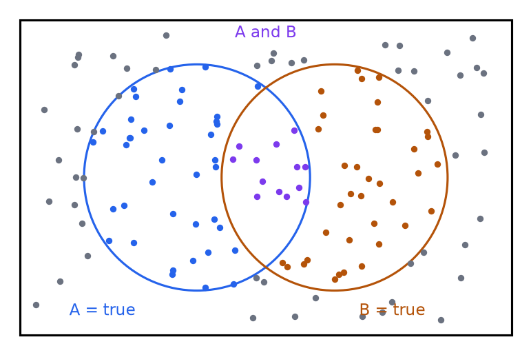
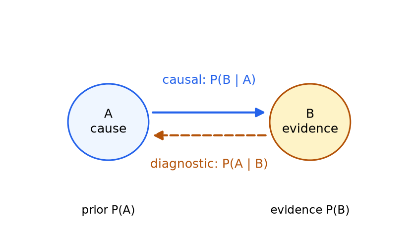
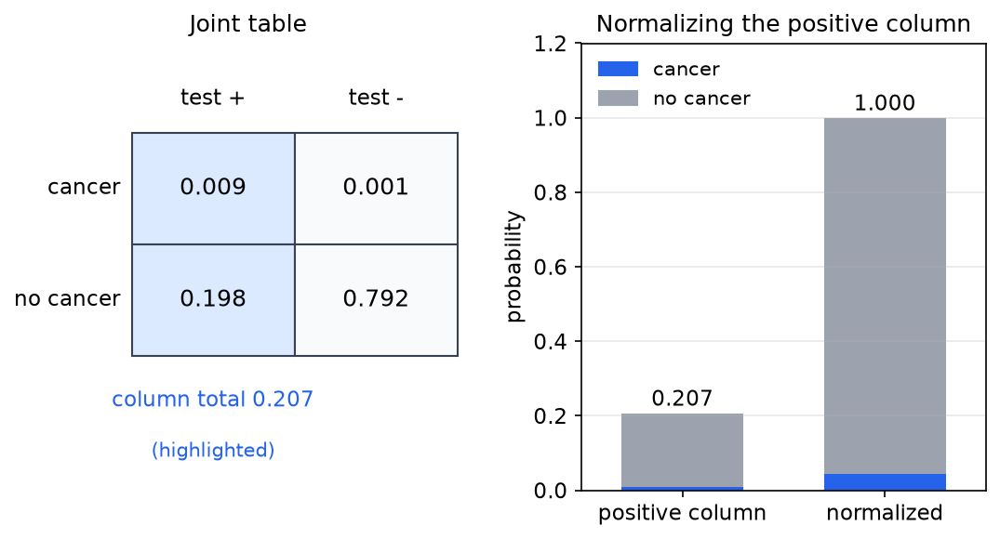
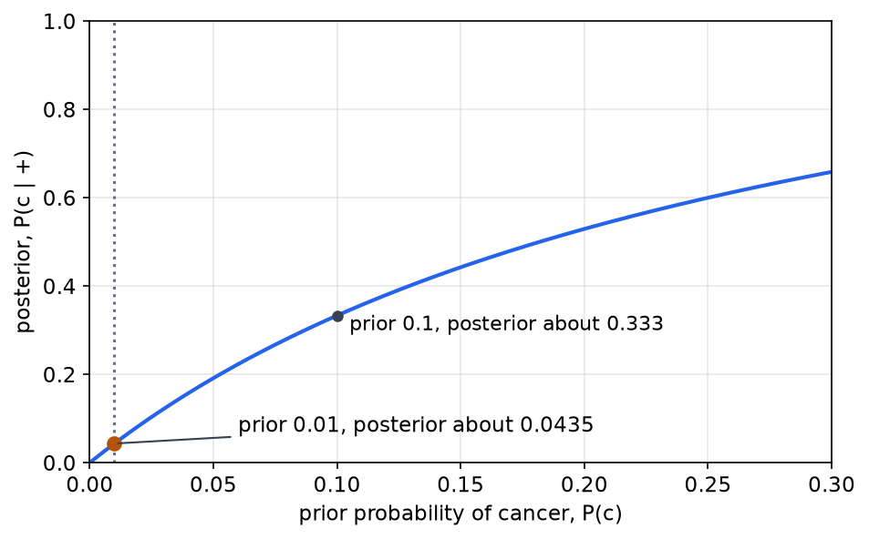
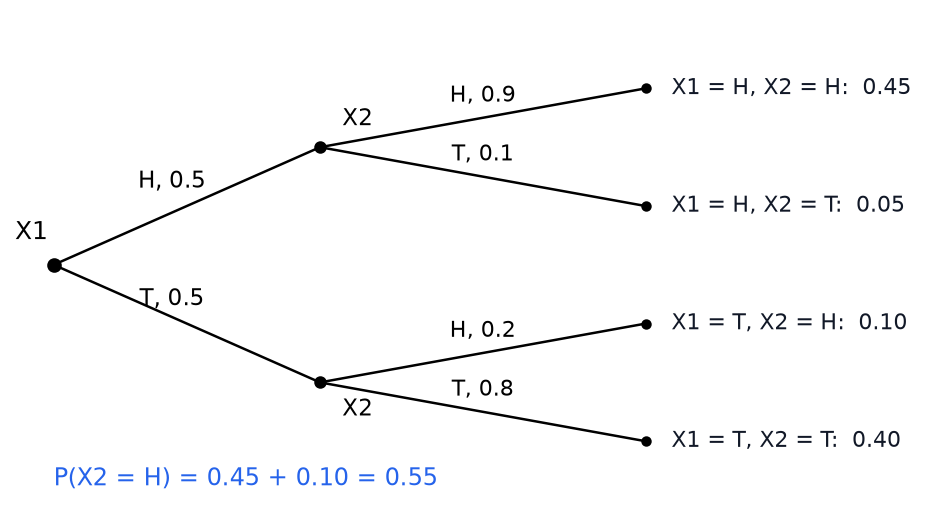

# Probability and Bayes' Rule

An agent with sensors never learns the state of its world exactly. A sensor reading is evidence about the state, not the state itself, and the agent must still choose an action. Probability supplies the calculus for this situation. It assigns numbers to the possible states of the world and tells the agent how to revise those numbers when evidence arrives. This chapter builds that calculus from its axioms: random variables and their distributions, the full joint distribution, conditioning and normalization, independence, and Bayes' rule. Bayes' rule converts a causal model, how a cause produces evidence, into the diagnostic quantity an agent needs, the probability of a cause given the evidence. The graphical models that organize large joint distributions are the subject of the next chapter, [Bayesian Networks: Structure and Independence](bayes-nets.md), and the same ideas extend to sequences of observations in [Filtering over Time and Belief States](filtering.md).

## Random Variables and Distributions

Anything an agent wants to know about the world is represented by a **random variable**. A random variable is a placeholder for a fact. It can take one of a set of values, and its **distribution** gives the probability of each value. We write \\(P(X)\\) for the whole distribution and \\(P(X = x)\\) for one entry.

Three examples show the range. A Boolean variable BEARD takes the values true or false with \\(P(\text{BEARD}) = \langle 0.6, 0.4 \rangle\\). A two-valued variable SHOES takes the values black or blue with \\(P(\text{SHOES}) = \langle 0.2, 0.8 \rangle\\). A five-valued variable WEATHER takes the values rain, snow, hot, warm and s.c. (an abbreviation this chapter does not expand), with

\\[
P(\text{WEATHER}) = \langle 0.3,\ 0.01,\ 0.25,\ 0.4,\ 0.04 \rangle .
\\]

The entries sum to \\(1.00\\), as they must. A distribution is a table of nonnegative numbers that sum to one. For discrete variables that is the whole definition. Continuous variables, which are described by density functions rather than tables, are treated in the next chapter.

## Possible Worlds

A **possible world** is one complete assignment of values to every random variable in the model. If the model has two Boolean variables A and B, there are four possible worlds: \\((A, B) = (T, T), (T, F), (F, T), (F, F)\\). The set of all worlds is the sample space, and a proposition such as \\(A = T\\) picks out the worlds in which it holds.

When every world is equally likely, the probability of a proposition is a count: the number of worlds in which it holds divided by the total number of worlds. A Venn-style picture makes this concrete. The box in Figure 1 holds the worlds as dots, and each circle covers the worlds where one proposition is true.

*Figure 1: Each dot is a possible world, and the box is the set of all worlds. The two circles mark the worlds in which A and B are true. The probability of a proposition is the fraction of the box it covers, so the overlap of the two circles is \\(P(A = T \land B = T)\\). The next sections extend this counting to unequal weights, which is the general case.*

## Axioms and the Rules That Follow

Three axioms define a probability measure over propositions:

1. For every proposition \\(a\\), \\(0 \le P(a) \le 1\\).
2. \\(P(\text{true}) = 1\\) and \\(P(\text{false}) = 0\\).
3. If \\(a\\) and \\(b\\) are mutually exclusive, \\(P(a \lor b) = P(a) + P(b)\\).

Two useful rules follow from these axioms.

**Complement rule.** The propositions \\(a\\) and \\(\neg a\\) are mutually exclusive, and their disjunction is certainly true. By the third axiom and the second,

\\[
P(a) + P(\neg a) = P(a \lor \neg a) = P(\text{true}) = 1,
\\]

so \\(P(\neg a) = 1 - P(a)\\).

**Inclusion-exclusion.** Split \\(a \lor b\\) into two disjoint pieces, \\(a\\) and \\(b \land \neg a\\). Then split \\(b\\) into \\(a \land b\\) and \\(\neg a \land b\\), which are also disjoint. Hence \\(P(b \land \neg a) = P(b) - P(a \land b)\\), and

\\[
P(a \lor b) = P(a) + P(b) - P(a \land b).
\\]

Subtracting the overlap avoids counting the worlds where both propositions hold twice.

**Example 1 (complement).** A coin has \\(P(\text{heads}) = 0.25\\), so it is loaded. Then \\(P(\text{tails}) = 1 - 0.25 = 0.75\\). The two outcomes are exhaustive, and their probabilities sum to one.

**Example 2 (independent flips).** A fair coin has \\(P(\text{heads}) = 0.5\\) on each flip, and the flips are independent. Three heads in a row has probability \\((0.5)^3 = 0.125 = 1/8\\).

**Example 3 (all the same).** Four fair flips are all heads or all tails. Each sequence has probability \\((0.5)^4 = 1/16\\). The two sequences are mutually exclusive, so \\(P(\text{all the same}) = 1/16 + 1/16 = 1/8\\).

**Example 4 (at least three heads).** Four fair flips contain at least three heads in five of the sixteen equally likely sequences: HHHH and the four sequences with exactly one tail. The probability is \\(5/16 = 0.3125\\).

## The Full Joint Distribution

When several variables interact, the most complete description is the **full joint distribution**, a table with one entry for every combination of values. Each entry is the probability of one possible world. The entries sum to one.

Consider three Boolean variables: CAVITY, TOOTHACHE and CATCH (whether a dental probe catches on the tooth). Six of the eight entries are:

| CAVITY | TOOTHACHE | CATCH | Probability |
|---|---|---|---|
| T | T | T | 0.108 |
| T | T | F | 0.012 |
| T | F | T | 0.072 |
| T | F | F | 0.008 |
| F | T | T | 0.016 |
| F | T | F | 0.064 |

The two entries with no toothache and no cavity are not given, but their sum is \\(1 - 0.28 = 0.72\\), because the six listed entries sum to \\(0.28\\). The calculations below need only the listed entries.

**Marginalization** (summing out) gives the probability of one value of one variable by adding the worlds in which it holds. The probability of a cavity is

\\[
P(\text{CAVITY} = T) = 0.108 + 0.012 + 0.072 + 0.008 = 0.200 .
\\]

The four cavity entries are added, so the marginal is \\(0.2\\). A handwritten version of this calculation subtracts the third term. That sign is a slip: the sum has to be an addition, and only the addition gives the stated \\(0.2\\).

The same method gives disjunctions and conjunctions. The probability of a toothache is \\(0.108 + 0.012 + 0.016 + 0.064 = 0.2\\), and the probability of both a cavity and a toothache is \\(0.108 + 0.012 = 0.12\\). Inclusion-exclusion gives

\\[
P(\text{CAVITY} = T \lor \text{TOOTHACHE} = T) = 0.2 + 0.2 - 0.12 = 0.28 .
\\]

Every query about a set of variables can be answered by adding table entries. The table is exact, but it grows fast. With \\(n\\) Boolean variables it has \\(2^n\\) entries, which is the reason the factored representations of the next chapter matter.

## Conditioning and Normalization

**Conditional probability** is the probability of one event once another is known. For \\(P(Z = z) > 0\\),

\\[
P(Y = y \mid Z = z) = \frac{P(Y = y,\ Z = z)}{P(Z = z)} .
\\]

Conditioning restricts attention to the worlds in which the evidence holds and then renormalizes so that the surviving probabilities sum to one. The restriction is the numerator, and the renormalization is the division by \\(P(Z = z)\\).

**Example 5 (cavity given toothache).** Restrict the table to the worlds with toothache. These have probabilities \\(0.108, 0.012, 0.016, 0.064\\), which sum to \\(0.2\\). The cavity worlds among them are \\(0.108\\) and \\(0.012\\), so

\\[
P(\text{CAVITY} = T \mid \text{TOOTHACHE} = T) = \frac{0.108 + 0.012}{0.2} = \frac{0.12}{0.2} = 0.6 ,
\\]

and \\(P(\text{CAVITY} = F \mid \text{TOOTHACHE} = T) = (0.016 + 0.064)/0.2 = 0.4\\). The two values sum to one.

Dividing by \\(P(e)\\) is the same as multiplying by the **normalization constant** \\(\alpha = 1/P(e)\\). The calculation is then written as

\\[
P(X \mid e) = \alpha\\, P(X, e) .
\\]

This form is useful when the normalizer is not needed in advance. Compute the unnormalized vector \\(P(X, e)\\), then scale it so that the entries sum to one. When some variables \\(H\\) are neither query nor evidence, they are summed out:

\\[
P(X \mid e) = \alpha \sum\_{h} P(X,\ e,\ H = h) .
\\]

**Example 6 (summing out a hidden variable).** Suppose CATCH is not observed. Then

\\[
P(\text{CAVITY} \mid \text{TOOTHACHE} = T) = \alpha \big[ P(\text{CAVITY}, T, \text{CATCH} = T) + P(\text{CAVITY}, T, \text{CATCH} = F) \big] .
\\]

The first bracketed vector is \\(\langle 0.108, 0.016 \rangle\\) and the second is \\(\langle 0.012, 0.064 \rangle\\). Adding them gives \\(\langle 0.12, 0.08 \rangle\\). The entries of this vector sum to \\(0.2\\), so \\(\alpha = 1/0.2 = 5\\), and

\\[
P(\text{CAVITY} \mid \text{TOOTHACHE} = T) = \langle 0.6,\ 0.4 \rangle .
\\]

This agrees with Example 5. The second route is the general one, and the rest of this book uses it.

## Independence

Two random variables \\(A\\) and \\(B\\) are **independent** when

\\[
P(A,\ B) = P(A)\\,P(B) .
\\]

The two common forms of this definition are equivalent. If \\(P(B) > 0\\), then \\(P(A \mid B) = P(A,B)/P(B) = P(A)\\). So independence means that learning the value of one variable leaves the probability of the other unchanged.

The factorization is also what makes independence useful for storage. Suppose a model has the dental variables above and a fourth variable WEATHER with four values (sun, rain, hot, snow), and WEATHER is independent of the dental variables. The full joint has \\(2 \times 2 \times 2 \times 4 = 32\\) entries. Under independence it factors as

\\[
P(\text{CAVITY}, \text{TOOTHACHE}, \text{CATCH}, \text{WEATHER}) = P(\text{CAVITY}, \text{TOOTHACHE}, \text{CATCH})\\; P(\text{WEATHER}),
\\]

so the model stores \\(8\\) entries for the dental joint and \\(4\\) for WEATHER, which is \\(12\\) numbers instead of \\(32\\). Because each table must sum to one, only \\(7 + 3 = 10\\) of those numbers are free.

## Conditional Independence

Independence is rare between variables that share a cause, and it is the wrong tool for the dental problem. The useful notion is **conditional independence**. The variables \\(A\\) and \\(B\\) are conditionally independent given \\(C\\) when

\\[
P(A,\ B \mid C) = P(A \mid C)\\,P(B \mid C) .
\\]

Equivalently, learning \\(B\\) does not change the probability of \\(A\\) once \\(C\\) is known. The condition is about the probabilities given each value of \\(C\\).

Take the dental variables, and suppose that TOOTHACHE and CATCH depend on the state of the tooth only through CAVITY. The product rule gives

\\[
P(\text{CAVITY} \mid \text{TOOTHACHE}, \text{CATCH}) = \alpha\\, P(\text{TOOTHACHE}, \text{CATCH} \mid \text{CAVITY})\\, P(\text{CAVITY}) .
\\]

Conditional independence given CAVITY then factors the first term:

\\[
P(\text{CAVITY} \mid \text{TOOTHACHE}, \text{CATCH}) = \alpha\\, P(\text{TOOTHACHE} \mid \text{CAVITY})\\, P(\text{CATCH} \mid \text{CAVITY})\\, P(\text{CAVITY}) .
\\]

This is the form an agent needs. Each factor is a single cause-to-effect quantity, and the diagnostic answer is the product of those quantities, normalized.

The table of the first section supports this assumption. The four entries with cavity true factor exactly. With \\(P(\text{CAVITY} = T) = 0.2\\), \\(P(\text{TOOTHACHE} = T \mid \text{CAVITY} = T) = 0.6\\) and \\(P(\text{CATCH} = T \mid \text{CAVITY} = T) = 0.9\\), the entry for toothache and catch is \\(0.2 \times 0.6 \times 0.9 = 0.108\\), and the other three entries follow the same way. The check uses only the cavity-true entries, so it does not show that the assumption holds for the cavity-false entries.

Two cautions. First, the independence needed here is conditional on CAVITY, not absolute. Toothache and catch are dependent in general, because each raises the probability of a cavity, and a cavity raises the probability of the other. They become separated only when the cavity is known. A common statement of this assumption says that the two tests are simply independent, and the formula above shows what is actually required. Second, the chapter on Bayesian networks shows that conditional independence does not imply absolute independence, and the converse also fails.

### The Naive Bayes Model

When one unobserved **cause** produces several **effects**, and the effects are conditionally independent given the cause, the posterior is

\\[
P(\text{CAUSE} \mid \text{EFFECT}\_1, \ldots, \text{EFFECT}\_n) = \alpha\\, P(\text{CAUSE}) \prod\_{i=1}^{n} P(\text{EFFECT}\_i \mid \text{CAUSE}) .
\\]

The joint distribution is the corresponding product. This is the **naive Bayes** model. The word naive refers to the assumption that the effects are independent once the cause is fixed. The assumption is often wrong in detail, but the model is still useful, because it turns a huge joint into one prior and one likelihood per effect.

The saving is large. For a binary cause and \\(n\\) binary effects, the full joint needs \\(2^{n+1} - 1\\) numbers. The naive model needs \\(1\\) for the prior and \\(2\\) for each effect, which is \\(1 + 2n\\) numbers. For \\(n = 2\\) that is 5 numbers against 7; for \\(n = 10\\) it is 21 numbers against 2047.

The formula is a special case of the general Bayes rule with several pieces of evidence. Applying the product rule twice gives \\(P(A \mid B, C) = \alpha\\, P(C \mid A, B)\\,P(B \mid A)\\,P(A)\\), and conditional independence of \\(B\\) and \\(C\\) given \\(A\\) removes the \\(B\\) from the middle factor. The numerical two-test version of this formula is worked in the next chapter, where the effects are conditionally independent given a hidden cancer variable.

## Bayes' Rule

The **product rule** expresses a joint probability in two orders:

\\[
P(A = a,\ B = b) = P(A = a \mid B = b)\\,P(B = b) = P(B = b \mid A = a)\\,P(A = a) .
\\]

Equating the two right-hand sides and dividing by \\(P(B = b)\\) gives **Bayes' rule**:

\\[
P(A = a \mid B = b) = \frac{P(B = b \mid A = a)\\,P(A = a)}{P(B = b)} .
\\]

The four terms have standard names. \\(P(B \mid A)\\) is the **likelihood**, \\(P(A)\\) is the **prior**, \\(P(B)\\) is the **evidence** or marginal likelihood, and \\(P(A \mid B)\\) is the **posterior**. The denominator is a sum over the values of \\(A\\), by the total-probability rule:

\\[
P(B = b) = \sum\_{a} P(B = b \mid A = a)\\,P(A = a) .
\\]

Because the denominator is the same for every value of \\(A\\), the calculation is usually written with the normalization constant:

\\[
P(A \mid B = b) = \alpha\\, P(B = b \mid A)\\,P(A) .
\\]

### Causal and Diagnostic Reasoning

Bayes' rule turns diagnostic reasoning into causal reasoning. Diagnosis runs from evidence back to a cause: given a positive test, how likely is the disease? A causal model runs the other way: given the disease, how likely is a positive test? Causal relations are usually better understood, because they describe mechanisms, and their numbers are often measured directly, for example by testing people who are known to have the disease. Diagnostic probabilities are harder to measure directly, because they require the whole population. Bayes' rule computes the diagnostic probability from the causal one, the prior and the evidence probability.

*Figure 2: The solid arrow is the causal direction, from a cause A to an observable effect B, with likelihood \\(P(B \mid A)\\) that is usually known from a model or from measurement. The dashed arrow is the diagnostic direction, from the observed B back to A, with posterior \\(P(A \mid B)\\) that is needed for decisions. The prior and the evidence probability are the two factors that carry the reversal.*

**Medical diagnosis.** Let \\(M\\) be meningitis and \\(S\\) a stiff neck. The diagnostic quantity is \\(P(M \mid S)\\). Bayes' rule expresses it through \\(P(S \mid M)\\), the probability of a stiff neck among people with meningitis, the prior \\(P(M)\\), and the marginal \\(P(S)\\). Writing the two cases for \\(M\\) and normalizing,

\\[
P(M = T \mid S = T) = \alpha\\, P(S = T \mid M = T)\\,P(M = T), \qquad P(M = F \mid S = T) = \alpha\\, P(S = T \mid M = F)\\,P(M = F) .
\\]

Both unnormalized terms are needed, and \\(\alpha\\) is whatever value makes the two posteriors sum to one. This example gives no numbers, so the formula is the point.

### Procedure for Small Problems

For a single hidden variable and a single observation, the calculation can be organized as a short table. The steps are:

1. List the prior \\(P(A = a)\\) for each value of the hidden variable.
2. List the likelihood \\(P(B = b \mid A = a)\\) for the observed value.
3. Multiply each prior by its likelihood to get the joint \\(P(b, a)\\).
4. Sum the joints over all values of \\(A\\) to get \\(P(B = b)\\).
5. Divide each joint by \\(P(B = b)\\) to get the posterior \\(P(A = a \mid B = b)\\).

The table is exactly the normalization of the previous section, written out as bookkeeping. The next example uses it.

## Worked Example: A Cancer Test

A cancer affects 1 percent of a population, so \\(P(c) = 0.01\\) and \\(P(\neg c) = 0.99\\). A test has sensitivity \\(P(+ \mid c) = 0.9\\), so \\(P(- \mid c) = 0.1\\), and a false-positive rate \\(P(+ \mid \neg c) = 0.2\\), so \\(P(- \mid \neg c) = 0.8\\).

Step 3 of the procedure multiplies each prior by its likelihood:

- \\(P(+, c) = 0.01 \times 0.9 = 0.009\\)
- \\(P(-, c) = 0.01 \times 0.1 = 0.001\\)
- \\(P(+, \neg c) = 0.99 \times 0.2 = 0.198\\)
- \\(P(-, \neg c) = 0.99 \times 0.8 = 0.792\\)

These four joints sum to one. Step 4 sums the positive column to get \\(P(+) = 0.009 + 0.198 = 0.207\\). Step 5 normalizes that column:

\\[
P(c \mid +) = \frac{0.009}{0.207} = 0.0435 \quad (\text{to four decimal places}), \qquad P(\neg c \mid +) = \frac{0.198}{0.207} = 0.9565 .
\\]

*Figure 3: Left, the joint table. Each cell is prior times likelihood, and the positive column (highlighted) has total \\(0.207\\). Right, the same two positive cells divided by their sum. The posterior for cancer is the cancer cell divided by the column total, \\(0.009 / 0.207\\).*

The result is worth reading slowly. A positive test is 90 percent sensitive, but the probability of cancer after a positive result is only about 4.35 percent. The prior was 1 percent, so the positive test raised the probability by a factor of about four, and it did not make the cancer likely. The reason is the base rate. The healthy group is large enough that its false positives, 0.198, outnumber the true positives, 0.009, by more than twenty to one. One version of this example says the test "erased" the probability to 0.043. That phrasing is wrong: the posterior is a rise from the prior of 0.01, not an erasure of anything.

The dependence on the prior is shown in Figure 4, which keeps the sensitivity and false-positive rate fixed and varies the base rate.

*Figure 4: The posterior \\(P(c \mid +)\\) as a function of the prior \\(P(c)\\), with sensitivity 0.9 and false-positive rate 0.2. The dotted line marks the prior used in the example, 0.01, where the posterior is about 0.0435. A test of the same quality gives a useful posterior only when the prior is large.*

## A Second Diagnosis Example

Suppose 2 percent of a population has a disease \\(D\\). A test is positive for 94 percent of the people who have the disease, so the test misses the disease with probability 0.06, and it is positive for 9 percent of the people who do not have it. For a person who tests positive, what is the probability of the disease?

The priors are \\(P(D) = 0.02\\) and \\(P(\neg D) = 0.98\\), and the likelihoods are \\(P(+ \mid D) = 0.94\\) and \\(P(+ \mid \neg D) = 0.09\\). The evidence probability is

\\[
P(+) = 0.94 \times 0.02 + 0.09 \times 0.98 = 0.0188 + 0.0882 = 0.107 .
\\]

Bayes' rule then gives

\\[
P(D \mid +) = \frac{0.94 \times 0.02}{0.107} = \frac{0.0188}{0.107} = 0.17570 .
\\]

The answer is about 17.6 percent, even though the test is 94 percent sensitive and 91 percent specific. The base rate explains the gap. Most positives come from the 98 percent of people who are healthy, because the false-positive rate, applied to the large healthy group, produces more positive results than the disease does. One version of this calculation writes the answer as \\(\sim 0.1757\\); the exact value is \\(0.17570\\), which rounds to \\(0.1757\\).

## Conditional Independence and the Pitfall of Negation

The probabilities of a proposition and its negation sum to one given the same evidence, so \\(P(\neg X \mid Y) = 1 - P(X \mid Y)\\). This identity does not hold for the other condition. The general inequality is

\\[
P(X \mid \neg Y) \neq 1 - P(X \mid Y) .
\\]

The conditioning event cannot be negated while the probabilities still sum to one, because \\(\neg Y\\) is a different set of worlds. The two-coin chain of the next example makes the point. Let \\(X\_1\\) be a fair coin, and let \\(X\_2\\) depend on \\(X\_1\\): \\(P(X\_2 = H \mid X\_1 = H) = 0.9\\) and \\(P(X\_2 = H \mid X\_1 = T) = 0.2\\).

## Total Probability in a Chain

Consider a fair coin \\(X\_1\\) followed by a second coin \\(X\_2\\) whose bias depends on the first outcome. If \\(X\_1\\) is heads, \\(X\_2\\) comes from a coin with \\(P(\text{heads}) = 0.9\\). If \\(X\_1\\) is tails, \\(X\_2\\) comes from a coin with \\(P(\text{tails}) = 0.8\\), so \\(P(X\_2 = H \mid X\_1 = T) = 0.2\\). The probability that the second flip is heads is found by the **law of total probability**:

\\[
P(X\_2 = H) = P(X\_2 = H \mid X\_1 = H)\\,P(X\_1 = H) + P(X\_2 = H \mid X\_1 = T)\\,P(X\_1 = T) = 0.9 \times 0.5 + 0.2 \times 0.5 = 0.55 .
\\]

The tree in Figure 5 lists the four joint outcomes, and the leaves give the same answer.

*Figure 5: Each path from the root is a sequence of outcomes, and its leaf is the product of the probabilities along the path. The four leaves are \\(0.45\\), \\(0.05\\), \\(0.10\\) and \\(0.40\\), and they sum to one. The probability that the second flip is heads is the sum of the two leaves that end in H, \\(0.45 + 0.10 = 0.55\\).*

The same tree gives the negation pitfall directly. From the leaves, \\(P(X\_1 = H \mid X\_2 = H) = 0.45/0.55 = 0.818\\), so \\(1 - P(X\_1 = H \mid X\_2 = H) = 0.182\\). But \\(P(X\_1 = H \mid X\_2 = T) = 0.05/0.45 = 0.111\\). The two numbers differ, so the complement rule cannot be applied to the condition.

The chain also shows how a total probability is built. The rule \\(P(Y) = \sum\_i P(Y \mid X = i)\\,P(X = i)\\) weights each branch by the probability of reaching it. Probability trees are a convenient way to keep track of the branches, and the same bookkeeping reappears in the Markov chains of the filtering chapter.

## Summary

- A random variable takes values from a set, and its distribution is a table of nonnegative numbers that sum to one.
- The axioms give the complement rule \\(P(\neg a) = 1 - P(a)\\) and the inclusion-exclusion rule \\(P(a \lor b) = P(a) + P(b) - P(a \land b)\\).
- The full joint distribution answers every query by summing table entries. Marginalization sums out variables, and conditioning restricts the table and renormalizes with \\(\alpha = 1/P(e)\\).
- Independence means \\(P(A,B) = P(A)P(B)\\). Conditional independence given \\(C\\), \\(P(A,B \mid C) = P(A \mid C)P(B \mid C)\\), is the assumption that makes diagnosis from several effects tractable.
- The naive Bayes model writes \\(P(\text{CAUSE} \mid \text{EFFECTS}) = \alpha\\,P(\text{CAUSE}) \prod\_i P(\text{EFFECT}\_i \mid \text{CAUSE})\\), with \\(1 + 2n\\) numbers for \\(n\\) binary effects instead of \\(2^{n+1} - 1\\).
- Bayes' rule, \\(P(A \mid B) = P(B \mid A)P(A)/P(B)\\), turns a causal likelihood into a diagnostic posterior. The denominator comes from total probability.
- A cancer test with sensitivity 0.9 and false-positive rate 0.2 gives \\(P(c \mid +) = 0.0435\\) at a prior of 0.01. The base rate, not the test quality alone, controls the posterior.
- \\(P(X \mid \neg Y)\\) is not \\(1 - P(X \mid Y)\\).

## References

- Russell, S. and Norvig, P., *Artificial Intelligence: A Modern Approach*, 3rd edition, Section 13.1 "Acting under Uncertainty", Section 13.2 "Basic Probability Notation", Section 13.3 "Inference Using Full Joint Distributions", Section 13.4 "Independence", and Section 13.5 "Bayes' Rule and Its Use".

## See Also

- [Bayesian Networks: Structure and Independence](bayes-nets.md): the factored form of large joints, d-separation and the continuous case.
- [Inference in Bayesian Networks](bayes-net-inference.md): enumeration, variable elimination and sampling.
- [Filtering over Time and Belief States](filtering.md): the Markov chain and belief updates that extend Bayes' rule over time.
- [Machine Learning](machine-learning.md): naive Bayes as a classifier.
- [Evaluation](../ml/evaluation.md): how the errors of a diagnostic test are measured.
