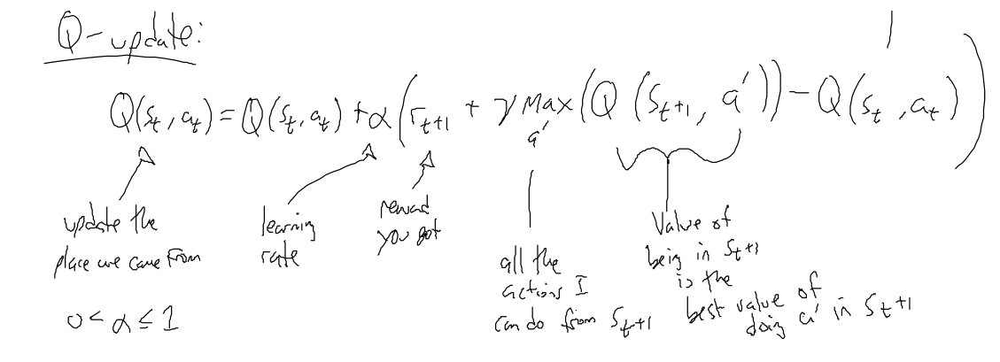
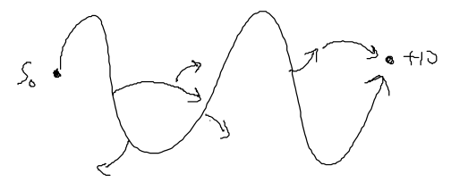
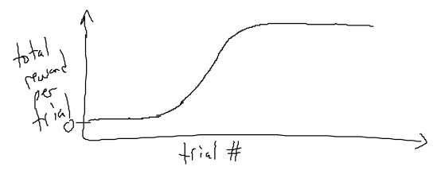
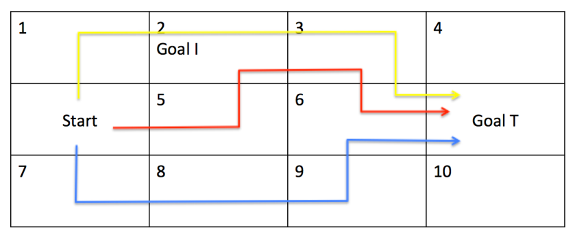
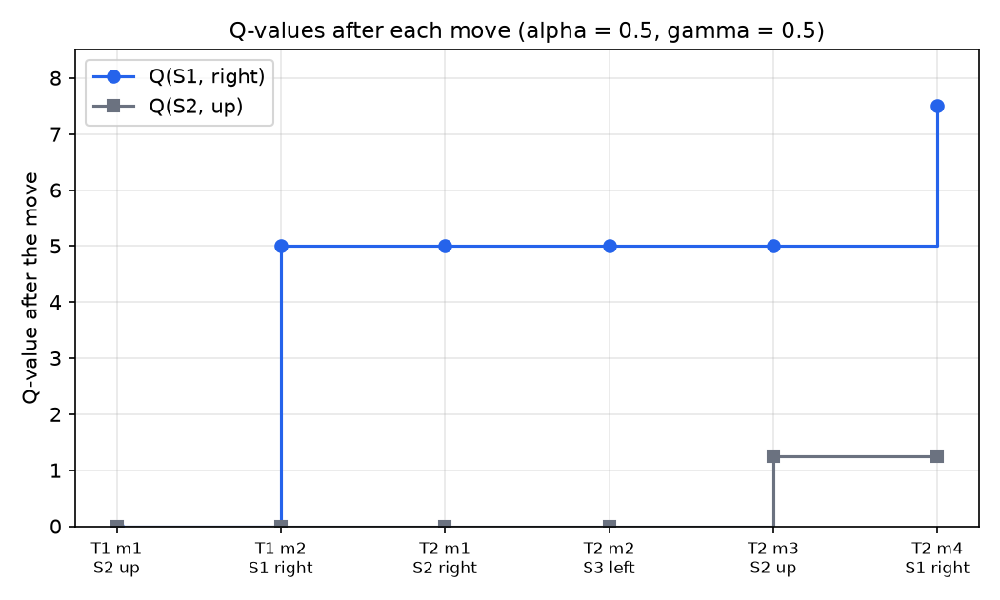

# Q-Learning and Reinforcement Learning Practice

Value iteration solves a Markov decision process only when the transition probabilities \\(T(s,a,s')\\) and the reward function are known. An agent that acts in a real environment usually has neither. Reinforcement learning replaces the known model with experience: the agent tries actions, observes the next state and the reward, and improves its estimates from those samples. Q-learning is the best-known model-free method of this kind. This chapter gives its introduction, the update rule and the reasons it works, the exploration question, a short look at deep reinforcement learning, and two worked practice problems with every update written out. The formal treatment of the Bellman equations, convergence and temporal-difference learning follows in the reinforcement-learning chapters.

## Learning Without the Model

Assume the environment is fully observable: after each action the agent knows the state it reached and the reward it received. What it does not know is the transition model. There are two families of response to that gap.

- **Model-based** methods estimate \\(T(s,a,s')\\) and the reward from experience, then solve the estimated decision problem with value iteration or policy iteration, as developed in [Markov Decision Processes](mdps.md).
- **Model-free** methods never estimate \\(T\\). They learn the quantity the policy needs directly.

Q-learning is model-free. Its goal is a policy \\(\pi(s)\\) that maps each state to an action, and the policy is read off a table of action values:

\\[
\pi(s) = \arg\max\_{a \in A} Q(s,a).
\\]

Here \\(Q(s,a)\\) is the utility of doing action \\(a\\) in state \\(s\\) and acting well afterwards. The two kinds of utility are related. If \\(U(s)\\) is the optimal utility of a state in the MDP convention, with the reward \\(R(s)\\) attached to the state, then

\\[
Q(s,a) = R(s) + \gamma \sum\_{s'} T(s,a,s')\\, U(s'), \qquad U(s) = \max\_a Q(s,a).
\\]

The practice problems and the update below put the reward on the transition: the reward \\(r\_{t+1}\\) is received when the agent enters \\(s\_{t+1}\\). This is the standard form for the update, and it differs from the state-reward convention only in where the reward is written.

A Q-table has one row per state and one column per action. The row below is typical of a table after some learning, with five actions in one state.

| State | \\(a\_1\\) | \\(a\_2\\) | \\(a\_3\\) | \\(a\_4\\) | \\(a\_5\\) |
|---|---|---|---|---|---|
| one state | 0.0 | \\(-5\\) | \\(+10\\) | \\(+2\\) | 0.0 |

The greedy action in this state is \\(a\_3\\), because its value of 10 is the largest entry in the row. The table is the whole policy: once the values are known, choosing an action is a single maximisation, with no model required.

## The Q-Learning Update

Suppose the agent is in state \\(s\_t\\), takes action \\(a\_t\\), receives reward \\(r\_{t+1}\\) and arrives in state \\(s\_{t+1}\\). One sample of the value of the action just taken is

\\[
r\_{t+1} + \gamma \max\_{a'} Q(s\_{t+1}, a').
\\]

The first term is the reward actually received. The second is the discounted value of being in \\(s\_{t+1}\\) and acting optimally there, estimated by the current table. The Q-learning update moves the table entry toward this sample by a fraction \\(\alpha\\):

\\[
Q(s\_t,a\_t) \leftarrow Q(s\_t,a\_t) + \alpha \left( r\_{t+1} + \gamma \max\_{a'} Q(s\_{t+1},a') - Q(s\_t,a\_t) \right).
\\]



*Figure: the update written term by term, as it appears in the source material. The left side is the entry being changed, the state-action pair just taken. The learning rate \\(\alpha\\) satisfies \\(0 < \alpha \le 1\\). The bracket is the temporal-difference error: the sample of the action value minus the current estimate.*

The bracket deserves a name because it drives all temporal-difference methods. Write the sample as \\(\hat Q = r\_{t+1} + \gamma \max\_{a'} Q(s\_{t+1},a')\\) and the temporal-difference error as \\(\delta = \hat Q - Q(s\_t,a\_t)\\). The update says \\(Q \leftarrow Q + \alpha\delta\\): a positive error raises the entry and a negative error lowers it.

### Why the update works

Rewrite the update as a weighted average. With \\(\alpha\\) fixed,

\\[
Q(s\_t,a\_t) \leftarrow (1-\alpha)\\, Q(s\_t,a\_t) + \alpha\\, \hat Q.
\\]

If the same pair is visited \\(n\\) times with samples \\(x\_1, x\_2, \dots, x\_n\\) and the step size is \\(\alpha\_n = 1/n\\), the update computes the sample mean exactly. Let \\(m\_n\\) be the estimate after \\(n\\) samples. Then \\(m\_n = m\_{n-1} + \tfrac{1}{n}(x\_n - m\_{n-1})\\), which rearranges to \\(m\_n = \tfrac{(n-1)m\_{n-1} + x\_n}{n}\\). By induction, \\(m\_n = \tfrac{1}{n}\sum\_{k=1}^{n} x\_k\\).

With a constant \\(\alpha\\) the estimate no longer weights all samples equally. Unrolling \\(m\_n = (1-\alpha)m\_{n-1} + \alpha x\_n\\) gives

\\[
m\_n = (1-\alpha)^n m\_0 + \alpha \sum\_{k=1}^{n} (1-\alpha)^{n-k} x\_k.
\\]

A sample \\(k\\) steps in the past has weight \\(\alpha(1-\alpha)^{n-k}\\), which shrinks geometrically. The entry is an exponential moving average of the sampled targets. A constant learning rate suits a setting where the target keeps moving, because old samples are gradually forgotten.

### Terminal states

If \\(s\_{t+1}\\) is terminal, nothing follows the transition, so the future term is zero:

\\[
Q(s\_t,a\_t) \leftarrow Q(s\_t,a\_t) + \alpha \left( r\_{t+1} - Q(s\_t,a\_t) \right).
\\]

This case matters for the worked examples below, because the largest reward sits on a terminal transition and its value enters the table in full.

### Propagating value backward

A single update changes one entry, and it changes it using the largest value already in the next state's row. Value therefore moves backward along a trajectory one step per visit. A reward found at the goal reaches the entry just before it after one trial that passes through that entry, the entry before that after a later trial, and so on. This is why the algorithm needs many trials that cover the state space. A state far from the goal learns about the reward only after its successors have learned about it.

### Off-policy learning

The update takes the maximum over the next actions, not the action the agent actually takes next. If the agent explores at random, the values it learns still describe the greedy policy. Learning from actions that are not the ones the policy would take is called off-policy learning, and it is the reason Q-learning can learn the best behavior from random exploration. The contrasting on-policy method, SARSA, uses the next action actually taken; it is not developed here.

## Exploration

Q-learning must try actions to learn their values, and it must use what it has learned to collect reward. Three action-selection rules show the trade-off.

- **Random.** The agent picks an action uniformly at random. Every action is tried, but the agent tends to see states near the start more often than states far from it, and it may never return to some states. It works in the limit but learns slowly.
- **Greedy.** The agent always picks \\(\arg\max\_a Q(s,a)\\). Initially every entry is zero, so the choice is arbitrary. The agent sees few states, and once a path to a reward has raised its entries, it can keep repeating that path and lock into a suboptimal policy.
- **Epsilon-greedy.** With probability \\(\epsilon\\), where \\(0 \le \epsilon \le 1\\), the agent picks a random action. Otherwise it picks the greedy action.



*Figure: a sketch of a trajectory from the start \\(s\_0\\) to a reward of 10, with random side steps along the way. The side steps are the exploration. Most steps still follow the current best values.*

Epsilon-greedy trades the two failures against each other. A constant \\(\epsilon\\) keeps some exploration forever, which is useful when the environment can change. A common refinement lowers \\(\epsilon\\) as trials accumulate, so that exploration gives way to exploitation as the values settle. The exploration chapter treats these schemes and their guarantees.

### The training loop

The procedure below runs Q-learning with epsilon-greedy exploration. The table is not reset between trials, because the values accumulate across all of them. The state update at the end of the loop, which the source leaves implicit, is written out here.

```
for N trials:
    reset the simulator to the start state (do not reset Q)
    while s is not terminal and t < threshold:
        if random number <= epsilon:
            a = a random action
        else:
            a = argmax over actions of Q(s, a)
        execute a; observe s' and r
        Q(s, a) <- Q(s, a) + alpha * (r + gamma * max over a' of Q(s', a') - Q(s, a))
        s <- s'
```

After training, the agent acts greedily, with no exploration:

```
repeat forever:
    a = argmax over actions of Q(s, a)
    execute a
```



*Figure: a sketch of total reward per trial against the trial number. Early trials rarely reach the reward, so the curve starts near zero. As value propagates backward, more trials reach the reward and the curve rises in an S-shape, then flattens when the policy is close to the best one. The curve still includes the effect of any remaining random actions.*

## Checking the Grid-World Table

The first grid example uses a seven-state grid with states A to G, four actions (left, right, up, down), and a goal worth 10 at the right of the grid. Its trajectories are drawn in four colors, and the table at the side shows the entries they produced. Most entries are zero. A few are nonzero and some are struck through beneath a newer value. The drawing does not state the learning rate, the discount factor or the number of trials, and some values are hard to read. The entries that matter most are these readings:

| Entry | Reading | Color of the trajectory |
|---|---|---|
| A, right | 0.5, over a struck-through value of 7.5 or 2.5 | blue |
| B, down | 2.5 | red |
| C, right | 4.15 or 4.5 | green |
| D, up | 2.5 | green |
| E, up | 3.75 | blue |
| F, down | 7.5 | red |
| G, down | 1.125 | green |

The table cannot be reproduced exactly, because the parameters and the trial sequence are missing. It can still be tested against the update rule. The check assumes the parameters of the first practice problem below, learning rate \\(\alpha = 0.1\\) and discount \\(\gamma = 0.5\\), and assumes that the only nonzero reward is the +10 at the goal. Under these assumptions every value stays between 0 and 20. Each target \\(r + \gamma \max Q'\\) is at most \\(10 + 0.5 \cdot 20 = 20\\), and an update replaces an entry by a convex combination of itself and a target, so a value no larger than 20 stays no larger than 20.

The check gives two results.

1. **The entry C, right.** A single update from zero changes the entry by at most \\(\alpha \cdot 20 = 0.1 \cdot 20 = 2\\). An entry of 4.15 or 4.5 therefore needs at least three updates to the same cell, and the trial order that would produce them is not given. The value cannot be checked from the drawing.
2. **The entry A, right.** The value 0.5 can come from a single update from zero: \\(0.1 (r + 0.5 M) = 0.5\\) gives \\(r + 0.5 M = 5\\). A move with no reward into a state whose best value is 10 satisfies this. The struck-through value cannot be the previous value of the same cell, though. An update from an old value \\(x\\) gives a new value \\(0.9x + 0.1(r + 0.5M) \ge 0.9x\\) when rewards and values are nonnegative. With \\(x = 2.5\\) or \\(x = 7.5\\), the new value would be at least 2.25 or 6.75, not 0.5. So under \\(\alpha = 0.1\\), the struck-through entries are not predecessors of 0.5 in that cell. They were produced under different settings or came from another part of the table.

Resolution: the chapter treats the first grid table as an illustration of the form such a table takes, not as a reproducible result. The worked practice problems below are fully specified and are the reference for the arithmetic.

## Practice Problem 1: A Three-Trial Grid

The first practice problem uses a \\(3 \times 4\\) grid. The cells are numbered 1 to 10 row by row, with the start on the left of row 2 and no number on it. State 2 is Goal I, a nonterminal intermediate goal worth 2 when entered. State 6 sits left of Goal T, which is terminal and worth 10 when entered. Moves are deterministic. The discount is \\(\gamma = 0.5\\) and the learning rate is \\(\alpha = 0.1\\). The table starts at zero.



*Figure: the grid with its three trajectories. Blue begins at the start, goes down to 7, right through 8 and 9, up to 6, then right into Goal T. Red goes right into 5, up into Goal I, right into 3, down into 6, then right into Goal T. Yellow goes up into 1, right through Goal I and 3, down into 6, then right into Goal T. Trials are processed in the order blue, red, yellow.*

The trajectories give the following moves. Each move of the form \\(s \to s'\\) is an update, and a move with zero reward into a state whose entries are all zero leaves the table unchanged.

**Trial 1 (blue).** Only one update changes the table. Entering Goal T from 6 gives

\\[
Q(6,\text{right}) = 0 + 0.1\\,(10 - 0) = 1.
\\]

The moves start to 7, 7 to 8, 8 to 9 and 9 to 6 have zero reward, and their next states have zero entries, so each leaves the table unchanged.

**Trial 2 (red).** Four moves matter.

- Entering Goal I from 5 by moving up: \\(Q(5,\text{up}) = 0 + 0.1\\,(2 + 0.5 \cdot 0 - 0) = 0.2\\). The next state's entries are still zero.
- Moving from Goal I right into 3: \\(Q(2,\text{right}) = 0 + 0.1\\,(0 + 0.5 \cdot 0 - 0) = 0\\). State 3's entries are still zero, so this update changes nothing.
- Moving from 3 down into 6: \\(Q(3,\text{down}) = 0 + 0.1\\,(0 + 0.5 \cdot 1 - 0) = 0.05\\), where the best value of state 6 is the 1 set in trial 1.
- Entering Goal T from 6: \\(Q(6,\text{right}) = 1 + 0.1\\,(10 - 1) = 1.9\\), a terminal update that moves the entry most of the way to 10.

**Trial 3 (yellow).** Four moves matter.

- Entering Goal I from 1: \\(Q(1,\text{right}) = 0 + 0.1\\,(2 + 0.5 \cdot 0 - 0) = 0.2\\). The entries of state 2 are still zero.
- Moving from Goal I right into 3: \\(Q(2,\text{right}) = 0 + 0.1\\,(0 + 0.5 \cdot 0.05 - 0) = 0.0025\\), using the 0.05 of state 3 from trial 2.
- Moving from 3 down into 6: \\(Q(3,\text{down}) = 0.05 + 0.1\\,(0 + 0.5 \cdot 1.9 - 0.05) = 0.05 + 0.09 = 0.14\\), using the 1.9 of state 6 from trial 2.
- Entering Goal T from 6: \\(Q(6,\text{right}) = 1.9 + 0.1\\,(10 - 1.9) = 1.9 + 0.81 = 2.71\\).

After the three trials the nonzero entries are \\(Q(1,\text{right}) = 0.2\\), \\(Q(2,\text{right}) = 0.0025\\), \\(Q(3,\text{down}) = 0.14\\), \\(Q(5,\text{up}) = 0.2\\) and \\(Q(6,\text{right}) = 2.71\\). The problem's Q-table reports these same five values, so it is the table after training, not the starting table.

Three points follow from the arithmetic.

- **Order matters.** The update of state 3 in trial 3 used the value 1.9 that trial 2 had set, and the update of state 2 used the 0.05 from trial 2. If the yellow trial had come before the red one, those inputs would be zero and the final numbers would differ. The table depends on the sequence of trials, not only on the set of trajectories.
- **Greedy policy.** Reading the table gives the greedy policy: from state 1 go right, from 2 go right, from 3 go down, from 5 go up, and from 6 go right into Goal T. Every nonzero entry points along a path that reaches the goal. The entry for state 2 is small, because the goal is three moves away and each step back multiplies the value by the discount of one half.
- **Propagation.** Each trial pushed value back one step. Blue set state 6. Red set state 5 and state 3. Yellow set state 1 and state 2, and updated state 3 and 6 again. No single trial could have produced the complete policy.

## Practice Problem 2: A Two-by-Two Grid

The second practice problem is a \\(2 \times 2\\) grid world. The top-left state is \\(S\_1\\), the top-right state is \\(S\_4\\), which is terminal and worth 10 when entered, the bottom-left state is \\(S\_2\\), the start, and the bottom-right state is \\(S\_3\\). The rewards of \\(S\_1\\), \\(S\_2\\) and \\(S\_3\\) are zero. The discount is \\(\gamma = 0.5\\) and the learning rate is \\(\alpha = 0.5\\). The agent's moves are given in advance:

- Trial 1: up from \\(S\_2\\) to \\(S\_1\\); right from \\(S\_1\\) to \\(S\_4\\).
- Trial 2: right from \\(S\_2\\) to \\(S\_3\\); left from \\(S\_3\\) to \\(S\_2\\); up from \\(S\_2\\) to \\(S\_1\\); right from \\(S\_1\\) to \\(S\_4\\).

Each update is written out below, including the three that leave the table unchanged. Every table entry starts at zero.

| Step | Move | Update | Result |
|---|---|---|---|
| 1 | \\(S\_2\\) up to \\(S\_1\\) | \\(Q(S\_2,\text{up}) = 0 + 0.5\\,(0 + 0.5 \cdot 0 - 0)\\) | 0 |
| 2 | \\(S\_1\\) right to \\(S\_4\\) (terminal) | \\(Q(S\_1,\text{right}) = 0 + 0.5\\,(10 - 0)\\) | 5 |
| 3 | \\(S\_2\\) right to \\(S\_3\\) | \\(Q(S\_2,\text{right}) = 0 + 0.5\\,(0 + 0.5 \cdot 0 - 0)\\) | 0 |
| 4 | \\(S\_3\\) left to \\(S\_2\\) | \\(Q(S\_3,\text{left}) = 0 + 0.5\\,(0 + 0.5 \cdot 0 - 0)\\) | 0 |
| 5 | \\(S\_2\\) up to \\(S\_1\\) | \\(Q(S\_2,\text{up}) = 0 + 0.5\\,(0 + 0.5 \cdot 5 - 0)\\) | 1.25 |
| 6 | \\(S\_1\\) right to \\(S\_4\\) (terminal) | \\(Q(S\_1,\text{right}) = 5 + 0.5\\,(10 - 5)\\) | 7.5 |

The steps 3 and 4 use the largest value in the next state, which is zero at that point, so they change nothing. Step 1 is the same. Step 5 is the first update that uses a nonzero value: \\(S\_1\\) has reached 5 by step 2, so \\(Q(S\_2,\text{up}) = 0.5 \cdot (0.5 \cdot 5) = 1.25\\). Step 6 raises \\(Q(S\_1,\text{right})\\) to 7.5. After the last move the table has exactly two nonzero entries, \\(Q(S\_1,\text{right}) = 7.5\\) and \\(Q(S\_2,\text{up}) = 1.25\\).



*Figure: the two nonzero entries after each of the six moves, with the step on each move. The solid line is \\(Q(S\_1,\text{right})\\), which jumps to 5 at the terminal move and then to 7.5 on the second visit. The square-marked line is \\(Q(S\_2,\text{up})\\), which stays at zero until step 5 and then reads 1.25. Each horizontal stretch is a period in which the entry does not change.*

Three observations follow from the table.

- **Repeated visits to a terminal move approach the reward geometrically.** The update into the terminal state is \\(Q \leftarrow Q + \alpha(10 - Q)\\), so the gap to 10 is multiplied by \\(1 - \alpha = 0.5\\) on each visit. After \\(k\\) visits with only this transition, \\(Q(S\_1,\text{right}) = 10 - 10 \cdot (0.5)^k\\). The formula gives 5 for \\(k = 1\\) and 7.5 for \\(k = 2\\), matching steps 2 and 6, and it tends to 10.
- **Entries depend on when they are updated.** The entry \\(Q(S\_2,\text{up})\\) was set to 1.25 because \\(Q(S\_1,\text{right})\\) was 5 at step 5. If the same move had come after \\(Q(S\_1,\text{right})\\) reached 7.5, the value would be \\(0.5 \cdot (0.5 \cdot 7.5) = 1.875\\). The sequence of moves, not only the set of transitions, determines the table.
- **Discounting shows in the value of the earlier state.** The entry \\(Q(S\_2,\text{up})\\) is worth less than \\(Q(S\_1,\text{right})\\) because it reaches the reward only through \\(S\_1\\), and each step back multiplies the target by \\(\gamma = 0.5\\).

## Deep Reinforcement Learning

Tabular Q-learning needs one entry for every state-action pair. Many problems have far too many states to enumerate. A game played from raw pixels has an enormous number of distinct screens, and a table over them cannot be stored or filled. Deep reinforcement learning, in the simplest statement, is reinforcement learning with a neural network in place of the table. The network learns a function that approximates the action values from the observation.

Two designs are common. One network takes the observation and the action as inputs and outputs a single real number, a guess at \\(Q(s,a)\\). Another takes only the observation and has one output per action, so that a single forward pass gives every action value and the greedy action is the argmax over outputs. The second design is the one in the source sketch, where the network replaces the Q-table and the maximum selects among the outputs. The update target stays \\(r + \gamma \max\_{a'} Q(s',a')\\), and the network is trained so that its prediction moves toward that target. The mechanics, and the stabilising tricks that make the approach work, are developed in [Deep Q-Learning and Policy Gradients](../ml/deep-learning/deep-q-learning.md).

Replacing the table with a network changes the guarantees. The convergence results for the table do not carry over automatically to a network, and the reinforcement-learning chapters on convergence say when they hold. The examples that made deep reinforcement learning prominent include a match of a Go program against a professional player in 2015, Atari video games learned from pixels, the team game Dota 2, the real-time strategy game StarCraft II, and a Quake capture-the-flag arena. The sources give the Quake version inconsistently, so this chapter names only the game family.

## Summary

- Q-learning learns action values \\(Q(s,a)\\) from sampled transitions, without a transition model. The greedy policy is \\(\pi(s) = \arg\max\_a Q(s,a)\\).
- The update is \\(Q(s,a) \leftarrow Q(s,a) + \alpha\\,(r + \gamma \max\_{a'} Q(s',a') - Q(s,a))\\), with \\(0 < \alpha \le 1\\). For a terminal successor the future term is zero.
- With a constant \\(\alpha\\), each entry is an exponential moving average of its sampled targets, so recent samples have the most weight.
- The max over next actions makes Q-learning off-policy: the values describe the greedy policy even when exploration is random.
- Greedy exploration can lock into a suboptimal policy, random exploration learns slowly, and epsilon-greedy trades one against the other.
- In the three-trial grid, with \\(\alpha = 0.1\\) and \\(\gamma = 0.5\\), the final entries are 0.2, 0.0025, 0.14, 0.2 and 2.71. In the two-by-two grid, with \\(\alpha = 0.5\\) and \\(\gamma = 0.5\\), the final entries are 7.5 and 1.25.
- A single update changes an entry by at most \\(\alpha \cdot R\_{\max}/(1-\gamma)\\). With rewards at most 10 and \\(\gamma = 0.5\\), that is 2 for \\(\alpha = 0.1\\), which limits how far one update can move an entry.
- Deep reinforcement learning replaces the table with a neural network that maps observations, or observations and actions, to action values.

## See Also

- [Markov Decision Processes](mdps.md): the model-based setting and value iteration that Q-learning approximates.
- [MDP Examples and Value Iteration](mdp-examples.md): worked MDP exercises with known transitions.
- [Reinforcement Learning](../ml/rl.md): the one-page overview of the field.
- [Temporal-Difference Learning](../ml/reinforcement-learning/td-learning.md): the general family that includes this update.
- [Exploration, Bandits, and R-max](../ml/reinforcement-learning/exploration.md): exploration strategies with guarantees.
- [Deep Q-Learning and Policy Gradients](../ml/deep-learning/deep-q-learning.md): the neural-network version of this method.
