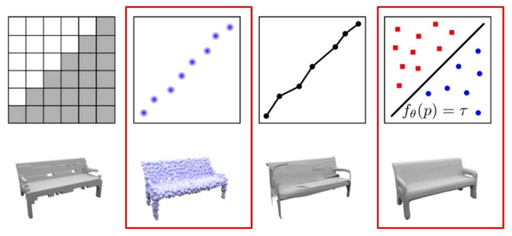
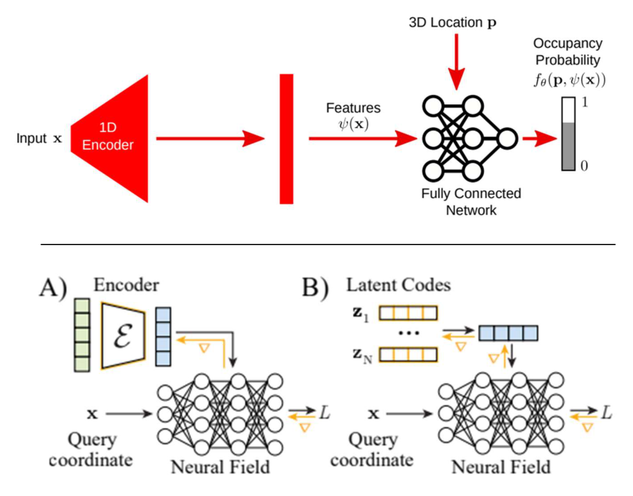
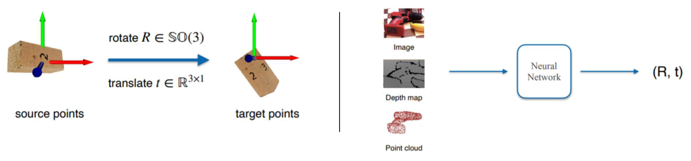
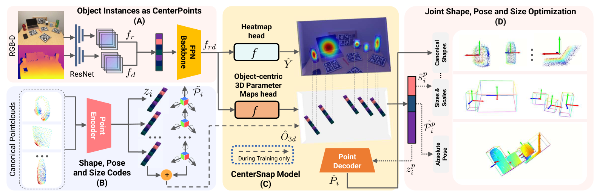
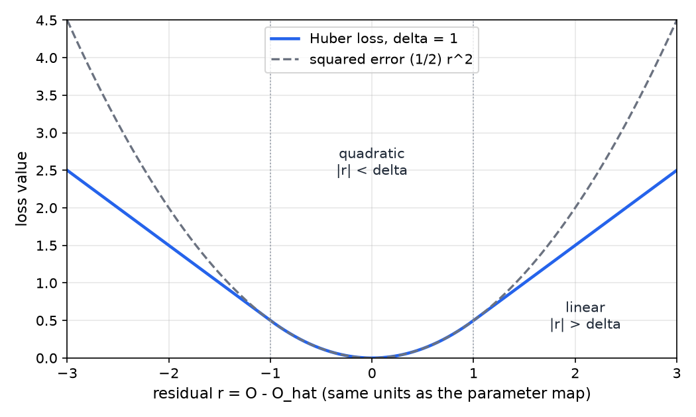
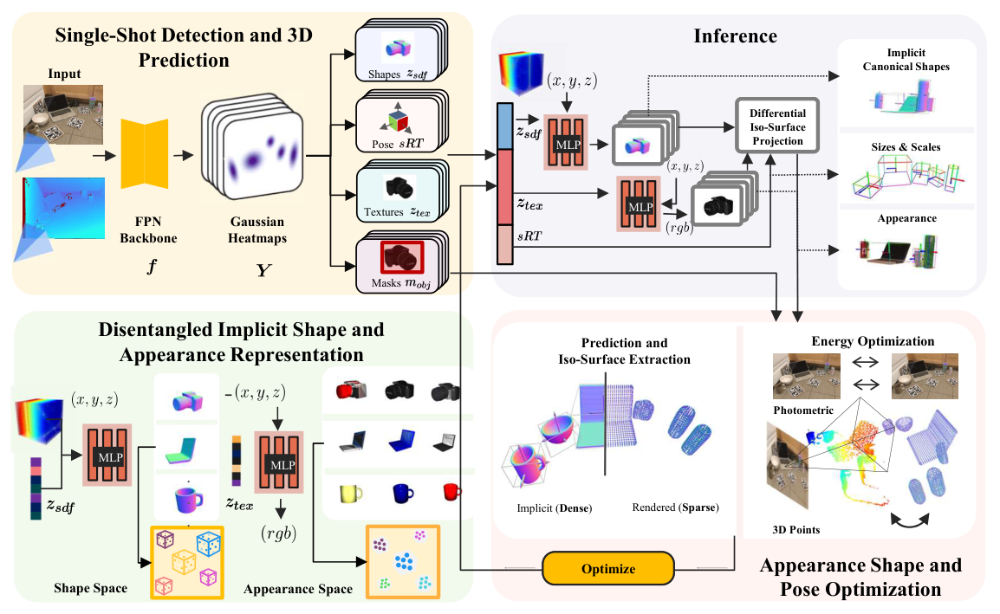

# 3D Scene Representations

A robot that handles objects needs more than labels on pixels. It needs to know where each object is, how it is oriented, how large it is, and what its shape is, including the sides the camera cannot see. This chapter studies how that 3D information is represented and learned. It compares four shape representations, introduces latent codes that let one network describe many objects, defines the 6D pose and its category-level extension, and then follows two systems that predict object-centric 3D structure from a single RGB-D view. CenterSnap does this in one forward pass. ShAPO adds an implicit appearance model and per-object optimization at test time. The chapter comes after the sequence-model chapters and before the generative models, which reuse the implicit and latent-code ideas.

## Why Structured 3D Representations

Two designs connect perception to action. In **end-to-end control**, observations and an instruction go into one neural network that outputs actions, and training uses a reward or a supervised loss on those actions. In **perception followed by a classical pipeline**, a neural network produces an intermediate output, and a classical pipeline (a planner, a controller, a grasp executor) consumes that output to drive the robot. The supervised loss is applied to the intermediate output rather than to the actions. The intermediate outputs in this design are typically 6-DOF grasp poses, 3D bounding boxes, object shapes and object appearances.

The argument of this chapter is that the intermediate output should be structured 3D objects. For each object the system should report a pose, a size, a shape and an appearance, all tied to one instance. A classical planner or controller can use each of these quantities directly. The end-to-end alternative asks a single network to learn the same geometry implicitly, from action labels or rewards. The structured route makes the geometry an explicit training target and leaves the planning stage unchanged.

What a good representation of one object looks like is therefore the first question, and how to predict it from pixels is the second.

## Four Shape Representations

One bench model can be described in four ways, shown in Figure 1 below. Each choice trades storage against accuracy and against the operations that are easy to perform.

### Voxel Occupancy Grids

A voxel grid divides a bounding volume into \\(N^3\\) cells and stores a binary occupancy value for each cell. The value is 1 if the cell lies inside the object and 0 otherwise:

\\[
o\_{ijk} \in \lbrace 0,1 \rbrace , \qquad i,j,k \in \lbrace 1,\dots,N \rbrace .
\\]

Storage grows as \\(N^3\\), so doubling the resolution multiplies the memory by eight. Grids are simple, parallel and easy to feed to convolutional networks, but thin structures (the legs of a chair, the handle of a mug) need many cells before they appear at all.

**Example (grid memory).** At \\(N = 64\\) there are \\(64^3 = 262{,}144\\) cells. Stored as one bit each, the grid takes \\(262{,}144 / 8 = 32{,}768\\) bytes, which is 32 KiB. Stored as float32 values at 4 bytes each, it takes \\(262{,}144 \times 4 = 1{,}048{,}576\\) bytes, which is 1 MiB. At \\(N = 256\\) there are \\(16{,}777{,}216\\) cells, and the float32 grid takes 64 MiB. Storage grows with the cube of the resolution, while the surface itself grows only with its square.

### Point Clouds

A point cloud is a finite set of \\(M\\) points \\(\mathbf{p}\_i \in \mathbb{R}^3\\). It is sparse and cheap, and it is what a depth sensor produces directly. It is not a surface. It has no faces, it cannot say whether a point lies inside or outside a closed shape, and it has gaps wherever the sensor saw nothing. Storage is \\(3M\\) numbers.

**Example (point cloud memory).** Two thousand forty-eight points with three float32 coordinates each take \\(2048 \times 3 \times 4 = 24{,}576\\) bytes, or 24 KiB. That is about forty times smaller than the float32 grid at \\(N = 64\\), but the cloud carries no connectivity and no notion of inside.

### Meshes

A mesh stores vertices and faces. It is an explicit surface with a well-defined inside and outside and with normal directions, which is why meshes are the usual format for rendering. Its weakness for learning is topology. A mesh predicted by deforming a template keeps the template's connectivity, so the template must already have the right number of holes and handles. Deciding whether an arbitrary point lies inside a mesh requires a separate containment test.

### Implicit Functions

An implicit representation stores a function rather than samples. A network \\(f\_\theta : \mathbb{R}^3 \to \mathbb{R}\\) can be queried at any point \\(\mathbf{p}\\), and the surface is the level set

\\[
\mathcal{S} = \lbrace \mathbf{p} \in \mathbb{R}^3 : f\_\theta(\mathbf{p}) = \tau \rbrace .
\\]

For a signed distance function the level is \\(\tau = 0\\), with negative values inside and positive values outside. An occupancy field instead outputs a probability, and the surface is taken where that probability crosses a chosen level.

**Example (a sphere as a signed distance field).** Take \\(f(\mathbf{p}) = \lVert \mathbf{p} \rVert - 1\\) for the unit sphere.

1. For \\(\mathbf{p} = (0.5, 0.5, 0.5)\\), \\(\lVert \mathbf{p} \rVert = \sqrt{0.75} \approx 0.8660\\), so \\(f(\mathbf{p}) \approx -0.1340\\). The point is inside.
2. For \\(\mathbf{p} = (1.2, 0, 0)\\), \\(f(\mathbf{p}) = 0.2\\). The point is outside.
3. Truncating the field at \\(\delta = 0.1\\), that is replacing \\(f\\) by \\(\operatorname{clamp}(f, \delta)\\) with \\(\operatorname{clamp}(f, \delta) = \max(-\delta, \min(\delta, f))\\), turns the two values into \\(-0.1\\) and \\(0.1\\).

Truncation keeps the stored values small away from the surface, so a loss built on the truncated field concentrates on the region near the level set. The learned fields below use this device.

The main property of an implicit representation is that its size does not depend on the output resolution. The weights are fixed, and the resolution is chosen at query time. The cost moves to query time. To produce an explicit mesh, one must evaluate the field on many points and locate its zero set, which is why the octree sampling discussed later matters.

| Representation | Storage | Explicit surface | Topology | Resolution |
|---|---|---|---|---|
| Voxel occupancy | N cubed cells | no, must be extracted | free | fixed by N |
| Point cloud | M points | no | none | set by M |
| Mesh | vertices and faces | yes | fixed by template | set by the mesh |
| Implicit function | network weights | through the level set | free | chosen at query time |

*Figure 1: The same bench model as a voxel occupancy grid, a point cloud, a mesh and an implicit level set. The red frames mark the two representations the systems later in this chapter use: point clouds as the output of a training-time decoder (CenterSnap) and implicit functions (ShAPO). In the implicit panel, the level set of the function separates query points on its two sides.*

## Neural Fields and Latent Codes

A neural field is a network that maps a coordinate to a physical quantity, such as occupancy, signed distance or color. A single field has to describe many objects, so the question is how to condition it on the object. Two designs appear in the literature this chapter follows, and Figure 2 shows both.

### Encoder-Conditioned Fields

An encoder \\(\psi\\) maps an input \\(\mathbf{x}\\) to a feature vector, and a fully connected network outputs an occupancy probability for any query point:

\\[
o(\mathbf{p}) = f\_\theta\big(\mathbf{p}, \psi(\mathbf{x})\big) \in [0,1] .
\\]

The feature vector is a bottleneck. The encoder must squeeze everything the network needs about the object into it, and the network must run once per input. This design is fast at test time because one forward pass produces the whole field.

### Latent Codes and the Auto-Decoder

The second design gives each training object \\(i\\) its own code \\(\mathbf{z}\_i\\), which is a free parameter learned during training rather than the output of an encoder. The weights and all codes are optimized together:

\\[
\min\_{\theta,\ \mathbf{z}\_1,\dots,\mathbf{z}\_N} \ \sum\_{i=1}^{N} \sum\_{j} \ \mathcal{L}\big(f\_\theta(\mathbf{p}\_{ij}, \mathbf{z}\_i),\ o\_{ij}\big),
\\]

where \\(\mathbf{p}\_{ij}\\) are query points sampled near object \\(i\\) and \\(o\_{ij}\\) is their ground-truth occupancy. The network acts as a decoder from codes to fields, and no encoder is needed. This is an auto-decoder. The published work states this objective only in words, and the sum form here is the standard way to write it.

At test time a new object gets its own code by the same optimization, with the weights frozen:

\\[
\hat{\mathbf{z}} = \arg\min\_{\mathbf{z}} \sum\_{j} \mathcal{L}\big(f\_\theta(\mathbf{p}\_j, \mathbf{z}), o\_j\big) .
\\]

The auto-decoder trades speed for accuracy. Fitting a code takes many gradient steps per object, where an encoder takes one forward pass. In return, the codes are not limited by an encoder's bottleneck, and the set of codes forms a learned shape space in which nearby codes give similar shapes. The category clusters shown later are an example.

**Example (one gradient step on a code, a toy).** Suppose the field at one query point is \\(f(\mathbf{p}, z) = 0.2 + z\\), the target occupancy is \\(o = 1\\), and the loss is \\(\mathcal{L} = (f - o)^2\\). Start from \\(z = 0\\). Then \\(f = 0.2\\) and \\(\partial \mathcal{L} / \partial z = 2(f - o) = -1.6\\). With learning rate 0.1 the update is \\(z \leftarrow 0 - 0.1 \times (-1.6) = 0.16\\). The new prediction is \\(f = 0.36\\), and the loss falls from \\(0.64\\) to \\(0.4096\\). The field is artificial, but the mechanism is the one used in practice. The gradient moves the code, and the weights do not change.

*Figure 2: The top panel shows an encoder that maps a one-dimensional input to features, and a fully connected network that combines those features with a 3D location to output an occupancy probability. The bottom panel shows (A) an encoder-conditioned neural field and (B) a field with one latent code per training object. In (B) the gradient arrows show that the codes and the network weights are updated together.*

## Object Pose

### Six Degrees of Freedom

A rigid object's pose is a rotation \\(R \in SO(3)\\) and a translation \\(\mathbf{t} \in \mathbb{R}^3\\). The rotation has three degrees of freedom and so does the translation, so the pose has six. A rigid map sends a point \\(\mathbf{x}\\) of the object into the target frame by

\\[
\mathbf{x}' = R\mathbf{x} + \mathbf{t}, \qquad R^{\top} R = I, \qquad \det R = 1 .
\\]

Together these conditions define \\(SO(3)\\), the set of rotations that preserve lengths, angles and orientation.

**Example (a rigid motion).** Let \\(R\\) be a 90-degree rotation about the \\(z\\) axis and \\(\mathbf{t} = (1, 0, 0)\\):

\\[
R = \begin{bmatrix} 0 & -1 & 0 \\\\ 1 & 0 & 0 \\\\ 0 & 0 & 1 \end{bmatrix} .
\\]

The point \\(\mathbf{x} = (1, 0, 0)\\) maps to \\(R\mathbf{x} = (0, 1, 0)\\), and then to \\(\mathbf{x}' = (0, 1, 0) + (1, 0, 0) = (1, 1, 0)\\).

A network can learn the pose from an image, from a depth map or from a point cloud. Its output is the pair \\((R, \mathbf{t})\\). Figure 3 shows the mapping and the learning setup.

*Figure 3: On the left, a rigid map takes source points to target points through a rotation in SO(3) followed by a translation. On the right, a neural network takes an image, a depth map or a point cloud and outputs the pose as a rotation and a translation.*

### Category-Level Pose and Size

A pose estimator for a known object can use the object's CAD model as a template. For a new instance of a known category there is no model. The category-level formulation predicts the object in a canonical frame with normalized coordinates, together with a similarity transform that maps canonical coordinates into the camera frame:

\\[
\mathbf{x}\_{cam} = s R \mathbf{x}\_{canon} + \mathbf{t} .
\\]

The scale \\(s\\) carries the object's size, \\(R\\) its orientation and \\(\mathbf{t}\\) its position. This is the convention of the NOCS benchmark, and the \\(sRT\\) notation used by ShAPO follows it. The "6D pose and size" in the published results is this transform: six degrees of freedom plus a scale.

**Example (scale inside the transform).** Use the rotation and translation from the previous example, a scale \\(s = 2\\), and the canonical point \\(\mathbf{x}\_{canon} = (1, 0, 0)\\). Then \\(\mathbf{x}\_{cam} = 2R(1, 0, 0) + (1, 0, 0) = 2(0, 1, 0) + (1, 0, 0) = (1, 2, 0)\\). The scale multiplies the rotated canonical coordinates before the translation is added, so a larger scale spreads the object's points farther from the translation point.

## CenterSnap

CenterSnap is a single network that detects objects, reconstructs their shapes and estimates their 6D poses and sizes from one RGB-D image. Its title describes the method: single-shot, multi-object, shape and categorical 6D pose and size estimation.

### Design Choices

Earlier systems for this task were either two-stage or disjoint. A detector found the objects, and then separate networks estimated shape and pose for each detection. The comparison below is taken from the published design rationale.

| Aspect | Prior methods (two-stage or disjoint) | CenterSnap |
|---|---|---|
| Detection | anchor-based | anchor-free, one peak per object center |
| Shape and scene context | shape reconstruction separate from the scene | shape reconstruction jointly with object-centric scene context |
| Speed | slow, one forward pass per task | real-time, a single forward pass |
| Category | category-specific | category-agnostic reconstruction and 6D pose and size |
| Heads | heads at different levels of expertise | all heads trained with one loss and sharing gradients |

Two properties follow from this design. Because each object is a single peak in one heatmap, no anchor boxes are needed to propose candidate objects. Because all heads are trained with one loss, the heads share gradients. The published argument is that a sequential pipeline lets errors compound, since a later stage inherits the mistakes of an earlier one, whereas a shared network with one loss has "no head smarter than the others".

### Architecture

The RGB image and the depth image pass through separate ResNet branches, which produce features \\(f\_r\\) and \\(f\_d\\). These are combined and passed through a feature pyramid network (FPN) backbone to give a single feature map \\(f\_{rd}\\). Two heads read that map:

- A **heatmap head** produces \\(\hat Y\\), which has one peak at each object center. Each peak is one object, so detection needs no anchors.
- An **object-centric 3D parameter-map head** produces \\(\hat O\_{3d}\\), which stores the per-object parameters at each center: a canonical shape code, a size and scale, and an absolute pose.

The shape code is turned into a canonical point cloud \\(\hat{\mathbf{P}}\_i\\) by a **point decoder**. That branch is used only during training, and it supplies the point-cloud supervision. The shape codes are built from the canonical point clouds of the training objects: a **point encoder** maps each cloud to a latent code \\(\mathbf{z}\_i\\), and the parameter-map head learns to predict that code for each object. At inference the per-object outputs are canonical shape, size and scale, absolute pose and shape code, and they are assembled into the final shape and 6D pose.

*Figure 4: The CenterSnap pipeline. Separate branches read the color and depth images, a backbone fuses them, and a heatmap head locates object centers. A parameter-map head reads per-object values at those centers. The dashed path, marked as used during training only, carries the point-cloud supervision through the point decoder.*

### Shape Codes and the Chamfer Distance

The shape prior is an autoencoder trained on ShapeNet models. Each object's canonical point cloud is encoded to a code, and the decoder reconstructs the points from that code. Shape reconstruction is scored with the symmetric Chamfer distance between the ground-truth set \\(\mathbf{P}\_i\\) and the predicted set \\(\hat{\mathbf{P}}\_i\\):

\\[
D\_{cd}(\mathbf{P}\_i, \hat{\mathbf{P}}\_i) = \frac{1}{\lvert \mathbf{P}\_i \rvert} \sum\_{\mathbf{x} \in \mathbf{P}\_i} \min\_{\mathbf{y} \in \hat{\mathbf{P}}\_i} \lVert \mathbf{x} - \mathbf{y} \rVert\_2^2 +
\frac{1}{\lvert \hat{\mathbf{P}}\_i \rvert} \sum\_{\mathbf{y} \in \hat{\mathbf{P}}\_i} \min\_{\mathbf{x} \in \mathbf{P}\_i} \lVert \mathbf{x} - \mathbf{y} \rVert\_2^2 .
\\]

The first term measures how far each ground-truth point is from its nearest predicted point, and the second measures how far each predicted point is from its nearest ground-truth point. The two terms penalize different errors. Missing geometry raises the first term, and stray geometry raises the second.

**Example (Chamfer distance by hand).** Let the ground truth contain the two points \\((0,0)\\) and \\((1,0)\\), and let the prediction contain \\((0,0.1)\\), \\((1,0.2)\\) and \\((2,0)\\).

1. First term. The nearest prediction to \\((0,0)\\) is \\((0,0.1)\\), at squared distance \\(0.01\\). The nearest prediction to \\((1,0)\\) is \\((1,0.2)\\), at squared distance \\(0.04\\). The sum is \\(0.05\\), and dividing by \\(\lvert \mathbf{P} \rvert = 2\\) gives \\(0.025\\).
2. Second term. The nearest ground-truth point to \\((0,0.1)\\) is \\((0,0)\\), at \\(0.01\\). For \\((1,0.2)\\) it is \\((1,0)\\), at \\(0.04\\). For \\((2,0)\\) it is \\((1,0)\\), at \\(1.00\\). The sum is \\(1.05\\), and dividing by \\(\lvert \hat{\mathbf{P}} \rvert = 3\\) gives \\(0.35\\).
3. Total: \\(0.025 + 0.35 = 0.375\\).

The stray prediction \\((2,0)\\) contributes most of the total through the second term. The definition is symmetric in its two arguments, but the two directions can contribute very different amounts.

The learned codes cluster by category. The published embedding of thirteen ShapeNet categories shows a separate cluster for each.

### Training Loss

The total loss is a weighted sum of three terms:

\\[
\mathcal{L} = \lambda\_{l} \mathcal{L}\_{inst} + \lambda\_{O\_{3d}} \mathcal{L}\_{O\_{3d}} + \lambda\_{d} \mathcal{L}\_{D} .
\\]

The heatmap term \\(\mathcal{L}\_{inst}\\) is a squared error summed over every heatmap entry:

\\[
\mathcal{L}\_{inst} = \sum\_{\text{entries}} \big(\hat Y - Y\big)^2 .
\\]

The parameter-map term \\(\mathcal{L}\_{O\_{3d}}\\) is a Huber loss with threshold \\(\delta\\). The version written in the published equations is

\\[
\mathcal{L}\_{O\_{3d}}(O\_{3d}, \hat O\_{3d}) =
\begin{cases}
\tfrac{1}{2}\big(O\_{3d} - \hat O\_{3d}\big)^2 & \text{if } \lvert O\_{3d} - \hat O\_{3d} \rvert < \delta, \\\\
\delta\Big(\lvert O\_{3d} - \hat O\_{3d} \rvert - \tfrac{1}{2}\delta\Big) & \text{otherwise.}
\end{cases}
\\]

The published bullet list says the reverse, with masked L1 for the parameter map and Huber for the heatmap. This chapter follows the equations, which are written out in full, and notes the disagreement. The Huber form has one correction. The published second branch omits the absolute value, which would make the loss negative for negative residuals. For a residual of \\(-2\\) with \\(\delta = 1\\), the published form gives \\(1 \cdot (-2 - 0.5) = -2.5\\), and the standard form gives \\(1 \cdot (2 - 0.5) = 1.5\\). The chapter uses the standard form with \\(\lvert \cdot \rvert\\).

The Huber loss is quadratic for small residuals and linear for large ones. At the transition \\(\lvert r \rvert = \delta\\) both branches equal \\(\delta^2/2\\), and both have slope \\(\delta\\), so the loss is smooth there. Figure 5 plots the form.

*Figure 5: The Huber loss with threshold 1 (solid line) against half the squared error (dashed line). Inside the band where the residual is smaller than the threshold, the two agree. Outside it, the Huber loss grows linearly, so a large residual contributes less than it would under squared error.*

**Example (Huber values).** With \\(\delta = 1\\), a residual of \\(0.5\\) lies inside the band and gives \\(\tfrac{1}{2}(0.5)^2 = 0.125\\). A residual of \\(2\\) lies outside and gives \\(1 \cdot (2 - 0.5) = 1.5\\). A residual of \\(-2\\) gives the same \\(1.5\\), so the loss is symmetric in the sign of the error.

The depth auxiliary term \\(\mathcal{L}\_D\\) improves transfer from simulation to the real world. The published work does not give its formula, so none is stated here.

### Results

The published comparison uses two benchmark splits: CAMERA25, which is synthetic, and REAL275, which is real. The table below gives selected entries. Columns are the 3D intersection-over-union thresholds (IOU25) and the 6D pose thresholds written as rotation error in degrees and translation error in centimeters.

| Method | CAMERA25 IOU25 | CAMERA25 10°10 cm | REAL275 IOU25 | REAL275 5°5 cm | REAL275 10°10 cm |
|---|---|---|---|---|---|
| NOCS | 91.1 | 65.1 | 84.8 | 10.0 | 25.8 |
| Metric Scale | 93.8 | 58.9 | 81.6 | 5.3 | 26.5 |
| ShapePrior | 81.6 | 81.3 | 81.2 | 21.4 | 54.1 |
| CenterSnap | 93.2 | 87.9 | 83.5 | 27.2 | 64.4 |
| CenterSnap-R | 93.2 | 87.9 | 83.5 | 29.1 | 70.9 |

The published text does not define the -R suffix. The strongest gains over the baselines are at the tight 5°5 cm threshold on the real data, where NOCS scores 10.0 and CenterSnap scores 27.2. The comparison is not uniform, however. On CAMERA25 at IOU25 the Metric Scale baseline (93.8) is slightly above CenterSnap (93.2), while CenterSnap is above NOCS (91.1). The fair summary is that CenterSnap leads at the tighter pose thresholds on the real data and at the 10°10 cm threshold on the synthetic data.

Shape reconstruction is reported as mean Chamfer distance, scaled by \\(10^{-2}\\) in the published table, where lower is better. CenterSnap has a mean of 0.14 on CAMERA25 and 0.15 on REAL275. The reconstruction baseline has 0.20 and 0.32, and ShapePrior has 0.37 and 0.44.

The ablation study separates the contribution of each input and component. The table below reproduces all seven published rows. The published text cites a comparison with a row 8 that does not exist, so the comparison in the text uses rows 3 and 7.

| Row | Input | Shape head | Depth auxiliary | IOU25 | 10°10 cm |
|---|---|---|---|---|---|
| 1 | RGB-D | yes | yes | 28.4 | 48.2 |
| 2 | RGB-D | yes | yes | 41.5 | 58.2 |
| 3 | RGB-D, no shape head | no | yes | not reported | 50.2 |
| 4 | RGB only | yes | yes | 63.7 | 30.1 |
| 5 | depth only | yes | yes | 74.2 | 63.2 |
| 6 | RGB-D | yes | no | 82.3 | 68.3 |
| 7 | RGB-D | yes | yes | 83.5 | 70.9 |

Three conclusions follow from the table. Monocular color is the weakest input, and depth alone is better than color alone at IOU25 (74.2 against 63.7). Combining both inputs gives the best result (83.5). The shape head helps at the 10°10 cm pose threshold: row 3 without it scores 50.2 and row 7 with it scores 70.9. The depth auxiliary term helps modestly, with 82.3 without it and 83.5 with it at IOU25. The training-regime labels C, C+R and C+RF in the table are not defined in the published work, so no conclusion about them is drawn here.

### Runtime

The published text claims that the system runs at 40 frames per second on a single GPU. The bar chart beside the claim does not support that figure. Its bars show about 23 frames per second for the system without the reconstruction branch and about 18 with it, against about 5 for the Mesh R-CNN baseline. The chart labels the systems "Stereo CenterPoint". This chapter reads those bars as the CenterSnap systems and uses the chart values. It does not repeat the 40 figure as a measurement.

On the chart values the speed ratio over the baseline is \\(23 / 5 = 4.6\\), or \\(18 / 5 = 3.6\\) with reconstruction. The published reason is structural: the baseline runs detection and shape reconstruction in two stages, while CenterSnap makes one pass with shared parameters.

### Follow-Up on Articulated Objects

CARTO applies the same center-point idea to articulated objects such as doors and drawers. It learns a shape and articulation prior per category, runs at about one second per image, and is trained in simulation and transferred to real images without fine-tuning. At one second per image it is far slower than CenterSnap.

## ShAPO

ShAPO (implicit shape, appearance and pose optimization) extends CenterSnap in two ways. It adds an appearance prior, so the system also reconstructs texture, and it refines each object's shape and pose by optimization at test time. The published motivation is to use geometry and appearance priors for generalizable reconstruction, together with object-centric scene context.

### Pipeline

ShAPO has three parts.

1. **Single-shot detection and 3D prediction.** The RGB-D input goes through an FPN backbone that produces Gaussian heatmaps for object centers. Four heads are read at each detection: a shape code \\(\mathbf{z}\_{sdf}\\), a pose \\(sRT\\), a texture code \\(\mathbf{z}\_{tex}\\) and an object mask.
2. **Disentangled implicit shape and appearance.** A shape network maps a point and the shape code to a signed distance. A texture network maps a point and both codes to a color. The shape and appearance spaces are latent spaces in which each training object is a single point.
3. **Inference and optimization.** A differentiable iso-surface projection turns the implicit fields into surface points. An energy minimization at test time, with a photometric term that compares rendered and observed color and a 3D point term, refines shape, appearance, pose and size.

*Figure 6: The ShAPO pipeline. The top-left panel is the single-shot detector with its four heads. The bottom-left panel shows the disentangled shape and appearance spaces. The top-right panel is inference through the implicit fields and the iso-surface projection. The bottom-right panel is the test-time optimization that refines the result against the input image.*

### Implicit Shape and Appearance

Geometry is a continuous signed distance field. A network \\(G(\mathbf{x}, \mathbf{z}\_{sdf}) = s\\) takes a point \\(\mathbf{x}\\) and a shape code \\(\mathbf{z}\_{sdf} \in \mathbb{R}^{64}\\), and returns a scalar \\(s\\). Appearance is a texture field \\(t\_\theta : \mathbb{R}^3 \to \mathbb{R}^3\\), which returns an RGB color for a point given the shape and texture codes. Each field is a multilayer perceptron. The training data are more than one thousand textured models from six ShapeNet categories.

Because both fields are functions, the surface and the appearance can be queried anywhere. The shape and texture codes are separate, so in principle one shape code can be paired with different texture codes. This separation is what the published work calls disentanglement.

### Losses

The shape loss compares truncated distances and adds a contrastive term on the shape codes:

\\[
\mathcal{L}\_{SDF} = \big\lvert \operatorname{clamp}\big(G(\mathbf{x}, \mathbf{z}\_{sdf}), \delta\big) - \operatorname{clamp}\big(s\_{gt}, \delta\big) \big\rvert + \mathcal{L}\_{contrastive}(\mathbf{z}\_{sdf}) .
\\]

The appearance loss is a squared color error summed over sampled points:

\\[
\mathcal{L}\_{RGB} = \sum\_{n=1}^{N} \big\lVert \mathbf{c}\_{gt} - t\_\theta(\mathbf{x}, \mathbf{z}\_{sdf}, \mathbf{z}\_{tex}) \big\rVert\_2^2 .
\\]

The published work leaves several terms undefined: the contrastive loss, the clamp threshold \\(\delta\\), and the mask, pose and texture terms of the total loss. The clamp is taken as the symmetric truncation \\(\operatorname{clamp}(v, \delta) = \max(-\delta, \min(\delta, v))\\), which is the usual form for truncated distances.

**Example (why truncation helps).** Let \\(\delta = 0.1\\), the predicted distance be \\(G = -0.05\\) (near the surface, inside), and the ground truth be \\(s\_{gt} = -0.2\\) (deeper inside). With truncation the clamped values are \\(-0.05\\) and \\(-0.1\\), so the loss is \\(\lvert -0.05 - (-0.1) \rvert = 0.05\\). Without truncation the loss would be \\(\lvert -0.05 - (-0.2) \rvert = 0.15\\). The truncated loss penalizes the error near the surface and ignores how deep inside the ground truth lies. That is the region that determines the rendered shape.

For the color loss, take a ground-truth color \\((0.8, 0.2, 0.1)\\) and a prediction \\((0.6, 0.25, 0.1)\\). The squared error is \\((0.2)^2 + (0.05)^2 + 0^2 = 0.0425\\).

### Differentiable Iso-Surface Projection

The surface has to come from the implicit field, and the optimization needs gradients from the surface points back to the codes and the pose. The direct method, thresholding sampled points by their signed distance, is not differentiable. The published method projects a sampled point \\(\mathbf{x}\_i\\) onto the zero level set:

\\[
\mathbf{p}\_i = \mathbf{x}\_i - \frac{\partial G(\mathbf{x}\_i; \mathbf{z}\_{sdf})}{\partial \mathbf{x}\_i} G(\mathbf{x}\_i; \mathbf{z}\_{sdf}) .
\\]

This is one Newton-style step toward the level set \\(G = 0\\). A Newton step for a root of a function divides the correction by the squared gradient:

\\[
\mathbf{p}\_i = \mathbf{x}\_i - \frac{G(\mathbf{x}\_i; \mathbf{z}\_{sdf}) \partial G / \partial \mathbf{x}\_i}{\lVert \partial G / \partial \mathbf{x}\_i \rVert\_2^2} .
\\]

The two forms agree when \\(\lVert \partial G / \partial \mathbf{x} \rVert = 1\\), which holds for an exact signed distance function. A learned field need not have unit gradient, and then the published form overshoots.

**Example (the normalization matters).** In one dimension take \\(G(x) = 2(x - 1)\\), whose zero is at \\(x = 1\\). At \\(x = 1.2\\) we have \\(G = 0.4\\) and \\(G' = 2\\). The published form gives \\(1.2 - 2 \times 0.4 = 0.4\\), which overshoots the zero by 0.6. The Newton form gives \\(1.2 - 0.4 \times 2 / 2^2 = 1.0\\), which lands on the zero. The published form omits the normalization, so the chapter uses the Newton form.

Because \\(\mathbf{p}\_i\\) depends on the field and its gradient, it is differentiable with respect to the shape code and the pose, and the optimization can propagate the photometric error back through the surface. The second derivatives involved are handled by automatic differentiation.

### Octree Sampling

Brute-force sampling of the field on a regular grid is expensive. The published example uses a grid of \\(60\\) points per axis, which gives \\(60^3 = 216{,}000\\) points, of which about 1,600 lie near the surface. The fraction is \\(1{,}600 / 216{,}000 \approx 0.74\\) percent. The published text writes "603 points = 216000" for this count, which is a typesetting slip for \\(60^3\\).

The remedy is coarse-to-fine sampling over an octree, with levels of detail from LoD3 to LoD7. Coarse cells cover the empty space cheaply, and finer cells are placed only where the surface is. The result is a point set that concentrates on the surface at each level.

### Experiments

The published experiments ask three questions: how well the system recovers pose and size for novel objects, how well it reconstructs geometry and appearance for several objects from one RGB-D view, and how much the iterative optimization and the multi-level sampling help.

The next table compares pose and detection on the two splits. Only the two rows that matter most are reproduced.

| Method | CAMERA25 IOU25 | CAMERA25 10°10 cm | REAL275 IOU25 | REAL275 5°5 cm | REAL275 5°10 cm | REAL275 10°10 cm |
|---|---|---|---|---|---|---|
| CenterSnap-R | 93.2 | 87.9 | 83.5 | 29.1 | 31.6 | 70.9 |
| ShAPO | 94.5 | 89.2 | 85.3 | 48.8 | 57.0 | 78.0 |

The gains on REAL275 are 19.7 points at 5°5 cm (from 29.1 to 48.8), 25.4 points at 5°10 cm (from 31.6 to 57.0) and 7.1 points at 10°10 cm (from 70.9 to 78.0). On REAL275 at IOU50 ShAPO is slightly lower, at 79.0 against 80.2. The largest gains come at the tight rotation thresholds, which is consistent with the optimization stage refining the pose after the single-shot estimate.

Shape reconstruction does not improve uniformly. The mean Chamfer distance of ShAPO on CAMERA25 is 0.16, which is worse than CenterSnap's 0.14. On REAL275 it is 0.13, against 0.15 for CenterSnap. The published claim of better results therefore holds for pose and for the real-data shape result, but not for every shape metric.

The grid comparison is the trade-off that matters for practical use. The following table reports the cost of the different sampling strategies for one object.

| Grid | Setting | Input points | Output points | Time (s) | Memory (MB) | Shape CD | Texture PSNR (dB) |
|---|---|---|---|---|---|---|---|
| Ordinary | 40 | 64,000 | 412 | 10.96 | 3,994 | 0.30 | 10.08 |
| Ordinary | 50 | 125,000 | 835 | 18.78 | 5,570 | 0.19 | 12.83 |
| Ordinary | 60 | 216,000 | 1,400 | 30.51 | 7,850 | 0.33 | 19.52 |
| OctGrid | LoD5 | 1,521 | 704 | 5.53 | 2,376 | 0.19 | 9.27 |
| OctGrid | LoD6 | 5,192 | 3,228 | 6.88 | 2,880 | 0.18 | 13.63 |
| OctGrid | LoD7 | 20,246 | 13,023 | 12.29 | 5,848 | 0.24 | 16.14 |

The ordinary grid at 60 gives the best texture quality, with a PSNR of 19.52 dB, but it takes 30.51 seconds and 7,850 MB for one object. The octree at LoD6 has the lowest shape error of all rows (0.18) at 6.88 seconds and 2,880 MB. The published recommendation of LoD6 rests on that trade-off. The claim that LoD7 gives higher accuracy holds for texture only, since LoD7 has the highest texture PSNR among the octree rows and the highest shape error among them.

The optimization stage also changes appearance a great deal. On novel real scenes, the texture quality measured as PSNR is 11.41 dB from the network's single inference, 20.64 dB after optimization and 24.32 dB after fine-tuning. The optimization adds \\(20.64 - 11.41 = 9.23\\) dB and fine-tuning adds \\(24.32 - 20.64 = 3.68\\) dB.

### Reading the Results

The reported gains come from three sources: the appearance prior, the test-time optimization and the octree sampling. The published texture ablation attributes most of the appearance gain to the optimization stage. The pose comparison does not separate the optimization from the appearance prior, so the pose gain cannot be assigned to either. The optimization costs seconds per object, as the timing column of the grid table shows. The shape results are mixed, and the published claim of uniform improvement should be read with that in mind.

## Summary

- A 3D shape can be stored as a voxel grid, a point cloud, a mesh or an implicit function. Only the implicit function's storage is independent of the output resolution.
- A neural field maps a coordinate to a physical quantity. An encoder-conditioned field needs one forward pass per input. An auto-decoder learns one latent code per training object and fits codes for new objects by optimization with the weights frozen.
- A 6D pose is a rotation and a translation. The category-level version adds a scale: \\(\mathbf{x}\_{cam} = s R \mathbf{x}\_{canon} + \mathbf{t}\\).
- The Chamfer distance is a two-sided measure. One term penalizes missing geometry and the other penalizes stray geometry.
- CenterSnap finds objects as heatmap peaks, reads shape, size and pose at each peak, and trains every head with one loss. The chart gives about 23 frames per second, not the 40 stated in the text.
- The Huber loss is quadratic for small residuals and linear for large ones. The absolute value on the linear branch keeps the loss nonnegative.
- ShAPO adds a texture field and test-time optimization. The optimization accounts for the appearance gain in the published ablation, and the shape results are mixed.
- The Newton form of the iso-surface projection divides by the squared gradient norm. The published form omits this and is correct only for fields with unit gradient.

## See Also

- [Generative Models: Autoregressive Models, VAEs and GANs](generative-models.md), which uses the latent-variable and reparameterization ideas that the auto-decoder also relies on.
- [3D Vision](../../vision/3d-vision.md)
- [Deep Vision](../../vision/deep-vision.md)
- [Deep Learning](../deep-learning.md)
