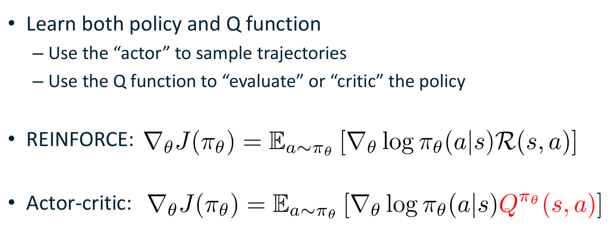
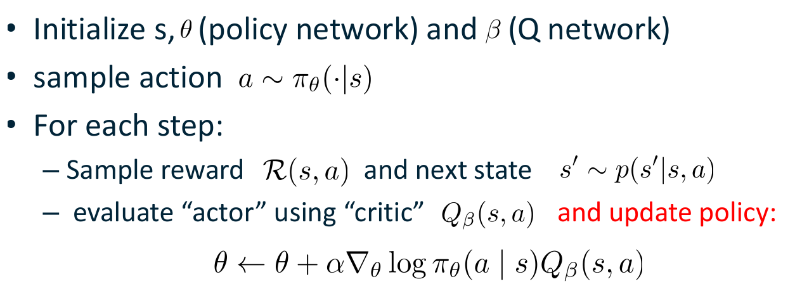
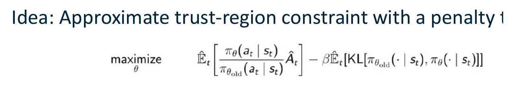
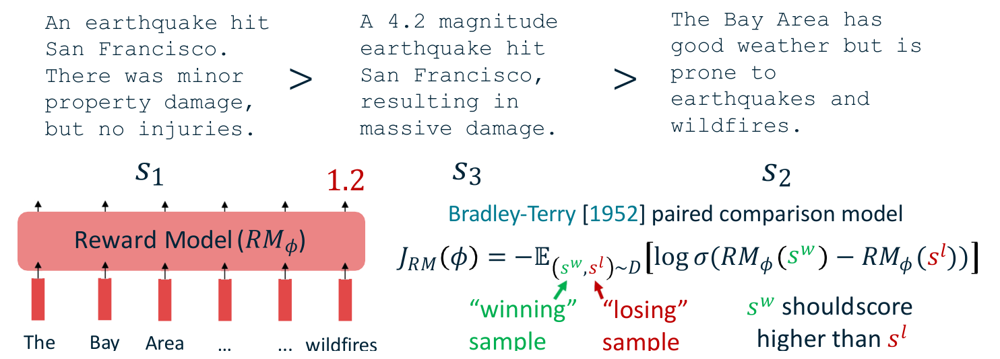
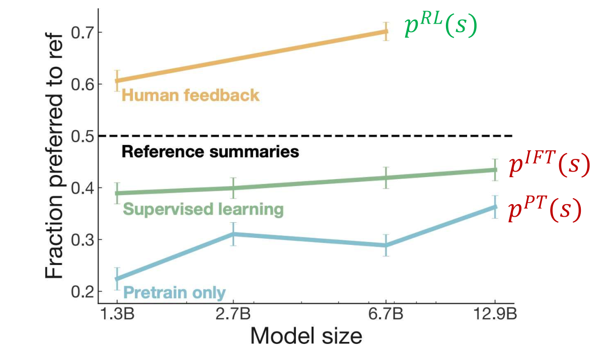
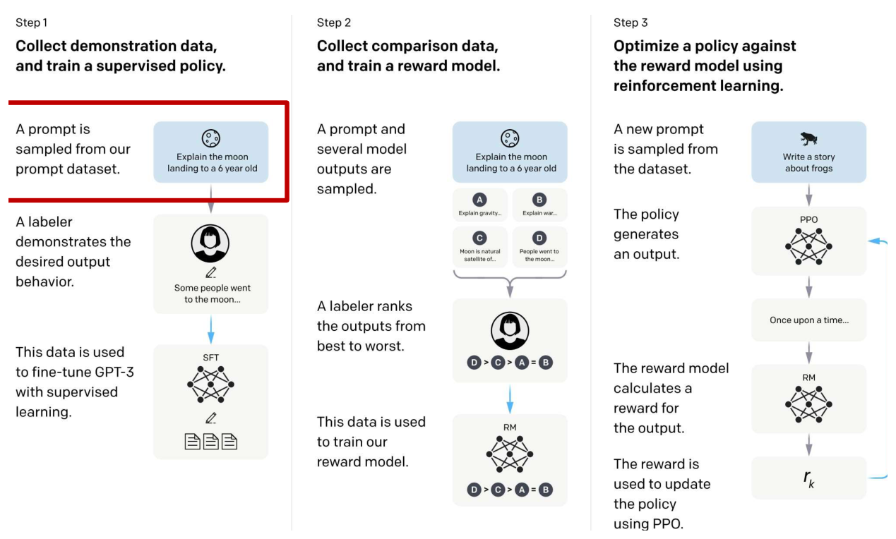

# Actor-Critic, PPO and RLHF

The policy gradient of the previous chapter is unbiased, but a single sampled return is a very noisy estimate of the gradient, and one large update can undo much of what an agent has learned. This chapter presents the standard responses. Baselines remove most of the noise without adding bias. Actor-critic methods replace the sampled return with a learned action-value function. Trust-region methods, TRPO and its simpler successor PPO, keep each policy update close to the previous policy. The last part applies these ideas to language models, where reinforcement learning from human feedback (RLHF) turns a model trained to predict text into one that follows instructions and reflects human preferences.

## Reducing the variance of the policy gradient

### Rewards-to-go

The REINFORCE estimator multiplies the score of every action by the whole return of the trajectory. That is wasteful, because an action at time \\(t\\) cannot change the rewards received before time \\(t\\). Write the policy gradient as a double sum over the score at time \\(t\\) and the reward at time \\(t'\\):

\\[
\nabla\_\theta J(\theta) = \mathbb{E}\left[ \sum\_{t=0}^{T} \sum\_{t'=0}^{T} \nabla\_\theta \log \pi\_\theta(a\_t \mid s\_t)\\, r\_{t'} \right].
\\]

Consider a term with \\(t' < t\\). Let \\(h\_t = (s\_0, a\_0, \dots, s\_{t-1}, a\_{t-1}, s\_t)\\) be the history up to the state at time \\(t\\). The reward \\(r\_{t'}\\) is a function of \\(h\_t\\), so conditioning on \\(h\_t\\) gives

\\[
\mathbb{E}\left[ \nabla\_\theta \log \pi\_\theta(a\_t \mid s\_t)\\, r\_{t'} \middle\vert h\_t \right] = r\_{t'} \sum\_a \pi\_\theta(a \mid s\_t)\\, \nabla\_\theta \log \pi\_\theta(a \mid s\_t) = r\_{t'} \sum\_a \nabla\_\theta \pi\_\theta(a \mid s\_t) = r\_{t'}\\, \nabla\_\theta \sum\_a \pi\_\theta(a \mid s\_t) = 0 .
\\]

The second equality uses \\(\pi \nabla \log \pi = \nabla \pi\\), and the last is \\(\nabla\_\theta 1 = 0\\). Each term with \\(t' < t\\) therefore has zero expectation, and only the rewards from time \\(t\\) onward remain. The estimator becomes

\\[
\nabla\_\theta J(\theta) = \mathbb{E}\left[ \sum\_{t=0}^{T} \nabla\_\theta \log \pi\_\theta(a\_t \mid s\_t) \sum\_{t'=t}^{T} r\_{t'} \right].
\\]

The sum \\(\sum\_{t' \ge t} r\_{t'}\\) is the reward-to-go. Practical implementations often also weight the future rewards by powers of the discount factor, \\(\sum\_{t' \ge t} \gamma^{t'-t} r\_{t'}\\), so that rewards far in the future count for less. This is a bias-variance trade-off: it lowers the variance, and it changes the objective slightly, because the result is the gradient of a discounted return rather than of the undiscounted one.

### Baselines

A second way to reduce variance is to subtract from the return a term \\(b(s\_t)\\) that depends only on the state. This does not change the expectation, because the same argument as above applies to any function of the state:

\\[
\mathbb{E}\_{a \sim \pi\_\theta(\cdot \mid s)}\left[ \nabla\_\theta \log \pi\_\theta(a \mid s) \right] = \sum\_a \nabla\_\theta \pi\_\theta(a \mid s) = \nabla\_\theta \sum\_a \pi\_\theta(a \mid s) = 0 .
\\]

Hence the estimator with a baseline is

\\[
\nabla\_\theta J(\theta) = \mathbb{E}\left[ \sum\_{t=0}^{T} \nabla\_\theta \log \pi\_\theta(a\_t \mid s\_t) \left( \sum\_{t'=t}^{T} \gamma^{t'-t} r\_{t'} - b(s\_t) \right) \right],
\\]

which is unbiased for every choice of \\(b\\) that depends only on the state. The baseline changes the variance, and a good baseline makes an action's weight positive only when the outcome is better than what is typically achieved from that state.

**Example (a constant return).** Consider one state with two actions, a policy \\(\pi = (0.5, 0.5)\\), and a return of 10 whatever the action. Without a baseline, the update for a sampled action 1 is \\((\mathbf{e}\_1 - \pi) \cdot 10 = (5, -5)\\), and for a sampled action 2 it is \\((-5, 5)\\). Their expectation is zero, as it must be, but every individual sample moves the parameters by a vector of length \\(5\sqrt{2} \approx 7.1\\). With the baseline \\(b = 10\\) the weight is zero for every sample, and the variance vanishes. The return says nothing about which action is better, so the correct update is nothing, and the baseline makes the estimator say so exactly.

A baseline that is close to the typical return is what the method needs. The usual choice is the state-value function \\(b(s) = V^\pi(s)\\), which is the expected return from the state under the current policy. The best baseline in general is not the value function, and the choice is left open here, but the value function is the one that makes the actor-critic connection below.

## Actor-critic methods

### The critic replaces the return

The baseline argument suggests a different route. The reward-to-go \\(\sum\_{t' \ge t} r\_{t'}\\) is a sample of the action-value \\(Q^\pi(s\_t, a\_t)\\), because its expectation given \\(s\_t\\) and \\(a\_t\\) is exactly the action-value. If we replace the sample by the function, the estimator becomes

\\[
\nabla\_\theta J(\pi\_\theta) = \mathbb{E}\_{s, a \sim \pi\_\theta}\left[ \nabla\_\theta \log \pi\_\theta(a \mid s)\\, Q^{\pi\_\theta}(s,a) \right].
\\]

The policy, or actor, generates the trajectories. The action-value function, or critic, evaluates the actions taken, and it is learned from the same data. Subtracting the state-value gives the advantage \\(A^\pi(s,a) = Q^\pi(s,a) - V^\pi(s)\\), and the estimator

\\[
\nabla\_\theta J(\pi\_\theta) = \mathbb{E}\left[ \nabla\_\theta \log \pi\_\theta(a \mid s)\\, A^{\pi\_\theta}(s,a) \right]
\\]

is the advantage actor-critic method. The advantage is a question of how much better an action is than the average action in the same state. An action with a positive advantage is made more likely, and one with a negative advantage is made less likely.

*Figure: the REINFORCE gradient (top) and the actor-critic gradient (bottom). The only change is the highlighted factor: the return in the first line becomes the critic's action-value in the second. The actor is still updated with the score of the sampled action.*

**Example (advantage).** Suppose the policy in a state chooses action 1 with probability 0.7 and action 2 with probability 0.3, and the critic gives \\(Q(s, a\_1) = 4\\) and \\(Q(s, a\_2) = 2\\). The state value is \\(V(s) = 0.7 \cdot 4 + 0.3 \cdot 2 = 3.4\\), so the advantages are \\(A(s,a\_1) = 0.6\\) and \\(A(s,a\_2) = -1.4\\). As a check, the average advantage under the policy is \\(0.7 \cdot 0.6 + 0.3 \cdot (-1.4) = 0\\). Using the raw \\(Q\\)-values would push both actions up, with action 1 by more. Using the advantage pushes action 1 up and action 2 down, which is the change the critic's information supports.

### The loop

The actor-critic loop that we follow is as follows. Initialize the state, the policy parameters \\(\theta\\) of the actor and the critic parameters \\(\beta\\). Sample an action \\(a \sim \pi\_\theta(\cdot \mid s)\\). At each step, observe the reward \\(r\\) and the next state \\(s' \sim p(s' \mid s, a)\\). Then update the actor with the critic's estimate,

\\[
\theta \leftarrow \theta + \alpha\\, \nabla\_\theta \log \pi\_\theta(a \mid s)\\, Q\_\beta(s,a),
\\]

and update the critic by regression on a one-step target,

\\[
\beta \leftarrow \beta - \alpha\_c\\, \nabla\_\beta \left( Q\_\beta(s,a) - y \right)^2, \qquad y = r + \gamma\\, Q\_{\beta^-}(s', a'), \quad a' \sim \pi\_\theta(\cdot \mid s').
\\]

The critic regression here is the Q-learning squared error with a discount factor. The loop as it is sometimes printed omits the discount factor, and the target takes a maximum over next actions. We include \\(\gamma\\) and use the action \\(a'\\) sampled from the current policy. The reason is that the actor's gradient needs \\(Q^\pi\\), the value of the policy being followed, while the maximum gives the value of the greedy policy. With a sampled \\(a'\\) the target is the on-policy one, which matches the gradient. Then the state and action are shifted, \\(s \leftarrow s'\\) and \\(a \leftarrow a'\\), and the loop repeats. The bootstrapped target is what makes the critic cheap, since it needs one successor rather than a full return.

*Figure: one step of the actor-critic loop. The actor's update multiplies the score of the sampled action by the critic's estimate \\(Q\_\beta(s,a)\\) in place of a sampled return. The critic is trained separately by the squared error against its one-step target.*

The price of the critic is bias. The estimator is correct only if the critic is correct, and a critic learned from a finite amount of data is an approximation. The actor-critic family therefore trades the variance of the Monte Carlo return for the bias of the learned critic, and in practice the trade is usually favorable.

Several members of the family differ only in how the policy is evaluated. REINFORCE uses the sampled return. Q actor-critic uses \\(Q^\pi\\). Advantage actor-critic uses \\(Q^\pi - V^\pi\\), which is the most common in practice. The critic can be trained by Monte Carlo returns, by one-step bootstrapped targets as above, or by longer targets that mix the two.

## Trust regions: TRPO and PPO

### The step-size problem

A gradient step has a size in parameter space, but what matters for an agent is how much the policy changes in its action probabilities. A small change in the parameters can change the policy a great deal in one region of the state space, and a large change can leave it nearly the same elsewhere. A single large update can move the policy into a region where the rewards are low, and it may then be unable to recover, because the data it collects from that region are poor. The aim of trust-region methods is to limit the change in the policy itself.

### Importance sampling

The data for an update are collected with the old policy \\(\pi\_{\text{old}}\\), but we want to evaluate a new policy \\(\pi\_\theta\\). The standard tool is importance sampling. For any function \\(f\\) and distributions \\(p\\) and \\(q\\) with \\(q(x) > 0\\) wherever \\(p(x) f(x) \ne 0\\),

\\[
\mathbb{E}\_{x \sim p}[f(x)] = \mathbb{E}\_{x \sim q}\left[ \frac{p(x)}{q(x)} f(x) \right].
\\]

**Example (importance sampling).** Let \\(p = (0.5, 0.5)\\), \\(q = (0.9, 0.1)\\) and \\(f = (1, 0)\\). The expectation under \\(p\\) is \\(0.5\\). Under \\(q\\), the weighted estimator is \\(0.9 \cdot (0.5/0.9) \cdot 1 + 0.1 \cdot (0.5/0.1) \cdot 0 = 0.5\\), as it should be. The weight \\(0.5/0.9\\) corrects for the fact that outcome 1 is sampled too often under \\(q\\). The correction is exact but becomes unreliable when the ratio is large, which is why the policies must stay close.

### TRPO

Trust-region policy optimization (TRPO) maximizes the importance-weighted advantage of the new policy, subject to a bound on how far the policy moves:

\\[
\max\_\theta \mathbb{E}\_{s \sim \rho^{\pi\_{\text{old}}},\\, a \sim \pi\_{\text{old}}}\left[ \frac{\pi\_\theta(a \mid s)}{\pi\_{\text{old}}(a \mid s)}\\, \hat A\_{\text{old}}(s,a) \right] \quad \text{subject to} \quad \mathbb{E}\_{s \sim \rho^{\pi\_{\text{old}}}}\left[ D\_{\text{KL}}\left( \pi\_{\text{old}}(\cdot \mid s) \\,\Vert\\, \pi\_\theta(\cdot \mid s) \right) \right] \le \delta .
\\]

The constraint is a limit on the average divergence between the old and new action distributions, measured by the Kullback-Leibler divergence. Solving this constrained problem exactly requires second-order information about the constraint, in the form of the Hessian, and that makes the method complicated to implement.

### PPO

Proximal policy optimization (PPO; Schulman et al. 2017) keeps the same objective and replaces the hard constraint by a penalty. Write \\(\rho\_t(\theta) = \pi\_\theta(a\_t \mid s\_t) / \pi\_{\text{old}}(a\_t \mid s\_t)\\) for the probability ratio of the sampled action. The penalty form maximizes

\\[
\mathbb{E}\_t\left[ \rho\_t(\theta)\\, \hat A\_t \right] - \beta\\, \mathbb{E}\_t\left[ D\_{\text{KL}}\left( \pi\_{\text{old}}(\cdot \mid s\_t) \\,\Vert\\, \pi\_\theta(\cdot \mid s\_t) \right) \right].
\\]

The first term is the importance-weighted advantage, and the second keeps the policy close to the old one. The coefficient \\(\beta\\) plays the role of a Lagrange multiplier for the constraint.

The variant that is most often used in practice is the clipped objective, which the benchmark comparisons call PPO (Clip):

\\[
L^{\text{CLIP}}(\theta) = \mathbb{E}\_t\left[ \min\left( \rho\_t(\theta)\\, \hat A\_t, \operatorname{clip}\left(\rho\_t(\theta), 1-\epsilon, 1+\epsilon\right) \hat A\_t \right) \right],
\\]

with a typical value \\(\epsilon = 0.2\\). The minimum removes the incentive to move the ratio beyond the interval \\([1-\epsilon, 1+\epsilon]\\) in the direction of the advantage.

**Example (clipping).** Take \\(\epsilon = 0.2\\) and an advantage \\(\hat A = 2\\). If the ratio has already reached \\(\rho = 1.5\\), the unclipped term is \\(1.5 \cdot 2 = 3.0\\) and the clipped term is \\(1.2 \cdot 2 = 2.4\\). The minimum is \\(2.4\\), which is constant in \\(\theta\\), so the gradient is zero and the update stops pushing an action that is already much more likely. If instead \\(\rho = 0.5\\), the unclipped term is \\(1.0\\) and the clipped term is \\(0.8 \cdot 2 = 1.6\\). The minimum is \\(1.0\\), which is the unclipped term, so the gradient still raises the probability of this rewarded action. The clip thus limits the step only in the direction that the advantage asks for.

*Figure: the PPO penalty objective. The first term weights the advantage by the probability ratio of the new and old policies, and the second subtracts \\(\beta\\) times the KL divergence between them. The penalty keeps the new policy near the old one.*

On a set of seven continuous-control benchmark tasks run for one million timesteps, the clipped PPO objective is at or near the top of the learning curves on most tasks, as reported by Schulman et al. (2017). The curves are read by eye from the published plots, so the values quoted here are approximate: for example, the HalfCheetah task reaches about 1,800 and Walker2d about 3,000 by the end of training.

## Language models and RLHF

### What pretraining and instruction tuning provide

A large language model is trained to predict the next token, so its distribution factorizes as \\(p(w\_1, \dots, w\_n) = \prod\_i p(w\_i \mid w\_{<i})\\). A pretrained model can perform tasks from a prompt alone. Zero-shot prompting gives only a task description. In-context learning adds a few demonstrations to the prompt, and it needs no gradient step. Its limits are that the examples must fit in the context, and that complex tasks often need weight updates.

Instruction finetuning gives the model many examples of instructions and outputs across many tasks, and it then generalizes to tasks it has not seen. In one example, the model is asked for the boiling point of nitrogen and answers \\(-320.4\\) °F. In another, a word problem about apples (23 apples, 20 used at lunch, 6 more bought) is solved by writing out the steps, \\(23 - 20 = 3\\) and \\(3 + 6 = 9\\), rather than by a single guessed number. Instruction finetuning is simple and generalizes to new tasks, but collecting demonstrations for so many tasks is expensive, and it leaves a mismatch between the language-modeling objective and what people want. The language-modeling loss charges the same penalty for every wrong token, even though some errors are far worse than others. For open-ended requests, such as a story about a dog and its pet grasshopper, there is no single right answer for the loss to target.

The task is therefore to optimize for human preferences directly. Write \\(R(s)\\) for the human reward of a sample \\(s\\), such as a summary of an article, with higher values better. The goal is

\\[
\max\_\theta \mathbb{E}\_{s \sim p\_\theta(s)}\left[ R(s) \right].
\\]

For a summary, the human reward is not a differentiable function of the model's output, and it is available only by asking a person. Reinforcement learning is the tool that handles a reward of this kind, since the policy gradient needs only sampled outputs and their rewards.

### Learning a reward model from comparisons

Asking a person to rate every sample is expensive, and the ratings are noisy and inconsistent: the same person gives different scores on different days, and the scale is not calibrated across people. Pairwise comparisons, in which a labeler says which of two outputs is better, are more reliable (Phelps et al. 2015; Clark et al. 2018). We therefore train a reward model \\(RM\_\phi(s)\\), a language model with a scalar output, on the comparisons.

The Bradley-Terry model (Bradley and Terry, 1952) says that the probability that the winning sample \\(s^w\\) is preferred to the losing sample \\(s^l\\) is \\(\sigma(r^w - r^l)\\), where \\(r^w\\) and \\(r^l\\) are the scores of the two samples and \\(\sigma(x) = 1/(1 + e^{-x})\\). Maximum likelihood on the comparison data gives the loss

\\[
J\_{RM}(\phi) = -\mathbb{E}\_{(s^w, s^l) \sim D}\left[ \log \sigma\left( RM\_\phi(s^w) - RM\_\phi(s^l) \right) \right].
\\]

The loss depends only on the difference of the two scores, so the reward model learns a scale relative to the comparisons, not an absolute one. Its values are meaningful only up to a constant. For a difference of 0 the loss is \\(-\log 0.5 = 0.693\\). For a difference of 1 it is \\(-\log \sigma(1) = 0.313\\), and for a difference of 3 it is \\(-\log \sigma(3) = 0.049\\). The loss falls as the preferred sample is scored further above the rejected one, and it does not reward any particular absolute score.

*Figure: pairwise preference training. A labeler ranks three summaries, and the reward model maps one summary to a scalar score (left). The Bradley-Terry loss (right) rewards the model for scoring the winning sample \\(s^w\\) above the losing sample \\(s^l\\).*

A reward model must be checked before it is optimized against. If the policy is optimized against a reward model that is wrong on held-out comparisons, it will find the outputs that the model over-scores rather than the ones people prefer. The check is to measure the reward model's accuracy on held-out human judgments, as a function of its size and the amount of training data. In the published study this accuracy rises with model size, and the largest models trained on enough data approach the agreement that a single human labeler reaches with the labels. The human baseline is about 0.77 and the ensemble of human labelers about 0.83 on those plots; the best curves reach roughly 0.75, which is read by eye. Approaching single-human agreement is the target, and the reward model is then a reasonable proxy for the labelers.

### Optimizing the policy against the reward model

RLHF uses the reward model as the reward in a reinforcement learning procedure. The ingredients are a pretrained, possibly instruction-tuned, language model \\(p^{PT}\\), a reward model \\(RM\_\phi\\) that scores complete outputs, and a policy-gradient method for optimizing the parameters of the language model against an arbitrary reward. The procedure initializes the policy \\(p^{RL}\_\theta\\) with a copy of the pretrained model and optimizes the expected reward of its outputs with a method such as PPO.

In practice the objective usually also penalizes divergence from the model that was trained with supervision, so that the policy does not drift into outputs that the reward model scores highly but that are unlike any text the model was trained on. A common form is

\\[
\max\_\theta \mathbb{E}\_{s \sim p^{RL}\_\theta}\left[ RM\_\phi(s) \right] - \beta\\, \mathbb{E}\_{s \sim p^{RL}\_\theta}\left[ \log \frac{p^{RL}\_\theta(s)}{p^{SFT}(s)} \right],
\\]

where \\(p^{SFT}\\) is the supervised model. The divergence term is not part of the basic description above, but it is standard in the work that introduced RLHF for summarization and for instruction following. It acts as the same kind of restraint that PPO's penalty provides within a single update.

### The results

The benefit of RLHF can be measured by how often people prefer a model's summaries to reference summaries, as the model size grows. Three methods are compared: pretraining alone, supervised finetuning, and RLHF. The values below are read by eye from the published plot, so they are approximate. At 1.3 billion parameters, RLHF is preferred about 61 percent of the time, and at 6.7 billion about 70 percent. Supervised finetuning sits near 39 to 43 percent across the sizes, and pretraining alone rises from about 22 percent to about 36 percent. Only RLHF is clearly above the 50 percent line, which marks parity with the reference summaries.

*Figure: the fraction of summaries preferred to the reference (dashed line at 0.5) as the model size grows, for RLHF, supervised finetuning and pretraining only. Higher values are better, and the points are read by eye from the published plot.*

### InstructGPT and ChatGPT

InstructGPT (Ouyang et al. 2022) scaled the procedure to tens of thousands of tasks, and its pipeline has three steps, shown in the figure.

1. **Supervised policy.** A prompt is sampled from the prompt dataset, a labeler writes the desired output, and the pretrained model is finetuned on these demonstrations.
2. **Reward model.** For a prompt, several model outputs are sampled and a labeler ranks them from best to worst. The ranking trains the reward model with the pairwise loss above.
3. **Policy optimization.** A new prompt is sampled, the current policy generates an output, the reward model scores it, and PPO updates the policy from the score.

The tasks come from three sources: plain instructions with enough variety, few-shot tasks written as an instruction with examples, and user-based tasks taken from requests submitted to an API. The demonstrations and rankings from labelers are what the method is built on, and the quality of those labels is the main determinant of the result.

*Figure: the three steps of the InstructGPT procedure. Step 1 finetunes a model on demonstrations. Step 2 trains a reward model from rankings. Step 3 optimizes the policy against the reward model with PPO. Read the figure left to right, and top to bottom within each column.*

The chat model ChatGPT is described as using the same methods as InstructGPT, with changes to the data collection. Its supervised stage uses dialogues written by trainers who played both the user and the assistant, and the reward model is then trained on rankings of several alternative replies to the same message. The details of the data, the model sizes and the training, are not public, so the description here is only of the general method.

These methods also show the limit of the approach. The reward model encodes the preferences of the particular labelers who ranked the outputs, and a policy optimized against it inherits their preferences, including any biases in them. The question of whose preferences are encoded, and what the alignment of a model to them means, is taken up in the [fairness and alignment chapter](fairness-alignment.md).

## Summary

- The policy gradient is unbiased but noisy. Rewards-to-go remove the terms that an action cannot affect, and any state-dependent baseline can be subtracted without changing the expectation.
- The Q-function, or the advantage \\(Q^\pi - V^\pi\\), replaces the sampled return in the actor-critic estimator, which trades variance for the bias of a learned critic. The critic's target should use the action sampled from the current policy, with the discount factor.
- Importance sampling lets data from an old policy evaluate a new one, but the ratio must stay bounded. TRPO bounds the KL divergence with a constraint, and PPO uses a penalty or a clipped objective, which is simpler and widely used.
- Reward models are trained on pairwise comparisons with the Bradley-Terry loss, which depends only on score differences. A reward model must be validated before the policy is optimized against it.
- RLHF optimizes a language model with PPO against a reward model, usually with a divergence penalty to the supervised model. In the published comparisons it is preferred to supervised finetuning and to pretraining alone.
- InstructGPT's three steps, supervised policy, reward model and PPO optimization, are the template for the later chat models. The details of those models are not public.

## See Also

- [Deep learning overview](../deep-learning.md)
- [Reinforcement learning overview](../rl.md)
- [Deep Q-learning and policy gradients](deep-q-learning.md)
- [Scaling language models](scaling-language-models.md)
- [Attention, transformers and speech self-supervision](transformers.md)
- [Fairness, alignment and the road ahead](fairness-alignment.md)
- [Drama management and closing remarks](../reinforcement-learning/drama-management.md)
- [Bellman equations and learning from experience](../reinforcement-learning/bellman-equations.md)
- [Convergence and analysis](../reinforcement-learning/convergence.md)
