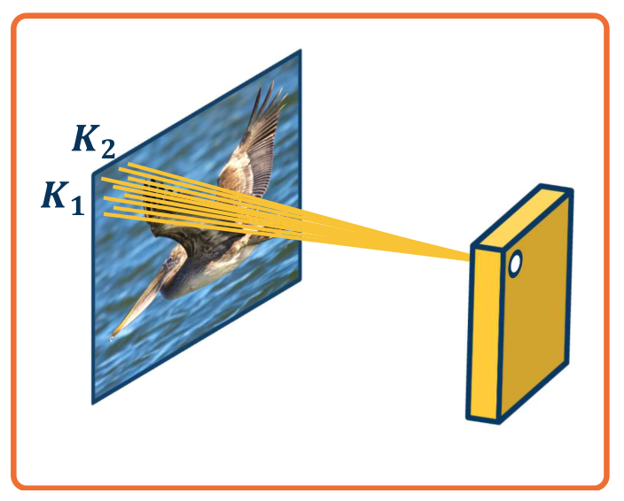
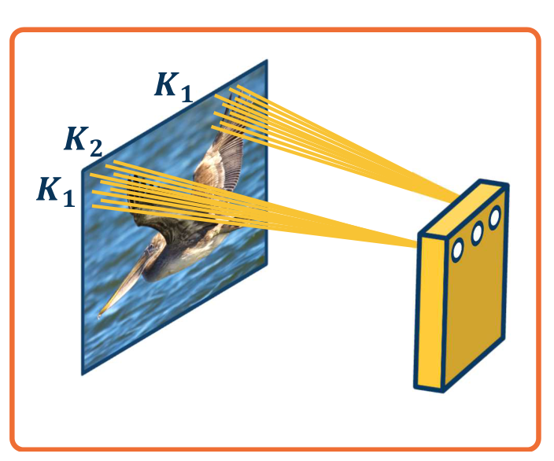
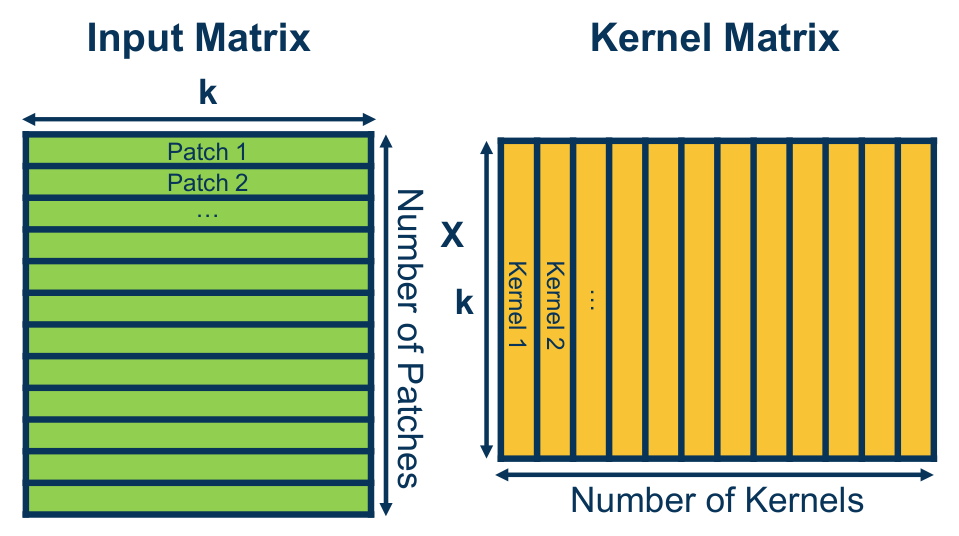
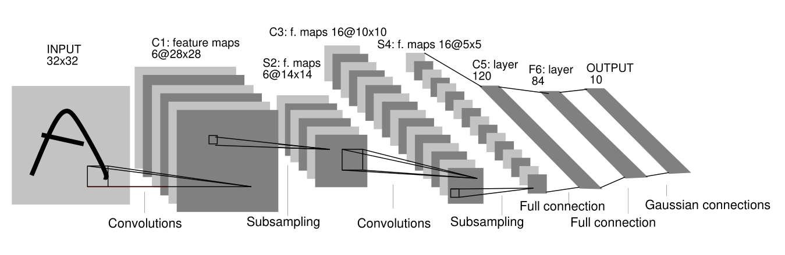
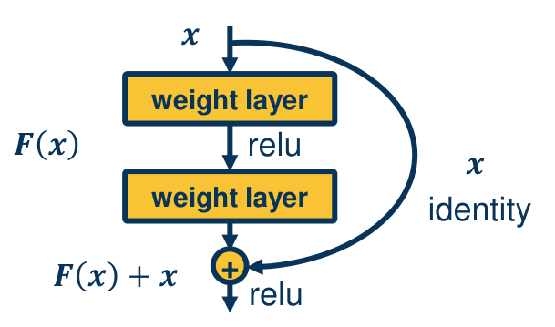
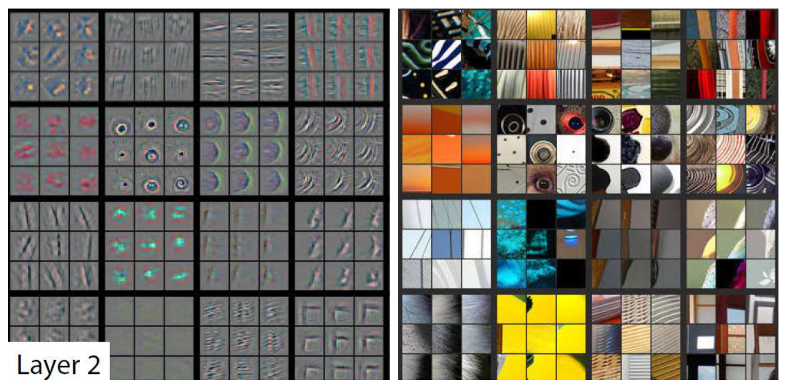

# Convolutional Networks and Visualization

A fully connected layer applied to an image has far too many parameters, and it ignores the fact that useful image features are local and can appear anywhere. Convolutional layers encode both facts directly, through receptive fields, shared weights and many filters per layer. Their core operation reduces to a matrix multiplication that GPUs execute efficiently. This chapter derives the convolution and its gradients, covers pooling and the main architectures from LeNet to residual networks, and then turns to transfer learning and to the methods for finding out what a trained network has learned.

## Why Convolution

Consider a \\(1024 \times 1024\\) grayscale image, which has \\(M = 1{,}048{,}576\\) pixels. A fully connected layer with \\(N\\) outputs has \\(M N\\) weights. For a thousand outputs that is more than a billion weights in one layer, and every one of them must be learned from data. Large parameter counts need large datasets, and most of those weights would be used to detect patterns that are local anyway.

Two properties of images suggest a better design. Small features such as edges, color blobs and corners are local, so each output should depend on a small patch of the input. And the same feature can occur at any location, so the weights that detect it should be reused across the image. This second property is called **stationarity**. Three ideas follow from these properties.

1. **Receptive fields.** Each output unit reads only a \\(K\_1 \times K\_2\\) window of the input, its receptive field. A layer with \\(N\\) outputs then has \\((K\_1 K\_2 + 1) N\\) parameters, and spatial position is kept explicitly.
2. **Shared weights.** Units at different locations use the same weights, so a feature detector is one set of \\(K\_1 K\_2 + 1\\) numbers applied everywhere. This is the step that makes the parameter count independent of the image size.
3. **Many features.** A layer computes \\(M\\) different feature maps, each with its own shared kernel, for a total of \\((K\_1 K\_2 + 1) M\\) parameters.

*Figure: each output unit reads only a \\(K\_1 \times K\_2\\) patch of the input. The bundle of lines from the patch to one unit is its receptive field.*

*Figure: the same kernel is applied at every location. Units at different positions use the same \\(K\_1 \times K\_2\\) weights, which is what the term shared weights refers to.*

**Example 3.1 (parameters per feature).** For a \\(1024 \times 1024\\) input and a \\(3 \times 3\\) kernel, a single shared feature has \\(3 \cdot 3 + 1 = 10\\) parameters. A fully connected unit on the same input has \\(1{,}048{,}576\\) weights plus a bias. The convolutional feature is roughly a hundred thousand times smaller, and it can still respond to the same edge wherever the edge appears.

## Convolution and Cross-Correlation

In one dimension the discrete convolution of a signal \\(x\\) with a filter \\(h\\) of length \\(N\\) is

\\[
y\_k = \sum\_{n=0}^{N-1} h\_n\\, x\_{k-n}.
\\]

Expanding a few terms shows the structure: \\(y\_0 = h\_0 x\_0\\), \\(y\_1 = h\_1 x\_0 + h\_0 x\_1\\), \\(y\_2 = h\_2 x\_0 + h\_1 x\_1 + h\_0 x\_2\\). The filter is applied in reverse order, and each output is a weighted sum of the most recent inputs.

For images, the two-dimensional version is written with the kernel indexed in the same direction as the image. Convolution of an image \\(x\\) with a kernel \\(k\\) is

\\[
(x \ast k)(r, c) = \sum\_{a} \sum\_{b} x(a, b)\\, k(r - a,\\; c - b),
\\]

while cross-correlation is

\\[
(x \star k)(r, c) = \sum\_{a=0}^{k\_1 - 1} \sum\_{b=0}^{k\_2 - 1} x(r + a,\\; c + b)\\, k(a, b).
\\]

Cross-correlation slides the kernel over the image in the same direction as the image indices, and it takes a dot product between the kernel and the patch under it. Convolution is cross-correlation with the kernel rotated by 180 degrees. Written out, \\(x \ast k\\) equals \\(x \star k'\\) with \\(k'(a,b) = k(k\_1 - 1 - a,\\; k\_2 - 1 - b)\\), up to an index offset at the borders. Because the kernel is learned, it does not matter whether the network uses convolution or cross-correlation. Deep learning libraries implement cross-correlation and call the operation convolution, as the rest of this chapter does.

**Example 3.2 (rotating a kernel).** The kernel \\(\begin{bmatrix} 1 & 2 & 3 \\\\ 4 & 5 & 6 \\\\ 7 & 8 & 9 \end{bmatrix}\\) becomes \\(\begin{bmatrix} 9 & 8 & 7 \\\\ 6 & 5 & 4 \\\\ 3 & 2 & 1 \end{bmatrix}\\) under a 180-degree rotation. Applying cross-correlation with the rotated kernel gives the same result as convolution with the original.

**Example 3.3 (one output of an edge filter).** Take the image patch \\(\begin{bmatrix} 200 & 150 & 150 \\\\ 100 & 50 & 100 \\\\ 25 & 25 & 10 \end{bmatrix}\\) and the vertical-edge kernel \\(\begin{bmatrix} 1 & 0 & -1 \\\\ 2 & 0 & -2 \\\\ 1 & 0 & -1 \end{bmatrix}\\). The output at the center is the sum of the element-wise products over the nine positions. Row 1 gives \\(200 \cdot 1 + 150 \cdot 0 + 150 \cdot (-1) = 50\\), row 2 gives \\(100 \cdot 2 + 50 \cdot 0 + 100 \cdot (-2) = 0\\), and row 3 gives \\(25 \cdot 1 + 25 \cdot 0 + 10 \cdot (-1) = 15\\). The total is \\(50 + 0 + 15 = 65\\), plus the bias of the filter. A large value means the patch is brighter on the left than on the right, which is what the filter detects. A Sobel-type kernel like this one, applied to a photograph, produces an edge map.

### Output sizes, padding and stride

For an input of size \\(H \times W\\) and a kernel of size \\(k\_1 \times k\_2\\), a **valid** convolution applies the kernel only where it fits. The output is \\((H - k\_1 + 1) \times (W - k\_2 + 1)\\). **Padding** adds \\(P\\) pixels on each side, often zeros, and a **stride** \\(S\\) moves the kernel in steps larger than one. The output size along each dimension is

\\[
\left\lfloor \frac{H + 2P - k\_1}{S} \right\rfloor + 1.
\\]

A \\(3 \times 3\\) kernel with padding 1 and stride 1 keeps the size unchanged. A stride of 2 halves the output, which is a cheap form of downsampling but discards information. A stride larger than the kernel can skip pixels entirely.

### Several channels and several kernels

A color image has three channels, so each kernel is a \\(k\_1 \times k\_2 \times 3\\) block of weights, and each output position is a dot product over all \\(k\_1 k\_2 \times 3\\) values. A layer with \\(N\\) kernels produces \\(N\\) feature maps, which become the channels of the next layer. Its parameter count is \\(N(k\_1 k\_2 C + 1)\\) for \\(C\\) input channels.

**Example 3.4 (parameter count of a convolutional layer).** Four \\(3 \times 3\\) kernels on a three-channel input have \\(4 (3 \cdot 3 \cdot 3 + 1) = 112\\) parameters, independent of the image height and width.

**Example 3.5 (the first layer of AlexNet).** The first layer applies 96 kernels of size \\(11 \times 11 \times 3\\) with stride 4 to a \\(227 \times 227 \times 3\\) image. The output size is \\((227 - 11)/4 + 1 = 55\\), so the output volume is \\(55 \times 55 \times 96\\). The layer has \\((11 \cdot 11 \cdot 3 + 1) \cdot 96 = 34{,}944\\) parameters.

### Convolution as matrix multiplication

Convolution can be computed as one large matrix product. The procedure is called **im2col**. First, lay out every (possibly overlapping) patch of the input as a row of an input matrix, with \\(k = k\_1 k\_2 C\\) columns. Second, lay out each kernel as a column of a kernel matrix with \\(k\\) rows and one column per kernel. The product of the two matrices gives every output position for every kernel at once (Figure 3). This is why convolution is fast on hardware built for matrix multiplication.

*Figure: the input is turned into a matrix with one row per patch, and the kernels are stacked as columns of a second matrix. Multiplying them gives one row per patch and one column per kernel, which is the output feature map flattened.*

## Gradients of a Convolution

Backpropagation through a convolution uses the same chain rule as before, and the answer has a surprising structure. Consider one input channel, one kernel, and an output of the same size as the input, obtained with padding. Write \\(y(r,c) = (x \star k)(r,c)\\) and let \\(\partial L/\partial y(r,c)\\) be the upstream gradient. The kernel weight \\(k(a,b)\\) enters every output position, and at each one it multiplies a single input pixel. So

\\[
\frac{\partial y(r,c)}{\partial k(a,b)} = x(r + a,\\; c + b),
\qquad
\frac{\partial L}{\partial k(a,b)} = \sum\_{r} \sum\_{c} \frac{\partial L}{\partial y(r,c)}\\, x(r + a,\\; c + b).
\\]

The sum on the right is a cross-correlation between the upstream gradient and the input. The kernel gradient therefore has the same form as the forward pass.

The input gradient is found by asking which outputs depend on a given input pixel. The pixel \\(x(r', c')\\) appears in output \\(y(r' - a, c' - b)\\) multiplied by \\(k(a,b)\\), for each kernel position \\((a,b)\\). Hence

\\[
\frac{\partial L}{\partial x(r', c')} = \sum\_{a} \sum\_{b} \frac{\partial L}{\partial y(r' - a,\\; c' - b)}\\, k(a,b).
\\]

This is a convolution of the upstream gradient with the kernel. Implementation therefore reuses the forward code: the input gradient is the upstream gradient convolved with the kernel, which is cross-correlation with the rotated kernel.

**Example 3.6 (one-dimensional gradients).** Take a valid cross-correlation with kernel \\((k\_0, k\_1) = (1, -1)\\) on the input \\(x = (1, 2, 3, 4)\\). The outputs are \\(y\_r = x\_r k\_0 + x\_{r+1} k\_1\\), giving \\(y = (-1, -1, -1)\\). Suppose the upstream gradient is \\(g = (1, 2, 3)\\).

The kernel gradients are the cross-correlation of \\(g\\) with \\(x\\):

\\[
\frac{\partial L}{\partial k\_0} = 1 \cdot 1 + 2 \cdot 2 + 3 \cdot 3 = 14,
\qquad
\frac{\partial L}{\partial k\_1} = 1 \cdot 2 + 2 \cdot 3 + 3 \cdot 4 = 20.
\\]

The input gradients are the convolution of \\(g\\) with the kernel. Input \\(x\_0\\) appears only in \\(y\_0\\), with weight \\(k\_0\\), so \\(\partial L/\partial x\_0 = g\_0 k\_0 = 1\\). Input \\(x\_1\\) appears in \\(y\_0\\) with weight \\(k\_1\\) and in \\(y\_1\\) with weight \\(k\_0\\), so \\(\partial L/\partial x\_1 = g\_0 k\_1 + g\_1 k\_0 = -1 + 2 = 1\\). Continuing, \\(\partial L/\partial x\_2 = g\_1 k\_1 + g\_2 k\_0 = -2 + 3 = 1\\), and \\(\partial L/\partial x\_3 = g\_2 k\_1 = -3\\). The input gradient is \\((1, 1, 1, -3)\\).

The forward pass, the kernel gradient and the input gradient are three uses of the same two operations, cross-correlation and convolution. All of them are matrix products after im2col, so one optimized routine serves the whole network.

## Pooling

Downsampling is needed to grow the receptive field and reduce computation. A **pooling** layer applies a fixed function to each window of a feature map, typically the maximum, and slides the window with a stride. **Max pooling** over a \\(2 \times 2\\) window with stride 2 halves each spatial dimension. It has no learned parameters.

For the \\(3 \times 3\\) patch used in the convolution example, the maximum is 200. The average of the same nine values is \\(810/9 = 90\\). Average pooling is less common in modern networks but has the same form. For a max pool the backward pass is a gradient router, like the max gate of the previous chapter: the gradient goes only to the position that held the maximum, and the other positions receive zero.

Pooling adds a limited invariance to small translations. If a feature such as a beak moves within the pooling window, the pooled value stays the same. Convolution alone is **equivariant**: when the input shifts, the output shifts by the same amount. Stacking convolution and pooling gives output that is nearly invariant to small shifts while preserving the spatial layout at a coarser scale.

## Architectures

### Simple convolutional networks

A typical classifier alternates convolution, a nonlinearity and pooling, and then ends with fully connected layers and a loss. Each stage increases the receptive field, so deep units see large regions of the input. The earliest layers respond to edges, and later layers combine them into parts and then objects.

### LeNet

LeNet-5 is the classic early network for handwritten digits, and its design dates from the 1980s and 1990s. Figure 4 shows its structure.

*Figure: LeNet-5 from left to right. A \\(32 \times 32\\) input is convolved to six \\(28 \times 28\\) maps (C1), subsampled to \\(14 \times 14\\) (S2), convolved to sixteen \\(10 \times 10\\) maps (C3), subsampled to \\(5 \times 5\\) (S4), and then passed through fully connected layers of 120 and 84 units to ten outputs.*

The sizes follow the output formula. A \\(5 \times 5\\) valid convolution maps \\(32\\) to \\(28\\). A \\(2 \times 2\\) pool maps \\(28\\) to \\(14\\). Another \\(5 \times 5\\) valid convolution maps \\(14\\) to \\(10\\), and the pool maps \\(10\\) to \\(5\\). The final \\(5 \times 5\\) convolution produces the 120-unit layer, which is the same computation as a fully connected layer on the \\(5 \times 5 \times 16\\) block.

### AlexNet and the scale-up

AlexNet won the 2012 ImageNet competition by a wide margin and launched the modern era of deep convolutional networks. Its input is \\(227 \times 227 \times 3\\). Its layers follow the size arithmetic above.

- CONV1: 96 kernels, \\(11 \times 11\\), stride 4, giving \\(55 \times 55 \times 96\\).
- MAX POOL1: \\(3 \times 3\\), stride 2, giving \\(27 \times 27 \times 96\\).
- CONV2: 256 kernels, \\(5 \times 5\\), padding 2, giving \\(27 \times 27 \times 256\\).
- MAX POOL2: \\(3 \times 3\\), stride 2, giving \\(13 \times 13 \times 256\\).
- CONV3, CONV4 and CONV5: 384, 384 and 256 kernels of size \\(3 \times 3\\), padding 1, giving \\(13 \times 13\\) maps.
- MAX POOL3: \\(3 \times 3\\), stride 2, giving \\(6 \times 6 \times 256\\).
- FC6 and FC7: 4096 units each. FC8: 1000 class scores.

The main ingredients were ReLU in place of sigmoid or tanh, dropout in the fully connected layers, data augmentation, and training on two GPUs. Each of these is now standard.

### VGG and the cost of depth

VGG networks use only \\(3 \times 3\\) convolutions with stride 1 and padding 1, separated by \\(2 \times 2\\) max pools. Their memory and parameter counts show where the resources go. The table gives a few layers of VGG-16 with a \\(224 \times 224 \times 3\\) input, with counts that exclude biases.

| Layer | Output size | Activation values | Parameters |
|---|---|---|---|
| CONV3-64 (first) | 224 x 224 x 64 | about 3.2 million | 1,728 |
| CONV3-64 (second) | 224 x 224 x 64 | about 3.2 million | 36,864 |
| CONV3-128 (first) | 112 x 112 x 128 | about 1.6 million | 73,728 |
| CONV3-512 (first) | 28 x 28 x 512 | about 400 thousand | 1,179,648 |
| FC-4096 (after pooling to 7 x 7 x 512) | 4096 | 4,096 | 102,760,448 |

The convolutional layers hold most of the activation memory, because their outputs are large spatial maps. The fully connected layers hold most of the parameters, because each of their weights connects two long vectors. Both facts shaped later designs. Global average pooling and fewer fully connected layers reduce the parameter count, and careful memory management reduces activation storage.

### Inception and bottlenecks

The Inception module applies several kernel sizes in parallel and concatenates their outputs along the channel dimension. A \\(1 \times 1\\) convolution is a dot product across channels at each position, so it can reduce the number of channels cheaply before an expensive \\(3 \times 3\\) or \\(5 \times 5\\) convolution. This is a bottleneck.

**Example 3.7 (cost of a bottleneck).** The input to an Inception module is \\(28 \times 28 \times 256\\). Consider the naive module with a \\(1 \times 1\\) branch of 128 kernels, a \\(3 \times 3\\) branch of 192 kernels and a \\(5 \times 5\\) branch of 96 kernels, each applied to all 256 input channels. Counting multiply-adds, the \\(1 \times 1\\) branch costs \\(28 \cdot 28 \cdot 128 \cdot 256 \approx 25.7\\) million, the \\(3 \times 3\\) branch costs \\(28 \cdot 28 \cdot 192 \cdot 256 \cdot 9 \approx 346.8\\) million, and the \\(5 \times 5\\) branch costs \\(28 \cdot 28 \cdot 96 \cdot 256 \cdot 25 \approx 481.7\\) million. The total is about 854 million.

Now add \\(1 \times 1\\) bottlenecks with 64 kernels before the \\(3 \times 3\\) and \\(5 \times 5\\) branches and after the pooling branch. The bottleneck costs \\(28 \cdot 28 \cdot 64 \cdot 256 \approx 12.8\\) million each, and the reduced branches cost \\(86.7\\) million for the \\(3 \times 3\\) convolution on 64 channels and \\(120.4\\) million for the \\(5 \times 5\\) convolution on 64 channels. The \\(1 \times 1\\) branch still costs 25.7 million. The six terms add to about 271 million. The module's output depth is \\(128 + 192 + 96 + 64 = 480\\) channels, as before.

The reduced module is therefore about three times cheaper than the naive one, for the same output depth. The total of 358 million that is sometimes quoted for the reduced module does not equal the sum of its six terms, which is 271 million by the same arithmetic. The chapter uses the computed value.

### Residual networks

Adding layers to a plain network can make it worse. A 56-layer plain network on CIFAR-10 shows a higher training error than a 20-layer one, so the problem is optimization, not overfitting. Deeper networks should be able to imitate shallower ones by learning identity mappings in their extra layers, but plain layers find this hard.

A **residual block** makes the identity easy. The block computes \\(F(x) + x\\), where \\(F\\) is a small stack of convolutions with a nonlinearity between them, and \\(x\\) is passed through unchanged by a skip connection (Figure 5). If \\(F\\) learns to output zero, the block is the identity.

*Figure: a residual block. Two weight layers form \\(F(x)\\), and the identity path adds \\(x\\) before the final ReLU. The skip connection lets information and gradients pass straight through.*

The backward pass shows why this helps. For \\(y = F(x) + x\\),

\\[
\frac{\partial y}{\partial x} = \frac{\partial F}{\partial x} + I.
\\]

The identity term means a gradient can flow from any layer to any earlier layer without passing through the products of many small derivatives. Residual networks can therefore be trained at depths where plain networks fail. Architectures of this kind became a common backbone for vision tasks.

### Computation and accuracy

Network designs trade accuracy against cost. A comparison of published models (Canziani and colleagues, 2016) finds that VGG-style networks are expensive for the accuracy they reach, while residual and Inception-style networks achieve more accuracy per operation. Automated architecture search, which uses evolutionary methods or reinforcement learning to propose blocks, has also been used to find efficient designs.

## Transfer Learning and Generalization

Training a large network from scratch needs a large labeled dataset. When the target task has little data, transfer learning is the standard remedy.

1. Train the network on a large dataset such as ImageNet.
2. Replace the final layer with a new fully connected layer whose outputs match the new classes, and initialize the other layers from step 1.
3. Either **fine-tune**, updating all parameters on the new data, or **freeze** the feature layers and update only the new last layer. Freezing is used when the new dataset is small.

Features learned for one set of classes often work well for others. Off-the-shelf features from a network trained on 1000 categories come close to specialized systems on many tasks, including scene recognition and bird subcategorization (Razavian and colleagues, 2014). Transfer works best when the source and target data are similar. When they differ greatly, or when the target dataset is large, pretraining mostly speeds up convergence.

Several settings describe what labeled data are available.

| Setting | Source | Target | Kind of shift |
|---|---|---|---|
| Semi-supervised | labeled | unlabeled, same task | none |
| Domain adaptation | labeled | unlabeled | non-semantic (style, photo or cartoon) |
| Domain generalization | several labeled domains | unseen | non-semantic |
| Cross-task transfer | labeled | unlabeled, new task | semantic |
| Few-shot learning | labeled | a few labeled examples | semantic (new classes) |
| Self-supervised pretraining | unlabeled | labeled | both |

Learning curves show how performance grows with data. Over a wide range, the error falls as a power law in the number of training examples. A common description has three regions: a small-data region where the error is roughly the best guess, a power-law region where the error falls steadily, and an irreducible-error region where more data no longer helps (Hestness and colleagues, 2017).

## Visualizing What a Network Learned

A trained network is a set of numbers, and several methods help interpret them. They fall into four families: weights, activations, gradients with respect to the input, and robustness.

### Weights and activations

For a fully connected layer, each row of weights can be reshaped into an image and scaled to the range 0 to 255. The result is the template described in the previous chapter. For a first convolutional layer, each kernel is a small image, and the kernels of AlexNet or ResNet typically show oriented edges and color blobs. Kernels in deeper layers are hard to read directly, because they act on many channels at once.

Activation maps are more informative. Each channel of a layer can be displayed as an image of where the unit responded. Deep-visualization tools show, for each unit, the image patches that activate it most strongly. A unit in a high layer may respond to faces, and its top-activating patches make that clear. For a whole layer, dimensionality reduction maps the activations of many images to two dimensions. Methods such as t-SNE produce an embedding in which images with similar activations sit close together, and digit images form clusters by class.

These visualizations can mislead. Some saliency methods produce images that look plausible but do not depend on the trained weights (Adebayo and colleagues, 2018). Interpretability is also hard to measure without user studies, and networks use distributed representations in which no single unit corresponds to one concept.

### Gradients with respect to the input

Backpropagation can be run all the way to the input image while the weights are held fixed. The gradient of a class score with respect to each pixel shows how sensitive the score is to that pixel.

A **saliency map** uses the gradient of the class score before the softmax, because the loss mixes all the classes. Take the absolute value of the gradient and combine the channels, for example by taking the maximum. The result highlights the pixels that most affect the score. Applied to an image, the largest values often fall on the object, which means that a method trained only with class labels can produce a rough segmentation.

**Guided backpropagation** modifies the backward pass at each ReLU. Ordinary backpropagation passes gradient only where the forward input was positive. A deconvolution network instead passes gradient only where the incoming gradient is positive. Guided backpropagation does both.

**Example 3.8 (masking at a ReLU).** Let the forward input to a ReLU be \\(\begin{bmatrix} 1 & -1 & 5 \\\\ 2 & -5 & -7 \\\\ -3 & 2 & 4 \end{bmatrix}\\), so the forward output is \\(\begin{bmatrix} 1 & 0 & 5 \\\\ 2 & 0 & 0 \\\\ 0 & 2 & 4 \end{bmatrix}\\). Let the upstream gradient be \\(\begin{bmatrix} -2 & 3 & -1 \\\\ 6 & -3 & 1 \\\\ 2 & -1 & 3 \end{bmatrix}\\).

- Ordinary backpropagation keeps the gradient where the forward input is positive: \\(\begin{bmatrix} -2 & 0 & -1 \\\\ 6 & 0 & 0 \\\\ 0 & -1 & 3 \end{bmatrix}\\).
- The deconvolution rule keeps the gradient where the upstream gradient is positive: \\(\begin{bmatrix} 0 & 3 & 0 \\\\ 6 & 0 & 1 \\\\ 2 & 0 & 3 \end{bmatrix}\\).
- Guided backpropagation keeps the gradient only where both conditions hold: \\(\begin{bmatrix} 0 & 0 & 0 \\\\ 6 & 0 & 0 \\\\ 0 & 0 & 3 \end{bmatrix}\\).

Guided backpropagation keeps only the entries that are positive in both senses, so it highlights the input pixels that push the unit up. On images this gives much cleaner pictures than either rule alone.

Layer-by-layer visualization uses a similar deconvolution to show the patterns that most excite the units of a given layer (Zeiler and Fergus, 2014). Figure 6 shows layer 2 of a convolutional network. Early layers respond to oriented edges and color blobs, the next layers to corners, textures and circles, and the highest layers to object parts such as dog faces, bird legs and keyboards.

*Figure: layer 2 of a convolutional network. Left, reconstructed patterns that excite units in this layer. Right, image patches that most strongly activate the units. Together they show which visual features the layer has learned to detect.*

**Grad-CAM** combines the gradient with the activation maps to localize a class. Let \\(A^k\\) be the \\(k\\)th feature map of a chosen convolutional layer, and let \\(y^c\\) be the score of class \\(c\\). The importance of map \\(k\\) is the average gradient over its spatial positions,

\\[
\alpha\_k^c = \frac{1}{Z} \sum\_{i} \sum\_{j} \frac{\partial y^c}{\partial A^k\_{ij}},
\\]

where \\(Z\\) is the number of positions. The class activation map is the weighted sum \\(\mathrm{ReLU}\big(\sum\_k \alpha\_k^c A^k\big)\\). It is coarse, but it highlights the image region that supports the class. For one image that contains both a dog and a cat, the maps for the classes dog and cat each highlight the corresponding animal.

### Optimizing the input

The gradient of a score with respect to the input also suggests a way to generate images. Gradient ascent on the input image maximizes a class score,

\\[
I^\* = \arg\max\_I \\; S\_c(I) - \lambda \lVert I \rVert\_2^2,
\qquad
I \leftarrow I + \alpha \frac{\partial S\_c}{\partial I}.
\\]

The penalty keeps pixel values small and encourages natural-image statistics, and the score is the pre-softmax value so that the image is not simply pushed away from other classes. Starting from a noisy image, the result is an image that the network scores highly for a class, such as a dumbbell or a cup. Additional smoothing and clipping steps produce clearer images. The result shows what the network responds to, which need not resemble any training example.

### Adversarial examples and robustness

Gradients also show how fragile a network can be. Starting from a real image, gradient ascent on the score of a wrong class can change the prediction with a perturbation too small to notice. A fast version, the fast gradient sign method, takes one step:

\\[
x' = x + \epsilon\\, \mathrm{sign}\big(\nabla\_x J(\theta, x, y)\big).
\\]

In one published example, a panda image classified with 57.7 percent confidence became a gibbon with 99.3 percent confidence after a perturbation of size 0.007 per pixel. The effect is not specific to deep networks. A linear model in high dimensions is vulnerable for the same reason: many small changes add up in a direction that the model weights heavily.

Defences exist, such as training on adversarial examples and transforming the input, but no single method is robust against every attack. Robustness is also tested with corrupted images. Benchmarks such as ImageNet-C apply noise, blur, fog, snow and compression at several severities. The error on each corruption is normalized by the error of AlexNet, so that a model's corruption error is measured relative to a fixed reference:

\\[
\mathrm{CE}^f\_c = \frac{\sum\_{s=1}^{5} E^f\_{s,c}}{\sum\_{s=1}^{5} E^{\text{AlexNet}}\_{s,c}}.
\\]

The mean corruption error averages this quantity over corruption types. More accurate architectures usually have lower corruption error, but the relative improvement is smaller than the gain in clean accuracy.

Cue-conflict images show a further bias. An image whose texture comes from one animal and whose shape comes from another is classified mostly by its texture. Humans classify such images mostly by shape, while standard ImageNet networks rely heavily on texture (Geirhos and colleagues, 2018). Training to rely more on shape can improve robustness as well as accuracy.

### Style transfer

Optimization can also combine the content of one image with the style of another. The image is updated by gradient descent so that its features match those of a content image at some layers, using the content loss

\\[
L\_{\text{content}} = \sum\_{\ell} \big(F\_C^{\ell} - F\_P^{\ell}\big)^2,
\\]

where \\(F\_C\\) and \\(F\_P\\) are the feature maps of the content image and of the generated image \\(P\\). Style is represented by correlations between channels. For a layer with \\(C\\) channels and features \\(F\_S\\) of a style image, the Gram matrix is

\\[
G^{\ell}\_S(i,j) = \sum\_{k} F^{\ell}\_S(i,k)\\, F^{\ell}\_S(j,k),
\\]

where \\(i\\) and \\(j\\) index channels and \\(k\\) indexes positions. The Gram matrix discards where features occur and keeps how strongly they co-occur, which is close to a texture description. The style loss compares Gram matrices, and the total objective is \\(\alpha L\_{\text{content}} + \beta L\_{\text{style}}\\). Results are generated by optimization, so the procedure is slow but flexible. Style transfer also serves as a probe of what the network encodes, and it is used for data augmentation.

## Summary

- Receptive fields, shared weights and many filters turn an image-sized fully connected layer into a convolution with \\((K\_1 K\_2 + 1) M\\) parameters per layer, independent of the image size.
- The forward pass is a cross-correlation. Its gradients are a cross-correlation with the upstream gradient for the kernel, and a convolution of the upstream gradient with the kernel for the input.
- Output size is \\(\lfloor (H + 2P - k)/S \rfloor + 1\\). Im2col turns convolution into one matrix product.
- Max pooling has no parameters, routes gradients to its maximum, and gives approximate invariance to small shifts.
- LeNet, AlexNet and VGG show the early design. Bottleneck \\(1 \times 1\\) convolutions reduce cost, and residual connections \\(F(x) + x\\) make very deep networks trainable.
- Transfer learning from a large source task is the standard remedy for small target datasets, with fine-tuning or freezing of features.
- Visualization methods include weights, activation maps, saliency, guided backpropagation, Grad-CAM, input optimization, adversarial examples, corruption robustness and style transfer. Each can mislead, so they are used together.

## References

- Goodfellow, I., Bengio, Y., and Courville, A. (2016). *Deep Learning*. Cambridge, MA: MIT Press. The chapter on convolutional networks covers the operations and their gradients in more depth.

## See Also

- [Backpropagation and Training](backpropagation.md): the chain rule and gradient methods used for the convolution gradients.
- [Introduction and Linear Classifiers](linear-classifiers.md): the linear classifier and its templates, which convolution generalizes.
- [Dense Prediction and Object Detection](dense-prediction.md): fully convolutional networks and segmentation, which extend these layers to per-pixel outputs.
- [Deep Vision](../../vision/deep-vision.md): the vision applications of these architectures.
- [Deep Learning overview](../deep-learning.md): the one-page summary of this section.
- [Neural networks](../neural-networks.md): the shallow-network basics.
