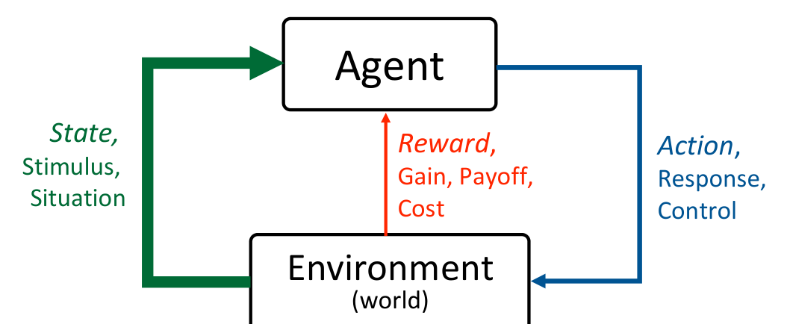
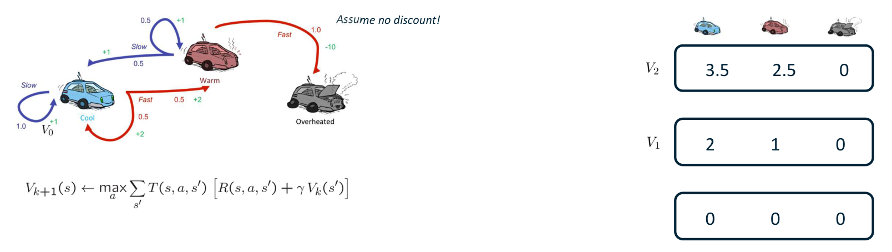
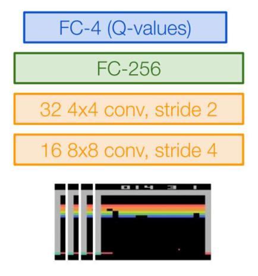
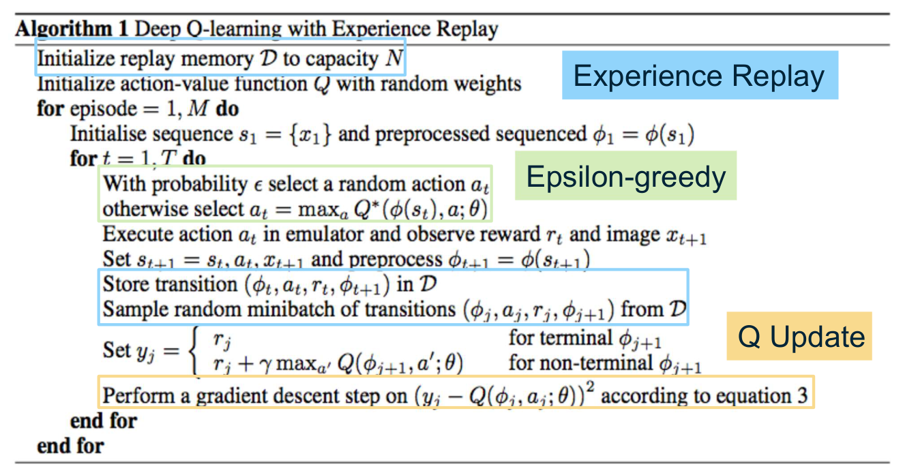
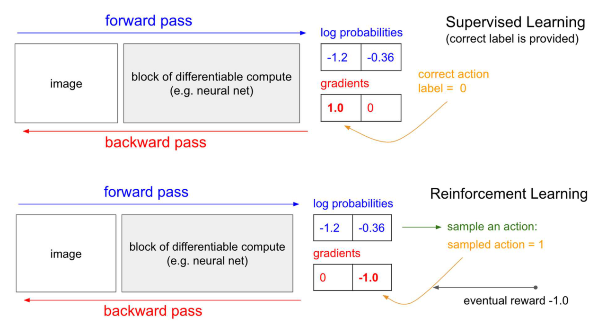
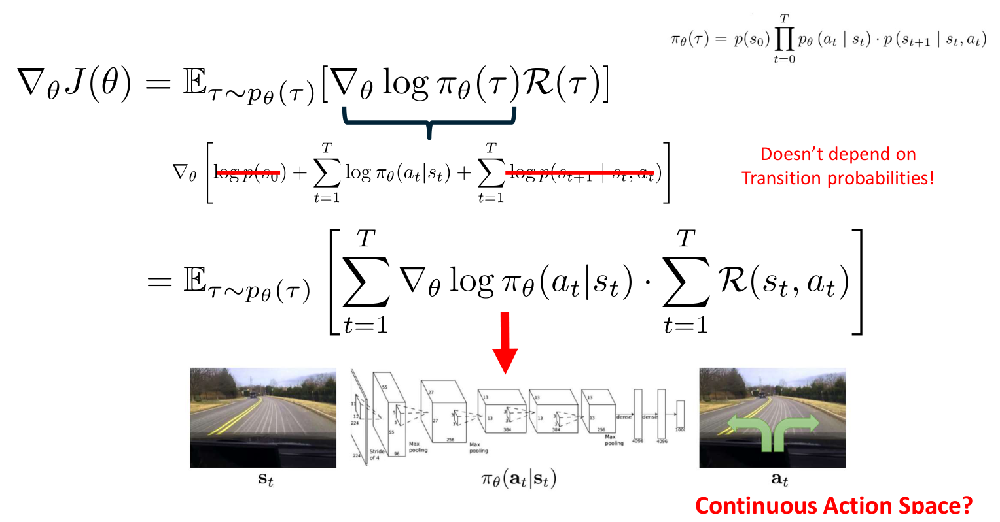

# Deep Q-Learning and Policy Gradients

Reinforcement learning asks an agent to choose actions so that the discounted sum of future rewards is as large as possible, and nobody tells it which action is correct. When the transition and reward distributions are known, the problem is dynamic programming, and the earlier chapters treat it that way. This chapter covers the step that makes the problem a deep learning problem: the agent learns from sampled experience, and the value function or the policy is represented by a neural network. We derive the Bellman optimality equations and the Q-learning update, show how a deep Q-network is trained with experience replay, and derive the policy gradient that underlies the actor-critic methods of the next chapter.

## Markov decision processes in brief

A Markov decision process (MDP) is specified by a state set \\(\mathcal{S}\\), an action set \\(\mathcal{A}\\), a transition distribution \\(p(s' \mid s, a)\\), a reward function and a discount factor \\(\gamma \in [0, 1)\\). We write \\(r(s,a)\\) for the expected immediate reward of taking action \\(a\\) in state \\(s\\). A policy \\(\pi(a \mid s)\\) chooses actions, and interaction with the environment produces a trajectory

\\[
s\_0, a\_0, r\_0, s\_1, a\_1, r\_1, \dots, s\_T, a\_T, r\_T, \qquad r\_t = r(s\_t, a\_t).
\\]

The Markov property says that the next state depends only on the current state and action:

\\[
p(s\_{t+1} \mid s\_t, a\_t, s\_{t-1}, a\_{t-1}, \dots, s\_0, a\_0) = p(s\_{t+1} \mid s\_t, a\_t).
\\]

The full framework, the grid-world example and the convergence of exact planning are developed in the chapters on the [MDP framework](../reinforcement-learning/mdp-framework.md) and [Bellman equations](../reinforcement-learning/bellman-equations.md), and the introductory treatment of grid worlds is in the [MDP chapter](../../ai/mdps.md). Here we need only the notation that the deep methods use.

**Definition (return and value functions).** The discounted return from time \\(t\\) is \\(G\_t = \sum\_{k \ge 0} \gamma^k r\_{t+k}\\). The state-value and action-value functions of a policy \\(\pi\\) are

\\[
V^\pi(s) = \mathbb{E}\_\pi\left[ \sum\_{t \ge 0} \gamma^t r\_t \middle\vert s\_0 = s \right], \qquad
Q^\pi(s,a) = \mathbb{E}\_\pi\left[ \sum\_{t \ge 0} \gamma^t r\_t \middle\vert s\_0 = s, a\_0 = a \right].
\\]

\\(V^\pi(s)\\) answers "how good is this state under \\(\pi\\)?" and \\(Q^\pi(s,a)\\) answers "how good is it to take \\(a\\) here and then follow \\(\pi\\)?" The optimal functions \\(V^\*\\) and \\(Q^\*\\) are the maxima over policies, and an optimal policy is greedy with respect to \\(Q^\*\\).

**Theorem (Bellman optimality equations).** For finite MDPs with \\(0 \le \gamma < 1\\) and bounded rewards,

\\[
Q^\*(s,a) = \sum\_{s'} p(s' \mid s, a)\left[ r(s,a) + \gamma \max\_{a'} Q^\*(s', a') \right], \qquad V^\*(s) = \max\_a Q^\*(s,a),
\\]

and \\(\pi^\*(s) \in \arg\max\_a Q^\*(s,a)\\) is an optimal policy.

The successor term in the first equation is \\(\gamma V^\*(s')\\), the value of the next state. A common typesetting slip writes \\(\gamma V^\*(s)\\) in that position; the equation is about the successor, and \\(s'\\) is used throughout this chapter.

*Figure: the agent-environment loop. The environment returns a state and a reward to the agent, and the agent returns an action. Learning means improving the agent's policy using only this loop.*

## Planning with known dynamics

### Value iteration

When \\(p\\) and \\(r\\) are known, the Bellman optimality equation is a fixed-point equation and can be solved by repeated application:

\\[
V\_{k+1}(s) = \max\_a \sum\_{s'} p(s' \mid s, a)\left[ r(s,a) + \gamma V\_k(s') \right], \qquad V\_0(s) = 0 \text{ for all } s.
\\]

Each sweep costs \\(O(\lvert \mathcal{S} \rvert^2 \lvert \mathcal{A} \rvert)\\) operations when the transition probabilities are stored densely, because every state is backed up against every action and every successor.

**Theorem (convergence of value iteration).** Assume \\(\mathcal{S}\\) and \\(\mathcal{A}\\) are finite, the rewards are bounded, and \\(0 \le \gamma < 1\\). Then the iterates converge to the unique optimal value function \\(V^\*\\), with

\\[
\lVert V\_k - V^\* \rVert\_\infty \le \gamma^k \lVert V\_0 - V^\* \rVert\_\infty.
\\]

**Proof sketch.** Define the operator \\((\mathcal{T}V)(s) = \max\_a \sum\_{s'} p(s' \mid s, a)\left[ r(s,a) + \gamma V(s') \right]\\). For bounded functions \\(U\\) and \\(V\\) and any \\(s\\) and \\(a\\), the probabilities sum to one, so

\\[
\left\lvert \sum\_{s'} p(s' \mid s,a) \left[ \gamma V(s') - \gamma U(s') \right] \right\rvert \le \gamma \lVert V - U \rVert\_\infty .
\\]

Since \\(\lvert \max\_a f(a) - \max\_a g(a) \rvert \le \max\_a \lvert f(a) - g(a) \rvert\\), the operator satisfies \\(\lVert \mathcal{T}V - \mathcal{T}U \rVert\_\infty \le \gamma \lVert V - U \rVert\_\infty\\). On the complete space of bounded functions, \\(\mathcal{T}\\) is therefore a contraction with modulus \\(\gamma\\). The Banach fixed-point theorem gives a unique fixed point. The Bellman optimality equation says \\(V^\* = \mathcal{T}V^\*\\), so that fixed point is \\(V^\*\\), and \\(V\_k = \mathcal{T}^k V\_0\\) gives the geometric rate. \\(\square\\)

The policy often stops changing long before the values converge. For control, what matters is the greedy policy, and the values are needed only to determine it.

**Example (racing with no discount).** A car can be in one of three states: Cool, Warm or Overheated. In Cool, Slow keeps the car Cool with reward 1. Fast gives reward 2 and leads to Cool or Warm with probability 0.5 each. In Warm, Slow gives reward 1 and leads to Warm or Cool with probability 0.5 each. In Warm, Fast leads to Overheated with reward \\(-10\\). Overheated is absorbing with value 0. The transitions are:

| State | Action | Outcomes (probability, reward) |
|---|---|---|
| Cool | Slow | Cool (1.0, +1) |
| Cool | Fast | Cool (0.5, +2); Warm (0.5, +2) |
| Warm | Slow | Warm (0.5, +1); Cool (0.5, +1) |
| Warm | Fast | Overheated (1.0, -10) |

We run value iteration with \\(\gamma = 1\\) and \\(V\_0 = (0, 0, 0)\\) for (Cool, Warm, Overheated). The first sweep is

\\[
V\_1(\text{Cool}) = \max\bigl(1 \cdot (1+0), 0.5(2+0) + 0.5(2+0)\bigr) = \max(1, 2) = 2,
\\]

\\[
V\_1(\text{Warm}) = \max\bigl(0.5(1+0) + 0.5(1+0), 1 \cdot (-10+0)\bigr) = \max(1, -10) = 1,
\\]

so \\(V\_1 = (2, 1, 0)\\). The second sweep uses \\(V\_1\\):

\\[
V\_2(\text{Cool}) = \max\bigl(1 \cdot (1+2), 0.5(2+2) + 0.5(2+1)\bigr) = \max(3, 3.5) = 3.5,
\\]

\\[
V\_2(\text{Warm}) = \max\bigl(0.5(1+1) + 0.5(1+2), 1 \cdot (-10+0)\bigr) = \max(2.5, -10) = 2.5,
\\]

so \\(V\_2 = (3.5, 2.5, 0)\\). The third sweep gives \\(V\_3(\text{Cool}) = \max(1 + 3.5, 0.5(2+3.5) + 0.5(2+2.5)) = \max(4.5, 5.0) = 5.0\\) and \\(V\_3(\text{Warm}) = \max(0.5(1+2.5) + 0.5(1+3.5), -10) = 4.0\\), so \\(V\_3 = (5, 4, 0)\\).

The optimal action is Fast in Cool and Slow in Warm, and the last increment \\(V\_3 - V\_2\\) is \\((1.5, 1.5)\\) for both states. This is not a coincidence. Under the greedy policy, the chain moves between Cool and Warm with equal long-run frequency, since each state sends the car to the other with probability 0.5. The expected reward per step is then \\(0.5 \cdot 2 + 0.5 \cdot 1 = 1.5\\), and with no discount the values grow by that average reward at every sweep. A discount \\(\gamma < 1\\) would make the sums converge instead.

*Figure: the racing MDP (left) with the value-iteration update, and the value vectors for successive sweeps (right). Each vector lists the values of Cool, Warm and Overheated. Read each row as one sweep of the Bellman backup in the previous example.*

### Q-iteration

The same procedure can be run on action-values:

\\[
Q\_{k+1}(s,a) = \sum\_{s'} p(s' \mid s,a) \left[ r(s,a) + \gamma \max\_{a'} Q\_k(s',a') \right].
\\]

Q-iteration loops over actions as well as states, and it costs \\(O(\lvert \mathcal{S} \rvert^2 \lvert \mathcal{A} \rvert)\\) per sweep, as value iteration does. Its advantage is that the greedy policy \\(\pi(s) = \arg\max\_a Q(s,a)\\) can be read off the table without any further model computation. The update itself still needs \\(p\\) and \\(r\\), and removing that requirement is the aim of the next section.

### Why exact planning does not scale

The table of values has one entry per state, or one per state-action pair, and the cost of each sweep grows with \\(\lvert \mathcal{S} \rvert^2\\). The number of states grows exponentially with the number of variables that describe a situation. A gray-scale image of 16 by 16 pixels, with each pixel taking one of 256 values, has \\(256^{256} = 2^{2048}\\) possible states, roughly \\(10^{616}\\). A tabular method is hopeless at that size, even if the model were known. Go and chess are similarly out of reach, and the state of an Atari game is a screen of pixels. Two things must therefore change: the value function must be represented by a function that generalizes across states, and the agent must learn the values from experience instead of computing them from a model.

## From planning to learning

### What is unknown

We now assume that \\(p\\) and \\(r\\) are unknown. The agent knows only the states and rewards it has actually seen, and it can act to see more. This is the setting that gives reinforcement learning its character: experience must be gathered by trial and error, and the agent's own policy determines what data it sees.

### Sample-based policy evaluation

Consider first the evaluation of a fixed policy \\(\pi\\) when the model is unknown. The known-model update is \\(V\_{k+1}(s) = \sum\_{s'} p(s' \mid s, \pi(s)) \left[ r + \gamma V\_k(s') \right]\\). The sum over successors can be replaced by an average over sampled successors. If we draw \\(n\\) samples \\(s'\_1, \dots, s'\_n\\) by taking action \\(\pi(s)\\) in \\(s\\) and forming \\(\text{sample}\_i = r + \gamma V\_k(s'\_i)\\), then

\\[
V\_{k+1}(s) \leftarrow \frac{1}{n} \sum\_{i=1}^{n} \text{sample}\_i .
\\]

The obstacle is that each sample requires a fresh visit to \\(s\\). An agent in a real environment cannot rewind time and draw many outcomes from the same state, so this estimator is available only with a simulator that can be reset.

### Temporal-difference updates

Temporal-difference (TD) learning avoids the repeated visits. Each observed transition \\((s, a, r, s')\\) gives one sample of the target \\(r + \gamma V^\pi(s')\\), and the estimate is moved toward it:

\\[
V^\pi(s) \leftarrow (1-\alpha) V^\pi(s) + \alpha \left[ r + \gamma V^\pi(s') \right] = V^\pi(s) + \alpha\\, \delta, \qquad \delta = r + \gamma V^\pi(s') - V^\pi(s).
\\]

The quantity \\(\delta\\) is the TD error. Outcomes that occur often appear often in the updates, so the averaging over successors happens over time rather than within one step. With a fixed step size \\(\alpha\\) the update is an exponentially weighted running average of the sampled targets.

### Q-learning

For control, the same idea is applied to the action-value function. The Bellman optimality equation has the form of an expectation over successors, and a single sampled transition \\((s, a, r, s')\\) gives the sample \\(r + \gamma \max\_{a'} Q(s', a')\\). The Q-learning update averages these samples with a running average:

\\[
Q(s,a) \leftarrow (1-\alpha) Q(s,a) + \alpha \left[ r + \gamma \max\_{a'} Q(s',a') \right] = Q(s,a) + \alpha \left[ r + \gamma \max\_{a'} Q(s',a') - Q(s,a) \right].
\\]

**Example (one Q-learning update).** Let \\(Q(s,a) = 2.0\\), \\(r = 1\\), \\(\gamma = 0.9\\), \\(\max\_{a'} Q(s',a') = 4.0\\) and \\(\alpha = 0.5\\). The target is \\(1 + 0.9 \cdot 4.0 = 4.6\\), so

\\[
Q(s,a) \leftarrow 2.0 + 0.5 (4.6 - 2.0) = 3.3 .
\\]

The new value lies halfway between the old estimate and the target, as the running-average form requires.

The update is off-policy. The target uses the maximum over next actions, not the action the agent will actually take next, so the learned values approximate \\(Q^\*\\) whatever the behavior policy is, as long as that policy keeps trying every action in every state. For the tabular case, the standard convergence theorem requires every state-action pair to be visited infinitely often and the step sizes to satisfy the Robbins-Monro conditions \\(\sum\_k \alpha\_k = \infty\\) and \\(\sum\_k \alpha\_k^2 < \infty\\). These conditions are the precise content of the usual warning that the learning rate must eventually become small, but must not shrink too quickly. In deep RL a constant or slowly decaying step size is common, and the guarantee then no longer applies in the same form. The convergence argument for the tabular case is in the [convergence chapter](../reinforcement-learning/convergence.md) and worked Q-learning practice is in the [Q-learning chapter](../../ai/q-learning.md).

## Function approximation

### Features and linear value functions

A table cannot generalize. If one state is bad, the table says nothing about a similar state that has never been visited. The remedy is to describe each state by a vector of features, functions from states (or state-action pairs) to real numbers, often indicators. In a Pac-Man-like game the features might be the distance to the nearest ghost, the distance to the nearest dot, the number of ghosts, the inverse square of the dot distance, and an indicator that Pac-Man is in a tunnel. With features \\(f\_1, \dots, f\_n\\), a linear approximation is

\\[
Q(s,a) = w\_1 f\_1(s,a) + \dots + w\_n f\_n(s,a) = w^\top f(s,a).
\\]

The experience of many states is summarized in a few weights. The weakness is that states with the same features may have very different values, and the features must be designed by hand. Designing features for raw images is impractical.

Linear approximators can be written with one weight vector per action, \\(Q(s,a; w, b) = w\_a^\top s + b\_a\\), and linear Q-learning has theoretical guarantees in some settings. The step that makes the approach practical for images is to let a deep network learn the features. The network \\(Q(s,a;\theta)\\) takes the observation as input and outputs one value per action.

### The deep Q-network

For Atari games, Mnih et al. (2013) used a convolutional network whose input is a stack of recent frames and whose output is one Q-value for each game action. The layers are shown in the figure below: two convolutional layers, a fully connected layer with 256 units, and an output layer with four units for four actions. The input size is not fixed by the layer list alone, so we take it to be 84 by 84 gray-scale pixels with four stacked frames, which is the input of the original Atari work and matches the layer sizes. The first convolution with \\(8 \times 8\\) kernels and stride 4 gives an output of \\(\lfloor (84 - 8)/4 \rfloor + 1 = 20\\) per side, with 16 channels. The second convolution with \\(4 \times 4\\) kernels and stride 2 gives \\(\lfloor (20 - 4)/2 \rfloor + 1 = 9\\) per side, with 32 channels, so the flattened vector has \\(32 \cdot 9 \cdot 9 = 2592\\) entries.

The weights are:

- first convolution: \\(16 \cdot (8 \cdot 8 \cdot 4) + 16 = 4112\\);
- second convolution: \\(32 \cdot (4 \cdot 4 \cdot 16) + 32 = 8224\\);
- fully connected layer: \\(2592 \cdot 256 + 256 = 663{,}808\\);
- output layer: \\(256 \cdot 4 + 4 = 1028\\).

The total is \\(677{,}172\\) parameters. The important design point is that one forward pass produces the whole vector \\(Q(s, \cdot)\\), so the maximum over actions needed by the Bellman target costs almost nothing.

*Figure: the deep Q-network for Atari. The input is a stack of game frames at the bottom. Each convolution is labeled with its kernel size and stride, and the top layer gives one Q-value per action. The network is trained with the Bellman-based loss described next.*

## Learning the deep Q-function

### The loss

Suppose we have a dataset \\(\mathcal{D}\\) of transitions \\((s, a, r, s')\\). The Bellman optimality condition suggests that \\(Q(s,a;\theta)\\) should match the target

\\[
y = r + \gamma \max\_{a'} Q(s', a'; \theta^-) \quad \text{for non-terminal } s', \qquad y = r \quad \text{for terminal } s',
\\]

where \\(\theta^-\\) is a frozen copy of the parameters. The loss is the squared Bellman error

\\[
L(\theta) = \mathbb{E}\_{(s,a,r,s') \sim \mathcal{D}}\left[ \bigl( y - Q(s,a;\theta) \bigr)^2 \right].
\\]

Treat the target \\(y\\) as a constant when differentiating. The gradient is then

\\[
\nabla\_\theta L(\theta) = -2\\, \mathbb{E}\left[ \bigl( y - Q(s,a;\theta) \bigr) \nabla\_\theta Q(s,a;\theta) \right],
\\]

and a gradient descent step is \\(\theta \leftarrow \theta + 2\alpha\\, \mathbb{E}\left[ (y - Q(s,a;\theta)) \nabla\_\theta Q(s,a;\theta) \right]\\) in its stochastic form, with a minibatch replacing the expectation. Differentiating through the target as well would be a different update, and it is not what the standard algorithm does: the target is held fixed in each step, as the usual stop-gradient convention prescribes. The deep Q-learning loss is the same squared error as in regression, except that the target is computed from the network itself.

**Example (one regression step).** Let \\(r = 1\\), \\(\gamma = 0.9\\), \\(\max\_{a'} Q(s', a'; \theta^-) = 5\\), and \\(Q(s,a;\theta) = 4\\). The target is \\(y = 1 + 0.9 \cdot 5 = 5.5\\). The residual is \\(y - Q = 1.5\\), and the loss for this sample is \\(1.5^2 = 2.25\\). Suppose \\(Q\\) is linear in features, \\(Q = w^\top \phi(s,a)\\), with \\(\lVert \phi(s,a) \rVert^2 = 4\\), and the step size is \\(\alpha = 0.01\\). The gradient step changes the weights by \\(\Delta w = 2\alpha (y - Q) \phi(s,a)\\), so the change in the prediction is

\\[
\Delta Q = \phi^\top \Delta w = 2\alpha (y - Q) \lVert \phi(s,a) \rVert^2 = 2 \cdot 0.01 \cdot 1.5 \cdot 4 = 0.12 .
\\]

The prediction moves toward the target, but only by a fraction of the gap, which is what a small step size is for.

### Frozen targets

The target depends on the same parameters that the update changes. Each step therefore moves the target as well as the prediction, and the regression chases a moving target. The stabilizing device is to keep \\(\theta^-\\) fixed for a number of steps and then copy the current parameters into it. The usual recipe is exactly this: the old network is held fixed while the new one is updated, and the old network is set equal to the new one at regular intervals. In the printed form of Algorithm 1 below, the same parameters appear in the target and the prediction; the frozen copy is the modification that later became standard practice.

## Correlated data and experience replay

### The feedback loop

In supervised learning the training examples are drawn from a fixed distribution. In reinforcement learning the examples are produced by the agent's own policy, and consecutive transitions are nearly identical. The network's current predictions decide what data it sees next. If the network prefers one action, the data are dominated by the results of that action, the network learns more about the action it already prefers, and the loop can settle into a local optimum. A five-cell chain makes the point. The start is in the middle cell, the reward is 10 at the left end and 1 at the right end. A learner that has come to prefer rightward moves gathers mostly rightward samples, which reinforce the preference, and it may never explore far enough to find the better end. Gradient estimates from such data have high variance, and learning is inefficient.

### The replay buffer

Experience replay breaks the loop by storing transitions in a buffer and training on random samples from it. The buffer \\(\mathcal{D}\\) has a fixed capacity \\(N\\). Each time the agent acts, it appends the new transition \\((\phi\_t, a\_t, r\_t, \phi\_{t+1})\\) and, when full, discards the oldest. Each training step draws a random minibatch from \\(\mathcal{D}\\) rather than using the most recent transitions. Three things follow.

- The minibatch is approximately a collection of independent transitions drawn from a mixture of recent behavior, which reduces the correlation that causes the feedback loop. A larger buffer gives lower correlation.
- Each transition is used for many updates, so the data are used efficiently.
- The learner is trained on data produced by earlier policies. That is acceptable only because Q-learning is off-policy, and it is one reason the Q-learning target uses the maximum over actions.

### Algorithm 1

Mnih et al. (2013) combined the network, the replay buffer and \\(\varepsilon\\)-greedy exploration in the algorithm below. The figure shows it with each part marked.

1. Initialize the replay memory \\(\mathcal{D}\\) with capacity \\(N\\), and initialize \\(Q\\) with random weights \\(\theta\\).
2. For each episode, start the game and compute the preprocessed input \\(\phi\_1\\) from the first frames.
3. For each time step \\(t\\), choose \\(a\_t\\) by \\(\varepsilon\\)-greedy selection with respect to \\(Q(\phi\_t, \cdot\\,; \theta)\\), execute it in the environment, observe the reward \\(r\_t\\) and the next frame, and compute \\(\phi\_{t+1}\\).
4. Store \\((\phi\_t, a\_t, r\_t, \phi\_{t+1})\\) in \\(\mathcal{D}\\), and sample a random minibatch \\((\phi\_j, a\_j, r\_j, \phi\_{j+1})\\) from \\(\mathcal{D}\\).
5. Set the target \\(y\_j = r\_j\\) if \\(\phi\_{j+1}\\) is terminal, and \\(y\_j = r\_j + \gamma \max\_{a'} Q(\phi\_{j+1}, a'; \theta)\\) otherwise.
6. Take a gradient descent step on \\((y\_j - Q(\phi\_j, a\_j; \theta))^2\\).

*Figure: Algorithm 1 for deep Q-learning with experience replay. The blue boxes mark the replay buffer, the green box marks \\(\varepsilon\\)-greedy action selection and the orange box marks the gradient step on the Bellman error. Read the steps top to bottom: store and sample first, then form the target and take the step.*

### Exploration

The \\(\varepsilon\\)-greedy rule selects actions as follows:

\\[
a\_t = \begin{cases} \arg\max\_a Q(s\_t, a; \theta) & \text{with probability } 1 - \varepsilon, \\\\ \text{a uniformly random action} & \text{with probability } \varepsilon. \end{cases}
\\]

Acting always greedily gives no exploration, and the agent can remain in a poor region of the state space. The random actions guarantee that every action is tried. In practice \\(\varepsilon\\) is usually large at the start of training and reduced over time. The choice of \\(\varepsilon\\) trades off exploitation of what the network already knows against the discovery of better actions. The theory of exploration is treated in the [exploration chapter](../reinforcement-learning/exploration.md).

## Policy gradients

### Why optimize the policy directly

Deep Q-learning derives its policy from the Q-function by an \\(\arg\max\\). That is awkward when actions are continuous, since the maximum is then over a continuum, and it cannot represent a stochastic optimal policy. The alternative is to parametrize the policy directly, \\(\pi\_\theta(a \mid s)\\), and optimize the expected return

\\[
J(\theta) = \mathbb{E}\_{\tau \sim p\_\theta(\tau)}\left[ R(\tau) \right], \qquad R(\tau) = \sum\_{t=0}^{T} r(s\_t, a\_t),
\\]

where \\(\tau = (s\_0, a\_0, \dots, s\_T, a\_T)\\) is a trajectory. The parameters \\(\theta\\) may be the weights of a linear map or of a deep network.

*Figure: supervised learning (top) and policy-gradient learning (bottom) use the same forward and backward pass. Supervised learning is given the correct label. Policy-gradient learning samples an action from the network's output and weights its gradient by the reward that follows. A positive reward reinforces the sampled action; a negative one suppresses it.*

### The score-function identity

The trajectory distribution is

\\[
p\_\theta(\tau) = p(s\_0) \prod\_{t=0}^{T} \pi\_\theta(a\_t \mid s\_t) \prod\_{t=0}^{T-1} p(s\_{t+1} \mid s\_t, a\_t).
\\]

The gradient of the objective is obtained with the log-derivative trick, \\(\nabla\_\theta p\_\theta = p\_\theta \nabla\_\theta \log p\_\theta\\):

\\[
\begin{aligned}
\nabla\_\theta J(\theta) &= \nabla\_\theta \int p\_\theta(\tau)\\, R(\tau)\\, d\tau \\\\
&= \int \nabla\_\theta p\_\theta(\tau)\\, R(\tau)\\, d\tau \\\\
&= \int p\_\theta(\tau)\\, \nabla\_\theta \log p\_\theta(\tau)\\, R(\tau)\\, d\tau \\\\
&= \mathbb{E}\_{\tau \sim p\_\theta}\left[ \nabla\_\theta \log p\_\theta(\tau)\\, R(\tau) \right].
\end{aligned}
\\]

The first step exchanges the gradient and the integral, which is allowed under the usual regularity conditions on \\(\pi\_\theta\\) and \\(R\\). The second step is the identity used throughout the method: the gradient of a density is the density times the gradient of its logarithm. The final expression is an expectation under the current policy, so it can be estimated from sampled trajectories.

### The transition terms cancel

Taking the logarithm of the trajectory distribution turns the product into a sum:

\\[
\log p\_\theta(\tau) = \log p(s\_0) + \sum\_{t=0}^{T} \log \pi\_\theta(a\_t \mid s\_t) + \sum\_{t=0}^{T-1} \log p(s\_{t+1} \mid s\_t, a\_t).
\\]

The first and last sums do not depend on \\(\theta\\), since the initial distribution and the environment dynamics are fixed. Their gradients vanish, and what remains is

\\[
\nabla\_\theta J(\theta) = \mathbb{E}\_{\tau \sim p\_\theta}\left[ \left( \sum\_{t=0}^{T} \nabla\_\theta \log \pi\_\theta(a\_t \mid s\_t) \right) \left( \sum\_{t=0}^{T} r(s\_t, a\_t) \right) \right].
\\]

This is the central result of the section. The policy gradient needs the gradient of the log-probability of the actions that were taken, and it needs the rewards that followed. It does not need a model of the environment. The transition probabilities appear in the trajectory density but not in its gradient.

The figure shows the same derivation with the transition terms struck out. The question of whether the method applies to a continuous action space has a yes answer, with the same formula. For a Gaussian policy with mean \\(\mu\_\theta(s)\\) and fixed variance \\(\sigma^2\\), the log-density gradient is

\\[
\nabla\_\theta \log \pi\_\theta(a \mid s) = \frac{a - \mu\_\theta(s)}{\sigma^2}\\, \nabla\_\theta \mu\_\theta(s),
\\]

which is computable from the sampled action and the network that produces the mean.

*Figure: the policy-gradient derivation. The top line is the objective, the braced term is the score function, and the struck-out terms are the initial-state and transition densities, which do not depend on the policy parameters. The bottom line is the estimator. The driving example shows the policy network that the gradient updates. The sums here start at \\(t = 0\\), so that the first state and action are included; some treatments start them at \\(t = 1\\), which changes only the labeling.*

### REINFORCE

Replacing the expectation by an average over \\(N\\) sampled trajectories gives the REINFORCE estimator (Williams, 1992):

\\[
\hat g = \frac{1}{N} \sum\_{i=1}^{N} \left( \sum\_{t=0}^{T} \nabla\_\theta \log \pi\_\theta(a\_t^i \mid s\_t^i) \right) \left( \sum\_{t=0}^{T} r(s\_t^i, a\_t^i) \right).
\\]

The algorithm alternates three steps. It runs the current policy to collect \\(N\\) trajectories, computes \\(\hat g\\), and updates \\(\theta \leftarrow \theta + \alpha \hat g\\). The estimator is unbiased, because it is an average of samples of the exact gradient. Its variance can be very large, and that is the subject of the next chapter.

### A worked update

Consider a single state with two actions and a softmax policy with logits \\(\theta = (\theta\_1, \theta\_2)\\). The probability of action \\(a\\) is \\(\pi\_\theta(a) = e^{\theta\_a} / (e^{\theta\_1} + e^{\theta\_2})\\), and the score function of a softmax policy is

\\[
\nabla\_\theta \log \pi\_\theta(a) = \mathbf{e}\_a - \pi\_\theta ,
\\]

where \\(\mathbf{e}\_a\\) is the unit vector for action \\(a\\) and \\(\pi\_\theta\\) is the vector of action probabilities.

Start from \\(\theta = (0, 0)\\), so \\(\pi = (0.5, 0.5)\\). Suppose we sample action 1 and it yields a total return \\(R = 2\\). The single-sample estimate is

\\[
\hat g = (\mathbf{e}\_1 - \pi)\\, R = \bigl((1, 0) - (0.5, 0.5)\bigr) \cdot 2 = (1, -1).
\\]

With step size \\(\alpha = 0.1\\), the new parameters are \\(\theta = (0.1, -0.1)\\), and the new probability of action 1 is

\\[
\pi\_1 = \frac{e^{0.1}}{e^{0.1} + e^{-0.1}} = 0.5498 .
\\]

The probability of the rewarded action rose from 0.5000 to 0.5498. If the return had been \\(R = -2\\) instead, the same computation gives \\(\theta = (-0.1, 0.1)\\) and \\(\pi\_1 = 0.4502\\), so the sampled action is made less likely. The sign of the return decides the direction, and its size decides the magnitude. Nothing in the update requires knowing the transition model, only the probability of the action taken and the return that followed.

### What is wrong with plain REINFORCE

The estimator credits every action in a trajectory with the entire return. In the Pong example, where a trajectory is a sequence of up and down moves that ends in a win or a loss, every move in a winning trajectory is reinforced, including the moves that did not matter. The same is true of every move in a losing trajectory. The gradient is unbiased but noisy, and the noise makes learning slow and unstable. The remedies are to use only the rewards that follow each action, to subtract a baseline, and to replace the return by a learned critic. These are the subject of the [actor-critic chapter](actor-critic.md), which also shows how the policy gradient is used in trust-region methods and in the training of language models.

## Summary

- The Bellman optimality equations express \\(Q^\*\\) and \\(V^\*\\) through the successor value \\(\gamma V^\*(s')\\), and value iteration is a \\(\gamma\\)-contraction that converges geometrically in the sup norm.
- Exact planning needs the model and a table whose size grows exponentially with the number of state variables, so it does not apply to images or games with large state spaces.
- Temporal-difference learning replaces the expectation over successors by one sampled transition, and Q-learning uses the maximum over next actions, which makes it off-policy.
- With function approximation, Q-learning becomes the regression of \\(Q(s,a;\theta)\\) onto the target \\(r + \gamma \max\_{a'} Q(s', a'; \theta^-)\\). A frozen target network stabilizes the target, and the Atari network of Mnih et al. (2013) produces all action values in one pass.
- Experience replay breaks the correlations in the data produced by the policy, and \\(\varepsilon\\)-greedy action selection keeps the data varied.
- The policy gradient \\(\nabla\_\theta J = \mathbb{E}[\sum\_t \nabla\_\theta \log \pi\_\theta(a\_t \mid s\_t) \sum\_t r\_t]\\) needs no model of the transitions, and it applies to continuous as well as discrete actions.
- REINFORCE is unbiased but has high variance, because every action receives the full return. The next chapter addresses this.

## See Also

- [Deep learning overview](../deep-learning.md)
- [Reinforcement learning overview](../rl.md)
- [MDP framework](../reinforcement-learning/mdp-framework.md)
- [Bellman equations and learning from experience](../reinforcement-learning/bellman-equations.md)
- [Temporal-difference learning](../reinforcement-learning/td-learning.md)
- [Convergence and analysis](../reinforcement-learning/convergence.md)
- [Exploration, bandits and R-max](../reinforcement-learning/exploration.md)
- [Generalization and function approximation](../reinforcement-learning/generalization.md)
- [Markov decision processes](../../ai/mdps.md)
- [Q-learning and reinforcement learning practice](../../ai/q-learning.md)
- [Backpropagation and training](backpropagation.md)
- [Actor-critic, PPO and RLHF](actor-critic.md)
