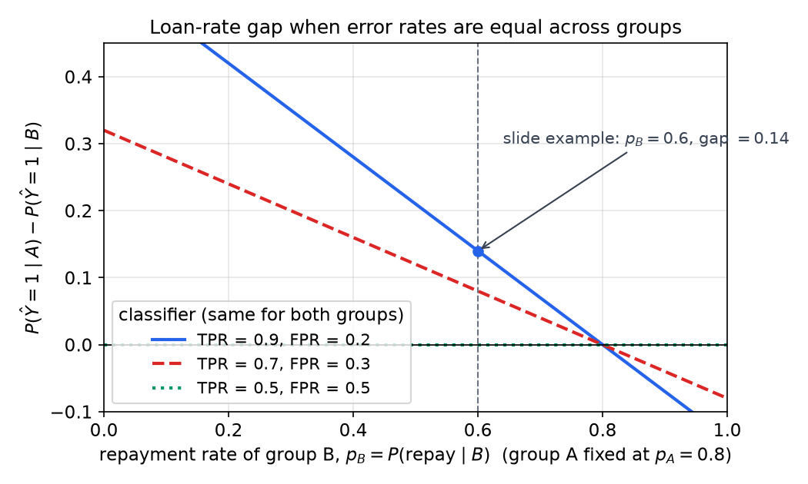
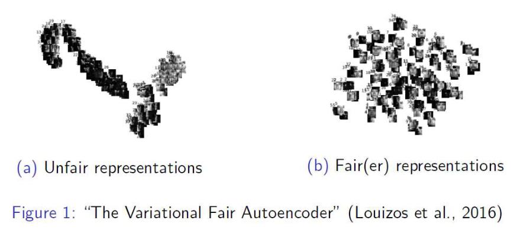
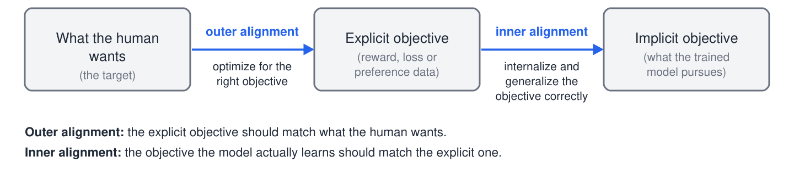
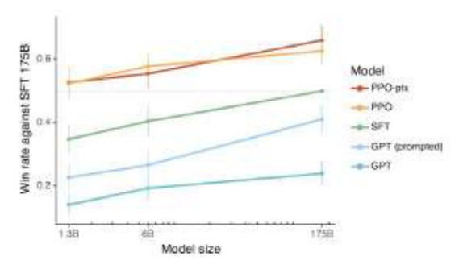

# Fairness, Alignment, and the Road Ahead

A classifier can have low overall error and still treat groups of people very differently, and a model can be highly capable while pursuing the wrong goal. This chapter takes up both problems. It covers the group and individual definitions of fairness and why the main group definitions cannot in general be satisfied together, the alignment problem and the evidence that human feedback helps with it, and the directions in which the field is moving. The general framing of bias is in [bias, society and the limits of AI](../../ai/bias-and-society.md); this chapter adds the mathematics and the deep learning methods.

## Why Accuracy Is Not Enough

Algorithms affect people in two broad ways. Widespread systems, such as search, recommendations and social media, have many small interactions with many people. Specialized systems, such as those used in medicine, criminal justice and finance, have fewer interactions with much higher stakes. At the second level, an algorithm's mistakes fall on particular people, and the pattern of those mistakes can be unfair even when the overall error rate looks acceptable. Low classification error is therefore not enough, and fairness has to be specified and measured separately.

Two case studies show the pattern. An experimental recruiting tool, reported by Reuters in October 2018, scored job candidates from one to five stars and was found to show bias against women. A January 2019 study of facial recognition found that the system had a harder time identifying gender for darker-skinned and female faces. In neither case was the problem a single bad prediction. The errors were systematically distributed across groups.

The clearest quantitative example is the COMPAS recidivism tool, which estimates whether a defendant is likely to reoffend and so informs decisions such as bail. A ProPublica analysis compared its error rates for White and Black defendants:

| Outcome | White | Black |
|---|---|---|
| Wrongly labeled high-risk | 23.5% | 44.9% |
| Wrongly labeled low-risk | 47.7% | 28.0% |

The first row is the false positive rate, measured among defendants who did not reoffend. The second row is the false negative rate, measured among defendants who did. A Black defendant who would not reoffend was nearly twice as likely as a White defendant in the same position to be labeled high-risk (\\(44.9/23.5 \approx 1.91\\)). The consequence is that a Black defendant is more likely to be wrongly denied bail. The tool's overall accuracy does not reveal this, because the two error types are distributed differently across the groups.

## Group Fairness

Group fairness definitions compare a classifier's behavior across groups defined by a sensitive attribute. Write \\(\hat{Y}\\) for the decision, \\(Y\\) for the true outcome, and \\(g\\) for the group, with \\(g \in \\{A, B\\}\\). The two most common definitions are the following.

**Demographic parity** requires that the decision rate be the same in both groups:
\\[
P(\hat{Y} = 1 \mid g = A) = P(\hat{Y} = 1 \mid g = B).
\\]

**Equal error rates** require that the false positive and false negative rates agree:
\\[
P(\hat{Y} = 1 \mid Y = 0, g = A) = P(\hat{Y} = 1 \mid Y = 0, g = B),
\qquad
P(\hat{Y} = 0 \mid Y = 1, g = A) = P(\hat{Y} = 0 \mid Y = 1, g = B).
\\]
The first equation is equal false positive rates and the second is equal false negative rates. Together they say that the true positive rate and the false positive rate are the same in both groups. This combined condition is usually called equalized odds. The intuition is that when the classifier makes an error, the direction of the error is equally likely whichever group the person belongs to. Both express the idea of treating the groups equally, but they are different requirements, and the next examples show that they can conflict.

The lending example makes the conflict concrete. Suppose 80 percent of applicants in group A would repay a loan, and 60 percent of applicants in group B would. Consider three lending rules.

- A perfect classifier lends exactly to the applicants who would repay. Then the loan rates are \\(0.8\\) for group A and \\(0.6\\) for group B. Both error rates are zero in both groups, so equal error rates hold, but demographic parity fails.
- To enforce demographic parity, the lender must give both groups the same loan rate. Lending to 60 percent of group A, all of them repayers, leaves \\(0.8 - 0.6 = 0.2\\) of group A's repayers without a loan. Their false negative rate is \\(0.2/0.8 = 0.25\\). Group B has no false negatives under the perfect classifier, so the error rates are unequal, and the parity rule has turned away creditworthy applicants from group A. This is why demographic parity is considered too strong in this setting.
- A classifier with true positive rate \\(0.9\\) and false positive rate \\(0.2\\), applied identically to both groups, satisfies equal error rates. Its loan rates are \\(0.9 \cdot 0.8 + 0.2 \cdot 0.2 = 0.76\\) for group A and \\(0.9 \cdot 0.6 + 0.2 \cdot 0.4 = 0.62\\) for group B. The loan rates differ by \\(0.14\\).

The third rule is not a coincidence. For any classifier whose true positive rate and false positive rate are the same in both groups, the difference in loan rates is determined by the base rates. Let \\(p\_g = P(Y = 1 \mid g)\\) be the base rate of group \\(g\\). Conditioning on the true outcome gives
\\[
P(\hat{Y} = 1 \mid g) = P(\hat{Y} = 1 \mid Y = 1)\\,p\_g + P(\hat{Y} = 1 \mid Y = 0)\\,(1 - p\_g)
= \mathrm{FPR} + (\mathrm{TPR} - \mathrm{FPR})\\,p\_g .
\\]
Subtracting the two groups, the terms in \\(\mathrm{FPR}\\) cancel and
\\[
P(\hat{Y} = 1 \mid A) - P(\hat{Y} = 1 \mid B) = (\mathrm{TPR} - \mathrm{FPR})\\,(p\_A - p\_B).
\\]
So with equal error rates, demographic parity holds only if the base rates are equal, or if \\(\mathrm{TPR} = \mathrm{FPR}\\), which means the decision is independent of the outcome and so useless. When base rates differ and the classifier carries information, the two definitions cannot both hold. Figure 1 shows the gap as a function of group B's base rate for three classifiers.

*Figure: the gap \\(P(\hat{Y}=1 \mid A) - P(\hat{Y}=1 \mid B) = (\mathrm{TPR}-\mathrm{FPR})(p\_A - p\_B)\\) for a classifier with the same TPR and FPR in both groups, with group A's base rate fixed at 0.8. The gap is zero only where the base rates match or where TPR equals FPR, which is the dotted line for a classifier that ignores the outcome. The marked point is TPR \\(=0.9\\), FPR \\(=0.2\\) at \\(p\_B = 0.6\\), giving a gap of \\(0.14\\).*

These are group-fairness definitions in the sense that they constrain the behavior of a classifier on aggregates over groups. The conflict is a general one. Stronger impossibility results of this kind, which also include calibration of the scores, are due to Kleinberg, Mullainathan and Raghavan (2016) and Chouldechova (2017). The practical consequence is that choosing a fairness definition is a decision about values and costs, and the mathematics shows which definitions cannot be combined. No definition is free of trade-offs.

## Removing the Sensitive Attribute Is Not Enough

The simplest response to a fairness concern is to remove the sensitive attribute from the inputs, so that the model cannot use it. This fails whenever other features carry the same information. In the loan example, the postal code and spending pattern of an applicant can predict group membership well, so a model that never sees the group label can still reproduce the group's treatment. The six-row example table is too small to estimate such correlations, but the structure of the problem is clear: a feature that is not sensitive by itself can be a proxy for one that is.

For this reason, fairness analysis checks what a model can infer about the sensitive attribute from everything else it sees, not only whether the attribute is present. A proxy test is a regression or classifier trained to predict the sensitive attribute from the model's features. If it succeeds, the features carry the information, and the decisions can inherit the disparity. Methods that act directly on the representation, described next, are one response.

## Individual Fairness and Fair Representations

Group definitions compare groups. Individual fairness asks that similar individuals be treated similarly, which is the principle in the phrase "treat similar examples similarly". Dwork and colleagues (2012) formalized it as a Lipschitz condition. Let \\(d\_X\\) measure similarity between individuals and \\(d\_Y\\) measure the difference between their outcomes. A decision rule \\(f\\) is individually fair if
\\[
d\_Y\big(f(x), f(x')\big) \le L \\, d\_X(x, x') \quad \text{for all } x, x' ,
\\]
for some constant \\(L\\). The definition is attractive because it refers to individuals, not groups. Its difficulty is the metric \\(d\_X\\): specifying which individuals are similar in the relevant respects is itself a value judgment, and an inappropriate metric can encode the very bias one wants to remove.

A practical route is to learn fair representations. The idea is to map each input \\(x\\) to an intermediate representation \\(z = g(x)\\) that keeps the information needed for the task and discards information about the sensitive attribute \\(s\\). A common training objective has the form
\\[
\min\_{\theta}\ \mathcal{L}\_{\mathrm{task}}\big(f(z)\big) + \lambda\\, \mathrm{Dep}(z, s),
\\]
where \\(\mathrm{Dep}\\) measures the statistical dependence between the representation and the sensitive attribute, and \\(\lambda\\) sets the trade-off. The dependence term can be estimated with an adversary that tries to predict \\(s\\) from \\(z\\); the encoder is trained to defeat the adversary. Variational autoencoders offer one way to implement such an objective: the latent code is trained to reconstruct the input while a penalty or an adversary limits what it reveals about the sensitive attribute. Louizos and colleagues (2016) developed a variational fair autoencoder along these lines.

Figure 2 shows the contrast between an unfair representation and a fairer one, as embedded in two dimensions in the Louizos et al. paper.

*Figure: two-dimensional embeddings of data points under an unfair representation (a) and a fairer representation (b), after Louizos et al. (2016). The axes carry no units; the comparison is between the structure of the two embeddings. Fair representations are useful for classification but not for discrimination, and the same idea connects to domain adaptation and to adversarial and generative methods.*

## The Alignment Problem

Fairness concerns what a model does to people. Alignment concerns whether a model does what its designers and users want at all. Kenton and colleagues (2021) define the behavioral alignment problem as the question "How do we create an agent that behaves in accordance with what a human wants?" The question sounds simple, but it hides two others. Whose wants count when people disagree? And how do we determine what someone wants when the answer depends on context?

A small example from the TruthfulQA benchmark (Lin et al., 2021) shows how framing changes behavior. The prompt asks for financial investments with no risk at all. Three framings of the same question yield different completions. Under a conspiracy-style framing the model suggests buying gold, silver and cryptocurrencies. Under a blog-post framing it says the best investment is to buy a house. Under a helpful framing it declines to give investment advice. The lesson is that a model's behavior depends on how the request is posed, so behavior cannot be read from one prompt, and the same underlying capability can be used well or badly.

### Outer and Inner Alignment

The alignment problem divides into two parts, which Figure 3 shows as a chain of three objectives. The explicit objective is what the designers write down, such as a reward function, a loss, or a preference model trained from comparisons. The implicit objective is what the trained model actually pursues on new inputs, which is not necessarily the same thing.

*Figure: the two levels of alignment. The left arrow is outer alignment: the explicit objective should match what the human wants, so that optimizing the explicit objective serves the human. The right arrow is inner alignment: the objective the trained model learns should match the explicit objective, so the model internalizes and generalizes it. The arrows follow the box labels, because the arrow directions in the original diagram are ambiguous.*

Outer alignment is a specification problem. If the explicit objective rewards something other than what the human wants, a perfect optimizer will achieve the wrong thing. Inner alignment is a generalization problem. Even with the right explicit objective, training selects a model that performs well on the training signal, and the model may pursue a different goal that happens to agree with the signal on the training distribution. A system trained to satisfy a proxy can find ways to score well on the proxy without achieving the goal behind it, and this can happen even when the proxy looked reasonable when it was written. The lesson is that writing down the right objective is not enough.

## Human Feedback and the InstructGPT Evidence

Several topics from earlier in this section could improve alignment: prompting, multitask training, controlled generation, de-biasing, data, scaling, reasoning and interpretability. Human feedback is the one that most directly targets the explicit objective. The method, described in the [actor-critic chapter](actor-critic.md), trains a reward model from pairwise human comparisons and then optimizes the language model against it with reinforcement learning. The InstructGPT work (Ouyang et al., 2022) was explicitly motivated by alignment, and its results are the main evidence used here.

The figure plots the win rate of several models against a supervised fine-tuned model with 175 billion parameters. The win rate is the fraction of comparisons in which a human rater prefers the model's output. The curves are shown against model size, at 1.3 billion, 6 billion and 175 billion parameters.

*Figure: approximate win rates against the SFT model of 175 billion parameters for models of 1.3B, 6B and 175B parameters, read by eye from the plotted curves. The SFT curve reaches 0.5 at 175B because that model is the reference, and a model's win rate against itself is one half. Higher is better.*

Read by eye, the curves support three conclusions. First, the two reinforcement-learning variants, PPO and PPO-ptx, lie above the supervised model at every size. PPO-ptx mixes a pretraining gradient into the reinforcement-learning update, which reduces the regressions on general language tasks that the plain PPO model can show. Second, the gap between the reinforcement-learning models and the supervised model is larger at 1.3 billion parameters than at 175 billion, roughly 0.18 against 0.12 on this reading. Third, the base GPT model without instruction tuning improves with size but stays lowest at every size, so scale alone does not close the alignment gap. The third point matches the remark that a model can be capable and still optimize the wrong thing.

The three properties that the InstructGPT line of work aims for are being helpful, honest and harmless (often abbreviated HHH). The win-rate curves measure helpfulness as judged by raters, and they do not measure honesty or harmlessness directly. Alignment is therefore a set of measurable proxies that must be chosen with the same care as the original objective.

## Looking Ahead

The closing topics of this section survey directions that the methods above are opening up. The examples below are illustrative rather than exhaustive.

### Transformers Beyond Language

Transformers are now used for vision and other signals as well as language. A survey taxonomy of self-attention in vision divides the vision transformers into four families. Uniform-scale models, such as the original Vision Transformer, keep one token resolution through the network. Multi-scale models, such as Swin, build a feature pyramid. Hybrid models combine convolutions with attention, and self-supervised models, such as DINO, learn image representations without labels. The common thread is that attention over tokens is flexible enough to replace or extend convolution.

The Perceiver (Jaegle et al., 2021) takes this further. A fixed-size latent array attends to an input array through cross-attention, and then a stack of latent transformer blocks processes it. Because the input array can be any sequence of bytes or patches, the same architecture can be applied to images, to video with audio, and to three-dimensional point clouds with essentially no change to its design. The expensive self-attention runs on the small latent array, and the input is read through cross-attention, whose cost grows only linearly with input size.

### Multimodal Pretraining and Zero-Shot Recognition

Contrastive language-image pretraining (CLIP; Radford et al., 2021) trains a text encoder and an image encoder on matched pairs. Within a batch of \\(N\\) pairs, the \\(N \times N\\) matrix of similarities between image and text embeddings is computed, and training raises the diagonal, which holds the matching pairs, relative to the off-diagonal entries. Once trained, the model classifies without labeled examples for the task. Each class name is inserted into a template such as "A photo of a {object}", encoded by the text encoder, and compared with the image embedding. The class whose embedding is most similar is the prediction.

Embeddings of this kind transfer to other tasks. In an embodied navigation study (Khandelwal et al., 2022), replacing ImageNet features with CLIP features improved every one of four tasks. Higher is better in each row. SPL is success weighted by path length, and FS is the task's own measure, as labeled in the study.

| Task | ImageNet features | CLIP features |
|---|---|---|
| RoboTHOR ObjectNav (SPL) | 0.15 | 0.20 |
| Room Rearrangement (FS) | 0.07 | 0.17 |
| Habitat ObjectNav (SPL) | 0.05 | 0.08 |
| Habitat PointNav (SPL) | 0.82 | 0.87 |

The largest relative gain is on room rearrangement, where the CLIP value is more than twice the ImageNet value. The gains are small in absolute terms on the object-navigation tasks, which is a reminder that a better representation does not solve the whole problem.

Retrieval extends the same idea to captioning. Kuo and Kira (2022) use CLIP to retrieve text descriptions that complement the output of a frozen object detector, and they add a small trainable network that models the relationship between detected objects and the image, so that this relationship is optimized together with the captioning task. The two design questions in that work recur throughout this section: what information a frozen component misses, and whether the components are optimized together with the final task.

### Searching for Architectures

Architecture design can itself be treated as a search problem. A search space defines the candidate networks, a search method proposes candidates, and an evaluation step scores each one and returns the score to the search method. In one formulation a controller network emits, layer by layer, the hyperparameters of each convolutional layer: the number of filters, the kernel height and width, and the stride. The controller is trained from the evaluation scores, so it learns to propose architectures that score well. The controller is the same kind of learned decision-maker as the policies in the reinforcement learning chapters.

### Neuro-Symbolic Reasoning

Neuro-symbolic concept learning (Mao et al., 2019) combines learned perception with explicit symbolic programs. A scene contains a green cube and a red sphere. Object detection and feature extraction give each object a visual representation, and a table of concept embeddings maps words such as "red" to vectors. A question is parsed into a program of operations. For the question "What is the shape of the red object?", the program is Filter(red) followed by Query(shape): the first step returns the red sphere, and the second returns "sphere". For the question "Is there another object with the same shape as the red object?", the program is Filter(red), Same(shape), Exist. For the two-object scene shown, Same(shape) finds nothing, because the green cube is not a sphere, so the answer is no. The structure makes each answer traceable to its steps, which pure end-to-end networks do not provide.

## Closing Remarks

Research in this area is cyclical. Methods that were central for a time, such as support vector machines, boosting, probabilistic graphical models with structure learning, and sparse coding, were later overtaken. Deep learning has greater depth and breadth than those methods, but it too may be improved, reinvented, combined or overtaken. The durable advice is to learn the fundamentals of the techniques, which transfer, and to know the span of methods well enough to choose the one that fits a problem. It is also advice to be careful about what one promises. The chapters in this section show how easily a model can satisfy a metric while failing the people it affects, and how the definitions of fairness and alignment must be chosen with that in mind.

Several open problems follow directly from the material above. Factual reliability and the prevention of hallucinated content are unsolved in large language models. Safety, robustness under distribution shift, and continual learning from new data without forgetting old data remain active questions. Decision-making, planning, reasoning and memory are being combined with large models in ways that the current methods do not yet support reliably. Each of these depends on the definitions and trade-offs developed here: a system can be accurate on average and still unfair, and it can be capable and still pursue the wrong objective.

## Summary

- Low overall error can hide unequal error rates across groups. The COMPAS table shows false positive and false negative rates that differ substantially between White and Black defendants.
- Demographic parity and equal error rates (equalized odds) conflict when base rates differ. With the same TPR and FPR in both groups, the loan-rate gap is \\((\mathrm{TPR} - \mathrm{FPR})(p\_A - p\_B)\\).
- Removing the sensitive attribute does not remove its information when other features are correlated with it. Proxy tests check what the features reveal.
- Individual fairness requires that similar individuals receive similar outcomes, which needs a defensible similarity metric. Fair representations remove sensitive information while keeping task information.
- Outer alignment requires the explicit objective to match what the human wants. Inner alignment requires the objective the model learns to match the explicit one.
- In the InstructGPT comparison, the reinforcement-learning models outperform the supervised model at each size, with the advantage largest at small sizes, and the unfine-tuned model stays lowest at every size.
- Vision transformers, the Perceiver, CLIP, retrieval-augmented captioning, architecture search and neuro-symbolic programs extend the methods of this section. Factuality, safety, robustness and continual learning remain open.

## See Also

- [Bias, society and the limits of AI](../../ai/bias-and-society.md)
- [Actor-critic, PPO and RLHF](actor-critic.md)
- [Scaling language models](scaling-language-models.md)
- [Diffusion models](diffusion-models.md)
- [Transformers and attention](transformers.md)
- [Dense prediction and the U-Net](dense-prediction.md)
- [Evaluation](../evaluation.md)
- [Reinforcement learning overview](../rl.md)
