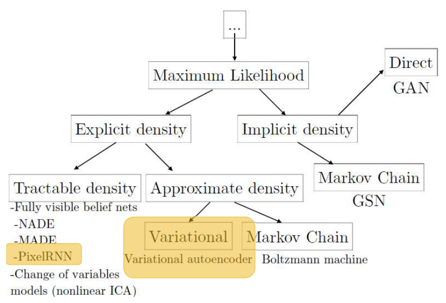
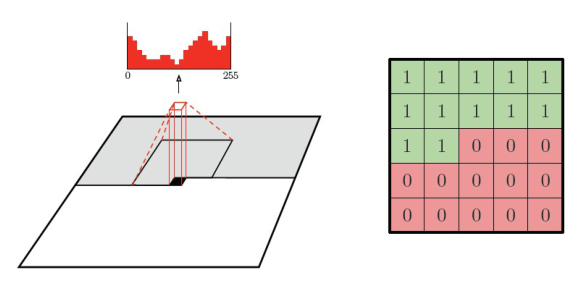
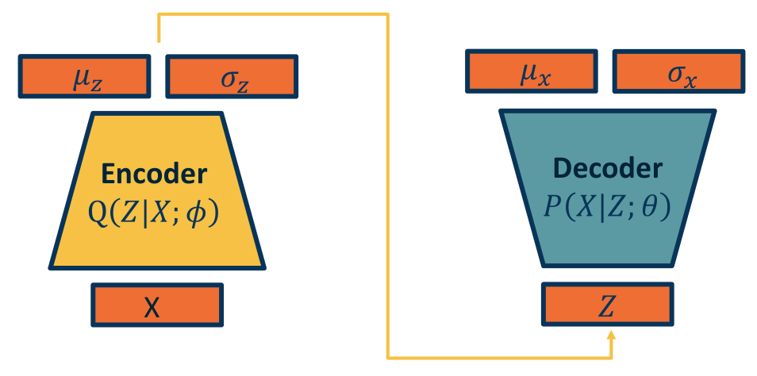
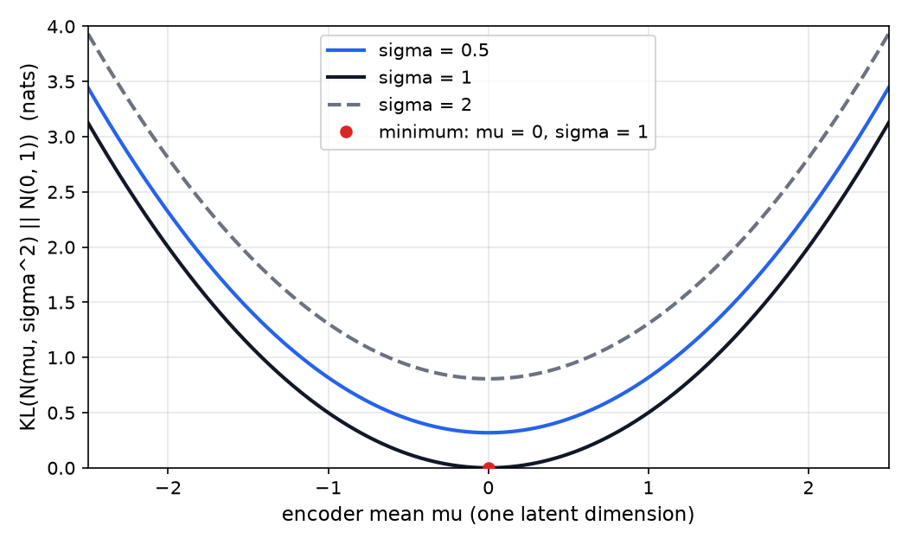
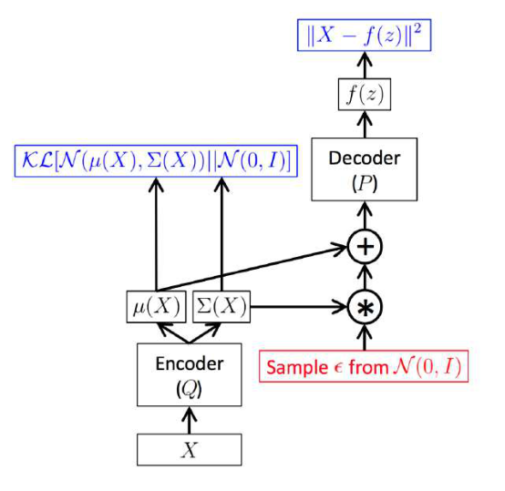
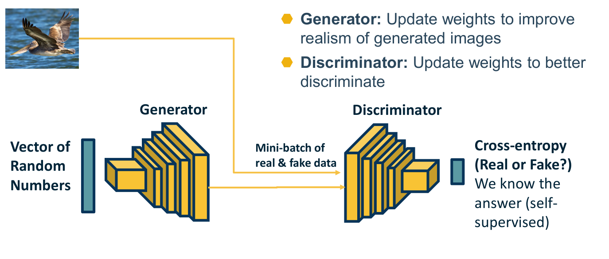

# Generative Models: Autoregressive Models, VAEs and GANs

A discriminative model learns to predict a label from an input. A generative model learns the distribution of the data itself, so it can assign a likelihood to an observation and can produce new samples. This chapter covers three families that answer the question of how to model \\(p(\mathbf{x})\\) with a neural network in different ways. Autoregressive models factor the joint distribution into conditionals, so the likelihood is exact, but sampling is slow. Variational autoencoders optimize a lower bound on the likelihood with an encoder and a decoder. Generative adversarial networks drop the explicit likelihood and train a generator against a discriminator. The chapter comes before the diffusion models, which build on the variational view, and it reuses the latent-code ideas from the 3D scene chapter.

## Discriminative and Generative Models

A discriminative model learns \\(p(y \mid \mathbf{x})\\), the probability of a label given an input, for example with a neural network or a support vector machine. A generative model learns \\(p(\mathbf{x})\\), and it can be fitted without labels. The standard way to fit it is maximum likelihood. With a parametric family \\(p\_{\text{model}}(\mathbf{x}; \theta)\\) and data \\(\mathbf{x}^{(1)}, \dots, \mathbf{x}^{(m)}\\),

\\[
\theta^\* = \arg\max\_{\theta} \prod\_{i=1}^{m} p\_{\text{model}}\big(\mathbf{x}^{(i)}; \theta\big) = \arg\max\_{\theta} \sum\_{i=1}^{m} \log p\_{\text{model}}\big(\mathbf{x}^{(i)}; \theta\big) .
\\]

Maximum likelihood has a clear meaning. Let \\(p\_{\text{data}}\\) be the distribution the data were drawn from. Then

\\[
\operatorname{KL}\big(p\_{\text{data}} \big\\| p\_\theta\big) = \mathbb{E}\_{\mathbf{x} \sim p\_{\text{data}}}\big[\log p\_{\text{data}}(\mathbf{x})\big] - \mathbb{E}\_{\mathbf{x} \sim p\_{\text{data}}}\big[\log p\_\theta(\mathbf{x})\big] .
\\]

The first term does not depend on \\(\theta\\), so maximizing the likelihood is the same as minimizing the divergence from the data distribution to the model. The divergence is nonnegative. To see why, apply Jensen's inequality to the concave logarithm: \\(-\mathbb{E}\_q[\log (p/q)] \ge -\log \mathbb{E}\_q[p/q] = -\log \sum\_{q > 0} p \ge 0\\). Equality holds only when the two distributions agree.

**Example (fitting a Gaussian).** Take four values, \\(1, 2, 4, 5\\), and a Gaussian model. The maximum-likelihood mean is the sample mean, \\(\hat\mu = 3\\). The maximum-likelihood variance divides by \\(m\\), not \\(m - 1\\): \\(\hat\sigma^2 = \big((1-3)^2 + (2-3)^2 + (4-3)^2 + (5-3)^2\big)/4 = 2.5\\). Each point contributes \\(\log \mathcal{N}(x; 3, 2.5) = -\tfrac{1}{2}\log(2\pi \cdot 2.5) - (x-3)^2/5\\), and \\(\tfrac{1}{2}\log(2\pi \cdot 2.5) = \tfrac{1}{2}(2.7546) = 1.3773\\). Summing over the four points gives \\(4(-1.3773) - (4 + 1 + 1 + 4)/5 = -7.509\\) for the log-likelihood.

Generative models divide, following Goodfellow's tutorial, into two families. Models with an **explicit density** define \\(p\_\theta(\mathbf{x})\\), either exactly (tractable models) or through an approximation. Models with an **implicit density** can sample from the model without defining its density. Figure 1 shows the tree.

*Figure 1: Taxonomy of deep generative models after Goodfellow's tutorial. Under maximum likelihood, the explicit-density branch splits into tractable models, such as PixelRNN, and approximate ones, such as the variational autoencoder. The highlighted boxes mark these two. The implicit-density branch contains GANs, which define no density.*

## Autoregressive Models

### The Chain-Rule Factorization

The joint distribution over the pixels of an \\(n \times n\\) image can be written, for any ordering of the pixels, as a product of conditionals:

\\[
p(\mathbf{x}) = \prod\_{i=1}^{n^2} p\big(x\_i \mid x\_1, \dots, x\_{i-1}\big) .
\\]

This is the chain rule of probability, so the factorization is exact. Nothing is approximated. The only choices are the ordering and the form of each conditional, and each conditional is estimated by a neural network. The same factorization underlies language models. A sentence has probability \\(p(w\_1, \dots, w\_n) = \prod\_{i} p(w\_i \mid w\_{i-1}, \dots, w\_1)\\), and the recurrent and transformer models implement those conditionals, as the chapters on them show.

The source expands the first few terms of the image factorization on one page, and that expansion repeats factors under the product. The chain-rule form above is the correct one, and the chapter uses it throughout.

**Example (two binary pixels).** Let \\(x\_1\\) and \\(x\_2\\) be binary, with \\(p(x\_1 = 1) = 0.6\\), \\(p(x\_2 = 1 \mid x\_1 = 1) = 0.9\\) and \\(p(x\_2 = 1 \mid x\_1 = 0) = 0.2\\). The chain rule gives the four joint probabilities:

- \\(p(1, 1) = 0.6 \times 0.9 = 0.54\\)
- \\(p(1, 0) = 0.6 \times 0.1 = 0.06\\)
- \\(p(0, 1) = 0.4 \times 0.2 = 0.08\\)
- \\(p(0, 0) = 0.4 \times 0.8 = 0.32\\)

They sum to \\(1.00\\), as they must. Each conditional is a normalized distribution, and the product of normalized conditionals is automatically normalized.

### Training and Sampling

Training an autoregressive model is straightforward. Every pixel of every training image is known, so all the conditionals can be evaluated in one parallel pass, and maximum likelihood becomes a sum of cross-entropy losses, one per pixel. The known values are fed as inputs. This is called teacher forcing.

Sampling is different. To draw an image, one draws \\(x\_1\\), then \\(x\_2\\) from its conditional given \\(x\_1\\), and so on. Each step needs the previous step's output, so the sampling is sequential. For a \\(32 \times 32\\) image there are \\(1024\\) sequential steps, and if each color channel is predicted in turn, \\(3 \times 1024 = 3072\\) steps. The result is that training is fast and generation stays slow.

### PixelRNN

PixelRNN predicts the pixels in raster order, one row at a time, with a recurrent network whose state carries information from all earlier pixels. The likelihood is exact. The cost is the sequential computation in the sampling process, and the recurrent state is a limited summary of the context, as the source notes.

### PixelCNN

PixelCNN replaces the recurrence with a convolution. A convolution gives every output a neighborhood of context, which is faster to compute, but a plain convolution would let each pixel see the pixels it is supposed to predict. The fix is a **masked convolution**. The mask multiplies the filter weights by zero at the future positions, so the output at each pixel depends only on the pixels before it in raster order.

Figure 2 shows the idea for a \\(5 \times 5\\) mask. The green entries are visible context and the red entries are masked. In the first layer the mask also hides the center pixel, so a prediction cannot use the value it is predicting. Stacking masked convolutions enlarges the context from one layer to the next, and the receptive field takes the shape of a cone that opens toward earlier pixels.

*Figure 2: Left, the receptive field of a masked convolution, a cone that reaches back over earlier pixels. Right, a 5 by 5 mask in which green entries are visible and red entries are masked. The histogram above the cone is the predicted distribution over intensities from 0 to 255.*

**Example (visible context).** In the \\(5 \times 5\\) mask of Figure 2, rows one and two are fully visible, which gives 10 visible entries. Row three contributes two visible entries, the two to the left of the center. Rows four and five are fully masked. The total is \\(10 + 2 = 12\\) visible positions out of 25, and 13 masked. The stacked network sees a much larger region than this single mask, but it still never sees the pixel it predicts or anything after it.

The output at each pixel is a categorical distribution over the 256 intensity values of a color channel, which is the histogram in the figure. Training is fast because all positions are computed in parallel. Sampling is still sequential, so generation remains slow. The source also notes that the approach is limited to smaller images. The samples it reports are locally convincing in texture and color but often incoherent globally, and the completions of occluded images are plausible without always matching the original.

## Autoencoders

An autoencoder is a pair of networks: an encoder maps an input \\(\mathbf{x}\\) to a low-dimensional code \\(\mathbf{z}\\), and a decoder maps the code back to the input space. Training minimizes the reconstruction error:

\\[
\min\_{\text{enc}, \text{dec}} \ \frac{1}{N} \sum\_{i=1}^{N} \big\lVert \mathbf{x}^{(i)} - \text{dec}\big(\text{enc}(\mathbf{x}^{(i)})\big) \big\rVert\_2^2 .
\\]

The encoder can use linear layers with decreasing width, or convolutional layers with stride. The decoder can use linear layers with increasing width, or convolutional layers with bilinear upsampling. A linear autoencoder trained with squared error recovers the principal subspace of the data, which is a standard result, so the deep version is a nonlinear generalization of principal components analysis.

**Example (a one-dimensional bottleneck).** Let the encoder be \\(z = \mathbf{w}^{\top} \mathbf{x}\\) and the decoder \\(\hat{\mathbf{x}} = z \mathbf{w}\\), with \\(\mathbf{w} = (0.6, 0.8)\\), a unit vector. For \\(\mathbf{x} = (3, 4)\\), \\(z = 1.8 + 3.2 = 5\\) and \\(\hat{\mathbf{x}} = (3, 4)\\), so the reconstruction is exact because the point lies on the line the bottleneck keeps. For \\(\mathbf{x} = (4, -3)\\), \\(z = 2.4 - 2.4 = 0\\) and \\(\hat{\mathbf{x}} = \mathbf{0}\\). The error is \\(\lVert (4, -3) \rVert^2 = 25\\), because the bottleneck keeps only one direction.

An autoencoder is a good compressor, but it is a poor generator. Its codes are points, and the training never constrains the space between them. Decoding a random code can produce an arbitrary output. The variational autoencoder fixes this by making the encoder output a distribution and by pulling those distributions toward a simple prior.

## Latent-Variable Generative Models

A latent-variable model explains an image by hidden factors \\(\mathbf{z}\\), such as digit identity, orientation and scale. The generative process is \\(\mathbf{z} \to \text{decoder} \to \mathbf{x}\\), with a simple prior \\(p(\mathbf{z})\\), often a standard normal. The marginal likelihood is

\\[
p(\mathbf{x}) = \int p(\mathbf{x} \mid \mathbf{z}; \theta) p(\mathbf{z}) d\mathbf{z} .
\\]

This integral cannot be computed for a deep decoder. A Monte Carlo estimate by sampling from the prior would need enormous numbers of samples, because for most \\(\mathbf{z}\\) the decoder assigns almost no probability to \\(\mathbf{x}\\). The variational method replaces the integral with a bound that can be optimized.

The decoder can be made probabilistic. It outputs the parameters of a distribution over \\(\mathbf{x}\\), for example a mean and a standard deviation of a Gaussian, and the sample is drawn from that distribution. The encoder does the same for \\(\mathbf{z}\\). It outputs a mean and standard deviation rather than a point, and the latent code is sampled from that distribution. Tying the two together gives the probabilistic autoencoder of Figure 3.

*Figure 3: The probabilistic autoencoder. The encoder, written Q(Z given X), outputs the parameters of a distribution over the latent code. A sample Z is drawn, and the decoder, written P(X given Z), outputs the parameters of a distribution over the image. Training optimizes both networks together.*

## The Variational Lower Bound

The derivation below is the core of the variational approach. Write \\(q\_\phi(\mathbf{z} \mid \mathbf{x})\\) for the encoder's distribution and \\(p\_\theta\\) for the generative model. Since \\(p\_\theta(\mathbf{x})\\) does not depend on \\(\mathbf{z}\\), taking its expectation under \\(q\_\phi\\) changes nothing:

\\[
\log p\_\theta(\mathbf{x}) = \mathbb{E}\_{\mathbf{z} \sim q\_\phi(\mathbf{z} \mid \mathbf{x})}\big[\log p\_\theta(\mathbf{x})\big] .
\\]

Bayes' rule inside the expectation gives \\(p\_\theta(\mathbf{x}) = p\_\theta(\mathbf{x} \mid \mathbf{z}) p\_\theta(\mathbf{z}) / p\_\theta(\mathbf{z} \mid \mathbf{x})\\). Multiplying the fraction by \\(q\_\phi(\mathbf{z} \mid \mathbf{x}) / q\_\phi(\mathbf{z} \mid \mathbf{x}) = 1\\) and splitting the logarithm gives

\\[
\log p\_\theta(\mathbf{x}) = \mathbb{E}\_{\mathbf{z}}\Big[\log \frac{p\_\theta(\mathbf{x} \mid \mathbf{z}) p\_\theta(\mathbf{z})}{q\_\phi(\mathbf{z} \mid \mathbf{x})}\Big] + \mathbb{E}\_{\mathbf{z}}\Big[\log \frac{q\_\phi(\mathbf{z} \mid \mathbf{x})}{p\_\theta(\mathbf{z} \mid \mathbf{x})}\Big] .
\\]

The first expectation splits into a reconstruction term and a KL term, and the second is a KL divergence to the true posterior. So the identity becomes

\\[
\log p\_\theta(\mathbf{x}) = \mathbb{E}\_{\mathbf{z} \sim q\_\phi}\big[\log p\_\theta(\mathbf{x} \mid \mathbf{z})\big] - \operatorname{KL}\big(q\_\phi(\mathbf{z} \mid \mathbf{x}) \big\\| p\_\theta(\mathbf{z})\big) + \operatorname{KL}\big(q\_\phi(\mathbf{z} \mid \mathbf{x}) \big\\| p\_\theta(\mathbf{z} \mid \mathbf{x})\big) .
\\]

The last term is a divergence, so it is nonnegative. It also contains the true posterior \\(p\_\theta(\mathbf{z} \mid \mathbf{x})\\), which is intractable, so it cannot be computed. Dropping it gives the **evidence lower bound** (ELBO):

\\[
\log p\_\theta(\mathbf{x}) \ge \mathcal{L}(\mathbf{x}; \theta, \phi) = \mathbb{E}\_{\mathbf{z} \sim q\_\phi(\mathbf{z} \mid \mathbf{x})}\big[\log p\_\theta(\mathbf{x} \mid \mathbf{z})\big] - \operatorname{KL}\big(q\_\phi(\mathbf{z} \mid \mathbf{x}) \big\\| p\_\theta(\mathbf{z})\big) .
\\]

Training maximizes the bound summed over the data set. The gap between the bound and the likelihood is exactly the divergence to the true posterior, so the bound is tight when the encoder matches the posterior. The derivation depends on the sign of the KL term. The source writes the divergence as a difference of cross-entropy and entropy, \\(\operatorname{KL}(p \\| q) = H(p, q) - H(p)\\), with \\(H(p, q) = -\sum\_x p(x) \log q(x)\\). Its printed line drops the minus sign on the cross-entropy sum. The chapter uses the corrected form, in which the minus sign is essential, because without it the sum would not be a divergence.

### The Closed-Form KL Term

When the encoder outputs a diagonal Gaussian \\(q = \mathcal{N}(\mu, \sigma^2)\\) and the prior is \\(\mathcal{N}(0, 1)\\), the KL term has a closed form:

\\[
\operatorname{KL}\big(\mathcal{N}(\mu, \sigma^2) \big\\| \mathcal{N}(0, 1)\big) = \tfrac{1}{2}\big(\mu^2 + \sigma^2 - 1 - \log \sigma^2\big) .
\\]

Figure 4, below, plots this function. Two values of the encoder's distribution show how it works. For \\(\mu = 0.5\\) and \\(\sigma = 0.8\\), the KL is \\(\tfrac{1}{2}(0.25 + 0.64 - 1 + 0.4463) = 0.1681\\). For \\(\mu = 0\\) and \\(\sigma = 1\\), it is zero. The term therefore pulls each encoder output toward the prior from every direction.

When the decoder is a Gaussian with fixed variance \\(\sigma\_x^2\\), the reconstruction term becomes, up to a constant, \\(-\lVert \mathbf{x} - \boldsymbol{\mu}\_x(\mathbf{z}) \rVert^2 / (2\sigma\_x^2)\\). Maximizing the reconstruction term is then minimizing squared error, which is why the autoencoder loss from earlier is the reconstruction part of the VAE objective.

**Example (one sample of the ELBO).** Take one data value \\(x = 1.0\\), one latent sample that gives a decoder mean \\(\mu\_x = 0.6\\), and a decoder standard deviation \\(\sigma\_x = 0.5\\). The reconstruction term is

\\[
\log p(x \mid z) = -\tfrac{1}{2}\log(2\pi \cdot 0.25) - \frac{(1.0 - 0.6)^2}{2 \cdot 0.25} = -0.2258 - 0.3200 = -0.5458 .
\\]

Let the encoder give \\(\mu = 0.5\\) and \\(\sigma = 0.8\\), so the KL term is \\(0.1681\\). The single-sample estimate of the ELBO is \\(-0.5458 - 0.1681 = -0.7139\\). Averaging over more samples of \\(z\\) gives a better estimate, and the training loss is the negative of this quantity.

*Figure 4: The closed-form KL divergence from a one-dimensional Gaussian to the standard normal prior, plotted against the mean for standard deviations of 0.5, 1 and 2. The divergence is zero only at mean 0 and standard deviation 1, so the encoder is pulled toward the prior in every direction.*

## Reparameterization

The ELBO is differentiable with respect to the decoder's parameters, but the sampling step is the obstacle for the encoder. The expectation is taken over \\(\mathbf{z} \sim q\_\phi\\), and a random sample is not a differentiable function of \\(\phi\\). The gradient has to pass through the sampling, and it does not.

The reparameterization trick moves the randomness out of the distribution. The sample is written as a deterministic function of the encoder's outputs and independent noise:

\\[
\mathbf{z} = \boldsymbol{\mu} + \boldsymbol{\sigma} \odot \boldsymbol{\epsilon}, \qquad \boldsymbol{\epsilon} \sim \mathcal{N}(0, I) .
\\]

Now the encoder is deterministic, and all the randomness sits in \\(\boldsymbol{\epsilon}\\), which does not depend on \\(\phi\\). Gradients flow through \\(\boldsymbol{\mu}\\) and \\(\boldsymbol{\sigma}\\) into the encoder, and the expectation over \\(\boldsymbol{\epsilon}\\) is estimated by sampling. Figure 5 shows this as a computation graph.

*Figure 5: The reparameterized VAE as a computation graph. The encoder outputs a mean and a covariance. Noise drawn from a standard normal is scaled and added to give the latent code, which the decoder maps to a reconstruction. Both losses are computed from these quantities, and gradients flow through the deterministic path.*

**Example (gradient through a sample).** Let \\(f(z) = z^2\\) and take \\(z \sim \mathcal{N}(\mu, \sigma^2)\\) with \\(\mu = 0.3\\) and \\(\sigma = 1\\). The exact expectation is \\(\mathbb{E}[z^2] = \mu^2 + \sigma^2\\), so \\(\partial\_\mu \mathbb{E}[z^2] = 2\mu = 0.6\\). With the reparameterization, \\(\partial f / \partial \mu = 2z = 2(\mu + \sigma \epsilon)\\). For \\(\epsilon = 1\\) this gives \\(2(1.3) = 2.6\\), and for \\(\epsilon = -1\\) it gives \\(2(-0.7) = -1.4\\). The average of the two estimates is \\(0.6\\), which equals the exact derivative. With many samples the estimate becomes accurate, and every sample is a usable gradient.

## Variational Autoencoders in Training

The VAE objective for one data point is the negative ELBO. The encoder computes \\(\boldsymbol{\mu}\\) and \\(\boldsymbol{\sigma}\\). A sample \\(\mathbf{z}\\) is drawn by reparameterization, the decoder computes the reconstruction distribution, and the loss is the reconstruction term plus the closed-form KL term. The forward pass samples \\(\mathbf{z}\\), and the backward pass sends the reconstruction gradient to the decoder and the encoder, and the KL gradient to the encoder. Mini-batches of data are used as in any other training.

The two terms pull in different directions. The reconstruction term rewards encodings that carry enough information to rebuild the input. The KL term keeps the encodings close to the prior. The prior is what makes generation possible, because one can then sample \\(\mathbf{z}\\) from \\(\mathcal{N}(0, I)\\) and decode it. The published visualizations show smooth changes in a two-dimensional latent plane. A grid of MNIST digits changes identity and slant gradually across the plane, which is the sense in which the latent features are described as interpretable and disentangled. The objective does not guarantee disentanglement. It only encourages it.

The VAE approach has two known limitations. Its samples are often less sharp than the best GAN and diffusion samples. The source reports the same caveat, describing VAE reconstructions as somewhat lower quality. A common explanation is that a Gaussian decoder with a squared-error objective averages over the plausible outputs, so the result is blurred. Second, the bound is approximate. A gap remains between the bound and the true likelihood, and it is governed by how well the encoder approximates the posterior.

## Generative Adversarial Networks

A GAN gives up the explicit likelihood. A generator \\(G\\) maps noise \\(\mathbf{z}\\) to an image. A discriminator \\(D\\) maps an image to a probability in \\((0, 1)\\) that the image is real. The two networks play a minimax game with value

\\[
V(G, D) = \mathbb{E}\_{\mathbf{x} \sim p\_{\text{data}}}\big[\log D(\mathbf{x})\big] + \mathbb{E}\_{\mathbf{z} \sim p\_z}\big[\log \big(1 - D(G(\mathbf{z}))\big)\big] .
\\]

The discriminator maximizes \\(V\\), and the generator minimizes it. The source gives the two gradient expressions without a sign convention. The convention above is the standard one. The discriminator ascends the value function, and the generator descends it.

### The Optimal Discriminator

Fix the generator and write \\(p\_g\\) for the generator's distribution over images. The value becomes \\(\int \big[p\_{\text{data}}(\mathbf{x}) \log D(\mathbf{x}) + p\_g(\mathbf{x}) \log(1 - D(\mathbf{x}))\big] d\mathbf{x}\\). The integrand depends on \\(D(\mathbf{x})\\) at each point separately, so the best \\(D\\) is found pointwise. Setting the derivative to zero gives \\(p\_{\text{data}}/D - p\_g/(1 - D) = 0\\), and the solution is

\\[
D^\*(\mathbf{x}) = \frac{p\_{\text{data}}(\mathbf{x})}{p\_{\text{data}}(\mathbf{x}) + p\_g(\mathbf{x})} .
\\]

The second derivative is negative, so this is a maximum. Substituting \\(D^\*\\) back into the value gives the generator's objective. Write \\(M = (p\_{\text{data}} + p\_g)/2\\). Then \\(p\_{\text{data}} + p\_g = 2M\\), so \\(\log D^\* = \log(p\_{\text{data}}/M) - \log 2\\) and \\(\log(1 - D^\*) = \log(p\_g/M) - \log 2\\). Therefore

\\[
V(G, D^\*) = \operatorname{KL}(p\_{\text{data}} \\| M) + \operatorname{KL}(p\_g \\| M) - \log 4 = 2\operatorname{JSD}(p\_{\text{data}} \\| p\_g) - \log 4 ,
\\]

where the Jensen-Shannon divergence is \\(\operatorname{JSD}(p \\| q) = \tfrac{1}{2}\operatorname{KL}(p \\| M) + \tfrac{1}{2}\operatorname{KL}(q \\| M)\\). The divergence is nonnegative and zero only when the two distributions agree. So the generator's ideal is \\(p\_g = p\_{\text{data}}\\), and the value attains its minimum \\(-\log 4\\) exactly there.

**Example (two outcomes).** Let the data distribution put probability \\((0.8, 0.2)\\) on two outcomes \\(A\\) and \\(B\\), and let the generator put \\((0.5, 0.5)\\). The optimal discriminator is \\(D^\*(A) = 0.8 / 1.3 = 0.6154\\) and \\(D^\*(B) = 0.2 / 0.7 = 0.2857\\). Evaluating the value term by term gives

\\[
0.8 \log 0.6154 + 0.5 \log 0.3846 + 0.2 \log 0.2857 + 0.5 \log 0.7143 = -0.8662 - 0.4188 = -1.2850 .
\\]

The Jensen-Shannon form gives the same value. With \\(M = (0.65, 0.35)\\), the divergences are \\(\operatorname{JSD} = 0.0507\\), and \\(2(0.0507) - \log 4 = -1.2850\\). The generator is not yet at its ideal, because the two outcomes have different probabilities.

### Practical Losses

In practice the generator's loss \\(\log(1 - D(G(\mathbf{z})))\\) saturates. Early in training the discriminator rejects generated images with high confidence, so the gradient on the generator is small exactly when it is needed. The common remedy, and the one used in most implementations, is the non-saturating loss \\(-\log D(G(\mathbf{z}))\\), which has the same fixed point and much larger gradients early on. The source does not show this variant, so it is stated here as the standard practice.

Training alternates between the two networks. A mini-batch of real images and a mini-batch of generated images is passed to the discriminator. Its output is trained with cross-entropy against the known labels, real or fake, which is why the signal is described as self-supervised. The generator is then updated to make its images more likely to be judged real. Figure 6 shows the loop.

*Figure 6: One step of GAN training. A noise vector feeds the generator. A mini-batch of real and generated images feeds the discriminator, which outputs a probability of real or fake and is trained with cross-entropy. The generator and discriminator are then updated in turn.*

GANs produce high-fidelity samples across many image types. The source cites large-scale BigGAN samples at high resolution, which are photo-realistic at that size. The price is training that is unstable, and good results are computationally heavy to obtain. A GAN also has no likelihood, so it is hard to evaluate. Two further difficulties are standard. A generator can cover only some of the modes of the data distribution, a failure known as mode collapse. The approach has also been less successful for discrete data such as text.

## Comparing the Three Families

The three families make different trade-offs, summarized below.

| Property | Autoregressive (PixelCNN) | Variational autoencoder | Generative adversarial network |
|---|---|---|---|
| Likelihood | exact | lower bound | none |
| Sampling | sequential, slow | one pass | one pass |
| Training | maximum likelihood, stable | bound, stable | adversarial, unstable |
| Latent space | none | structured, supports interpolation | implicit in the generator input |
| Sample quality | locally good, globally limited | often blurred | high |
| Evaluation | likelihood available | bound available | hard |

The source's summary follows the same lines. Autoregressive models give tractable densities but generate slowly. GANs give strong results across image modalities but train unstably and are hard to evaluate. VAEs have a principled formulation and disentangled latents, at the price of approximate inference and lower-quality reconstructions.

## Summary

- Maximum likelihood minimizes the divergence from the data distribution to the model. The divergence is nonnegative, which is what makes the bound below a bound.
- The chain rule gives an exact factorization of the joint distribution into conditionals. PixelCNN implements the conditionals with masked convolutions. Training is parallel, and sampling is sequential.
- A VAE maximizes the ELBO, which is the expected reconstruction log-likelihood minus the KL divergence from the encoder to the prior. The bound is tight when the encoder matches the true posterior.
- For a diagonal Gaussian encoder, the KL term is \\(\tfrac{1}{2}(\mu^2 + \sigma^2 - 1 - \log \sigma^2)\\), and the reparameterization \\(\mathbf{z} = \boldsymbol{\mu} + \boldsymbol{\sigma} \odot \boldsymbol{\epsilon}\\) makes the sampling step differentiable.
- The GAN objective has an optimal discriminator \\(D^\* = p\_{\text{data}} / (p\_{\text{data}} + p\_g)\\), and the value at that discriminator equals \\(2\operatorname{JSD} - \log 4\\).
- GANs trade a tractable likelihood for sample quality, with unstable training and no direct evaluation. The non-saturating generator loss is the usual practical choice.

## See Also

- [Denoising Diffusion Models](diffusion-models.md), which builds on the variational view of this chapter.
- [3D Scene Representations](3d-scene-representations.md), which uses the latent-code and auto-decoder ideas.
- [Entropy](../../information-theory/entropy.md), for cross-entropy and the KL divergence.
- [Probability](../../ai/probability.md), for Bayes' rule and conditional distributions.
- [Convolutional Networks](convolutional-networks.md), for the masked convolution.
- [Recurrent Networks](recurrent-networks.md) and [Transformers](transformers.md), for autoregressive sequence models.
- [Unsupervised Learning](../unsupervised.md), for the broader view of models that learn without labels.
