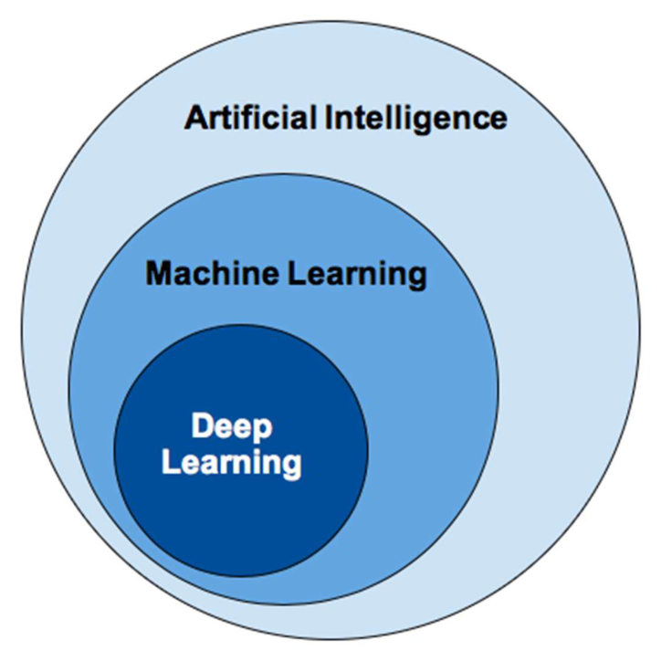
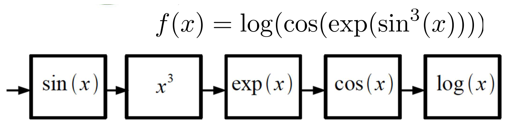
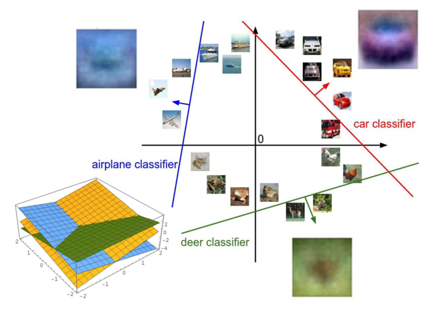
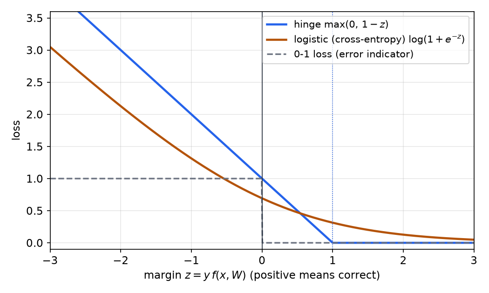
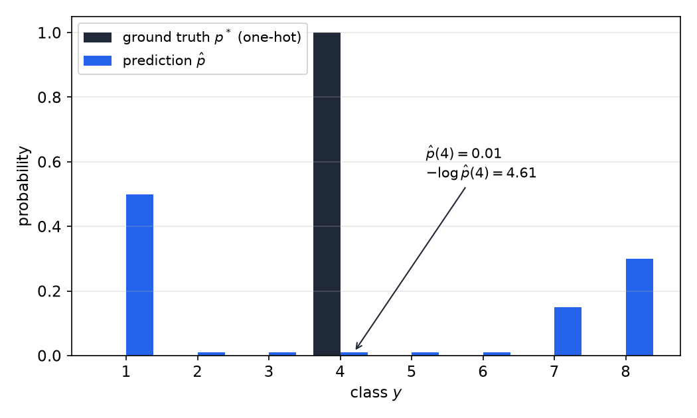
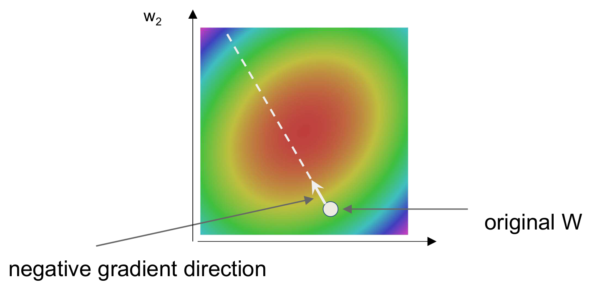

# Introduction and Linear Classifiers

Deep learning builds models from stacked, differentiable functions whose parameters are fitted to data by gradient descent. This chapter sets up the framework that the rest of the section uses: what the field means by a learned representation, how learning is posed as a search over a parametrized family of functions, and why the simplest such family, the linear classifier, already contains the two tools that carry the whole subject, a loss function and gradient descent. The linear classifier and its training are worked out here with full arithmetic. The chain rule that extends the same ideas to deep networks is the subject of the next chapter, [Backpropagation and Training](backpropagation.md).

## What Deep Learning Adds to Machine Learning

The three fields nest. Artificial intelligence is the broadest term, machine learning is the part of it that improves from data, and deep learning is the part of machine learning that uses models with many layers of learned representations (Figure 1).

*Figure: the three nested fields. Deep learning is one family of methods inside machine learning, and machine learning is itself part of artificial intelligence.*

Tom Mitchell's standard definition makes "learning" precise. A program learns from experience E with respect to a class of tasks T and a performance measure P if its performance at T, as measured by P, improves with E (Mitchell, 1997). Everything in this chapter is an instance of that definition. The experience is a labeled dataset, the task is to predict labels, and the performance measure is a loss.

Deep learning is distinguished by three ideas that recur throughout the subject.

1. **Hierarchical compositionality.** The model is a cascade of nonlinear transformations, and each layer builds its representation out of the layer before. In vision the cascade runs from pixels to edges, to textures, to object parts, and to objects. In speech it runs from samples to spectral bands, to phonetic units, and to words.
2. **End-to-end learning.** The intermediate representations are not designed by hand. They are learned jointly with the classifier, because the training signal at the output flows back through every layer.
3. **Distributed representations.** No single unit is responsible for a concept. A feature such as "wheel" is carried by a pattern of activity across many units, and each unit takes part in many features.

### Composition versus linear combination

Suppose we have a library of simple functions, say sin x, cos x, log x, x^3 and exp x, and we want a complicated function built from them. There are two ways to combine them. A linear combination, \\(f(x) = \sum\_i \alpha\_i\\, g\_i(x)\\), is the basis of boosting, kernel machines and many classical methods. It is wide and shallow, because every basis function sits beside the others. A composition, \\(f(x) = g\_1(g\_2(\cdots g\_n(x)\cdots))\\), is deep, because each function consumes the output of the one before it.

**Example 1.1 (a composed function).** The function \\(f(x) = \log(\cos(\exp(\sin^3 x)))\\) is a composition of five simple functions: sine, then cubing, then exp, then cos, then log (Figure 2). Each module is trivial to evaluate and to differentiate. The derivative of the whole chain is the product of the derivatives of the modules, which is the chain rule that the next chapter exploits.

*Figure: the function \\(f(x)=\log(\cos(\exp(\sin^3 x)))\\) drawn as a chain of five modules. Read left to right: the output of each box is the input of the next.*

Deep learning rests on the bet that the world is compositional, and the bet has paid off wherever representations matter. Zeiler and Fergus's visualizations of an ImageNet convolutional network show the hierarchy directly. First-layer units respond to oriented edges and color blobs, middle layers respond to textures, curves and circles, and the highest layers respond to object parts and whole objects, such as dog faces and keyboards.

### Hand-designed features versus learned features

Before deep learning, the usual pipeline had two parts. A person designed a feature extractor, such as SIFT or HOG descriptors for images, MFCC coefficients for speech, or word counts for text, and a learned classifier sat on top. Only the last stage was fitted to data. Some methods added an unsupervised middle stage, such as clustering local descriptors, but the features were never tuned for the final task as a whole.

Deep learning removes the hand-designed stage. Every stage is a module with parameters, and all the parameters are chosen to reduce the same final loss. This is what end-to-end learning means. Moving from "fixed features plus a learned classifier" to "every stage learned" is the defining change, and it explains why the same architectural ideas now appear in vision, speech, language and control.

### Benefits and open problems

Learned representations usually outperform hand-designed ones when there is enough data and the training and test data come from similar distributions. They also reach domains where no one knows how to design features, such as lidar, multispectral imagery and gene expression. Sutton's essay "The Bitter Lesson" argues that general methods which exploit computation tend to beat methods that encode human knowledge, and that this pattern has repeated across decades of AI research.

The approach has real costs, and a careful reader should keep them in view.

- **Theory is incomplete.** The training loss of a multilayer network is non-convex in its parameters. The classical guarantees for convex learning do not carry over directly, and much of the current understanding is empirical.
- **Models are hard to interpret and diagnose.** In a pipeline each stage can be tested on its own. In an end-to-end system a failure may come from any layer, and the internal representations must be probed to locate it.
- **Results are hard to reproduce.** Random initialization, the order of the data and small design choices can change the outcome, so a reported gain may not replicate.

## Learning as Search over Functions

### Supervised, unsupervised and reinforcement learning

In supervised learning the data are pairs \\((x\_i, y\_i)\\), and the goal is a function \\(f : X \to Y\\) that predicts labels for new inputs. The output may be a label, a number, or a probability distribution \\(P(y \mid x)\\). In unsupervised learning only the inputs are given, and the goal is to model their distribution \\(P\_{\text{data}}(x)\\): to cluster them, to estimate their density, or to generate new samples. In reinforcement learning the feedback is a reward rather than a correct answer. These paradigms are often combined inside one model.

### Non-parametric and parametric models

A non-parametric model has no fixed functional form. The nearest-neighbor rule labels a query point with the label of the closest training example. Its capacity grows with the data, because every training point is stored and consulted at test time. It works in low dimensions and fails in high ones. To keep four grid points per unit length in every direction, a \\(d\\)-dimensional unit cube needs \\(4^d\\) points, so the number of samples needed for a fixed density grows exponentially with the dimension. A \\(32 \times 32\\) color image lives in 3,072 dimensions, and no realistic training set is dense enough for distances between images to mean much.

A parametric model fixes the functional form in advance and learns a finite parameter vector, so that \\(f(x, W) = y\\). Its capacity is set by the architecture, not by the size of the training set. Learning becomes a search for good parameters within the family. Linear classifiers and neural networks are parametric.

### No assumptions, no learning

A learning problem is under-determined without an inductive bias. Consider an unknown Boolean function \\(y = f(x\_1, x\_2, x\_3, x\_4)\\) of four binary inputs.

**Example 1.2 (seven observations of a Boolean function).** There are \\(2^{16} = 65{,}536\\) such functions, since each of the 16 possible inputs can map to 0 or 1. Suppose we observe seven labeled examples:

\\[
(0,0,1,0) \to 0, \quad (0,1,0,0) \to 0, \quad (0,0,1,1) \to 1, \quad (1,0,0,1) \to 1, \quad (0,1,1,0) \to 0, \quad (1,1,0,0) \to 0, \quad (0,1,0,1) \to 0.
\\]

Nine of the 16 inputs remain unlabeled, so \\(2^9 = 512\\) functions agree with all the data. Without a prior that prefers some of them, no algorithm has a reason to choose one over another. Every learning method embeds such a prior, through its choice of model, loss and optimizer. The art of deep learning is largely the art of choosing priors that match the structure of the data, such as locality in images and order in sequences.

### The statistical view and generalization

We treat the data as draws from a joint distribution \\(P(X, Y)\\). The training pairs are independent and identically distributed (IID), and the test data are drawn from the same distribution. What we care about is the expected loss on fresh draws. Training makes the loss small on the sample. Generalization means the loss stays small on new draws. The classical story says that if the training set is large enough and the hypothesis class is not too complex, the two will be close. Recent experiments show that large networks can fit randomly labeled training sets, so this story is at best incomplete (Zhang and colleagues, 2017).

It helps to split the gap between what a learner achieves and the best possible into three parts. Think of the true function as a point in a large space, the model class as a smaller set inside it, the best function in the class as a point inside that set, and the function the optimizer actually returns as a point near that.

- The **modeling error** is the distance from the truth to the best function in the class. It is reduced by enlarging the class.
- The **estimation error** is the extra error caused by having only finite data to choose among the functions in the class. It grows as the class grows.
- The **optimization error** is the extra error from not finding the best function in the class. A convex model trained with a good optimizer has zero optimization error, but it may be too simple to reduce modeling error. A very large network has small modeling error, but its optimization error is typically not zero.

### Components of a parametric learning algorithm

Any parametric learner has four components, and deep learning changes mainly the second.

1. The input and its representation.
2. The functional form of the model, with its parameters.
3. A performance measure, the loss or objective.
4. An algorithm that finds parameters with low loss, the optimizer.

The loop is: input, then model, then scores, then loss, with the optimizer adjusting the parameters using the loss. The rest of this chapter fills in the second and third components for the linear case and the fourth for gradient descent.

## Linear Classifiers

### The model

The simplest parametric model is a weighted sum of the inputs plus a bias:

\\[
f(x, w) = w^\top x + b.
\\]

For a binary problem we predict class 1 when \\(f(x, w) \ge 0\\) and class 0 otherwise. The weight vector \\(w\\) defines a direction, and the decision boundary is the set of inputs where the score is zero.

For several classes we use one weight vector per class and stack them as the rows of a matrix \\(W\\) with \\(c\\) rows (one per class) and \\(m\\) columns (one per input dimension). The biases form a vector \\(b\\) with \\(c\\) entries, and the scores are

\\[
s = f(x, W) = W x + b.
\\]

The predicted class is the one with the largest score. An \\(n \times n\\) image is flattened into a vector of \\(m = n^2\\) values per channel, or \\(3n^2\\) for a color image.

**Example 1.3 (parameter count).** A \\(32 \times 32\\) color image gives \\(m = 3{,}072\\) inputs. With \\(c = 10\\) classes the weight matrix has \\(10 \times 3{,}072 = 30{,}720\\) entries, and the biases add 10 more, so the model has 30,730 parameters. That is small by modern standards, but the count grows with the image size, and a \\(512 \times 512\\) color image would give about 786,000 weights per class. This growth is the problem that the convolutional chapter addresses.

### The bias trick

The bias can be absorbed into the weight matrix. Append \\(b\\) as an extra column of \\(W\\), and append a constant 1 to \\(x\\). Then

\\[
\tilde{W} = \begin{bmatrix} W & b \end{bmatrix}, \qquad \tilde{x} = \begin{bmatrix} x \\\\ 1 \end{bmatrix}, \qquad s = \tilde{W}\tilde{x}.
\\]

The whole computation becomes one matrix-vector product. This is convenient for implementation, and it lets the derivative be taken with respect to a single object.

### A worked example

**Example 1.4 (scores of a four-pixel image).** Take a four-pixel image \\(x = (56, 231, 24, 2)^\top\\) and three classes, cat, dog and ship. The parameters are

\\[
W = \begin{bmatrix} 0.2 & -0.5 & 0.1 & 2.0 \\\\ 1.5 & 1.3 & 2.1 & 0.0 \\\\ 0 & 0.25 & 0.2 & -0.3 \end{bmatrix}, \qquad b = \begin{bmatrix} 1.1 \\\\ 3.2 \\\\ -1.2 \end{bmatrix}.
\\]

Each score is one row of \\(W\\) dotted with \\(x\\), plus the matching bias:

- cat: \\(0.2(56) - 0.5(231) + 0.1(24) + 2.0(2) + 1.1 = 11.2 - 115.5 + 2.4 + 4.0 + 1.1 = -96.8\\)
- dog: \\(1.5(56) + 1.3(231) + 2.1(24) + 0.0(2) + 3.2 = 84.0 + 300.3 + 50.4 + 0.0 + 3.2 = 437.9\\)
- ship: \\(0(56) + 0.25(231) + 0.2(24) - 0.3(2) - 1.2 = 0 + 57.75 + 4.8 - 0.6 - 1.2 = 60.75\\)

The score vector is \\(s = (-96.8, 437.9, 60.75)^\top\\). The classifier ranks dog highest. If the image is a cat, the loss must penalize this, and the next section shows how. Note that the ship score includes the bias. The value 61.95 that appears in some presentations of this example is the ship score before the bias \\(-1.2\\) is added. The bias is part of the score, so any loss computed from this example must use 60.75.

### Three ways to read a linear classifier

The **algebraic** view is simply \\(f(x, W) = Wx + b\\), a matrix multiplication. The **visual** view reshapes each row of \\(W\\) back into an image of the input's shape. The result is a template for that class. For CIFAR-10-style images the learned templates are blurred averages: the airplane template is bluish, the car template is reddish, and the horse template looks two-headed, which suggests that horses in the training set face both ways. A linear template can only add up evidence at fixed locations, so it cannot represent a horse's head in one place with the body elsewhere.

The **geometric** view treats each row \\(w\_k\\) of \\(W\\), together with \\(b\_k\\), as a hyperplane \\(\\{x : w\_k^\top x + b\_k = 0\\}\\) in the \\(m\\)-dimensional input space. The score of class \\(k\\) is \\(\lVert w\_k \rVert\\) times the signed distance from \\(x\\) to that hyperplane. A class wins where its score is largest, and the decision boundaries between classes are where two scores are equal (Figure 3).

*Figure: the geometric view. Each line is the zero-score boundary of one class, and the arrow shows the direction of increasing score. The lower-left inset plots three linear score surfaces over a two-dimensional input, where the surfaces cross along the decision boundaries.*

### Limits of a linear classifier

A linear boundary cannot separate some sets that look simple. Take two binary pixels and the rule "exactly one pixel is on". The classes (0,0) and (1,1) must be separated from (0,1) and (1,0). That is the exclusive-or function, and no line in the plane does it. A class defined by an annulus, \\(1 \le \lVert x \rVert\_2 \le 2\\), cannot be cut out of its surroundings by a single hyperplane, and neither can a class made of three separated blobs. These limits are the reason nonlinear layers are needed, and the next chapter adds them.

## Loss Functions

### Empirical risk minimization

A loss \\(L(f(x, W), y)\\) measures how wrong one prediction is. Training minimizes the average loss over the training set,

\\[
L(W) = \frac{1}{N} \sum\_{i=1}^{N} L\_i, \qquad L\_i = L\big(f(x\_i, W), y\_i\big).
\\]

This is empirical risk minimization. The average is taken over the training sample, and the hope is that the average over fresh data is close to it.

### The multiclass hinge loss

Let \\(s = f(x\_i, W)\\) be the scores for example \\(i\\), with correct class \\(y\_i\\). The multiclass hinge loss asks the correct score to exceed every other score by a margin of at least 1:

\\[
L\_i = \sum\_{j \ne y\_i} \max\big(0, s\_j - s\_{y\_i} + 1\big).
\\]

Each wrong class contributes its violation of the margin, and a wrong class already beaten by a margin of 1 contributes nothing. The loss is zero when every margin is satisfied, grows linearly with the violation, is bounded below by 0, and has no upper bound.

**Example 1.5 (hinge loss on three images).** Three training images with scores for three classes are shown below. The correct score is in bold.

| Score | Cat image | Car image | Frog image |
|---|---|---|---|
| cat | **3.2** | 1.3 | 2.2 |
| car | 5.1 | **4.9** | 2.5 |
| frog | -1.7 | 2.0 | **-3.1** |

For the cat image, the car class contributes \\(\max(0, 5.1 - 3.2 + 1) = 2.9\\), and the frog class contributes \\(\max(0, -1.7 - 3.2 + 1) = 0\\). The cat image therefore has loss 2.9.

For the car image, the cat class contributes \\(\max(0, 1.3 - 4.9 + 1) = 0\\), and the frog class contributes \\(\max(0, 2.0 - 4.9 + 1) = 0\\). The car image has loss 0, because its correct score already beats the others by more than the margin.

For the frog image, the cat class contributes \\(\max(0, 2.2 + 3.1 + 1) = 6.3\\), and the car class contributes \\(\max(0, 2.5 + 3.1 + 1) = 6.6\\). The frog image has loss 12.9.

The average over the three examples is \\(L = (2.9 + 0 + 12.9)/3 = 5.27\\).

Several properties follow directly from the definition. Small changes to the car scores leave the loss unchanged, because the margin is already satisfied; the loss is flat there and gives no gradient. If all the weights are small, every score is near 0, every term is \\(\max(0, 0 - 0 + 1) = 1\\), and \\(L\_i = C - 1\\) for \\(C\\) classes. That is a useful sanity check on a new implementation. Summing over all classes, including the correct one, adds the constant 1 to each example and changes nothing that matters. Using the mean instead of the sum only rescales the loss.

*Figure: loss as a function of the margin \\(z = y f(x, W)\\) for a binary problem with labels \\(y = \pm 1\\). The hinge loss is zero once the margin exceeds 1. The logistic loss is never exactly zero and penalizes small margins smoothly. The dashed 0-1 loss is the error indicator that both losses are surrogates for.*

### Softmax and cross-entropy

Raw scores are unbounded and hard to interpret. The softmax function turns the scores into probabilities:

\\[
P(Y = k \mid X = x) = \frac{e^{s\_k}}{\sum\_j e^{s\_j}}.
\\]

The exponential makes every value positive, and the normalization makes the values sum to one. The loss is the negative log probability of the correct class,

\\[
L\_i = -\log P(Y = y\_i \mid X = x\_i) = -\log \frac{e^{s\_{y\_i}}}{\sum\_j e^{s\_j}}.
\\]

Minimizing this loss is the same as maximizing the likelihood of the training labels under the model, so the loss is a negative log-likelihood. It is bounded below by 0, which is reached when the correct class takes all the probability, and it is unbounded above.

**Example 1.6 (softmax on the cat image).** The scores are 3.2 for cat, 5.1 for car and -1.7 for frog. Exponentiating gives \\(e^{3.2} = 24.5\\), \\(e^{5.1} = 164.0\\) and \\(e^{-1.7} = 0.18\\), which sum to 188.7. Normalizing gives \\(P(\text{cat}) = 24.5/188.7 = 0.13\\), \\(P(\text{car}) = 0.87\\) and \\(P(\text{frog}) = 0.00\\). The cat image's loss is \\(L\_i = -\log(0.13) = 2.04\\), using natural logarithms.

At initialization all the scores are close to zero, so all the probabilities are close to \\(1/C\\) and the loss is close to \\(\log C\\). For \\(C = 10\\) classes this is \\(\log 10 = 2.30\\). A first loss far from \\(\log C\\) points to a bug or to a poorly scaled initialization.

### Cross-entropy as a distance between distributions

Why this loss rather than another? Let \\(p^\*\\) be the true label distribution, which is one-hot, with a 1 at the correct class and 0 elsewhere. Let \\(\hat p\\) be the model's predicted distribution over the classes. The Kullback-Leibler divergence measures how far \\(\hat p\\) is from \\(p^\*\\). It is not symmetric, but it is zero only when the two distributions agree. Expanding it gives

\\[
\mathrm{KL}(p^\* \lVert \hat p) = \sum\_y p^\*(y) \log p^\*(y) - \sum\_y p^\*(y) \log \hat p(y).
\\]

The first sum is the negative entropy \\(-H(p^\*)\\). It does not depend on the weights \\(W\\), so it is a constant during training. The second sum is the cross-entropy \\(H(p^\*, \hat p)\\). Minimizing the KL divergence over \\(W\\) is therefore the same as minimizing the cross-entropy. Because \\(p^\*\\) is one-hot, every term with \\(y \ne y\_i\\) vanishes (using \\(0 \log 0 = 0\\)), leaving

\\[
H(p^\*, \hat p) = -\log \hat p(y\_i).
\\]

**Example 1.7 (cross-entropy for an eight-class prediction).** Let the true class be class 4, so \\(p^\* = (0,0,0,1,0,0,0,0)^\top\\). Let the prediction be \\(\hat p = (0.5, 0.01, 0.01, 0.01, 0.01, 0.01, 0.15, 0.3)^\top\\), which sums to one. The model puts most of its mass on classes 1 and 8 and only 0.01 on the true class. The loss is \\(-\log 0.01 = 4.61\\). The bar chart in Figure 5 shows the mismatch: only the height of the bar at the true class enters the loss.

*Figure: the ground truth \\(p^\*\\) (dark bars) is a spike on class 4. The prediction \\(\hat p\\) (blue bars) puts only 0.01 on class 4. The loss is the negative log of that single bar, so it is large when the true class receives little probability, whatever the other classes do.*

### Regularization

Minimizing the training loss alone can produce weights that fit noise in the sample. A regularization term \\(R(W)\\) penalizes complexity:

\\[
L(W) = \frac{1}{N} \sum\_{i} L\_i + \lambda R(W), \qquad \lambda \ge 0.
\\]

The two standard choices are L2, \\(R(W) = \sum\_{k,j} W\_{kj}^2\\), which shrinks all weights toward zero (weight decay), and L1, \\(R(W) = \sum\_{k,j} \lvert W\_{kj} \rvert\\), which drives many weights to exactly zero. The strength \\(\lambda\\) is a hyperparameter. The regularizer also encodes a prior. L2 favors spreading weight across correlated inputs rather than concentrating it on one. Regularization is treated more fully in [Regularization](../regularization.md).

## Gradient Descent

### Derivatives and the descent direction

For a function of one variable the derivative is the limit of a difference quotient,

\\[
f'(a) = \lim\_{h \to 0} \frac{f(a+h) - f(a)}{h}.
\\]

For a function of many variables the gradient collects the partial derivatives, \\(\nabla L(w) = (\partial L/\partial w\_1, \dots, \partial L/\partial w\_d)^\top\\). For a small step \\(\Delta w\\), the first-order Taylor expansion gives

\\[
L(w + \Delta w) \approx L(w) + \nabla L(w)^\top \Delta w.
\\]

The change in the loss is most negative when \\(\Delta w\\) points against the gradient. Choosing \\(\Delta w = -\eta \nabla L(w)\\) with \\(\eta > 0\\) gives

\\[
L\big(w - \eta \nabla L(w)\big) \approx L(w) - \eta \lVert \nabla L(w) \rVert^2 \le L(w).
\\]

A small step against the gradient therefore cannot increase the loss to first order, and it decreases the loss by about \\(\eta \lVert \nabla L(w) \rVert^2\\). That is the whole idea of gradient descent.

### The algorithm

Gradient descent repeats two steps: compute the loss and its gradient at the current \\(w\\), then update

\\[
w \leftarrow w - \eta \nabla L(w).
\\]

The number \\(\eta\\) is the learning rate. If it is too small, progress is slow. If it is too large, the iterates overshoot the minimum and can diverge. Full-batch gradient descent uses all \\(N\\) examples for each update, which costs a full pass over the data per step. Mini-batch gradient descent estimates the gradient from a random subset \\(B\\) of \\(M\\) examples,

\\[
\nabla L(w) \approx \frac{1}{M} \sum\_{i \in B} \nabla L\_i(w).
\\]

The estimate is unbiased but noisy. The noise makes the path zig-zag, but each step costs only \\(M\\) examples, which is what makes training on large datasets practical.

For a convex loss with suitably chosen step sizes, gradient descent converges to the global minimum. For the non-convex losses of deep networks, the guarantee weakens to convergence to a stationary point, which is usually a local minimum or a saddle point. In practice the points reached are often good, and the choice of initialization, learning rate and optimizer matters a great deal.

*Figure: a two-dimensional loss surface over the weights \\(w\_1\\) and \\(w\_2\\). The white arrow at the point is the negative gradient. It points downhill, toward lower loss, and the dashed line continues that direction. One gradient step moves the parameters along the arrow.*

### Ways to compute the gradient

There are four ways to obtain \\(\partial L/\partial w\_i\\). A **manual** derivation writes the formula by hand, as in the next subsection. A **symbolic** system manipulates the expression and returns an exact formula, which can grow very large. Take the logistic map \\(l\_{n+1} = 4 l\_n (1 - l\_n)\\) iterated four times, whose closed form is a product of many factors; its symbolic derivative is long and hard to check. A **numerical** gradient uses finite differences, \\((f(x+h) - f(x))/h\\) for a small \\(h\\), which is easy to code but approximate, and which costs one extra loss evaluation per parameter. **Automatic differentiation** computes exact derivatives of any program built from primitive operations at roughly the cost of the forward computation. It is the method used in practice, and the next chapter develops it.

Numerical gradients are still valuable for checking. The analytic gradient should agree with a finite-difference estimate to several significant digits, and a disagreement points to a bug.

**Example 1.8 (a numerical gradient).** At a weight vector whose first three entries are \\((0.34, -1.11, 0.78)\\), the loss is 1.25347. Perturbing the first entry by \\(h = 0.0001\\) gives loss 1.25322, so \\(\partial L / \partial w\_1 \approx (1.25322 - 1.25347)/0.0001 = -2.5\\). Perturbing the second entry by the same amount gives loss 1.25353, so \\(\partial L / \partial w\_2 \approx 0.6\\). Perturbing the third entry leaves the loss at 1.25347, so \\(\partial L / \partial w\_3 \approx 0\\). Each of these requires a full loss evaluation, which is why the numerical method does not scale to millions of parameters.

### Manual derivation: linear least squares

Consider the least-squares loss \\(L = \sum\_k (y\_k - w^\top x\_k)^2\\) for a linear model. Let \\(\delta\_k = y\_k - w^\top x\_k\\) be the residual of example \\(k\\). The derivative with respect to one weight is

\\[
\frac{\partial L}{\partial w\_j} = \sum\_{k=1}^{N} 2 \delta\_k \frac{\partial}{\partial w\_j} \big(y\_k - w^\top x\_k\big) = -2 \sum\_{k=1}^{N} \delta\_k \\, x\_{kj}.
\\]

The last step uses \\(\partial (w^\top x\_k) / \partial w\_j = x\_{kj}\\), since \\(w^\top x\_k = \sum\_m w\_m x\_{km}\\). Gradient descent therefore updates each weight by

\\[
w\_j \leftarrow w\_j + 2\eta \sum\_{k=1}^{N} \delta\_k \\, x\_{kj}.
\\]

The update has a clear meaning. A residual \\(\delta\_k > 0\\) means the prediction is too low, so the weights on the features that are positive in \\(x\_k\\) are increased. A negative residual does the reverse.

### Manual derivation: a sigmoid unit

Pass the score through the logistic function \\(\sigma(d) = 1/(1 + e^{-d})\\). Its derivative is \\(\sigma'(d) = \sigma(d)(1 - \sigma(d))\\), which has maximum value 0.25 at \\(d = 0\\). Let \\(d\_i = \sum\_k w\_k x\_{ik}\\), \\(\sigma\_i = \sigma(d\_i)\\) and \\(\delta\_i = y\_i - \sigma\_i\\). For the squared loss \\(L = \sum\_i (y\_i - \sigma\_i)^2\\), the chain rule gives

\\[
\frac{\partial L}{\partial w\_j} = \sum\_{i} 2(y\_i - \sigma\_i)\big(-\sigma'(d\_i)\big) x\_{ij} = -2 \sum\_{i} \delta\_i \\, \sigma\_i (1 - \sigma\_i)\\, x\_{ij}.
\\]

Gradient descent gives the sigmoid perceptron rule \\(w\_j \leftarrow w\_j + 2\eta \sum\_i \delta\_i \sigma\_i (1 - \sigma\_i) x\_{ij}\\). The extra factor \\(\sigma\_i(1 - \sigma\_i)\\) is the price of the nonlinearity. It scales each update by the slope of the activation, so updates vanish when the unit saturates near 0 or 1. That is the first appearance of the vanishing-gradient problem, which the backpropagation chapter treats in detail. The same unit is the building block of the neural network basics in [Neurons, Perceptrons, and Feedforward Networks](../../ai/neural-network-basics.md).

## Summary

- Deep learning builds representations by composing simple modules (hierarchical compositionality), learns all stages jointly (end-to-end learning), and spreads information across many units (distributed representations).
- Learning is a search over a parametrized family of functions. Generalization means small expected loss on new data, and the gap to the best possible splits into modeling, estimation and optimization errors.
- A linear classifier computes \\(s = Wx + b\\), with one row of weights per class. The bias can be absorbed into \\(W\\) by appending a 1 to \\(x\\). Its limits, such as XOR-like rules, are why nonlinear layers are needed.
- The multiclass hinge loss requires the correct score to beat each wrong score by a margin of 1. Softmax with cross-entropy gives \\(L\_i = -\log P(y\_i \mid x\_i)\\), which equals the KL divergence to the one-hot target up to a constant.
- Regularization adds \\(\lambda R(W)\\) to the training loss, with L2 for weight decay and L1 for sparsity.
- Gradient descent updates \\(w \leftarrow w - \eta \nabla L(w)\\). Mini-batches give cheap, noisy gradient estimates. Numerical gradients check analytic ones, and the manual derivations for least squares and the sigmoid unit give the update rules used throughout.

## References

- Mitchell, T. M. (1997). *Machine Learning*. New York: McGraw-Hill.

## See Also

- [Deep Learning overview](../deep-learning.md): the one-page summary of this section.
- [Neural networks](../neural-networks.md): the shallow-network basics that this chapter extends.
- [Supervised learning](../supervised.md): the general setting of labeled data and predictors.
- [Regularization](../regularization.md): the full treatment of penalties and their effects.
- [Gradient methods](../../optimization/gradient.md): the optimization background for gradient descent.
- [Matrices](../../../math/linear-algebra/matrices.md): the matrix notation used for the weights.
- [Information theory: entropy](../../information-theory/entropy.md): entropy, cross-entropy and KL divergence.
- [Neurons, Perceptrons, and Feedforward Networks](../../ai/neural-network-basics.md): the same linear-plus-nonlinearity unit in the AI section.
- [Backpropagation and Training](backpropagation.md): the next chapter, which computes these gradients for deep networks.
