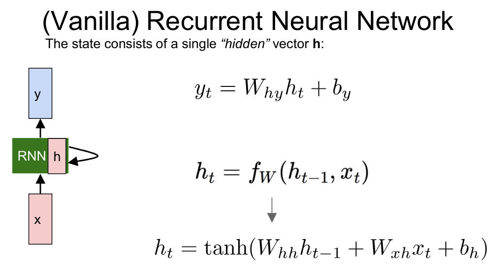
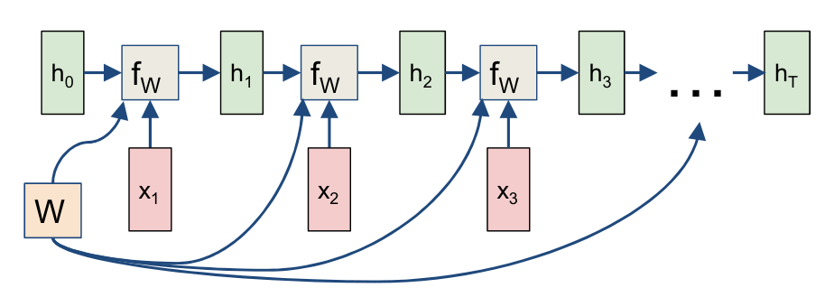
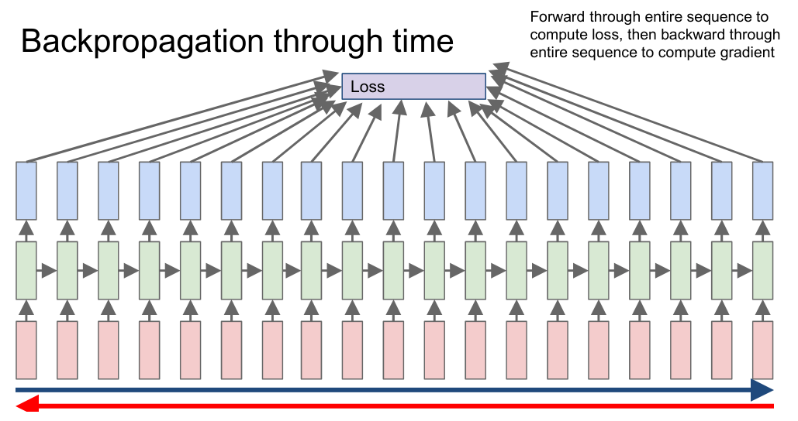
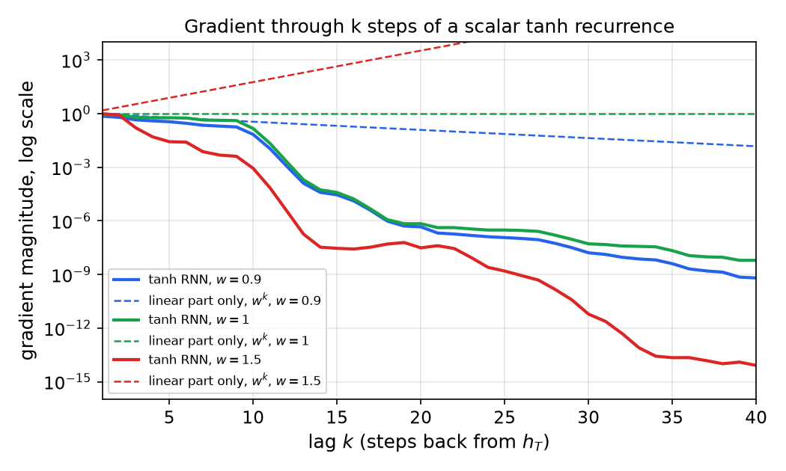
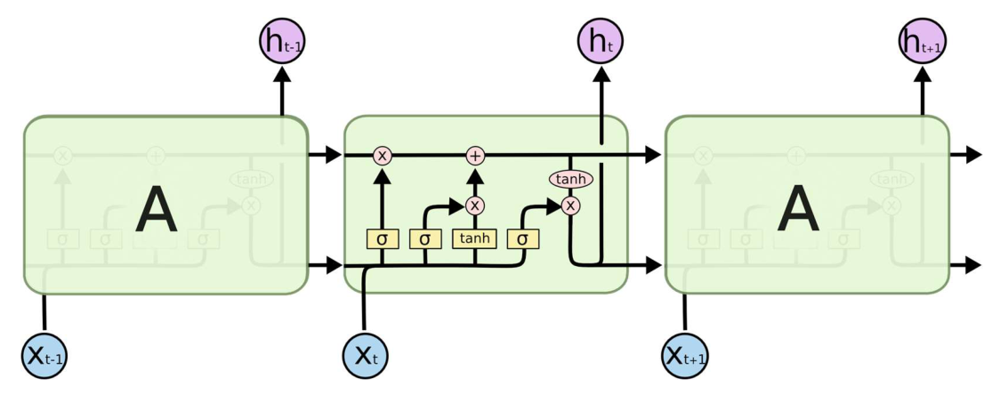

# Recurrent Networks and LSTMs

Many data sources arrive as sequences whose meaning depends on order: speech, text, video, sensor readings. A feed-forward network fixes the size of its input and has no memory, so it cannot process a sequence of arbitrary length or carry information from one element to the next. A recurrent network solves both problems with one idea: a hidden state that is updated at each time step by the same function with the same parameters. This chapter develops the vanilla recurrent network, the computational graph that unrolls it, and backpropagation through time. It then analyzes why gradients vanish and explode over long sequences, and presents the gated cells (the LSTM and the GRU) that were designed to fix this. The chapter closes with the character-level language model, image captioning, word representations and beam search. The attention-based alternative, which can access any earlier element directly, is treated in [Attention and Transformers](transformers.md).

## Sequence Structure and the Limits of Feed-Forward Networks

A fully connected network maps a fixed-size input to a fixed-size output. Applied to a sentence, it would require a fixed number of words, and any dependence between words would have to be built into a fixed window. Two problems follow. First, the network cannot model a sequence of unknown length. Second, it has no state, so the output at time \\( t \\) cannot depend on inputs at earlier times except through an explicit window of fixed size.

Sequence problems differ in how many inputs and outputs they have. Writing the input length and output length as one or many gives four configurations:

| Configuration | Input | Output | Example |
|---|---|---|---|
| one to one | single item | single item | standard classification or regression |
| one to many | single item | sequence | image captioning |
| many to one | sequence | single item | sentence classification, question answering with a multiple-choice answer |
| many to many | sequence | sequence | machine translation, per-frame labeling of video |

Many-to-many problems come in two forms. In the delayed form, the network reads the whole input and then writes the output, as in translation, where the output length need not match the input length. In the aligned form, there is one output per input step, as in labeling each frame of a video. The recurrent architecture handles all four configurations with the same building block, which is why it is the natural starting point.

## The Vanilla Recurrent Network

A recurrent network reads a sequence \\( x\_1, \dots, x\_T \\) and maintains a state \\( h\_t \\) that summarizes what it has read so far. The state is updated by a function \\( f\_W \\) with parameters \\( W \\):

\\[
h\_t = f\_W(h\_{t-1}, x\_t).
\\]

The same \\( f\_W \\) and the same \\( W \\) are used at every step. The vanilla recurrent network (also called the Elman network) takes the simplest concrete form of this update. The new state is an affine function of the old state and the current input, passed through a \\( \tanh \\) nonlinearity, and the output is read from the state:

\\[
h\_t=\tanh\\!\big(W\_{hh}\\,h\_{t-1}+W\_{xh}\\,x\_t+b\_h\big),\qquad y\_t=W\_{hy}\\,h\_t+b\_y.
\\]

The matrix \\( W\_{hh} \\) maps the previous state, \\( W\_{xh} \\) maps the input, and \\( W\_{hy} \\) maps the state to the output. The bias \\( b\_h \\) belongs to the state update. Outputs need not be produced at every step; a classifier for a whole sequence reads only \\( y\_T \\), for instance.

*Figure: The vanilla recurrent network. The box labeled RNN holds the state \\( h \\), which feeds back into itself. The input \\( x \\) enters from below and the output \\( y \\) leaves above. The equations on the right are the state update and the output readout, with the same weights at every time step.*

It is sometimes convenient to stack the previous state and the input into one vector. Let \\( W = (W\_{hh}\\;\\; W\_{xh}) \\) and let \\( z\_t = (h\_{t-1}; x\_t) \\) be the concatenation. Then \\( W\_{hh}h\_{t-1}+W\_{xh}x\_t = W z\_t \\), and the update becomes \\( h\_t = \tanh(W z\_t + b\_h) \\). The bias must stay in this form, or the update changes. Throughout this chapter the input-to-hidden matrix is \\( W\_{xh} \\), and the bias \\( b\_h \\) is kept in both forms.

### Parameter sharing and the unrolled graph

A recurrent network is a deep network whose depth equals the sequence length, with the same weights at every layer. Unrolling the recurrence over the sequence produces a feed-forward computational graph with one copy of the cell per time step:

\\[
h\_0 \xrightarrow{\\;f\_W(\cdot,\\,x\_1)\\;} h\_1 \xrightarrow{\\;f\_W(\cdot,\\,x\_2)\\;} h\_2 \longrightarrow \cdots \longrightarrow h\_T.
\\]

Because \\( W \\) appears at every step, the single matrix feeds every copy of \\( f\_W \\). This sharing is what allows a network trained on short sequences to be applied to long ones, and it keeps the number of parameters independent of \\( T \\).

*Figure: The unrolled computational graph. Each green box is the same function applied to the previous state and the current input. The single weight matrix \\( W \\) at the lower left feeds every copy, so the gradients from all copies are summed when the weights are updated.*

The unrolled graph has depth \\( T \\) in the time direction. Computing \\( h\_T \\) requires \\( T \\) sequential steps, so the forward pass cannot be parallelized over time. This is the main computational drawback of recurrent networks, and the reason the transformer has largely replaced them for sequence tasks.

## Losses and Computational Graphs

The output configuration determines where the loss is attached. For a many-to-many problem with one output and one loss per step, the total loss is the sum of the step losses:

\\[
L=\sum\_{t=1}^{T}L\_t(y\_t),
\\]

where \\( L\_t \\) is, for example, a softmax cross-entropy against the target at step \\( t \\). For a many-to-one problem, only \\( h\_T \\) produces an output, and the loss is \\( L = L\_T(y\_T) \\). For one-to-many, a single input \\( x \\) enters at the first step and an output is read from every state.

Sequence-to-sequence translation combines two recurrent networks. An encoder with weights \\( W\_1 \\) reads the source sentence, and its final state \\( h\_T \\) initializes a decoder with weights \\( W\_2 \\). The decoder emits the target one word at a time. Its first input is a start token, and each subsequent input is typically the word it emitted or was supposed to emit. This is the architecture whose bottleneck, a single fixed vector carrying the whole source sentence, motivated attention.

## Backpropagation Through Time

Training uses backpropagation through the unrolled graph, called backpropagation through time (BPTT). Its structure is clearest when derived directly, because the same parameter appears in every copy of the cell.

**Derivation of BPTT for the vanilla network.** Let \\( a\_t = W\_{hh}h\_{t-1}+W\_{xh}x\_t+b\_h \\), so that \\( h\_t = \tanh(a\_t) \\). The state \\( h\_t \\) depends on the shared parameters in two ways: directly, through the update at step \\( t \\), and indirectly, through \\( h\_{t-1} \\), which itself depends on the parameters. Differentiating the update gives a recursion for the total derivative with respect to \\( W\_{hh} \\). Define the gradient of the loss with respect to the state, \\( \delta\_t = \partial L/\partial h\_t \\), where \\( L \\) is the total loss. The chain rule applied to the state at step \\( k \\) gives

\\[
\delta\_k=\frac{\partial L\_k}{\partial h\_k}+\left(\frac{\partial h\_{k+1}}{\partial h\_k}\right)^{\top}\delta\_{k+1},
\\]

with \\( \delta\_T = \partial L\_T/\partial h\_T \\) at the last step. The Jacobian of the update is \\( \partial h\_{k+1}/\partial h\_k = \operatorname{diag}(1-h\_{k+1}^2)\\,W\_{hh} \\), because \\( \tanh'(a) = 1-\tanh^2(a) \\). Define the gradient with respect to the pre-activation,

\\[
g\_k = \delta\_k \odot (1-h\_k^2),
\\]

where \\( \odot \\) is the elementwise product. The recursion becomes \\( \delta\_k = \partial L\_k/\partial h\_k + W\_{hh}^{\top} g\_{k+1} \\), which runs backward through time. Since \\( W\_{hh} \\) appears once per step, the parameter gradients are sums over the steps:

\\[
\frac{\partial L}{\partial W\_{hh}}=\sum\_{k=1}^{T}g\_k\\,h\_{k-1}^{\top},\qquad \frac{\partial L}{\partial W\_{xh}}=\sum\_{k=1}^{T}g\_k\\,x\_k^{\top},\qquad \frac{\partial L}{\partial b\_h}=\sum\_{k=1}^{T}g\_k.
\\]

This is the rule stated in words earlier: the gradients from every copy of the cell add, because the copies share their parameters. Each term is an outer product of a backward signal and a forward activation.

The forward pass must run through the whole sequence before the backward pass can start, because \\( \delta\_k \\) depends on all later steps. Memory is therefore proportional to \\( T \\), since every hidden state must be stored.

*Figure: Backpropagation through time. The blue arrow is the forward pass through the whole sequence, which computes the per-step outputs and the loss. The red arrow is the backward pass, which propagates the gradient through every step to every shared parameter.*

### Truncated backpropagation

For long sequences, the full backward pass is expensive and its gradients are dominated by the nearest steps anyway. Truncated BPTT divides the sequence into chunks of length \\( \kappa \\). The forward pass carries the hidden state across chunk boundaries, so the network sees the whole history, but the backward pass stops after \\( \kappa \\) steps. Gradients do not flow across the chunk boundary, so the model cannot learn dependencies longer than the chunk. The trade-off is compute and memory for the length of dependency that can be learned. The truncation length is a design choice that trades compute against the longest dependency the model can learn.

## Vanishing and Exploding Gradients

Expanding the gradient of a late loss with respect to an early state gives a product of Jacobians. For the derivative of \\( h\_T \\) with respect to \\( h\_k \\),

\\[
\frac{\partial h\_T}{\partial h\_k}=\prod\_{j=k+1}^{T}\frac{\partial h\_j}{\partial h\_{j-1}}=\prod\_{j=k+1}^{T}\operatorname{diag}(1-h\_j^2)\\,W\_{hh}.
\\]

The product has \\( T-k \\) factors. Its size is controlled by two quantities. The matrix \\( W\_{hh} \\) can amplify or shrink vectors, and the factor \\( 1-h\_j^2 \\) is always between 0 and 1, because \\( \lvert h\_j \rvert < 1 \\) for the \\( \tanh \\) unit.

This gives a clean sufficient condition for vanishing. Since \\( \lVert \operatorname{diag}(1-h\_j^2) \rVert\_2 \le 1 \\), the spectral norm of each factor is at most \\( \lVert W\_{hh} \rVert\_2 \\). Therefore

\\[
\left\lVert \frac{\partial h\_T}{\partial h\_k} \right\rVert\_2 \le \lVert W\_{hh} \rVert\_2^{\\,T-k}.
\\]

If \\( \lVert W\_{hh} \rVert\_2 < 1 \\), the gradient from a step \\( T-k \\) back decays at least geometrically. The contribution of distant inputs to the loss then disappears, and the network cannot learn long-range dependencies. The factor \\( 1-h\_j^2 \\) makes this worse in practice, because each step multiplies the gradient by a number below 1 whenever the unit is not at zero. Saturated units, with \\( \lvert h\_j \rvert \\) near 1, shrink the gradient to almost nothing.

Explosion is the opposite case. If the product of Jacobians has norm much larger than 1, the gradient is dominated by a few large terms, and the update destroys the parameters. A large \\( \lVert W\_{hh} \rVert \\) is needed for explosion, but it is not sufficient. The \\( \tanh \\) factor bounds the gain, so explosion requires the units to stay near zero, where \\( \tanh' \\) is close to 1.

Because the effect depends on the activations along a particular trajectory, the best illustration is a simulation. The figure below uses a scalar tanh recurrence \\( h\_t = \tanh(w\\,h\_{t-1}+u\\,x\_t) \\) with \\( u = 0.5 \\) and standard normal inputs, driven for 60 steps with a fixed seed. For each value of \\( w \\) it plots the magnitude of \\( \partial h\_T/\partial h\_{T-k} \\) as a function of the lag \\( k \\), together with the linear prediction \\( w^k \\) that would hold without the \\( \tanh \\) factor.

*Figure: Solid lines show the gradient of the state at step 60 with respect to earlier states, computed along the simulated trajectory with the \\( \tanh \\) factors included. Dashed lines show \\( w^k \\), the value if the nonlinearity were absent. The gap between each solid line and its dashed line is the effect of the \\( \tanh \\) saturation.*

The numbers from this simulation show the mechanism. At lag 10, the trajectory gives a gradient magnitude of 0.068 for \\( w=0.9 \\), 0.145 for \\( w=1.0 \\) and \\( 8.6 \times 10^{-4} \\) for \\( w=1.5 \\). At lag 40 the values are about \\( 6 \times 10^{-10} \\), \\( 6 \times 10^{-9} \\) and \\( 8 \times 10^{-15} \\). The linear prediction for \\( w=1.5 \\) is \\( 1.5^{10} \approx 58 \\) at lag 10 and \\( 1.5^{40} \approx 1.1 \times 10^{7} \\) at lag 40, so the nonlinearity has reduced the gradient by about a factor of \\( 10^{8} \\) at lag 40. The mean of \\( 1-h^2 \\) along this trajectory is about 0.72 for \\( w = 0.9 \\) and 0.45 for \\( w = 1.5 \\), so the effective per-step gain is well below 1 in all three cases. Explosion would appear for a trajectory that keeps the units near zero, for example with small inputs. The simulation is one trajectory, not a proof, but it shows that the sign of the effect is set by the activations as well as by \\( W \\).

### Remedies

Two remedies follow from the analysis. For exploding gradients, clip the gradient norm. Let \\( g \\) be the gradient vector of all parameters, with Euclidean norm \\( \lVert g \rVert\_2 = \sqrt{\sum\_i g\_i^2} \\). If the norm exceeds a threshold \\( \tau \\), rescale the gradient:

\\[
g \leftarrow \frac{\tau}{\lVert g \rVert\_2}\\,g \qquad \text{whenever } \lVert g \rVert\_2 > \tau.
\\]

Clipping keeps the direction of the gradient and bounds its size. The square root matters. Some written versions of this rule compute the sum of squares and compare it with the threshold without taking the square root; that compares the squared norm with \\( \tau \\), and it changes the effective threshold, so the norm must be the true Euclidean norm.

For vanishing gradients, clipping is no help, because the gradient is already too small. The remedy is architectural: give the network a path along which the gradient is multiplied by a value close to 1, and let learned gates decide what to keep. That is the LSTM.

## Long Short-Term Memory

The long short-term memory (LSTM) cell of Hochreiter and Schmidhuber (1997) separates the state into a cell state \\( C\_t \\), which carries memory, and a hidden output \\( h\_t \\), which is read by the rest of the network. Three gates, each a sigmoid of the previous hidden state and the current input, control the cell. The forget gate \\( f\_t \\) decides how much of the old cell state to keep. The input gate \\( i\_t \\) decides how much of a candidate value \\( \tilde C\_t \\) to write. The output gate \\( o\_t \\) decides how much of the cell to expose. The equations are

\\[
\begin{aligned}
f\_t&=\sigma(W\_f\\,[h\_{t-1},x\_t]+b\_f), & i\_t&=\sigma(W\_i\\,[h\_{t-1},x\_t]+b\_i), \\\\
\tilde C\_t&=\tanh(W\_C\\,[h\_{t-1},x\_t]+b\_C), & o\_t&=\sigma(W\_o\\,[h\_{t-1},x\_t]+b\_o),
\end{aligned}
\\]

and the updates are

\\[
C\_t=f\_t\odot C\_{t-1}+i\_t\odot\tilde C\_t,\qquad h\_t=o\_t\odot\tanh(C\_t).
\\]

Here \\( [h\_{t-1},x\_t] \\) is the concatenation of the two vectors, and \\( \sigma \\) is the logistic function. The cell state is updated additively: the old memory is multiplied by \\( f\_t \\) and new content is added. A compact vector form, with the four pre-activations stacked, places one matrix \\( W \\) in front of the concatenated input and applies \\( \sigma \\) to three blocks and \\( \tanh \\) to the fourth. That form omits the biases.

*Figure: A chain of LSTM cells. The horizontal line across the top is the cell state, and it is changed only by one pointwise multiplication (the forget gate) and one addition (the input). The three sigmoid boxes and the tanh box are the gate computations. The legend explains the symbols for neural-network layers, pointwise operations, concatenation and copying.*

### Why the cell state helps gradients

Consider the direct path from \\( C\_t \\) back to \\( C\_{t-1} \\). Holding the gate values fixed, the cell state is \\( C\_t = f\_t\odot C\_{t-1}+\dots \\), so the direct Jacobian is \\( \operatorname{diag}(f\_t) \\). The backward signal along the cell state is multiplied elementwise by the forget gate, with no matrix \\( W \\) and no \\( \tanh \\) in between. If the forget gate stays near 1, the gradient survives many steps.

The total derivative also includes paths through the gates, because \\( f\_t \\), \\( i\_t \\) and \\( o\_t \\) depend on \\( h\_{t-1} \\), which depends on \\( C\_{t-1} \\). These paths do pass through the weight matrices and nonlinearities, so the cell state does not give a guarantee. It gives a direct path whose per-step gain is the forget gate itself, and that is the reason the LSTM trains over much longer sequences than the vanilla network.

**Example 1 (decay along the cell state).** Suppose the forget gate is 0.99 at every step. After 100 steps the direct path multiplies the gradient by \\( 0.99^{100} = 0.366 \\). Over the same 100 steps, a vanilla recurrence with effective per-step gain 0.7 multiplies it by \\( 0.7^{100} \approx 3.2 \times 10^{-16} \\). The difference is the difference between a gradient that remains usable and one that is numerically zero. The LSTM does not avoid the problem entirely: if the forget gate is 0.5 at every step, the direct path decays as \\( 0.5^{100} \\). The network must learn to keep the forget gate near 1 where long memory is needed.

**Example 2 (one cell update).** Take scalar gates \\( f\_t = 0.5 \\), \\( i\_t = 0.8 \\), \\( o\_t = 0.9 \\), a candidate \\( \tilde C\_t = 0.3 \\), and a previous cell state \\( C\_{t-1} = 2.0 \\). The new cell state is

\\[
C\_t = 0.5 \cdot 2.0 + 0.8 \cdot 0.3 = 1.24,
\\]

and the output is \\( h\_t = 0.9 \cdot \tanh(1.24) = 0.9 \cdot 0.846 = 0.761 \\). The forget gate halved the old memory, and the input gate added a smaller amount of new content.

### The gated recurrent unit

The gated recurrent unit (GRU) merges the cell state and the hidden state into one vector, and uses two gates. The update gate \\( z\_t \\) controls how much of the new candidate replaces the old state, and the reset gate \\( r\_t \\) controls how much of the old state enters the candidate:

\\[
z\_t=\sigma(W\_z\\,[h\_{t-1},x\_t]),\qquad r\_t=\sigma(W\_r\\,[h\_{t-1},x\_t]),\qquad \tilde h\_t=\tanh(W\\,[r\_t\odot h\_{t-1},x\_t]),
\\]

\\[
h\_t=(1-z\_t)\odot h\_{t-1}+z\_t\odot\tilde h\_t.
\\]

With \\( z\_t = 0 \\) the state is copied unchanged, and with \\( z\_t = 1 \\) the state is replaced by the candidate. Because the update is a convex combination of the old state and the candidate, the gradient along the state passes through the factor \\( 1-z\_t \\), which plays the role of the LSTM's forget gate. Some references swap the roles of \\( z\_t \\) and \\( 1-z\_t \\); the form above follows the source.

Jozefowicz et al. (2015) compared many gated variants on several tasks. The gating principle is shared by all of them: a learned multiplicative gate decides what the state keeps.

## Applications

### A character-level language model

A character-level language model predicts the next character from the characters so far. The worked example uses the vocabulary \\( [h,e,l,o] \\) and the training sequence "hello". Each character is a one-hot vector, so \\( h = (1,0,0,0)^{\top} \\), \\( e = (0,1,0,0)^{\top} \\), and so on. At each step the input is the current character and the target is the next character: \\( h \to e \\), \\( e \to l \\), \\( l \to l \\), \\( l \to o \\).

The source gives the hidden states for this example as

\\[
h\_1=(0.3,-0.1,0.9)^{\top},\quad h\_2=(1.0,0.3,0.1)^{\top},\quad h\_3=(0.1,-0.5,-0.3)^{\top},\quad h\_4=(-0.3,0.9,0.7)^{\top},
\\]

and the output logits over \\( [h,e,l,o] \\) at the four steps are

| Step | Input | Target | Logits \\( (h, e, l, o) \\) | Softmax \\( (h, e, l, o) \\) | Loss \\( -\log p\_{\text{target}} \\) |
|---|---|---|---|---|---|
| 1 | h | e | (1.0, 2.2, -3.0, 4.1) | (0.0377, 0.1251, 0.0007, 0.8365) | 2.079 |
| 2 | e | l | (0.5, 0.3, -1.0, 1.2) | (0.2466, 0.2019, 0.0550, 0.4965) | 2.900 |
| 3 | l | l | (0.1, 0.5, 1.9, -1.1) | (0.1131, 0.1687, 0.6841, 0.0341) | 0.380 |
| 4 | l | o | (0.2, -1.5, -0.1, 2.2) | (0.1074, 0.0196, 0.0796, 0.7935) | 0.231 |

The softmax of each logit vector is \\( p\_k = e^{s\_k}/\sum\_j e^{s\_j} \\). The source's own rounding of these values truncates some entries, for example writing 0.03 for 0.0377 in the first row, so the table above gives four decimals computed directly from the logits. The weight matrices are not given, so the hidden states cannot be reproduced from the recurrence; they are the values shown in the source and are used here as given.

Training uses maximum likelihood with teacher forcing. At each step the ground-truth previous character is fed as the input, not the model's own prediction. The loss is the sum of the step losses, which here is \\( 2.079 + 2.900 + 0.380 + 0.231 = 5.590 \\) nats, or a mean of \\( 1.397 \\) nats per character. Teacher forcing makes training stable and parallel across the batch, but it creates a mismatch: at test time the model must consume its own outputs. Generation therefore samples a character from the softmax, feeds it back as the next input, and repeats. Sampling produces variety, while argmax decoding is greedy and tends to repeat. The source's generation examples sample from the softmax rows rather than taking the largest entry. In the row \\( (0.25, 0.20, 0.05, 0.50) \\), a sampled character need not be the most probable one, and the sampling is what makes the output diverse.

### Image captioning

Image captioning is a one-to-many problem with a convolutional encoder. A VGG-style network produces a 4096-dimensional image embedding. A linear layer maps the embedding to the initial input of an RNN decoder, which reads the start token and the caption words in turn and produces the probability of the next word at each step. During training the decoder receives the ground-truth words shifted by one step, which is teacher forcing again. The decoder's state is conditioned on the image through its input at the first step, so the caption is generated word by word from the image.

### Word representations

A one-hot encoding of a vocabulary of \\( N \\) words is a vector of length \\( N \\) with a single 1. It treats all words as equally distant, and it grows with the vocabulary. A dense representation replaces it with a vector of, typically, a few hundred real numbers, learned so that words with similar usage have similar vectors. Feeding a one-hot vector into a linear layer is the same as looking up a row of a matrix, an embedding table indexed by the word's identity. The table can be initialized randomly or with pretrained embeddings.

The distributional idea behind dense vectors goes back to Firth (1957): a word is known by the company it keeps. Mikolov et al. (2013) showed that embeddings trained for prediction capture linear structure. Gender, tense and plurality correspond to roughly constant offsets, and the nearest neighbor of \\( \text{king} - \text{man} + \text{woman} \\) is \\( \text{queen} \\). The regularities are approximate and depend on the training data.

A recurrent language model uses the same machinery. The input layer \\( w(t) \\) and the output layer \\( y(t) \\) have the dimension of the vocabulary, and the hidden layer \\( s(t) \\) is much smaller. The input-to-hidden matrix \\( U \\) and the hidden-to-output matrix \\( V \\) are learned, and the hidden layer has a self-loop, so that \\( s(t) \\) depends on \\( s(t-1) \\). This is the same recurrence as before, with one-hot inputs and a softmax output.

### Decoding: beam search

Greedy decoding picks the most probable word at each step, which need not give the most probable sequence. Beam search keeps the \\( N \\) best partial sequences, the beam, at each step. Each partial sequence is extended by every possible next word, the extensions are scored by the product of their probabilities (or, in practice, the sum of their log probabilities), and all but the best \\( N \\) new hypotheses are discarded. The procedure stops when the hypotheses end with a stop token.

Consider a beam of width 2 with two partial captions, "I" and "My". Each is expanded to three candidates, six in all, and the two highest-scoring are kept. The example in the source expands to "I decided", "My decision", "I thought", "I tried", "My thinking" and "My direction", and retains two. A probability tree from a start token shows the branch probabilities at each step: from the start token, the first word is "a" with probability 0.25 or "the" with probability 0.75, and the branch probabilities at every node sum to one. Beam search is not exact, because a hypothesis pruned early cannot recover, but it trades a small search for a large improvement over greedy decoding.

## Summary

- A recurrent network updates a hidden state with a shared function, \\( h\_t = f\_W(h\_{t-1}, x\_t) \\), so it can process sequences of any length with a fixed number of parameters.
- For the vanilla network, \\( h\_t = \tanh(W\_{hh}h\_{t-1}+W\_{xh}x\_t+b\_h) \\). Unrolling gives a deep graph with one copy per step, and the copies share their weights.
- BPTT sums the parameter gradients over all steps. The backward recursion is \\( \delta\_k = \partial L\_k/\partial h\_k + W\_{hh}^{\top}(\delta\_{k+1}\odot(1-h\_{k+1}^2)) \\).
- Gradients through \\( T-k \\) steps are products of Jacobians. If \\( \lVert W\_{hh} \rVert\_2 < 1 \\), they decay at least as \\( \lVert W\_{hh} \rVert\_2^{T-k} \\). Explosion needs the units to stay near zero, and it is handled by clipping the true Euclidean norm of the gradient.
- The LSTM keeps a cell state updated by \\( C\_t = f\_t\odot C\_{t-1}+i\_t\odot\tilde C\_t \\). The direct gradient path through the cell is multiplied by the forget gate, so the gradient survives many steps when the gate stays near 1.
- The GRU merges the states into one vector with the update gate \\( z\_t \\): \\( h\_t=(1-z\_t)\odot h\_{t-1}+z\_t\odot\tilde h\_t \\).
- The character model in the worked example has losses 2.079, 2.900, 0.380 and 0.231 nats, with a mean of 1.397. Teacher forcing trains it, and sampling generates from it.
- Beam search keeps the \\( N \\) best partial sequences at each step, a better approximation to the most probable output than greedy decoding.

## See Also

- [Deep Learning](../deep-learning.md)
- [Backpropagation and Training](backpropagation.md)
- [Attention and Transformers](transformers.md)
- [Dense Prediction and Object Detection](dense-prediction.md)
- [Convolutional Networks and Visualization](convolutional-networks.md)
- [Neural Networks](../neural-networks.md)
- [Hidden Markov Models and Sequence Recognition](../../ai/hidden-markov-models.md)
- [Backpropagation (hand-worked)](../../ai/backpropagation.md)
