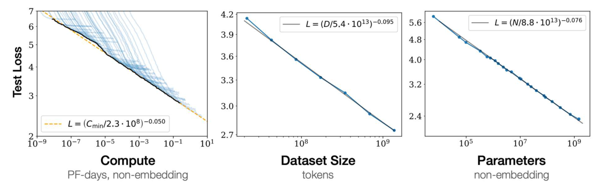
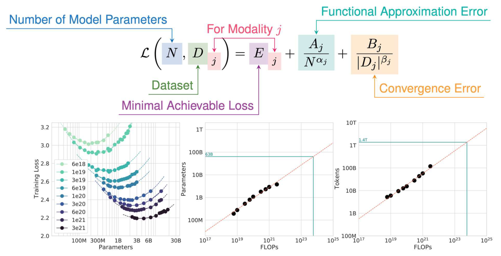
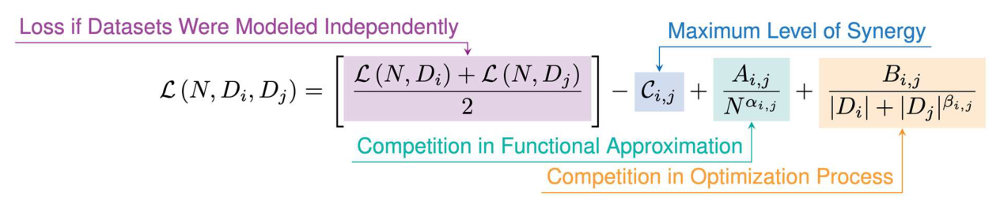
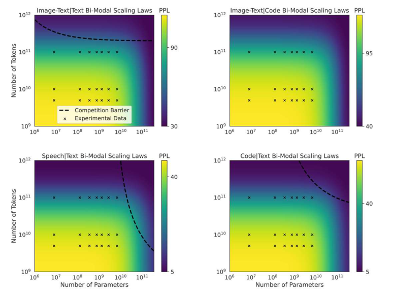
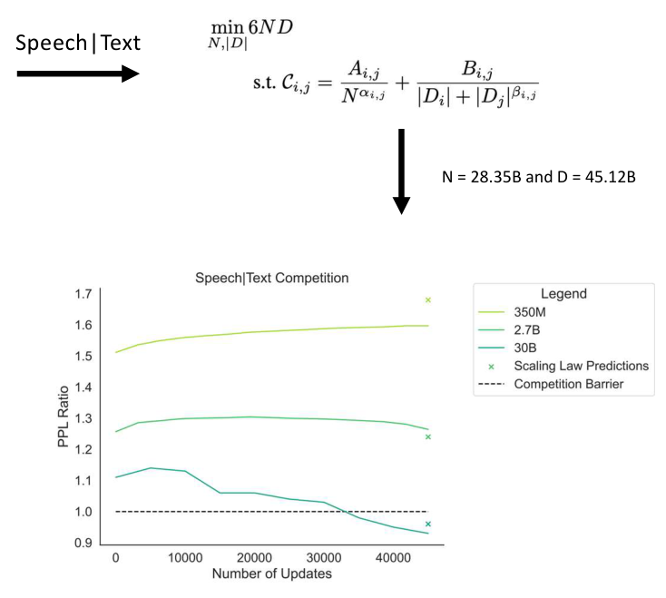

# Scaling Language Models

Large language models, in the regime of tens of billions of parameters trained on hundreds of billions of tokens, are built with as much engineering judgment as theory. This chapter covers the main quantitative ideas that guide that work. The first is that the loss of a language model follows simple power laws in model size, data and compute, which lets the loss of a large run be predicted from small ones. The second is that the procedures for running very large training jobs fail in ways that are not predicted by those laws, and a large part of the work is finding out why. The third extends the same ideas to several data types at once and to image generation. The chapter ends with the predictions the authors make for research, which are opinions rather than results.

## Language models as next-token predictors

A large language model assigns probability to text by the chain rule,

\\[
p(w\_1, w\_2, w\_3, \dots) = p(w\_1)\\, p(w\_2 \mid w\_1)\\, p(w\_3 \mid w\_2, w\_1) \cdots = \prod\_i p(w\_i \mid w\_{<i}),
\\]

and it is trained to minimize the average negative log-probability of the next token. That average is the cross-entropy loss \\(L\\) per token. Its exponential is the perplexity, \\(\exp(L)\\) when the logarithm is natural, or \\(2^{L}\\) when the loss is measured in bits. The two conventions are easy to confuse, and the choice matters for every number in this chapter. Measured in bits, a loss of 5 corresponds to a perplexity of \\(2^5 = 32\\). Measured in nats, the same perplexity would correspond to a loss of \\(\ln 32 \approx 3.47\\). An untrained model that guesses uniformly over a vocabulary of 50,000 tokens has loss \\(\log\_2 50{,}000 \approx 15.6\\) bits, which is the scale of the early loss values on the training curves below.

The regime considered here is one with more than 30 billion parameters and more than 400 billion training tokens, using transformers, usually in the post-norm variant.

### In-context learning and reasoning

Two capabilities appear with scale and are used in prompts rather than trained for directly. The first is in-context learning. In zero-shot prompting, the model receives only a task description, such as "Translate English to Russian: Dog ->". In in-context prompting, a few demonstrations precede the query, as in "Translate English to Russian: Cat -> Кошка, Bird -> Птица, Dog ->", and the model is expected to continue with the Russian word for dog. The demonstrations specify the task without any change to the weights.

The second is that prompts can elicit multi-step reasoning. Consider a question in which a cafeteria starts with 23 apples, uses 20 for lunch and buys 6 more. A standard prompt returns 27, which is wrong. A chain-of-thought prompt, which shows the intermediate steps in its example, writes out \\(23 - 20 = 3\\) and \\(3 + 6 = 9\\), and returns 9, which is correct. The same prompt contains a tennis-ball example solved in the same way: two cans of three balls is six balls, and \\(5 + 6 = 11\\).

A more specific failure mode is the compositionality gap. A model can answer each sub-question correctly and still fail the composed question. The example asks who lived longer, Theodor Haecker or Harry Vaughan Watkins, and then who was the U.S. president when superconductivity was discovered. A direct prompt names Franklin D. Roosevelt for the second sub-question, which is wrong. A chain-of-thought prompt names Woodrow Wilson, also wrong. A self-ask prompt decomposes the problem: Haecker died at 65 and Watkins at 69, so the first answer is Watkins. Superconductivity was discovered in 1911, when William Howard Taft was president, so the final answer is Taft. The lesson is that explicit intermediate questions can close a gap that the model's knowledge alone does not close.

## Scaling is an art

The architecture of a transformer has many choices that interact with scale. One can make the network wider or deeper, enlarge the embedding space, add attention heads, rebalance the weights between the attention and feed-forward layers, move the layer normalization, and change the activation function. For a fixed compute budget and data budget, the optimal parameter count depends on these choices, and the hyperparameters that work for a small model may not work for a large one. The questions are therefore these. What is the right parametrization as the model scales? For a fixed budget of compute and data, how many parameters should the model have? How should the hyperparameters change with scale, and how should the training data be balanced across sources?

The authors are candid that much of current practice rests on experience. It describes training as a process that is not fully formalized, in which debugging relies on people who have run many large jobs, and it gives a conservative estimate of tens of millions of dollars for the cost of bringing a new engineer up to speed on large-model training. The chapter does not try to settle those practical questions. It concentrates on the quantitative laws, which are the part of the picture that can be checked.

## Instability at moderate scale

The first case study concerns a model with 1.3 billion parameters, trained with settings that had worked for smaller models. The run plateaued at a high loss early in training. The team tried doubling the batch size, lengthening the warmup, and halving the learning rate. Longer warmup seemed to fix the odd early convergence, but the loss still appeared to level off at a high value. The target was a loss of about 5 for a perplexity near 32, which is again the bits convention.

The training curves for several runs start near 16 bits and fall. The baseline plateaus near 11, another run sits near 13.7, and the runs that continue reach about 10.5 to 11 over the first few thousand steps. Some runs show sharp one-step spikes in the loss. The diagnostic record lists the suspected causes one after another: the choice of the Adam momentum parameters, the initialization scale, loss scaling, and whether gradient clipping was enabled. Activation norms and the loss scale were traced because the loss was behaving erratically, and the trace shows jumps between plateaus.

The lesson of this case is that the early diagnosis was a sequence of guesses. A more systematic procedure would log the activation norms, the gradient norms and the loss scale at every step, so that the first sign of divergence is visible before the loss plateaus. Gradient clipping is a standard guard against single-step spikes, and the optimizer's betas and the initialization are the standard knobs to check. No single cause is established by the record, so the practical point is that the instrumentation must be built in advance.

## Random hardware and throughput failures

The second case study is less about the model and more about the machines. The throughput of the training job, recorded as "wps" (presumably words per second), starts near 660,000. It falls to about 480,000 at steps 2,800 to 3,000, which is a drop of roughly 27 percent, recovers to about 575,000 near step 4,300, dips to about 505,000 near steps 6,500 to 7,000, peaks near 585,000 around step 10,000, and ends near 605,000 at step 13,000. The values are read approximately from the trace.

The team spent two weeks ruling out the obvious causes: the training code, GPU saturation, memory-transfer bottlenecks, software version mismatches, driver problems, CUDA bugs, and PyTorch bugs. The eventual explanation in the record points to environmental heat, but no root cause is stated. The section caption draws the general point: the tail of problems in large distributed computing is long, and many of the failures sit outside the training code.

For the practice of large-scale training, this means that throughput monitoring is a first-class diagnostic. A drop of tens of percent in throughput can be a hardware event, and it can look like a software regression. A job that trains at a steady rate on each device is the first thing to check, before the model or the optimizer is blamed.

## Scaling laws

### Power laws in compute, data and parameters

The central empirical finding of Kaplan et al. (2020) is that test loss follows power laws in each of the three resources when the others are not the bottleneck. The three fits printed in the study are

\\[
L(C\_{\min}) = \left( \frac{C\_{\min}}{2.3 \cdot 10^{8}} \right)^{-0.050}, \qquad
L(D) = \left( \frac{D}{5.4 \cdot 10^{13}} \right)^{-0.095}, \qquad
L(N) = \left( \frac{N}{8.8 \cdot 10^{13}} \right)^{-0.076},
\\]

where \\(C\_{\min}\\) is the compute in PF-days, \\(D\\) the number of tokens, and \\(N\\) the number of non-embedding parameters. In these fits the loss is a per-token cross-entropy. The exponents describe the rate of improvement. Doubling \\(N\\) multiplies the loss by \\(2^{-0.076} \approx 0.949\\), a reduction of about 5 percent. Doubling \\(D\\) multiplies it by \\(2^{-0.095} \approx 0.936\\), a reduction of about 6 percent. Doubling the compute multiplies it by \\(2^{-0.050} \approx 0.966\\), a reduction of about 3 percent. The gains are real but slow, and each factor of improvement costs a constant multiple of resources.

The fits also give a prediction. A model with \\(N = 10^{9}\\) non-embedding parameters, trained to convergence with enough data, has loss \\(L \approx (10^9 / 8.8 \cdot 10^{13})^{-0.076} \approx 2.38\\) nats per token. Its perplexity is \\(e^{2.38} \approx 10.8\\). The prediction is made from the form of the curve alone, before any run of that size is trained.

*Figure: test loss against compute, dataset size and non-embedding parameters, on log-log axes. A power law is a straight line on these axes, and the three panels are close to straight. The printed fits are the dashed and gray lines. The caption of the original figure adds that all three factors must be scaled together for optimal performance.*

### Compute-optimal models

Hoffmann et al. (2022) extended the parametric form of the loss. Their model has three terms,

\\[
\mathcal{L}(N, D) = E + \frac{A}{N^{\alpha}} + \frac{B}{D^{\beta}},
\\]

where \\(E\\) is the minimal achievable loss, \\(A / N^{\alpha}\\) is the functional approximation error that a model of \\(N\\) parameters cannot avoid, and \\(B / D^{\beta}\\) is the convergence error from training on only \\(D\\) tokens. For a fixed compute budget \\(C\\), the approximation \\(C \approx 6ND\\) holds, since each parameter costs about six floating-point operations per token in training. We can therefore ask how to split a budget between parameters and tokens.

Write \\(k = C/6\\), so that \\(D = k/N\\). The loss as a function of \\(N\\) is

\\[
f(N) = A N^{-\alpha} + B k^{-\beta} N^{\beta}.
\\]

Setting the derivative to zero gives

\\[
\beta B k^{-\beta} N^{\beta - 1} = \alpha A N^{-\alpha - 1} \quad \Longrightarrow \quad N^{\alpha + \beta} = \frac{\alpha A}{\beta B}\\, k^{\beta} .
\\]

Hence the optimal parameter count and token count are

\\[
N\_{\text{opt}} \propto C^{\beta/(\alpha+\beta)}, \qquad D\_{\text{opt}} = \frac{C}{6 N\_{\text{opt}}} \propto C^{\alpha/(\alpha+\beta)} .
\\]

When the two exponents are equal, both the parameters and the tokens should grow in proportion to the square root of the compute. The exponents do not depend on the units in which \\(N\\) and \\(D\\) are measured, since a change of units only rescales \\(A\\) and \\(B\\).

**Example (the compute-optimal check).** The figure's guide reaches about \\(6 \times 10^{23}\\) FLOPs at 63 billion parameters and 1.4 trillion tokens. Check the consistency with \\(C \approx 6ND\\):

\\[
6 \cdot (63 \times 10^{9}) \cdot (1.4 \times 10^{12}) \approx 5.3 \times 10^{23} \text{ FLOPs}, \qquad \frac{1.4 \times 10^{12}}{63 \times 10^{9}} \approx 22 \text{ tokens per parameter}.
\\]

The two numbers are consistent with the guide to within the accuracy of reading the plot. The ratio of about 22 tokens per parameter is the practical consequence of the analysis: at this budget the data must grow along with the parameters, not only the parameters with the budget.

*Figure: the parametric loss and the compute-optimal fits. The left panel plots training loss against parameters for fixed compute budgets; the minimum of each curve is the compute-optimal size for that budget. The middle and right panels plot the optimal parameter and token counts against FLOPs, with a guide at about \\(6 \times 10^{23}\\) FLOPs that reaches 63 billion parameters and 1.4 trillion tokens.*

## Uni-modal and mixed-modal scaling

### Other modalities

The same form of law can be fitted for other data types. The study considers text, code, images, image-text pairs, speech, speech-text pairs and molecular sequences. For each, the perplexity falls with model size, from models of about 8 million to 6.7 billion parameters, and with the number of training tokens, which were 5, 10 and 100 billion in the three panels. At 100 billion tokens the code perplexity for the largest models is close to 1, and the molecular sequences stay near 3.

The fitted Chinchilla-form coefficients are in a table with rows \\(A\\), \\(B\\), \\(E\\), \\(\alpha\\) and \\(\beta\\), one column per modality. The Text column has \\(A = 492.51\\), \\(B = 1987.40\\), \\(E = 2.42\\), \\(\alpha = 0.18\\) and \\(\beta = 0.22\\). The Code column has \\(A = 611.91\\), \\(B = 4484.08\\), \\(E = 0.16\\), \\(\alpha = 0.37\\) and \\(\beta = 0.32\\). The table gives no units for \\(N\\), \\(D\\) or the loss, and the normalization is not stated. Substituting the Text column at \\(N = 10^{9}\\) and \\(D = 10^{11}\\) gives

\\[
2.42 + \frac{492.51}{(10^9)^{0.18}} + \frac{1987.40}{(10^{11})^{0.22}} \approx 2.42 + 11.81 + 7.56 \approx 21.8 .
\\]

The Code column at the same \\(N\\) and \\(D\\) gives about 1.80. A loss of 21.8 is not plausible in the scale in which the Code value is plausible, so the normalization of the Text column must differ from what is printed, and its absolute values cannot be used. The exponents remain usable, as noted above, because the units of \\(N\\) and \\(D\\) do not change them.

### The mixed-modal law

The next question concerns a model trained on two modalities at once, such as speech and text, where the data are concatenated rather than aligned. The proposal is that the two modalities compete in an additive way. The loss of the mixed model is written as

\\[
\mathcal{L}(N, D\_i, D\_j) = \left[ \frac{\mathcal{L}(N, D\_i) + \mathcal{L}(N, D\_j)}{2} \right] - \mathcal{C}\_{i,j} + \frac{A\_{i,j}}{N^{\alpha\_{i,j}}} + \frac{B\_{i,j}}{\left( \lvert D\_i \rvert + \lvert D\_j \rvert \right)^{\beta\_{i,j}}} .
\\]

The printed form places the exponent on \\(\lvert D\_j \rvert\\) alone, as \\(\lvert D\_i \rvert + \lvert D\_j \rvert^{\beta\_{i,j}}\\). That is most likely a typesetting slip, and we read the denominator as the sum raised to the power, which is the form in which the term depends on the total amount of data. The correction is marked here, and the figure shows the printed version.

The four terms have the following roles. The bracket is the loss if the two datasets were modeled independently. The term \\(\mathcal{C}\_{i,j}\\) is the largest possible synergy between the modalities, which lowers the loss. The term \\(A\_{i,j}/N^{\alpha\_{i,j}}\\) is a competition in functional approximation, and the \\(B\\) term is a competition in the optimization process. The mixed loss is lower than the independent loss exactly when

\\[
\mathcal{C}\_{i,j} > \frac{A\_{i,j}}{N^{\alpha\_{i,j}}} + \frac{B\_{i,j}}{\left( \lvert D\_i \rvert + \lvert D\_j \rvert \right)^{\beta\_{i,j}}} ,
\\]

because subtracting the independent loss from the mixed loss leaves \\(-\mathcal{C}\_{i,j} + A\_{i,j} / N^{\alpha\_{i,j}} + B\_{i,j} / (\cdots)^{\beta\_{i,j}}\\). When the inequality holds, the modalities are synergistic, and when it fails they compete. The criterion is the basis for the language of synergy and competition, and the reader should notice that it is a statement about the predicted loss, with no claim about what the modalities mean.

*Figure: the mixed-modal scaling law. The bracket is the average of the independent losses, \\(\mathcal{C}\\) is the maximum synergy, the \\(A\\) term is competition in functional approximation, and the \\(B\\) term is competition in optimization. The figure shows the printed denominator, which the text corrects.*

### The competition barrier

Fitting the bi-modal law predicts a boundary in the space of model size and tokens, which is called the competition barrier. Heatmaps of predicted perplexity over parameters and tokens show the barrier as a dashed curve, with experimental points as crosses. For the Speech|Text pair the barrier runs from about \\(10^{12}\\) tokens at \\(10^{10}\\) parameters down to about \\(10^{9.5}\\) tokens at the right edge of the plot, as read from the figure.

To break the barrier, the parameter and token counts are chosen to minimize the training cost \\(6ND\\), subject to the constraint that the predicted competition term takes the required value. For the Speech|Text pair the answer is \\(N = 28.35\\) billion parameters and \\(D = 45.12\\) billion tokens. The cost is \\(6 \cdot 28.35 \times 10^9 \cdot 45.12 \times 10^9 \approx 7.7 \times 10^{21}\\) FLOPs. The stated optimization is written with \\(6ND\\) alone; the cost figure here uses the standard approximation \\(C \approx 6ND\\) explicitly.

The verification plot shows the perplexity ratio against training updates for three sizes, with a dashed line at 1.0 marking the barrier. The denominator of the ratio is not stated, so the values should be read as relative, and the argument uses only the crossing of 1.0. The 350M model stays above 1, at about 1.5 to 1.6. The 2.7B model stays above 1 at about 1.26 to 1.3. The 30B model starts near 1.11, peaks near 1.14 around 5,000 updates, falls to about 0.93 by 45,000 updates, and crosses below 1.0 between about 33,000 and 35,000 updates. Crosses at 45,000 updates mark the predictions of the scaling law, which are about 1.68, 1.24 and 0.96 for the three sizes. These values are read by eye from the plot.

*Figure: predicted perplexity over model size and tokens for four bi-modal pairs. The dashed curve is the predicted competition barrier, and the crosses are the experimental points that the fit uses. The color scale differs between panels.*

*Figure: the optimization that chooses the parameter and token counts for the Speech|Text pair (top), and the verification plot (bottom). The curves show the perplexity ratio against training updates for three model sizes. The dashed line at 1.0 is the barrier, and the largest model falls below it near 33,000 to 35,000 updates.*

## Intermittent training and batch size

Two further regularities appear in the multi-modal runs. The first is that the modalities are not optimized at the same pace. The definition is that different modalities in a multi-modal setting are optimized at different paces, and some pause their progress for many steps while others advance. For a speech-text run with a 2.7 billion parameter model, the speech perplexity falls from about 6.0 to about 5.1 by 35,000 updates, stays flat from about 35,000 to 55,000 updates, and falls again to about 4.96 by 85,000 updates. This is called coordinate-ascent-like training, since one modality is optimized while the others hold still. The fraction of non-text perplexity that sits in this flat regime is correlated with the scaling exponent \\(\alpha\\), falling from about 0.42 at \\(\alpha = 0.13\\) to about 0.06 at \\(\alpha = 0.36\\), and the flat fraction for speech in the speech-text pair shrinks with model size. These values are read from the plots.

The second regularity links the optimal batch size with the exponent \\(\beta\\). The logarithm of the ratio between the paired batch size and the sum of the two unimodal batch sizes falls as \\(\beta\\) grows. The fit runs from about \\(+0.15\\) at \\(\beta = 0.08\\) to about \\(-0.8\\) at \\(\beta = 0.24\\). A negative value means that the paired batch is smaller than the sum of the unimodal batches, and the gap grows with \\(\beta\\).

A third regularity concerns stability. The number of gradient spikes during training rises with \\(\log(N)/\alpha\\). In the fit the spikes rise from about 4 at \\(\log(N)/\alpha = 40\\) to about 19 at 190. The authors read this as evidence that the training dynamics deteriorate with scale and with the exponent of the modality.

## Scaling recipes for text-to-image

The same recipe has been applied to image generation from text, in a model called CM3leon. The comparison plots the FID score on MS-COCO against the number of GPU hours used for training. A lower FID is better. The approximate points are these. DALLE-1 has an FID near 29 at about 0.1 million GPU hours. PARTI reaches about 7.5 at about 1 million. Stable Diffusion V1 is at about 12.6 for about 0.13 million GPU hours, and Stable Diffusion V2 at about 8.8 for about 0.2 million. The CM3leon models of 350 million and 760 million parameters reach FIDs of about 14.8 and 11.9 at about 0.03 and 0.06 million GPU hours. The 760 million parameter model therefore reaches a slightly lower FID than Stable Diffusion V1 at about half its GPU hours. The lines in the plot join related models and are not fitted curves, and the values are read by eye.

## Data quality at scale

The data themselves are a lever on scale. One experiment prunes a training set by removing a fraction of its data, either at random or with a deduplication method labeled SSL dedup on the plot, and measures the validation perplexity on three sets. At 50 percent kept, the deduplicated set gives about 48 perplexity on the c4 validation set against about 51.5 for random pruning, and at 20 percent kept the values are about 67.5 against about 87. The unpruned baseline is about 39 on that set. The deduplicated curve is below the random curve at every fraction shown, and the gap widens as data are removed. Near 90 to 100 percent kept, the two curves almost coincide. The values are read from the plots.

The implication is that the choice of which data to keep matters more as the amount of data falls: at the same size, the deduplicated subset gives the lower perplexity. The result also depends on the validation sets, which show the same ordering but different gaps.

## The future of research

The closing section of the work makes predictions. They are opinions, and the book presents them as such. The first is that niche areas of language research, such as semantic parsing, dialogue, reasoning, question answering, machine reading comprehension and summarization, will be absorbed into general models trained at scale rather than remaining separate fields. The second is that mixed-modal language modeling is inevitable. The third is that the most important direction is a science of efficient scaling, which asks how to make the coefficients of the scaling laws larger, that is, how to get more loss reduction per unit of compute.

The routes to that goal are ranked by risk and expected reward, as follows.

| Direction | Risk | Expected reward |
|---|---|---|
| Better Transformer implementations | Low | Low |
| Architecture improvements | High | High |
| Better data selection | Standard | High |
| Better objective | High | High |
| Better optimization | High | Moderate |

The table is a judgment, not a measurement. The data-selection row connects to the pruning experiment above, and the optimization row to the instability case study.

## Summary

- A language model's loss is a per-token cross-entropy, and perplexity is its exponential in the same base. Units must be kept consistent: a loss of 5 bits is a perplexity of 32.
- In-context demonstrations specify a task without changing the weights, and step-by-step prompts elicit reasoning that a direct prompt misses. Explicit intermediate questions close the compositionality gap in multi-hop questions.
- Kaplan et al. (2020) fit power laws in parameters, data and compute. Doubling the parameters lowers the loss by about 5 percent under the printed fit, and the fits predict the loss of a larger model before it is trained.
- With \\(\mathcal{L}(N, D) = E + A/N^{\alpha} + B/D^{\beta}\\) and \\(C \approx 6ND\\), the compute-optimal parameter and token counts scale as \\(C^{\beta/(\alpha+\beta)}\\) and \\(C^{\alpha/(\alpha+\beta)}\\). Equal exponents give equal growth of parameters and tokens.
- Multi-modal data are modeled with an additive competition law. The mixed loss beats the independent loss exactly when the synergy term exceeds the competition terms, and the fitted barrier can be crossed with a particular choice of parameters and tokens.
- Large runs fail through instability and through hardware and throughput problems. Monitoring activation norms, gradient norms and throughput is the first defence.
- Data selection matters more as data are removed, and the research predictions are opinions to be tested rather than results.

## See Also

- [Deep learning overview](../deep-learning.md)
- [Information theory: entropy](../../information-theory/entropy.md)
- [Attention, transformers and speech self-supervision](transformers.md)
- [Actor-critic, PPO and RLHF](actor-critic.md)
- [Denoising diffusion models](diffusion-models.md)
- [Fairness, alignment and the road ahead](fairness-alignment.md)
