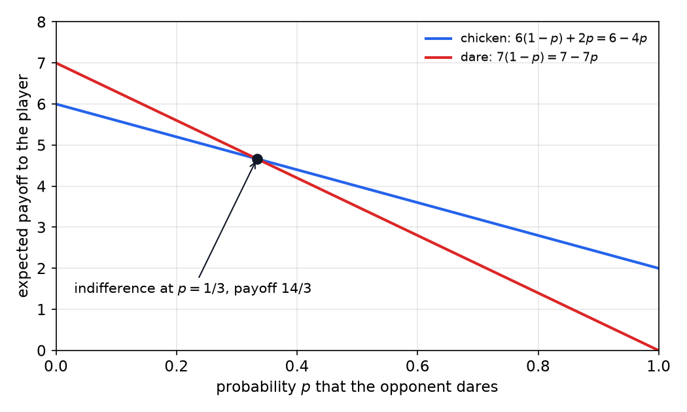
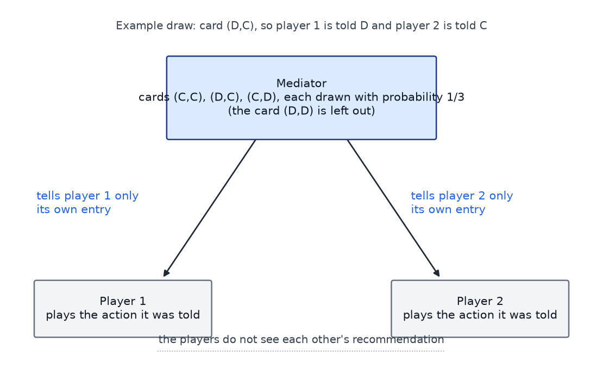
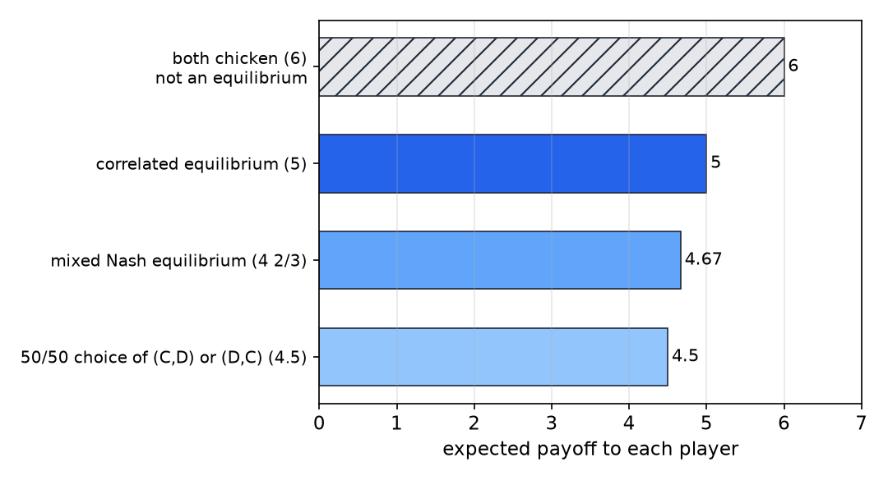
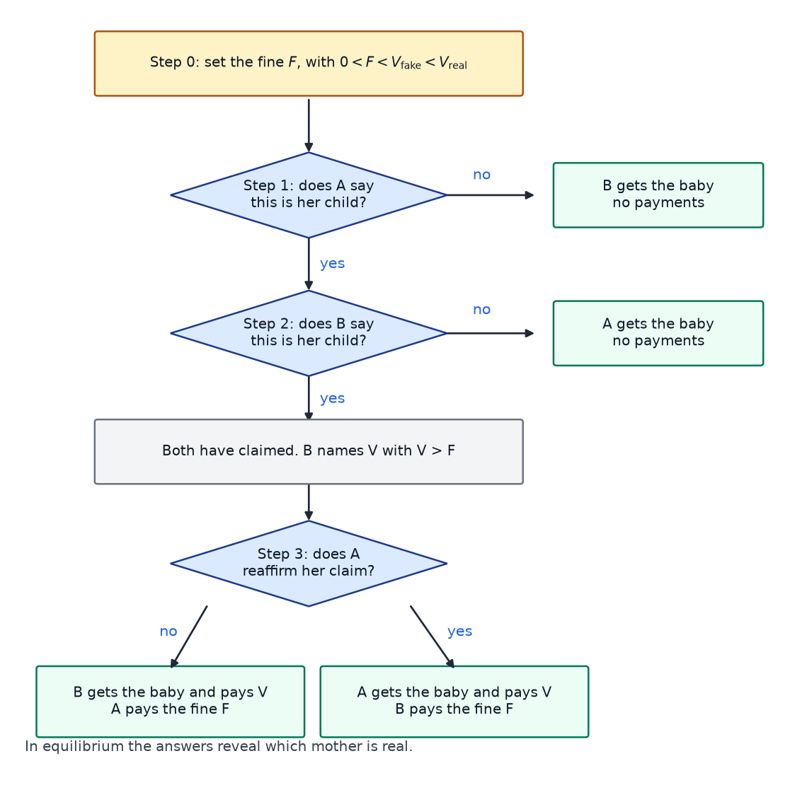

# Correlated Equilibria, CoCo Values, and Mechanism Design

The Nash equilibria of the previous two chapters are not always easy to choose between. A game can have several equilibria, and the theory of Nash equilibrium says nothing about which one the players should expect. The game of chicken is the standard example: its two pure equilibria are asymmetric, and each player prefers the other to be the one who swerves. This chapter covers three responses. A **correlated equilibrium** lets the players share a source of recommendations, which is linear to compute and can beat every mixed Nash equilibrium. **CoCo values** split a general-sum game into a cooperative part and a competitive part, and assume that side payments can be enforced. **Mechanism design** reverses the usual question: instead of asking what behavior a game produces, it asks which game produces a chosen behavior.

## Solution Concepts

A **solution concept** is a rule for predicting how a game will be played. Nash equilibrium, the rule used most so far, says that every player is making a best response to the others, so no player gains by changing alone. The idea of a solution concept is broader than the equilibrium property itself. Other concepts in the literature include subgame-perfect equilibrium, which requires best responses after every history, and Stackelberg equilibrium, in which one player commits first. Concepts such as correlated equilibrium and CoCo values answer a different question: they ask what the players can achieve when they have access to something beyond their own private choices, such as a shared randomizer or enforceable payments. Solution concepts apply both to one-shot matrix games and to repeated or sequential ones.

## The Game of Chicken

Two drivers approach each other. Each either **dares** (D), driving straight on, or **chickens out** (C), swerving. If both dare, both die, which gives payoff (0, 0). If one dares and the other chickens, the darer gets 7 and the chicken gets 2, since the chicken lives with the shame of backing down. If both chicken out, both get 6, which is better than death and better than shame alone, but worse than daring while the other swerves. The payoffs, written (player 1, player 2), are:

| Player 1 / player 2 | Player 2: C | Player 2: D |
|---|---|---|
| Player 1: C | (6, 6) | (2, 7) |
| Player 1: D | (7, 2) | (0, 0) |

The game is symmetric and general-sum. Its pure-strategy profiles are (C, C), (C, D), (D, C) and (D, D), and checking each against the definition of Nash equilibrium gives the following. In (C, C) player 1 gains by switching to D, going from 6 to 7, so it is not an equilibrium. In (C, D) the chicken would fall from 2 to 0 by switching to D, and the darer would fall from 7 to 6 by switching to C, so neither gains and it is an equilibrium. By symmetry (D, C) is an equilibrium. In (D, D) either player gains by switching to C, going from 0 to 6, so it is not an equilibrium.

The two pure equilibria are asymmetric. Each player prefers the other to be the one who swerves, and the theory of pure Nash equilibrium gives no principled way to choose between them.

### The mixed equilibrium

The game also has a symmetric mixed equilibrium. Suppose each player dares with probability \\(p\\). If the opponent dares with probability \\(p\\), then chickening earns \\(6(1-p) + 2p = 6 - 4p\\) and daring earns \\(7(1-p) + 0 \cdot p = 7 - 7p\\). A mixed strategy is an equilibrium when the player is indifferent between the pure strategies it mixes, so \\(6 - 4p = 7 - 7p\\), which gives \\(p = 1/3\\). Each player dares with probability one third and chickens with probability two thirds.

*Figure: The expected payoff of chicken (blue) and dare (red) for a player against an opponent who dares with probability \\(p\\). The lines cross at \\(p = 1/3\\), where both payoffs equal \\(14/3\\). At that opponent strategy the player has no preference between the two actions, which is what makes the mixed profile an equilibrium.*

With independent randomization the four joint outcomes have these probabilities:

- both chicken: \\((2/3)^2 = 4/9\\);
- player 1 chickens and player 2 darers, or the reverse: \\((2/3)(1/3) = 2/9\\) each;
- both dare: \\((1/3)^2 = 1/9\\).

The four probabilities sum to 1. The expected payoff of player 1, using the payoffs (C, C) = 6, (C, D) = 2, (D, C) = 7 and (D, D) = 0, is

\\[
\tfrac49(6) + \tfrac29(2) + \tfrac29(7) + \tfrac19(0) = \tfrac{42}{9} = \tfrac{14}{3} \approx 4.67.
\\]

Two other arrangements give simple comparison values. A uniform choice between (C, D) and (D, C), which is a coin flip deciding which driver darers, gives each player \\(\tfrac12(2) + \tfrac12(7) = 4.5\\). The mixed equilibrium is better than that, at 4.67. The mixed equilibrium also carries a cost: the probability of the worst outcome, mutual daring, is \\(1/9\\), about eleven percent. The next section shows that a correlated arrangement can avoid the crash entirely and do better for both players.

## Correlated Equilibrium

### A mediator

Suppose a mediator, a trusted third party, draws one of three cards at random, with each card having probability 1/3. The cards are (C, C), (D, C) and (C, D). The card (D, D) is left out. The mediator tells each player only that player's own recommended action. Player 1 learns the first entry of the card and player 2 learns the second, and neither learns the other's recommendation. Both players know the distribution of cards and the protocol. Each player then decides whether to follow its recommendation.

*Figure: The mediator draws a card and tells each player only its own entry. The example draw (D, C) tells player 1 to dare and player 2 to chicken out. The players do not see each other's recommendation, and the card (D, D) has probability zero.*

The protocol is a **correlated equilibrium** if following the recommendation is a best response for each player. Formally, let \\(\pi\\) be a probability distribution over joint actions. The distribution is a correlated equilibrium when, for each player and each recommended action, following the recommendation is at least as good as any deviation, in the conditional expectation:

\\[
\sum\_{b} \pi(a,b)\big[u\_1(a,b) - u\_1(a',b)\big] \geq 0 \quad \text{for every } a \text{ and } a'.
\\]

The same inequality holds for player 2 with the roles exchanged. The sum runs over the actions \\(b\\) of the other player, and it is weighted by the joint probability \\(\pi(a,b)\\), which is the same as conditioning on the recommendation \\(a\\) up to a constant factor.

### Checking the incentives

Take the player told C. The card must be (C, C) or (C, D), each with probability one half, so the other player is recommended C or D with equal probability. Following C gives an expected payoff \\(\tfrac12(6) + \tfrac12(2) = 4\\). Deviating to D gives \\(\tfrac12(7) + \tfrac12(0) = 3.5\\). Following is better.

Now the player told D. The card must be (D, C), so the other player is recommended C for certain. Following D gives 7. Deviating to C gives 6. Following is better again.

The game is symmetric, so the same holds for player 2. Both players should do what the mediator says. In the joint-probability form of the inequality, the constraint for a recommendation of C is \\(\tfrac13(6-7) + \tfrac13(2-0) = \tfrac13 \geq 0\\), and the constraint for a recommendation of D is \\(\tfrac13(7-6) = \tfrac13 \geq 0\\).

The protocol is sensitive to the distribution. If the card (D, D) is included with probability 1/4 for each of the four cards, a player told D faces the other player being C or D with equal probability. Following D then earns \\(\tfrac12(7) + \tfrac12(0) = 3.5\\), and deviating to C earns \\(\tfrac12(6) + \tfrac12(2) = 4\\). The recommendation D is no longer a best response, and the protocol fails. The idea is not a free-for-all: the distribution must be chosen with some care, and the uniform choice over the three cards works.

### The value of the protocol

The probability of being told C is \\(2/3\\), since the cards (C, C) and (C, D) both start with C. The expected payoff given C is 4. The probability of being told D is \\(1/3\\), and the expected payoff given D is 7. The value of the protocol to each player is therefore

\\[
\tfrac23(4) + \tfrac13(7) = \tfrac83 + \tfrac73 = 5.
\\]

*Figure: The expected payoff to each player under four arrangements. Mutual chickening gives 6 but is not an equilibrium, since a driver who knows the other is chickening gains by daring. The correlated equilibrium gives 5 and is stable. The mixed Nash equilibrium gives \\(14/3\\), and the coin flip between the two asymmetric equilibria gives 4.5, which is not an equilibrium either.*

The ranking of the four arrangements is the key result. Mutual chickening gives the highest payoff, 6, but it is not an equilibrium, because a player who knows the other is chickening gains by daring for 7. The correlated equilibrium gives 5, which beats the mixed equilibrium's \\(14/3\\), and it is stable. The mixed equilibrium is stable but worse. The coin flip gives 4.5 but is not an equilibrium: a driver told to chicken out would prefer to dare. The mediator's protocol is therefore better than both the mixed equilibrium and the simple randomization, and it does so by letting each player's private recommendation carry information about the other player's likely action.

The intuition is a form of Bayes' rule. Given my card, I know something about your card. If I am told to chicken out, the chances are equal that you are told to chicken or dare, and I should expect your action to be less dangerous than the worst case. If I am told to dare, I know you are chickening out for certain. The recommendations are correlated, and that correlation is what the name refers to.

### Three facts

The correlated equilibrium has three properties that explain why it is useful.

1. **Computation.** The set of correlated equilibria is defined by linear inequalities in \\(\pi\\), together with the constraint that \\(\pi\\) is a probability distribution. Finding one is therefore a linear program, which can be solved in polynomial time. This is in sharp contrast with Nash equilibria, which are hard to compute in general. The linearity is the writer's observation, because the constraints above are linear in the joint probabilities.
2. **Mixed equilibria are correlated equilibria.** Let each player randomize independently according to its mixed Nash equilibrium. This product distribution is a correlated equilibrium. If a player is told a, then its opponent's recommendation is distributed as the opponent's mixed strategy, since the two randomizations are independent. Following a is then a best response exactly when a is a best response to the opponent's mixed strategy, which is the defining property of the Nash equilibrium. Pure Nash equilibria are the special case in which the product is a point mass. Since Nash equilibria always exist, correlated equilibria exist too.
3. **Convex combinations.** A convex combination of correlated equilibria is a correlated equilibrium. The incentive constraints are linear in \\(\pi\\), so any mixture of distributions that satisfy them also satisfies them. In particular, every convex combination of mixed Nash equilibria is a correlated equilibrium.

Fact 2 has a consequence that matters for the example. The product of the mixed equilibrium of chicken is a correlated equilibrium with value \\(14/3\\), and the mediator's protocol is a different correlated equilibrium with value 5. The set of correlated equilibria is strictly larger than the set of mixed Nash equilibria, and the best of them can be strictly better for everyone.

### Traffic lights

An intersection is a game of chicken. Going through is daring, and stopping is chickening out. Going through while the other driver waits is good, and waiting while the other passes is bad. If both go through, there is a crash, which is the worst outcome. A traffic light is a device that gives each driver a signal: green means go, and red means stop. The light never shows green to both drivers at once. That is the role of leaving (D, D) out of the cards. The signal is a shared source of information about what the other driver will do, and the drivers follow it because it is in their own interest to do so, given what the signal tells them about the other driver. The traffic light is not random in the way the mediator's cards are, but it has the same structure. Correlated equilibria are one account of why drivers do not crash.

## CoCo Values

Correlated equilibria keep the players as independent decision makers and add a shared signal. CoCo values take a different route. They take the general-sum game, split it into two games of the simpler kinds, and combine the results. The name stands for cooperative-competitive values.

### Decomposition

Let \\(U\\) be the payoff matrix of player 1 and \\(\bar U\\) the payoff matrix of player 2. Split the game into two parts. The **purely cooperative** part has the average payoff, which both players receive:

\\[
U\_c = \tfrac12 (U + \bar U).
\\]

The **purely competitive** part is a zero-sum game. Player 1's competitive payoff is \\(U\_k = \tfrac12 (U - \bar U)\\), and player 2's is \\(-U\_k\\), since the two must sum to zero. The two parts recover the original game, because \\(U = U\_c + U\_k\\) and \\(\bar U = U\_c - U\_k\\).

The CoCo value of player 1 is the best joint payoff from the cooperative part plus the minimax value of the competitive part:

\\[
\text{Coco}\_1 = \max\_{a} U\_c(a) + \text{minimax}\_{a} U\_k(a).
\\]

Player 2's CoCo value is the same maximum plus the minimax of its own competitive matrix, \\(-U\_k\\). If the game is zero-sum, \\(U + \bar U = 0\\), so the cooperative part is zero, and the CoCo values reduce to the minimax values of the zero-sum game.

The computation is simple in principle. The cooperative part needs a single maximization over joint actions. The competitive part is a zero-sum game, which is solved by a linear program. Both steps are polynomial. The motivation is that computing a Nash equilibrium of a general-sum game is hard, and a Nash equilibrium may not divide the surplus well. CoCo values sidestep both problems by splitting the game into two easier games.

### A worked example: the banana game

A short player cannot reach any bananas. A tall player can reach two bananas alone, and four bananas if it stands on the short player's head. The short player chooses **Don't boost** (N) or **Boost** (B), which allows the tall player to stand on it. The tall player chooses **Reach** (R) or **Climb** (C). Payoffs are written (short, tall), with the short player's payoff first:

| Short player / tall player | Tall: Reach (R) | Tall: Climb (C) |
|---|---|---|
| Short: Don't boost (N) | (0, 2) | (0, 0) |
| Short: Boost (B) | (0, 2) | (0, 4) |

The pure Nash equilibria are (N, R) and (B, C). In (N, R) the short player gains nothing by boosting, since its payoff is 0 either way, and the tall player would drop from 2 to 0 by climbing. In (B, C) the short player's payoff is 0 whether it boosts or not, so it gains nothing by switching to N, and the tall player would drop from 4 to 2 by reaching. The profile (N, C) is not an equilibrium, because the tall player gains 2 by switching to R, and (B, R) is not one, because the tall player gains 2 by switching to C.

The short player gets 0 at both equilibria. The tall player gets 2 at one and 4 at the other, and the joint payoff is 2 or 4. Nash theory does not choose between them. A correlated equilibrium that mixes the two can give the tall player any payoff from 2 to 4, but the solution concept does not say which mixture the players should expect. CoCo values make a specific choice.

Compute the CoCo values using the halved definitions. The cooperative matrix \\(U\_c\\) has entries 1 at (N, R), 0 at (N, C), 1 at (B, R) and 2 at (B, C). Its maximum is 2, at (B, C).

The short player's competitive matrix \\(U\_k\\) has entries \\(-1\\), 0, \\(-1\\) and \\(-2\\) in the same cells. The short player chooses the row that maximizes its worst case. Row N gives a worst case of \\(-1\\), and row B gives \\(-2\\). So the minimax value is \\(-1\\), at N. The short player's CoCo value is

\\[
\text{Coco}\_{\text{short}} = 2 + (-1) = 1.
\\]

The tall player's competitive matrix \\(-U\_k\\) has entries 1, 0, 1 and 2. Its maximin is 1, reached by the column R, since the minimum over the rows is 1 there and 0 in the column C. The tall player's CoCo value is

\\[
\text{Coco}\_{\text{tall}} = 2 + 1 = 3.
\\]

The two CoCo values sum to 4, which is the total payoff at the joint action (B, C), namely \\(0 + 4\\). This is not a coincidence. For a zero-sum matrix the value of the negated matrix is the negative of the value, so the competitive parts cancel in the sum, leaving twice the maximum of \\(U\_c\\), which equals the maximum of \\(U + \bar U\\). The CoCo values therefore always split the best joint payoff exactly.

The protocol then proceeds in two steps. First the players take the joint action that maximizes the sum of payoffs, (B, C). Then they make side payments so that each player ends with its CoCo value. The side payment to each player is its CoCo value minus its payoff at (B, C). For the short player that is \\(1 - 0 = +1\\), and for the tall player \\(3 - 4 = -1\\). The two payments are equal and opposite, so the tall player gives the short player one banana. The final payoffs are 1 for the short player and 3 for the tall player, which add to the joint payoff of 4.

A note on units. Some statements of the calculation use unhalved sums, in which the joint payoff is four bananas and the values double. The halved definition is the one under which the CoCo values are in the same units as the payoffs: they add to the joint payoff at the efficient action. The argmax is the same either way, but only the halved values give the payoffs the correct total.

### Properties

CoCo values have several properties that make them useful as a solution concept.

- **Efficiency.** The behavior maximizes joint payoff first, and the surplus is divided afterward. The game is decomposed into a purely cooperative part and a purely competitive part, and the sum of the CoCo values is the best joint payoff.
- **Efficient computation.** A single maximization and a linear program are enough.
- **Uniqueness.** Each player has one CoCo value. Nash equilibria can give many values, depending on which equilibrium is chosen.
- **Extension to stochastic games.** The idea extends to Markov games. A Q-learning-like algorithm, CoCo-Q, computes CoCo values at each state and makes side payments after each joint move. Side payments can reflect luck and risk. A player who was unlucky is compensated, and a player asked to take a risky action is paid for taking it.
- **Stability requires enforcement.** The CoCo values are not necessarily an equilibrium. After the values are computed, a player may prefer not to make its side payment. The payments must therefore be binding, which requires an enforcement mechanism. This is a different kind of stability from Nash or correlated equilibrium: the agreement must be enforced from outside the game.
- **Limitation.** CoCo values are defined for two players. No natural extension to three or more players is known.

The enforcement point is the main practical limitation. A CoCo outcome is attractive when the side payments can be made binding. Where they cannot, a correlated device needs no payments and may be the more useful tool, provided the players trust it.

## Mechanism Design

Game theory starts from a game and derives behavior. Mechanism design starts from the behavior one wants and designs a game that produces it. The designer chooses the rules, the information the players receive, and the payments, and the players then respond. Politics, law and economic policy are full of mechanisms. A tax deduction on mortgage interest makes buying a home cheaper, and it is a mechanism whatever one thinks of it: its purpose is to induce a behavior.

The problem is the inverse of the one in inverse reinforcement learning. Inverse reinforcement learning infers a reward function from observed behavior. Mechanism design chooses a reward function that produces a desired behavior. In both cases the reward is the link between the game and the behavior, and the design question is which reward to use.

### Peer teaching

A learner and a teacher work through a sequence of questions on a subject, ordered from easy to hard. The goal is for the learner to learn over time. The teacher's payoff is the design variable, because it determines what questions the teacher asks.

Three simple designs fail, and their failure is instructive.

1. If the learner earns +1 for each correct answer and the teacher also earns +1 for each correct learner answer, the teacher asks easy questions. Both score well, and the learner learns little.
2. If the teacher earns +1 for each incorrect answer, the teacher asks very hard questions. The learner gets everything wrong, and the teacher scores. The design is broken.
3. If the teacher's payoff does not depend on the learner's answers, the teacher has no reason to choose useful questions at all.

The target is that the learner answers about half the questions correctly, since the feedback is most informative near the learner's level. To see why, model understanding as a single continuous quantity, and give each question a difficulty on the same scale. The probability of a correct answer falls from one to zero as the difficulty passes the learner's understanding. Far below the learner's level, the learner always answers correctly. Far above, it always answers incorrectly. Near the learner's level the answers are noisy and informative. This is the same structure as the self-play analogy in which a learner should practice against an opponent of similar skill: against a much stronger opponent it always loses and learns nothing, and against a much weaker one it always wins and learns nothing.

### A bar mechanism

The teacher does not pick each question directly. Instead the teacher states a **bar**, an estimate of the learner's current understanding, and questions are generated relative to the bar, for example by drawing their difficulty from a distribution around it. The teacher earns +1 when the learner answers correctly a question above the bar, which the learner should get wrong, or answers incorrectly a question below the bar, which the learner should get right.

The teacher scores when the bar separates the questions the learner gets wrong from those it gets right. The teacher's score is claimed to be highest when the bar equals the learner's actual understanding. That claim is intuitive, but it is asserted rather than derived, and this chapter takes it as the design intent without proving it. The bar is needed because a teacher allowed to choose each question could alternate very easy and very hard questions to get half right and earn nothing useful.

The dynamics are easy to describe. The learner wants to answer as many questions correctly as possible, and the only reliable way to do that is to learn, which raises its understanding. The teacher then moves the bar up to track the learner. The two keep pushing each other until the learner knows everything, at which point the teacher's incentive has run out, and that is an acceptable endpoint. A learner who feigns ignorance to lower the bar gives up points in the meantime, and a teacher who notices the pattern can respond, so feigning is not the best strategy.

The same logic applies to peer grading. Without a mechanism every student has an incentive to give everyone high grades. A mechanism must be built so that inflated grades do not pay off.

### King Solomon's problem

The story of King Solomon is a classic case of mechanism design under incomplete information. Two women, called A and B here, each claim the same child. A proposal to divide the child between them is put forward, and the question is how to learn which woman is the real mother.

Recast the situation as a game. Each woman says yes, meaning she accepts the division, or no. Against a yes from the other woman, no is clearly better, since she does not want the division. Against a no from the other woman, yes gains nothing, so yes is no better than no. Therefore no is weakly dominant for both, both say no, and Solomon learns nothing. The naive mechanism fails because the threat is not believable to either party.

A better mechanism uses a difference in values. Let \\(V\_{\text{real}}\\) be the real mother's value for the child, and \\(V\_{\text{fake}}\\) the other woman's. The assumption that makes the mechanism work is \\(V\_{\text{real}} > V\_{\text{fake}}\\): the real mother cares more about the child. The design aim is that the fake mother's best reply is to withdraw at the first step where continuing could cost her.

*Figure: The mechanism as a flowchart. At each step a mother either confirms her claim or withdraws. A withdrawal at step 1 or step 2 ends the process with the other mother receiving the child at no cost. If both have claimed, B names a price V greater than F, and at step 3 A either reaffirms or withdraws, each choice carrying a payment as shown.*

The mechanism runs as follows. Solomon publicly announces a fine \\(F\\) with \\(0 < F < V\_{\text{fake}} < V\_{\text{real}}\\). Both women know the whole procedure in advance.

- **Step 1.** Solomon asks A whether the child is hers. If A says no, B gets the child and nothing is paid. If A says yes, go to step 2.
- **Step 2.** Solomon asks B whether the child is hers. If B says no, A gets the child and nothing is paid. If B says yes, both have claimed the child. B names a price \\(V\\) greater than \\(F\\), and the process goes to step 3.
- **Step 3.** Solomon asks A again. If A withdraws, B gets the child and pays \\(V\\), and A pays the fine \\(F\\). If A reaffirms, A gets the child and pays \\(V\\), and B pays the fine \\(F\\).

The source states the payments at steps 2 and 3 in ways that conflict: at step 2 it says A pays \\(F\\), and at step 3 it says B pays \\(F\\) for lying. We take the step 3 reading, which is the one under which the analysis below works. The fine is paid by the mother who backs down at step 3, or by B if A reaffirms. The price \\(V\\) is paid by whichever mother keeps the child. The price must go to the mechanism and not to the other mother. If it went to the other mother, then whenever the real mother reaffirms, the fake mother would receive \\(V\\) and pay \\(F\\), a net gain of \\(V - F > 0\\). She would then not withdraw at step 2, and the mechanism would fail.

Now the analysis by backward induction.

**Case 1: A is real, B is fake.** B's payoff at step 2 depends on what it does next. If B says no, A gets the child and B receives nothing, so B's payoff is 0. If B says yes, B names its price and A is asked at step 3. A reaffirms, because her payoff from reaffirming, \\(V\_{\text{real}} - V\\), exceeds the payoff \\(-F\\) from withdrawing, as long as \\(V\\) is not too large. If A reaffirms, B does not get the child and pays the fine, so B's payoff is \\(-F\\). Since \\(-F < 0\\), B says no at step 2. The fake mother bails before step 3, A gets the child, and no payment is made. The argument does not depend on the price B names, since B's payoff from reaching step 3 is \\(-F\\) whatever \\(V\\) is. Taking \\(V = V\_{\text{fake}}\\) is one valid choice.

**Case 2: B is real, A is fake.** A's payoffs at the later steps are both negative. If A says yes at step 1, B says yes at step 2 and names \\(V = V\_{\text{real}}\\). At step 3 A reaffirms, which gives it the child worth \\(V\_{\text{fake}}\\) at a price of \\(V\_{\text{real}}\\), a payoff of \\(V\_{\text{fake}} - V\_{\text{real}} < 0\\). Or A withdraws, which costs the fine, a payoff of \\(-F < 0\\). Since every continuation is negative, A's best reply is to say no at step 1, which gives 0. B then gets the child, and no payment is made.

**Conclusion.** In both cases the fake mother bails out, the real mother gets the child, and no payments are made in equilibrium. The answers also reveal the truth to Solomon. A yes at step 1 followed by a no at step 2 identifies A as the real mother, and a no at step 1 identifies B. The real mother's own answers are also a best response. If she says yes at step 1 and the other mother withdraws, she gets the child at no cost, and if the other mother persists, her payoff is \\(V\_{\text{real}} - V\\), which is non-negative when \\(V\\) does not exceed \\(V\_{\text{real}}\\). Truthful answering is therefore a subgame-perfect outcome: at every step the continuation play is a best response.

The mechanism needs \\(V\_{\text{real}} > V\_{\text{fake}}\\). If that fails, the scheme does not separate the two mothers, and other designs with distributions over the values are needed. Those designs are beyond the scope of this chapter. The structure of the mechanism is similar to auction design, in which bidders reveal their true values through the bids they are willing to make.

## Summary

- A **solution concept** predicts play. Nash equilibrium is the most used, and correlated equilibrium and CoCo values answer questions that Nash equilibrium leaves open.
- In the game of chicken the pure equilibria are asymmetric, and the symmetric mixed equilibrium has each player daring with probability \\(1/3\\), for an expected payoff of \\(14/3\\). The mutual-daring outcome has probability \\(1/9\\).
- A **correlated equilibrium** is a distribution over joint actions with incentive constraints that are linear in the probabilities. A mediator who recommends actions can implement one, and in chicken the uniform choice over (C, C), (D, C) and (C, D) gives each player 5, better than the mixed equilibrium's \\(14/3\\).
- Correlated equilibria are linear to compute. Every mixed Nash equilibrium is one, and convex combinations of correlated equilibria are correlated equilibria.
- **CoCo values** split a general-sum game into a cooperative average \\(\tfrac12(U + \bar U)\\) and a zero-sum competitive part, and combine a maximum with a minimax. In the banana game the CoCo values are 1 and 3, which add to the joint payoff of 4. The joint action maximizing the sum is played, and a side payment of one unit divides the surplus.
- CoCo values need enforceable side payments, and they are defined for two players.
- **Mechanism design** chooses a game that produces a desired behavior. Peer teaching uses a bar to make the teacher's incentives track the learner's understanding. The King Solomon mechanism uses a fine and a price to make the fake mother withdraw, under the assumption that the real mother values the child more.

## See Also

- [Two-Player Games and Nash Equilibria](two-player-games.md): the game-theory foundations, the minimax theorem, and the prisoner's dilemma.
- [Repeated and Stochastic Games](repeated-games.md): repeated play, folk theorems, and the Markov games in which CoCo values are extended.
- [Coordination, Inverse Reinforcement Learning, and Coaching](coordination-irl.md): multi-agent coordination, inverse reinforcement learning, and coaching with human feedback.
- [Game Playing and Adversarial Search](../../ai/game-playing.md): deterministic minimax and expectimax, the search versions of the zero-sum computations.
- [Convex Optimization](../../optimization/convex.md): the linear programming background for computing correlated equilibria and the zero-sum parts of CoCo values.
- [Reinforcement Learning](../rl.md): the one-page overview of the subsection.
