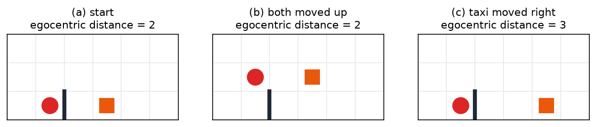
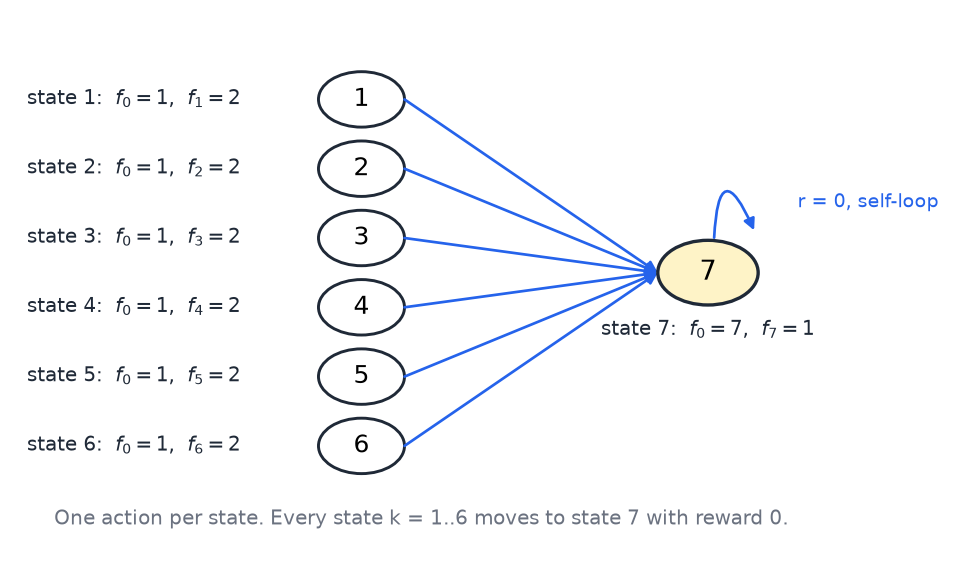
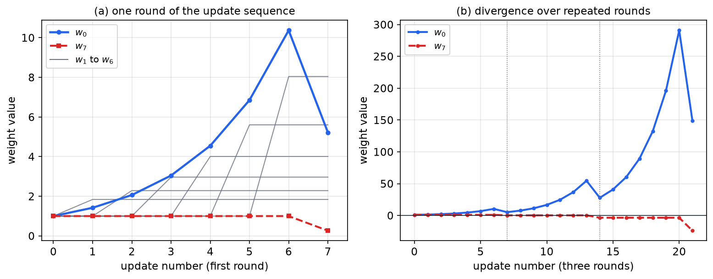
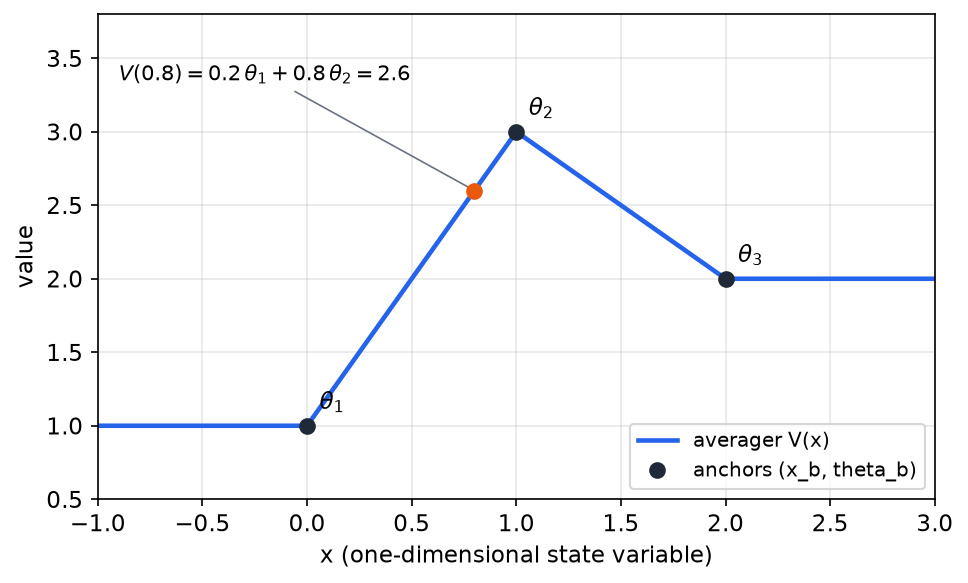
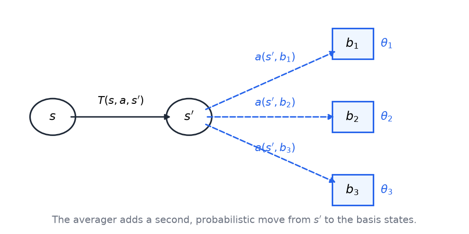

# Generalization and Function Approximation

The tabular methods of the previous chapters store one value for every state, or one value for every state-action pair. That works for a grid of a few dozen cells, but a robot's sensor readings or a game board have far too many states to visit each one many times. A learner must then predict values in states it has rarely or never seen, using what it learned elsewhere. This chapter studies that step, which is called generalization or function approximation. It explains how states are described by features, how the TD update extends to a parameterized value function, why even a linear approximator can diverge, and how averagers keep the convergence guarantees of the tabular case. The chapter sits between the exploration analysis and the partially observable and deep settings that build on it.

## Why Generalize?

Consider a taxi that must pick up and drop off passengers on a small grid. With the fuel level, the taxi's position, the walls and the passenger's position all included in the state, the example has about 500 states. A table with one entry per state is manageable, but the same design with more passengers, more fuel levels and a larger map quickly becomes impossible to fill. More importantly, a table learns nothing about a state from its neighbors. Each entry is updated only when that exact state is visited.

Generalization means using what was learned in visited states to predict values in states that have not been visited, or have been visited rarely. If the value function is smooth in some description of the state, then a few data points determine values in regions with no data. The prediction is made by a function with a small number of parameters, and the learner adjusts those parameters from experience.

Three things can be generalized: the policy (a map from states to actions), the value function (\\( V(s) \\) or \\( Q(s,a) \\)), and the model (the transition and reward functions). Learning a policy directly is often hard, so reinforcement learning methods usually learn a value function and derive a policy from it. Learning a model gives ordinary supervised examples of the form (state, action, next state), but planning with an approximate model is less well understood, because errors compound over many predicted steps. This chapter concentrates on value functions.

## States as Feature Vectors

A tabular learner treats states as opaque labels: "state 17" has no relation to "state 18." A function approximator needs a description of each state that makes similar states look similar. The description is a feature vector \\( f(s) = (f\_1(s), \ldots, f\_n(s)) \\). For the taxi, candidate features include whether the fuel is low, the taxi's coordinates, whether a wall lies in each direction, and the passenger's position.

The choice of features is an inductive bias. Two states with similar features receive similar values, so the features express a preference about which differences between states matter. A feature set that ignores a difference treats the two states as the same, and the learner cannot tell them apart whatever experience it gathers.

Feature design can be subtle. Suppose the feature is the distance between the taxi and the passenger, measured as the number of moves on the grid, ignoring walls. Two states look alike whenever this distance is the same. Figure 1 shows three configurations. In panel (a) the passenger and the taxi are two steps apart. In panel (b) both have moved up one row. The distance is still two, so the two states have identical features and the learner treats them as similar, which is the intended effect of the feature. In panel (c) only the taxi moves right, the distance becomes three, and the states look less alike. The distance ignores walls, so two states at the same distance can differ greatly in how long the trip takes. The feature gives a good approximation in open rooms and a poor one behind walls, and that trade-off is part of the design.

*Figure 1: Egocentric distance between the taxi (orange square) and the passenger (red circle), counted as grid moves and ignoring the wall. Panels (a) and (b) have the same distance of two, so their features are identical. Panel (c) moves only the taxi, the distance becomes three, and the two states are less similar under this feature.*

The ideal feature would be the set of best actions in each state, which is exactly what we want to learn. Its value is limited by the same circularity: a feature that encodes the answer makes learning trivial, but computing it is as hard as the original problem. Good features are a compromise. They should be cheap to compute from the state and informative about the value. The raw state is cheap but not very informative. The distance to the passenger is cheap to compute and tells the learner how close pickup is. The feature set should also ignore details that do not matter: if an anvil is about to fall, the right action is to jump away whatever else the state contains. A shark tank in front of the learner, however, changes the best action, so a feature set that ignores the shark tank is poor.

## Gradient Q-Learning with Function Approximation

We now write the Q function as a parameterized function. The simplest choice is linear. Each action \\( a \\) has its own weight vector \\( w\_a \\), and the Q value is the dot product of the weights with the features:

\\[
Q(s,a) = \sum\_{i=1}^{n} w\_{a,i}\\, f\_i(s) = w\_a^{\top} f(s).
\\]

Each action's weights form a single linear unit, so the set of all actions is a one-layer network. Taking the maximum over actions adds a nonlinearity, which is why the overall structure resembles a neural network even though each action's value is linear. Linear approximators are the most studied case, because their behavior is easier to analyze, and a large body of theory has been built for them.

The weights mean something. A weight near zero means the feature is ignored for that action. A large weight, positive or negative, means the feature matters a great deal. Whether a negative weight means that the feature works against the action depends on how the feature is signed.

After experience \\( (s, a, r, s') \\), the TD error compares the target with the current prediction:

\\[
\delta = r + \gamma \max\_{a'} Q(s',a') - Q(s,a).
\\]

The target \\( r + \gamma \max\_{a'} Q(s',a') \\) plays the role of a label in supervised learning. The difference is that the label is built from the learner's own predictions. This is called bootstrapping, and it is the source of both the power and the risk of the method. If the TD error is positive, the prediction is too low, and if it is negative, the prediction is too high. The update moves each weight in the direction that changes the prediction the right way:

\\[
w\_{a,i} \leftarrow w\_{a,i} + \alpha\\,\delta\\,\frac{\partial Q(s,a)}{\partial w\_{a,i}}.
\\]

This is a gradient step on the squared error \\( \tfrac{1}{2}\delta^2 \\) with the target held fixed when differentiating. The convention of treating the target as a constant is called the semi-gradient update. It is the update that the tabular method reduces to when each state has its own weight.

For the linear form, the derivative is simple. The Q value is a sum of weights times features, so \\( \partial Q(s,a)/\partial w\_{a,i} = f\_i(s) \\). The other weights do not depend on \\( w\_{a,i} \\), and the feature value is a fixed number once the state is known. The update therefore becomes

\\[
w\_{a,i} \leftarrow w\_{a,i} + \alpha\\,\bigl( r + \gamma \max\_{a'} Q(s',a') - Q(s,a) \bigr)\\, f\_i(s).
\\]

Only the weights of the action taken change, and each change is proportional to the feature value, so features that are zero in the current state do not move.

**Algorithm (gradient Q-learning with a linear approximator).**

1. Observe \\( (s, a, r, s') \\).
2. Compute \\( \delta = r + \gamma \max\_{a'} Q(s',a') - Q(s,a) \\).
3. For each weight \\( w\_{a,i} \\) of the action taken, add \\( \alpha\\,\delta\\,f\_i(s) \\) to it.
4. Return to step 1 with the next experience.

Tabular Q-learning is the special case in which the features are indicators of single states. Then each weight is the value of one state-action pair, and the update reduces to the update of the earlier chapters.

## Does It Work?

The record is mixed, and it helps to separate the successes from the failures.

Early successes used neural networks as approximators. Tesauro's TD-Gammon used a three-layer backpropagation network to predict the value of backgammon positions and to choose moves, and it played at a strong level. A similar approach is reported for decision making in the Watson question-answering system. Other applications include a backpropagation network that predicted the success of NASA space-shuttle scheduling strategies, and linear approximators for cellular channel allocation, where the simple learning rule of a linear unit is an advantage.

The most visible recent success is the Atari work, in which deep convolutional networks map screen pixels to joystick actions. The reported results were roughly human level on average, superhuman on some games and far below human on others. An average can hide such extremes, and the same point is made by the joke that "on average I'm comfortable" when one's head is in an oven and one's feet are in ice water. The success also depended on careful changes to the training procedure, not only on the depth of the network.

The failures are just as instructive. Few other groups reproduced some of the early results. A common experience is that a system learns well for a while and then enters a death spiral, in which predictions built on earlier predictions drift away from the truth. Sutton's CMAC (tile coding) is a linear-like approximator whose first layer is fixed in advance: it decides how the input space is divided, and it generalizes less aggressively, which makes it safer.

The backgammon and tic-tac-toe comparison explains why generalization works in some problems and not others. Backgammon is random, so the dice force exploration and avoid some traps. Its values change gradually when a single piece moves, so nearby positions have nearby values, and the approximator can generalize. Tic-tac-toe is deterministic, and moving one X can change the outcome completely. Nearby states then do not have nearby values, and generalization does poorly. The reading of these results has a balanced conclusion: Boyan and Moore built simple examples where the same approach works very badly, so it "need not work." Sutton replicated their failures and showed that changing the training procedure makes them work, so the failures "need not not work." Neither result is a guarantee. Pollack showed that genetic algorithms also do well at backgammon, so backgammon may be a good test bed for temporal-difference learning in general, rather than a proof that the method is sound.

## Baird's Counterexample

Baird's example shows that a sensible-looking update with a linear approximator can diverge even on a very simple problem. It is worth working through in full because the failure is not due to noise, to a bad feature or to stochastic transitions. The example has no randomness at all.

**Example (Baird's counterexample).** The MDP has six states, numbered 1 to 6, and a seventh absorbing state, state 7. Each state has exactly one action. Each of states 1 to 6 moves to state 7, and state 7 has a self-loop. Every reward is zero, so the optimal value function is zero everywhere. There is only one policy, so it is optimal.

The features are eight weights \\( w\_0, \ldots, w\_7 \\). Feature 0 equals 1 in states 1 to 6 and 7 in state 7. For each state \\( k \\) from 1 to 6, feature \\( k \\) equals 2, and state 7 has feature 7 equal to 1. Every other feature is zero. The value of each state is therefore

\\[
V(k) = w\_0 + 2\\,w\_k \quad (k = 1,\ldots,6), \qquad V(7) = 7\\,w\_0 + w\_7.
\\]

Figure 2 shows the structure. The feature 0 is shared by all states, so every update that changes \\( w\_0 \\) changes all six values at once, and that sharing is the source of the trouble.

*Figure 2: Baird's counterexample. States 1 to 6 each have one action that moves to the absorbing state 7 with reward zero. The labels give the features of each state, so \\( V(k) = w\_0 + 2\\,w\_k \\) and \\( V(7) = 7\\,w\_0 + w\_7 \\). Read the diagram as the transition structure of an MDP with a single action per state.*

**Representability.** The zero value function can be represented in two ways. The first is to set all weights to zero. The second is \\( w\_0 = -1 \\), \\( w\_1 = \cdots = w\_6 = \tfrac{1}{2} \\), \\( w\_7 = 7 \\). Then \\( V(k) = -1 + 2 \cdot \tfrac{1}{2} = 0 \\) for \\( k = 1, \ldots, 6 \\), and \\( V(7) = 7(-1) + 7 = 0 \\). More generally, \\( V \equiv 0 \\) holds exactly when \\( w\_k = -w\_0/2 \\) for \\( k = 1, \ldots, 6 \\) and \\( w\_7 = -7\\,w\_0 \\). The solution set is the line \\( \\{\\, t\\,(-1, \tfrac{1}{2}, \ldots, \tfrac{1}{2}, 7) : t \in \mathbb{R} \\,\\} \\), so the correct answer is available in many ways. The problem is not that the representation cannot express the answer. It is what the update sequence does to the weights.

**The update sequence.** The updates run round-robin: transitions from states 1 to 6 into state 7, one at a time, and then the self-loop at state 7, and then the cycle repeats. The parameters are \\( \gamma = 0.9 \\) and \\( \alpha = 0.1 \\). Start with every weight equal to 1. Then \\( V(1) = \cdots = V(6) = 1 + 2 = 3 \\) and \\( V(7) = 7 + 1 = 8 \\), so state 7 is valued much more highly than the others.

The first update is a transition from state 1 to state 7 with reward zero. The TD error is

\\[
\delta = 0 + 0.9 \cdot 8 - 3 = 4.2.
\\]

The derivative of \\( V(1) \\) with respect to \\( w\_0 \\) is 1, and with respect to \\( w\_1 \\) it is 2. So \\( \Delta w\_0 = 0.1 \times 4.2 \times 1 = 0.42 \\), giving \\( w\_0 = 1.42 \\), and \\( \Delta w\_1 = 0.1 \times 4.2 \times 2 = 0.84 \\), giving \\( w\_1 = 1.84 \\). Every later transition from states 2 to 6 also raises \\( w\_0 \\), because each of them has feature 0 equal to 1. So \\( w\_0 \\) keeps growing.

The table follows the whole first round. Each update uses the weights left by the previous one, and all arithmetic is carried to four significant digits.

| update | TD error \\( \delta \\) | \\( w\_0 \\) after | weight of the source state after |
|---|---|---|---|
| 1 to 7 | 4.20 | 1.42 | \\( w\_1 = 1.84 \\) |
| 2 to 7 | 6.43 | 2.06 | \\( w\_2 = 2.29 \\) |
| 3 to 7 | 9.83 | 3.05 | \\( w\_3 = 2.97 \\) |
| 4 to 7 | 15.04 | 4.55 | \\( w\_4 = 4.01 \\) |
| 5 to 7 | 23.02 | 6.85 | \\( w\_5 = 5.60 \\) |
| 6 to 7 | 35.21 | 10.37 | \\( w\_6 = 8.04 \\) |
| 7 to 7 | −7.36 | 5.22 | \\( w\_7 = 0.26 \\) |

The last two rows need care. Before the 6-to-7 update, \\( w\_0 = 6.8516 \\) and \\( w\_6 = 1 \\), so \\( V(6) = 6.8516 + 2 = 8.8516 \\) and \\( V(7) = 7(6.8516) + 1 = 48.961 \\). The TD error is \\( 0.9 \times 48.961 - 8.8516 = 35.213 \\). The weight \\( w\_0 \\) rises by \\( 0.1 \times 35.213 = 3.5213 \\), to 10.3729, and \\( w\_6 \\) rises by \\( 0.1 \times 35.213 \times 2 = 7.0427 \\), to 8.0427.

For the self-loop, \\( V(7) = 7(10.3729) + 1 = 73.610 \\). The TD error is \\( \gamma V(7) - V(7) = -0.1 \times 73.610 = -7.361 \\). The change in \\( w\_0 \\) is \\( 0.1 \times (-7.361) \times 7 = -5.153 \\), so \\( w\_0 = 10.3729 - 5.153 = 5.220 \\). The change in \\( w\_7 \\) is \\( 0.1 \times (-7.361) \times 1 = -0.736 \\), so \\( w\_7 = 1 - 0.736 = 0.264 \\).

Rounding the intermediate values to one decimal place gives \\( w\_0 = 10.4 \\) at the start of the last update, a value of 73.8 for \\( V(7) \\), and a final \\( w\_0 \\) of 5.234. The exact final value is 5.220. The difference comes only from rounding, and the working above uses the exact arithmetic throughout.

The last update helps, but not enough. After one round, \\( w\_0 \\) has moved from 1 to about 5.2, and the weights \\( w\_1 \\) to \\( w\_6 \\) are all larger than before, with \\( w\_7 \\) falling to about 0.26. Repeating the sequence makes the problem worse. Carrying the same procedure through two more rounds gives \\( w\_0 \approx 27.8 \\) and \\( w\_7 \approx -3.56 \\) after round two, and \\( w\_0 \approx 148.6 \\) and \\( w\_7 \approx -23.9 \\) after round three. The weights grow without bound. This is divergence, and it occurs for a linear approximator on a problem with a true value of zero everywhere.

Figure 3 plots the weights. The left panel shows the first round, and the right panel shows three rounds, with \\( w\_0 \\) rising and \\( w\_7 \\) falling below zero.

*Figure 3: Weight trajectories for Baird's example with \\( \gamma = 0.9 \\), \\( \alpha = 0.1 \\) and all weights starting at 1. Left: one round of seven updates; the bold blue curve is \\( w\_0 \\), the dashed red curve is \\( w\_7 \\), and the gray curves are \\( w\_1 \\) to \\( w\_6 \\). Right: three rounds, with dotted lines marking round boundaries. The value of \\( w\_0 \\) grows without bound, which is divergence.*

**Starting from zero.** If every weight starts at zero, the value function is zero everywhere. Every reward is zero, so every TD error is \\( \gamma \cdot 0 - 0 = 0 \\), and no weight changes. The initial zero is therefore a fixed point. The reason is subtle: the zero is sticky because the TD error is zero, not because the value function is correct in some deeper sense. For an MDP with nonzero rewards, a zero start would be moved by the rewards. The argument also fails with random transitions. Individual updates can push the weights away from the correct answer, and nothing guarantees that the pushes cancel on average. Whether they do depends on the learning rate and related choices.

**The lesson.** When weights are shared between states, every update changes the values of other states as well as the state being updated. Even in the linear case, this sharing can make values diverge. Linear functions are usually chosen because they are easy to analyze and to compute, so the failure is disappointing. The methods that solve it are described below.

## Averagers

Geoffrey Gordon introduced averagers as an approximator with guarantees. An averager represents the value function by its values at a set of anchor points, which are called basis states. The prediction at any state is a convex combination of the anchor values.

Consider first a one-dimensional example. The function is defined on a line by its values at three anchors \\( x\_1, x\_2, x\_3 \\). These anchor values are the free parameters. Between two anchors, the value is a weighted average of their values, with weights that depend on relative distance. With linear interpolation, the value at \\( x = 0.8 \\) between anchors at 0 and 1 is \\( 0.2\\,\theta\_1 + 0.8\\,\theta\_2 \\). Outside the outer anchors one can extend the function flat, so that the value equals the nearest anchor value. Any extension is allowed as long as each prediction is a convex combination of anchor values.

**Example (interpolation with an averager).** Take anchors at \\( x = 0, 1, 2 \\) with values \\( \theta\_1 = 1 \\), \\( \theta\_2 = 3 \\) and \\( \theta\_3 = 2 \\). At \\( x = 0.8 \\), the weights are \\( 0.2 \\) on the anchor at 0 and \\( 0.8 \\) on the anchor at 1, so

\\[
V(0.8) = 0.2 \cdot 1 + 0.8 \cdot 3 = 2.6.
\\]

For \\( x > 2 \\) the flat extension gives \\( V(x) = \theta\_3 = 2 \\), and for \\( x < 0 \\) it gives \\( V(x) = \theta\_1 = 1 \\). Figure 4 shows the resulting piecewise-linear curve.

*Figure 4: A one-dimensional averager. The anchors at \\( x = 0, 1, 2 \\) have heights \\( \theta\_1 = 1 \\), \\( \theta\_2 = 3 \\) and \\( \theta\_3 = 2 \\). Between anchors the curve is a convex combination of the two neighboring heights, and beyond the outer anchors it stays flat. The orange point is the worked value \\( V(0.8) = 2.6 \\).*

**General form.** Let \\( S \\) be the states and \\( B \\) the set of basis points. The parameters are the anchor values \\( \theta\_b \\). The averaging weights \\( a(s,b) \\) are fixed in advance and satisfy

\\[
a(s,b) \ge 0, \qquad \sum\_{b \in B} a(s,b) = 1, \qquad V(s) = \sum\_{b \in B} a(s,b)\\,\theta\_b.
\\]

This form looks like the linear case, but with the convex-combination constraints on the weights. Because each prediction is a convex combination of anchor values, it always lies between the smallest and the largest anchor value. The approximation therefore cannot extrapolate beyond the range of the data it was built from, and that restriction is what the convergence argument below uses. Kernel-based and smoothed representations also fit the form, as long as every prediction is a convex combination of anchor values.

Two familiar supervised methods are averagers. A k-nearest-neighbor predictor averages the values at the \\( k \\) nearest anchors, each with weight \\( 1/k \\). Distance-weighted and kernel versions are also averagers, because their weights are nonnegative and sum to one.

**Why averagers do not diverge.** Folding the approximator into the MDP shows the reason. Substitute the averager into the Bellman equation for \\( V(s') \\):

\\[
V(s) = \max\_a \Bigl[ R(s,a) + \gamma \sum\_{s'} T(s,a,s') \sum\_{b} a(s',b)\\,\theta\_b \Bigr].
\\]

Swap the two sums and define the combined weight

\\[
T'(s,a,b) = \sum\_{s'} T(s,a,s')\\,a(s',b).
\\]

The equation becomes \\( V(s) = \max\_a \bigl[ R(s,a) + \gamma \sum\_{b} T'(s,a,b)\\,\theta\_b \bigr] \\). The weights \\( T' \\) are nonnegative and sum to one over \\( b \\), because

\\[
\sum\_b T'(s,a,b) = \sum\_{s'} T(s,a,s') \sum\_b a(s',b) = \sum\_{s'} T(s,a,s') = 1.
\\]

So \\( T' \\) is a transition function on the basis states. The equation is the Bellman equation of a new MDP whose states are the basis points. That MDP has a unique value function, which Q-learning or value iteration can find. In that MDP, each step first moves the agent to a next state \\( s' \\), then makes an extra probabilistic move from \\( s' \\) to a basis state \\( b \\) with probability \\( a(s',b) \\). Figure 5 shows the two-stage transition.

*Figure 5: Folding an averager into the MDP. From \\( s \\), an action leads to \\( s' \\) with probability \\( T(s,a,s') \\). From \\( s' \\), an extra probabilistic move leads to a basis state \\( b \\) with probability \\( a(s',b) \\), and the values \\( \theta\_b \\) at the basis states form a smaller MDP.*

The convergence argument follows directly. The folded MDP is an ordinary MDP, so its Bellman operator is a \\( \gamma \\)-contraction in the maximum norm, and value iteration on the anchor values converges. This is the property that Baird's example lacks. A linear approximator's update need not be a contraction, but an averager's update is always the Bellman operator of a legitimate MDP.

The approximation is limited, though. Value functions often have cliffs or sharp features, and smoothing over a few anchors does not capture them. The approximation error shrinks as the anchors become denser, and convergence statements of the form "as the number of anchors grows, the approximation approaches the true value function" hold when the anchor values are estimated from enough data. The chapter does not prove these statements in detail. Their proofs are close in spirit to the nearest-neighbor results of supervised learning.

## Newer Methods and the State of the Field

Averagers guarantee convergence, but they demand a fixed basis. The linear case needs better update rules, and the field has developed them.

Plain residual minimization does not solve the problem. The quantity called the GTD error in some presentations is read here as the Bellman residual: the expected squared TD error at each state, averaged over the sampling distribution. Gradient descent on the Bellman residual is well defined, but it can behave badly in exactly the situations that Baird's example illustrates. The gradient TD methods instead minimize the error after projection onto the set of functions the approximator can represent. This projected error is the quantity that the methods can drive to a fixed point. GTD2 is a gradient TD method that is provably convergent in the linear case, and it handles Baird's example correctly with a different update rule. The main point is that the objective should include the approximator itself. Measuring the raw Bellman residual ignores the fact that the approximator cannot represent every function.

Fitted Q iteration is the standard practical algorithm that combines function approximation with Q-value learning. It repeatedly fits a regression model to the Bellman targets computed from the previous fit. It can still fail to converge, but many practitioners have made it work reasonably well, and it is the basis of several deep reinforcement learning methods.

Least-squares policy iteration (LSPI) uses linear function approximation together with policy improvement. It has useful properties and has performed well in practice, because it solves a linear system at each policy evaluation step rather than taking many small gradient steps.

Two observations close the discussion. Policy-gradient methods, which learn the policy directly with a parameterized form, have had reported successes in robotics, and the reasons they work well there are not fully understood. Models have been studied less than value functions. The most important practical point is that the feature set matters most of all. If the right features were available, the problem would be easy, and most of the difficulty lies in finding features that are cheap, informative and free of irrelevant detail.

## Summary

- Tabular learning cannot scale to large or continuous state spaces. Generalization predicts values in unvisited states from a parameterized approximator, and the features define the inductive bias.
- With a linear approximator, the TD update is \\( w\_{a,i} \leftarrow w\_{a,i} + \alpha\\,\delta\\,f\_i(s) \\) with \\( \delta = r + \gamma \max\_{a'} Q(s',a') - Q(s,a) \\). It is a semi-gradient step on the squared TD error, with the target treated as fixed.
- Deep-network approximators have produced striking results, but the record includes failures and death spirals, and results do not reproduce reliably without careful training choices.
- Baird's six-state MDP has zero rewards and a zero optimal value, yet round-robin linear TD updates make \\( w\_0 \\) grow from 1 to about 5.22 after one round and to about 148.6 after three. Shared weights cause the divergence, and a zero start is a fixed point only because every TD error is zero.
- An averager represents values as convex combinations of anchor values, so each prediction stays within the range of the anchors. Folding the averager into the MDP gives a legitimate MDP over the basis states, and that MDP's Bellman operator is a contraction.
- Gradient TD methods such as GTD2 minimize the projected Bellman error and converge in the linear case, and fitted Q iteration and LSPI are the standard practical algorithms for linear and nonlinear approximators.

## See Also

- [Reinforcement Learning](../rl.md): the one-page overview of the field.
- [Temporal-Difference Learning](td-learning.md): the tabular TD updates that this chapter generalizes.
- [Exploration, Bandits, and R-max](exploration.md): the exploration analysis that the function-approximation setting must still respect.
- [Convergence and Analysis](convergence.md): the contraction argument used for averagers, and the convergence theory of the tabular case.
- [Partially Observable MDPs](pomdps.md): the next chapter, where the state is no longer observed directly.
- [Q-Learning](../../ai/q-learning.md): the introductory Q-learning update and its practice problems.
- [Deep Q-Learning and Policy Gradients](../deep-learning/deep-q-learning.md): the deep-network version of the approximators discussed here.
- [Neural Networks](../neural-networks.md): the shallow network basics that the nonlinear approximators build on.
