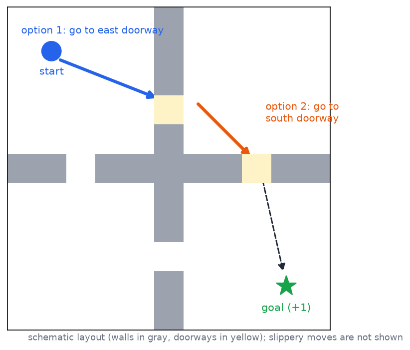
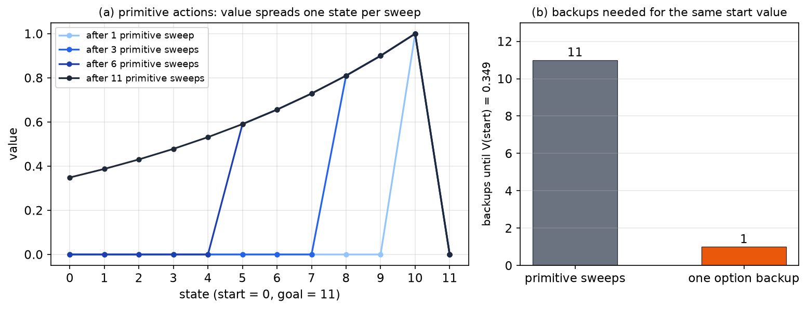
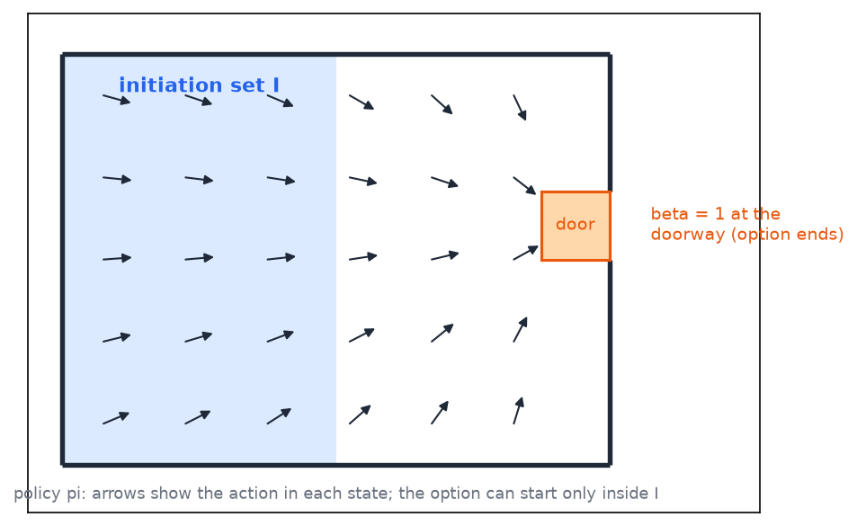
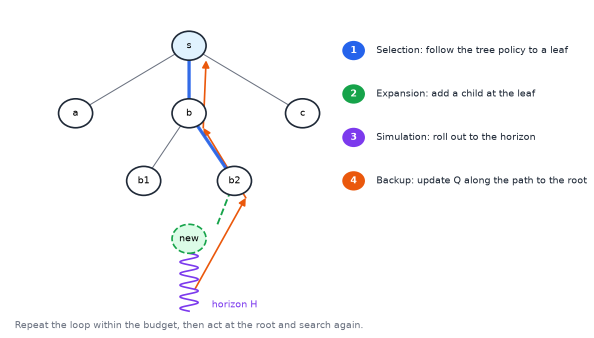
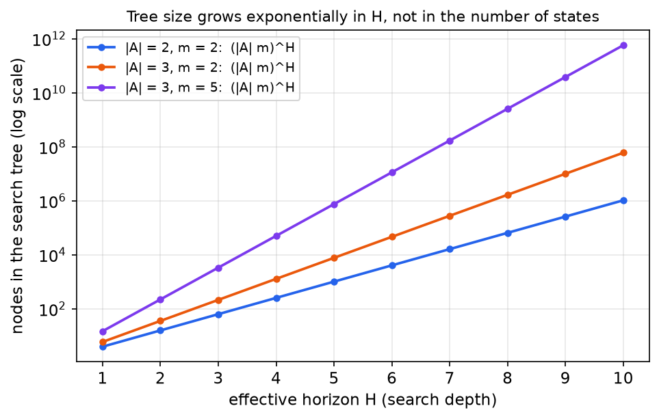

# Options and Monte Carlo Tree Search

Two of the main ways to scale reinforcement learning leave the underlying MDP unchanged. The first is temporal abstraction. Primitive actions are grouped into options that run for many steps, so the learner makes fewer decisions and value information travels faster. The second is search. Monte Carlo tree search plans from the current state by sampling, and its cost depends on the length of the look-ahead rather than on the size of the state space. This chapter develops the options framework and the semi-Markov Bellman equation it produces, the state and goal abstractions that options induce, the modular treatment of competing goals, and Monte Carlo tree search with its cost analysis.

## Why Reinforcement Learning Is Hard to Scale

Several features make reinforcement learning harder than supervised learning. Reward is delayed. The learner receives weak feedback that says how well it is doing, not what it should have done. Its estimates bootstrap from other estimates, so the target moves as the learning proceeds, which is sometimes described as averaging averages. Exploration is needed because the learner has only estimates. And the cost grows with three quantities: the size of the state space, the length of the temporal window over which reward is delayed, and the size of the action space. Learning grows super-linearly in the number of states and actions.

Function approximation over states already addresses part of this. A learner that visits one state can inform the values of many others. Actions have received much less attention. Classical MDPs were built with small action sets, and in Q-learning the maximum over actions must be computed at every update, which becomes hard when the action set is large. The thesis of this chapter is that the learner should abstract over actions as well as states. Three forms of generalization follow: temporal abstraction through options and semi-Markov decision processes, goal abstraction through modular reinforcement learning and arbitration, and state abstraction, which function approximation provides and options also induce.

## Temporal Abstraction: Options

Consider a grid world with walls that form four rooms, each with a doorway. A +1 goal sits in one room, and the moves are slippery, so a move up sometimes goes sideways. A person who knew the layout would describe a route in a few words: go through the doorway to the east, then through the doorway to the south, then a few steps to the reward. That description is high-level and avoids listing every cell. The new actions it uses are temporally extended. Each one covers a lot of ground, so the action set becomes larger, but each action does more. The rough count for this example is about five steps with the extended actions, against roughly 60 to 100 primitive steps. Figure 1 shows the layout and the two extended actions.

*Figure 1: A schematic four-room grid. Walls are gray and doorways are yellow. Option 1 leads from the start to the east doorway, option 2 leads from the north-east room to the south doorway, and the dashed path finishes at the +1 goal. Each option is an extended action whose policy is a route to its doorway.*

Two kinds of abstraction are visible in this example. Inside a room, the best doorway is the same for many states, so all of them can be treated alike, which is state abstraction. The choice of doorway can also change at a switch line inside the room, where going east first and going south first become equally good. A single decision then covers many time steps, which is temporal abstraction.

Temporal abstraction also speeds up learning. With primitive actions, a value spreads one state at a time from the goal outwards. An option that goes to a doorway passes the goal's value back to the state where the option started in one update. The corridor in Figure 2 makes the difference concrete.

**Example (value propagation with and without an option).** Take a corridor of twelve states, numbered 0 to 11, with a goal at 11 that gives reward 1 on entry, and discount \\( \gamma = 0.9 \\). With primitive left and right moves, the start state's value after \\( k \\) synchronous sweeps is zero until \\( k \\) reaches eleven. The value of the start is then \\( \gamma^{10} = 0.349 \\). A single option that runs from state 0 to the goal in eleven steps reaches the same start value in one backup, because its discounted reward is \\( \gamma^{10} \\) and its termination weight on the goal is \\( \gamma^{11} \\) times the goal's value, which is zero after entry.

*Figure 2: Left, value spread in a twelve-state corridor with primitive actions, after 1, 3, 6 and 11 sweeps; the value moves one state per sweep. Right, the number of backups needed to reach the same start value, \\( \gamma^{10} = 0.349 \\): eleven primitive sweeps against one option backup.*

### The Options Formalism

An option is a triple \\( (I, \pi, \beta) \\). The initiation set \\( I \\) is the set of states in which the option can be started. The policy \\( \pi \\) is the behavior followed while the option runs. It is almost always a policy, and a deterministic memoryless policy is the special case with probability one on a single action. The termination function \\( \beta(s) \\) is the probability that the option ends in state \\( s \\). It generalizes a termination set, because the option may stop in some states with probability less than one.

From outside, an option is run until it terminates, which happens in some state with some probability. Inside, the policy does the work. An option is like a function in a program: it gives abstraction, modularity and reuse. Figure 3 shows one option in a room.

*Figure 3: One option in a room. The shaded region is the initiation set \\( I \\), where the option may start. Arrows show the policy \\( \pi \\) toward the door. The orange doorway cell is where the termination function \\( \beta \\) equals one, so the option ends there.*

There is a design caution. An option whose initiation set covers every state and which solves the whole task gives nothing new. Options should divide the problem into subproblems, each with its own region of applicability and its own stopping rule.

A primitive action is itself an option. Its initiation set is the set of states in which the action is valid, its policy takes the action with probability one, and its termination function is one in every state the agent can reach. In other words \\( \beta(s) = 1 \\) for every state, so the option always ends after one step. This is the reading that gives the correct one-step behavior.

### The Bellman Equation with Options

Replace the action in the Bellman equation by an option. The return of an option started in state \\( s \\) is random in two ways. Its duration \\( k \\) is random, because termination is random, and the state \\( s\_k \\) where it ends is random. Splitting the discounted return at the termination time gives the decomposition

\\[
V\_{t+1}(s) = \max\_o \mathbb{E}\Bigl[ \sum\_{i=1}^{k} \gamma^{\\,i-1} r\_i + \gamma^{k}\\, V\_t(s\_k) \\;\Big\vert\\; s, o \Bigr].
\\]

The first sum collects the rewards earned inside the option, with the first reward undiscounted and each later reward discounted by one more factor of \\( \gamma \\). The second term is the value of the state where the option ends, discounted by \\( \gamma^{k} \\) because \\( k \\) primitive steps have elapsed. Define two expectations:

\\[
R(s,o) = \mathbb{E}\Bigl[ \sum\_{i=1}^{k} \gamma^{\\,i-1} r\_i \\;\Big\vert\\; s, o \Bigr], \qquad F(s,o,s') = \mathbb{E}\Bigl[ \gamma^{k}\\, \mathbf{1}(s\_k = s') \\;\Big\vert\\; s, o \Bigr].
\\]

The Bellman equation with options is then

\\[
V\_{t+1}(s) = \max\_o \Bigl[ R(s,o) + \sum\_{s'} F(s,o,s')\\, V\_t(s') \Bigr].
\\]

Three differences from the primitive equation are visible. The action has become an option. The discount factor does not appear explicitly, because it is absorbed into \\( R \\) and \\( F \\). And the transition function \\( T \\) has been replaced by \\( F \\), because \\( F \\) must carry the discount, which depends on the duration \\( k \\). For a single primitive action, \\( k = 1 \\), \\( R \\) reduces to the expected immediate reward, and \\( F \\) reduces to \\( \gamma\\, T \\), which recovers the usual equation.

The process over options is a semi-Markov decision process (SMDP): a Markov decision process whose transitions take variable amounts of time. Because \\( R \\) and \\( F \\) average over the duration, the Bellman operator has the same form as the MDP operator, so an SMDP can be treated as an MDP for the purpose of value iteration. The discount is applied per primitive step, not per option. Underneath, the process is still an MDP at the primitive level, and the literature on SMDPs goes well beyond what this chapter needs.

The option-level process is not Markov in time, because the state reached after an option depends on how long the option ran. If the agent needs to know the elapsed time, the simplest fix is to add the elapsed time to the state. For value iteration, the averages \\( R \\) and \\( F \\) already account for the duration, which is why the equation holds without it.

**Example (the corridor as an SMDP).** Return to the corridor with twelve states. Suppose the option "go to the goal" is available from state 0 and lasts exactly \\( k = 11 \\) steps. Its reward is \\( R(0, \text{go}) = \gamma^{10} \\), since only the final step pays reward 1 and it is discounted by \\( \gamma^{10} \\). The discounted indicator gives \\( F(0, \text{go}, 11) = \gamma^{11} \\). The goal is absorbing with value zero after entry, so one option backup gives

\\[
V(0) = R(0, \text{go}) + F(0, \text{go}, 11)\\, V(11) = \gamma^{10} + \gamma^{11} \cdot 0 = 0.349.
\\]

This is the same value that eleven primitive sweeps reach, confirming that the option-level backup is consistent with the primitive one.

**Algorithm (value iteration over options).**

1. Initialize \\( V\_0(s) \\) for all states.
2. For each option \\( o \\) and each state \\( s \\), estimate \\( R(s,o) \\) and \\( F(s,o,s') \\) by simulating the option from \\( s \\) until it terminates. Accumulate the discounted rewards for \\( R \\), and record the discounted indicator of the end state for \\( F \\).
3. Set \\( V\_{t+1}(s) \\) to the maximum over options of \\( R(s,o) + \sum\_{s'} F(s,o,s')\\, V\_t(s') \\).
4. Repeat steps 2 and 3 until \\( V \\) converges.

Computing \\( R \\) and \\( F \\) for a concrete option is usually the hard part. In a small problem they can be estimated by simulation, as in the algorithm, and in a large problem they are learned from experience.

### State Abstraction and Feature Choice

An option can ignore features of the state that do not affect its behavior. Consider a small Pac-Man maze with walls, little dots that give points, power pellets that let Pac-Man eat ghosts for a limited time, and ghosts that kill Pac-Man unless it is powered. Pac-Man has four atomic moves: left, right, up and down. Four options are natural: eat a dot, eat a power pellet, eat a ghost and avoid a ghost.

The state features are the positions of the little dots, the positions of the power pellets, Pac-Man's own position, the positions of the ghosts, and whether each ghost is scared. Walls are not state features, because the transition function already forbids entering them. The question is which features each option needs. Each option needs Pac-Man's position, and the rest depend on the option.

| option | features needed |
|---|---|
| eat power pellet | Pac-Man position, power-pellet positions |
| eat dot | Pac-Man position, dot positions |
| eat ghost | Pac-Man position, ghost positions |
| avoid ghost | Pac-Man position, ghost positions, scared status |

The scared status matters for avoiding a ghost, because a scared ghost moves differently. For eating a ghost it can be omitted, because the option's initiation set already restricts it to scared ghosts, so the option never has to ask whether a ghost is scared. Including the feature would do no harm, but it would enlarge the state space without changing the option's behavior. This is the separation of concerns that options provide. Each option, like a function, needs only the features it uses.

A human ignores most of the world and attends to a feature, such as the nearest polar bear, only when it becomes relevant. Options give the learner the same ability. If an option ignores some features, its learning problem works over a smaller effective state space, so temporal abstraction buys state abstraction, provided the world divides up appropriately.

There is no guarantee. Options written badly may not reach an optimal policy, and options that must solve every subproblem gain nothing. The value of an option set depends on how well the world divides into the subtasks it describes.

### Optimality with Options

Because options define an SMDP, the convergence and stability results for MDPs carry over. The optimal policy, however, is optimal only with respect to the options and the features that were supplied. This is hierarchical optimality: the agent does the best it can while respecting the high-level options, without asking whether it could do better by ignoring them. Every notion of optimality is limited by the actions and features chosen, and the choice is a trade-off that designers make routinely.

Options also help exploration. They skip large regions of the state space, such as rooms the agent need not explore, and they make decisions only at the points where an option is chosen. Fewer decisions means less exploration.

## Goal Abstraction and Arbitration

Options can be arranged in two ways. In sequencing, options run one after another, each finishing before the next starts. In goal abstraction, options run conceptually in parallel, and only one is in control at any time. An operating system scheduler is a useful analogy: several processes want the processor, and the scheduler decides which one runs.

In the Pac-Man example, at every moment the agent wants to eat dots, eat power pellets, eat ghosts and avoid ghosts. At any given moment one of these goals is in control. The problem resembles predator and prey. Eating is needed to survive, and avoiding predators is needed to survive, and the two can conflict. Reading the termination function as an interruption makes this precise. The termination probability can represent the probability that the option's goal was reached, or the probability that another goal has become more important and interrupts the option. Primitive actions have only low-level goals, such as moving left or right, and options usually have high-level goals, which is why they are useful.

Modular reinforcement learning (MRL) assigns each module its own goal and its own Q function, and an arbitrator decides which module acts. Three arbitration methods are common.

1. **Greatest mass.** The value of an action is the sum of the module values, \\( Q(s,a) = \sum\_i Q\_i(s,a) \\), and the agent takes the action with the largest sum. The modules vote. The weakness is that the winning action may be nobody's favorite.
2. **Top Q.** The module with the largest single Q value gets control and takes its best action. The weakness is that a module that gives nearly the same high value to every action can win without expressing a real preference.
3. **Negotiated W-learning.** The module with the most to lose gets to choose. Informally, the modules whose gap between best and worst action is largest decide. This method cannot be written as a simple formula.

**Example (two arbitration rules disagree).** Three modules compare three actions, up, left and right, with illustrative Q values \\( Q\_A = (10, 0, 0) \\), \\( Q\_B = (0, 6, 6) \\) and \\( Q\_C = (0, 6, 5) \\). The greatest-mass rule sums the modules' values to get \\( (10, 12, 11) \\), so it chooses left. The top-Q rule finds the largest single value, 10 from module A, and chooses up. The two rules pick different actions, and in each case the chosen action is ranked only by a different reading of "importance." The numbers are chosen for illustration.

All of these methods have weaknesses, and in a strict sense they cannot all be satisfied at once. The reason is the one behind Arrow's impossibility result for voting. Each method adds, averages, maximizes or subtracts Q values that come from different modules. That assumes the Q values share a common scale, so that a seven from one module means the same as a seven from another. There are two ways out. One is to assume that the Q values are compatible. The other is to introduce a larger goal that the arbitrator knows about. In the predator-prey case, that larger goal could be staying alive long enough to reproduce. Once options are goals, the goals need not be compatible, and the arbitrator must balance them. Each option is still an SMDP, and reinforcement learning methods apply within it.

## Monte Carlo Tree Search

Monte Carlo tree search (MCTS) scales by algorithm rather than by abstraction, although abstraction still applies inside it. It is analogous to game-tree search, such as minimax with alpha-beta pruning, but with two differences. There is no opponent, and transitions are random. The value of a leaf is therefore estimated by Monte Carlo simulation rather than by a hand-designed evaluation function. The word "rollout" in this setting means a simulated trajectory, not the dice rolls of backgammon.

The method repeats four steps from the current state.

1. **Selection.** From the root, which is the current state, follow the tree policy through nodes whose Q estimates are already reliable, until reaching a leaf where the next choice has not been explored. The tree policy is greedy with respect to the current Q estimates.
2. **Expansion.** At the leaf, sample the next state for each action with a model or simulator, one step each. Sampling is preferred to enumerating all successors, because the number of successors can be very large.
3. **Simulation.** From each new node, follow a rollout policy, which is random in the simplest version, for a fixed horizon, and add up the discounted rewards.
4. **Backup.** Average the rollout returns to estimate Q at the new nodes, and back the estimates up the path to the root with Bellman-style updates.

After the search budget is spent, the agent takes the action with the best estimate at the root, executes it in the real world, and searches again from the new state. Figure 4 shows one pass of the loop.

*Figure 4: One pass of the MCTS loop on a small tree. The bold blue path is selection, which follows the tree policy to a leaf. The dashed green node is the expansion. The purple wiggly path is the rollout to the horizon, and the orange arrows back up the tree are the backup of the returned value to the root.*

The greedy tree policy in this description is the simplest form. The common practical refinement adds an exploration bonus, so that selection chooses the action that maximizes \\( Q(s,a) + c \sqrt{\ln N(s) / N(s,a)} \\), where \\( N \\) counts visits. This upper-confidence rule is the standard form of the method, and it keeps the search from fixating on a single early estimate.

The method needs a simulator or a transition model that can be sampled. With infinitely many expansions and rollouts, the Q estimates converge to the optimal values. In practice the budget decides when to stop. A typical budget is 50 to 200 milliseconds per action, compared with the months of computation that would be needed to solve the whole MDP first. Viewed another way, the search is policy search with an inner loop of evaluation. The outer loop searches over policies, and inside it the Q estimates are improved by Monte Carlo evaluation and Bellman backups.

**Rollout policies.** Random rollouts give biased estimates, usually too low, because a random agent performs poorly. Two improvements help. The first is a domain-specific rollout policy that plays sensibly. The second is to choose expansions and statistics with care. Constraints give a better rollout policy in a natural way. A goal ends in success, such as eating a dot or a ghost. A constraint can only fail, such as avoiding ghosts, and it cannot succeed in the sense that a goal does. During rollouts the agent acts randomly but keeps honouring the constraints, so it survives longer and its value estimates are less pessimistic. The table summarizes the distinction.

| kind | example | how the episode ends |
|---|---|---|
| goal | eat a dot, eat a ghost | ends in success |
| constraint | avoid ghosts | ends only in failure |

Options can also be placed inside the tree. Replacing primitive actions with options lets the search reach deeper into the tree for the same computation, because each option covers several steps in one expansion.

## Properties and the Cost of Search

MCTS is well suited to large state spaces. It visits only the states reachable from the current state, and it does not run value iteration over all states. Its planning time does not depend on the number of states, which makes it attractive. A survey provides the intuition: a fixed-size sample can describe a large population if the sample is representative.

The cost is exponential in the effective horizon \\( H \\). With branching factor \\( \lvert A \rvert \\) and \\( m \\) simulated samples per action, the search tree has on the order of \\( (\lvert A \rvert\\, m)^{H} \\) nodes. This count is a reconstruction for this chapter, in the form used by the sparse-sampling analysis of Kearns, Mansour and Ng (2002), and the constants there are not reproduced here. Figure 5 shows how the count grows for a few settings.

*Figure 5: The number of nodes \\( (\lvert A \rvert\\, m)^{H} \\) in a full search tree of depth \\( H \\), for three settings on a logarithmic scale. The count grows exponentially with the horizon and does not depend on the number of states. The curves are schematic.*

Sample demands depend on the environment. When transitions are random, many samples are needed. When they are deterministic, few are needed. The effective horizon depends on the discount factor. With a small \\( \gamma \\), distant rewards are negligible and the horizon is short. With \\( \gamma = 0.9 \\), the effective horizon is roughly \\( 1/(1-\gamma) = 10 \\) steps, and the search must look far ahead to see the rewards that matter.

The trade-off is between space and time. Tabular value iteration costs grow with the number of states. MCTS trades that dependence for one on the lookahead depth. In the words of the trade-off, space (the number of states) is exchanged for time (the depth of lookahead). Related search ideas from game trees, such as quiescence search, which stops expanding quiet positions, are not developed here.

## Summary

- Options are triples \\( (I, \pi, \beta) \\) that act as temporally extended actions. Primitive actions are the special case in which \\( \beta(s) = 1 \\) everywhere.
- The Bellman equation with options is \\( V\_{t+1}(s) = \max\_o [ R(s,o) + \sum\_{s'} F(s,o,s')\\, V\_t(s') ] \\), with \\( R \\) the discounted reward of the option and \\( F \\) the discounted arrival distribution. The discount per primitive step is carried inside \\( R \\) and \\( F \\), which turns the MDP into an SMDP.
- In the corridor example, one option backup gives the start value \\( \gamma^{10} = 0.349 \\), which takes eleven primitive sweeps.
- Options induce state abstraction: an option ignores the features it does not need. In the Pac-Man example, eating a ghost needs only the ghost positions because its initiation set already fixes the scared status.
- The optimal policy with options is hierarchically optimal, and it is limited by the options and features supplied.
- Goal abstraction treats options as competing goals, and arbitration methods such as greatest mass and top Q can disagree. Every arbitration method has weaknesses, and the difficulty is related to Arrow's impossibility result.
- MCTS plans by selection, expansion, simulation and backup, and it needs only a simulator. Its cost is independent of the number of states and exponential in the horizon, with the count \\( (\lvert A \rvert\\, m)^{H} \\).

## See Also

- [Partially Observable MDPs](pomdps.md): the previous chapter, where the state is hidden and the belief must be tracked.
- [Two-Player Games and Nash Equilibria](two-player-games.md): the game-theoretic view of competing decision makers.
- [Game Playing and Adversarial Search](../../ai/game-playing.md): minimax and alpha-beta search, the game-tree ideas that MCTS adapts to random transitions.
- [Generalization and Function Approximation](generalization.md): the function approximators that complement temporal and state abstraction.
- [Reinforcement Learning](../rl.md): the one-page overview of the field.
- [Bellman Equations and Learning from Experience](bellman-equations.md): the Bellman equations for MDPs, which the option equation generalizes.
- [MDP Framework](mdp-framework.md): the Markov property and the definition of the MDP that options extend.
