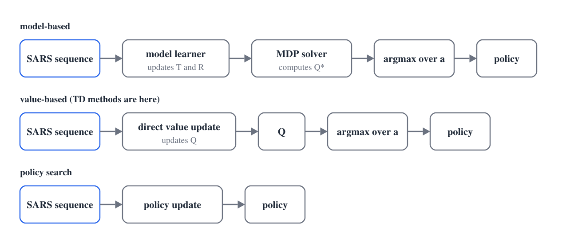
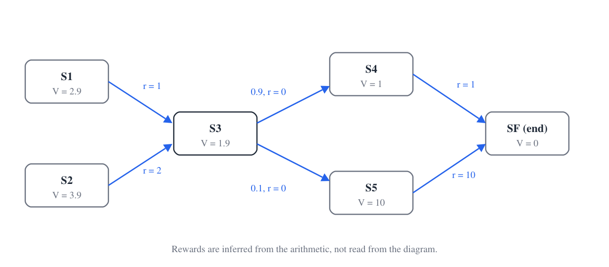
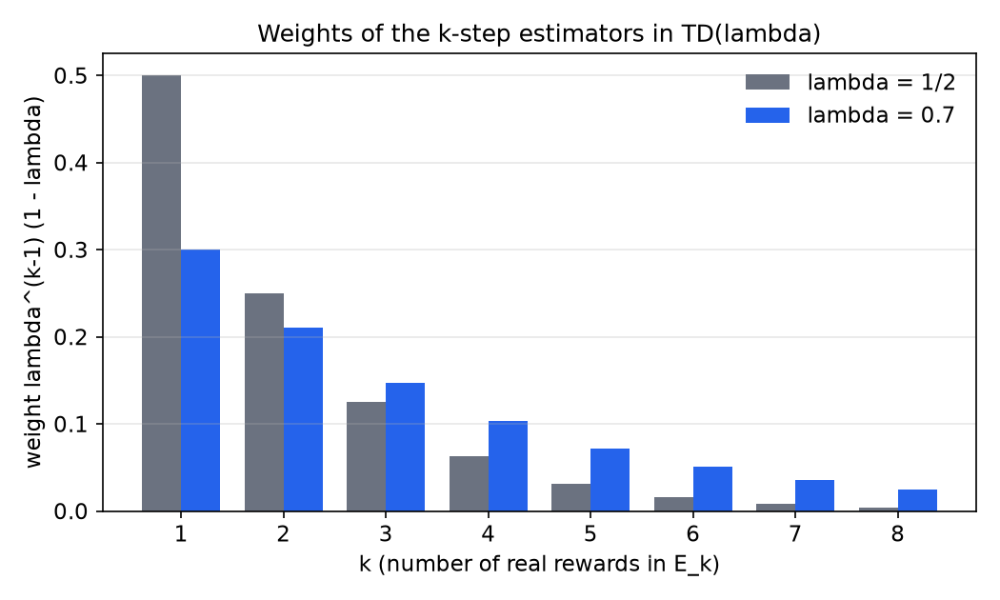
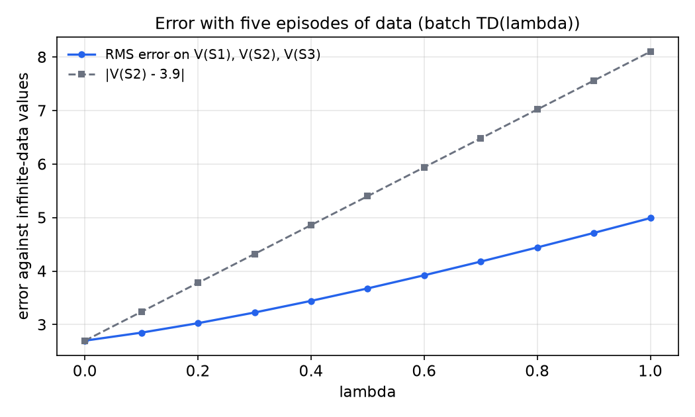

# Temporal-Difference Learning

Temporal-difference (TD) learning estimates the value of each state from sampled transitions. Its central idea is to update a prediction toward the reward just received plus the current prediction of the next state, so that it learns before the episode ends. This chapter places TD among the families of reinforcement learning algorithms, derives the incremental average that underlies it, and develops TD(0), TD(1) and the family TD(\\(\lambda\\)) that joins them. It compares TD with a model-based estimate on a small chain, and it ends with a batch experiment on finite data. The Bellman equations it relies on are in the [previous chapter](bellman-equations.md).

## Three families of reinforcement learning algorithms

The input to a reinforcement learning algorithm is a history of state, action, reward and next-state tuples \\((s, a, r, s')\\). Its output is a policy. Three families of algorithm differ in what they do with the history.

- **Model-based.** A model learner uses the history to update estimates of the transition function \\(T\\) and the reward function \\(R\\). An MDP solver turns the model into \\(Q^\*\\), and the policy chooses the action that maximizes \\(Q^\*\\) in the current state.
- **Value-based, also called model-free.** No explicit model is built. A direct update takes the latest tuple and the current estimate \\(Q\\), and produces a new \\(Q\\). The policy is again the action that maximizes \\(Q\\). TD methods belong to this family.
- **Policy search.** The policy itself is updated directly from the tuples. Feedback about the policy is weak, so the learning problem is hard.

Moving from the model-based family toward policy search, the computation becomes simpler and the learning more direct, but the problem becomes less supervised. Model-based learning is essentially supervised, because it predicts the next state and the reward from the previous ones. Value-based learning has values that can be propagated backward through the states. In policy search there is little useful feedback for changing the policy. Different problems favor different families, and the value-based family has received the most study, because it balances the cost of computation against the simplicity of the update.

*Figure: the three families. Each row starts from the same history of state, action, reward and next-state tuples and ends at a policy. The top row learns a model and solves it. The middle row updates the action values directly, with no model box, and TD methods live here. The bottom row updates the policy itself.*

## Prediction and the value of a Markov chain

TD(\\(\lambda\\)) is a method for predicting over time. The prediction target is the expected sum of discounted rewards from each state. Predictions matter because an agent that can predict the return from each state can choose the action with the best prediction.

The running example is the Markov chain in the figure below. It has states \\(S\_1, S\_2, S\_3, S\_4, S\_5\\) and a terminal state \\(S\_F\\). From \\(S\_3\\) the chain moves to \\(S\_4\\) with probability 0.9 and to \\(S\_5\\) with probability 0.1. The other transitions are deterministic. The rewards are not stated in the description of the chain, so they are inferred from the arithmetic that follows: \\(S\_1 \to S\_3\\) pays 1, \\(S\_2 \to S\_3\\) pays 2, the two transitions out of \\(S\_3\\) pay 0, \\(S\_4 \to S\_F\\) pays 1, and \\(S\_5 \to S\_F\\) pays 10. These are the rewards that reproduce the values computed below.

*Figure: the example chain. Each state shows its value under the stated rewards and the transition probabilities. The values are computed backward from the terminal state \\(S\_F\\), with \\(V(S\_F) = 0\\). The state \\(S\_3\\) is the branch point, and the rewards on the arrows are the ones inferred from the arithmetic.*

The value of a state is the expected reward plus the discounted value of the next state, averaged over the possible next states,

\\[
V(s) = \mathbb{E}\big[\\, r + \gamma V(s') \\,\big].
\\]

**Example 3.1 (Values by backward computation).** Take \\(\gamma = 1\\) and find \\(V(S\_3)\\).

Work backward from the terminal state, because the downstream values are known first.

1. \\(V(S\_F) = 0\\).
2. \\(V(S\_4) = 1 + \gamma \cdot 0 = 1\\) and \\(V(S\_5) = 10 + \gamma \cdot 0 = 10\\).
3. \\(V(S\_3) = 0 + \gamma (0.9 \cdot 1 + 0.1 \cdot 10) = 1.9\\).
4. \\(V(S\_1) = 1 + \gamma \cdot 1.9 = 2.9\\) and \\(V(S\_2) = 2 + \gamma \cdot 1.9 = 3.9\\).

The state \\(S\_2\\) is the better place to start, because \\(3.9 > 2.9\\). The only difference between the two branches is the extra reward of 1 on the \\(S\_2\\) branch.

## Estimating values from episodes

Suppose the chain is simulated from \\(S\_1\\), and the agent records the return of each episode. With \\(\gamma = 1\\) the return from \\(S\_1\\) is the sum of the rewards along the episode. Episodes 1, 3 and 4 follow \\(S\_1 \to S\_3 \to S\_4 \to S\_F\\), with returns \\(1 + 0 + 1 = 2\\). Episode 2 follows \\(S\_1 \to S\_3 \to S\_5 \to S\_F\\), with return \\(1 + 0 + 10 = 11\\).

Estimating an expectation from data means averaging. After three episodes the estimate is \\((2 + 11 + 2)/3 = 5\\), and after four it is \\((2 + 11 + 2 + 2)/4 = 4.25\\). The true value is 2.9, which equals \\(0.9 \cdot 2 + 0.1 \cdot 11\\). The early estimate is high because the return 11 appeared in one of three episodes, rather than in about one in ten. The average converges to 2.9 as the number of episodes grows.

### The incremental average

Let \\(V\_{T-1}\\) be the average after \\(T - 1\\) episodes and \\(R\_T\\) the return of episode \\(T\\). The new average is

\\[
V\_T = \frac{(T-1)\\,V\_{T-1} + R\_T}{T} = V\_{T-1} + \frac{1}{T}\left(R\_T - V\_{T-1}\right).
\\]

The update needs only the previous average and the new return, not the whole history. Check it with the numbers above: \\(V\_4 = 5 + \tfrac{1}{4}(2 - 5) = 4.25\\), as before.

Write \\(\alpha\_T = 1/T\\) for the step size. The general form is

\\[
V\_T = V\_{T-1} + \alpha\_T \left( R\_T - V\_{T-1} \right).
\\]

The difference \\(R\_T - V\_{T-1}\\) is the temporal difference that drives learning. A zero difference leaves the estimate unchanged, a large positive difference raises it and a large negative one lowers it. The step size controls how far the estimate moves toward each new return. The update has the form of a perceptron learning rule, in which the error is the difference between the observed target and the current prediction.

### Conditions on the step size

Suppose the step sizes \\(\alpha\_t\\) are chosen so that

\\[
\sum\_{t=1}^{\infty} \alpha\_t = \infty \qquad \text{and} \qquad \sum\_{t=1}^{\infty} \alpha\_t^2 < \infty .
\\]

These are the Robbins-Monro conditions. The first says that the steps are large enough, in total, to carry the estimate to the true value from any starting point. The second says that the steps shrink enough to average out the noise, rather than letting the estimate keep bumping around. Under these conditions the incremental estimate converges to the expected value. The convergence argument is given in the [convergence chapter](convergence.md).

The conditions can be checked with the \\(p\\)-series. The sum \\(\sum\_{T \ge 1} 1/T^p\\) converges when \\(p > 1\\) and diverges when \\(p \le 1\\). For \\(p = 2\\) the sum is \\(\pi^2/6\\), which is Euler's solution of the Basel problem.

**Example 3.2 (Which step sizes qualify).** Test five step-size sequences.

| Step size \\(\alpha\_t\\) | \\(\sum \alpha\_t\\) | \\(\sum \alpha\_t^2\\) | Qualifies? |
|---|---|---|---|
| \\(1/T^2\\) | finite, \\(\pi^2/6\\) | finite | no: the first sum is finite |
| \\(1/T\\) | infinite (harmonic) | \\(\pi^2/6\\), finite | yes |
| \\(1/T^{2/3}\\) | infinite, \\(p = 2/3 < 1\\) | \\(\sum T^{-4/3}\\), finite | yes |
| \\(1/\sqrt{T}\\) | infinite | \\(\sum 1/T\\), infinite | no: the second sum diverges |
| constant \\(\alpha\\) | infinite | infinite | no: the rate never shrinks |

The step size \\(1/T\\) reproduces the running average exactly, and it qualifies. A constant step size keeps the estimate moving, which is useful when the environment changes, but it does not give convergence to the expected value.

## TD(1) and eligibility traces

The incremental update needs one more ingredient to handle sequences of states. The **eligibility** \\(e(s)\\) records how recently state \\(s\\) was visited. It is increased when the state is visited, and it decays by a factor \\(\gamma\\) at each step. A state visited long ago has a small eligibility, and a recently visited state has a large one.

The TD(1) algorithm, in its accumulating form, runs as follows.

1. At the start of each episode set \\(e(s) = 0\\) for every state. Start \\(V\\) from its values at the end of the previous episode.
2. For each step from \\(s\_{t-1}\\) to \\(s\_t\\) with reward \\(r\_t\\):
   - (a) increase the eligibility of the state just left, \\(e(s\_{t-1}) \leftarrow e(s\_{t-1}) + 1\\);
   - (b) compute the temporal difference with the values from before this step, \\(\delta\_t = r\_t + \gamma V(s\_t) - V(s\_{t-1})\\);
   - (c) for every state, \\(V(s) \leftarrow V(s) + \alpha\_t \\, \delta\_t \\, e(s)\\);
   - (d) decay every eligibility, \\(e(s) \leftarrow \gamma \\, e(s)\\).
3. Repeat until the episode ends.

When a state is visited again, its eligibility can be increased by one, as in step (a), or reset to one. The increase-by-one rule is the accumulating trace, and it counts every visit, so it matches the every-visit return. The reset rule is the replacing trace, and it is the usual alternative. This chapter uses the accumulating rule throughout.

### A worked trace

Take the trajectory \\(S\_1 \to S\_2 \to S\_3 \to S\_F\\) with rewards \\(r\_1, r\_2, r\_3\\). The table below lists the eligibilities of \\((S\_1, S\_2, S\_3)\\) after each step of the algorithm.

| Step | Before the step | After the increase | After the decay |
|---|---|---|---|
| start | (0, 0, 0) | (0, 0, 0) | (0, 0, 0) |
| leave \\(S\_1\\) | (0, 0, 0) | (1, 0, 0) | \\((\gamma, 0, 0)\\) |
| leave \\(S\_2\\) | \\((\gamma, 0, 0)\\) | \\((\gamma, 1, 0)\\) | \\((\gamma^2, \gamma, 0)\\) |
| leave \\(S\_3\\) | \\((\gamma^2, \gamma, 0)\\) | \\((\gamma^2, \gamma, 1)\\) | \\((\gamma^3, \gamma^2, \gamma)\\) |

At the first step only \\(V(S\_1)\\) changes, by \\(\alpha \delta\_1\\), where \\(\delta\_1 = r\_1 + \gamma V(S\_2) - V(S\_1)\\). At the second step \\(V(S\_1)\\) changes by \\(\alpha \gamma \delta\_2\\) and \\(V(S\_2)\\) by \\(\alpha \delta\_2\\), where \\(\delta\_2 = r\_2 + \gamma V(S\_3) - V(S\_2)\\). At the third step the three states change by \\(\alpha\gamma^2 \delta\_3\\), \\(\alpha \gamma \delta\_3\\) and \\(\alpha \delta\_3\\), where \\(\delta\_3 = r\_3 + \gamma V(S\_F) - V(S\_3)\\).

Add up the changes to \\(V(S\_1)\\). The term \\(\gamma V(S\_2)\\) in \\(\delta\_1\\) cancels the term \\(-\gamma V(S\_2)\\) in \\(\gamma \delta\_2\\), and the term \\(\gamma^2 V(S\_3)\\) in \\(\gamma \delta\_2\\) cancels \\(-\gamma^2 V(S\_3)\\) in \\(\gamma^2 \delta\_3\\). With \\(V(S\_F) = 0\\),

\\[
\delta\_1 + \gamma \delta\_2 + \gamma^2 \delta\_3 = r\_1 + \gamma r\_2 + \gamma^2 r\_3 - V(S\_1) .
\\]

The total change to \\(V(S\_1)\\) is \\(\alpha\\) times the discounted return from \\(S\_1\\) minus the old estimate. This is the error of the prediction, compared with what actually followed.

### TD(1) and the outcome-based update

The **outcome-based** update waits until the episode ends, computes the discounted return \\(G\\) from the state, and moves the estimate toward it, \\(V(s) \leftarrow V(s) + \alpha (G - V(s))\\). It uses the observed outcome as the target and does not bootstrap from other estimates.

**Proposition 3.1 (TD(1) equals the outcome-based update when no state repeats).** Consider an episode in which every state is visited at most once. Suppose the TD errors are computed from the values at the start of the episode, with the updates accumulated and applied at the end. Then the total change to \\(V(s)\\) from TD(1) equals \\(\alpha (G\_s - V(s))\\), where \\(G\_s\\) is the discounted return from the visit to \\(s\\).

*Proof.* Let \\(s\\) be visited at time \\(k\\), and write \\(s\_t\\) for the state left at time \\(t\\). Since \\(e(s)\\) is set to 1 at time \\(k\\), and no other visit increases it, \\(e(s) = \gamma^{t-k}\\) at the step that leaves \\(s\_t\\) for \\(t \ge k\\). The total change to \\(V(s)\\) is therefore

\\[
\alpha \sum\_{t \ge k} \gamma^{t-k} \delta\_t = \alpha \sum\_{t \ge k} \gamma^{t-k} \big( r\_t + \gamma V(s\_{t+1}) - V(s\_t) \big).
\\]

Shifting the index in the middle term shows that \\(\sum\_{t \ge k} \gamma^{t-k+1} V(s\_{t+1})\\) equals \\(\sum\_{u \ge k+1} \gamma^{u-k} V(s\_u)\\), which cancels the tail of \\(\sum\_{t \ge k} \gamma^{t-k} V(s\_t)\\) after its first term \\(V(s\_k)\\). What remains is \\(\sum\_{t \ge k} \gamma^{t-k} r\_t - V(s\_k) = G\_s - V(s)\\). \\(\square\\)

The proposition shows that TD(1) reproduces the outcome-based update for every state visited once. When a state repeats, the two differ. The outcome-based update learns nothing about the first visit during the episode, because it waits for the end. TD(1) backs up the value at the revisit, using what was seen at the first departure. Its learning inside the episode is the extra information, and the price is that TD(1) inherits the variance of the full return.

## TD(0) and the maximum likelihood model

The TD(0) update changes only the state just left,

\\[
V(s\_{t-1}) \leftarrow V(s\_{t-1}) + \alpha\_t \left( r\_t + \gamma V(s\_t) - V(s\_{t-1}) \right).
\\]

The next state is random, so over many updates the target \\(r + \gamma V(s')\\) averages over the possible next states. The update therefore moves \\(V(s)\\) toward \\(\mathbb{E}[r + \gamma V(s')]\\), the expectation in the definition of value.

TD(0) also bootstraps. It uses the current estimate of the next state, so the values of the states are linked to one another, and each value must agree with its successors. The outcome-based update does not bootstrap. It uses only the observed reward sequence, so repeating it on one trajectory changes nothing.

Repeating the TD(0) update over a finite data set, with each observed transition replayed in proportion to how often it occurred, gives the values of the maximum likelihood model. This model is the Markov chain fitted to the transition counts in the data, and its values are the ones that the fitted transitions and rewards would produce. We check this on the example below rather than prove it in general. With infinite data both TD(0) and TD(1) give the correct values.

**Example 3.3 (Finite data).** Take five episodes. Episodes 1 to 4 start at \\(S\_1\\), with returns 2, 11, 2 and 2 as above. Episode 5 starts at \\(S\_2\\) and follows \\(S\_2 \to S\_3 \to S\_5 \to S\_F\\), with return \\(2 + 0 + 10 = 12\\). Estimate \\(V(S\_2)\\) with \\(\gamma = 1\\), when the true value is \\(V(S\_2) = 3.9\\).

*(a) Outcome-based estimate.* The state \\(S\_2\\) is visited once, in episode 5, and its return is 12. The estimate is 12, which is a single observed outcome.

*(b) Maximum likelihood estimate.* Only the transitions out of \\(S\_3\\) need estimating, because the others are deterministic. Over the five episodes, \\(S\_3\\) is followed by \\(S\_4\\) three times and by \\(S\_5\\) twice, so \\(\hat P(S\_4 \mid S\_3) = 3/5 = 0.6\\) and \\(\hat P(S\_5 \mid S\_3) = 2/5 = 0.4\\). The true probabilities are 0.9 and 0.1. Solve the estimated model backward:

\\[
\hat V(S\_3) = 0.6 \cdot 1 + 0.4 \cdot 10 = 4.6, \qquad \hat V(S\_2) = 2 + 4.6 = 6.6 .
\\]

The estimate \\(\hat V(S\_1) = 1 + 4.6 = 5.6\\) follows in the same way.

Compare the two errors with the true value 3.9. The outcome-based estimate is 12, which is 8.1 too high. The maximum likelihood estimate is 6.6, which is 2.7 too high. The maximum likelihood estimate is less wrong because it uses the transitions of all five episodes. The outcome-based estimate uses only the single trajectory through \\(S\_2\\), and that trajectory happened to pass through the rare state \\(S\_5\\). The maximum likelihood estimate is also wrong, because \\(S\_5\\) is over-represented in this small sample, with probability 0.4 instead of 0.1.

If the \\(S\_2\\) trajectory had gone \\(S\_2 \to S\_3 \to S\_4 \to S\_F\\), its return would have been 3. The outcome-based estimate would then have been 3, close to the truth, but it would still rest on a single trajectory. A rare event in one run can give an estimate far from the truth, and that estimate persists, because TD(1) does not average over the other data.

Repeating the TD(0) update over the five episodes until the values stop changing gives \\(V(S\_1) = 5.6\\), \\(V(S\_2) = 6.6\\) and \\(V(S\_3) = 4.6\\). These are the maximum likelihood values, which agrees with the statement above on this example. Repeating the outcome-based update over the same data gives \\(V(S\_1) = 4.25\\), \\(V(S\_2) = 12\\) and \\(V(S\_3) = 4.6\\), the sample averages of the observed returns.

## TD(\\(\lambda\\)): the family between TD(0) and TD(1)

TD(\\(\lambda\\)) is one algorithm that gives TD(0) at \\(\lambda = 0\\) and TD(1) at \\(\lambda = 1\\), with a range of update rules in between. The only change from TD(1) is the decay of the eligibility. Where TD(1) multiplies by \\(\gamma\\) at each step, TD(\\(\lambda\\)) multiplies by \\(\lambda \gamma\\).

The algorithm is:

1. At the start of each episode set \\(e(s) = 0\\) for all states. Start \\(V\\) from its values at the end of the previous episode.
2. For each transition \\(s\_{t-1} \to s\_t\\) with reward \\(r\_t\\):
   - (a) \\(e(s\_{t-1}) \leftarrow e(s\_{t-1}) + 1\\);
   - (b) \\(\delta\_t \leftarrow r\_t + \gamma V(s\_t) - V(s\_{t-1})\\);
   - (c) for every state, \\(V(s) \leftarrow V(s) + \alpha\_t \\, \delta\_t \\, e(s)\\);
   - (d) for every state, \\(e(s) \leftarrow \lambda \gamma \\, e(s)\\).
3. Repeat until the episode ends.

The checks are direct. With \\(\lambda = 1\\) the algorithm is TD(1). With \\(\lambda = 0\\) all eligibilities are zero after each step, so only \\(s\_{t-1}\\) is updated, by \\(\alpha\_t \delta\_t\\). That is the TD(0) rule.

### The k-step estimators

Fix the state \\(s\_t\\) being left, and let \\(r\_t\\) be the reward received on leaving it. A \\(k\\)-step estimator uses \\(k\\) real rewards and then bootstraps from the state reached after them,

\\[
E\_k = \sum\_{i=0}^{k-1} \gamma^i r\_{t+i} + \gamma^k V(s\_{t+k}) .
\\]

The one-step estimator \\(E\_1 = r\_t + \gamma V(s\_{t+1})\\) is the TD(0) target. The infinite-step estimator \\(E\_\infty = \sum\_{i \ge 0} \gamma^i r\_{t+i}\\) has no bootstrap term, because \\(\gamma^\infty = 0\\), and it is the TD(1) target, which is the full discounted return.

TD(\\(\lambda\\)) is a weighted combination of all the \\(k\\)-step estimators, with weights

\\[
w\_k = \lambda^{k-1} (1 - \lambda), \qquad k = 1, 2, 3, \ldots
\\]

For \\(\lambda < 1\\) the weights sum to one, since \\(\sum\_{k \ge 1} \lambda^{k-1}(1-\lambda) = (1-\lambda) \cdot \frac{1}{1-\lambda} = 1\\). The weight on \\(E\_1\\) is \\(1 - \lambda\\), the weight on \\(E\_2\\) is \\(\lambda(1-\lambda)\\), and so on. For \\(\lambda < 1\\) the weight on \\(E\_\infty\\) is zero. At \\(\lambda = 0\\) all the weight falls on \\(E\_1\\), which is TD(0). As \\(\lambda \to 1\\) the weight moves to longer estimators, and at \\(\lambda = 1\\) it falls entirely on the full return, which is TD(1).

Each update moves \\(V(s)\\) toward a weighted average of the \\(k\\)-step estimators. The backward algorithm with eligibility traces reaches this target without computing the estimators one by one. The equivalence between the traces and the weighted average is stated here without the full derivation.

*Figure: the weight \\(\lambda^{k-1}(1-\lambda)\\) given to the \\(k\\)-step estimator, for \\(\lambda = 1/2\\) and \\(\lambda = 0.7\\). Each bar is one estimator, and the bars for one value of \\(\lambda\\) sum to one. A larger \\(\lambda\\) shifts weight to the longer estimators, which use more real rewards before bootstrapping.*

**Example 3.4 (The weights for \\(\lambda = 1/2\\)).** The weights are \\(1/2\\) for \\(E\_1\\), \\(1/4\\) for \\(E\_2\\), \\(1/8\\) for \\(E\_3\\), and so on. They sum to \\(1/2 + 1/4 + 1/8 + \cdots = 1\\). The value of \\(\lambda\\) does not place the target halfway between TD(0) and TD(1). It gives a particular mixture, and its effect has to be measured.

## Finite data and the choice of lambda

The usual question is which \\(\lambda\\) to use. The question has a precise form for finite data. Learn \\(V\\) from a finite data set with TD(\\(\lambda\\)) for several values of \\(\lambda\\), and measure how far the result is from the values that infinite data would give. In this example the infinite-data values are the true values \\(2.9\\), \\(3.9\\) and \\(1.9\\) for \\(S\_1\\), \\(S\_2\\) and \\(S\_3\\).

For each \\(\lambda\\) the procedure presents the five episodes repeatedly, accumulates the TD(\\(\lambda\\)) updates over each pass, and stops when the values no longer change. The table reports the values at a selection of \\(\lambda\\), together with the root-mean-square error over \\(S\_1\\), \\(S\_2\\) and \\(S\_3\\).

| \\(\lambda\\) | \\(V(S\_1)\\) | \\(V(S\_2)\\) | \\(V(S\_3)\\) | RMS error |
|---|---|---|---|---|
| 0 | 5.600 | 6.600 | 4.600 | 2.700 |
| 0.5 | 4.925 | 9.300 | 4.600 | 3.677 |
| 0.7 | 4.655 | 10.380 | 4.600 | 4.178 |
| 1 | 4.250 | 12.000 | 4.600 | 4.991 |

The values were computed by running the procedure over a grid of \\(\lambda\\) from 0 to 1 in steps of 0.1. Two features are clear in the table. At \\(\lambda = 0\\) the values are the maximum likelihood values, and at \\(\lambda = 1\\) they are the sample averages of the observed returns, as derived above. The estimate of \\(V(S\_2)\\) moves steadily from 6.6 to 12 as \\(\lambda\\) grows; over this grid it is \\(6.6 + 5.4\lambda\\) to the precision shown.

*Figure: the error of the batch TD(\\(\lambda\\)) estimates on five episodes, against \\(\lambda\\). The solid curve is the RMS error over \\(S\_1\\), \\(S\_2\\) and \\(S\_3\\), and the dashed curve is the error in \\(V(S\_2)\\). Both rise with \\(\lambda\\), so the smallest error is at \\(\lambda = 0\\). The figure was computed for this example and is not a general result.*

The figure shows that, on this chain and this data, the error is smallest at \\(\lambda = 0\\) and grows with \\(\lambda\\). The curve does not have the interior minimum that is often reported for TD(\\(\lambda\\)) on larger problems, where intermediate values near 0.3 to 0.7 frequently give the lowest finite-data error. The example is too small to show that effect, and it should not be read as a refutation of it.

The reason for an interior minimum is the trade-off between bias and variance. TD(0) relies on the current estimates of later states, which are biased when the data are few, but it averages over the transitions. TD(1) relies only on observed returns, which are unbiased for the data but vary from run to run. An intermediate \\(\lambda\\) trades some of each. In this example the bias of TD(0) is small compared with the variance of TD(1), so the trade-off does not favor a mixture.

## Summary

- Reinforcement learning algorithms fall into three families: model-based, value-based and policy search. TD methods are value-based and model-free.
- The incremental average \\(V\_T = V\_{T-1} + \alpha\_T(R\_T - V\_{T-1})\\) gives the sample mean with \\(\alpha\_T = 1/T\\). It converges under \\(\sum \alpha\_t = \infty\\) and \\(\sum \alpha\_t^2 < \infty\\).
- In the chain example the values are \\(V(S\_3) = 1.9\\), \\(V(S\_1) = 2.9\\) and \\(V(S\_2) = 3.9\\), and the sample estimates of \\(V(S\_1)\\) after three and four episodes are 5.0 and 4.25.
- TD(1) with eligibility traces telescopes to the outcome-based update when no state is visited twice. The identity \\(\delta\_1 + \gamma \delta\_2 + \gamma^2 \delta\_3 = r\_1 + \gamma r\_2 + \gamma^2 r\_3 - V(S\_1)\\) is the building block.
- TD(0) bootstraps, and repeated updates over finite data give the maximum likelihood model. In Example 3.3, the estimates of \\(V(S\_2)\\) are 12 (outcome-based), 6.6 (maximum likelihood) and 3.9 (true).
- TD(\\(\lambda\\)) mixes the \\(k\\)-step estimators with weights \\(\lambda^{k-1}(1-\lambda)\\). It reduces to TD(0) at \\(\lambda = 0\\) and TD(1) at \\(\lambda = 1\\).
- In the five-episode batch experiment the error grows with \\(\lambda\\), so the minimum is at \\(\lambda = 0\\). The interior minimum reported for larger problems is not reproduced by this example.

## See Also

- [Bellman equations and learning from experience](bellman-equations.md): the equations that TD methods estimate from samples.
- [Convergence and analysis](convergence.md): the convergence of the incremental update and of TD control.
- [Q-learning](../../ai/q-learning.md): TD control with the Q form.
- [Exploration, bandits and R-max](exploration.md): gathering the data that TD learning needs.
- [Reinforcement learning](../rl.md): the one-page overview.
